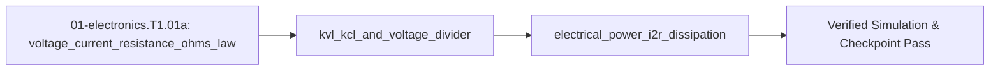

<!-- run-callout:start -->
> **Run this in the workbench.** [Open MechaLab](https://tle47.github.io/Mechatronics-Roadmap/) → **Tab 2, Run Python Lessons** → search `EX.01-electronics.T1.01a` and pick it from the list. The starter code, hints and graded check live there; this page is the reading copy, and nothing you type here is saved.
<!-- run-callout:end -->

## 1. Why it matters
Before wiring an H-bridge motor driver or level-shifting a $5\text{ V}$ sensor to a $3.3\text{ V}$ microcontroller in Step 1.2 (`01-electronics.T1.02`), you must be able to calculate how much current flows through a resistor, how two resistors divide a voltage, and how much heat ($P = I^2 R$) a wire or resistor dissipates. Getting these three laws right prevents magic smoke on your very first breadboard build. Already know this? Take the Skip test in section 7 first.

## 2. Intuition first
Picture water pumped through a closed loop of pipes. **Voltage** ($V$, in volts) is the water pressure difference between two points; **current** ($I$, in amperes) is the flow rate of charge through the pipe; and **resistance** ($R$, in ohms, $\Omega$) is a narrow constriction that fights the flow. **Ohm's Law** ($V = I R$) says that pushing more current through a constriction takes proportionally more pressure. **Kirchhoff's Current Law (KCL)** says charge never vanishes at a pipe junction (what flows in must flow out), and **Kirchhoff's Voltage Law (KVL)** says if you walk around any closed loop and return to your starting point, the pressure rises and drops must sum to zero. When current squeezes through a resistor, the lost pressure turns directly into heat at rate $P = V I = I^2 R$.

## 3. Formalization
1. **Ohm's Law ($V = I R$):** Across a resistor of resistance $R$ in ohms ($\Omega$), the voltage drop $V$ in volts ($\text{V}$) and current $I$ in amperes ($\text{A}$) obey:

$$
V = I \cdot R \iff I = \frac{V}{R}
$$

   Substituting $V_{\text{bat}} = 12.0\text{ V}$ across a stalled motor winding of resistance $R_m = 2.4\ \Omega$ gives stall current $I_{\text{stall}} = 12.0\text{ V} / 2.4\ \Omega = 5.0\text{ A}$.
2. **KVL, KCL, and the Unloaded/Loaded Voltage Divider:** Two series resistors $R_1$ (top, connected to $V_{\text{in}}$) and $R_2$ (bottom, connected to $\text{GND}$) share the same current $I = V_{\text{in}}/(R_1 + R_2)$ when unloaded, producing midpoint voltage:

$$
V_{\text{out}} = V_{\text{in}} \frac{R_2}{R_1 + R_2}
$$

   Substituting $V_{\text{in}} = 5.0\text{ V}$, $R_1 = 10\text{ k}\Omega$, and $R_2 = 20\text{ k}\Omega$ gives $V_{\text{out}} = 5.0 \times \frac{20}{30} = 3.333\text{ V}$. If a load resistor $R_L$ is connected from $V_{\text{out}}$ to $\text{GND}$, the bottom leg becomes the parallel combination $R_{2\parallel L} = \frac{R_2 R_L}{R_2 + R_L}$.
3. **Joule Heating ($P = V I = I^2 R$):** The thermal power $P$ in watts ($\text{W}$) dissipated as heat in resistance $R$ carrying current $I$ is:

$$
P = V \cdot I = I^2 R = \frac{V^2}{R}
$$

   Substituting $I = 5.0\text{ A}$ through $R_m = 2.4\ \Omega$ gives $P = (5.0\text{ A})^2 (2.4\ \Omega) = 60.0\text{ W}$ of heat.

## 4. Worked example
**Predict first (before you run it):** $R_1 = 68\text{ k}\Omega$ over $R_2 = 10\text{ k}\Omega$ on a $24.0\text{ V}$ rail — commit to a number now. Roughly what fraction of $24\text{ V}$ does the $10\text{ k}\Omega$ bottom leg see, is that fraction safely under $3.3\text{ V}$, and which way must $V_{\text{out}}$ move once the ADC's finite $R_L = 100\text{ k}\Omega$ loads that leg? Write it down before you scroll, then check yourself against the printout: a *loaded* output reading higher than the unloaded one means your parallel bottom branch is inverted.

Design a battery-voltage sensing divider that scales a $V_{\text{bat}} = 24.0\text{ V}$ supply down using $R_1 = 68\text{ k}\Omega$ and $R_2 = 10\text{ k}\Omega$ for a $3.3\text{ V}$ ADC pin, and compute both the unloaded output voltage and the loaded output voltage when the ADC input has finite input resistance $R_L = 100\text{ k}\Omega$.

```python
import math

def divider_vout(v_in: float, r1: float, r2: float, r_load: float | None = None) -> float:
    r_bottom = r2 if r_load is None else (r2 * r_load) / (r2 + r_load)
    return v_in * (r_bottom / (r1 + r_bottom))

v_unloaded = divider_vout(24.0, 68_000.0, 10_000.0)
v_loaded = divider_vout(24.0, 68_000.0, 10_000.0, r_load=100_000.0)
p_r1_mw = ((24.0 - v_unloaded) ** 2 / 68_000.0) * 1000.0

assert math.isclose(v_unloaded, 3.076923, rel_tol=1e-5)
assert v_unloaded < 3.3
assert math.isclose(v_loaded, 2.830189, rel_tol=1e-5)
assert math.isclose(p_r1_mw, 6.437870, rel_tol=1e-5)
print(f"V_unloaded={v_unloaded:.3f} V, V_loaded={v_loaded:.3f} V, P_R1={p_r1_mw:.2f} mW")
```
Expected output:
```text
V_unloaded=3.077 V, V_loaded=2.830 V, P_R1=6.44 mW
```

## 5. Exercise
Calculate the current-limiting resistor $R$ required to run a status LED ($V_{\text{LED}} = 2.1\text{ V}$, target current $I = 10\text{ mA} = 0.010\text{ A}$) from a $V_{\text{supply}} = 5.0\text{ V}$ rail using KVL ($V_R = V_{\text{supply}} - V_{\text{LED}}$), and compute the power $P_R = I^2 R$ dissipated in the resistor. Verify $R = 290.0\ \Omega$ and $P_R = 0.029\text{ W}$ ($29.0\text{ mW}$, safely within a $0.25\text{ W}$ resistor rating).
- **If your result differs:** Make sure you subtracted $V_{\text{LED}} = 2.1\text{ V}$ from $5.0\text{ V}$ before dividing by $0.010\text{ A}$ ($2.9\text{ V} / 0.010\text{ A} = 290\ \Omega$, not $5.0 / 0.010 = 500\ \Omega$).

### Graded package - the three laws on the bench
[`exercises/01-electronics.T1.01a/`](../exercises/01-electronics.T1.01a/) turns this section into a test. `starter.py` holds seven holes: `stall_current`, `divider_unloaded`, `divider_loaded`, `joule_power`, `led_series_resistor`, `led_current` and `within_derating`. Edit it, then run the tests the way CI does:

```bash
EXERCISE_TARGET=exercises/01-electronics.T1.01a/starter.py \
  python3 -m unittest discover -s exercises/01-electronics.T1.01a -p 'test_*.py'
```

**25 tests.** The divider is checked unloaded, loaded and **with its legs swapped** ($20.9\text{ V}$ into a $3.3\text{ V}$ pin, the module's own destroyed-pin case); the loaded case must come out **lower**, and a shorting load must pull it to zero; the power is checked on a $5\text{ A}$ stall; the LED resistor is checked at the exercise's $2.1\text{ V} / 10\text{ mA}$ and its current round-trips back; and the derating rule is checked at 50% of a quarter-watt part, so a full-rating check fails. The transfer suite takes **the plant's numbers**: the shoulder damper's $B_1\dot{q}^2$ is the same $I^2R$ form at a measured peak of $0.36\text{ W}$ (a quarter-watt part is out, a one-watt part at half rating is in), the $24\text{ V}$ sensing divider must still protect a $3.3\text{ V}$ ADC when a $100\text{ k}\Omega$ input loads it, and the $20$-byte $1\text{ kHz}$ frame at 8N1 is $200\text{ kbit/s}$ - above the 115.2 kbaud link that drops frames, below the 500 kbaud one that does not. Five planted faults - `divider_swaps_legs`, `loaded_ignores_load`, `power_without_square`, `led_resistor_divides_supply`, `derating_uses_full_rating` - each fail the test named for them.


- **📚 What to Learn & Resources to Solve This Exercise:**
  - **Required Foundations Modules (`00-foundations`):** [`00-foundations.T1.00a`](00-foundations.T1.00a.md) (*Python Variables & Functions*) and [`00-foundations.T1.00c`](00-foundations.T1.00c.md) (SI Prefixes $\text{k}\Omega, \text{mA}, \text{mW}$ & Joule Heating $P = I^2 R$).
  - **Core Concepts to Review First:** Ohm's law ($V = IR$), Kirchhoff's Voltage/Current Laws (KVL/KCL), and loaded voltage dividers in `## 3. Formalization` (Items 1–3) and `## 4. Worked example` above.
  - **Study Links & Resources:** [SparkFun Voltage Dividers Tutorial (`learn.sparkfun.com`)](https://learn.sparkfun.com/tutorials/voltage-dividers), [All About Circuits Vol. I (`allaboutcircuits.com`)](https://www.allaboutcircuits.com/textbook/direct-current/), and [Track 01 Tier 1 (`01-electronics-and-power/README.md`)](../01-electronics-and-power/README.md#tier-1-beginner--intuitive).

### Starter code
The exercise above is the whole exercise: KVL for the LED's series resistor, then $P = I^2R$ for the heat it makes. Fill the seven TODOs, then compare against the full solution below.

```python
# --- Exercise scaffold: fill in each TODO, then check against the numbers in the full solution ---
import mechalab_plant as plant  # noqa: F401  (the shared arm, as every graded package here imports it)


def stall_current(v_supply, r_winding):
    """I = V / R for a stalled winding; refuse a zero winding."""
    # TODO 1: divide the supply by the winding resistance, and raise ValueError for R <= 0
    ...


def divider_unloaded(v_in, r1, r2):
    """The midpoint of an unloaded divider."""
    # TODO 2: the BOTTOM leg sets the fraction: v_in * r2 / (r1 + r2)
    ...


def divider_loaded(v_in, r1, r2, r_load):
    """The midpoint with r_load in parallel with the bottom leg."""
    # TODO 3: parallel r_load with r2 first, then reuse the unloaded formula
    ...


def joule_power(current, resistance):
    """P = I^2 R."""
    # TODO 4: square the current, then multiply by the resistance
    ...


def led_series_resistor(v_supply, v_led, i_target):
    """KVL first: R = (V_supply - V_LED) / I_target."""
    # TODO 5: subtract the LED's forward drop before dividing by the target current
    ...


def led_current(v_supply, v_led, resistance):
    """The current an already-chosen series resistor allows."""
    # TODO 6: the same KVL, solved for current, and never negative
    ...


def within_derating(p_dissipated, p_rated, derating=0.5):
    """True when the part runs at or below `derating` of its rating."""
    # TODO 7: compare against derating * p_rated, not against the full rating
    ...


print("scaffold ready: 7 TODOs to fill, then compare against the numbers in the full solution")
```

### Hint ladder
1. **The LED's resistor is a KVL problem, not an Ohm's-law problem.** The resistor only ever sees $V_R = 5.0 - 2.1 = 2.9\text{ V}$; dividing the *supply* by $10\text{ mA}$ gives $500\ \Omega$, which is $210\ \Omega$ too much and dims or kills the LED.
2. **The divider is set by the bottom leg.** $V_{\text{out}} = V_{\text{in}} R_2/(R_1 + R_2)$, and a load in parallel with $R_2$ can only make the bottom leg smaller, so a loaded reading *higher* than the unloaded one means the parallel branch was inverted.
3. **Heat is $I^2R$, not $IR$.** For the exercise's $10\text{ mA}$ through $290\ \Omega$, $P = (0.010)^2 \times 290 = 0.029\text{ W}$ — $11.6\%$ of a quarter-watt part, so the $50\%$ derating check passes with room to spare.
4. **Close the loop.** Feed your $R$ back into `led_current`: $2.9\text{ V} / 290\ \Omega$ must read $10.0\text{ mA}$, so the two functions have to agree with each other.
5. **What the suite refuses.** `stall_current` raises on a zero winding resistance, `divider_unloaded` and `divider_loaded` on a zero leg, `joule_power` on a negative resistance, `led_series_resistor` on a supply at or below the LED's forward drop or on a zero current, and `within_derating` on a derating fraction of zero - all `ValueError`, because each one would otherwise divide by zero or report a part that cannot exist.

### Full Solution
```python
import math

import mechalab_plant as plant  # noqa: F401  (kept so the submission imports what the module uses)


def stall_current(v_supply, r_winding):
    if r_winding <= 0.0:
        raise ValueError("a winding needs a positive resistance")
    return v_supply / r_winding


def divider_unloaded(v_in, r1, r2):
    if r1 <= 0.0 or r2 <= 0.0:
        raise ValueError("both legs need a positive resistance")
    return v_in * r2 / (r1 + r2)


def divider_loaded(v_in, r1, r2, r_load):
    if r_load <= 0.0:
        raise ValueError("a load needs a positive resistance")
    bottom = (r2 * r_load) / (r2 + r_load)
    return divider_unloaded(v_in, r1, bottom)


def joule_power(current, resistance):
    if resistance < 0.0:
        raise ValueError("a resistance cannot be negative")
    return current * current * resistance


def led_series_resistor(v_supply, v_led, i_target):
    if i_target <= 0.0:
        raise ValueError("an LED needs a positive target current")
    if v_led > v_supply:
        raise ValueError("the LED's forward voltage exceeds the supply - it will not light")
    return (v_supply - v_led) / i_target


def led_current(v_supply, v_led, resistance):
    if resistance <= 0.0:
        raise ValueError("the series resistance must be positive")
    return max(0.0, (v_supply - v_led) / resistance)


def within_derating(p_dissipated, p_rated, derating=0.5):
    if p_rated <= 0.0:
        raise ValueError("a resistor needs a positive rating")
    if not 0.0 < derating <= 1.0:
        raise ValueError("the derating fraction is in (0, 1]")
    return p_dissipated <= derating * p_rated


# The exercise: a 2.1 V LED at 10 mA from a 5.0 V rail.
r_led = led_series_resistor(5.0, 2.1, 0.010)
p_led = joule_power(0.010, r_led)
i_back_ma = led_current(5.0, 2.1, r_led) * 1000.0

# Two neighbouring laws, so a formula copied from the wrong row shows up.
i_stall = stall_current(12.0, 2.4)
v_loaded = divider_loaded(24.0, 68_000.0, 10_000.0, r_load=100_000.0)

assert math.isclose(r_led, 290.0, rel_tol=1e-12)
assert math.isclose(p_led, 0.029, rel_tol=1e-12)
assert math.isclose(i_back_ma, 10.0, rel_tol=1e-9)
assert within_derating(p_led, 0.25) and not within_derating(p_led, 0.05)
assert math.isclose(i_stall, 5.0, rel_tol=1e-12)
assert math.isclose(v_loaded, 2.830189, rel_tol=1e-6) and v_loaded < 3.3

print(f"R_led={r_led:.1f} ohm, I_back={i_back_ma:.1f} mA, P_R={p_led * 1000.0:.1f} mW, "
      f"derated={within_derating(p_led, 0.25)}")
```

Printed: `R_led=290.0 ohm, I_back=10.0 mA, P_R=29.0 mW, derated=True`

**On the shared arm.** The Transfer suite measures this module's link budget on the plant's own telemetry frame:

```python
import mechalab_plant as plant

# A 20-byte frame at 8N1 on the plant's 1 kHz tick needs 200 kbit/s: over the 115.2 kbaud link,
# inside the 500 kbaud one.
bits_per_second = plant.FRAME_BYTES * 10 * (1.0 / plant.DT)
assert bits_per_second == 200_000
assert plant.BAUD_OVERFLOWS < bits_per_second < plant.BAUD_FITS
print("plant link: %d B/frame at %d Hz = %d bit/s vs %d / %d baud"
      % (plant.FRAME_BYTES, int(1.0 / plant.DT), bits_per_second,
         plant.BAUD_OVERFLOWS, plant.BAUD_FITS))
```

### Break it on purpose
Inject one realistic bench fault and diagnose it from the symptom alone:
- **Inject:** swap the legs — put $R_1 = 10\text{ k}\Omega$ on top and $R_2 = 68\text{ k}\Omega$ on the bottom, leaving everything else alone.
- **Symptom:** the midpoint now reads $V_{\text{out}} = 24.0 \times \frac{68}{78} = 20.92\text{ V}$ — a number that would destroy the $3.3\text{ V}$ ADC pin it was meant to protect.
- **Diagnose:** the ratio is $R_2 / (R_1 + R_2)$, so the **bottom** resistor sets the fraction, not the top one. A midpoint near the full supply always means the bottom leg is the larger resistor.
- **Fix:** restore the $68\text{ k}\Omega$ / $10\text{ k}\Omega$ order, then prove the pin is safe before wiring it: $V_{\text{out}} = 3.077\text{ V} < 3.3\text{ V}$ and $P_{R_1} = (24.0 - 3.077)^2 / 68\text{ k}\Omega = 6.44\text{ mW}$.

## 6. Simulation path
Simulate the voltage divider and LED resistor in the browser using [Falstad Circuit Simulator](https://www.falstad.com/circuit/) (`resources/open-source-toolchains.md`) or run the Python verification script above.

The graded package is also a workbench entry: **Modules -> `EX.01-electronics.T1.01a`**, where `selfcheck.py` is appended below the starter and **Verify** compares its `SELF-CHECK PASS:` line. `scripts/e2e_pages_bundle.mjs` drives it on the built bundle, so the browser path is tested, not assumed.

Optional Tier 1 breadboard check (`hardware_required: false`): place a $68\text{ k}\Omega$ and $10\text{ k}\Omega$ resistor in series on a solderless breadboard powered from a $5.0\text{ V}$ USB rail and probe the midpoint with a digital multimeter:
```text
[+5.0 V Rail] ---> [R1 = 68 kOhm] ---+---> (DMM Red Probe: reads 0.641 V)
                                     |
                               [R2 = 10 kOhm]
                                     |
[GND Rail] --------------------------+---> (DMM Black Probe)
```
Pass/fail verification: unloaded $24\text{ V}$ divider reads $3.077\text{ V} < 3.3\text{ V}$ and $P_{R1} = 6.44\text{ mW} \ll 250\text{ mW}$.

### Safety notes
> **⚠️ Bench Safety Note (`safety_level: low`):** Always verify probe placement (`V/Ohm` voltage port, never the `10A` shunt port in parallel) and set your CC/CV bench power supply current limit ($\le 0.5\text{ A}$) before energizing any breadboard or sensor circuit.




## 7. Checkpoint
Pass criteria: run the worked example and exercise asserts with zero errors, or score $\ge 80\%$ ($4/5$) on the Skip test below.

### Skip test
<!-- skip-test:start -->
1. `[Recall] [Concept: voltage_current_resistance_ohms_law]` A $12.0\text{ V}$ supply drives a motor coil with resistance $R = 3.0\ \Omega$ while the rotor is stalled. Compute the stall current $I_{\text{stall}}$ in amperes ($\text{A}$, tolerance $\pm 10^{-9}$).
2. `[Apply] [Concept: kvl_kcl_and_voltage_divider]` Compute the unloaded output voltage $V_{\text{out}}$ in volts ($\text{V}$, tolerance $\pm 10^{-6}$) of a divider with $V_{\text{in}} = 5.0\text{ V}$, top resistor $R_1 = 10\text{ k}\Omega$, and bottom resistor $R_2 = 20\text{ k}\Omega$.
3. `[Transfer] [Concept: electrical_power_i2r_dissipation]` Compute the heat power $P = I^2 R$ in watts ($\text{W}$, tolerance $\pm 10^{-9}$) dissipated in a $0.050\ \Omega$ current-sense resistor carrying $I = 10.0\text{ A}$.
4. `[Concept: kvl_kcl_and_voltage_divider]` Why can you **never** power a $3.3\text{ V}$ motor or microcontroller using a $10\text{ k}\Omega / 20\text{ k}\Omega$ resistor voltage divider from $5\text{ V}$?
   - **A.** Because resistors only work with AC voltages.
   - **B.** Because the load draws significant current $I_{\text{load}}$ through $R_1$, causing a massive $I_{\text{load}} R_1$ voltage drop that collapses $V_{\text{out}}$ (a voltage divider is for high-impedance signal sensing, not power delivery).
   - **C.** Because KCL does not apply when a motor is connected.
   - **D.** Because $3.3\text{ V}$ exceeds the breakdown voltage of carbon film resistors.
5. `[Spaced review -> 00-foundations.T1.00e — Concept: spring_energy_and_power]` A spring of stiffness $k = 200.0\,\text{N/m}$ is compressed by $0.050\,\text{m}$. Compute the stored energy $\tfrac12 k x^2$ in joules (tolerance $\pm 10^{-9}$).

**Answer key:**
```python
import math

q1_istall = 12.0 / 3.0
q2_vout = 5.0 * (20_000.0 / (10_000.0 + 20_000.0))
q3_power_w = (10.0 ** 2) * 0.050
q4_choice = "B"

assert math.isclose(q1_istall, 4.0, rel_tol=1e-9)
assert math.isclose(q2_vout, 10.0 / 3.0, rel_tol=1e-6)
assert math.isclose(q3_power_w, 5.0, rel_tol=1e-9)
assert q4_choice == "B"
q5_review = 0.5 * 200.0 * 0.050 ** 2
assert math.isclose(q5_review, 0.25, rel_tol=1e-9, abs_tol=1e-09)
```
- **Pass mark:** $4/5$ ($80\%+$). If you missed Q1, study `## 3. Formalization` item 1; Q2 or Q4, study `## 3. Formalization` item 2; Q3, study `## 3. Formalization` item 3. If you missed  Q5, review `00-foundations.T1.00e`. On pass, proceed to `## 10. Next modules`.
<!-- skip-test:end -->

### Gate test
Covers the complete Track 01 Tier 1 bridge ladder (`01-electronics.T1.01a` $\to$ `01-electronics.T1.01c` $\to$ `01-electronics.T1.01d` $\to$ `01-electronics.T1.01b`) before Step 1.2 (`01-electronics.T1.02`):
1. `[Concept: voltage_current_resistance_ohms_law]` Compute the current $I$ in amperes ($\text{A}$, tolerance $\pm 10^{-9}$) when $24.0\text{ V}$ is applied across an $8.0\ \Omega$ resistor.
2. `[Concept: kvl_kcl_and_voltage_divider]` Compute the unloaded output voltage $V_{\text{out}}$ in volts ($\text{V}$, tolerance $\pm 10^{-6}$) of a divider with $V_{\text{in}} = 15.0\text{ V}$, $R_1 = 30\text{ k}\Omega$ (top) and $R_2 = 10\text{ k}\Omega$ (bottom).
3. `[Concept: electrical_power_i2r_dissipation]` Compute the heat power $P = I^2 R$ in watts ($\text{W}$, tolerance $\pm 10^{-9}$) dissipated in a $0.08\ \Omega$ wire carrying $2.5\text{ A}$.
4. `[SAFETY] [Concept: multimeter_and_current_limited_psu_safety]` Your DMM's red lead is in the `10A` jack ($R_{\text{shunt}} = 0.010\ \Omega$) and you touch the probes across a $15.0\text{ V}$ rail. Compute the short-circuit current in amperes ($\text{A}$, tolerance $\pm 10^{-6}$).
5. `[Concept: breadboard_internal_bus_connectivity]` A resistor's two legs are both pressed into row 12 (holes `a12` and `b12`). What does the rest of the circuit see between those two legs?
   - **A.** A short circuit: `a12`–`b12` are the same copper clip, so the resistor is bypassed and the node is a plain wire.
   - **B.** The full resistance, because holes in one row are isolated from each other.
   - **C.** Twice the resistance, because the clips are in series.
   - **D.** An open circuit, because the center ravine separates every row.
6. `[Concept: rc_time_constant_and_filtering] [Concept: capacitor_charge_storage_and_decoupling]` Compute the time constant $\tau = R C$ in seconds ($\text{s}$, tolerance $\pm 10^{-12}$) for $R = 2.2\text{ k}\Omega$ and $C = 0.10\ \mu\text{F}$.
7. `[Concept: inductor_flyback_and_freewheeling_diode]` A $5.0\text{ mH}$ coil carrying $2.0\text{ A}$ is interrupted in $2.0\ \mu\text{s}$ with no freewheeling diode. Compute the flyback spike $|V_L| = L\,\Delta I/\Delta t$ in volts ($\text{V}$, tolerance $\pm 10^{-6}$).
8. `[Concept: mosfet_low_side_rds_on_switch]` Compute the conduction loss $P = I_D^2 R_{DS(\text{on})}$ in watts ($\text{W}$, tolerance $\pm 10^{-9}$) for $I_D = 3.0\text{ A}$ and $R_{DS(\text{on})} = 25\text{ m}\Omega$.
9. `[Concept: pwm_duty_cycle_effective_voltage]` Compute the average motor voltage $V_{\text{eff}} = D V_{\text{bus}}$ in volts ($\text{V}$, tolerance $\pm 10^{-9}$) for $V_{\text{bus}} = 18.0\text{ V}$ at $D = 0.40$.
10. `[Concept: h_bridge_four_switch_polarity_and_shoot_through]` An H-bridge runs Leg A at $D_A = 0.60$ and Leg B at $D_B = 0.20$ from $V_{\text{bus}} = 20.0\text{ V}$. Compute the average signed motor voltage $V_{AB} = (D_A - D_B)V_{\text{bus}}$ in volts ($\text{V}$, tolerance $\pm 10^{-9}$).
11. `[SAFETY] [Concept: esd_and_short_circuit_prevention]` Before you pick up a bare motor-driver breakout on a dry winter day, what is the correct ESD precaution?
   - **A.** Touch the $3.3\text{ V}$ pin first so the static discharges through the regulator.
   - **B.** Wear a wrist strap bonded to a grounded mat, or touch a grounded metal chassis first, so your body charge equalises before it can arc into a gate oxide.
   - **C.** Hold the board by its pins to maximise contact area.
   - **D.** Nothing: CMOS inputs are protected against any static voltage.

**Gate answer key:**
```python
import math

g1_i = 24.0 / 8.0
g2_vout = 15.0 * (10_000.0 / (30_000.0 + 10_000.0))
g3_p = (2.5 ** 2) * 0.08
g4_safety_ishort = 15.0 / 0.010
g5_choice = "A"
g6_tau = 2_200.0 * 0.10e-6
g7_vl = 5.0e-3 * (2.0 / 2.0e-6)
g8_pcond = (3.0 ** 2) * 0.025
g9_veff = 0.40 * 18.0
g10_vab = (0.60 - 0.20) * 20.0
g11_safety_choice = "B"

assert math.isclose(g1_i, 3.0, rel_tol=1e-9)
assert math.isclose(g2_vout, 3.75, rel_tol=1e-6)
assert math.isclose(g3_p, 0.50, rel_tol=1e-9)
assert math.isclose(g4_safety_ishort, 1500.0, rel_tol=1e-6)  # Mandatory [SAFETY] 100% required
assert g5_choice == "A"
assert math.isclose(g6_tau, 2.2e-4, rel_tol=1e-12)
assert math.isclose(g7_vl, 5000.0, rel_tol=1e-6)
assert math.isclose(g8_pcond, 0.225, rel_tol=1e-9)
assert math.isclose(g9_veff, 7.2, rel_tol=1e-9)
assert math.isclose(g10_vab, 8.0, rel_tol=1e-9)
assert g11_safety_choice == "B"  # Mandatory [SAFETY] 100% required
```
- **Pass mark:** $9/11$ overall ($80\%+$) AND $2/2$ ($100\%$) on Q4 and Q11 (`[SAFETY]`). Remediation: Q1–Q3 $\to$ `01-electronics.T1.01a`; Q4–Q5, Q11 $\to$ `01-electronics.T1.01c`; Q6–Q7 $\to$ `01-electronics.T1.01d`; Q8–Q10 $\to$ `01-electronics.T1.01b`.

## 8. Common mistakes
| Symptom | Root cause | 2-minute fix |
| :--- | :--- | :--- |
| Divider output is $20.9\text{ V}$ instead of $3.08\text{ V}$ ($3.3\text{ V}$ MCU pin destroyed!) | Swapped $R_1 = 68\text{ k}\Omega$ (top) and $R_2 = 10\text{ k}\Omega$ (bottom). | Always measure the divider midpoint with a multimeter before connecting it to an MCU pin. |
| Quarter-watt ($0.25\text{ W}$) resistor smokes and turns brown | Used a low resistance ($100\ \Omega$) across $24\text{ V}$, dissipating $P = V^2/R = 5.76\text{ W}$. | Compute $P = V^2/R$ or $I^2 R$ and keep continuous dissipation below $50\%$ of the resistor's wattage rating. |
| Tried to power a $3.3\text{ V}$ logic chip using a resistor divider | Ignored the load current $I_{\text{load}}$ flowing through the top resistor $R_1$. | Use a voltage regulator (LDO or buck converter) for power rails; use resistor dividers only for high-impedance ADC inputs. |

## 9. Resources
- **Paul Scherz & Simon Monk — *Practical Electronics for Inventors* (`resources/textbooks-and-papers.md`):** Beginner-friendly chapters on Ohm's law, KVL/KCL, and resistor power ratings `[VERIFIED 2026-10-15]`.
- **Falstad Circuit Simulator (`falstad.com/circuit/`, `resources/open-source-toolchains.md`):** Interactive browser circuit simulator showing live current dots and voltage colors `[VERIFIED 2026-10-15]`.
## 10. Next modules
- Proceed to [`01-electronics.T1.01c`](01-electronics.T1.01c.md) (*Multimeter, Current-Limited Bench Supply, Breadboard & ESD/Short-Circuit Safety*).
