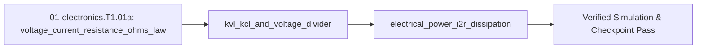

## 1. Why it matters
Before wiring an H-bridge motor driver or level-shifting a $5\text{ V}$ sensor to a $3.3\text{ V}$ microcontroller in Step 1.2 (`01-electronics.T1.02`), you must be able to calculate how much current flows through a resistor, how two resistors divide a voltage, and how much heat ($P = I^2 R$) a wire or resistor dissipates. Getting these three laws right prevents magic smoke on your very first breadboard build. Already know this? Take the Skip test in section 7 first.

## 2. Intuition first
Picture water pumped through a closed loop of pipes. **Voltage** ($V$, in volts) is the water pressure difference between two points; **current** ($I$, in amperes) is the flow rate of charge through the pipe; and **resistance** ($R$, in ohms, $\Omega$) is a narrow constriction that fights the flow. **Ohm's Law** ($V = I R$) says that pushing more current through a constriction takes proportionally more pressure. **Kirchhoff's Current Law (KCL)** says charge never vanishes at a pipe junction (what flows in must flow out), and **Kirchhoff's Voltage Law (KVL)** says if you walk around any closed loop and return to your starting point, the pressure rises and drops must sum to zero. When current squeezes through a resistor, the lost pressure turns directly into heat at rate $P = V I = I^2 R$.

## 3. Formalization
1. **Ohm's Law ($V = I R$):** Across a resistor of resistance $R$ in ohms ($\Omega$), the voltage drop $V$ in volts ($\text{V}$) and current $I$ in amperes ($\text{A}$) obey:

$$
V = I \cdot R \iff I = \frac{V}{R}
$$

   Substituting $V_{\text{bat}} = 12.0\text{ V}$ across a stalled motor winding of resistance $R_m = 2.4\ \Omega$ gives stall current $I_{\text{stall}} = 12.0\text{ V} / 2.4\ \Omega = 5.0\text{ A}$.
2. **KVL, KCL, and the Unloaded/Loaded Voltage Divider:** Two series resistors $R_1$ (top, connected to $V_{\text{in}}$) and $R_2$ (bottom, connected to $\text{GND}$) share the same current $I = V_{\text{in}}/(R_1 + R_2)$ when unloaded, producing midpoint voltage:

$$
V_{\text{out}} = V_{\text{in}} \frac{R_2}{R_1 + R_2}
$$

   Substituting $V_{\text{in}} = 5.0\text{ V}$, $R_1 = 10\text{ k}\Omega$, and $R_2 = 20\text{ k}\Omega$ gives $V_{\text{out}} = 5.0 \times \frac{20}{30} = 3.333\text{ V}$. If a load resistor $R_L$ is connected from $V_{\text{out}}$ to $\text{GND}$, the bottom leg becomes the parallel combination $R_{2\parallel L} = \frac{R_2 R_L}{R_2 + R_L}$.
3. **Joule Heating ($P = V I = I^2 R$):** The thermal power $P$ in watts ($\text{W}$) dissipated as heat in resistance $R$ carrying current $I$ is:

$$
P = V \cdot I = I^2 R = \frac{V^2}{R}
$$

   Substituting $I = 5.0\text{ A}$ through $R_m = 2.4\ \Omega$ gives $P = (5.0\text{ A})^2 (2.4\ \Omega) = 60.0\text{ W}$ of heat.

## 4. Worked example
**Predict first (before you run it):** $R_1 = 68\text{ k}\Omega$ over $R_2 = 10\text{ k}\Omega$ on a $24.0\text{ V}$ rail — commit to a number now. Roughly what fraction of $24\text{ V}$ does the $10\text{ k}\Omega$ bottom leg see, is that fraction safely under $3.3\text{ V}$, and which way must $V_{\text{out}}$ move once the ADC's finite $R_L = 100\text{ k}\Omega$ loads that leg? Write it down before you scroll, then check yourself against the printout: a *loaded* output reading higher than the unloaded one means your parallel bottom branch is inverted.

Design a battery-voltage sensing divider that scales a $V_{\text{bat}} = 24.0\text{ V}$ supply down using $R_1 = 68\text{ k}\Omega$ and $R_2 = 10\text{ k}\Omega$ for a $3.3\text{ V}$ ADC pin, and compute both the unloaded output voltage and the loaded output voltage when the ADC input has finite input resistance $R_L = 100\text{ k}\Omega$.

```python
import math

def divider_vout(v_in: float, r1: float, r2: float, r_load: float | None = None) -> float:
    r_bottom = r2 if r_load is None else (r2 * r_load) / (r2 + r_load)
    return v_in * (r_bottom / (r1 + r_bottom))

v_unloaded = divider_vout(24.0, 68_000.0, 10_000.0)
v_loaded = divider_vout(24.0, 68_000.0, 10_000.0, r_load=100_000.0)
p_r1_mw = ((24.0 - v_unloaded) ** 2 / 68_000.0) * 1000.0

assert math.isclose(v_unloaded, 3.076923, rel_tol=1e-5)
assert v_unloaded < 3.3
assert math.isclose(v_loaded, 2.830189, rel_tol=1e-5)
assert math.isclose(p_r1_mw, 6.437870, rel_tol=1e-5)
print(f"V_unloaded={v_unloaded:.3f} V, V_loaded={v_loaded:.3f} V, P_R1={p_r1_mw:.2f} mW")
```
Expected output:
```text
V_unloaded=3.077 V, V_loaded=2.830 V, P_R1=6.44 mW
```

## 5. Exercise
Calculate the current-limiting resistor $R$ required to run a status LED ($V_{\text{LED}} = 2.1\text{ V}$, target current $I = 10\text{ mA} = 0.010\text{ A}$) from a $V_{\text{supply}} = 5.0\text{ V}$ rail using KVL ($V_R = V_{\text{supply}} - V_{\text{LED}}$), and compute the power $P_R = I^2 R$ dissipated in the resistor. Verify $R = 290.0\ \Omega$ and $P_R = 0.029\text{ W}$ ($29.0\text{ mW}$, safely within a $0.25\text{ W}$ resistor rating).
- **If your result differs:** Make sure you subtracted $V_{\text{LED}} = 2.1\text{ V}$ from $5.0\text{ V}$ before dividing by $0.010\text{ A}$ ($2.9\text{ V} / 0.010\text{ A} = 290\ \Omega$, not $5.0 / 0.010 = 500\ \Omega$).


- **📚 What to Learn & Resources to Solve This Exercise:**
  - **Required Foundations Modules (`00-foundations`):** [`00-foundations.T1.00a`](00-foundations.T1.00a.md) (*Python Variables & Functions*) and [`00-foundations.T1.00c`](00-foundations.T1.00c.md) (SI Prefixes $\text{k}\Omega, \text{mA}, \text{mW}$ & Joule Heating $P = I^2 R$).
  - **Core Concepts to Review First:** Ohm's law ($V = IR$), Kirchhoff's Voltage/Current Laws (KVL/KCL), and loaded voltage dividers in `## 3. Formalization` (Items 1–3) and `## 4. Worked example` above.
  - **Study Links & Resources:** [SparkFun Voltage Dividers Tutorial (`learn.sparkfun.com`)](https://learn.sparkfun.com/tutorials/voltage-dividers), [All About Circuits Vol. I (`allaboutcircuits.com`)](https://www.allaboutcircuits.com/textbook/direct-current/), and [Track 01 Tier 1 (`01-electronics-and-power/README.md`)](../01-electronics-and-power/README.md#tier-1-beginner--intuitive).

### Break it on purpose
Inject one realistic bench fault and diagnose it from the symptom alone:
- **Inject:** swap the legs — put $R_1 = 10\text{ k}\Omega$ on top and $R_2 = 68\text{ k}\Omega$ on the bottom, leaving everything else alone.
- **Symptom:** the midpoint now reads $V_{\text{out}} = 24.0 \times \frac{68}{78} = 20.92\text{ V}$ — a number that would destroy the $3.3\text{ V}$ ADC pin it was meant to protect.
- **Diagnose:** the ratio is $R_2 / (R_1 + R_2)$, so the **bottom** resistor sets the fraction, not the top one. A midpoint near the full supply always means the bottom leg is the larger resistor.
- **Fix:** restore the $68\text{ k}\Omega$ / $10\text{ k}\Omega$ order, then prove the pin is safe before wiring it: $V_{\text{out}} = 3.077\text{ V} < 3.3\text{ V}$ and $P_{R_1} = (24.0 - 3.077)^2 / 68\text{ k}\Omega = 6.44\text{ mW}$.

## 6. Simulation path
Simulate the voltage divider and LED resistor in the browser using [Falstad Circuit Simulator](https://www.falstad.com/circuit/) (`resources/open-source-toolchains.md`) or run the Python verification script above.

Optional Tier 1 breadboard check (`hardware_required: false`): place a $68\text{ k}\Omega$ and $10\text{ k}\Omega$ resistor in series on a solderless breadboard powered from a $5.0\text{ V}$ USB rail and probe the midpoint with a digital multimeter:
```text
[+5.0 V Rail] ---> [R1 = 68 kOhm] ---+---> (DMM Red Probe: reads 0.641 V)
                                     |
                               [R2 = 10 kOhm]
                                     |
[GND Rail] --------------------------+---> (DMM Black Probe)
```
Pass/fail verification: unloaded $24\text{ V}$ divider reads $3.077\text{ V} < 3.3\text{ V}$ and $P_{R1} = 6.44\text{ mW} \ll 250\text{ mW}$.

### Safety notes
> **⚠️ Bench Safety Note (`safety_level: low`):** Always verify probe placement (`V/Ohm` voltage port, never the `10A` shunt port in parallel) and set your CC/CV bench power supply current limit ($\le 0.5\text{ A}$) before energizing any breadboard or sensor circuit.




## 7. Checkpoint
Pass criteria: run the worked example and exercise asserts with zero errors, or score $\ge 80\%$ ($4/4$) on the Skip test below.

### Skip test
1. `[Recall] [Concept: voltage_current_resistance_ohms_law]` A $12.0\text{ V}$ supply drives a motor coil with resistance $R = 3.0\ \Omega$ while the rotor is stalled. Compute the stall current $I_{\text{stall}}$ in amperes ($\text{A}$, tolerance $\pm 10^{-9}$).
2. `[Apply] [Concept: kvl_kcl_and_voltage_divider]` Compute the unloaded output voltage $V_{\text{out}}$ in volts ($\text{V}$, tolerance $\pm 10^{-6}$) of a divider with $V_{\text{in}} = 5.0\text{ V}$, top resistor $R_1 = 10\text{ k}\Omega$, and bottom resistor $R_2 = 20\text{ k}\Omega$.
3. `[Transfer] [Concept: electrical_power_i2r_dissipation]` Compute the heat power $P = I^2 R$ in watts ($\text{W}$, tolerance $\pm 10^{-9}$) dissipated in a $0.050\ \Omega$ current-sense resistor carrying $I = 10.0\text{ A}$.
4. `[Spaced review -> 00-foundations.T1.00e — Concept: si_base_and_derived_units] [Concept: kvl_kcl_and_voltage_divider]` Why can you **never** power a $3.3\text{ V}$ motor or microcontroller using a $10\text{ k}\Omega / 20\text{ k}\Omega$ resistor voltage divider from $5\text{ V}$?
   - **A.** Because resistors only work with AC voltages.
   - **B.** Because the load draws significant current $I_{\text{load}}$ through $R_1$, causing a massive $I_{\text{load}} R_1$ voltage drop that collapses $V_{\text{out}}$ (a voltage divider is for high-impedance signal sensing, not power delivery).
   - **C.** Because KCL does not apply when a motor is connected.
   - **D.** Because $3.3\text{ V}$ exceeds the breakdown voltage of carbon film resistors.

**Answer key:**
```python
import math

q1_istall = 12.0 / 3.0
q2_vout = 5.0 * (20_000.0 / (10_000.0 + 20_000.0))
q3_power_w = (10.0 ** 2) * 0.050
q4_choice = "B"

assert math.isclose(q1_istall, 4.0, rel_tol=1e-9)
assert math.isclose(q2_vout, 10.0 / 3.0, rel_tol=1e-6)
assert math.isclose(q3_power_w, 5.0, rel_tol=1e-9)
assert q4_choice == "B"
```
- **Pass mark:** $4/4$ ($80\%+$). If you missed Q1, study `## 3. Formalization` item 1; Q2 or Q4, study `## 3. Formalization` item 2; Q3, study `## 3. Formalization` item 3. On pass, proceed to `## 10. Next modules`.

## 8. Common mistakes
| Symptom | Root cause | 2-minute fix |
| :--- | :--- | :--- |
| Divider output is $20.9\text{ V}$ instead of $3.08\text{ V}$ ($3.3\text{ V}$ MCU pin destroyed!) | Swapped $R_1 = 68\text{ k}\Omega$ (top) and $R_2 = 10\text{ k}\Omega$ (bottom). | Always measure the divider midpoint with a multimeter before connecting it to an MCU pin. |
| Quarter-watt ($0.25\text{ W}$) resistor smokes and turns brown | Used a low resistance ($100\ \Omega$) across $24\text{ V}$, dissipating $P = V^2/R = 5.76\text{ W}$. | Compute $P = V^2/R$ or $I^2 R$ and keep continuous dissipation below $50\%$ of the resistor's wattage rating. |
| Tried to power a $3.3\text{ V}$ logic chip using a resistor divider | Ignored the load current $I_{\text{load}}$ flowing through the top resistor $R_1$. | Use a voltage regulator (LDO or buck converter) for power rails; use resistor dividers only for high-impedance ADC inputs. |

## 9. Resources
- **Paul Scherz & Simon Monk — *Practical Electronics for Inventors* (`resources/textbooks-and-papers.md`):** Beginner-friendly chapters on Ohm's law, KVL/KCL, and resistor power ratings `[VERIFIED 2026-10-15]`.
- **Falstad Circuit Simulator (`falstad.com/circuit/`, `resources/open-source-toolchains.md`):** Interactive browser circuit simulator showing live current dots and voltage colors `[VERIFIED 2026-10-15]`.
## 10. Next modules
- Proceed to [`01-electronics.T1.01c`](01-electronics.T1.01c.md) (*Multimeter, Current-Limited Bench Supply, Breadboard & ESD/Short-Circuit Safety*).
