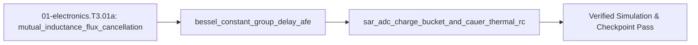

## 1. Why it matters
This is the final bridge module in the Track 01 Tier 3 ladder before Step 3.2 (`01-electronics.T3.02`). Scaling a motor inverter from a $24\text{ V}/5\text{ A}$ 4-layer board (`01-electronics.T2.02`) to a production $48\text{ V}/30\text{ A}$ ($1.5\text{ kW}$) actuator introduces four severe mixed-signal physics bottlenecks: (1) switching $30\text{ A}$ in $10\text{ ns}$ ($di/dt = 3\text{ A/ns}$) destroys $80\text{ V}$ MOSFETs unless the commutation loop inductance is crushed below $2.0\text{ nH}$ using **6-layer mutual-inductance flux cancellation**, (2) Butterworth/Chebyshev anti-aliasing filters ring on step current changes and distort phase unless replaced by a **linear-phase Bessel filter**, (3) a microcontroller's **SAR ADC internal sampling switch** kicks charge back into the op-amp unless isolated by a $C_0\text{G}$ **RC charge bucket** that settles to $< 0.5\text{ LSB}$ within the $150\text{ ns}$ acquisition window, and (4) millisecond motor stall bursts burn silicon dies long before the external heatsink warms up unless modeled with a **Cauer electro-thermal RC network**. Already know this? Take the Skip test or the Ladder Gate test in section 7 first.

## 2. Intuition first
Think of high-current, high-speed mixed-signal design as four coupled wave-and-energy problems:
- **Flux Cancellation on a 6-Layer Stackup:** Current flowing out along Layer 1 (`+V_bus`) and returning immediately underneath on Layer 2 (`PGND`, separated by a $100\ \mu\text{m}$ prepreg dielectric) generates equal and opposite magnetic fields ($\vec{B}_{\text{out}} \approx -\vec{B}_{\text{return}}$). Because the two conductors are tightly coupled via **mutual inductance $M$**, the net loop inductance collapses to $L_{\text{loop}} = L_{\text{self},1} + L_{\text{self},2} - 2M \propto \frac{\mu_0 h_{\text{diel}}}{w_{\text{copper}}}\ell$, easily achieving $< 1.5\text{ nH}$!
- **Bessel Constant Group Delay vs. Butterworth Ringing:** In a $40\text{ kHz}$ current loop, you sample the shunt amplifier output right at the PWM center. A Butterworth filter optimizes flat amplitude response at the expense of non-constant group delay $\tau_g(\omega) = -\frac{d\phi}{d\omega}$, causing step-response overshoot that corrupts the sampled current. A **2nd-order Bessel filter** ($Q = 1/\sqrt{3} \approx 0.5774$) maximizes flat group delay $\tau_g$, delaying all frequencies by the same time interval with **zero step overshoot**.
- **SAR ADC Charge Bucket (`R_filt`, `C_filt`):** When a 12-bit SAR ADC closes its internal sampling switch onto sampling capacitor $C_{\text{sample}} \approx 5\text{ pF}$, it gulps an instant charge packet from the pin. An op-amp cannot respond in $10\text{ ns}$ without oscillating. Placing an external `C0G` ceramic reservoir $C_{\text{filt}} \ge 20 \, C_{\text{sample}}$ ($100\text{–}220\text{ pF}$) right at the ADC pin supplies the instant charge gulp with a voltage droop of $\Delta V \approx \frac{C_{\text{sample}}}{C_{\text{filt}} + C_{\text{sample}}} V_{\text{step}}$, while series resistor $R_{\text{filt}}$ ($22\text{–}50\ \Omega$) isolates the op-amp and settles within $N_{\tau} = \ln(2^{B+1})$ time constants.
- **Cauer vs. Foster Electro-Thermal RC Networks:** Temperature $T$ (${^\circ}\text{C}$) is analogous to voltage, heat power $P_{\text{loss}}$ ($\text{W}$) to current, thermal resistance $R_{\theta}$ (${^\circ}\text{C/W}$) to electrical resistance, and thermal mass $C_{\theta}$ ($\text{J/}{^\circ}\text{C}$) to capacitance. The silicon die (`C_die ~ 5 mJ/°C`) heats up in milliseconds (`tau_die ~ 2 ms`), whereas the aluminum housing (`C_sink ~ 50 J/°C`) takes minutes!

## 3. Formalization
1. **Parallel-Plate Mutual-Inductance Flux Cancellation (`< 2 nH` Loop):** For overlapping copper planes of length $\ell$ ($\text{m}$), width $w$ ($\text{m}$, with $w \gg h$), separated by prepreg thickness $h$ ($\text{m}$) with permeability $\mu_0 = 4\pi \times 10^{-7}\text{ H/m}$, the net commutation loop inductance and peak turn-off voltage are:

$$
L_{\text{loop}} = L_1 + L_2 - 2M \approx \mu_0 \frac{h}{w} \ell, \qquad V_{\text{DS,peak}} = V_{\text{bus}} + L_{\text{loop}} \frac{di}{dt}
$$

2. **2nd-Order Bessel Anti-Aliasing Filter ($Q = 1/\sqrt{3}$):** Normalized 2nd-order Bessel transfer function with -3 dB cutoff $\omega_c = 2\pi f_c$ and scale factor $k_B = \sqrt{3} \approx 1.73205$:

$$
H_{\text{Bessel}}(s) = \frac{3}{\left(\frac{s}{\omega_0}\right)^2 + 3\left(\frac{s}{\omega_0}\right) + 3}, \qquad \tau_{g,0} = -\left.\frac{d\phi(\omega)}{d\omega}\right|_{\omega \to 0} = \frac{1}{\omega_0}, \qquad Q = \frac{1}{\sqrt{3}} \approx 0.57735
$$

3. **SAR ADC Charge-Bucket Settling & Cauer Electro-Thermal Junction Temperature:**
   - **Charge-Bucket Settling to $\frac{1}{2}\text{ LSB}$:** For a $B$-bit ADC with acquisition window $t_{\text{acq}}$, external bucket $(R_{\text{filt}}, C_{\text{filt}})$, and internal sampling switch resistance $R_{\text{sw}}$, the required time constant $\tau_{\text{adc}} = (R_{\text{filt}} + R_{\text{sw}}) C_{\text{sample}}$ (for full-scale step settling) or $\tau_{\text{bucket}} = R_{\text{filt}} C_{\text{filt}}$ after charge sharing $\Delta V_0 = V_{\text{FS}} \frac{C_{\text{sample}}}{C_{\text{filt}} + C_{\text{sample}}}$ must satisfy:

$$
\frac{C_{\text{sample}}}{C_{\text{filt}} + C_{\text{sample}}} e^{-t_{\text{acq}} / (R_{\text{filt}} C_{\text{filt}})} \le \frac{1}{2^{B+1}}
$$

   - **Transient Junction Temperature $T_J(t)$:** For a $K$-stage thermal impedance $Z_{\theta JA}(t) = \sum_{k=1}^{K} R_{\theta,k}\left(1 - e^{-t / \tau_{\theta,k}}\right)$ under a rectangular power pulse $P_{\text{loss}}$ of duration $t_p$:

$$
T_J(t_p) = T_{\text{amb}} + P_{\text{loss}} \sum_{k=1}^{K} R_{\theta,k}\left(1 - e^{-t_p / \tau_{\theta,k}}\right) < T_{J,\max}
$$


### Use & Understand
Open this module when a 48 V power stage has to survive its own switching, or when a measurement has to be trusted at the exact sample instant. Four numbers decide three separate designs, and all four are cheap enough to compute before anything is ordered.

Read the worked example as a design review. The 6-layer stackup ($h=0.10\text{ mm}$ prepreg, $w=12\text{ mm}$, $\ell=15\text{ mm}$) gives $L_\text{loop}=0.157\text{ nH}$ and a $48.47\text{ V}$ turn-off peak, so an $80\text{ V}$ MOSFET keeps $31\text{ V}$ of headroom; the 2-layer board's $25.13\text{ nH}$ produces $123.40\text{ V}$ and avalanches the same part. The 2nd-order Bessel at $\omega_0=2\pi\times250\text{ kHz}$ delays every low frequency by $0.6366\ \mu\text{s}$ — the phase the current loop must not spend. The 12-bit SAR bucket settles to $0.0000\text{ LSB}$ in $150\text{ ns}$ with $R_f=33\ \Omega$ and $C_f=180\text{ pF}$, while the exercise's $34.2\text{ ns}$ window is the case that does *not* settle ($0.5076\text{ LSB}$). And a $10\text{ ms}$, $120\text{ W}$ stall moves the die $+46.7\ {^\circ}\text{C}$ while the heatsink moves $+0.1\ {^\circ}\text{C}$, which is why the die and not the heatsink sets $T_J=71.8\ {^\circ}\text{C}$.

Plausibility checks worth applying to any answer here:
- Units: $\text{nH}\times\text{A/ns}$ is already volts — a factor of $10^9$ in the peak means the prefix was applied twice.
- The bucket's residual must be under $0.5\text{ LSB}$; a fractional LSB in the hundreds means the droop term was dropped.
- $\tau_{g,0}$ must scale as $1/\omega_0$; a delay near $4.0\ \mu\text{s}$ at $250\text{ kHz}$ is $1/f_0$ with the $2\pi$ missing.
- A die-to-heatsink rise anywhere near half-and-half used the $30\text{ s}$ time constant where the $5\text{ ms}$ one belongs.

### Derive & Extend
**The thermal ladder.** (1) Heat in a slab obeys $\partial T/\partial t=\alpha\,\partial^2T/\partial x^2$ with $\alpha=1/(R'C')$ per unit length. (2) In the Laplace domain $d^2\hat T/dx^2=(s/\alpha)\hat T$, so $\hat T(x)=\hat T(0)\cosh\!\big(x\sqrt{s/\alpha}\big)$. (3) A slab of length $\ell$ therefore presents the driving-point impedance

$$
Z_\theta(s)=\sqrt{\frac{R'}{C's}}\,\tanh\!\big(\ell\sqrt{sR'C'}\big).
$$

(4) Expanding $\tanh x=x/(1+x^2/(3+x^2/(5+\cdots)))$ and inverting turns that into a continued fraction of alternating series resistors and shunt capacitors,

$$
Z_\theta(s)=R_{\theta,1}+\frac{1}{C_{\theta,1}s+\dfrac{1}{R_{\theta,2}+\dfrac{1}{C_{\theta,2}s+\cdots}}},
$$

whose truncation after $K$ rungs is the Cauer network of §3 item 3. (5) Each rung is first order, so a power step $P$ produces $P\sum_k R_{\theta,k}(1-e^{-t/\tau_{\theta,k}})$ with $\tau_k=R_{\theta,k}C_{\theta,k}$, which is exactly the $T_J(t_p)$ the module evaluates — the $5\text{ ms}$ die stage is rung one, the $30\text{ s}$ heatsink rung two.

**Where $Q=1/\sqrt3$ comes from.** For $H(s)=\omega_c^2/(s^2+2\zeta\omega_c s+\omega_c^2)$, the group delay at DC is $\tau_g(0)=2\zeta/\omega_c$ and the next term in $\tau_g(\omega)$ is proportional to $4\zeta^2-3$. Flat delay to second order therefore needs $\zeta=\sqrt3/2$, hence $Q=1/(2\zeta)=1/\sqrt3$. Matching the module's normalisation $H=3/((s/\omega_0)^2+3(s/\omega_0)+3)$ gives $\omega_c=\sqrt3\,\omega_0$ and $\tau_g(0)=1/\omega_0$, the $0.6366\ \mu\text{s}$ of §4.

**Extend.** The next rung costs design margin, not just a term. The 3rd-order Bessel polynomial is $\theta_3(s)=s^3+6s^2+15s+15$; derive the condition on its $\omega^4$ group-delay coefficient that keeps the delay flat to the next order, then add that stage to the Cauer ladder and recompute $T_J$ for the same $10\text{ ms}$, $120\text{ W}$ burst. Show whether the extra thermal mass lowers the die peak or merely delays it.

## 4. Worked example
**Predict first (before you run it):** Commit to the following before you touch the code, and write each number down. (1) With $L_{\text{loop}} \approx \mu_0 \frac{h}{w}\ell$ and $\mu_0 = 4\pi \times 10^{-7}\text{ H/m}$, what is $L_{\text{loop}}$ in nanohenries for the 6-layer board ($h = 0.10\text{ mm}$ prepreg, $w = 12\text{ mm}$ plane, $\ell = 15\text{ mm}$) and for the 2-layer board ($h = 1.60\text{ mm}$ core, $w = 2.0\text{ mm}$ trace, $\ell = 25\text{ mm}$), how many times smaller is the 6-layer loop, and which board survives an $80\text{ V}$ MOSFET on a $V_{\text{bus}} = 48.0\text{ V}$ rail at $di/dt = 3.0\text{ A/ns}$ ($V_{\text{DS,peak}} = V_{\text{bus}} + L_{\text{loop}}\,di/dt$)? (2) What is the low-frequency group delay $\tau_{g,0} = 1/\omega_0$ in microseconds for a 2nd-order Bessel filter with $\omega_0 = 2\pi \times 250\text{ kHz}$? (3) In a $t_p = 10\text{ ms}$ stall burst of $P_{\text{loss}} = 120\text{ W}$ at $T_{\text{amb}} = 25.0\ {^\circ}\text{C}$, how far does the silicon die rise ($R_{\theta 1} = 0.45\ {^\circ}\text{C/W}$, $\tau_{\theta 1} = 5\text{ ms}$), how far does the heatsink ($R_{\theta 2} = 2.5\ {^\circ}\text{C/W}$, $\tau_{\theta 2} = 30\text{ s}$), and does $T_J$ stay inside $125\ {^\circ}\text{C}$? Three tells that a value is wrong rather than the module: a 6-layer loop in the tens of nanohenries means $h$ and $w$ were read off the 2-layer stackup ($1.60\text{ mm}$ of core instead of $0.10\text{ mm}$ of prepreg); a $\tau_{g,0}$ near $636.6\text{ ns}$ or $636.6\ \mu\text{s}$ is a metric prefix slipped one way or the other, while one near $4.0\ \mu\text{s}$ is $1/f_0$ with the $2\pi$ dropped; and a die-to-heatsink split anywhere near half-and-half means $5\text{ s}$ was used where $\tau_{\theta 1} = 5\text{ ms}$ belongs - the die has to carry more than $99\%$ of a $10\text{ ms}$ rise, $1 - e^{-2} = 0.865$ of its $120 \times 0.45 = 54.0\ {^\circ}\text{C}$ steady rise against $1 - e^{-3.3 \times 10^{-4}} = 3.3 \times 10^{-4}$ of the heatsink's $120 \times 2.5 = 300.0\ {^\circ}\text{C}$.
Compute (1) the net commutation loop inductance $L_{\text{loop}}$ and peak turn-off voltage $V_{\text{DS,peak}}$ on a 6-layer PCB with $h = 0.10\text{ mm}$ prepreg vs. a 2-layer PCB with $h = 1.60\text{ mm}$ core at $di/dt = 3.0\text{ A/ns}$, (2) the low-frequency group delay $\tau_{g,0}$ of a 2nd-order Bessel filter with $\omega_0 = 2\pi \times 250\text{ kHz}$, (3) the 12-bit SAR ADC charge-bucket settling error in LSBs after $t_{\text{acq}} = 150\text{ ns}$, and (4) the silicon junction temperature $T_J$ during a $10\text{ ms}$ $120\text{ W}$ stall burst.

```python
import math

mu0 = 4.0 * math.pi * 1e-7
length_m, width_m = 0.015, 0.012   # 15 mm loop length, 12 mm plane width
L_6layer_nH = (mu0 * (0.00010 / width_m) * length_m) * 1e9
L_2layer_nH = (mu0 * (0.00160 / 0.0020) * 0.025) * 1e9  # 2-layer 2 mm trace over 25 mm loop = 25.13 nH
di_dt_A_per_ns = 3.0               # 30 A in 10 ns
V_bus = 48.0
V_peak_6layer = V_bus + L_6layer_nH * di_dt_A_per_ns
V_peak_2layer = V_bus + L_2layer_nH * di_dt_A_per_ns
assert L_6layer_nH < 0.20          # 0.157 nH plane inductance!
assert V_peak_6layer < 50.0 and V_peak_2layer > 120.0  # 2-layer avalanches 80V FETs!

# 2nd-order Bessel filter group delay at w0 = 2*pi*250 kHz:
w0 = 2.0 * math.pi * 250_000.0
tau_g_us = (1.0 / w0) * 1e6
Q_bessel = 1.0 / math.sqrt(3.0)
assert math.isclose(tau_g_us, 0.63661977, rel_tol=1e-6)
assert math.isclose(Q_bessel, 0.57735027, rel_tol=1e-6)

# 12-bit SAR ADC charge bucket: C_sample = 5 pF, C_filt = 180 pF, R_filt = 33 Ohm, t_acq = 150 ns
C_s, C_f, R_f, t_acq = 5e-12, 180e-12, 33.0, 150e-9
initial_droop_frac = C_s / (C_f + C_s)
residual_frac = initial_droop_frac * math.exp(-t_acq / (R_f * C_f))
residual_lsb_12bit = residual_frac * (2 ** 12)
assert residual_lsb_12bit < 0.05   # Well below 0.5 LSB requirement!

# 2-stage thermal network: Die (R1=0.45 C/W, tau1=0.005 s) + Heatsink (R2=2.5 C/W, tau2=30.0 s)
P_burst, t_pulse, T_amb = 120.0, 0.010, 25.0
dT_die = P_burst * 0.45 * (1.0 - math.exp(-t_pulse / 0.005))
dT_sink = P_burst * 2.50 * (1.0 - math.exp(-t_pulse / 30.0))
T_junction = T_amb + dT_die + dT_sink
assert T_junction > 70.0 and dT_sink < 0.20  # Die heats by +46.7 C while heatsink barely moves (+0.1 C)!
print(f"V_peak_6L={V_peak_6layer:.2f}V vs 2L={V_peak_2layer:.2f}V, err={residual_lsb_12bit:.4f} LSB, T_J={T_junction:.1f} C")
```
Expected output:
```text
V_peak_6L=48.47V vs 2L=123.40V, err=0.0000 LSB, T_J=71.8 C
```

## 5. Exercise
Suppose a 12-bit SAR ADC ($2^{12} = 4096\text{ LSB}$) has $C_{\text{sample}} = 6.0\text{ pF}$, external bucket capacitor $C_{\text{filt}} = 114.0\text{ pF}$, and series resistor $R_{\text{filt}} = 50.0\ \Omega$. Compute (a) the initial charge-sharing voltage droop fraction $\frac{C_{\text{sample}}}{C_{\text{filt}} + C_{\text{sample}}}$ at $t = 0^+$, and (b) the residual settling error in LSBs ($4096 \times \frac{C_{\text{sample}}}{C_{\text{filt}} + C_{\text{sample}}} e^{-t_{\text{acq}} / (R_{\text{filt}} C_{\text{filt}})}$) at the end of a $t_{\text{acq}} = 34.2\text{ ns}$ acquisition window. Verify initial droop fraction $= 0.050$ and residual error $\approx 0.5076\text{ LSB}$ ($\pm 10^{-3}\text{ LSB}$, showing why $t_{\text{acq}}$ must be at least $35\text{ ns}$ for $< 0.5\text{ LSB}$ settling!).
- **If your result differs:** Check that $\tau = R_{\text{filt}} C_{\text{filt}} = 50.0 \times 114\times 10^{-12} = 5.70\text{ ns}$, so $t_{\text{acq}}/\tau = 34.2 / 5.70 = 6.0$ and $4096 \times 0.05 \times e^{-6.0} = 204.8 \times 0.00247875 = 0.5076\text{ LSB}$.

### Graded package - the loop, the filter, the bucket and the die
[`exercises/01-electronics.T3.01a/`](../exercises/01-electronics.T3.01a/) turns this section into a test. `starter.py` holds eight holes: `loop_inductance_nh` ($\mu_0 h \ell / w$), `flux_cancelled_nh` ($L_1 + L_2 - 2M$), `turn_off_peak_v` (nH x A/ns is already volts), `bessel_group_delay_us`, `bessel_q`, `charge_droop_fraction`, `charge_settling_lsb` and `cauer_junction_c`. Edit it, then run the tests the way CI does:

```bash
EXERCISE_TARGET=exercises/01-electronics.T3.01a/starter.py \
  python3 -m unittest discover -s exercises/01-electronics.T3.01a -p 'test_*.py'
```

**39 tests.** The loop is checked on both stackups ($0.1571\text{ nH}$ against $25.13\text{ nH}$, a ratio of exactly $160$) and on the Gate test's $0.3016\text{ nH}$, so a width-over-height formula reports $2.3\ \mu\text{H}$ and fails; the turn-off peak is checked at $48.47\text{ V}$ and $123.40\text{ V}$, the pair that decides whether an $80\text{ V}$ device survives; the mutual term is checked at the Skip test's $1.6\text{ nH}$, so adding it twice ($22.4\text{ nH}$) fails; the Bessel delay is checked at $0.6366\ \mu\text{s}$ and $0.7958\ \mu\text{s}$, so $1/f_0$ ($4.0\ \mu\text{s}$) fails; the charge bucket is checked at the exercise's $0.050$ droop and $0.5076\text{ LSB}$ at $34.2\text{ ns}$, at $0.4412\text{ LSB}$ at $35\text{ ns}$, and at the Break-it case's $198.75\text{ LSB}$ ($391\times$), so a bucket without its droop or without its exponential fails; and the thermal ladder is checked at the worked $+46.69\ {^\circ}\text{C}$ die rise against the $+0.100\ {^\circ}\text{C}$ heatsink rise, so a linear ramp ($+108\ {^\circ}\text{C}$) fails.

The transfer suite runs **the plant this course already built**: a Bessel corner on the plant's $1\text{ kHz}$ tick delays a sample by $159.15\ \mu\text{s}$, $16\%$ of a tick; the ADC's $12$ bits and the AS5600's $4096$ counts are the same $2^{12}$; a $10\text{ ms}$ stall burst is ten plant ticks, and the plant's own $I_1 / B_1 = 0.2\text{ s}$ obeys the same $63.2\%$ law; across the $0.20\text{ s}$ disturbance window the $30\text{ s}$ heatsink stage rises $0.66\%$ while the $5\text{ ms}$ die stage has fully arrived. Five planted faults - `loop_uses_width_over_height`, `flux_adds_mutual_twice`, `group_delay_drops_2pi`, `settling_forgets_droop`, `cauer_ignores_tau` - each fail the test named for them.


- **📚 What to Learn & Resources to Solve This Exercise:**
  - **Required Foundations Modules (`00-foundations`):** [`00-foundations.T2.00c`](00-foundations.T2.00c.md)–[`00-foundations.T2.00d`](00-foundations.T2.00d.md) (*2nd-Order Filter Damping & Group Delay*), [`00-foundations.T2.00e`](00-foundations.T2.00e.md) (*State-Space ODEs*), and [`00-foundations.T3.00a`](00-foundations.T3.00a.md) (*Port-Hamiltonian Energy Dissipation*).
  - **Prerequisite Bridge Module:** [`01-electronics.T2.01b`](01-electronics.T2.01b.md) and Legacy **Step 2.2 (`01-electronics.T2.02`)**.
  - **Core Concepts to Review First:** 6-layer planar loop inductance $L_{\text{loop}} = \mu_0 \frac{h}{w}\ell$, SAR ADC charge-bucket acquisition settling $t_{\text{acq}} = \ln(2^{N+1})R_{\text{filt}}C_{\text{sh}}$, and Cauer RC thermal network steady-state junction rise in `## 3. Formalization` and `## 4. Worked example` above.
  - **Study Links & Resources:** [TI SBAA586 (Charge-Bucket Circuit Design for SAR ADCs)](https://www.ti.com/lit/pdf/sbaa586), [Infineon MOSFET Power Losses Application Note](https://www.infineon.com/dgdl/Infineon-ApplicationNote_MOSFET_Power_Losses_Calculation_Using_the_DataSheet_Parameters-AN-v01_00-EN.pdf?fileId=db3a30431add1d95011ae08005a90294), and [Track 01 Tier 3 (`01-electronics-and-power/README.md`)](../01-electronics-and-power/README.md#tier-3-advanced--production).

### Starter code
```python
# --- Exercise scaffold: fill in each TODO, then check against the numbers in the full solution below ---
import math

MU0 = 4.0 * math.pi * 1e-7  # H/m


def loop_inductance_nh(h_m, w_m, length_m, mu0=MU0):
    """The parallel-plate commutation loop inductance of a plane pair, in nH."""
    # TODO 1: height OVER width, then the length, then 1e9 for the nano prefix
    ...


def flux_cancelled_nh(l1_nh, l2_nh, m_nh):
    """The net loop inductance when supply and return carry anti-parallel currents."""
    # TODO 2: the mutual term is counted TWICE and SUBTRACTED
    ...


def turn_off_peak_v(v_bus, l_loop_nh, di_dt_a_per_ns):
    """The peak drain-source voltage at turn-off."""
    # TODO 3: nH times A/ns is already volts - no 1e-9 or 1e9 anywhere here
    ...


def bessel_group_delay_us(f0_hz):
    """The low-frequency group delay of a 2nd-order Bessel filter, in microseconds."""
    # TODO 4: the 2 pi and the micro prefix are both easy to drop
    ...


def bessel_q():
    """The Q of a 2nd-order Bessel filter."""
    # TODO 5: 1/sqrt(3), about 0.577 - not 1/sqrt(2)
    ...


def charge_droop_fraction(c_sample_f, c_filt_f):
    """The t = 0+ droop fraction when the SAR switch closes."""
    # TODO 6: the bucket and the sampling capacitor SHARE the step
    ...


def charge_settling_lsb(bits, c_sample_f, c_filt_f, r_filt_ohm, t_acq_s):
    """The residual settling error at the end of acquisition, in LSBs."""
    # TODO 7: 2**bits times the droop, decayed by exp(-t / (R_filt * C_filt))
    ...


def cauer_junction_c(t_amb_c, p_loss_w, stages, t_s):
    """The junction temperature of a Cauer ladder under a rectangular pulse."""
    # TODO 8: each stage is R (1 - exp(-t / tau)); add the rises, then add T_amb
    ...


print("scaffold ready: 8 TODOs to fill, then compare against the numbers in the full solution")
```

### Hint ladder
1. **The droop is a capacitor divider, not a settling result.** $C_{\text{sample}} = 6.0\text{ pF}$ and $C_{\text{filt}} = 114.0\text{ pF}$ share one step, so the fraction is $6/(114+6) = 0.050$; no resistor appears until the next part.
2. **The time constant uses the bucket, not the sum.** $\tau = R_{\text{filt}} C_{\text{filt}} = 50.0 \times 114\text{ pF} = 5.70\text{ ns}$, so $t_{\text{acq}} = 34.2\text{ ns}$ is exactly six time constants and the exponential is $e^{-6.0} = 0.00247875$.
3. **The error is in LSBs of the full scale, not volts.** Multiply the droop by $2^{12} = 4096$ first, then by the exponential: $4096 \times 0.050 \times 0.00247875 = 0.5076\text{ LSB}$, just over the half-LSB budget.
4. **The fix the numbers point at.** Solving $4096 \times 0.050 \times e^{-t/\tau} = 0.5$ gives $t = 5.70\text{ ns} \times \ln(409.6) = 34.29\text{ ns}$, which is why the module recommends a $35\text{ ns}$ window ($0.4412\text{ LSB}$).
5. **What the suite refuses.** The guards are part of the contract, not defensive padding, and every one of them is a `ValueError`: `loop_inductance_nh` refuses a non-positive height, width or length; `turn_off_peak_v` refuses a negative loop inductance or slew rate; `flux_cancelled_nh` refuses a negative self- or mutual inductance and a mutual term larger than *either* self-inductance (nothing physical couples that hard); `bessel_group_delay_us` refuses a zero corner frequency; `charge_droop_fraction` and `charge_settling_lsb` refuse a zero bucket capacitor, and the settling helper also `bits < 1`, `R_filt <= 0` or a negative `t_acq`; and `cauer_junction_c` refuses an empty rung list, a non-positive rung time constant, negative dissipation and a negative time.

### Full Solution
```python
import math

MU0 = 4.0 * math.pi * 1e-7  # H/m


def loop_inductance_nh(h_m, w_m, length_m, mu0=MU0):
    """L_loop = mu0 (h / w) length, in nanohenries, for a plane pair h apart."""
    if h_m <= 0.0 or w_m <= 0.0 or length_m <= 0.0:
        raise ValueError("a loop needs a positive dielectric height, width and length")
    return mu0 * (h_m / w_m) * length_m * 1e9


def flux_cancelled_nh(l1_nh, l2_nh, m_nh):
    """L_loop = L1 + L2 - 2 M for anti-parallel supply and return currents, in nH."""
    if l1_nh < 0.0 or l2_nh < 0.0 or m_nh < 0.0:
        raise ValueError("self- and mutual inductances cannot be negative")
    net = l1_nh + l2_nh - 2.0 * m_nh
    if net < 0.0:
        raise ValueError("mutual inductance cannot exceed the geometric mean of the self terms")
    return net


def turn_off_peak_v(v_bus, l_loop_nh, di_dt_a_per_ns):
    """V_DS,peak = V_bus + L_loop di/dt; nH times A/ns is exactly volts."""
    if l_loop_nh < 0.0:
        raise ValueError("an inductance cannot be negative")
    if di_dt_a_per_ns < 0.0:
        raise ValueError("a turn-off slew cannot be negative")
    return v_bus + l_loop_nh * di_dt_a_per_ns


def bessel_group_delay_us(f0_hz):
    """tau_g0 = 1 / (2 pi f0), in microseconds, for a 2nd-order Bessel filter."""
    if f0_hz <= 0.0:
        raise ValueError("a filter needs a positive scaling frequency")
    return 1e6 / (2.0 * math.pi * f0_hz)


def bessel_q():
    """The Q of a 2nd-order Bessel filter: 1 / sqrt(3)."""
    return 1.0 / math.sqrt(3.0)


def charge_droop_fraction(c_sample_f, c_filt_f):
    """The t = 0+ droop: C_sample / (C_filt + C_sample)."""
    if c_sample_f <= 0.0 or c_filt_f <= 0.0:
        raise ValueError("both the sampling and the bucket capacitor must be positive")
    return c_sample_f / (c_filt_f + c_sample_f)


def charge_settling_lsb(bits, c_sample_f, c_filt_f, r_filt_ohm, t_acq_s):
    """Residual settling error at the end of acquisition, in LSBs of a `bits`-bit ADC."""
    if bits < 1:
        raise ValueError("an ADC needs at least one bit")
    if r_filt_ohm <= 0.0:
        raise ValueError("the bucket's series resistance must be positive")
    if t_acq_s < 0.0:
        raise ValueError("an acquisition window cannot be negative")
    tau_s = r_filt_ohm * c_filt_f
    return (
        (2.0 ** bits)
        * charge_droop_fraction(c_sample_f, c_filt_f)
        * math.exp(-t_acq_s / tau_s)
    )


def cauer_junction_c(t_amb_c, p_loss_w, stages, t_s):
    """T_J = T_amb + P sum_k R_k (1 - exp(-t / tau_k)) over [(R_theta, tau), ...]."""
    if p_loss_w < 0.0:
        raise ValueError("a dissipation cannot be negative")
    if t_s < 0.0:
        raise ValueError("time does not run backwards")
    if not stages:
        raise ValueError("a thermal ladder needs at least one R_theta/tau stage")
    rise_c = 0.0
    for r_theta, tau_s in stages:
        if r_theta < 0.0:
            raise ValueError("a thermal resistance cannot be negative")
        if tau_s <= 0.0:
            raise ValueError("a thermal time constant must be positive")
        rise_c += r_theta * (1.0 - math.exp(-t_s / tau_s))
    return t_amb_c + p_loss_w * rise_c


# No `__main__` block on purpose: the browser grades this file's stdout against the appended
# self-check's single PASS line, and a second print here would be a mismatch for a correct answer.

droop = charge_droop_fraction(6.0e-12, 114.0e-12)
lsb_34 = charge_settling_lsb(12, 6.0e-12, 114.0e-12, 50.0, 34.2e-9)
lsb_35 = charge_settling_lsb(12, 6.0e-12, 114.0e-12, 50.0, 35.0e-9)

assert math.isclose(droop, 0.050, abs_tol=1e-12)
assert math.isclose(lsb_34, 0.5076, abs_tol=5e-4)
assert math.isclose(lsb_35, 0.4412, abs_tol=5e-4)
assert math.isclose(turn_off_peak_v(48.0, 0.15708, 3.0), 48.47124, abs_tol=1e-4)
assert math.isclose(flux_cancelled_nh(6.0, 6.0, 5.2), 1.6, abs_tol=1e-12)
assert math.isclose(bessel_group_delay_us(250_000.0), 0.63661977, abs_tol=1e-6)
assert math.isclose(bessel_q(), 0.57735027, abs_tol=1e-6)

t_j = cauer_junction_c(25.0, 120.0, ((0.45, 0.005), (2.5, 30.0)), 0.010)
assert math.isclose(t_j, 71.79, abs_tol=0.02)

print(f"droop={droop:.4f} | residual at 34.2 ns={lsb_34:.4f} LSB | at 35 ns={lsb_35:.4f} LSB")
print(f"L_6L={loop_inductance_nh(1e-4, 0.012, 0.015):.3f} nH | V_peak={turn_off_peak_v(48.0, 0.15708, 3.0):.2f} V | "
      f"tau_g={bessel_group_delay_us(250_000.0):.4f} us | T_J={t_j:.1f} C")

```

Printed: `droop=0.0500 | residual at 34.2 ns=0.5076 LSB | at 35 ns=0.4412 LSB`, then `L_6L=0.157 nH | V_peak=48.47 V | tau_g=0.6366 us | T_J=71.8 C`.

**On the shared arm.** The Transfer suite in `exercises/01-electronics.T3.01a/` measures this on the same `mechalab_plant` arm the capstone builds - its 1 kHz tick is the filter's own corner, and its inertia over damping is the same first-order time constant the die stage obeys:

```python
import math
import mechalab_plant as plant

tick_hz = 1.0 / plant.DT
bessel_delay_us = 1e6 / (2.0 * math.pi * tick_hz)
tau_s = plant.I1 / plant.B1

assert math.isclose(tick_hz, 1000.0, rel_tol=1e-12)
assert math.isclose(bessel_delay_us, 159.154943, abs_tol=1e-6)
assert bessel_delay_us < plant.DT * 1e6          # the AFE delays less than one tick
assert math.isclose(tau_s, 0.2, rel_tol=1e-12)
print("plant: tick=%.0f Hz | Bessel delay=%.3f us (%.3f of a tick) | I1/B1=%.2f s"
      % (tick_hz, bessel_delay_us, bessel_delay_us / (plant.DT * 1e6), tau_s))
```

### Break it on purpose
Inject one realistic bring-up fault into this module's own exercise (12-bit SAR ADC, $C_{\text{sample}} = 6.0\text{ pF}$, $C_{\text{filt}} = 114.0\text{ pF}$, $R_{\text{filt}} = 50.0\ \Omega$, $t_{\text{acq}} = 34.2\text{ ns}$) and diagnose it from the symptom alone:
- **Inject:** a leftover current-limiting resistor stays in series with the ADC pin, so $R_{\text{filt}} = 10.0\text{ k}\Omega$ instead of $50.0\ \Omega$; both capacitors are untouched (the $10\text{ k}\Omega$ series resistor row in `## 8. Common mistakes`, made on purpose).
- **Symptom:** the charge-sharing droop at $t = 0^+$ is unchanged at $0.050$ (the capacitors set it), but $\tau = R_{\text{filt}} C_{\text{filt}}$ becomes $10.0\text{ k}\Omega \times 114.0\text{ pF} = 1.14\ \mu\text{s}$, so $t_{\text{acq}}/\tau$ collapses to $0.030$, $e^{-0.030} = 0.970$, and the residual error jumps to $4096 \times 0.050 \times 0.970 = 198.7\text{ LSB}$ - $391\times$ the $0.5076\text{ LSB}$ the exercise predicts, about $0.16\text{ V}$, $5\%$ of a $3.30\text{ V}$ full scale, so the current waveform still *looks* right while every sample is wrong.
- **Diagnose:** the $t = 0^+$ droop fraction is the discriminator. It reads $0.050$ before and after, because it depends on the two capacitors alone, so the bucket size is not the fault; what moved is the time constant, $5.70\text{ ns} \to 1.14\ \mu\text{s}$ ($200\times$), and $R_{\text{filt}}$ is the only element left in $\tau = R_{\text{filt}} C_{\text{filt}}$. A wrongly sized bucket moves the droop itself instead: halve $C_{\text{filt}}$ to $57.0\text{ pF}$ and the droop rises from $0.050$ to $0.0952$ while $\tau$ stays at $2.85\text{ ns}$, still in the nanosecond range of the healthy $5.70\text{ ns}$.
- **Fix:** restore $R_{\text{filt}} = 50.0\ \Omega$, which reproduces the exercise's $0.5076\text{ LSB}$ - still $0.008\text{ LSB}$ over the half-LSB budget, so the change that actually closes it is the acquisition window: $t_{\text{acq}} \ge \tau \ln\!\left(\frac{4096 \times 0.050}{0.5}\right) = 5.70\text{ ns} \times 6.015 = 34.29\text{ ns}$, and the $35\text{ ns}$ this module recommends gives $204.8 \times e^{-6.14} = 0.441\text{ LSB}$.

## 6. Simulation path
Open **Tab 3 (25 kHz PMSM FOC)** and **Tab 6 (3D CAD & 48V PCB — Parasitics & Thermal Analyzer)** in the MechaLab Workbench (`npm run dev`), or simulate the 2nd-order Bessel AFE + SAR charge bucket by running `python3 01-electronics-and-power/lab/lab01_power_and_afe_sim.py`.

No hardware required for this module (`hardware_required: false`). In Step 3.2 (`01-electronics.T3.02`), these exact equations size the 6-layer `STM32G474` + `DRV8353` inverter stackup:
```text
[Shunt + INA240] ---> [2nd-Order Bessel AFE] ---> [R_filt=33 Ohm + C_filt=180 pF C0G] ---> [STM32G4 SAR ADC1/2]
```
Pass/fail verification in simulation: `V_peak_6layer < 50.0 V`, `residual_lsb_12bit < 0.5 LSB`, and `T_junction < 125.0 C`.

### Safety notes
- **Mandatory Safety Rules (`safety_level: high`):**
  1. **Stored Bus Energy & Pre-Charge Gate (`48 V / 30 A` Stage):** A $48\text{ V}$ inverter bank with $C_{\text{bus}} = 2200\ \mu\text{F}$ stores $E = \frac{1}{2} C V^2 = 2.53\text{ J}$ and can deliver $> 1500\text{ A}$ into a dead short. Never hot-plug a $48\text{ V}$ battery without an active pre-charge resistor circuit + bleed resistor + polycarbonate splash shield.
  2. **Silicon Die Thermal Runaway (`< 10 ms` Time Constant):** A thermocouple glued to the aluminum heatsink (`tau_sink ~ 30 s`) **cannot** protect MOSFET silicon (`tau_die ~ 5 ms`) during a rotor lock! Hardware desaturation / comparator over-current trip (`TIM1_BRK` $< 1\ \mu\text{s}$) and fast $I^2 t$ firmware thermal integration are mandatory before enabling gate drive power.




## 7. Checkpoint
Pass criteria: read `### Safety notes`, score $\ge 80\%$ ($4/5$, $100\%$ on `[SAFETY]` items) on the Skip test, or score $\ge 80\%$ ($7/8$, $100\%$ on `[SAFETY]` items) on the Ladder Gate test below to unlock Step 3.2 (`01-electronics.T3.02`).

### Skip test
1. `[Recall] [Concept: mutual_inductance_flux_cancellation]` Two coupled traces have self-inductances $L_1 = 6.0\text{ nH}$ and $L_2 = 6.0\text{ nH}$ and mutual inductance $M = 5.2\text{ nH}$ when carrying anti-parallel supply and return currents. Compute the net commutation loop inductance $L_{\text{loop}} = L_1 + L_2 - 2M$ in nanohenries ($\text{nH}$, tolerance $\pm 10^{-9}\text{ nH}$).
2. `[Apply] [Concept: bessel_constant_group_delay_afe]` Compute the quality factor $Q = 1 / \sqrt{3}$ (tolerance $\pm 10^{-4}$) of a maximally flat group-delay 2nd-order Bessel low-pass filter.
3. `[Transfer] [Concept: sar_adc_charge_bucket_and_cauer_thermal_rc]` A SAR ADC has internal sampling capacitor $C_{\text{sample}} = 5.0\text{ pF}$ and external charge-bucket capacitor $C_{\text{filt}} = 95.0\text{ pF}$. For a full-scale step $V_{\text{FS}} = 3.30\text{ V}$, compute the instantaneous charge-sharing voltage droop $\Delta V_0 = V_{\text{FS}} \frac{C_{\text{sample}}}{C_{\text{filt}} + C_{\text{sample}}}$ in volts ($\text{V}$, tolerance $\pm 10^{-9}\text{ V}$) at the moment the sampling switch closes.
4. `[Spaced review -> 01-electronics.T2.02 — Concept: parasitic_loop_inductance_voltage_overshoot] [SAFETY] [Concept: sar_adc_charge_bucket_and_cauer_thermal_rc]` During a $t_p = 0.005\text{ s}$ ($5\text{ ms}$) locked-rotor fault dissipating $P_{\text{loss}} = 200.0\text{ W}$ in a MOSFET whose junction-to-case thermal stage has $R_{\theta 1} = 0.50\ {^\circ}\text{C/W}$ and $\tau_{\theta 1} = 0.005\text{ s}$, compute the transient junction temperature rise $\Delta T_J = P_{\text{loss}} R_{\theta 1} (1 - e^{-t_p / \tau_{\theta 1}})$ in ${^\circ}\text{C}$ (tolerance $\pm 0.01\ {^\circ}\text{C}$).
5. `[SAFETY] [Concept: sar_adc_charge_bucket_and_cauer_thermal_rc]` Why can an NTC thermistor mounted on the aluminum motor housing **never** be used as the sole protection against a locked-rotor MOSFET over-current fault?
   - **A.** Because NTC thermistors only work below $0\ {^\circ}\text{C}$.
   - **B.** Because the silicon die has a millisecond thermal time constant ($\tau_{\text{die}} \approx 2\text{–}10\text{ ms}$) and reaches its $175\ {^\circ}\text{C}$ destruction limit in milliseconds, whereas the aluminum housing has a multi-second thermal time constant ($\tau_{\text{sink}} \approx 20\text{–}60\text{ s}$) and barely warms up before the MOSFET explodes.
   - **C.** Because aluminum is a thermal insulator.
   - **D.** Because thermistors block PWM signals.

**Answer key:**
```python
import math

q1_l_loop = 6.0 + 6.0 - 2.0 * 5.2
q2_q_bessel = 1.0 / math.sqrt(3.0)
q3_dv0 = 3.30 * (5.0 / (95.0 + 5.0))
q4_safety_dtj = 200.0 * 0.50 * (1.0 - math.exp(-1.0))
q5_safety_choice = "B"

assert math.isclose(q1_l_loop, 1.6, rel_tol=1e-9)
assert math.isclose(q2_q_bessel, 0.57735027, abs_tol=1e-4)
assert math.isclose(q3_dv0, 0.165, rel_tol=1e-9)
assert math.isclose(q4_safety_dtj, 63.212056, abs_tol=1e-2)  # Mandatory [SAFETY] 100% required
assert q5_safety_choice == "B"                                # Mandatory [SAFETY] 100% required
```
- **Pass mark:** $4/5$ overall ($80\%+$) AND $2/2$ ($100\%$) on Q4 and Q5 (`[SAFETY]`). If you missed Q1, study `## 3. Formalization` item 1; if you missed Q2, study `## 3. Formalization` item 2; if you missed Q3, Q4, or Q5, study `## 3. Formalization` item 3 and `### Safety notes`. On pass, proceed to `## 10. Next modules`.

### Gate test
Covers the complete Track 01 Tier 3 bridge ladder (`01-electronics.T3.01a`) before Step 3.2 (`01-electronics.T3.02`):
1. `[Concept: mutual_inductance_flux_cancellation]` Using the parallel-plate inductance approximation $L_{\text{loop}} = \mu_0 \frac{h}{w} \ell$ with $\mu_0 = 4\pi \times 10^{-7}\text{ H/m}$, $h = 0.12\text{ mm}$ ($1.2\times 10^{-4}\text{ m}$), $w = 10.0\text{ mm}$ ($0.010\text{ m}$), and $\ell = 20.0\text{ mm}$ ($0.020\text{ m}$), compute $L_{\text{loop}}$ in nanohenries ($\text{nH}$, tolerance $\pm 10^{-4}\text{ nH}$).
2. `[Concept: mutual_inductance_flux_cancellation]` For a commutation loop with $L_{\text{loop}} = 1.5\text{ nH}$ operating at $V_{\text{bus}} = 48.0\text{ V}$ and turn-off slew rate $di/dt = 4.0\text{ A/ns}$, compute the peak Drain-to-Source voltage $V_{\text{DS,peak}} = V_{\text{bus}} + L_{\text{loop}}\frac{di}{dt}$ in volts ($\text{V}$, tolerance $\pm 10^{-6}\text{ V}$).
3. `[Concept: bessel_constant_group_delay_afe]` Why is a 2nd-order **Bessel** filter ($Q = 1/\sqrt{3}$) preferred over a high-$Q$ Chebyshev filter for the anti-aliasing filter inside a $40\text{ kHz}$ synchronous current-sense loop?
   - **A.** Because Bessel filters have maximally flat group delay (linear phase) and zero step-response overshoot, preserving the exact time-domain current waveform at the PWM midpoint sampling instant.
   - **B.** Because Chebyshev filters cannot be built with op-amps.
   - **C.** Because Bessel filters require zero resistors.
   - **D.** Because Bessel filters amplify high-frequency switching noise.
4. `[Concept: bessel_constant_group_delay_afe]` Compute the low-frequency group delay $\tau_{g,0} = \frac{1}{2\pi f_0}$ in microseconds ($\mu\text{s}$, tolerance $\pm 10^{-4}\ \mu\text{s}$) for a 2nd-order Bessel filter with scaling frequency $f_0 = 200\text{ kHz}$.
5. `[Concept: sar_adc_charge_bucket_and_cauer_thermal_rc]` Why must the external charge-bucket capacitor $C_{\text{filt}}$ placed at a SAR ADC input pin use a **Class-I `C0G` / `NP0` dielectric** rather than a low-cost X7R or Y5V ceramic?
   - **A.** Because `C0G`/`NP0` capacitors have near-zero voltage coefficient of capacitance ($\Delta C / \Delta V \approx 0$) and zero piezoelectric microphonics, whereas X7R capacitance drops by $30\text{–}60\%$ as DC voltage changes, introducing nonlinear harmonic distortion into the ADC reading.
   - **B.** Because X7R capacitors only work above $100\text{ V}$.
   - **C.** Because `C0G` capacitors are magnetic.
   - **D.** Because SAR ADCs cannot read DC voltages.
6. `[Concept: sar_adc_charge_bucket_and_cauer_thermal_rc]` Compute the RC time constant $\tau = R_{\text{filt}} C_{\text{filt}}$ in nanoseconds ($\text{ns}$, tolerance $\pm 10^{-6}\text{ ns}$) for an ADC charge bucket with $R_{\text{filt}} = 25.0\ \Omega$ and $C_{\text{filt}} = 200.0\text{ pF}$ ($0.20\text{ nF}$).
7. `[SAFETY] [Concept: sar_adc_charge_bucket_and_cauer_thermal_rc]` Compute the steady-state junction temperature $T_J = T_{\text{amb}} + P_{\text{loss}}(R_{\theta JC} + R_{\theta CS} + R_{\theta SA})$ in ${^\circ}\text{C}$ (tolerance $\pm 10^{-6}\ {^\circ}\text{C}$) when $T_{\text{amb}} = 30.0\ {^\circ}\text{C}$, $P_{\text{loss}} = 20.0\text{ W}$, $R_{\theta JC} = 0.5\ {^\circ}\text{C/W}$, $R_{\theta CS} = 0.2\ {^\circ}\text{C/W}$, and $R_{\theta SA} = 2.3\ {^\circ}\text{C/W}$.
8. `[SAFETY] [Concept: mutual_inductance_flux_cancellation]` What hardware fault protection must trigger within $< 1\ \mu\text{s}$ if a phase-to-phase short circuit causes current to exceed the $45\text{ A}$ comparator threshold on a $48\text{ V}$ inverter?
   - **A.** Direct hardware break input (`TIM1_BKIN` / gate-driver `VDS` desaturation comparator) that asynchronously forces all 6 PWM outputs into high-impedance Safe Torque Off without waiting for software polling.
   - **B.** A Python script running at $10\text{ Hz}$ over USB.
   - **C.** An LED blinking on the dashboard.
   - **D.** Increasing the PWM duty cycle to $100\%$.

**Gate answer key:**
```python
import math

mu0 = 4.0 * math.pi * 1e-7
g1_l_nh = (mu0 * (1.2e-4 / 0.010) * 0.020) * 1e9
g2_vpeak = 48.0 + 1.5 * 4.0
g3_choice = "A"
g4_taug_us = (1.0 / (2.0 * math.pi * 200_000.0)) * 1e6
g5_choice = "A"
g6_tau_ns = 25.0 * 0.20
g7_safety_tj = 30.0 + 20.0 * (0.5 + 0.2 + 2.3)
g8_safety_choice = "A"

assert math.isclose(g1_l_nh, 0.30159289, abs_tol=1e-4)
assert math.isclose(g2_vpeak, 54.0, rel_tol=1e-9)
assert g3_choice == "A"
assert math.isclose(g4_taug_us, 0.7957747, abs_tol=1e-4)
assert g5_choice == "A"
assert math.isclose(g6_tau_ns, 5.0, rel_tol=1e-9)
assert math.isclose(g7_safety_tj, 90.0, rel_tol=1e-9)  # Mandatory [SAFETY] 100% required
assert g8_safety_choice == "A"                         # Mandatory [SAFETY] 100% required
```
- **Pass mark:** $7/8$ ($80\%+$) AND $2/2$ ($100\%$) on Q7 and Q8 (`[SAFETY]`). Remediation: Q1, Q2, Q8 $\to$ `## 3. Formalization` item 1 & `### Safety notes`; Q3–Q4 $\to$ `## 3. Formalization` item 2; Q5–Q7 $\to$ `## 3. Formalization` item 3 & `### Safety notes`.

## 8. Common mistakes
| Symptom | Root cause | 2-minute fix |
| :--- | :--- | :--- |
| 6-layer PCB still exhibits $> 8\text{ nH}$ commutation loop inductance and $25\text{ V}$ ringing | Placed Layer-2 `PGND` return plane too far away or routed gate/sense traces across a slot in Layer 2 underneath the half-bridge. | Place a solid, unbroken `PGND` plane on Layer 2 separated from Layer 1 (`+V_bus` / `SW`) by a thin $100\ \mu\text{m}$ (`4 mil`) prepreg and stitch decoupling return vias directly beside MOSFET source pads. |
| SAR ADC readings show channel-to-channel crosstalk or $15\text{ LSB}$ offset spikes when sampling at $40\text{ kHz}$ | Connected the op-amp output directly to the SAR ADC pin without an RC charge bucket, or used a $10\text{ k}\Omega$ series resistor that cannot recharge $C_{\text{sample}}$ within $150\text{ ns}$. | Place $R_{\text{filt}} = 22\text{–}47\ \Omega$ and $C_{\text{filt}} = 100\text{–}220\text{ pF}$ (`C0G`) within $2\text{ mm}$ of the ADC pin so $\tau_{\text{bucket}} \ll t_{\text{acq}} / 9$. |
| Mathematical Foster RC thermal model predicts realistic junction temperature, but connecting a heatsink model in series produces physically wrong temperatures | Foster network nodes do not correspond to physical spatial layers and cannot be cascaded node-by-node. | Transform the datasheet Foster network into a grounded-capacitor **Cauer ladder network** before coupling the heatsink RC network to the case node. |

## 9. Resources
- **Henry W. Ott — *Electromagnetic Compatibility Engineering* (`resources/textbooks-and-papers.md`) & Texas Instruments *SAR ADC Front-End Design (`SBOA247`)*:** High-frequency return-plane flux cancellation, Bessel AFE design, and SAR charge-bucket calculations `[VERIFIED 2026-10-15]`.
- **Track 01 (`01-electronics-and-power/README.md`):** Directly continues into Step 3.2 (`01-electronics.T3.02`) `[VERIFIED 2026-10-15]`.

## 10. Next modules
- Proceed to legacy **Step 3.2 (`01-electronics.T3.02`)** in [`01-electronics-and-power/README.md`](../01-electronics-and-power/README.md#tier-3-advanced--production).
