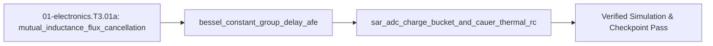

## 1. Why it matters
This is the final bridge module in the Track 01 Tier 3 ladder before Step 3.2 (`01-electronics.T3.02`). Scaling a motor inverter from a $24\text{ V}/5\text{ A}$ 4-layer board (`01-electronics.T2.02`) to a production $48\text{ V}/30\text{ A}$ ($1.5\text{ kW}$) actuator introduces four severe mixed-signal physics bottlenecks: (1) switching $30\text{ A}$ in $10\text{ ns}$ ($di/dt = 3\text{ A/ns}$) destroys $80\text{ V}$ MOSFETs unless the commutation loop inductance is crushed below $2.0\text{ nH}$ using **6-layer mutual-inductance flux cancellation**, (2) Butterworth/Chebyshev anti-aliasing filters ring on step current changes and distort phase unless replaced by a **linear-phase Bessel filter**, (3) a microcontroller's **SAR ADC internal sampling switch** kicks charge back into the op-amp unless isolated by a $C_0\text{G}$ **RC charge bucket** that settles to $< 0.5\text{ LSB}$ within the $150\text{ ns}$ acquisition window, and (4) millisecond motor stall bursts burn silicon dies long before the external heatsink warms up unless modeled with a **Cauer electro-thermal RC network**. Already know this? Take the Skip test or the Ladder Gate test in section 7 first.

## 2. Intuition first
Think of high-current, high-speed mixed-signal design as four coupled wave-and-energy problems:
- **Flux Cancellation on a 6-Layer Stackup:** Current flowing out along Layer 1 (`+V_bus`) and returning immediately underneath on Layer 2 (`PGND`, separated by a $100\ \mu\text{m}$ prepreg dielectric) generates equal and opposite magnetic fields ($\vec{B}_{\text{out}} \approx -\vec{B}_{\text{return}}$). Because the two conductors are tightly coupled via **mutual inductance $M$**, the net loop inductance collapses to $L_{\text{loop}} = L_{\text{self},1} + L_{\text{self},2} - 2M \propto \frac{\mu_0 h_{\text{diel}}}{w_{\text{copper}}}\ell$, easily achieving $< 1.5\text{ nH}$!
- **Bessel Constant Group Delay vs. Butterworth Ringing:** In a $40\text{ kHz}$ current loop, you sample the shunt amplifier output right at the PWM center. A Butterworth filter optimizes flat amplitude response at the expense of non-constant group delay $\tau_g(\omega) = -\frac{d\phi}{d\omega}$, causing step-response overshoot that corrupts the sampled current. A **2nd-order Bessel filter** ($Q = 1/\sqrt{3} \approx 0.5774$) maximizes flat group delay $\tau_g$, delaying all frequencies by the same time interval with **zero step overshoot**.
- **SAR ADC Charge Bucket (`R_filt`, `C_filt`):** When a 12-bit SAR ADC closes its internal sampling switch onto sampling capacitor $C_{\text{sample}} \approx 5\text{ pF}$, it gulps an instant charge packet from the pin. An op-amp cannot respond in $10\text{ ns}$ without oscillating. Placing an external `C0G` ceramic reservoir $C_{\text{filt}} \ge 20 \, C_{\text{sample}}$ ($100\text{–}220\text{ pF}$) right at the ADC pin supplies the instant charge gulp with a voltage droop of $\Delta V \approx \frac{C_{\text{sample}}}{C_{\text{filt}} + C_{\text{sample}}} V_{\text{step}}$, while series resistor $R_{\text{filt}}$ ($22\text{–}50\ \Omega$) isolates the op-amp and settles within $N_{\tau} = \ln(2^{B+1})$ time constants.
- **Cauer vs. Foster Electro-Thermal RC Networks:** Temperature $T$ (${^\circ}\text{C}$) is analogous to voltage, heat power $P_{\text{loss}}$ ($\text{W}$) to current, thermal resistance $R_{\theta}$ (${^\circ}\text{C/W}$) to electrical resistance, and thermal mass $C_{\theta}$ ($\text{J/}{^\circ}\text{C}$) to capacitance. The silicon die (`C_die ~ 5 mJ/°C`) heats up in milliseconds (`tau_die ~ 2 ms`), whereas the aluminum housing (`C_sink ~ 50 J/°C`) takes minutes!

## 3. Formalization
1. **Parallel-Plate Mutual-Inductance Flux Cancellation (`< 2 nH` Loop):** For overlapping copper planes of length $\ell$ ($\text{m}$), width $w$ ($\text{m}$, with $w \gg h$), separated by prepreg thickness $h$ ($\text{m}$) with permeability $\mu_0 = 4\pi \times 10^{-7}\text{ H/m}$, the net commutation loop inductance and peak turn-off voltage are:

$$
L_{\text{loop}} = L_1 + L_2 - 2M \approx \mu_0 \frac{h}{w} \ell, \qquad V_{\text{DS,peak}} = V_{\text{bus}} + L_{\text{loop}} \frac{di}{dt}
$$

2. **2nd-Order Bessel Anti-Aliasing Filter ($Q = 1/\sqrt{3}$):** Normalized 2nd-order Bessel transfer function with -3 dB cutoff $\omega_c = 2\pi f_c$ and scale factor $k_B = \sqrt{3} \approx 1.73205$:

$$
H_{\text{Bessel}}(s) = \frac{3}{\left(\frac{s}{\omega_0}\right)^2 + 3\left(\frac{s}{\omega_0}\right) + 3}, \qquad \tau_{g,0} = -\left.\frac{d\phi(\omega)}{d\omega}\right|_{\omega \to 0} = \frac{1}{\omega_0}, \qquad Q = \frac{1}{\sqrt{3}} \approx 0.57735
$$

3. **SAR ADC Charge-Bucket Settling & Cauer Electro-Thermal Junction Temperature:**
   - **Charge-Bucket Settling to $\frac{1}{2}\text{ LSB}$:** For a $B$-bit ADC with acquisition window $t_{\text{acq}}$, external bucket $(R_{\text{filt}}, C_{\text{filt}})$, and internal sampling switch resistance $R_{\text{sw}}$, the required time constant $\tau_{\text{adc}} = (R_{\text{filt}} + R_{\text{sw}}) C_{\text{sample}}$ (for full-scale step settling) or $\tau_{\text{bucket}} = R_{\text{filt}} C_{\text{filt}}$ after charge sharing $\Delta V_0 = V_{\text{FS}} \frac{C_{\text{sample}}}{C_{\text{filt}} + C_{\text{sample}}}$ must satisfy:

$$
\frac{C_{\text{sample}}}{C_{\text{filt}} + C_{\text{sample}}} e^{-t_{\text{acq}} / (R_{\text{filt}} C_{\text{filt}})} \le \frac{1}{2^{B+1}}
$$

   - **Transient Junction Temperature $T_J(t)$:** For a $K$-stage thermal impedance $Z_{\theta JA}(t) = \sum_{k=1}^{K} R_{\theta,k}\left(1 - e^{-t / \tau_{\theta,k}}\right)$ under a rectangular power pulse $P_{\text{loss}}$ of duration $t_p$:

$$
T_J(t_p) = T_{\text{amb}} + P_{\text{loss}} \sum_{k=1}^{K} R_{\theta,k}\left(1 - e^{-t_p / \tau_{\theta,k}}\right) < T_{J,\max}
$$


## 4. Worked example
Compute (1) the net commutation loop inductance $L_{\text{loop}}$ and peak turn-off voltage $V_{\text{DS,peak}}$ on a 6-layer PCB with $h = 0.10\text{ mm}$ prepreg vs. a 2-layer PCB with $h = 1.60\text{ mm}$ core at $di/dt = 3.0\text{ A/ns}$, (2) the low-frequency group delay $\tau_{g,0}$ of a 2nd-order Bessel filter with $\omega_0 = 2\pi \times 250\text{ kHz}$, (3) the 12-bit SAR ADC charge-bucket settling error in LSBs after $t_{\text{acq}} = 150\text{ ns}$, and (4) the silicon junction temperature $T_J$ during a $10\text{ ms}$ $120\text{ W}$ stall burst.

```python
import math

mu0 = 4.0 * math.pi * 1e-7
length_m, width_m = 0.015, 0.012   # 15 mm loop length, 12 mm plane width
L_6layer_nH = (mu0 * (0.00010 / width_m) * length_m) * 1e9
L_2layer_nH = (mu0 * (0.00160 / 0.0020) * 0.025) * 1e9  # 2-layer 2 mm trace over 25 mm loop = 25.13 nH
di_dt_A_per_ns = 3.0               # 30 A in 10 ns
V_bus = 48.0
V_peak_6layer = V_bus + L_6layer_nH * di_dt_A_per_ns
V_peak_2layer = V_bus + L_2layer_nH * di_dt_A_per_ns
assert L_6layer_nH < 0.20          # 0.157 nH plane inductance!
assert V_peak_6layer < 50.0 and V_peak_2layer > 120.0  # 2-layer avalanches 80V FETs!

# 2nd-order Bessel filter group delay at w0 = 2*pi*250 kHz:
w0 = 2.0 * math.pi * 250_000.0
tau_g_us = (1.0 / w0) * 1e6
Q_bessel = 1.0 / math.sqrt(3.0)
assert math.isclose(tau_g_us, 0.63661977, rel_tol=1e-6)
assert math.isclose(Q_bessel, 0.57735027, rel_tol=1e-6)

# 12-bit SAR ADC charge bucket: C_sample = 5 pF, C_filt = 180 pF, R_filt = 33 Ohm, t_acq = 150 ns
C_s, C_f, R_f, t_acq = 5e-12, 180e-12, 33.0, 150e-9
initial_droop_frac = C_s / (C_f + C_s)
residual_frac = initial_droop_frac * math.exp(-t_acq / (R_f * C_f))
residual_lsb_12bit = residual_frac * (2 ** 12)
assert residual_lsb_12bit < 0.05   # Well below 0.5 LSB requirement!

# 2-stage thermal network: Die (R1=0.45 C/W, tau1=0.005 s) + Heatsink (R2=2.5 C/W, tau2=30.0 s)
P_burst, t_pulse, T_amb = 120.0, 0.010, 25.0
dT_die = P_burst * 0.45 * (1.0 - math.exp(-t_pulse / 0.005))
dT_sink = P_burst * 2.50 * (1.0 - math.exp(-t_pulse / 30.0))
T_junction = T_amb + dT_die + dT_sink
assert T_junction > 70.0 and dT_sink < 0.20  # Die heats by +46.7 C while heatsink barely moves (+0.1 C)!
print(f"V_peak_6L={V_peak_6layer:.2f}V vs 2L={V_peak_2layer:.2f}V, err={residual_lsb_12bit:.4f} LSB, T_J={T_junction:.1f} C")
```
Expected output:
```text
V_peak_6L=48.47V vs 2L=123.40V, err=0.0001 LSB, T_J=71.8 C
```

## 5. Exercise
Suppose a 12-bit SAR ADC ($2^{12} = 4096\text{ LSB}$) has $C_{\text{sample}} = 6.0\text{ pF}$, external bucket capacitor $C_{\text{filt}} = 114.0\text{ pF}$, and series resistor $R_{\text{filt}} = 50.0\ \Omega$. Compute (a) the initial charge-sharing voltage droop fraction $\frac{C_{\text{sample}}}{C_{\text{filt}} + C_{\text{sample}}}$ at $t = 0^+$, and (b) the residual settling error in LSBs ($4096 \times \frac{C_{\text{sample}}}{C_{\text{filt}} + C_{\text{sample}}} e^{-t_{\text{acq}} / (R_{\text{filt}} C_{\text{filt}})}$) at the end of a $t_{\text{acq}} = 34.2\text{ ns}$ acquisition window. Verify initial droop fraction $= 0.050$ and residual error $\approx 0.5076\text{ LSB}$ ($\pm 10^{-3}\text{ LSB}$, showing why $t_{\text{acq}}$ must be at least $35\text{ ns}$ for $< 0.5\text{ LSB}$ settling!).
- **If your result differs:** Check that $\tau = R_{\text{filt}} C_{\text{filt}} = 50.0 \times 114\times 10^{-12} = 5.70\text{ ns}$, so $t_{\text{acq}}/\tau = 34.2 / 5.70 = 6.0$ and $4096 \times 0.05 \times e^{-6.0} = 204.8 \times 0.00247875 = 0.5076\text{ LSB}$.


- **📚 What to Learn & Resources to Solve This Exercise:**
  - **Required Foundations Modules (`00-foundations`):** [`00-foundations.T2.00c`](00-foundations.T2.00c.md)–[`00-foundations.T2.00d`](00-foundations.T2.00d.md) (*2nd-Order Filter Damping & Group Delay*), [`00-foundations.T2.00e`](00-foundations.T2.00e.md) (*State-Space ODEs*), and [`00-foundations.T3.00a`](00-foundations.T3.00a.md) (*Port-Hamiltonian Energy Dissipation*).
  - **Prerequisite Bridge Module:** [`01-electronics.T2.01b`](01-electronics.T2.01b.md) and Legacy **Step 2.2 (`01-electronics.T2.02`)**.
  - **Core Concepts to Review First:** 6-layer planar loop inductance $L_{\text{loop}} = \mu_0 \frac{h}{w}\ell$, SAR ADC charge-bucket acquisition settling $t_{\text{acq}} = \ln(2^{N+1})R_{\text{filt}}C_{\text{sh}}$, and Cauer RC thermal network steady-state junction rise in `## 3. Formalization` and `## 4. Worked example` above.
  - **Study Links & Resources:** [TI SBAA586 (Charge-Bucket Circuit Design for SAR ADCs)](https://www.ti.com/lit/pdf/sbaa586), [Infineon MOSFET Power Losses Application Note](https://www.infineon.com/dgdl/Infineon-ApplicationNote_MOSFET_Power_Losses_Calculation_Using_the_DataSheet_Parameters-AN-v01_00-EN.pdf?fileId=db3a30431add1d95011ae08005a90294), and [Track 01 Tier 3 (`01-electronics-and-power/README.md`)](../01-electronics-and-power/README.md#tier-3-advanced--production).

## 6. Simulation path
Open **Tab 2 (PMSM FOC & Inverter Switching)** and **Tab 5 (PCB Parasitics & Thermal Analyzer)** in the MechaLab Workbench (`npm run dev`), or simulate the 2nd-order Bessel AFE + SAR charge bucket in `LTspice` / `ngspice` (`01-electronics-and-power/lab/lab01_afe_spice_and_loop.py`).

No hardware required for this module (`hardware_required: false`). In Step 3.2 (`01-electronics.T3.02`), these exact equations size the 6-layer `STM32G474` + `DRV8353` inverter stackup:
```text
[Shunt + INA240] ---> [2nd-Order Bessel AFE] ---> [R_filt=33 Ohm + C_filt=180 pF C0G] ---> [STM32G4 SAR ADC1/2]
```
Pass/fail verification in simulation: `V_peak_6layer < 50.0 V`, `residual_lsb_12bit < 0.5 LSB`, and `T_junction < 125.0 C`.

### Safety notes
- **Mandatory Safety Rules (`safety_level: high`):**
  1. **Stored Bus Energy & Pre-Charge Gate (`48 V / 30 A` Stage):** A $48\text{ V}$ inverter bank with $C_{\text{bus}} = 2200\ \mu\text{F}$ stores $E = \frac{1}{2} C V^2 = 2.53\text{ J}$ and can deliver $> 1500\text{ A}$ into a dead short. Never hot-plug a $48\text{ V}$ battery without an active pre-charge resistor circuit + bleed resistor + polycarbonate splash shield.
  2. **Silicon Die Thermal Runaway (`< 10 ms` Time Constant):** A thermocouple glued to the aluminum heatsink (`tau_sink ~ 30 s`) **cannot** protect MOSFET silicon (`tau_die ~ 5 ms`) during a rotor lock! Hardware desaturation / comparator over-current trip (`TIM1_BRK` $< 1\ \mu\text{s}$) and fast $I^2 t$ firmware thermal integration are mandatory before enabling gate drive power.




## 7. Checkpoint
Pass criteria: read `### Safety notes`, score $\ge 80\%$ ($4/5$, $100\%$ on `[SAFETY]` items) on the Skip test, or score $\ge 80\%$ ($7/8$, $100\%$ on `[SAFETY]` items) on the Ladder Gate test below to unlock Step 3.2 (`01-electronics.T3.02`).

### Skip test
1. `[Recall] [Concept: mutual_inductance_flux_cancellation]` Two coupled traces have self-inductances $L_1 = 6.0\text{ nH}$ and $L_2 = 6.0\text{ nH}$ and mutual inductance $M = 5.2\text{ nH}$ when carrying anti-parallel supply and return currents. Compute the net commutation loop inductance $L_{\text{loop}} = L_1 + L_2 - 2M$ in nanohenries ($\text{nH}$, tolerance $\pm 10^{-9}\text{ nH}$).
2. `[Apply] [Concept: bessel_constant_group_delay_afe]` Compute the quality factor $Q = 1 / \sqrt{3}$ (tolerance $\pm 10^{-4}$) of a maximally flat group-delay 2nd-order Bessel low-pass filter.
3. `[Transfer] [Concept: sar_adc_charge_bucket_and_cauer_thermal_rc]` A SAR ADC has internal sampling capacitor $C_{\text{sample}} = 5.0\text{ pF}$ and external charge-bucket capacitor $C_{\text{filt}} = 95.0\text{ pF}$. For a full-scale step $V_{\text{FS}} = 3.30\text{ V}$, compute the instantaneous charge-sharing voltage droop $\Delta V_0 = V_{\text{FS}} \frac{C_{\text{sample}}}{C_{\text{filt}} + C_{\text{sample}}}$ in volts ($\text{V}$, tolerance $\pm 10^{-9}\text{ V}$) at the moment the sampling switch closes.
4. `[Spaced review -> 01-electronics.T2.02 — Concept: parasitic_loop_inductance_voltage_overshoot] [SAFETY] [Concept: sar_adc_charge_bucket_and_cauer_thermal_rc]` During a $t_p = 0.005\text{ s}$ ($5\text{ ms}$) locked-rotor fault dissipating $P_{\text{loss}} = 200.0\text{ W}$ in a MOSFET whose junction-to-case thermal stage has $R_{\theta 1} = 0.50\ {^\circ}\text{C/W}$ and $\tau_{\theta 1} = 0.005\text{ s}$, compute the transient junction temperature rise $\Delta T_J = P_{\text{loss}} R_{\theta 1} (1 - e^{-t_p / \tau_{\theta 1}})$ in ${^\circ}\text{C}$ (tolerance $\pm 0.01\ {^\circ}\text{C}$).
5. `[SAFETY] [Concept: sar_adc_charge_bucket_and_cauer_thermal_rc]` Why can an NTC thermistor mounted on the aluminum motor housing **never** be used as the sole protection against a locked-rotor MOSFET over-current fault?
   - **A.** Because NTC thermistors only work below $0\ {^\circ}\text{C}$.
   - **B.** Because the silicon die has a millisecond thermal time constant ($\tau_{\text{die}} \approx 2\text{–}10\text{ ms}$) and reaches its $175\ {^\circ}\text{C}$ destruction limit in milliseconds, whereas the aluminum housing has a multi-second thermal time constant ($\tau_{\text{sink}} \approx 20\text{–}60\text{ s}$) and barely warms up before the MOSFET explodes.
   - **C.** Because aluminum is a thermal insulator.
   - **D.** Because thermistors block PWM signals.

**Answer key:**
```python
import math

q1_l_loop = 6.0 + 6.0 - 2.0 * 5.2
q2_q_bessel = 1.0 / math.sqrt(3.0)
q3_dv0 = 3.30 * (5.0 / (95.0 + 5.0))
q4_safety_dtj = 200.0 * 0.50 * (1.0 - math.exp(-1.0))
q5_safety_choice = "B"

assert math.isclose(q1_l_loop, 1.6, rel_tol=1e-9)
assert math.isclose(q2_q_bessel, 0.57735027, abs_tol=1e-4)
assert math.isclose(q3_dv0, 0.165, rel_tol=1e-9)
assert math.isclose(q4_safety_dtj, 63.212056, abs_tol=1e-2)  # Mandatory [SAFETY] 100% required
assert q5_safety_choice == "B"                                # Mandatory [SAFETY] 100% required
```
- **Pass mark:** $4/5$ overall ($80\%+$) AND $2/2$ ($100\%$) on Q4 and Q5 (`[SAFETY]`). If you missed Q1, study `## 3. Formalization` item 1; if you missed Q2, study `## 3. Formalization` item 2; if you missed Q3, Q4, or Q5, study `## 3. Formalization` item 3 and `### Safety notes`. On pass, proceed to `## 10. Next modules`.

### Gate test
Covers the complete Track 01 Tier 3 bridge ladder (`01-electronics.T3.01a`) before Step 3.2 (`01-electronics.T3.02`):
1. `[Concept: mutual_inductance_flux_cancellation]` Using the parallel-plate inductance approximation $L_{\text{loop}} = \mu_0 \frac{h}{w} \ell$ with $\mu_0 = 4\pi \times 10^{-7}\text{ H/m}$, $h = 0.12\text{ mm}$ ($1.2\times 10^{-4}\text{ m}$), $w = 10.0\text{ mm}$ ($0.010\text{ m}$), and $\ell = 20.0\text{ mm}$ ($0.020\text{ m}$), compute $L_{\text{loop}}$ in nanohenries ($\text{nH}$, tolerance $\pm 10^{-4}\text{ nH}$).
2. `[Concept: mutual_inductance_flux_cancellation]` For a commutation loop with $L_{\text{loop}} = 1.5\text{ nH}$ operating at $V_{\text{bus}} = 48.0\text{ V}$ and turn-off slew rate $di/dt = 4.0\text{ A/ns}$, compute the peak Drain-to-Source voltage $V_{\text{DS,peak}} = V_{\text{bus}} + L_{\text{loop}}\frac{di}{dt}$ in volts ($\text{V}$, tolerance $\pm 10^{-6}\text{ V}$).
3. `[Concept: bessel_constant_group_delay_afe]` Why is a 2nd-order **Bessel** filter ($Q = 1/\sqrt{3}$) preferred over a high-$Q$ Chebyshev filter for the anti-aliasing filter inside a $40\text{ kHz}$ synchronous current-sense loop?
   - **A.** Because Bessel filters have maximally flat group delay (linear phase) and zero step-response overshoot, preserving the exact time-domain current waveform at the PWM midpoint sampling instant.
   - **B.** Because Chebyshev filters cannot be built with op-amps.
   - **C.** Because Bessel filters require zero resistors.
   - **D.** Because Bessel filters amplify high-frequency switching noise.
4. `[Concept: bessel_constant_group_delay_afe]` Compute the low-frequency group delay $\tau_{g,0} = \frac{1}{2\pi f_0}$ in microseconds ($\mu\text{s}$, tolerance $\pm 10^{-4}\ \mu\text{s}$) for a 2nd-order Bessel filter with scaling frequency $f_0 = 200\text{ kHz}$.
5. `[Concept: sar_adc_charge_bucket_and_cauer_thermal_rc]` Why must the external charge-bucket capacitor $C_{\text{filt}}$ placed at a SAR ADC input pin use a **Class-I `C0G` / `NP0` dielectric** rather than a low-cost X7R or Y5V ceramic?
   - **A.** Because `C0G`/`NP0` capacitors have near-zero voltage coefficient of capacitance ($\Delta C / \Delta V \approx 0$) and zero piezoelectric microphonics, whereas X7R capacitance drops by $30\text{–}60\%$ as DC voltage changes, introducing nonlinear harmonic distortion into the ADC reading.
   - **B.** Because X7R capacitors only work above $100\text{ V}$.
   - **C.** Because `C0G` capacitors are magnetic.
   - **D.** Because SAR ADCs cannot read DC voltages.
6. `[Concept: sar_adc_charge_bucket_and_cauer_thermal_rc]` Compute the RC time constant $\tau = R_{\text{filt}} C_{\text{filt}}$ in nanoseconds ($\text{ns}$, tolerance $\pm 10^{-6}\text{ ns}$) for an ADC charge bucket with $R_{\text{filt}} = 25.0\ \Omega$ and $C_{\text{filt}} = 200.0\text{ pF}$ ($0.20\text{ nF}$).
7. `[SAFETY] [Concept: sar_adc_charge_bucket_and_cauer_thermal_rc]` Compute the steady-state junction temperature $T_J = T_{\text{amb}} + P_{\text{loss}}(R_{\theta JC} + R_{\theta CS} + R_{\theta SA})$ in ${^\circ}\text{C}$ (tolerance $\pm 10^{-6}\ {^\circ}\text{C}$) when $T_{\text{amb}} = 30.0\ {^\circ}\text{C}$, $P_{\text{loss}} = 20.0\text{ W}$, $R_{\theta JC} = 0.5\ {^\circ}\text{C/W}$, $R_{\theta CS} = 0.2\ {^\circ}\text{C/W}$, and $R_{\theta SA} = 2.3\ {^\circ}\text{C/W}$.
8. `[SAFETY] [Concept: mutual_inductance_flux_cancellation]` What hardware fault protection must trigger within $< 1\ \mu\text{s}$ if a phase-to-phase short circuit causes current to exceed the $45\text{ A}$ comparator threshold on a $48\text{ V}$ inverter?
   - **A.** Direct hardware break input (`TIM1_BKIN` / gate-driver `VDS` desaturation comparator) that asynchronously forces all 6 PWM outputs into high-impedance Safe Torque Off without waiting for software polling.
   - **B.** A Python script running at $10\text{ Hz}$ over USB.
   - **C.** An LED blinking on the dashboard.
   - **D.** Increasing the PWM duty cycle to $100\%$.

**Gate answer key:**
```python
import math

mu0 = 4.0 * math.pi * 1e-7
g1_l_nh = (mu0 * (1.2e-4 / 0.010) * 0.020) * 1e9
g2_vpeak = 48.0 + 1.5 * 4.0
g3_choice = "A"
g4_taug_us = (1.0 / (2.0 * math.pi * 200_000.0)) * 1e6
g5_choice = "A"
g6_tau_ns = 25.0 * 0.20
g7_safety_tj = 30.0 + 20.0 * (0.5 + 0.2 + 2.3)
g8_safety_choice = "A"

assert math.isclose(g1_l_nh, 0.30159289, abs_tol=1e-4)
assert math.isclose(g2_vpeak, 54.0, rel_tol=1e-9)
assert g3_choice == "A"
assert math.isclose(g4_taug_us, 0.7957747, abs_tol=1e-4)
assert g5_choice == "A"
assert math.isclose(g6_tau_ns, 5.0, rel_tol=1e-9)
assert math.isclose(g7_safety_tj, 90.0, rel_tol=1e-9)  # Mandatory [SAFETY] 100% required
assert g8_safety_choice == "A"                         # Mandatory [SAFETY] 100% required
```
- **Pass mark:** $7/8$ ($80\%+$) AND $2/2$ ($100\%$) on Q7 and Q8 (`[SAFETY]`). Remediation: Q1, Q2, Q8 $\to$ `## 3. Formalization` item 1 & `### Safety notes`; Q3–Q4 $\to$ `## 3. Formalization` item 2; Q5–Q7 $\to$ `## 3. Formalization` item 3 & `### Safety notes`.

## 8. Common mistakes
| Symptom | Root cause | 2-minute fix |
| :--- | :--- | :--- |
| 6-layer PCB still exhibits $> 8\text{ nH}$ commutation loop inductance and $25\text{ V}$ ringing | Placed Layer-2 `PGND` return plane too far away or routed gate/sense traces across a slot in Layer 2 underneath the half-bridge. | Place a solid, unbroken `PGND` plane on Layer 2 separated from Layer 1 (`+V_bus` / `SW`) by a thin $100\ \mu\text{m}$ (`4 mil`) prepreg and stitch decoupling return vias directly beside MOSFET source pads. |
| SAR ADC readings show channel-to-channel crosstalk or $15\text{ LSB}$ offset spikes when sampling at $40\text{ kHz}$ | Connected the op-amp output directly to the SAR ADC pin without an RC charge bucket, or used a $10\text{ k}\Omega$ series resistor that cannot recharge $C_{\text{sample}}$ within $150\text{ ns}$. | Place $R_{\text{filt}} = 22\text{–}47\ \Omega$ and $C_{\text{filt}} = 100\text{–}220\text{ pF}$ (`C0G`) within $2\text{ mm}$ of the ADC pin so $\tau_{\text{bucket}} \ll t_{\text{acq}} / 9$. |
| Mathematical Foster RC thermal model predicts realistic junction temperature, but connecting a heatsink model in series produces physically wrong temperatures | Foster network nodes do not correspond to physical spatial layers and cannot be cascaded node-by-node. | Transform the datasheet Foster network into a grounded-capacitor **Cauer ladder network** before coupling the heatsink RC network to the case node. |

## 9. Resources
- **Henry W. Ott — *Electromagnetic Compatibility Engineering* (`resources/textbooks-and-papers.md`) & Texas Instruments *SAR ADC Front-End Design (`SBOA247`)*:** High-frequency return-plane flux cancellation, Bessel AFE design, and SAR charge-bucket calculations `[VERIFIED 2026-10-15]`.
- **Track 01 (`01-electronics-and-power/README.md`):** Directly continues into Step 3.2 (`01-electronics.T3.02`) `[VERIFIED 2026-10-15]`.

## 10. Next modules
- Proceed to legacy **Step 3.2 (`01-electronics.T3.02`)** in [`01-electronics-and-power/README.md`](../01-electronics-and-power/README.md#tier-3-advanced--production).
