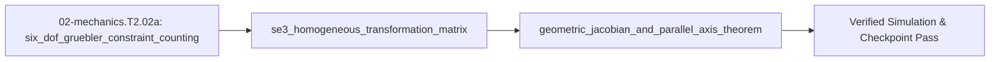

## 1. Why it matters
This is the bridge module before Step 2.3 (`02-mechanics.T2.03`) and Step 2.7 (`06-robotics.T2.07`). Moving from 2D planar links to 3D CAD (`CadQuery`), kinematic couplings, and `URDF`/`MuJoCo` physics requires four core tools: counting **6-DOF spatial degrees of freedom** ($3$ translations + $3$ rotations), combining 3D rotation $R \in SO(3)$ and translation $p \in \mathbb{R}^3$ into a single $4\times 4$ **homogeneous transformation matrix** $T \in SE(3)$, mapping joint speeds $\dot{q}$ to tip velocity $\dot{x} = J(q)\dot{q}$ via the **Jacobian matrix** (which also transforms tip forces into joint torques via $\tau = J^\top F$), and shifting 3D inertia tensors from the Center of Mass to a joint axis via the **Parallel-Axis Theorem**. Already know this? Take the Skip test or the Ladder Gate test in section 7 first.

## 2. Intuition first
An unconstrained rigid part floating in 3D space has **6 Degrees of Freedom (DOF)**: it can slide along $X, Y, Z$ and pitch, roll, or yaw about those three axes. Every ideal point contact removes exactly $1\text{ DOF}$ along its surface normal—so removing all $6\text{ DOF}$ without over-constraining the part takes exactly $6$ non-redundant contact points (**Maxwell's exact-constraint principle** in Step 2.3). Next, why do robotics engineers love $4\times 4$ **homogeneous matrices** $T = \begin{bmatrix} R & p \\ 0 & 1 \end{bmatrix}$? Because adding a `1` at the bottom of a 3D position vector $[x, y, z, 1]^\top$ turns "rotate by $R$, then add offset $p$" into a single matrix multiplication $T_{\text{base}\to\text{tip}} = T_{01} T_{12} \cdots T_{n-1,n}$! Next, the **Jacobian matrix** $J(q)$ acts as a multi-dimensional gear ratio that depends on posture $q$: it maps joint velocities to tip velocity ($\dot{x} = J(q)\dot{q}$), and by conservation of virtual work ($\tau^\top \dot{q} = F^\top \dot{x}$), its transpose maps tip forces directly to joint torques ($\tau = J(q)^\top F$). Finally, swinging a heavy hammer by the end of its handle feels much heavier than spinning the hammerhead in your palm—the **Parallel-Axis Theorem** ($I_{\text{pivot}} = I_{\text{com}} + m d^2$) quantifies that extra $m d^2$ inertia when a link's mass is offset by distance $d$ from the joint axis.

## 3. Formalization
1. **Spatial 6-DOF Constraint Counting:** A free rigid body in $\mathbb{R}^3$ has $6\text{ DOF}$. If $c \le 6$ independent point constraints are applied, remaining mobility is $M = 6 - c$. If $c > 6$ (over-constraint, such as a 4-legged table on an uneven floor), internal preload stress depends on manufacturing tolerances rather than static equilibrium.
2. **3D Homogeneous Transformation Matrix ($T \in SE(3)$):** Combining rotation $R \in SO(3)$ ($3\times 3$) and translation $p \in \mathbb{R}^3$ ($3\times 1$) forms:

$$
T = \begin{bmatrix} R & p \\ 0_{1\times 3} & 1 \end{bmatrix} \in \mathbb{R}^{4\times 4}, \quad T^{-1} = \begin{bmatrix} R^\top & -R^\top p \\ 0_{1\times 3} & 1 \end{bmatrix}
$$

   Chaining frames $\{0\} \to \{1\} \to \{2\}$ multiplies $T_{02} = T_{01} T_{12}$.
3. **Planar/3D Velocity Jacobian ($J(q)$), Force Duality ($\tau = J^\top F$) & Parallel-Axis Theorem:**
   - **What a Partial Derivative ($\frac{\partial x}{\partial q_i}$) Means:** When tip position $x(q_1, q_2)$ depends on two joint angles, the **partial derivative** $\frac{\partial x}{\partial q_1}$ simply means taking the ordinary derivative (`00-foundations.T2.00b`) with respect to $q_1$ while treating all other joint angles ($q_2$) as frozen constants! Differentiating planar 2-link forward kinematics $x = L_1\cos q_1 + L_2\cos(q_1+q_2),\ y = L_1\sin q_1 + L_2\sin(q_1+q_2)$ with respect to $q = [q_1, q_2]^\top$ gives the $2\times 2$ Jacobian:

$$
J(q) = \begin{bmatrix} \frac{\partial x}{\partial q_1} & \frac{\partial x}{\partial q_2} \\ \frac{\partial y}{\partial q_1} & \frac{\partial y}{\partial q_2} \end{bmatrix} = \begin{bmatrix} -L_1 s_1 - L_2 s_{12} & -L_2 s_{12} \\ L_1 c_1 + L_2 c_{12} & L_2 c_{12} \end{bmatrix}, \quad \dot{x} = J(q)\dot{q}, \quad \tau = J(q)^\top F
$$

     At $q_2 = 0$ (arm stretched straight) or $q_2 = \pi$ (arm folded back), $\det J(q) = L_1 L_2 \sin q_2 = 0$ (**kinematic singularity**).
   - **3D Parallel-Axis Theorem (Steiner's Theorem):** Shifting inertia tensor $I_{\text{com}} \in \mathbb{R}^{3\times 3}$ of mass $m$ ($\text{kg}$) by displacement vector $d \in \mathbb{R}^3$ ($\text{m}$) yields:

$$
I_{\text{joint}} = I_{\text{com}} + m\left((d^\top d) I_3 - d d^\top\right)
$$

     For scalar rotation about $z$ with planar offset $d = [L_{\text{com}}, 0, 0]^\top$, $I_{zz,\text{joint}} = I_{zz,\text{com}} + m L_{\text{com}}^2$.

## 4. Worked example
Chain two $SE(3)$ link transforms, compute the 2-link Jacobian $J(q)$ and joint torque $\tau = J(q)^\top F$ at $q_1 = 0\text{ rad}, q_2 = \pi/2\text{ rad}$ ($L_1 = L_2 = 0.20\text{ m}$) for a tip force $F = [10.0, 20.0]^\top\text{ N}$, and verify the 3D Parallel-Axis Theorem on a uniform slender rod ($m = 0.60\text{ kg}, L = 0.40\text{ m}$).

```python
import math

def se3_rz_tx(theta: float, tx: float) -> list[list[float]]:
    c, s = math.cos(theta), math.sin(theta)
    return [[c, -s, 0.0, tx * c],
            [s,  c, 0.0, tx * s],
            [0.0, 0.0, 1.0, 0.0],
            [0.0, 0.0, 0.0, 1.0]]

def mat4_mul(A: list[list[float]], B: list[list[float]]) -> list[list[float]]:
    return [[sum(A[i][k] * B[k][j] for k in range(4)) for j in range(4)] for i in range(4)]

L1, L2 = 0.20, 0.20
q1, q2 = 0.0, math.pi / 2.0
T02 = mat4_mul(se3_rz_tx(q1, L1), se3_rz_tx(q2, L2))
tip_xy = [T02[0][3], T02[1][3]]
assert math.isclose(tip_xy[0], 0.20, abs_tol=1e-9) and math.isclose(tip_xy[1], 0.20, abs_tol=1e-9)

s1, c1 = math.sin(q1), math.cos(q1)
s12, c12 = math.sin(q1 + q2), math.cos(q1 + q2)
J = [[-L1 * s1 - L2 * s12, -L2 * s12],
     [ L1 * c1 + L2 * c12,  L2 * c12]]
F_tip = [10.0, 20.0]
tau_joints = [J[0][0] * F_tip[0] + J[1][0] * F_tip[1], J[0][1] * F_tip[0] + J[1][1] * F_tip[1]]
det_J = J[0][0] * J[1][1] - J[0][1] * J[1][0]
assert math.isclose(det_J, L1 * L2 * math.sin(q2), rel_tol=1e-9)
assert math.isclose(tau_joints[0], 2.0, abs_tol=1e-9) and math.isclose(tau_joints[1], -2.0, abs_tol=1e-9)

# Parallel-Axis Theorem: rod m=0.6 kg, L=0.4 m -> I_com = (1/12)mL^2, I_end = I_com + m(L/2)^2 = (1/3)mL^2
m, L = 0.60, 0.40
I_com = (1.0 / 12.0) * m * (L ** 2)
I_end = I_com + m * ((L / 2.0) ** 2)
assert math.isclose(I_end, (1.0 / 3.0) * m * (L ** 2), rel_tol=1e-9)
print(f"tip={[round(x, 4) for x in tip_xy]}, det(J)={det_J:.4f}, tau={[round(x, 4) for x in tau_joints]} N*m, I_end={I_end:.4f} kg*m^2")
```
Expected output:
```text
tip=[0.2, 0.2], det(J)=0.0400, tau=[2.0, -2.0] N*m, I_end=0.0320 kg*m^2
```

## 5. Exercise
For the 2-link planar arm ($L_1 = 0.25\text{ m}, L_2 = 0.20\text{ m}$), compute the Jacobian determinant $\det J(q) = L_1 L_2 \sin q_2$ at (a) $q_2 = \pi/6\text{ rad}$ ($30^\circ$) and (b) the stretched-out boundary singularity $q_2 = 0\text{ rad}$. Verify $\det J(\pi/6) = 0.025\text{ m}^2$ and $\det J(0) = 0.0\text{ m}^2$.
- **If your result differs:** Check that $\det J(q)$ for a 2-link planar arm depends only on the elbow angle $q_2$: $L_1 L_2 \sin(\pi/6) = 0.25 \times 0.20 \times 0.5 = 0.025\text{ m}^2$.


- **📚 What to Learn & Resources to Solve This Exercise:**
  - **Required Foundations Modules (`00-foundations`):** [`00-foundations.T2.00a`](00-foundations.T2.00a.md) ($2\times 2$ Matrices, Transpose & Determinants) and [`00-foundations.T2.00b`](00-foundations.T2.00b.md) (3D Cross Products $\vec{\tau} = \vec{r}\times\vec{F}$ & Orthogonal Frames).
  - **Prerequisite Bridge Module:** [`02-mechanics.T1.02a`](02-mechanics.T1.02a.md) and Legacy **Step 1.3 (`02-mechanics.T1.03`)**.
  - **Core Concepts to Review First:** 2-link velocity Jacobian $J(q)$, static virtual-work torque $\tau = J(q)^\top F_{\text{tip}}$, parallel-axis theorem $I_O = I_{\text{com}} + m d^2$, and physical triangle-inequality validation in `## 3. Formalization` and `## 4. Worked example` above.
  - **Study Links & Resources:** [Lynch & Park *Modern Robotics* Ch. 5 & Ch. 8 (`hades.mech.northwestern.edu`)](https://hades.mech.northwestern.edu/index.php/Modern_Robotics), [CadQuery Docs (`cadquery.readthedocs.io`)](https://cadquery.readthedocs.io/), and [Track 02 Tier 2 (`02-mechanics-kinematics-dynamics/README.md`)](../02-mechanics-kinematics-dynamics/README.md#tier-2-intermediate--applied).

## 6. Simulation path
Open **Tab 3 (2-Link Arm Kinematics, Jacobian Ellipsoids & Singularities)** in the MechaLab Workbench (`npm run dev`) and drag the end-effector to the workspace boundary ($q_2 \to 0$) to watch $\det J(q) \to 0$.

No hardware required for this module (`hardware_required: false`). In Step 2.3 (`02-mechanics.T2.03`) and Step 2.7 (`06-robotics.T2.07`), `tau = J(q).T @ F_cartesian` runs at $1\text{ kHz}$ to turn the 2-link arm into a Cartesian virtual spring-damper without ever inverting $J(q)$:
```text
[Cartesian Error dx = x_d - FK(q)] ---> [F = K_x * dx - D_x * (J * dq)] ---> [tau = J(q)^T * F] ---> [Motors]
```
Pass/fail verification in simulation: `tip_xy == [0.20, 0.20]`, `det_J == 0.0400`, `tau_joints == [2.0, -2.0] N*m`, and `I_end == 0.0320 kg*m^2`.




## 7. Checkpoint
Pass criteria: score $\ge 80\%$ ($4/4$) on the Skip test or score $\ge 80\%$ ($7/8$) on the Ladder Gate test below to unlock Step 2.3 (`02-mechanics.T2.03`).

### Skip test
1. `[Recall] [Concept: six_dof_gruebler_constraint_counting]` Using the spatial Gruebler-Kutzbach mobility formula $M = 6(N - 1 - J) + \sum_{i=1}^J f_i$, compute the spatial degrees of freedom $M$ (exact integer, tolerance $\pm 0$) of a serial robot arm with $N = 7$ total links ($1$ fixed base $+ 6$ moving links) connected by $J = 6$ single-DOF revolute joints ($f_i = 1$).
2. `[Apply] [Concept: se3_homogeneous_transformation_matrix]` For a $4\times 4$ homogeneous transform $T = \begin{bmatrix} I_3 & p \\ 0 & 1 \end{bmatrix}$ with pure translation $p = [0.3, -0.1, 0.5]^\top\text{ m}$, what is the translation vector $p_{\text{inv}}$ of its inverse $T^{-1}$?
   - **A.** $[0.3, -0.1, 0.5]^\top\text{ m}$
   - **B.** $[-0.3, 0.1, -0.5]^\top\text{ m}$
   - **C.** $[0.0, 0.0, 0.0]^\top\text{ m}$
   - **D.** $[1.0, 1.0, 1.0]^\top\text{ m}$
3. `[Transfer] [Concept: geometric_jacobian_and_parallel_axis_theorem]` Given Jacobian $J = \begin{bmatrix} 0.0 & -0.2 \\ 0.4 & 0.2 \end{bmatrix}\text{ m/rad}$ and Cartesian tip force $F = [10.0, 5.0]^\top\text{ N}$, compute the first joint torque $\tau_1 = (J^\top F)_0$ in $\text{N}\cdot\text{m}$ (tolerance $\pm 10^{-9}$).
4. `[Spaced review -> 02-mechanics.T1.03 — Concept: planar_2link_forward_kinematics] [Concept: geometric_jacobian_and_parallel_axis_theorem]` A link has mass $m = 2.0\text{ kg}$, center-of-mass inertia $I_{zz,\text{com}} = 0.015\text{ kg}\cdot\text{m}^2$, and center-of-mass offset $d = 0.10\text{ m}$ from the joint pivot. Compute $I_{zz,\text{joint}} = I_{zz,\text{com}} + m d^2$ in $\text{kg}\cdot\text{m}^2$ (tolerance $\pm 10^{-9}$).

**Answer key:**
```python
import math

q1_mobility = 6 * (7 - 1 - 6) + 6 * 1
q2_choice = "B"
J = [[0.0, -0.2], [0.4, 0.2]]
F = [10.0, 5.0]
q3_tau1 = J[0][0] * F[0] + J[1][0] * F[1]
q4_i_joint = 0.015 + 2.0 * (0.10 ** 2)

assert q1_mobility == 6
assert q2_choice == "B"
assert math.isclose(q3_tau1, 2.0, rel_tol=1e-9)
assert math.isclose(q4_i_joint, 0.035, rel_tol=1e-9)
```
- **Pass mark:** $4/4$ ($80\%+$). If you missed Q1, study `## 3. Formalization` item 1; Q2, study `## 3. Formalization` item 2; Q3 or Q4, study `## 3. Formalization` item 3. On pass, proceed to `## 10. Next modules`.
### Gate test
Covers the complete Track 02 Tier 2 bridge ladder (`02-mechanics.T2.02a`) before Step 2.3 (`02-mechanics.T2.03`):
1. `[Concept: six_dof_gruebler_constraint_counting]` A rigid sphere rests in a V-groove (2 contact points). How many spatial degrees of freedom $M = 6 - 2$ remain unconstrained?
2. `[Concept: six_dof_gruebler_constraint_counting]` Why does a 3-legged stool never wobble on a rough floor whereas a 4-legged chair often rocks between two diagonal legs?
   - **A.** Because 3 vertical leg contacts remove exactly 3 DOF ($z$-translation, roll, pitch), whereas 4 vertical leg contacts over-constrain those same 3 DOF by 1 redundant constraint.
   - **B.** Because 3 is an odd number.
   - **C.** Because a 3-legged stool has zero mass.
   - **D.** Because gravity only pulls on 3 points.
3. `[Concept: se3_homogeneous_transformation_matrix]` What is the bottom row of every $4\times 4$ rigid-body transformation matrix $T \in SE(3)$?
   - **A.** `[0, 0, 0, 1]`
   - **B.** `[1, 1, 1, 1]`
   - **C.** `[0, 0, 0, 0]`
   - **D.** `[x, y, z, 0]`
4. `[Concept: se3_homogeneous_transformation_matrix]` Why is the inverse of $T = \begin{bmatrix} R & p \\ 0 & 1 \end{bmatrix}$ equal to $\begin{bmatrix} R^\top & -R^\top p \\ 0 & 1 \end{bmatrix}$ instead of $\begin{bmatrix} R^\top & -p \\ 0 & 1 \end{bmatrix}$?
   - **A.** Because the negated translation vector $-p$ is expressed in the parent frame and must be rotated into the child frame via $R^\top$ so that $T T^{-1} = I_4$.
   - **B.** Because $R^\top$ is always zero.
   - **C.** Because $p$ is a $3\times 3$ matrix.
   - **D.** Because homogeneous matrices cannot be inverted.
5. `[Concept: geometric_jacobian_and_parallel_axis_theorem]` Compute $\det J(q) = L_1 L_2 \sin q_2$ in $\text{m}^2$ (tolerance $\pm 10^{-9}$) for $L_1 = 0.30\text{ m}, L_2 = 0.20\text{ m}$, and $q_2 = \pi/2\text{ rad}$.
6. `[Concept: geometric_jacobian_and_parallel_axis_theorem]` At what elbow angle $q_2 \in [0, \pi/2]$ does the 2-link arm become singular ($\det J(q) = 0$) and lose the ability to move radially outward? (Report $q_2$ in radians, tolerance $\pm 10^{-9}$.)
7. `[Concept: geometric_jacobian_and_parallel_axis_theorem]` Why is Jacobian Transpose control ($\tau = J(q)^\top F$) completely immune to divide-by-zero blowup at kinematic singularities ($\det J(q) = 0$) compared to inverse-Jacobian velocity control ($\dot{q} = J(q)^{-1} \dot{x}$)?
   - **A.** Because $\tau = J(q)^\top F$ only multiplies by $J^\top$ and never divides by $\det J(q)$!
   - **B.** Because $J^\top$ is always the identity matrix.
   - **C.** Because singularities only occur in 1D.
   - **D.** Because $F$ is always zero.
8. `[Concept: geometric_jacobian_and_parallel_axis_theorem]` A link with $m = 0.50\text{ kg}$ has $I_{zz,\text{com}} = 0.004\text{ kg}\cdot\text{m}^2$ and its URDF joint origin is offset by $d = 0.20\text{ m}$ from the CoM. Compute $I_{zz,\text{joint}} = I_{zz,\text{com}} + m d^2$ in $\text{kg}\cdot\text{m}^2$ (tolerance $\pm 10^{-9}$).

**Gate answer key:**
```python
import math

g1_dof = 6 - 2
g2_choice = "A"
g3_choice = "A"
g4_choice = "A"
g5_detj = 0.30 * 0.20 * math.sin(math.pi / 2.0)
g6_q2_sing = 0.0
g7_choice = "A"
g8_izz_joint = 0.004 + 0.50 * (0.20 ** 2)

assert g1_dof == 4
assert g2_choice == "A"
assert g3_choice == "A"
assert g4_choice == "A"
assert math.isclose(g5_detj, 0.06, rel_tol=1e-9)
assert math.isclose(g6_q2_sing, 0.0, abs_tol=1e-9)
assert g7_choice == "A"
assert math.isclose(g8_izz_joint, 0.024, rel_tol=1e-9)
```
- **Pass mark:** $7/8$ ($80\%+$). Remediation: Q1–Q2 $\to$ `## 3. Formalization` item 1; Q3–Q4 $\to$ `## 3. Formalization` item 2; Q5–Q8 $\to$ `## 3. Formalization` item 3.

## 8. Common mistakes
| Symptom | Root cause | 2-minute fix |
| :--- | :--- | :--- |
| MuJoCo / Gazebo simulation explodes with `Non-positive definite inertia` or unrealistic swing dynamics | Exported CAD inertia tensor about the CAD world origin instead of the URDF `<inertial>` frame origin without applying the Parallel-Axis Theorem. | Set the URDF `<inertial>` origin at the link's Center of Mass (or shift $I_{\text{com}}$ via $I + m((d^\top d)I_3 - d d^\top)$) and verify $I_{xx} + I_{yy} \ge I_{zz}$ (triangle inequality). |
| Used $\tau = J(q) F$ instead of $\tau = J(q)^\top F$ | Forgot the transpose on $J(q)$ when mapping Cartesian forces to joint torques. | Always transpose: velocities map forward via $\dot{x} = J\dot{q}$, wrenches map backward via $\tau = J^\top F$. |
| Inverted $T \in SE(3)$ using `[R.T, -p]` | Forgot to rotate $-p$ by $R^\top$ in the top-right $3\times 1$ block of $T^{-1}$. | Use `-R.T @ p` for the translation part of $T^{-1}$ and verify `mat_mul4(T, T_inv) == I_4` within $10^{-14}$. |

## 9. Resources
- **Kevin Lynch & Frank Park — *Modern Robotics* (`modernrobotics.org`, Ch. 3, 5 & 8, `resources/textbooks-and-papers.md`):** Free textbook on $SE(3)$ transforms, Jacobians, and spatial inertia matrices `[VERIFIED 2026-10-15]`.
- **Track 02 (`02-mechanics-kinematics-dynamics/README.md`):** Directly continues into Step 2.3 (`02-mechanics.T2.03`) `[VERIFIED 2026-10-15]`.
## 10. Next modules
- Proceed to legacy **Step 2.3 (`02-mechanics.T2.03`)** in [`02-mechanics-kinematics-dynamics/README.md`](../02-mechanics-kinematics-dynamics/README.md#tier-2-intermediate--applied).
