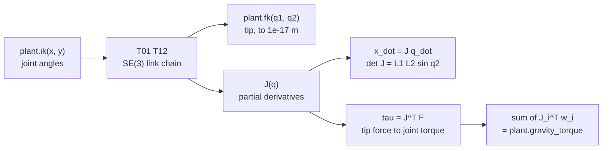

<!-- run-callout:start -->
> **Step 5 of 10 · Build the arm: mechanics**
>
> **Run this in the workbench.** [Open MechaLab with `EX.02-mechanics.T2.02a` loaded](https://tle47.github.io/Mechatronics-Roadmap/?lesson=EX.02-mechanics.T2.02a) - it opens on the **Run Python Lessons** tab with that entry selected. Starter code, hints and the graded check are ready; this page is the reading copy, and nothing you type here is saved.
<!-- run-callout:end -->

## 1. Why it matters
This is the bridge module before Step 2.3 (`02-mechanics.T2.03`) and Step 2.7 (`06-robotics.T2.07`). Moving from 2D links to 3D CAD, kinematic couplings and `URDF`/`MuJoCo` physics takes four tools: counting **6-DOF spatial degrees of freedom**, combining rotation $R \in SO(3)$ and translation $p \in \mathbb{R}^3$ into one $4\times 4$ **homogeneous transform** $T \in SE(3)$, mapping joint speeds to tip speed with the **Jacobian** $\dot{x} = J(q)\dot{q}$ (and tip forces to joint torques with its transpose, $\tau = J^\top F$), and shifting an inertia tensor to a joint axis with the **Parallel-Axis Theorem**.

It is also where the course stops inventing numbers. Every figure below comes from the arm you already built in the Tier 1 capstone (`08-capstone-projects/08.1`), through one import:

```text
import mechalab_plant as plant      # L1 = L2 = 0.10 m, m1 = 0.20 kg, m2 = 0.15 kg, 1 kHz, 4096 cpr
```

So the chain you build here is the chain the arm's own controller runs, `plant.fk` is what that chain computes, and `plant.gravity_torque` is the same transpose $\tau = J^\top F$ applied to each link's weight. Already know this? Take the Skip test or the Ladder Gate test in section 7 first.

## 2. Intuition first
A part floating in space has **6 Degrees of Freedom** - slide along $X, Y, Z$ and roll, pitch, yaw about them. Every ideal point contact removes exactly $1$ along its surface normal, so fixing a part completely without over-constraining it takes exactly $6$ non-redundant contacts (**Maxwell's exact-constraint principle**, Step 2.3). A fourth contact on three legs preloads the part instead of holding it: over-constraint is a manufacturing problem, not a rigidity win.

Why do robotics engineers love $4\times 4$ matrices $T = \begin{bmatrix} R & p \\ 0 & 1 \end{bmatrix}$? Because a `1` appended to a 3D point turns "rotate by $R$, then add $p$" into one matrix multiply, and a chain of links becomes one product, $T_{02} = T_{01}T_{12}$ - which is exactly how a `URDF` states a robot and exactly what the plant's `fk` evaluates for two planar links.

The **Jacobian** $J(q)$ is a posture-dependent multi-dimensional gear ratio. It tells you how much tip speed one rad/s of shoulder buys at the current pose, and by conservation of virtual work ($\tau^\top \dot{q} = F^\top \dot{x}$) its transpose tells you what tip force costs in joint torque: $\tau = J(q)^\top F$. Read that as a promise: **you never invert $J$**. The inverse exists only away from $\det J(q) = 0$, and near a singularity the tip speed for a given joint speed goes to zero while $J^{-1}$ blows up. The transpose has no such trap, which is why a Cartesian virtual spring-damper (Step 2.7) is written with $J^\top$ and not $J^{-1}$.

For the plant's equal-length arm, $\det J(q) = L_1L_2\sin q_2$ depends on the **elbow angle alone**: the arm is singular folded back ($q_2 = \pi$) and stretched straight ($q_2 = 0$). Reach for the boundary with `plant.ik(0.20, 0.0)` and you get $q_2 = 0$ exactly - the pose where pushing the tip radially outward buys nothing.

The same transpose carries gravity. Each link's weight is a wrench at its centre of mass, so the torque that holds the arm up is $\tau_g = \sum_i J_{i}^{\top} w_i$ over the link CoM Jacobians - which is precisely the feedforward term in `plant.pd_gravity_torque`, and it comes out of `plant.gravity_torque` to machine precision. Finally, the **Parallel-Axis Theorem** ($I_{\text{joint}} = I_{\text{com}} + md^2$ for the scalar case) is what turns a CAD inertia tensor about a part's centre of mass into the `<inertial>` a `URDF` needs about its joint axis. The plant's elbow inertia, $I_2 = 0.003\ \text{kg}\cdot\text{m}^2$, is **not** a bare rod: a $0.15\ \text{kg}$, $0.10\ \text{m}$ rod about its own end is $mL^2/3 = 0.0005\ \text{kg}\cdot\text{m}^2$, so the reflected rotor and gearbox are $6\times$ the link. Guessing the rod would be wrong by a factor of six, in the direction that makes a simulator explode.

## 3. Formalization
1. **Spatial mobility (Gruebler-Kutzbach).** For $N$ links (ground included) and $J$ joints with $f_i$ DOF each:

$$
M = 6(N - 1 - J) + \sum_{i=1}^{J} f_i
$$

   The plant's arm: $N = 3$, $J = 2$ revolute joints ($f_i = 1$) gives $M = 6(3 - 1 - 2) + 2 = 2$ - the two joints it is driven by. A free body in $\mathbb{R}^3$ has $6$ DOF; $c \le 6$ independent point constraints leave $M = 6 - c$; $c > 6$ is over-constraint, with internal preload set by tolerances rather than statics.
2. **Homogeneous transforms ($T \in SE(3)$).** Combining $R \in SO(3)$ and $p \in \mathbb{R}^3$:

$$
T = \begin{bmatrix} R & p \\ 0_{1\times3} & 1 \end{bmatrix} \in \mathbb{R}^{4\times4}, \qquad T^{-1} = \begin{bmatrix} R^\top & -R^\top p \\ 0_{1\times3} & 1 \end{bmatrix}
$$

   Chaining frames multiplies: $T_{02} = T_{01}T_{12}$. The inverse's translation is $-R^\top p$ and **not** $-p$, because $-p$ is expressed in the parent frame and has to be rotated into the child frame for $TT^{-1} = I_4$.
3. **Velocity Jacobian, force duality, and gravity through the same transpose.** With $x = L_1\cos q_1 + L_2\cos(q_1 + q_2),\ y = L_1\sin q_1 + L_2\sin(q_1 + q_2)$:

$$
J(q) = \begin{bmatrix} -L_1 s_1 - L_2 s_{12} & -L_2 s_{12} \\ L_1 c_1 + L_2 c_{12} & L_2 c_{12} \end{bmatrix}, \quad \dot{x} = J(q)\dot{q}, \quad \tau = J(q)^\top F, \quad \det J(q) = L_1 L_2 \sin q_2
$$

   The determinant vanishes at $q_2 = 0$ (stretched) and $q_2 = \pi$ (folded back). The gravity torque is the same transpose, one call per link, with $w_i = (0,\ m_i g)$ in the world frame:

$$
\tau_g = \sum_i J_{\text{com},i}(q)^\top w_i, \qquad J_{\text{com},1} = \begin{bmatrix} -L_{c1}s_1 & 0 \\ L_{c1}c_1 & 0 \end{bmatrix}, \qquad J_{\text{com},2} = \begin{bmatrix} -L_1 s_1 - L_{c2}s_{12} & -L_{c2}s_{12} \\ L_1 c_1 + L_{c2}c_{12} & L_{c2}c_{12} \end{bmatrix}
$$

   Note $c_{12} = \cos(q_1 + q_2)$, a **world**-frame angle: the elbow link hangs off the shoulder, so its weight lever arm is set by the angle of the world, not by its own joint. That single subscript is where the fault in section 5 lives.
4. **Parallel-Axis Theorem (Steiner).** Shifting inertia $I_{\text{com}}$ of mass $m$ by $d \in \mathbb{R}^3$:

$$
I_{\text{joint}} = I_{\text{com}} + m\left((d^\top d)I_3 - d d^\top\right) \qquad \xrightarrow{\ d = [L_{\text{com}}, 0, 0]^\top\ } \qquad I_{zz,\text{joint}} = I_{zz,\text{com}} + m L_{\text{com}}^2
$$

   For the plant's second link as a rod, $I_{\text{com}} = mL^2/12 = 0.000125$ and $I_{\text{end}} = 0.0005\ \text{kg}\cdot\text{m}^2$ - one sixth of the plant's reflected $I_2 = 0.003$, the gap the next section prints.

## 4. Worked example
Take the plant's arm at $q = (0.30, 0.60)$ rad - a pose where nothing is accidentally special - and do the four checks in order: chain the two $SE(3)$ transforms and compare the tip with `plant.fk`, build $J$ from its partial derivatives and check $\det J = L_1L_2\sin q_2$, map a tip force $F = (1.20, -0.40)$ N to joint torques with $J^\top$, and rebuild the plant's own gravity torque through the two link CoM Jacobians.

**Predict first (before you run it):** write down your four answers - the tip $(x, y)$ to 4 decimals, $\det J$ to 6 decimals in $\text{m}^2$, $\tau = J^\top F$ on both joints in $\text{N}\cdot\text{m}$, and the ratio of the plant's elbow inertia to a bare rod of the same link. Commit to them before you scroll; a prediction you did not write down is not a prediction.

```python
import math
import mechalab_plant as plant      # the one arm every Tier 2/3 exercise runs on

def rz(theta):
    c, s = math.cos(theta), math.sin(theta)
    return [[c, -s, 0.0, 0.0], [s, c, 0.0, 0.0], [0.0, 0.0, 1.0, 0.0], [0.0, 0.0, 0.0, 1.0]]

def translate(x, y):
    return [[1.0, 0.0, 0.0, x], [0.0, 1.0, 0.0, y], [0.0, 0.0, 1.0, 0.0], [0.0, 0.0, 0.0, 1.0]]

def mat4_mul(A, B):
    return [[sum(A[i][k] * B[k][j] for k in range(4)) for j in range(4)] for i in range(4)]

def jacobian(q1, q2, l1=plant.L1, l2=plant.L2):
    s1, c1 = math.sin(q1), math.cos(q1)
    s12, c12 = math.sin(q1 + q2), math.cos(q1 + q2)
    return [[-l1 * s1 - l2 * s12, -l2 * s12],
            [ l1 * c1 + l2 * c12,  l2 * c12]]

def joint_torques(J, force):
    """tau = J^T F, written out: no matrix library, and no inverse of J anywhere."""
    return (J[0][0] * force[0] + J[1][0] * force[1],
            J[0][1] * force[0] + J[1][1] * force[1])

q1, q2 = 0.30, 0.60
T02 = mat4_mul(mat4_mul(rz(q1), translate(plant.L1, 0.0)),
               mat4_mul(rz(q2), translate(plant.L2, 0.0)))      # the URDF chain, multiplied out
tip = (T02[0][3], T02[1][3])
assert math.dist(tip, plant.fk(q1, q2)) < 1e-12                 # the chain and the plant agree

J = jacobian(q1, q2)
det_J = J[0][0] * J[1][1] - J[0][1] * J[1][0]
assert math.isclose(det_J, plant.L1 * plant.L2 * math.sin(q2), rel_tol=1e-12)

tau_F = joint_torques(J, (1.20, -0.40))

# Gravity, through the same transpose: one CoM Jacobian per link, weight (0, m * g) pointing down
s1, c1 = math.sin(q1), math.cos(q1)
s12, c12 = math.sin(q1 + q2), math.cos(q1 + q2)
J_link1 = [[-plant.LC1 * s1, 0.0], [plant.LC1 * c1, 0.0]]
J_link2 = [[-plant.L1 * s1 - plant.LC2 * s12, -plant.LC2 * s12],
           [ plant.L1 * c1 + plant.LC2 * c12,  plant.LC2 * c12]]
tau_g = [0.0, 0.0]
for J_com, mass in ((J_link1, plant.M1), (J_link2, plant.M2)):
    held = joint_torques(J_com, (0.0, mass * plant.G))
    tau_g[0] += held[0]
    tau_g[1] += held[1]
reference = plant.gravity_torque(q1, q2)
assert math.isclose(tau_g[0], reference[0], abs_tol=1e-12)
assert math.isclose(tau_g[1], reference[1], abs_tol=1e-12)

# Parallel axis on the plant's own second link: a rod about its centre, shifted to the joint axis
rod_com = plant.M2 * plant.L2 ** 2 / 12.0                  # (1/12) m L^2
rod_end = rod_com + plant.M2 * (plant.L2 / 2.0) ** 2       # + m d^2
assert math.isclose(rod_end, plant.M2 * plant.L2 ** 2 / 3.0, rel_tol=1e-12)

print(
    "tip=(%.4f, %.4f) m | det J=%.6f m^2 | tau=J^T F=(%.4f, %.4f) N*m | "
    "gravity via CoM Jacobians=(%.4f, %.4f) N*m | I2 = %.1f x rod"
    % (tip[0], tip[1], det_J, tau_F[0], tau_F[1], tau_g[0], tau_g[1], plant.I2 / rod_end)
)
```
Expected output:
```text
tip=(0.1577, 0.1079) m | det J=0.005646 m^2 | tau=J^T F=(-0.1925, -0.1189) N*m | gravity via CoM Jacobians=(0.2800, 0.0457) N*m | I2 = 6.0 x rod
```

What to notice, in the order the checks ran:
- `plant.fk` and the matrix chain agree to $3\times10^{-17}$ m, i.e. to the last bit a double can carry. Your URDF and your Python now say the same thing about where the tip is.
- $\det J = 0.005646\ \text{m}^2$ and the closed form $L_1L_2\sin(0.60) = 0.005646$ agree: the determinant is a function of the elbow alone, so no pose of the shoulder can rescue a singular elbow.
- $\tau = J^\top F = (-0.1925, -0.1189)\ \text{N}\cdot\text{m}$: a modest $1.3\ \text{N}$ push at the tip loads the shoulder with $0.19\ \text{N}\cdot\text{m}$, comfortably inside the plant's $\pm 2.5\ \text{N}\cdot\text{m}$ clamp - but check it at the stretched pose before you assume that always holds.
- The gravity sum through the two CoM Jacobians matches `plant.gravity_torque` to $6\times10^{-17}\ \text{N}\cdot\text{m}$. That is not a coincidence to admire; it is the reason the plant's feedforward is one line, and it is the identity section 5 breaks on purpose.
- $I_2$ is $6.0\times$ a bare rod. The plant's joint inertias are reflected rotor-plus-gearbox-plus-link values measured at Tier 1, so a rod model of that link would be wrong by a factor of six.

## 5. Exercise
Do the same three checks at the pose where the tip sits at $(0.10, 0.10)$ m, then one that uses the plant as a *measuring device* rather than a formula.

1. `q = plant.ik(0.10, 0.10)` - report the two joint angles to 4 decimals. (Note what they are.)
2. Build $J(q)$ and report $\det J$ to 6 decimals, plus the closed form $L_1L_2\sin q_2$. Explain in one line why they can only agree at this pose.
3. Report $\tau = J^\top F$ for $F = (1.0, 2.0)$ N to 4 decimals, and say what is special about the pair.
4. Sum the two link CoM Jacobians' contributions and check the result against `plant.gravity_torque(q)` at this pose. Report both torques to 4 decimals.
5. **Independent route.** Give a tip point mass $m_p = 0.05$ kg at the tip and compute $\partial U/\partial q$ by central differences of the plant's own potential energy $U(q) = m_p g \cdot y_{\text{tip}}(q)$, where $y_{\text{tip}}$ is `plant.fk(q1, q2)[1]`; compare against $J^\top(0, m_p g)$. Report the worst disagreement in $\text{N}\cdot\text{m}$. Never accept a torque formula on the strength of the formula alone - this is a second, independent way to the same numbers.
6. Report the elbow angles in $[0, \pi]$ at which the arm loses a Cartesian direction.

### Starter code
```python
"""Exercise 02-mechanics.T2.02a - the learner's file.

Fill the six TODOs below (the module's five, plus `payload_run`), then run the tests:

    EXERCISE_TARGET=exercises/02-mechanics.T2.02a/starter.py \
        python3 -m unittest discover -s exercises/02-mechanics.T2.02a -p 'test_behavior.py'

Every `raise NotImplementedError` is a hole; the file is still valid Python, so CI can import it
and confirm it *fails*, which is half of the three-way check.

The conventions are the plant's, not yours to pick: angles in radians, lengths in metres,
(x, y) in metres, torques in newton-metres, gravity downwards at -y.
"""

import math

import mechalab_plant as plant


def jacobian(q1, q2, l1=plant.L1, l2=plant.L2):
    """The 2x2 geometric Jacobian of the tip: [[dx/dq1, dx/dq2], [dy/dq1, dy/dq2]].

    TODO 1: differentiate the planar forward kinematics.
    Only the elbow differentiates l2, so both entries of the second column carry the world
    angle q1 + q2.
    """
    raise NotImplementedError("TODO 1: build the Jacobian")


def joint_torques(J, force):
    """Joint torques (tau1, tau2) that a Cartesian tip force produces.

    TODO 2: the transpose is the whole point - do not multiply J by F.
    """
    raise NotImplementedError("TODO 2: map a tip force into joint torques")


def gravity_from_com_jacobians(q1, q2):
    """Gravity holding torques, built as sum_i J_com,i(q)^T (0, m_i g).

    TODO 3: two links, two CoM Jacobians. The elbow's CoM hangs off the shoulder, so it is
    rotated by q1 + q2 - its own joint angle is not its world angle.
    """
    raise NotImplementedError("TODO 3: sum the two CoM Jacobians")


def singular_elbow_angles():
    """The elbow angles in [0, pi] where det J = l1 * l2 * sin(q2) is zero.

    TODO 4: solve sin(q2) = 0 on the closed interval. Return a tuple of floats.
    """
    raise NotImplementedError("TODO 4: where is the arm singular?")


def potential_gradient(q1, q2, m_p=0.05, h=1e-6):
    """(dU/dq1, dU/dq2) of U = m_p * g * y_tip, by central differences.

    TODO 5: perturb one angle at a time, divide by 2h, and use plant.fk for the height.
    """
    raise NotImplementedError("TODO 5: energy route to the same torque")


def payload_run(m_payload, compensate):
    """Run the capstone's figure-8 with a point mass at the tip.

    Returns {"rms_mm": float, "peak_mm": float}. The payload reaches the plant twice:
      * as an external torque on `step_arm(dist=...)`, always;
      * as a feedforward term J(q)^T (0, m g) in the controller, when `compensate` is True.
    The controller is the capstone's PD + gravity law; keep it, do not retune it.
    """
    raise NotImplementedError("TODO 6: run the payload scenario")

# The browser entry appends `selfcheck.py` below this line; on its own this file prints nothing.
```

**Expected numbers (the answer):** $q = (0.0000, 1.5708)$ rad; $\det J = 0.010000\ \text{m}^2$; $\tau = (0.1000, -0.1000)\ \text{N}\cdot\text{m}$; $\tau_g = (0.2453, 0.0000)\ \text{N}\cdot\text{m}$; worst finite-difference gap below $10^{-9}\ \text{N}\cdot\text{m}$; singular at $q_2 = 0$ and $q_2 = \pi$.

### Hint ladder
1. **Which partial derivative is which.** $J$'s first row is $\partial x/\partial q$ and its second is $\partial y/\partial q$; each column is one joint. Only the elbow differentiates $L_2$, which is why both entries of the second column carry $s_{12}$ or $c_{12}$.
2. **Why the exercise pose is clean.** At the tip $(0.10, 0.10)$ the law of cosines gives $\cos q_2 = (x^2 + y^2 - L_1^2 - L_2^2)/(2L_1L_2) = 0$, so $q_2 = \pi/2$ exactly and $q_1 = \operatorname{atan2}(y, x) - \operatorname{atan2}(L_2, L_1) = 0$ exactly: $\det J = L_1L_2$ with no rounding, and the elbow is horizontal, so the elbow's gravity term is exactly $0$.
3. **The finite-difference check.** Perturb one angle at a time by $\pm h$ with $h = 10^{-6}$, difference the two potentials, divide by $2h$, and use `plant.fk` for the height $y$. A central difference is accurate to $O(h^2)$, so the gap should sit near $10^{-12}$, not $10^{-3}$; if yours is large, you likely differenced both angles at once or reused a stale $q$.

### Submit it as a graded exercise
This section is a real exercise package, not a page: [`exercises/02-mechanics.T2.02a/`](../exercises/02-mechanics.T2.02a/) holds `starter.py` (the scaffold above plus the `payload_run` hole, six in all), `solution.py`, `test_behavior.py` (11 cases), `test_transfer.py` (3 cases), four planted faults and a browser self-check. Edit the starter in place, then run the tests the way CI does:

```bash
EXERCISE_TARGET=exercises/02-mechanics.T2.02a/starter.py \
  python3 -m unittest discover -s exercises/02-mechanics.T2.02a -p 'test_*.py'
```

The grading is behavioural, and each test names the mistake it catches: the Jacobian is compared with a finite difference of the plant's `fk` at five poses (not only the worked one), the force map with virtual work (so $J F$ fails where $J^\top F$ passes), gravity with `plant.gravity_torque` at five poses, and the singular poses with a finite result. The transfer suite then moves the payload to 0.35 kg so a submission tuned to 0.20 kg does not pass. `scripts/run_exercise.py` is the gate: starter fails on its `NotImplementedError`, the reference passes both suites, and `wrong_frame`, `wrong_transpose`, `hardcoded_pose` and `ignored_lengths` each fail the test named for them - a print-only file that recites the numbers passes nothing.

### Full Solution
```python
import math

import mechalab_plant as plant


def jacobian(q1, q2, l1=plant.L1, l2=plant.L2):
    """The 2x2 geometric Jacobian of the tip, m/rad."""
    s1, c1 = math.sin(q1), math.cos(q1)
    s12, c12 = math.sin(q1 + q2), math.cos(q1 + q2)
    return [[-l1 * s1 - l2 * s12, -l2 * s12],
            [l1 * c1 + l2 * c12, l2 * c12]]


def joint_torques(J, force):
    """tau = J^T F: the tip force mapped into the joints, N*m."""
    return (J[0][0] * force[0] + J[1][0] * force[1],
            J[0][1] * force[0] + J[1][1] * force[1])


def gravity_from_com_jacobians(q1, q2):
    """Gravity holding torque from the two CoM Jacobians, N*m."""
    s1, c1 = math.sin(q1), math.cos(q1)
    s12, c12 = math.sin(q1 + q2), math.cos(q1 + q2)   # the elbow's world angle, not q2
    j_link1 = [[-plant.LC1 * s1, 0.0],
               [plant.LC1 * c1, 0.0]]
    j_link2 = [[-plant.L1 * s1 - plant.LC2 * s12, -plant.LC2 * s12],
               [plant.L1 * c1 + plant.LC2 * c12, plant.LC2 * c12]]
    tau1 = 0.0
    tau2 = 0.0
    for j_com, mass in ((j_link1, plant.M1), (j_link2, plant.M2)):
        t1, t2 = joint_torques(j_com, (0.0, mass * plant.G))
        tau1 += t1
        tau2 += t2
    return tau1, tau2


def singular_elbow_angles():
    """det J = l1 l2 sin(q2) vanishes at the stretched and folded poses."""
    return (0.0, math.pi)


def potential_gradient(q1, q2, m_p=0.05, h=1e-6):
    """dU/dq for U = m_p g y_tip, by central differences."""

    def potential(a1, a2):
        return m_p * plant.G * plant.fk(a1, a2)[1]

    return ((potential(q1 + h, q2) - potential(q1 - h, q2)) / (2.0 * h),
            (potential(q1, q2 + h) - potential(q1, q2 - h)) / (2.0 * h))


def payload_run(m_payload, compensate):
    """The capstone's figure-8 with a point mass at the tip, graded on tip error."""
    q_des = plant.ik(*plant.figure8_target(0.0))
    state = (q_des[0], q_des[1], 0.0, 0.0)
    previous = q_des
    sum_sq = 0.0
    peak_mm = 0.0

    for step in range(plant.TICKS):
        t = step * plant.DT
        x_des, y_des = plant.figure8_target(t)
        q_des = plant.ik(x_des, y_des)
        if step:
            dq_des = ((q_des[0] - previous[0]) / plant.DT,
                      (q_des[1] - previous[1]) / plant.DT)
        else:
            dq_des = (0.0, 0.0)
        previous = q_des

        tau_g = plant.gravity_torque(state[0], state[1])
        payload = joint_torques(jacobian(state[0], state[1]),
                                (0.0, m_payload * plant.G))
        feed = payload if compensate else (0.0, 0.0)

        tau1 = (plant.KP1 * (q_des[0] - state[0])
                + plant.KD1 * (dq_des[0] - state[2]) + tau_g[0] + feed[0])
        tau2 = (plant.KP2 * (q_des[1] - state[1])
                + plant.KD2 * (dq_des[1] - state[3]) + tau_g[1] + feed[1])
        tau = (max(-plant.TAU_LIMIT, min(plant.TAU_LIMIT, tau1)),
               max(-plant.TAU_LIMIT, min(plant.TAU_LIMIT, tau2)))

        pulse = plant.disturbance_torque(t)
        state = plant.step_arm(state, tau,
                               dist=(pulse[0] - payload[0], pulse[1] - payload[1]))

        error_mm = math.dist((x_des, y_des), plant.fk(state[0], state[1])) * 1000.0
        sum_sq += error_mm * error_mm
        peak_mm = max(peak_mm, error_mm)

    return {"rms_mm": math.sqrt(sum_sq / plant.TICKS), "peak_mm": peak_mm}

# No `__main__` block on purpose: the browser grades this file's stdout against the appended
# self-check's single PASS line, and a second print here would be a mismatch for a correct answer.

q = plant.ik(0.10, 0.10)
J = jacobian(*q)
det_J = J[0][0] * J[1][1] - J[0][1] * J[1][0]
tau_F = joint_torques(J, (1.0, 2.0))
tau_g = gravity_from_com_jacobians(*q)
reference = plant.gravity_torque(*q)

assert math.isclose(q[0], 0.0, abs_tol=1e-15) and math.isclose(q[1], math.pi / 2.0, abs_tol=1e-15)
assert math.isclose(det_J, plant.L1 * plant.L2, rel_tol=1e-12)
assert math.isclose(tau_F[0], 0.1, abs_tol=1e-12) and math.isclose(tau_F[1], -0.1, abs_tol=1e-12)
assert math.isclose(tau_g[0], reference[0], abs_tol=1e-12)
assert math.isclose(tau_g[1], reference[1], abs_tol=1e-12)
assert singular_elbow_angles() == (0.0, math.pi)

# The independent route: a 0.05 kg point mass at the tip, dU/dq against J^T (0, m g)
m_p = 0.05
worst = 0.0
for pose in ((0.0, math.pi / 2.0), (0.30, 0.60), (-1.10, 1.40)):
    by_jacobian = joint_torques(jacobian(*pose), (0.0, m_p * plant.G))
    by_energy = potential_gradient(*pose)
    worst = max(worst, abs(by_jacobian[0] - by_energy[0]), abs(by_jacobian[1] - by_energy[1]))
assert worst < 1e-9, worst

print("q=(%.4f, %.4f) rad | det J=%.6f m^2 | tau=(%.4f, %.4f) N*m" % (q[0], q[1], det_J, tau_F[0], tau_F[1]))
print("tau_g=(%.4f, %.4f) N*m | plant reference=(%.4f, %.4f) N*m | worst dU/dq gap=%.2e N*m"
      % (tau_g[0], tau_g[1], reference[0], reference[1], worst))

```

Printed: `q=(0.0000, 1.5708) rad | det J=0.010000 m^2 | tau=(0.1000, -0.1000) N*m`, then `tau_g=(0.2453, 0.0000) N*m | plant reference=(0.2453, 0.0000) N*m | worst dU/dq gap=6.16e-12 N*m`.

### Transfer task - a payload, graded by behaviour
The capstone's disturbance pulse is a joint torque; a real payload is a **tip force**. Put a $0.20\ \text{kg}$ mass at the tip and run the capstone's own figure-8 with it, twice: once with the payload fed forward as $\tau = J^\top(0, -m_p g)$ and once without. Report both RMS and peak tip errors, and the ratio. Grade yourself on the numbers only, not on how the code reads.

```python
import math
import mechalab_plant as plant

def jacobian(q1, q2, l1=plant.L1, l2=plant.L2):
    s1, c1 = math.sin(q1), math.cos(q1)
    s12, c12 = math.sin(q1 + q2), math.cos(q1 + q2)
    return [[-l1 * s1 - l2 * s12, -l2 * s12], [l1 * c1 + l2 * c12, l2 * c12]]

def joint_torques(J, force):
    return (J[0][0] * force[0] + J[1][0] * force[1], J[0][1] * force[0] + J[1][1] * force[1])

def run_with_payload(m_payload, compensate):
    """The plant's figure-8 with a point mass at the tip.

    A payload is a tip force, so its joint-torque effect is exactly J(q)^T (0, -m g): the whole
    point of the transpose is that you write that down instead of measuring it. `step_arm`'s `dist`
    is where the plant takes an external torque, and `compensate` decides whether the controller
    also feeds the same wrench forward.
    """
    q_des = plant.ik(*plant.figure8_target(0.0))
    state = (q_des[0], q_des[1], 0.0, 0.0)
    previous = q_des
    rms_sum = 0.0
    peak_mm = 0.0
    for step in range(plant.TICKS):
        t = step * plant.DT
        x_des, y_des = plant.figure8_target(t)
        q_des = plant.ik(x_des, y_des)
        dq_des = ((q_des[0] - previous[0]) / plant.DT, (q_des[1] - previous[1]) / plant.DT) if step else (0.0, 0.0)
        previous = q_des
        tau_g = plant.gravity_torque(state[0], state[1])
        payload = joint_torques(jacobian(state[0], state[1]), (0.0, m_payload * plant.G))
        feed = payload if compensate else (0.0, 0.0)
        tau1 = plant.KP1 * (q_des[0] - state[0]) + plant.KD1 * (dq_des[0] - state[2]) + tau_g[0] + feed[0]
        tau2 = plant.KP2 * (q_des[1] - state[1]) + plant.KD2 * (dq_des[1] - state[3]) + tau_g[1] + feed[1]
        tau = (max(-plant.TAU_LIMIT, min(plant.TAU_LIMIT, tau1)),
               max(-plant.TAU_LIMIT, min(plant.TAU_LIMIT, tau2)))
        pulse = plant.disturbance_torque(t)
        state = plant.step_arm(state, tau, dist=(pulse[0] - payload[0], pulse[1] - payload[1]))
        error_mm = math.dist((x_des, y_des), plant.fk(state[0], state[1])) * 1000.0
        rms_sum += error_mm * error_mm
        peak_mm = max(peak_mm, error_mm)
    return math.sqrt(rms_sum / plant.TICKS), peak_mm

for compensate in (True, False):
    rms_mm, peak_mm = run_with_payload(0.20, compensate)
    print("0.20 kg payload | J^T feedforward %-3s: RMS=%.2f mm, peak=%.2f mm"
          % ("on" if compensate else "off", rms_mm, peak_mm))
```

Printed:
```text
0.20 kg payload | J^T feedforward on : RMS=0.91 mm, peak=2.40 mm
0.20 kg payload | J^T feedforward off: RMS=3.59 mm, peak=5.41 mm
```

With an empty `m_payload` the same loop reproduces the capstone's `0.9130 mm` RMS and `2.4016 mm` peak exactly, so the comparison is against the module's own baseline, not a remembered one. With the payload and the feedforward, the run is **bit-identical** to the capstone's payload-free run - the compensation is exact, not approximately right - and without it the RMS is $3.9\times$ worse. That factor is the entire argument for $\tau = J^\top F$ in a controller.

### Break it on purpose
Build the elbow link's CoM Jacobian from the elbow's **own** angle instead of the world angle: replace `s12, c12 = sin(q1 + q2), cos(q1 + q2)` with `sin(q2), cos(q2)` in `gravity_from_com_jacobians`. This is the mistake a link-local URDF frame hands you, and it is one token wide.

- **Inject:** that single substitution - and nothing else. Keep the shoulder branch, the gains and the trajectory exactly as they were.
- **Symptom:** at the vertical pose $q = (\pi/2, 0)$, where the arm needs no elbow torque at all, the law now commands $0.0736\ \text{N}\cdot\text{m}$ and the PD holds the elbow $0.3549^\circ$ off target (the correct law holds it to $0.000000^\circ$). Along the capstone's figure-8, where $q_1$ stays small, the worst mismatch is only $0.0677\ \text{N}\cdot\text{m}$, and the run degrades from RMS $0.91\ \text{mm}$ to $1.43\ \text{mm}$ - visible, but easy to dismiss as noise.
- **Diagnose:** the mismatch is **exactly zero at $q_1 = 0$** and maximal at $q_1 = \pi/2$. No gain error behaves that way: a wrong $K_p$ is wrong everywhere, and a wrong sign is wrong everywhere. A fault that vanishes at one angle and is largest $90^\circ$ away is a **frame** error - an angle measured from the wrong origin - and the plant names the culprit for you: the elbow term must use $\cos(q_1 + q_2)$ because the elbow link hangs off the shoulder. The determinant cannot see this fault at all; `det J` only depends on $q_2$, and the bad term is a torque, not a velocity.
- **Fix:** use the world angle $q_1 + q_2$ for the second link, then re-run the identity at several poses, not just the one you were testing: `plant.gravity_torque` is the oracle and the agreement must hold to $10^{-12}$ everywhere on the trajectory.

## 6. Simulation path
Every block above runs in the workbench's Python runner (`npm run dev`, Vibration Filter & Resonance Lab), where `import mechalab_plant` needs no setup: the runner writes the shared plant into Pyodide's filesystem before your code runs. On your own machine, put that one directory on the path and run the same code with the host interpreter:

```bash
PYTHONPATH=resources/plants python3 your_script.py
```

The graded exercise also has a browser entry: **Modules -> `EX.02-mechanics.T2.02a`** in the workbench list. The starter is preloaded with `selfcheck.py` appended, so **Run** shows the first hole it hits and **Verify** compares the `SELF-CHECK PASS:` line - the same checks as the native tests, in the same program shape `scripts/exercise_bundle.py` builds for CI. That path is tested on the built bundle, not just promised: `scripts/e2e_pages_bundle.mjs` selects this entry, asserts the starter fails on its `NotImplementedError`, loads the reference, waits for the PASS line and checks the output badge reads MATCHED.

`verification: ci-native` records how this module is actually checked: `scripts/validate_modules.py` and `scripts/run_all_labs.py` execute the worked example on the runner and diff its stdout against the `Expected output:` block, and every other block in this module - the scaffold, the full solution, the transfer run, both answer keys - is executed too, so a broken number fails the build rather than sitting in the page. No hardware is required (`hardware_required: false`): this module is `simulation: full`.

The plant's contract, its provenance rule and its values live in [`resources/plants/README.md`](../resources/plants/README.md); the tier-parity contract this module is scored against is [`docs/QUALITY_SPEC.md`](../docs/QUALITY_SPEC.md).



## 7. Checkpoint
Pass criteria: score $\ge 80\%$ ($4/5$) on the Skip test or score $\ge 80\%$ ($7/8$) on the Ladder Gate test below to unlock Step 2.3 (`02-mechanics.T2.03`).

### Skip test
<!-- skip-test:start -->
1. `[Recall] [Concept: six_dof_gruebler_constraint_counting]` Using the spatial Gruebler-Kutzbach mobility formula $M = 6(N - 1 - J) + \sum_{i=1}^J f_i$, compute the spatial degrees of freedom $M$ (exact integer, tolerance $\pm 0$) of a serial robot arm with $N = 7$ total links ($1$ fixed base $+ 6$ moving links) connected by $J = 6$ single-DOF revolute joints ($f_i = 1$).
2. `[Apply] [Concept: se3_homogeneous_transformation_matrix]` For a $4\times 4$ homogeneous transform $T = \begin{bmatrix} I_3 & p \\ 0 & 1 \end{bmatrix}$ with pure translation $p = [0.3, -0.1, 0.5]^\top\text{ m}$, what is the translation vector $p_{\text{inv}}$ of its inverse $T^{-1}$?
   - **A.** $[0.3, -0.1, 0.5]^\top\text{ m}$
   - **B.** $[-0.3, 0.1, -0.5]^\top\text{ m}$
   - **C.** $[0.0, 0.0, 0.0]^\top\text{ m}$
   - **D.** $[1.0, 1.0, 1.0]^\top\text{ m}$
3. `[Transfer] [Concept: geometric_jacobian_and_parallel_axis_theorem]` Given Jacobian $J = \begin{bmatrix} 0.0 & -0.2 \\ 0.4 & 0.2 \end{bmatrix}\text{ m/rad}$ and Cartesian tip force $F = [10.0, 5.0]^\top\text{ N}$, compute the first joint torque $\tau_1 = (J^\top F)_0$ in $\text{N}\cdot\text{m}$ (tolerance $\pm 10^{-9}$).
4. `[Concept: geometric_jacobian_and_parallel_axis_theorem]` A link has mass $m = 2.0\text{ kg}$, center-of-mass inertia $I_{zz,\text{com}} = 0.015\text{ kg}\cdot\text{m}^2$, and center-of-mass offset $d = 0.10\text{ m}$ from the joint pivot. Compute $I_{zz,\text{joint}} = I_{zz,\text{com}} + m d^2$ in $\text{kg}\cdot\text{m}^2$ (tolerance $\pm 10^{-9}$).
5. `[Spaced review -> 02-mechanics.T1.02a — Concept: gear_reduction_speed_torque_power_conservation]` A motor turns at $3000\,\text{rpm}$ through a $10{:}1$ reduction. Compute the output speed in $\text{rpm}$ (tolerance $\pm 10^{-9}$).

**Answer key:**
```python
import math

q1_mobility = 6 * (7 - 1 - 6) + 6 * 1
q2_choice = "B"
J = [[0.0, -0.2], [0.4, 0.2]]
F = [10.0, 5.0]
q3_tau1 = J[0][0] * F[0] + J[1][0] * F[1]
q4_i_joint = 0.015 + 2.0 * (0.10 ** 2)

assert q1_mobility == 6
assert q2_choice == "B"
assert math.isclose(q3_tau1, 2.0, rel_tol=1e-9)
assert math.isclose(q4_i_joint, 0.035, rel_tol=1e-9)
q5_review = 3000.0 / 10.0
assert math.isclose(q5_review, 300.0, rel_tol=1e-9, abs_tol=1e-09)
```
- **Pass mark:** $4/5$ ($80\%+$). If you missed Q1, study `## 3. Formalization` item 1; Q2, study `## 3. Formalization` item 2; Q3 or Q4, study `## 3. Formalization` item 3. If you missed  Q5, review `02-mechanics.T1.02a`. On pass, proceed to `## 10. Next modules`.
<!-- skip-test:end -->

### Gate test
Covers the complete Track 02 Tier 2 bridge ladder (`02-mechanics.T2.02a`) before Step 2.3 (`02-mechanics.T2.03`):
1. `[Concept: six_dof_gruebler_constraint_counting]` A rigid sphere rests in a V-groove (2 contact points). How many spatial degrees of freedom $M = 6 - 2$ remain unconstrained?
2. `[Concept: six_dof_gruebler_constraint_counting]` Why does a 3-legged stool never wobble on a rough floor whereas a 4-legged chair often rocks between two diagonal legs?
   - **A.** Because 3 vertical leg contacts remove exactly 3 DOF ($z$-translation, roll, pitch), whereas 4 vertical leg contacts over-constrain those same 3 DOF by 1 redundant constraint.
   - **B.** Because 3 is an odd number.
   - **C.** Because a 3-legged stool has zero mass.
   - **D.** Because gravity only pulls on 3 points.
3. `[Concept: se3_homogeneous_transformation_matrix]` What is the bottom row of every $4\times 4$ rigid-body transformation matrix $T \in SE(3)$?
   - **A.** `[0, 0, 0, 1]`
   - **B.** `[1, 1, 1, 1]`
   - **C.** `[0, 0, 0, 0]`
   - **D.** `[x, y, z, 0]`
4. `[Concept: se3_homogeneous_transformation_matrix]` Why is the inverse of $T = \begin{bmatrix} R & p \\ 0 & 1 \end{bmatrix}$ equal to $\begin{bmatrix} R^\top & -R^\top p \\ 0 & 1 \end{bmatrix}$ instead of $\begin{bmatrix} R^\top & -p \\ 0 & 1 \end{bmatrix}$?
   - **A.** Because the negated translation vector $-p$ is expressed in the parent frame and must be rotated into the child frame via $R^\top$ so that $T T^{-1} = I_4$.
   - **B.** Because $R^\top$ is always zero.
   - **C.** Because $p$ is a $3\times 3$ matrix.
   - **D.** Because homogeneous matrices cannot be inverted.
5. `[Concept: geometric_jacobian_and_parallel_axis_theorem]` Compute $\det J(q) = L_1 L_2 \sin q_2$ in $\text{m}^2$ (tolerance $\pm 10^{-9}$) for $L_1 = 0.30\text{ m}, L_2 = 0.20\text{ m}$, and $q_2 = \pi/2\text{ rad}$.
6. `[Concept: geometric_jacobian_and_parallel_axis_theorem]` At what elbow angle $q_2 \in [0, \pi/2]$ does the 2-link arm become singular ($\det J(q) = 0$) and lose the ability to move radially outward? (Report $q_2$ in radians, tolerance $\pm 10^{-9}$.)
7. `[Concept: geometric_jacobian_and_parallel_axis_theorem]` Why is Jacobian Transpose control ($\tau = J(q)^\top F$) completely immune to divide-by-zero blowup at kinematic singularities ($\det J(q) = 0$) compared to inverse-Jacobian velocity control ($\dot{q} = J(q)^{-1} \dot{x}$)?
   - **A.** Because $\tau = J(q)^\top F$ only multiplies by $J^\top$ and never divides by $\det J(q)$!
   - **B.** Because $J^\top$ is always the identity matrix.
   - **C.** Because singularities only occur in 1D.
   - **D.** Because $F$ is always zero.
8. `[Concept: geometric_jacobian_and_parallel_axis_theorem]` A link with $m = 0.50\text{ kg}$ has $I_{zz,\text{com}} = 0.004\text{ kg}\cdot\text{m}^2$ and its URDF joint origin is offset by $d = 0.20\text{ m}$ from the CoM. Compute $I_{zz,\text{joint}} = I_{zz,\text{com}} + m d^2$ in $\text{kg}\cdot\text{m}^2$ (tolerance $\pm 10^{-9}$).

**Gate answer key:**
```python
import math

g1_dof = 6 - 2
g2_choice = "A"
g3_choice = "A"
g4_choice = "A"
g5_detj = 0.30 * 0.20 * math.sin(math.pi / 2.0)
g6_q2_sing = 0.0
g7_choice = "A"
g8_izz_joint = 0.004 + 0.50 * (0.20 ** 2)

assert g1_dof == 4
assert g2_choice == "A"
assert g3_choice == "A"
assert g4_choice == "A"
assert math.isclose(g5_detj, 0.06, rel_tol=1e-9)
assert math.isclose(g6_q2_sing, 0.0, abs_tol=1e-9)
assert g7_choice == "A"
assert math.isclose(g8_izz_joint, 0.024, rel_tol=1e-9)
```
- **Pass mark:** $7/8$ ($80\%+$). Remediation: Q1-Q2 $\to$ `## 3. Formalization` item 1; Q3-Q4 $\to$ `## 3. Formalization` item 2; Q5-Q8 $\to$ `## 3. Formalization` item 3.

## 8. Common mistakes
| Symptom | Root cause | 2-minute fix |
| :--- | :--- | :--- |
| MuJoCo or Gazebo explodes with `Non-positive definite inertia`, or the link swings with the wrong dynamics | The exported inertia tensor is about the CAD origin, not the URDF `<inertial>` frame, and the shift was never applied | Move `<inertial>` to the link's centre of mass, or shift $I$ with $I_{\text{com}} + m((d^\top d)I_3 - d d^\top)$; then check the triangle inequality $I_{xx} + I_{yy} \ge I_{zz}$ and the plant's own scale (a rod is $6\times$ too light here) |
| Used $\tau = J(q) F$ instead of $\tau = J(q)^\top F$ | Forgot the transpose when mapping a Cartesian force to joint torques | Velocities map forward with $\dot{x} = J\dot{q}$, wrenches map backward with $\tau = J^\top F$; the tell is that the torques are right in magnitude but wrong in distribution, and $F^\top \dot{x} \ne \tau^\top \dot{q}$ |
| The torch reading matches but the arm pushes the wrong way, only at some poses | The elbow link's angle was measured in its own frame (`cos q2`) instead of the world frame (`cos(q1 + q2)`) | Use $q_1 + q_2$ for the second link and re-check against the oracle: `plant.gravity_torque` must agree to $10^{-12}$ at every pose, not just the one you tested |
| Inverted $T \in SE(3)$ with `[R.T, -p]` | Forgot to rotate $-p$ by $R^\top$ in the top-right block of $T^{-1}$ | Use `-R.T @ p` and assert `mat4_mul(T, T_inv)` equals $I_4$ within $10^{-14}$ |

## 9. Resources
- **Kevin Lynch & Frank Park - *Modern Robotics* (`modernrobotics.org`, Ch. 3, 5 and 8, `resources/textbooks-and-papers.md`):** the free textbook behind section 3 here: $SE(3)$ transforms, Jacobians, spatial inertia `[VERIFIED 2026-10-15]`.
- **The shared plant - [`resources/plants/README.md`](../resources/plants/README.md):** the arm every exercise in this module runs on, its values, and the provenance rule that keeps them honest `[VERIFIED 2026-10-15]`.
- **The Tier 1 capstone - [`08-capstone-projects/08.1`](../08-capstone-projects/08.1-tier1-2dof-compliant-arm-capstone.md):** where this arm's numbers, gains and figure-8 come from `[VERIFIED 2026-10-15]`.
- **The parity contract - [`docs/QUALITY_SPEC.md`](../docs/QUALITY_SPEC.md):** what "done" means for this module, item by item `[VERIFIED 2026-10-15]`.
- **Track 02 (`02-mechanics-kinematics-dynamics/README.md`):** continues into Step 2.3 (`02-mechanics.T2.03`) `[VERIFIED 2026-10-15]`.

## 10. Next modules

<!-- next-step:start -->
👉 **Next:** [Step 5 · Build the arm: mechanics — 02-mechanics.T3.02a: 6D Spatial Twists & Wrenches, Screw Axes in SE(3), Notch Flexure Stiffness & Recursive Newton-Euler Passivity](02-mechanics.T3.02a.md)
<!-- next-step:end -->
