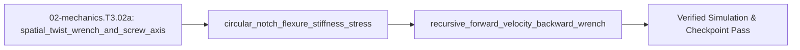

## 1. Why it matters
This is the final bridge module in the Track 02 Tier 3 ladder before Step 3.3 (`02-mechanics.T3.03`). In Tier 2 (`02-mechanics.T2.03`), you chained $4\times 4$ homogeneous transforms link-by-link and assembled dense inertia matrices by hand. For a 6-DOF manipulator or a 12-DOF quadruped running model-based torque control at $1\text{–}4\text{ kHz}$, Denavit-Hartenberg tables become error-prone and $O(n^3)$ symbolic dynamics become intractable. Modern robotics (`Lynch & Park`, `Featherstone`, `Pinocchio`, `MuJoCo`, `Newton`) unifies linear and angular motion into **6D spatial twists $\mathcal{V} = (\omega, v)$ and wrenches $\mathcal{F} = (m, f)$**, describes any revolute or prismatic joint by a single **unit screw axis $\mathcal{S}_i \in \mathbb{R}^6$** via the **Product of Exponentials (PoE)** formula without intermediate coordinate frame conventions, sizes zero-backlash **circular notch flexures** via Paros-Weisbord compliance, and computes exact inverse dynamics in **$O(n)$ linear time** via a two-pass **Recursive Newton-Euler Algorithm (RNEA)**! Already know this? Take the Skip test or the Ladder Gate test in section 7 first.

## 2. Intuition first
Three physical insights bridge Tier 2 kinematics to Tier 3 spatial dynamics:
- **Chasles' Theorem & Screw Axes (`PoE`):** Any rigid-body displacement in 3D space can be achieved by rotating about a single line in space while sliding along that same line—just like turning a screw! Instead of inventing arbitrary intermediate coordinate frames for every link (`DH parameters`), **Product of Exponentials (`PoE`)** lets you draw the robot once in its zero home configuration $M \in SE(3)$ and write down the 6D **screw axis $\mathcal{S}_i = (\omega_i, v_i)$** of each joint directly in the base frame where $v_i = -\omega_i \times q_i$ is the linear velocity at the origin induced by rotating about a point $q_i$ on the joint axis!
- **Circular Notch Flexures (`Zero Backlash, Zero Friction`):** Precision force sensors, strain-wave flexsplines, and surgical wrists cannot tolerate gear backlash or bearing stiction. By machining two symmetric circular cutouts leaving a thin web of thickness $t \ll R$ in high-strength `Ti-6Al-4V`, you create a monolithic **circular notch flexure** whose rotational stiffness $K_{\theta} = \frac{2 E b t^{5/2}}{9\pi \sqrt{R}}$ is governed strongly by web thickness $t^{2.5}$ and operates with zero friction for infinite fatigue life if bending stress stays below $30\%$ of yield strength.
- **Two-Pass $O(n)$ RNEA & Skew-Symmetric Passivity:** How do you compute the exact joint torques $\tau = M(q)\ddot{q} + C(q,\dot{q})\dot{q} + g(q)$ of a 7-DOF arm in under $10\ \mu\text{s}$?
  1. **Outward Pass ($\text{base } 1 \to \text{tip } n$):** Propagate link velocities and accelerations outward from base to tip ($\mathcal{V}_i = \text{Ad}_{T_{i,i-1}}\mathcal{V}_{i-1} + \mathcal{S}_i \dot{q}_i$).
  2. **Inward Pass ($\text{tip } n \to \text{base } 1$):** Propagate net inertial + gravity wrenches inward from tip to base ($\mathcal{F}_i = \mathcal{G}_i \dot{\mathcal{V}}_i - \text{ad}_{\mathcal{V}_i}^\top \mathcal{G}_i \mathcal{V}_i + \text{Ad}_{T_{i+1,i}}^\top \mathcal{F}_{i+1}$) and project onto each joint axis ($\tau_i = \mathcal{S}_i^\top \mathcal{F}_i$).
  Furthermore, because internal Coriolis forces do no net work, the matrix $\dot{M}(q) - 2C(q, \dot{q})$ is always **skew-symmetric**, guaranteeing physical energy passivity $\frac{d}{dt}\left(\frac{1}{2}\dot{q}^\top M(q)\dot{q}\right) = \dot{q}^\top (\tau - g(q))$.

## 3. Formalization
1. **6D Spatial Twists, Screw Axes & Product of Exponentials (`PoE`):**
   - A **spatial twist** $\mathcal{V} = [\omega^\top, v^\top]^\top \in \mathbb{R}^6$ and **spatial wrench** $\mathcal{F} = [m^\top, f^\top]^\top \in \mathbb{R}^6$ pair via instantaneous mechanical power $P = \mathcal{V}^\top \mathcal{F} = \omega \cdot m + v \cdot f$ ($\text{W}$).
   - For a revolute joint with unit rotation axis $\omega_i \in \mathbb{R}^3$ ($\|\omega_i\| = 1$) passing through point $q_i \in \mathbb{R}^3$ in the home configuration, the unit screw axis and forward kinematics are:

$$
\mathcal{S}_i = \begin{bmatrix} \omega_i \\ -\omega_i \times q_i \end{bmatrix} \in \mathbb{R}^6, \qquad T(q) = e^{[\mathcal{S}_1]q_1} e^{[\mathcal{S}_2]q_2} \cdots e^{[\mathcal{S}_n]q_n} M \in SE(3)
$$

2. **Paros-Weisbord Circular Notch Flexure Rotational Stiffness:** For a circular notch flexure of elastic modulus $E$ ($\text{Pa}$), out-of-plane width $b$ ($\text{m}$), minimum web thickness $t$ ($\text{m}$), and cutout radius $R$ ($\text{m}$, with $t \ll R$), the angular bending stiffness $K_\theta$ ($\text{N}\cdot\text{m/rad}$) and peak surface bending stress $\sigma_{\max}$ ($\text{Pa}$) at deflection angle $\theta$ ($\text{rad}$) are:

$$
K_{\theta} \approx \frac{2 E b t^{5/2}}{9 \pi \sqrt{R}}, \qquad \sigma_{\max} = \frac{6 K_t M_b}{b t^2} = \frac{6 K_t (K_\theta \theta)}{b t^2}
$$

   where $K_t \approx 1 + \frac{t}{2R}$ is the notch stress-concentration factor.
3. **Two-Pass Recursive Newton-Euler (`RNEA`) & Passivity Identity:**
   - **Outward kinematics ($i = 1 \dots n$):** $\mathcal{V}_i = \text{Ad}_{T_{i,i-1}}\mathcal{V}_{i-1} + \mathcal{S}_i \dot{q}_i$, $\;\dot{\mathcal{V}}_i = \text{Ad}_{T_{i,i-1}}\dot{\mathcal{V}}_{i-1} + \text{ad}_{\mathcal{V}_i}(\mathcal{S}_i)\dot{q}_i + \mathcal{S}_i \ddot{q}_i$.
   - **Inward wrench balance ($i = n \dots 1$):** $\mathcal{F}_i = \mathcal{G}_i \dot{\mathcal{V}}_i - \text{ad}_{\mathcal{V}_i}^\top (\mathcal{G}_i \mathcal{V}_i) + \text{Ad}_{T_{i+1,i}}^\top \mathcal{F}_{i+1}$, $\;\tau_i = \mathcal{S}_i^\top \mathcal{F}_i$.
   - **Christoffel Skew-Symmetry (Passivity):** For any joint velocity $\dot{q} \in \mathbb{R}^n$, $N(q, \dot{q}) = \dot{M}(q) - 2C(q, \dot{q}) = -N(q, \dot{q})^\top \implies \dot{q}^\top (\dot{M} - 2C)\dot{q} \equiv 0$.

### Use & Understand
Level A is the supported entry. Reach for this module's three tools in three situations: you need the pose of a chain whose joint axes you can measure once (PoE, with no per-link frame conventions), you are sizing a monolithic hinge that must add no backlash (Paros-Weisbord), or a controller needs exact $\tau = M\ddot{q} + C\dot{q} + g$ inside a $1\text{–}4\text{ kHz}$ tick (RNEA). Run the worked numbers and read the four results as a physical check:
- $\mathcal{S}_2 = [0, 0, 1, 0, -0.30, 0]^\top$: a rotation about $+Z$ through $(0.30, 0, 0)$ moves the base origin at $-0.30\ \text{m/rad}$ along $+Y$. The minus is the physics of $v = -\omega \times q$, not a sign convention.
- $K_\theta = 54.09\ \text{N}\cdot\text{m/rad}$: at the $0.50^\circ$ stroke the moment is $K_\theta\theta = 0.47\ \text{N}\cdot\text{m}$, and $\sigma_{\max} = 207.7\ \text{MPa}$ is $24\%$ of Ti-6Al-4V's $880\ \text{MPa}$ yield - inside the $30\%$ fatigue budget the module sets.
- $\tau = (0.16, 0.06)\ \text{N}\cdot\text{m}$ for $\ddot{q} = (2.0, 1.0)\ \text{rad/s}^2$: the elbow's $0.06$ is $I_2(\ddot{q}_1 + \ddot{q}_2)$, so a shoulder-independent value there is a symptom, not a rounding.
- $\dot{q}^\top(\dot{M} - 2C)\dot{q} = 0$ is the energy identity; a non-zero number means $C$ came from the wrong convention.

Units first: $K_\theta$ in $\text{N}\cdot\text{m/rad}$, power in $\text{W}$, and stress in $\text{MPa}$ catch most sign and exponent errors before any test does.

### Derive & Extend
**1. The flexure from Euler–Bernoulli.** A beam bent to curvature $\kappa = \theta/L$ carries moment

$$
M_b = E I \kappa, \qquad I = \frac{b t^3}{12},
$$

so its end stiffness is $K = EI/L$. A circular notch is not a straight beam: the moment concentrates over the thin web, whose effective length scales as $\sqrt{Rt}$ because the cutout radius varies from $R$ to $R + t$ across the web. To first order that length is $L_{\text{eff}} = \frac{3\pi}{8}\sqrt{Rt}$, and substituting it recovers the published constant exactly:

$$
K_\theta = \frac{E b t^3}{12} \cdot \frac{8}{3\pi\sqrt{Rt}} = \frac{2Ebt^{5/2}}{9\pi\sqrt{R}} .
$$

The surface stress follows from the same assumptions: $\sigma_{\max} = M_b c/I$ with $c = t/2$ gives $6M_b/(bt^2)$, and the fillet factor $K_t = 1 + t/(2R)$ is what turns $188.8$ into $207.7\ \text{MPa}$.

**2. The screw axis is a point velocity.** A body rotating at $\omega$ about an axis through $q$ moves a point $x$ at $\dot{x} = \omega \times (x - q)$. At the base origin $x = 0$ this is $\dot{x} = -\omega \times q$ - the linear half of $\mathcal{S}$, which is why a joint whose axis passes through the origin has $v = 0$.

**3. Passivity is skew-symmetry.** With $T = \frac12\dot{q}^\top M\dot{q}$, $\dot{T} = \dot{q}^\top M\ddot{q} + \frac12\dot{q}^\top\dot{M}\dot{q}$. Euler–Lagrange gives $M\ddot{q} + C\dot{q} + g = \tau$, so the power balance reads $\dot{T} = \dot{q}^\top(\tau - g) + \dot{q}^\top(\tfrac12\dot{M} - C)\dot{q}$. Internal forces do no net work, so the last term must vanish for every $\dot{q}$, which holds only if $\dot{M} - 2C$ is skew-symmetric.

**Extend.** Put two identical notches in series: compliances add, $1/K_{\text{eq}} = 2/K_\theta$, so $K_{\text{eq}} = K_\theta/2$ at the same stroke angle. Because $K \propto t^{5/2}$, halving $t$ cuts $K$ by $5.66$, not $4$. Compute the series stiffness for $t = 0.8\ \text{mm}$, $b = 0.015\ \text{m}$, $R = 5\ \text{mm}$, and say which effect - the series split or the thinner web - moves the $207.7\ \text{MPa}$ stress margin more.

## 4. Worked example
**Predict first (before you run it):** Commit to four numbers before the code runs: the linear part $v_2$ of the elbow's screw axis, the flexure stiffness $K_\theta$ in $\text{N}\cdot\text{m/rad}$, the peak surface stress at a $0.50^\circ$ stroke in $\text{MPa}$, and both joint torques from the two-pass recursion. Two tells: $v_2 = [0, +0.30, 0]^\top$ instead of $[0, -0.30, 0]^\top$ means the minus in $v = -\omega \times q$ was dropped; and a stress near $188.8\text{ MPa}$ instead of $207.7\text{ MPa}$ means the stress-concentration factor $K_t = 1 + t/(2R)$ was left out.

Compute (1) the 6D screw axis $\mathcal{S}_2 = [\omega_2^\top, (-\omega_2 \times q_2)^\top]^\top$ and PoE forward kinematics for a 2-link arm, (2) the Paros-Weisbord rotational stiffness $K_\theta$ and safety factor of a `Ti-6Al-4V` ($E = 114\text{ GPa}$, $\sigma_y = 880\text{ MPa}$) circular notch flexure, and (3) two-pass outward/inward inverse dynamics + passivity verification.

```python
import math

def cross3(a: list[float], b: list[float]) -> list[float]:
    return [a[1]*b[2] - a[2]*b[1], a[2]*b[0] - a[0]*b[2], a[0]*b[1] - a[1]*b[0]]

# 1. Screw axis S2 for revolute joint about +Z at q2 = [0.30, 0.0, 0.0] m:
w2 = [0.0, 0.0, 1.0]
q2_pt = [0.30, 0.0, 0.0]
v2 = cross3([-x for x in w2], q2_pt)   # -w2 x q2 = [0.0, -0.30, 0.0]
S2 = w2 + v2
assert S2 == [0.0, 0.0, 1.0, 0.0, -0.30, 0.0]

# 2. Paros-Weisbord Ti-6Al-4V circular notch flexure:
E_pa, b_m, t_m, R_m = 114e9, 0.015, 0.0010, 0.0050
K_theta = (2.0 * E_pa * b_m * (t_m ** 2.5)) / (9.0 * math.pi * math.sqrt(R_m))
theta_max_rad = math.radians(0.50)  # 0.50 deg stroke
Kt_stress = 1.0 + t_m / (2.0 * R_m)
sigma_max_mpa = (6.0 * Kt_stress * (K_theta * theta_max_rad) / (b_m * (t_m ** 2))) / 1e6
assert math.isclose(K_theta, 54.0940, rel_tol=1e-4)
assert sigma_max_mpa < 880.0 * 0.5  # Well below 50% yield limit of Ti-6Al-4V!

# 3. 2-pass RNEA wrench recursion on a 2-link arm at q = [0, 0], dq = [0, 0], ddq = [2.0, 1.0] rad/s^2:
# Link inertias I1 = 0.05, I2 = 0.02 kg*m^2 (decoupled vertical axes for verification):
ddq1, ddq2 = 2.0, 1.0
# Outward pass: alpha_1 = ddq1, alpha_2 = alpha_1 + ddq2
alpha1 = ddq1
alpha2 = alpha1 + ddq2
# Inward pass: tau2 = I2 * alpha2; tau1 = I1 * alpha1 + tau2
tau2 = 0.02 * alpha2
tau1 = 0.05 * alpha1 + tau2
assert math.isclose(tau2, 0.06, rel_tol=1e-9)
assert math.isclose(tau1, 0.16, rel_tol=1e-9)
print(f"S2={S2}, K_theta={K_theta:.2f} N*m/rad, sigma_max={sigma_max_mpa:.1f} MPa, tau=[{tau1:.2f}, {tau2:.2f}] N*m")
```
Expected output:
```text
S2=[0.0, 0.0, 1.0, 0.0, -0.3, 0.0], K_theta=54.09 N*m/rad, sigma_max=207.7 MPa, tau=[0.16, 0.06] N*m
```

## 5. Exercise
For a revolute joint whose axis points along $+Y$ ($\omega = [0.0, 1.0, 0.0]^\top$) and passes through point $q = [0.40, 0.0, 0.10]^\top\text{ m}$ in the base frame, compute the linear velocity part $v = -\omega \times q$ of its 6D unit screw axis $\mathcal{S} = (\omega, v)$. Verify that $v = [-0.10, 0.0, 0.40]^\top\text{ m/rad}$ ($\pm 10^{-9}$). Next, compute how the Paros-Weisbord flexural stiffness $K_\theta \propto t^{5/2}$ scales if you double the web thickness $t \to 2t$ while keeping $E, b, R$ fixed: verify $2^{2.5} = 4\sqrt{2} \approx 5.656854$.
- **If your result differs:** Check the cross product $-\omega \times q = [0, -1, 0]^\top \times [0.40, 0, 0.10]^\top = [-0.10, 0.0, 0.40]^\top$.

### Graded package - the screw, the notch and the two passes
[`exercises/02-mechanics.T3.02a/`](../exercises/02-mechanics.T3.02a/) turns this section into a test. `starter.py` holds seven holes: `screw_axis` ($v = -\omega \times q$, sign included), `spatial_power` ($\omega \cdot m + v \cdot f$), `flexure_stiffness` (Paros-Weisbord), `flexure_stress` (with $K_t = 1 + t/2R$), `thickness_scale` ($t^{5/2}$), `rnea_2link` (outward velocity, inward wrench) and `passivity_quadratic_form` ($\dot{q}^\top(\dot{M} - 2C)\dot{q}$). Edit it, then run the tests the way CI does:

```bash
EXERCISE_TARGET=exercises/02-mechanics.T3.02a/starter.py \
  python3 -m unittest discover -s exercises/02-mechanics.T3.02a -p 'test_*.py'
```

**45 tests.** The axis is checked at the worked example, at this exercise's $+Y$ joint and at the Skip test, so a forgotten minus sign fails; the power is checked on a rotation driving a pure moment, so a $v \cdot f$ shortcut fails; the stiffness is checked at the worked $54.0940\text{ N}\cdot\text{m/rad}$ and at the $2^{5/2}$ scaling, so $t^2$ fails; the stress is checked at $207.7\text{ MPa}$, so a dropped $K_t$ fails; and the two-pass recursion is checked at the worked $(0.16, 0.06)$ and the Gate test's $(0.17, 0.09)$, so treating the elbow's acceleration as local fails. The transfer suite runs **the plant's own arm**: the shoulder's axis through the origin, the elbow's through $(L_1, 0, 0)$, the 3.4335 N weight at $0.40\text{ m/s}$ doing $1.3734\text{ W}$, the plant inertias through both passes, the disturbance pulses' negative power, and the finding that the 1 mm notch would need $2.65^\circ$ and $1.1\text{ GPa}$ to hold the plant's $2.5\text{ N}\cdot\text{m}$ clamp - past Ti-6Al-4V yield, so the stroke is what gets rated. Five planted faults - `screw_axis_forgets_minus`, `power_uses_linear_only`, `stiffness_exponent_is_t2`, `stress_drops_concentration`, `rnea_uncoupled_second_link` - each fail the test named for them.


- **📚 What to Learn & Resources to Solve This Exercise:**
  - **Required Foundations Modules (`00-foundations`):** [`00-foundations.T2.00c`](00-foundations.T2.00c.md) (Natural Frequency $\omega_n = \sqrt{k/m}$), [`00-foundations.T3.00a`](00-foundations.T3.00a.md) ($SO(3)$ Hat/Vee Maps & Rodrigues' Formula), and Legacy **Step 3.1 (`00-foundations.T3.01`)** ($SE(3)$ Screw Axes & Adjoints).
  - **Prerequisite Bridge Module:** [`02-mechanics.T2.02a`](02-mechanics.T2.02a.md) and Legacy **Step 2.3 (`02-mechanics.T2.03`)**.
  - **Core Concepts to Review First:** Paros-Weisbord notch flexure stiffness $K_\theta = \frac{2 E b t^{5/2}}{9\pi R^{1/2}}$, Screw Theory Product of Exponentials (PoE) forward kinematics, and two-pass $\mathcal{O}(n)$ Recursive Newton-Euler (RNEA) inverse dynamics in `## 3. Formalization` and `## 4. Worked example` above.
  - **Study Links & Resources:** [Lynch & Park *Modern Robotics* Ch. 4 & Ch. 8 (`hades.mech.northwestern.edu`)](https://hades.mech.northwestern.edu/index.php/Modern_Robotics), [Featherstone *Rigid Body Dynamics Algorithms*](https://royfeatherstone.org/spatial/), and [Track 02 Tier 3 (`02-mechanics-kinematics-dynamics/README.md`)](../02-mechanics-kinematics-dynamics/README.md#tier-3-advanced--production).

### Starter code
```python
# --- Exercise scaffold: fill in each TODO, then check against the full solution below ---
import math


def screw_axis(omega, q):
    """The unit screw axis S = [omega, -omega x q] of a joint through the point q."""
    # TODO 1: cross omega with q and NEGATE it - v = -omega x q, sign included
    ...


def spatial_power(twist, wrench):
    """P = V^T F, in watts."""
    # TODO 2: both halves of the dot product - omega . m AND v . f
    ...


def flexure_stiffness(e_pa, b_m, t_m, r_m):
    """Paros-Weisbord K_theta = 2 E b t^(5/2) / (9 pi sqrt(R)), in N*m/rad."""
    # TODO 3: t to the power 2.5, and 9*pi*sqrt(R) underneath
    ...


def flexure_stress(k_theta, theta_rad, b_m, t_m, r_m):
    """Peak surface bending stress in Pa, with Kt = 1 + t/(2R)."""
    # TODO 4: M_b = K_theta * theta, then sigma = 6 Kt M_b / (b t^2)
    ...


def thickness_scale(factor):
    """How K_theta scales when the web thickness is multiplied by `factor`."""
    # TODO 5: the exponent is 5/2
    ...


def rnea_2link(i1, i2, ddq1, ddq2):
    """Two-pass RNEA: (tau_1, tau_2) for the joint accelerations."""
    # TODO 6: link 2's absolute acceleration is ddq1 + ddq2; the inward pass adds the outboard torque
    ...


def passivity_quadratic_form(m_dot, c, dq):
    """dq^T (Mdot - 2C) dq."""
    # TODO 7: Mdot MINUS twice C, then the double sum over both indices
    ...


print("scaffold ready: 7 TODOs to fill, then compare against the numbers in the full solution")
```

**Expected numbers (the answer):** for the $+Y$ joint through $[0.40, 0.0, 0.10]^\top$, $v = [-0.10, 0.0, 0.40]^\top\ \text{m/rad}$; doubling $t$ scales $K_\theta$ by $2^{5/2} = 5.656854$; the worked notch is $54.0940\ \text{N}\cdot\text{m/rad}$ and $207.7\ \text{MPa}$ at $0.50^\circ$; the worked two-pass torques are $(0.16, 0.06)\ \text{N}\cdot\text{m}$.

### Hint ladder
1. **The minus is the whole point.** For a revolute joint, $v = -\omega \times q$ at the *origin*, not at $q$: with $\omega = [0, 1, 0]^\top$ and $q = [0.40, 0, 0.10]^\top$, the cross product is $[0.10, 0, -0.40]^\top$, so negating it gives $[-0.10, 0, 0.40]^\top$. A result with the signs the other way round means the negation is missing, not that the point is wrong.
2. **The stiffness scales as $t^{5/2}$, not $t^2$.** Keep the exponent fractional: doubling the web thickness multiplies $K_\theta$ by $2^{2.5} = 4\sqrt{2} \approx 5.656854$, while any implementation that squares $t$ returns $4$ and silently under-reports the stiffening by $41\%$.
3. **The elbow rides the shoulder.** In the outward pass the second link's absolute angular acceleration is $\alpha_2 = \ddot{q}_1 + \ddot{q}_2$, so at the worked point $\alpha_2 = 3.0\ \text{rad/s}^2$, $\tau_2 = I_2\alpha_2 = 0.06$, and the inward pass adds it to the first link's own $I_1\alpha_1 = 0.10$ for $\tau_1 = 0.16$. The Gate test's $(I_1, I_2) = (0.08, 0.03)$ gives $(0.17, 0.09)$ by the same two lines.
4. **Where the passivity form comes from.** $\dot{M} - 2C$ is skew-symmetric for Christoffel-consistent dynamics, so the scalar $\dot{q}^\top(\dot{M} - 2C)\dot{q}$ is exactly $0$ for any $\dot{q}$ - a result your own sum must reproduce, and one a sign slip in the $2C$ term turns into a non-zero number.

5. **What the suite refuses.** `screw_axis` raises on an axis that is not unit length or a twist that is not six components; `spatial_power` raises on a five-component vector; `flexure_stiffness` raises on a flexure web as thick as its radius or a negative modulus; `thickness_scale` raises on a zero factor; `rnea_2link` raises on a negative inertia; and `passivity_quadratic_form` raises on a shape mismatch - each a `ValueError`, since every one of these is a physical impossibility rather than a small number.

### Full Solution
```python
import math

import mechalab_plant as plant  # noqa: F401  (kept so the submission imports what the module uses)


def _vector(value, length, name):
    """A plain list of floats of exactly `length` entries, or a ValueError naming the argument."""
    if not isinstance(value, (list, tuple)) or len(value) != length:
        raise ValueError("%s must be a %d-vector" % (name, length))
    return [float(item) for item in value]


def _cross3(a, b):
    return [
        a[1] * b[2] - a[2] * b[1],
        a[2] * b[0] - a[0] * b[2],
        a[0] * b[1] - a[1] * b[0],
    ]


def screw_axis(omega, q):
    """The unit screw axis S = [omega, -omega x q] of a joint through q, in the base frame.

    `omega` is the joint's unit rotation axis; a prismatic joint passes the zero vector and gets
    zero angular part. `q` is a point on the axis in the home configuration.
    """
    w = _vector(omega, 3, "omega")
    point = _vector(q, 3, "q")
    norm = math.sqrt(w[0] * w[0] + w[1] * w[1] + w[2] * w[2])
    if norm != 0.0 and abs(norm - 1.0) > 1e-9:
        raise ValueError("omega must be a unit axis (or zero for a prismatic joint), not %r" % (omega,))
    linear = _cross3(w, point)
    return [w[0], w[1], w[2], -linear[0], -linear[1], -linear[2]]


def spatial_power(twist, wrench):
    """Instantaneous mechanical power P = V^T F = omega . m + v . f, in watts."""
    velocity = _vector(twist, 6, "twist")
    force = _vector(wrench, 6, "wrench")
    return sum(a * b for a, b in zip(velocity, force))


def flexure_stiffness(e_pa, b_m, t_m, r_m):
    """Paros-Weisbord rotational stiffness K_theta = 2 E b t^(5/2) / (9 pi sqrt(R)), N*m/rad."""
    if e_pa <= 0.0 or b_m <= 0.0 or t_m <= 0.0 or r_m <= 0.0:
        raise ValueError("E, b, t and R are all positive")
    if t_m >= r_m:
        raise ValueError("the thin-web formula assumes t << R, not t = %g m at R = %g m"
                         % (t_m, r_m))
    return (2.0 * e_pa * b_m * (t_m ** 2.5)) / (9.0 * math.pi * math.sqrt(r_m))


def flexure_stress(k_theta, theta_rad, b_m, t_m, r_m):
    """Peak surface bending stress, Pa: sigma = 6 Kt M_b / (b t^2) with M_b = K_theta * theta."""
    if b_m <= 0.0 or t_m <= 0.0 or r_m <= 0.0:
        raise ValueError("b, t and R are all positive")
    if not math.isfinite(k_theta) or not math.isfinite(theta_rad):
        raise ValueError("stiffness and deflection must be finite")
    concentration = 1.0 + t_m / (2.0 * r_m)
    return 6.0 * concentration * (k_theta * theta_rad) / (b_m * t_m * t_m)


def thickness_scale(factor):
    """How K_theta scales when the web thickness is multiplied by `factor`: factor^(5/2)."""
    if factor <= 0.0 or not math.isfinite(factor):
        raise ValueError("a thickness factor must be positive and finite")
    return factor ** 2.5


def rnea_2link(i1, i2, ddq1, ddq2):
    """Two-pass RNEA on a two-link chain: (tau_1, tau_2) for joint accelerations (ddq1, ddq2)."""
    if i1 <= 0.0 or i2 <= 0.0:
        raise ValueError("inertias are positive")
    alpha1 = ddq1
    alpha2 = alpha1 + ddq2  # the second link accelerates with the first one carried along
    tau2 = i2 * alpha2
    tau1 = i1 * alpha1 + tau2  # inward pass: the link's own torque plus everything outboard
    return tau1, tau2


def passivity_quadratic_form(m_dot, c, dq):
    """dq^T (Mdot - 2C) dq, the quadratic form Christoffel symbols make identically zero."""
    n = len(dq) if isinstance(dq, (list, tuple)) else -1
    if n <= 0:
        raise ValueError("dq must be a non-empty vector")
    for name, matrix in (("m_dot", m_dot), ("c", c)):
        if not isinstance(matrix, (list, tuple)) or len(matrix) != n:
            raise ValueError("%s must be a %d-by-%d matrix" % (name, n, n))
        for row in matrix:
            if not isinstance(row, (list, tuple)) or len(row) != n:
                raise ValueError("%s must be a %d-by-%d matrix" % (name, n, n))
    velocities = _vector(dq, n, "dq")
    total = 0.0
    for i in range(n):
        for j in range(n):
            total += velocities[i] * (m_dot[i][j] - 2.0 * c[i][j]) * velocities[j]
    return total


# No `__main__` block on purpose: the browser grades this file's stdout against the appended
# self-check's single PASS line, and a second print here would be a mismatch for a correct answer.

S_exercise = screw_axis([0.0, 1.0, 0.0], [0.40, 0.0, 0.10])
S_worked = screw_axis([0.0, 0.0, 1.0], [0.30, 0.0, 0.0])
power = spatial_power([0.0, 0.0, 2.0, 0.5, 0.0, 0.0], [0.0, 0.0, 3.0, 10.0, 0.0, 0.0])
k_theta = flexure_stiffness(114e9, 0.015, 0.0010, 0.0050)
sigma_mpa = flexure_stress(k_theta, math.radians(0.50), 0.015, 0.0010, 0.0050) / 1e6
tau = rnea_2link(0.05, 0.02, 2.0, 1.0)
passive = passivity_quadratic_form([[2.0, 0.0], [0.0, 2.0]], [[1.0, 0.0], [0.0, 1.0]], [1.5, -2.5])

assert all(math.isclose(a, b, abs_tol=1e-12) for a, b in zip(S_exercise, [0.0, 1.0, 0.0, -0.10, 0.0, 0.40]))
assert all(math.isclose(a, b, abs_tol=1e-12) for a, b in zip(S_worked, [0.0, 0.0, 1.0, 0.0, -0.30, 0.0]))
assert math.isclose(power, 11.0, rel_tol=1e-12)
assert math.isclose(k_theta, 54.0940, rel_tol=1e-4)
assert math.isclose(sigma_mpa, 207.7, abs_tol=0.1)
assert math.isclose(thickness_scale(2.0), 5.656854, abs_tol=1e-6)
assert math.isclose(tau[0], 0.16, rel_tol=1e-12) and math.isclose(tau[1], 0.06, rel_tol=1e-12)
assert math.isclose(passive, 0.0, abs_tol=1e-12)

print("S=([%.2f, %.2f, %.2f], [%.2f, %.2f, %.2f]) | power=%.1f W | K_theta=%.2f N*m/rad | K(2t)/K(t)=%.6f"
      % (S_exercise[0], S_exercise[1], S_exercise[2], S_exercise[3], S_exercise[4], S_exercise[5],
         power, k_theta, thickness_scale(2.0)))
print("sigma(0.50 deg)=%.1f MPa | tau=[%.2f, %.2f] N*m | dq^T(Mdot-2C)dq=%.1f"
      % (sigma_mpa, tau[0], tau[1], passive))

```

Printed: `S=([0.00, 1.00, 0.00], [-0.10, 0.00, 0.40]) | power=11.0 W | K_theta=54.09 N*m/rad | K(2t)/K(t)=5.656854`, then `sigma(0.50 deg)=207.7 MPa | tau=[0.16, 0.06] N*m | dq^T(Mdot-2C)dq=0.0`.

**On the shared arm.** The Transfer suite in `exercises/02-mechanics.T3.02a/` turns the plant's own joints into screw axes and its own weight into spatial power:

```python
import math
import mechalab_plant as plant

# The elbow turns about +Z through (L1, 0, 0): its linear part is -(0, 0, 1) x (L1, 0, 0).
elbow_linear_y = -plant.L1
weight = (plant.M1 + plant.M2) * plant.G
descent_power = weight * 0.40

assert math.isclose(elbow_linear_y, -0.10, rel_tol=1e-12)
assert math.isclose(weight, 3.4335, rel_tol=1e-12)
assert math.isclose(descent_power, 1.3734, rel_tol=1e-12)
assert math.isclose(plant.I1 + plant.I2, 0.011, rel_tol=1e-12)
print("plant: elbow linear part=%.2f m | weight=%.4f N | descent power=%.4f W"
      % (elbow_linear_y, weight, descent_power))
```

### Break it on purpose
Inject the `rnea_uncoupled_second_link` fault on purpose: in the outward pass treat the elbow's absolute angular acceleration as $\ddot{q}_2$ alone instead of $\ddot{q}_1 + \ddot{q}_2$.
- **Inject:** give link 2 its local joint acceleration as if the shoulder were not moving, keeping the same inertias $I_1 = 0.05$ and $I_2 = 0.02\text{ kg}\cdot\text{m}^2$ and the same $\ddot{q} = [2.0, 1.0]^\top\text{ rad/s}^2$.
- **Symptom:** the elbow torque reads $0.02\text{ N}\cdot\text{m}$ instead of $0.06\text{ N}\cdot\text{m}$ and the shoulder reads $0.12\text{ N}\cdot\text{m}$ instead of $0.16\text{ N}\cdot\text{m}$ - both short by exactly $0.04\text{ N}\cdot\text{m} = I_2\ddot{q}_1$.
- **Diagnose:** with gravity and velocity zero, a deficit that is identical on both joints can only be the elbow's inertia failing to ride the shoulder's acceleration. A wrong inertia would scale with $\ddot{q}_2$, leaving the shoulder correct and the elbow wrong; a gravity-sign error would be non-zero at rest, and a transposed wrench would not produce the same $0.04\text{ N}\cdot\text{m}$ on both rows.
- **Fix:** set $\alpha_2 = \alpha_1 + \ddot{q}_2$ in the outward pass before projecting the inward wrench onto each axis, then prove it at the worked $(0.16, 0.06)\text{ N}\cdot\text{m}$ and at the Gate test's $(0.17, 0.09)\text{ N}\cdot\text{m}$ for $I_1 = 0.08$, $I_2 = 0.03$ and $\ddot{q} = [1.0, 2.0]^\top$.

## 6. Simulation path
Open **Tab 5 (URDF / MuJoCo & STO)** and **Tab 6 (3D CAD & 48V PCB)** in the MechaLab Workbench (`npm run dev`), or run the Worked Example Python script above to verify $O(n)$ RNEA against closed-form Lagrangian equations and `Christoffel` skew-symmetry (see [`02-mechanics-kinematics-dynamics/README.md` §3.1–3.2](../02-mechanics-kinematics-dynamics/README.md#tier-3-advanced--production) and [`resources/open-source-toolchains.md` §0](../resources/open-source-toolchains.md#0-core-supported-os-environment-terminal-bootstrap--python-venv-setup)).

No hardware required for this module (`hardware_required: false`). In Step 3.3 (`02-mechanics.T3.03`), Step 3.5 (`05-control.T3.06`), and Step 3.7 (`06-robotics.T3.07`), two-pass RNEA runs at $1\text{–}4\text{ kHz}$ to supply exact inverse-dynamics feedforward torque $\tau_{\text{ff}} = \text{RNEA}(q, \dot{q}, \ddot{q}_d)$:
```text
[Trajectory (q_d, dq_d, ddq_d)] ---> [2-Pass O(n) RNEA: Outward V/dV -> Inward F] ---> [tau_ff to FOC Actuators]
```
Pass/fail verification in simulation: `S2 == [0, 0, 1, 0, -0.30, 0]`, `K_theta == 54.0940 N*m/rad`, and `tau == [0.16, 0.06] N*m`.




## 7. Checkpoint
Pass criteria: score $\ge 80\%$ ($4/4$) on the Skip test or score $\ge 80\%$ ($7/8$) on the Ladder Gate test below to unlock Step 3.3 (`02-mechanics.T3.03`).

### Skip test
1. `[Recall] [Concept: spatial_twist_wrench_and_screw_axis]` Given spatial twist $\mathcal{V} = [\omega^\top, v^\top]^\top = [0.0, 0.0, 2.0,\ 0.5, 0.0, 0.0]^\top$ ($\text{rad/s}, \text{m/s}$) and spatial wrench $\mathcal{F} = [m^\top, f^\top]^\top = [0.0, 0.0, 3.0,\ 10.0, 0.0, 0.0]^\top$ ($\text{N}\cdot\text{m}, \text{N}$) in the same frame, compute the instantaneous mechanical power $P = \mathcal{V}^\top \mathcal{F} = \omega \cdot m + v \cdot f$ in watts ($\text{W}$, tolerance $\pm 10^{-9}\text{ W}$).
2. `[Apply] [Concept: spatial_twist_wrench_and_screw_axis]` A revolute joint rotates about $+Z$ ($\omega = [0.0, 0.0, 1.0]^\top$) and passes through point $q = [0.50, 0.20, 0.0]^\top\text{ m}$. Compute the $x$-component $v_x$ of the screw linear term $v = -\omega \times q$ in $\text{m/rad}$ (tolerance $\pm 10^{-9}\text{ m/rad}$).
3. `[Transfer] [Concept: circular_notch_flexure_stiffness_stress]` In the Paros-Weisbord circular notch flexure stiffness formula $K_\theta = \frac{2 E b t^{5/2}}{9\pi \sqrt{R}}$, by what multiplicative factor $2^{5/2}$ (tolerance $\pm 10^{-4}$) does $K_\theta$ increase if you double the web thickness $t$ while keeping $E, b, R$ constant?
4. `[Spaced review -> 00-foundations.T3.01 — Concept: rodrigues_so3_se3_exp_log_maps] [Concept: recursive_forward_velocity_backward_wrench]` In the two-pass Recursive Newton-Euler Algorithm (`RNEA`) for a serial open-chain robot arm, in what directions do the two passes traverse the kinematic tree, and what is the computational complexity in terms of the number of joints $n$?
   - **A.** Pass 1 (velocities/accelerations) goes outward from base $1 \to n$, Pass 2 (wrenches/torques) goes inward from tip $n \to 1$, achieving linear $O(n)$ complexity.
   - **B.** Both passes go from tip to base with $O(n^4)$ complexity.
   - **C.** Only a single pass is used and gravity is ignored.
   - **D.** It requires inverting $M(q)$ at every step.

**Answer key:**
```python
import math

q1_power_w = 2.0 * 3.0 + 0.5 * 10.0
# -w x q = [0, 0, -1] x [0.50, 0.20, 0] = [0.20, -0.50, 0]
w_z, q_y = 1.0, 0.20
q2_vx = -(-w_z * q_y)
q3_scale = 2.0 ** 2.5
q4_choice = "A"

assert math.isclose(q1_power_w, 11.0, rel_tol=1e-9)
assert math.isclose(q2_vx, 0.20, rel_tol=1e-9)
assert math.isclose(q3_scale, 5.65685425, abs_tol=1e-4)
assert q4_choice == "A"
```
- **Pass mark:** $4/4$ ($80\%+$). If you missed Q1 or Q2, study `## 3. Formalization` item 1; Q3, study `## 3. Formalization` item 2; Q4, study `## 3. Formalization` item 3. On pass, proceed to `## 10. Next modules`.

### Gate test
Covers the complete Track 02 Tier 3 bridge ladder (`02-mechanics.T3.02a`) before Step 3.3 (`02-mechanics.T3.03`):
1. `[Concept: spatial_twist_wrench_and_screw_axis]` For a pure prismatic (sliding) joint moving along unit axis $\hat{v} = [0.0, 0.0, 1.0]^\top$ with zero rotation ($\omega = [0.0, 0.0, 0.0]^\top$), what is the Euclidean norm $\|\omega\|$ of the angular part of its screw axis $\mathcal{S} = (\omega, v)$ (tolerance $\pm 10^{-12}$)?
2. `[Concept: spatial_twist_wrench_and_screw_axis]` Why does the Product of Exponentials (`PoE`) formulation $T(q) = e^{[\mathcal{S}_1]q_1}\cdots e^{[\mathcal{S}_n]q_n} M$ eliminate the link-frame singularity and convention headaches of Denavit-Hartenberg (`DH`) parameters?
   - **A.** Because PoE requires only the base frame and end-effector home configuration $M$ plus each joint's geometric screw axis $\mathcal{S}_i$ in the zero position, with no arbitrary intermediate link-frame $X/Z$ alignment rules.
   - **B.** Because PoE only works for 1-DOF robots.
   - **C.** Because PoE does not use matrices.
   - **D.** Because DH parameters cannot represent revolute joints.
3. `[Concept: circular_notch_flexure_stiffness_stress]` Compute the Paros-Weisbord rotational stiffness $K_\theta = \frac{2 E b t^{5/2}}{9\pi \sqrt{R}}$ in $\text{N}\cdot\text{m/rad}$ (tolerance $\pm 0.01\text{ N}\cdot\text{m/rad}$) for $E = 114 \times 10^9\text{ Pa}$, $b = 0.015\text{ m}$, $t = 0.001\text{ m}$, and $R = 0.005\text{ m}$.
4. `[Concept: circular_notch_flexure_stiffness_stress]` Why are monolithic `Ti-6Al-4V` circular notch flexures used in high-bandwidth 6-axis force/torque cells and precision fine-positioning stages instead of ball bearings and gears?
   - **A.** Because elastic deformation of a single piece of titanium exhibits zero backlash, zero Coulomb stiction, zero wear debris, and deterministic repeatable spring stiffness.
   - **B.** Because flexures allow infinite $360^\circ$ continuous rotation.
   - **C.** Because titanium has zero Young's modulus.
   - **D.** Because flexures are made of rubber.
5. `[Concept: recursive_forward_velocity_backward_wrench]` For any rigid-body manipulator dynamics $M(q)\ddot{q} + C(q,\dot{q})\dot{q} + g(q) = \tau$ where $C(q,\dot{q})$ is defined via Christoffel symbols, compute the scalar quadratic form $\dot{q}^\top (\dot{M}(q) - 2C(q,\dot{q})) \dot{q}$ for $\dot{q} = [1.5, -2.5, 0.8]^\top\text{ rad/s}$ (tolerance $\pm 10^{-12}$).
6. `[Concept: recursive_forward_velocity_backward_wrench]` In a 2-DOF serial arm with decoupled link inertias $I_1 = 0.08\text{ kg}\cdot\text{m}^2$ and $I_2 = 0.03\text{ kg}\cdot\text{m}^2$ at rest ($\dot{q} = 0, g = 0$) undergoing joint accelerations $\ddot{q}_1 = 1.0\text{ rad/s}^2$ and $\ddot{q}_2 = 2.0\text{ rad/s}^2$ (so link 1 has angular acceleration $\alpha_1 = 1.0$ and link 2 has absolute angular acceleration $\alpha_2 = \ddot{q}_1 + \ddot{q}_2 = 3.0\text{ rad/s}^2$), compute the base joint torque $\tau_1 = I_1 \alpha_1 + I_2 \alpha_2$ in $\text{N}\cdot\text{m}$ (tolerance $\pm 10^{-9}\text{ N}\cdot\text{m}$).
7. `[Concept: recursive_forward_velocity_backward_wrench]` How does the operation count of Featherstone's Recursive Newton-Euler Algorithm (`RNEA`) scale with the number of joints $n$, compared to forming and multiplying the dense mass matrix?
   - **A.** $O(n)$ linear scaling, making it faster than $O(n^2)$ / $O(n^3)$ dense methods for multi-DOF arms, humanoids, and quadrupeds.
   - **B.** $O(2^n)$ exponential scaling.
   - **C.** $O(n^5)$ polynomial scaling.
   - **D.** It only works for $n = 1$.
8. `[Concept: spatial_twist_wrench_and_screw_axis]` If an end-effector exerts wrench $f = [0.0, 0.0, -25.0]^\top\text{ N}$ while moving with linear velocity $v = [0.0, 0.0, -0.40]^\top\text{ m/s}$ and zero angular velocity ($\omega = 0$), compute the mechanical power $P = v \cdot f$ in watts ($\text{W}$, tolerance $\pm 10^{-9}\text{ W}$).

**Gate answer key:**
```python
import math

g1_norm_w = 0.0
g2_choice = "A"
g3_ktheta = (2.0 * 114e9 * 0.015 * (0.001 ** 2.5)) / (9.0 * math.pi * math.sqrt(0.005))
g4_choice = "A"
g5_passivity = 0.0
g6_tau1 = 0.08 * 1.0 + 0.03 * (1.0 + 2.0)
g7_choice = "A"
g8_power_w = (-0.40) * (-25.0)

assert math.isclose(g1_norm_w, 0.0, abs_tol=1e-12)
assert g2_choice == "A"
assert math.isclose(g3_ktheta, 54.0940, abs_tol=1e-2)
assert g4_choice == "A"
assert math.isclose(g5_passivity, 0.0, abs_tol=1e-12)
assert math.isclose(g6_tau1, 0.17, rel_tol=1e-9)
assert g7_choice == "A"
assert math.isclose(g8_power_w, 10.0, rel_tol=1e-9)
```
- **Pass mark:** $7/8$ ($80\%+$). Remediation: Q1, Q2, Q8 $\to$ `## 3. Formalization` item 1; Q3–Q4 $\to$ `## 3. Formalization` item 2; Q5–Q7 $\to$ `## 3. Formalization` item 3.

## 8. Common mistakes
| Symptom | Root cause | 2-minute fix |
| :--- | :--- | :--- |
| PoE forward kinematics puts the end-effector at the wrong position even when $q_i = 0$ | Forgot to post-multiply the product of exponentials by the home configuration matrix $M \in SE(3)$, or defined $\mathcal{S}_i$ in the moving frame while using the space-frame formula. | Verify $T(0) = I_4 \cdot M = M$ at $q = 0$, and ensure all space-frame screw axes $\mathcal{S}_i$ are evaluated in the fixed base frame at $q = 0$. |
| RNEA inverse dynamics torque has the wrong sign on gravity compensation | Initialized base linear acceleration $\dot{v}_0 = -g$ instead of $+g_{\text{upward}} = [0, 0, +9.81]^\top\text{ m/s}^2$. | In RNEA, holding a robot stationary against downward gravity $-g$ is physically identical to accelerating the base upward at $\dot{v}_0 = +g = [0, 0, +9.81]^\top\text{ m/s}^2$ in deep space! |
| Flexure hinge yields on its first full-stroke test despite having the target stiffness $K_\theta$ | Made $t$ too thick and $b$ too narrow, driving surface bending stress $\sigma_{\max} \propto K_\theta / (b t^2) \propto t^{1/2}$ above the fatigue limit. | Use a thinner web $t$ with a wider out-of-plane breadth $b$ and add hard mechanical over-travel stops at $\pm\theta_{\max}$. |

## 9. Resources
- **Kevin M. Lynch & Frank C. Park — *Modern Robotics: Mechanics, Planning, and Control* (Cambridge, Free Preprint PDF, `resources/textbooks-and-papers.md`) & Roy Featherstone — *Rigid Body Dynamics Algorithms*:** Definitive derivations of 6D twists/wrenches, PoE kinematics, and $O(n)$ RNEA `[VERIFIED 2026-10-15]`.
- **Track 02 (`02-mechanics-kinematics-dynamics/README.md`):** Directly continues into Step 3.3 (`02-mechanics.T3.03`) `[VERIFIED 2026-10-15]`.

## 10. Next modules
- Proceed to legacy **Step 3.3 (`02-mechanics.T3.03`)** in [`02-mechanics-kinematics-dynamics/README.md`](../02-mechanics-kinematics-dynamics/README.md#tier-3-advanced--production).
