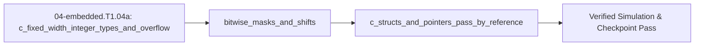

## 1. Why it matters
Python integers grow arbitrarily large and never overflow, but microcontroller C/C++ variables occupy a fixed number of bits (`uint8_t`, `int16_t`, `uint32_t`, `float`) in hardware registers. Before writing real-time timer interrupts and binary serial telemetry in Step 1.5 (`04-embedded.T1.05`), you must know how fixed-width integers wrap around, how bitwise masks (`|`, `&`, `~`, `<<`) flip single register bits without corrupting neighbors, and how `struct` pointers pass data with zero copy overhead. Already know this? Take the Skip test in section 7 first.

## 2. Intuition first
When you transition from desktop Python to microcontroller firmware, you first meet the **Arduino / Wiring execution model** (`void setup()` runs once at power-on to configure pins with `pinMode(pin, OUTPUT)`; `void loop()` repeats forever calling `digitalWrite(pin, HIGH)` or `analogWrite(pin, pwm)`). Imagine moving from an infinite notepad (Python) to a mechanical odometer with only four digit wheels (`uint16_t`, which holds `0` to `65535`). If your odometer is at `65535` and clicks forward by `1`, it doesn't add a fifth wheel—it wraps cleanly back to `0` (**integer wrap-around**). Next, when packing status flags or configuration bits into an 8-bit or 32-bit C integer, think of that integer as a row of individual toggle switches: you use a **bitwise stencil (mask)** `1U << n` with bitwise OR (`|`), AND (`&`), and NOT (`~`) to set, clear, or test one flag bit without disturbing its neighbors. Finally, a C **`struct`** is a molded tray that holds several related variables side-by-side in memory, and a **pointer** (`*`) passes the address of that tray on a sticky note instead of copying the entire tray on every function call.

## 3. Formalization
1. **C-for-Python Syntax Bridge, Arduino Execution Model (`setup()` / `loop()`) & Fixed-Width Integer Types (`<stdint.h>`):**
   - **C/C++ Syntax for Python Programmers:**
     - **Explicit Types & Semicolons (`;`):** Every variable declaration states its fixed hardware type (`uint16_t count = 0;`, `float vel = 3.25f;`), and every statement ends with `;`.
     - **Braces (`{ ... }`) & Comments (`//`):** Code blocks use curly braces `{ ... }` instead of indentation; comments start with `//`.
     - **Functions & Loops:** `int32_t add(int32_t a, int32_t b) { return a + b; }` declares return and argument types; `for (int i = 0; i < N; i++) { ... }` is the C equivalent of `for i in range(N):`.
   - **Firmware Entry (`setup()` / `loop()`) & Integer Bounds:** Firmware entry starts at reset, runs `void setup()` once, and repeats `void loop()` forever. Unlike Python's arbitrary-precision integers, an $N$-bit unsigned C integer `uintN_t` stores values in $[0, 2^N - 1]$, and a two's-complement signed integer `intN_t` stores $[-2^{N-1}, 2^{N-1} - 1]$:
     - `uint8_t`: $[0, 255]$ ($1\text{ byte}$); `int16_t`: $[-32768, 32767]$ ($2\text{ bytes}$); `uint32_t`: $[0, 4294967295]$ ($4\text{ bytes}$); `float`: IEEE-754 single precision ($4\text{ bytes}$).
     - Computing unsigned tick difference `(uint16_t)(now - prev)` modulo $2^{16} = 65536$: substituting `now = 4` and `prev = 65530` yields `(4 - 65530) & 0xFFFF = 10` ticks elapsed across rollover.
2. **Bitwise Masks and Shifts (`|`, `&`, `~`, `<<`, `>>`):** For bit index $n \in \{0, \dots, 31\}$ in an unsigned status or configuration word $W$:
   - Set bit $n$ to `1`: $W \leftarrow W \mid (1\text{U} \ll n)$.
   - Clear bit $n$ to `0`: $W \leftarrow W \mathbin{\&} \sim(1\text{U} \ll n)$.
   - Toggle bit $n$: $W \leftarrow W \oplus (1\text{U} \ll n)$.
   - Test bit $n$: $\text{is-set} = (W \gg n) \mathbin{\&} 1\text{U}$.
   Substituting $W = \text{0x01}$ (`0b00000001`), setting bit $3$ ($1 \ll 3 = 8 = \text{0x08}$) gives $W = \text{0x09}$ (`0b00001001`).
3. **Structs and Pass-by-Pointer (`*` and `->`):** Grouping fields in `struct MotorState { int16_t count; float vel_rad_s; };` and passing `MotorState *s` passes a single memory address (`4` or `8` bytes) so `s->count += 1` (`->` dereferences a struct pointer, equivalent to `(*s).count`) mutates the caller's struct in-place and packs cleanly into binary frames (`struct.pack("<Hhf", ...)`).

## 4. Worked example
**Predict first (before you run it):** The block starts a `uint16_t` counter at `65530` and reads `4` after the rollover, starts a register at `0b0000_0001`, sets bit `3`, then clears bit `0`, and packs `(1000, -512, 3.25)` with `struct.pack("<Hhf", ...)`. Commit before you run it: (1) how many ticks elapsed across the wrap; (2) the register's decimal value after those two edits, and what the bit-`3` test returns; (3) the packed frame's length in bytes, and whether `1000`, `-512` and `3.25` survive the round trip. Two tells that a wrong answer is a mistake rather than a surprise: an elapsed count of $-65526$ is the raw Python difference before the $2^{16}$ mask, which is exactly the bug `elapsed_unsigned` exists to catch; and a register value of $9$ after the clear means the `~` was dropped, leaving `reg &= (1 << 0)` as a no-op.

Simulate 16-bit encoder counter wrap-around, bitwise GPIO register set/clear operations, and packing an 8-byte C telemetry struct (`<Hhf`: `uint16_t`, `int16_t`, `float`) using Python's `struct` module.

```python
import struct

def uint16_elapsed(now: int, prev: int) -> int:
    return (now - prev) & 0xFFFF

assert uint16_elapsed(now=4, prev=65530) == 10

reg = 0b0000_0001
reg |= (1 << 3)                  # Set bit 3 -> 0b0000_1001 (9)
assert reg == 9
reg &= ~(1 << 0)                 # Clear bit 0 -> 0b0000_1000 (8)
assert reg == 8
assert ((reg >> 3) & 1) == 1

raw_bytes = struct.pack("<Hhf", 1000, -512, 3.25)
assert len(raw_bytes) == 8       # 2 + 2 + 4 bytes = 8 bytes
tick, count, vel = struct.unpack("<Hhf", raw_bytes)
assert tick == 1000 and count == -512 and abs(vel - 3.25) < 1e-6
print(f"Rollover delta={uint16_elapsed(4, 65530)}, reg=0x{reg:02X}, struct_size={len(raw_bytes)} bytes")
```
Expected output:
```text
Rollover delta=10, reg=0x08, struct_size=8 bytes
```

## 5. Exercise
Start with register value `reg = 0x5A` (`0b01011010`). Write a Python expression that sets bit `6` (`1 << 6`) and clears bit `3` (`~(1 << 3)`), and verify the resulting integer is `0x52` (`82` in decimal, `0b01010010`). Bit `6` is already set in `0x5A`, so setting it changes nothing - the read-modify-write form has to keep that neighbour, not toggle it.
- **If your result differs:** Check that bit indices are 0-based from the least-significant (rightmost) bit: bit `0` has weight $2^0 = 1$, bit `3` has weight $2^3 = 8$, and bit `6` has weight $2^6 = 64$.


### Graded package - the width, the mask and the frame
[`exercises/04-embedded.T1.04a/`](../exercises/04-embedded.T1.04a/) turns this section into a test. `starter.py` holds seven holes: `int_range` (the signed and unsigned bounds), `wrap_uint` (the width mask), `elapsed_unsigned` (subtract, then mask), `apply_bits` ($W \mid \text{set} \mathbin{\&} \sim\text{clear}$), `bit_is_set`, and `pack_telemetry`/`unpack_telemetry` for the 8-byte `<Hhf` frame. Edit it, then run the tests the way CI does:

```bash
EXERCISE_TARGET=exercises/04-embedded.T1.04a/starter.py \
  python3 -m unittest discover -s exercises/04-embedded.T1.04a -p 'test_*.py'
```

**38 tests.** The register edit is checked at the exercise's `0x5A -> 0x52` and the Skip test's `0x0F -> 11`, the rollover at the worked example's `10` and the Skip test's `9`, the frame at its exact little-endian bytes (`e8 03 00 fe 00 00 50 40`), and every guard at the boundary one past its own range. The transfer suite runs **the plant's own numbers**: its 12-bit encoder wraps at 4096 counts and the difference across that wrap is 16 counts, its 1 kHz tick is a uint16 millisecond counter where the 1000-tick run is 1000 ms, its $2.5\text{ N}\cdot\text{m}$ clamp is 2500 mN$\cdot$m inside an `int16_t`, and a config word keeps its neighbours when only the low twelve bits move. Five planted faults - `elapsed_no_mask`, `clear_forgets_the_tilde`, `int_range_signed_off_by_one`, `wrap_masks_a_byte`, `pack_big_endian` - each fail the test named for them.

- **📚 What to Learn & Resources to Solve This Exercise:**
  - **Required Foundations Modules (`00-foundations`):** [`00-foundations.T1.00a`](00-foundations.T1.00a.md) (*Variables, Loops & Functions*) and [`00-foundations.T1.00b`](00-foundations.T1.00b.md) (*Arrays & Indexing*).
  - **Core Concepts to Review First:** Fixed-width `<stdint.h>` integer types (`uint8_t`, `uint16_t`, `uint32_t`), bitwise set/clear/toggle/extract idioms (`|= (1U << n)`, `&= ~(1U << n)`), and C structs/pointers in `## 3. Formalization` and `## 4. Worked example` above.
  - **Study Links & Resources:** [Barr Group *Embedded C Coding Standard* (`barrgroup.com`)](https://barrgroup.com/embedded-systems/books/embedded-c-coding-standard) and [Track 04 Tier 1 (`04-embedded-and-realtime/README.md`)](../04-embedded-and-realtime/README.md#tier-1-beginner--intuitive).

### Starter code
```python
# --- Exercise scaffold: fill in each TODO, then check against the numbers in the full solution below ---
import struct


def int_range(bits, signed=False):
    """The (low, high) a fixed-width C integer holds - `int16_t` is (-32768, 32767)."""
    # TODO 1: unsigned is 0..2**bits - 1; signed is -2**(bits-1)..2**(bits-1) - 1
    ...


def wrap_uint(value, bits):
    """What a `uintN_t` keeps when it is assigned `value`."""
    # TODO 2: mask with 2**bits - 1 - the mask is the width, not always 0xFF
    ...


def elapsed_unsigned(now, prev, bits):
    """`(uintN_t)(now - prev)` - the tick difference that survives a counter rollover."""
    # TODO 3: subtract first, then mask - the raw difference across the wrap is negative
    ...


def apply_bits(reg, set_mask=0, clear_mask=0):
    """`(reg | set_mask) & ~clear_mask`."""
    # TODO 4: `|` the set mask on, then `& ~` the clear mask off - forgetting the `~` wipes
    #         every neighbouring bit
    ...


def bit_is_set(reg, bit):
    """One flag read as 0 or 1."""
    # TODO 5: shift the bit down to position 0, then `& 1`
    ...


def pack_telemetry(tick, count, vel):
    """The MCU's 8-byte `<Hhf` frame: uint16 tick, int16 count, float velocity."""
    # TODO 6: struct.pack('<Hhf', ...) - `<` is little-endian, the UART's byte order
    ...


def unpack_telemetry(raw):
    """The same frame read back as (tick, count, vel)."""
    # TODO 7: refuse anything that is not exactly 8 bytes, then struct.unpack('<Hhf', raw)
    ...


print("scaffold ready: 7 TODOs to fill, then compare against the numbers in the full solution")
```

**Expected numbers (the answer):** `0x5A` with bit `6` set and bit `3` cleared is `0x52` (`82`); the Skip test's `0x0F` with bit `2` cleared is `11`; `(uint16_t)(4 - 65530) = 10`; the 12-bit encoder's `8 - 4088` is `16` counts; the `<Hhf` frame of `(1000, -512, 3.25)` is 8 bytes, `e8 03 00 fe 00 00 50 40`.

### Hint ladder
1. **Width first, value second.** `uint16_t` holds `0..65535` and `int16_t` holds `-32768..32767`; both bounds come from `bits` alone, so write them as shifts of `1`, not as remembered constants.
2. **The mask is the width.** `2**16 - 1` is `0xFFFF` and `2**12 - 1` is `0x0FFF`, so `& (2**bits - 1)` keeps exactly the bits a `uintN_t` keeps - hard-coding `0xFF` makes the 12-bit encoder `4096` come back as `0`.
3. **Subtract before you mask.** `4 - 65530` is `-65526` in Python; `-65526 & 0xFFFF` is the `10` ticks that actually elapsed. Masking each reading first and then subtracting gives the same `10`, but subtracting and never masking gives `-65526`.
4. **Clearing is an AND with an inverted mask.** `~(1 << 3)` is `0xF7`, so `0x5A & 0xF7` keeps bits 1, 4, 6 and clears only bit 3 - `0x5A & 0x08` instead keeps bit 3 and wipes the rest.
5. **What the suite refuses.** A width of zero, or past 64 bits, in `int_range` and a zero-width `elapsed_unsigned`; a negative mask in `apply_bits`; a bit index past 31 in `bit_is_set`; a tick past 65535 or a count past 32767 in `pack_telemetry`, which has no room for them; and an `unpack_telemetry` frame that is not exactly 8 bytes - each raises `ValueError` instead of masking the overflow away.

### Full Solution
```python
import math
import struct

MAX_BITS = 64


def _check_bits(bits):
    if not isinstance(bits, int) or isinstance(bits, bool):
        raise ValueError("a width is a whole number of bits, not %r" % (bits,))
    if bits < 1 or bits > MAX_BITS:
        raise ValueError("a C integer is 1..%d bits wide, not %d" % (MAX_BITS, bits))
    return bits


def int_range(bits, signed=False):
    """The (low, high) a fixed-width C integer holds - `int16_t` is (-32768, 32767)."""
    _check_bits(bits)
    if signed:
        return -(2 ** (bits - 1)), 2 ** (bits - 1) - 1
    return 0, 2 ** bits - 1


def wrap_uint(value, bits):
    """What a `uintN_t` keeps when it is assigned `value`: the value modulo 2**bits."""
    _check_bits(bits)
    if not isinstance(value, int) or isinstance(value, bool):
        raise ValueError("an integer register cannot be assigned %r" % (value,))
    return value & (2 ** bits - 1)


def elapsed_unsigned(now, prev, bits):
    """`(uintN_t)(now - prev)` - the tick difference that survives a counter rollover."""
    _check_bits(bits)
    mask = 2 ** bits - 1
    return (wrap_uint(now, bits) - wrap_uint(prev, bits)) & mask


def apply_bits(reg, set_mask=0, clear_mask=0):
    """`(reg | set_mask) & ~clear_mask` - the neighbours untouched, clearing winning over setting."""
    for name, value in (("reg", reg), ("set_mask", set_mask), ("clear_mask", clear_mask)):
        if not isinstance(value, int) or isinstance(value, bool) or value < 0:
            raise ValueError("%s must be a non-negative integer, not %r" % (name, value))
    return (reg | set_mask) & ~clear_mask


def bit_is_set(reg, bit):
    """`(reg >> bit) & 1` - one flag read as 0 or 1, with the rest of the word ignored."""
    if not isinstance(reg, int) or isinstance(reg, bool) or reg < 0:
        raise ValueError("a register is a non-negative integer, not %r" % (reg,))
    if not isinstance(bit, int) or isinstance(bit, bool) or bit < 0 or bit > 31:
        raise ValueError("a 32-bit register has bit indices 0..31, not %r" % (bit,))
    return (reg >> bit) & 1


def pack_telemetry(tick, count, vel):
    """The MCU's 8-byte `<Hhf` frame: uint16 tick, int16 count, float velocity."""
    if not isinstance(tick, int) or isinstance(tick, bool) or not 0 <= tick <= 0xFFFF:
        raise ValueError("tick is a uint16, 0..65535, not %r" % (tick,))
    if not isinstance(count, int) or isinstance(count, bool) or not -32768 <= count <= 32767:
        raise ValueError("count is an int16, -32768..32767, not %r" % (count,))
    if not isinstance(vel, (int, float)) or isinstance(vel, bool) or not math.isfinite(vel):
        raise ValueError("velocity must be a finite float, not %r" % (vel,))
    return struct.pack("<Hhf", tick, count, float(vel))


def unpack_telemetry(raw):
    """The same frame read back as (tick, count, vel)."""
    if not isinstance(raw, (bytes, bytearray)) or len(raw) != 8:
        raise ValueError("a telemetry frame is exactly 8 bytes, not %r" % (raw,))
    return struct.unpack("<Hhf", bytes(raw))


# No `__main__` block on purpose: the browser grades this file's stdout against the appended
# self-check's single PASS line, and a second print here would be a mismatch for a correct answer.

reg = apply_bits(0x5A, 1 << 6, 1 << 3)
skip_reg = apply_bits(0x0F, 0, 1 << 2)
frame = pack_telemetry(1000, -512, 3.25)
tick, count, vel = unpack_telemetry(frame)

assert int_range(8) == (0, 255)
assert int_range(16, signed=True) == (-32768, 32767)
assert wrap_uint(65536 + 5, 16) == 5
assert elapsed_unsigned(4, 65530, 16) == 10
assert elapsed_unsigned(8, 4088, 12) == 16
assert reg == 0x52 and bit_is_set(reg, 6) == 1 and bit_is_set(reg, 3) == 0
assert skip_reg == 11
assert len(frame) == 8 and frame.hex(" ") == "e8 03 00 fe 00 00 50 40"
assert (tick, count) == (1000, -512) and abs(vel - 3.25) < 1e-6

print("reg=0x%02X (bit6=%d, bit3=%d) | skip reg=%d | u16 delta=%d | 12-bit encoder delta=%d"
      % (reg, bit_is_set(reg, 6), bit_is_set(reg, 3), skip_reg,
         elapsed_unsigned(4, 65530, 16), elapsed_unsigned(8, 4088, 12)))
print("frame=%s | tick=%d count=%d vel=%.2f rad/s" % (frame.hex(" "), tick, count, vel))

```

Printed: `reg=0x52 (bit6=1, bit3=0) | skip reg=11 | u16 delta=10 | 12-bit encoder delta=16`, then `frame=e8 03 00 fe 00 00 50 40 | tick=1000 count=-512 vel=3.25 rad/s`.

**On the shared arm.** The package's Transfer suite runs the same wrapping on the plant's own encoder and clamp:
```python
import mechalab_plant as plant

# Its 12-bit encoder is a `uint12_t`: 4096 counts wrap, and a 4090 -> 10 rollover is 16 counts.
assert plant.ENCODER_CPR == 2 ** plant.ENCODER_BITS == 4096
assert (10 - 4090) & (plant.ENCODER_CPR - 1) == 16
# Its 2.5 N*m clamp is 2500 mN*m, which fits the int16 the frame carries.
assert int(plant.TAU_LIMIT * 1000) == 2500
print("plant: encoder=%d counts (%d bits) | 4090->10 wrap=%d counts | clamp=%d mN*m"
      % (plant.ENCODER_CPR, plant.ENCODER_BITS, (10 - 4090) & (plant.ENCODER_CPR - 1),
         int(plant.TAU_LIMIT * 1000)))
```

### Break it on purpose
Inject the `clear_forgets_the_tilde` fault the graded package names, and diagnose it from the register value alone:
- **Inject:** drop the `~` — write `reg &= (1 << 3)` to clear bit `3` of the exercise's `reg = 0x5A` (`0b01011010`) instead of `reg &= ~(1 << 3)`.
- **Symptom:** the register reads `0x5A & 0x08 = 0x08` — decimal `8`, not `82` — so bit `3` is still set and the other three set bits (`1`, `4`, `6`) have been wiped out. On a live peripheral register the same line silently clears every other configuration bit in the word.
- **Diagnose:** the symptom is always "too many bits changed", never "the wrong bit". `& (1 << n)` keeps bit $n$ and discards the rest, while `& ~(1 << n)` keeps everything except bit $n$; an answer in the single digits where a two-digit value was expected therefore means the mask was never inverted, and it rules out a wrong bit index, which would disturb exactly one bit and leave the others alone.
- **Fix:** restore `reg &= ~(1 << 3)`, which gives `0x5A & 0xF7 = 0x52` = `82`, with the bit-`6` neighbour still set and bit `3` cleared — the exercise's assertion passing, and the same guarantee a live read-modify-write needs.

## 6. Simulation path
Test the C equivalent directly in the browser on the [Wokwi ESP32/STM32 Simulator](https://wokwi.com/) (`resources/open-source-toolchains.md`), run the Python bit-exact verification script above, or compile and run native C++20 on your workstation using the **canonical host `g++` command** (taught once here and used for all C++ labs):
```bash
g++ -std=c++20 -O2 -Wall -Wextra -Werror 04-embedded-and-realtime/lab/lab04_realtime_embedded.cpp -o /tmp/lab04 && /tmp/lab04
```
No hardware required for this module (`hardware_required: false`). In Step 1.5 (`04-embedded.T1.05`), the exact `struct.pack("<Hhf", ...)` layout matches the `__attribute__((packed))` C struct transmitted over the microcontroller's USB-UART bridge (flashed via `pio run -t upload` in [`04-embedded-and-realtime/README.md` §1.2](../04-embedded-and-realtime/README.md#tier-1-beginner--intuitive)):
```text
[MCU C Struct: uint16_t + int16_t + float (8 B)] ---> (UART 115200 bps) ---> [Python struct.unpack("<Hhf")]
```
Pass/fail verification in simulation: `uint16_elapsed(4, 65530) == 10`, `reg == 0x08`, and `len(raw_bytes) == 8`.




## 7. Checkpoint
Pass criteria: run the worked example and exercise asserts with zero errors, or score $\ge 80\%$ ($4/4$) on the Skip test below.

### Skip test
1. `[Recall] [Concept: c_fixed_width_integer_types_and_overflow]` Compute the maximum positive integer $2^{16-1} - 1$ representable by a signed 16-bit integer `int16_t` (exact integer, tolerance $\pm 0$).
2. `[Apply] [Concept: c_fixed_width_integer_types_and_overflow]` Compute the unsigned 8-bit difference `(uint8_t)(now - prev)` (i.e. `(now - prev) & 0xFF`) when `now = 3` and `prev = 250` (exact integer, tolerance $\pm 0$).
3. `[Transfer] [Concept: bitwise_masks_and_shifts]` Starting from `reg = 0x0F` (`15`), compute the decimal value of `reg` after clearing bit `2` (`reg &= ~(1 << 2)`, exact integer, tolerance $\pm 0$).
4. `[Spaced review -> 00-foundations.T1.00b — Concept: python_variables_and_types] [Concept: c_structs_and_pointers_pass_by_reference]` Why does embedded C code write `REG &= ~(1U << 5)` instead of `REG = 0` when disabling peripheral bit 5?
   - **A.** Because `REG = 0` does not compile in C.
   - **B.** Because `REG &= ~(1U << 5)` clears **only** bit 5 while preserving the state of all other 31 configuration bits in that hardware register.
   - **C.** Because `~` multiplies by two.
   - **D.** Because `REG = 0` sets all bits to `1`.

**Answer key:**
```python
q1_int16_max = (1 << 15) - 1
q2_u8_delta = (3 - 250) & 0xFF
q3_reg_cleared = 0x0F & ~(1 << 2)
q4_choice = "B"

assert q1_int16_max == 32767
assert q2_u8_delta == 9
assert q3_reg_cleared == 11
assert q4_choice == "B"
```
- **Pass mark:** $4/4$ ($80\%+$). If you missed Q1 or Q2, study `## 3. Formalization` item 1; Q3 or Q4, study `## 3. Formalization` item 2. On pass, proceed to `## 10. Next modules`.

### Gate test
Covers the complete Track 04 Tier 1 bridge ladder (`04-embedded.T1.04a` $\to$ `04-embedded.T1.04b`) before Step 1.5 (`04-embedded.T1.05`):
1. `[Concept: c_fixed_width_integer_types_and_overflow]` Compute the unsigned 8-bit elapsed tick difference `(now - prev) & 0xFF` when `now = 9` and `prev = 250` (exact integer, tolerance $\pm 0$).
2. `[Concept: c_fixed_width_integer_types_and_overflow]` How many bytes does a packed struct `{ uint32_t stamp_ms; int16_t counts; uint8_t flags; }` occupy in memory (exact integer)?
3. `[Concept: bitwise_masks_and_shifts]` Starting from `reg = 0x00`, compute the decimal value of `reg` after setting bits `2` and `5` (`reg |= (1 << 2) | (1 << 5)`).
4. `[Concept: bitwise_masks_and_shifts]` Starting from `reg = 0xB4` (`180`), compute the decimal value of `reg` after clearing bit `2` (`reg &= ~(1 << 2)`).
5. `[Concept: c_structs_and_pointers_pass_by_reference]` Why does `s->count += 1` inside `void bump(MotorState *s)` update the caller's struct?
   - **A.** Because the pointer carries the struct's address, so the increment writes through to the caller's own memory instead of to a stack copy.
   - **B.** Because C copies every struct back to the caller after each call.
   - **C.** Because `->` dereferences a copy of the struct.
   - **D.** Because `int16_t` fields are always global.
6. `[Concept: non_blocking_tick_scheduler]` A $1\text{ kHz}$ control task last ran at $t_{\text{last}} = 4{,}000\ \mu\text{s}$. Compute how many complete ticks of its own $1000\ \mu\text{s}$ grid have come due at $t_{\text{now}} = 6{,}500\ \mu\text{s}$ (exact integer).
7. `[Concept: finite_state_machine_switch_enum]` A `FAULT` state latched after an over-current trip. On the next tick the measured current has recovered to $0.4\text{ A}$ under the $2.0\text{ A}$ limit and the supervisor requests full PWM. What does the FSM return?
   - **A.** `("FAULT", 0.0)` - the fault is latched, so it survives a recovered measurement.
   - **B.** `("RUN", pwm_cmd)` as soon as the current is below the limit.
   - **C.** `("HOMING", 0.2)` because the position is unknown.
   - **D.** `("IDLE", 0.0)` because the trip reset the state.
8. `[Concept: hardware_isr_and_volatile_contract]` A timer ISR takes $t_{\text{exec}} = 28\ \mu\text{s}$ and fires at $f_{\text{isr}} = 2\text{ kHz}$. Compute its CPU utilisation in percent (tolerance $\pm 10^{-9}$).

**Gate answer key:**
```python
import math

g1_u8 = (9 - 250) & 0xFF
g2_bytes = 4 + 2 + 1
g3_set = (1 << 2) | (1 << 5)
g4_clear = 0xB4 & ~(1 << 2)
g5_choice = "A"
g6_due = (6_500 - 4_000) // 1_000
g7_choice = "A"
g8_pct = 100.0 * 28.0 * 1e-6 * 2_000.0

assert g1_u8 == 15
assert g2_bytes == 7
assert g3_set == 36
assert g4_clear == 176
assert g5_choice == "A"
assert g6_due == 2
assert g7_choice == "A"
assert math.isclose(g8_pct, 5.6, rel_tol=1e-9)
```
- **Pass mark:** $7/8$ ($80\%+$). Remediation: Q1–Q5 $\to$ `04-embedded.T1.04a`; Q6–Q8 $\to$ `04-embedded.T1.04b`.

## 8. Common mistakes
| Symptom | Root cause | 2-minute fix |
| :--- | :--- | :--- |
| Wrote `reg &= (1 << 3)` to clear bit 3, wiping out all other bits | Forgot the bitwise NOT operator `~` before `(1 << 3)`. | Always write `reg &= ~(1U << n)` to clear bit `n`. |
| `sizeof(struct)` is 12 bytes on MCU instead of 8 bytes | Compiler inserted 2 bytes of alignment padding after `uint16_t`/`int16_t`. | Order 4-byte fields (`float`, `uint32_t`) first or mark wire packets `__attribute__((packed))`. |
| Signed `int16_t` encoder count jumps from `+32767` to `-32768` | Exceeded the signed 16-bit range during multi-turn rotation. | Accumulate multi-turn counts in a 32-bit `int32_t` or 64-bit `int64_t` variable using unsigned 16-bit tick deltas. |

## 9. Resources
- **Jens Gustedt — *Modern C* & Arduino Reference (`resources/textbooks-and-papers.md`):** Fixed-width integer types (`<stdint.h>`), pointers, and bitwise operators `[VERIFIED 2026-10-15]`.
- **Wokwi Embedded Simulator (`wokwi.com`, `resources/open-source-toolchains.md`):** Browser-based Arduino/ESP32/STM32 simulator `[VERIFIED 2026-10-15]`.
## 10. Next modules
- Proceed to [`04-embedded.T1.04b`](04-embedded.T1.04b.md) (*Non-Blocking `millis()`/`micros()` State Machines, Hardware Interrupts (ISRs) & `volatile`*).
