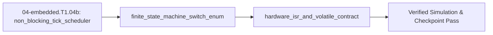

<!-- run-callout:start -->
> **Step 7 of 10 · Run it in real time: embedded C**
>
> **Run this in the workbench.** [Open MechaLab with `EX.04-embedded.T1.04b` loaded](https://tle47.github.io/Mechatronics-Roadmap/?lesson=EX.04-embedded.T1.04b) - it opens on the **Run Python Lessons** tab with that entry selected. Starter code, hints and the graded check are ready; this page is the reading copy, and nothing you type here is saved.
<!-- run-callout:end -->

## 1. Why it matters
This is the final bridge module in the Track 04 Tier 1 ladder before Step 1.5 (`04-embedded.T1.05`). Calling `delay(100)` freezes the CPU for $100\text{ ms}$—during that time your robot is blind to encoder pulses, limit switches, and PID loops. Replacing `delay()` with a non-blocking tick scheduler (`now_us - last_us >= PERIOD_US`), an `enum` finite state machine, and a hardware timer **Interrupt Service Routine (ISR)** with `volatile` shared variables gives your robot deterministic $1\text{ kHz}$ reflexes. Already know this? Take the Skip test or the Ladder Gate test in section 7 first.

## 2. Intuition first
Imagine a chef cooking three dishes at once. A **`delay()` loop** is like staring at a pot of water for 10 minutes with your eyes glued to it while the toast burns and the doorbell goes unanswered. A **non-blocking tick scheduler** (`micros() - last_us >= 1000`) is glancing at the wall clock on every pass through the kitchen: if $1000\ \mu\text{s}$ has elapsed, you stir the pot for $5\ \mu\text{s}$ and immediately check the next station. A **hardware interrupt (ISR)** is a smoke alarm wired directly to your reflex nervous system—the instant the hardware timer hits zero, the CPU pauses whatever background line it was running, executes the short ISR function in a few microseconds, sets a flag on a shared whiteboard, and resumes the background loop. Marking that flag **`volatile`** tells the C++ compiler: *"Do not cache this variable in a register—another context (the ISR) can change it behind your back at any nanosecond!"*

## 3. Formalization
1. **Non-Blocking Rollover-Safe Tick Scheduler:** Given unsigned 32-bit microsecond timer `now_us` and period `PERIOD_US = 1000` ($1\text{ kHz}$), the condition:

$$
\text{uint32-t}(t_{\text{now}} - t_{\text{last}}) \ge T_{\text{period}} \implies t_{\text{last}} \leftarrow t_{\text{last}} + T_{\text{period}}
$$

   executes without blocking and without cumulative phase drift. Substituting $t_{\text{last}} = 2000\ \mu\text{s}$, $T_{\text{period}} = 1000\ \mu\text{s}$, and $t_{\text{now}} = 3015\ \mu\text{s}$ triggers execution and advances $t_{\text{last}}$ to $3000\ \mu\text{s}$ (preserving the exact $1000\ \mu\text{s}$ grid).
2. **Finite State Machine (`enum` + `switch`):** An actuator controller defines explicit states `enum class State { IDLE, HOMING, RUN, FAULT };` and transitions cleanly on each tick (e.g., `FAULT` forces `pwm = 0.0` immediately if current exceeds $I_{\max}$ or E-stop is pressed).
3. **Hardware Timer ISR Budget & `volatile`:** If a timer ISR fires at frequency $f_{\text{isr}} = 1/T_{\text{isr}}$ and takes execution time $t_{\text{exec}}$, its CPU utilization fraction is:

$$
U_{\text{isr}} = \frac{t_{\text{exec}}}{T_{\text{isr}}} = t_{\text{exec}} \cdot f_{\text{isr}}
$$

   Substituting $t_{\text{exec}} = 45\ \mu\text{s}$ at $f_{\text{isr}} = 1000\text{ Hz}$ ($T_{\text{isr}} = 1000\ \mu\text{s}$) gives $U_{\text{isr}} = 45 / 1000 = 4.5\%$. Any variable written inside an ISR and read in `loop()` must be declared `volatile`.

## 4. Worked example
**Predict first (before you run it):** The loop below runs $10{,}000\ \mu\text{s}$ of a $1\text{ kHz}$ control task and a $100\text{ Hz}$ telemetry task, with the state machine starting at `IDLE` and `pos_rad = -0.05`, gaining $0.01$ on every `HOMING` tick. Before you run it, commit to three numbers: how many control runs and how many telemetry runs fire in that window, and which tick carries the `HOMING -> RUN` switch. Two tells that a wrong answer is a mistake rather than a surprise: the control count must be the window divided by the $1000\ \mu\text{s}$ period and not one more, so $11$ means the deadline at $t = 0$ was counted as a run, and the telemetry count cannot be the same as the control count because its period is ten times longer; and the switch to `RUN` cannot happen in the same pass that leaves `IDLE`, so a `RUN` on the first tick means two transitions ran in one pass.

Simulate $10\text{ ms}$ ($10{,}000\ \mu\text{s}$) of a microcontroller running a $1\text{ kHz}$ ($1000\ \mu\text{s}$) control task and a $100\text{ Hz}$ ($10{,}000\ \mu\text{s}$) telemetry task concurrently alongside an `IDLE -> HOMING -> RUN -> FAULT` state machine with zero `delay()` calls.

```python
def run_scheduler_and_fsm(duration_us: int = 10_000) -> tuple[int, int, str]:
    last_ctrl_us = 0
    last_telem_us = 0
    ctrl_runs = 0
    telem_runs = 0
    state = "IDLE"
    pos_rad = -0.05

    for now_us in range(1, duration_us + 1):
        if ((now_us - last_ctrl_us) & 0xFFFFFFFF) >= 1000:
            last_ctrl_us = (last_ctrl_us + 1000) & 0xFFFFFFFF
            ctrl_runs += 1
            if state == "IDLE":
                state = "HOMING"
            elif state == "HOMING":
                pos_rad += 0.01
                if pos_rad >= 0.0:
                    state = "RUN"
            elif state == "RUN" and ctrl_runs == 9:
                state = "FAULT"  # Simulated over-current fault on tick 9
        if ((now_us - last_telem_us) & 0xFFFFFFFF) >= 10_000:
            last_telem_us = (last_telem_us + 10_000) & 0xFFFFFFFF
            telem_runs += 1

    return ctrl_runs, telem_runs, state

ctrl_runs, telem_runs, final_state = run_scheduler_and_fsm(10_000)
assert ctrl_runs == 10
assert telem_runs == 1
assert final_state == "FAULT"
print(f"ctrl_runs={ctrl_runs}, telem_runs={telem_runs}, final_state={final_state}")
```
Expected output:
```text
ctrl_runs=10, telem_runs=1, final_state=FAULT
```

## 5. Exercise
Calculate the maximum allowable ISR execution time $t_{\text{exec,max}}$ in microseconds ($\mu\text{s}$) if a $f_{\text{isr}} = 10\text{ kHz}$ ($T_{\text{isr}} = 100\ \mu\text{s}$) current-loop ISR must consume no more than $U_{\max} = 25\%$ ($0.25$) of total CPU time so that $75\%$ remains for telemetry and state machines. Verify $t_{\text{exec,max}} = 25.0\ \mu\text{s}$.
- **If your result differs:** Multiply the period $T_{\text{isr}} = 10^6 / 10000 = 100\ \mu\text{s}$ by $0.25$ ($100 \times 0.25 = 25.0\ \mu\text{s}$).

### Graded package - the scheduler, the ISR budget and the latched fault
[`exercises/04-embedded.T1.04b/`](../exercises/04-embedded.T1.04b/) turns this section into a test. `starter.py` holds eight holes: `elapsed_us` (subtract first, *then* mask to the timer width), `tick_due`, `next_deadline_us` (advance on the grid, never resynchronise to `now`), `isr_utilization_pct` (the $10^{-6}$), `max_isr_exec_us`, `fault_latency_us`, `ticks_in` and `fsm_step` (FAULT latches and forces `pwm = 0`). Edit it, then run the tests the way CI does:

```bash
EXERCISE_TARGET=exercises/04-embedded.T1.04b/starter.py \
  python3 -m unittest discover -s exercises/04-embedded.T1.04b -p 'test_*.py'
```

**45 tests.** The elapsed time is checked at the $3015 - 2000 = 1015\ \mu\text{s}$ worked example and across both wraps ($12 - 65520$ is $28$ on a 16-bit counter and $4294901788$ on a 32-bit one), so a difference taken without the mask fails; the deadline is checked at exactly one period, so `>` instead of `>=` loses that tick; the $45\ \mu\text{s}$/$1\text{ kHz}$ utilization, the $3.5\%$ Skip test, the $25\ \mu\text{s}$ exercise budget and the $150\ \mu\text{s}$ debounce latency each fail on a dropped $10^{-6}$ or a percentage read as a fraction; and the FSM is checked at `IDLE -> HOMING -> RUN`, at the current limit itself (no fault) and after the current recovers, so a FAULT that clears itself fails. The transfer suite runs **the plant's own clock**: `plant.DT` is the $1\text{ kHz}$ period, one second is `plant.TICKS` ticks, a $10\text{ kHz}$ loop fits ten times per tick with $975\ \mu\text{s}$ left over, and the uint32 wrap lands back on the same $1000\ \mu\text{s}$ grid. Five planted faults - `rollover_not_masked`, `tick_due_uses_greater_than`, `isr_microseconds_dropped`, `isr_budget_ignores_percent`, `fsm_fault_not_latched` - each fail the test named for them.


- **📚 What to Learn & Resources to Solve This Exercise:**
  - **Required Foundations Modules (`00-foundations`):** [`00-foundations.T1.00a`](00-foundations.T1.00a.md)–[`00-foundations.T1.00c`](00-foundations.T1.00c.md) (*Loops, Arrays & SI Timing Units*).
  - **Prerequisite Bridge Modules:** [`01-electronics.T1.01b`](01-electronics.T1.01b.md) (*PWM Control*) and [`04-embedded.T1.04a`](04-embedded.T1.04a.md) (*Bitwise Masks & `volatile`*).
  - **Core Concepts to Review First:** Non-blocking timer ISR execution vs. `delay()`, `enum` finite-state machines (`IDLE`, `HOMING`, `CLOSED_LOOP`, `FAULT_STOP`), and packed binary telemetry (`struct.pack`/`unpack` + XOR checksum) in `## 3. Formalization` and `## 4. Worked example` above.
  - **Study Links & Resources:** [Python `struct` Binary Packing Docs (`docs.python.org`)](https://docs.python.org/3/library/struct.html), [Samek *Practical UML Statecharts in C/C++*](https://www.state-machine.com/psicc2), and [Track 04 §1.1–1.3 (`04-embedded-and-realtime/README.md`)](../04-embedded-and-realtime/README.md#tier-1-beginner--intuitive).

### Starter code
```python
# --- Exercise scaffold: fill in each TODO, then check against the numbers in the full solution below ---
STATE_NAMES = ("IDLE", "HOMING", "RUN", "FAULT")
UINT32_MASK = 0xFFFFFFFF
HOMING_PWM = 0.2


def elapsed_us(now_us, last_us, bits=32):
    """Unsigned elapsed ticks between two timer readings `bits` wide, wrap included."""
    # TODO 1: subtract first, then mask to (1 << bits) - 1
    ...


def tick_due(now_us, last_us, period_us):
    """True when another whole period has elapsed."""
    # TODO 2: at exactly one period the answer is already True - compare with >=
    ...


def next_deadline_us(last_us, period_us):
    """Advance the deadline on its own grid, so a late check never accumulates drift."""
    # TODO 3: add the period to the old deadline, then mask - never resynchronise to now
    ...


def isr_utilization_pct(t_exec_us, f_isr_hz):
    """The CPU fraction an ISR costs, in percent."""
    # TODO 4: microseconds are 1e-6 seconds - forgetting that reports 4.5 million percent
    ...


def max_isr_exec_us(u_max_pct, f_isr_hz):
    """The longest an ISR may run inside its budget."""
    # TODO 5: the budget arrives as a percentage, so divide it by 100 before using it
    ...


def fault_latency_us(n_debounce, f_isr_hz):
    """How long N consecutive samples take at the ISR rate."""
    # TODO 6: seconds to microseconds is 1e6, not 1e3
    ...


def ticks_in(duration_us, period_us):
    """Complete ticks of `period_us` inside `duration_us`."""
    # TODO 7: integer division - a partial tick has not run
    ...


def fsm_step(state, current_a, i_max_a, pos_rad, pwm_cmd):
    """One control tick of the actuator FSM: (next_state, pwm)."""
    # TODO 8: FAULT is a latch, not a measurement - it must survive a current that has recovered
    ...


print("scaffold ready: 8 TODOs to fill, then compare against the numbers in the full solution")
```

**Expected numbers (the answer):** $t_{\text{exec,max}} = 25.0\ \mu\text{s}$ at $25\%$ of a $10\text{ kHz}$ period; a $45\ \mu\text{s}$ ISR at $1\text{ kHz}$ costs $4.5\%$ ($3.5\%$ at $30\ \mu\text{s}$); three samples at $20\text{ kHz}$ debounce in $150\ \mu\text{s}$; $3015 - 2000 = 1015\ \mu\text{s}$; the same $12 - 65520$ difference is $28$ on a 16-bit counter and $4294901788$ on a 32-bit one.

### Hint ladder
1. **Mask after subtracting, not before.** `12 - 65520` is `-65508`; `-65508 & 0xFFFF` is `28`, and `-65508 & 0xFFFFFFFF` is `4294901788`. The mask belongs to the *counter width*, so `bits` is an argument, not a constant 32.
2. **A deadline advances on its own grid.** `next_deadline_us(1000, 1000)` is `2000`, not `now + period`: resynchronising to the late reading is what lets a 1 kHz loop drift to 999 Hz.
3. **Percentages and microseconds cancel cleanly.** $100 \times t_{\text{exec}}/T_{\text{isr}} = 100 \times t_{\text{exec}}\times 10^{-6}\times f_{\text{isr}}$; the budget comes back with `u_max_pct / 100` because `25` means $0.25$.
4. **FAULT is latched.** Once `current_a > i_max_a` has set it, the next tick - current recovered, PWM requested - still returns `("FAULT", 0.0)`. Only `HOMING` waits on `pos_rad < 0.0`; the others advance.

5. **What the suite refuses.** A zero period in `tick_due`, `next_deadline_us` or `ticks_in`; a timer width outside `1..32` bits in `elapsed_us`; a submission budget outside `0..100` percent in `max_isr_exec_us`; an `isr_utilization_pct` whose ISR is longer than its period, or whose frequency is zero; a zero debounce in `fault_latency_us`; an unknown state or a duty above one in `fsm_step`; and a negative duration anywhere - each raises `ValueError`.

### Full Solution
```python
STATE_NAMES = ("IDLE", "HOMING", "RUN", "FAULT")
UINT32_MASK = 0xFFFFFFFF
HOMING_PWM = 0.2


def elapsed_us(now_us, last_us, bits=32):
    """Unsigned elapsed ticks between two timer readings `bits` wide, wrap included."""
    if not isinstance(bits, int) or bits < 8 or bits > 32:
        raise ValueError("bits must be an integer timer width from 8 to 32, not %r" % (bits,))
    if not isinstance(now_us, int) or not isinstance(last_us, int):
        raise ValueError("timer counts are integers")
    return (now_us - last_us) & ((1 << bits) - 1)


def tick_due(now_us, last_us, period_us):
    """True when another whole period has elapsed - the non-blocking replacement for delay()."""
    if not isinstance(period_us, int) or period_us <= 0:
        raise ValueError("a period is a positive integer number of microseconds")
    return elapsed_us(now_us, last_us) >= period_us


def next_deadline_us(last_us, period_us):
    """Advance the deadline on its own grid, so a late check never accumulates drift."""
    if not isinstance(period_us, int) or period_us <= 0:
        raise ValueError("a period is a positive integer number of microseconds")
    if not isinstance(last_us, int):
        raise ValueError("timer counts are integers")
    return (last_us + period_us) & UINT32_MASK


def isr_utilization_pct(t_exec_us, f_isr_hz):
    """The CPU fraction an ISR costs, in percent: 100 * t_exec / T_isr = 100 * t_exec * f_isr."""
    if t_exec_us < 0.0:
        raise ValueError("an ISR cannot take negative time")
    if f_isr_hz <= 0.0:
        raise ValueError("an ISR frequency is positive")
    if t_exec_us > 1_000_000.0 / f_isr_hz:
        raise ValueError("an ISR longer than its own period (%g us) never returns"
                         % (1_000_000.0 / f_isr_hz))
    return 100.0 * (t_exec_us * 1e-6) * f_isr_hz


def max_isr_exec_us(u_max_pct, f_isr_hz):
    """The longest an ISR may run and still leave (100 - u_max_pct) percent to the main loop."""
    if not 0.0 < u_max_pct <= 100.0:
        raise ValueError("the budget is a percentage greater than 0 and at most 100")
    if f_isr_hz <= 0.0:
        raise ValueError("an ISR frequency is positive")
    return (u_max_pct / 100.0) * (1_000_000.0 / f_isr_hz)


def fault_latency_us(n_debounce, f_isr_hz):
    """How long N consecutive samples take at the ISR rate - the fault-detection latency."""
    if not isinstance(n_debounce, int) or n_debounce < 1:
        raise ValueError("a debounce count is an integer of at least one sample")
    if f_isr_hz <= 0.0:
        raise ValueError("an ISR frequency is positive")
    return (n_debounce / f_isr_hz) * 1_000_000.0


def ticks_in(duration_us, period_us):
    """Complete ticks of `period_us` inside `duration_us` - the number of 1 kHz runs in a window."""
    if not isinstance(duration_us, int) or duration_us < 0:
        raise ValueError("a duration is a non-negative integer number of microseconds")
    if not isinstance(period_us, int) or period_us <= 0:
        raise ValueError("a period is a positive integer number of microseconds")
    return duration_us // period_us


def fsm_step(state, current_a, i_max_a, pos_rad, pwm_cmd):
    """One control tick of the actuator FSM: (next_state, pwm).

    IDLE -> HOMING on the first tick, HOMING -> RUN once the axis reaches zero, RUN holds the
    commanded PWM, and FAULT latches with the PWM forced to zero until the controller is reset.
    """
    if state not in STATE_NAMES:
        raise ValueError("unknown state %r; expected one of %s" % (state, ", ".join(STATE_NAMES)))
    if i_max_a <= 0.0:
        raise ValueError("the current limit is positive")
    if current_a < 0.0:
        raise ValueError("a measured current magnitude is not negative")
    if not 0.0 <= pwm_cmd <= 1.0:
        raise ValueError("a duty cycle lies in [0, 1]")
    if state == "FAULT":
        return "FAULT", 0.0
    if current_a > i_max_a:
        return "FAULT", 0.0
    if state == "IDLE":
        return "HOMING", HOMING_PWM
    if state == "HOMING":
        return ("HOMING" if pos_rad < 0.0 else "RUN"), HOMING_PWM
    return "RUN", pwm_cmd

assert elapsed_us(3015, 2000) == 1015
assert elapsed_us(12, 65520, 16) == 28
assert elapsed_us(12, 65520, 32) == 4294901788
assert tick_due(2000, 1000, 1000) and not tick_due(1999, 1000, 1000)
assert next_deadline_us(1000, 1000) == 2000
assert abs(isr_utilization_pct(45, 1000) - 4.5) < 1e-12
assert abs(isr_utilization_pct(30, 1000) - 3.0) < 1e-12
assert abs(max_isr_exec_us(25, 10000) - 25.0) < 1e-12
assert abs(fault_latency_us(3, 20000) - 150.0) < 1e-12
assert ticks_in(1000, 1000) == 1 and ticks_in(1999, 1000) == 1
assert fsm_step("IDLE", 0.5, 2.0, 0.3, 0.4) == ("HOMING", HOMING_PWM)
assert fsm_step("HOMING", 0.5, 2.0, 0.0, 0.4) == ("RUN", HOMING_PWM)
assert fsm_step("RUN", 2.5, 2.0, 0.3, 0.6) == ("FAULT", 0.0)
assert fsm_step("FAULT", 0.2, 2.0, 0.3, 0.6) == ("FAULT", 0.0)

print("budget=%.1f us at 10 kHz (25%%) | util(45 us @ 1 kHz)=%.1f%% | debounce(3 @ 20 kHz)=%.0f us"
      % (max_isr_exec_us(25, 10000), isr_utilization_pct(45, 1000), fault_latency_us(3, 20000)))
print("elapsed(3015-2000)=%d us | 16-bit wrap(12-65520)=%d | IDLE->%s | over-limit->%s"
      % (elapsed_us(3015, 2000), elapsed_us(12, 65520, 16),
         fsm_step("IDLE", 0.5, 2.0, 0.3, 0.4)[0], fsm_step("RUN", 2.5, 2.0, 0.3, 0.6)[0]))

```

Printed: `budget=25.0 us at 10 kHz (25%) | util(45 us @ 1 kHz)=4.5% | debounce(3 @ 20 kHz)=150 us`, then `elapsed(3015-2000)=1015 us | 16-bit wrap(12-65520)=28 | IDLE->HOMING | over-limit->FAULT`.

**On the shared arm.** The package's Transfer suite schedules the plant's own clock:
```python
import mechalab_plant as plant

# Its 1 ms tick is the 1 kHz ISR period, and one second of plant time is a thousand ticks.
assert abs(1.0 / plant.DT - 1000.0) < 1e-9
assert abs(plant.TICKS * plant.DT - 1.0) < 1e-12
# The worked example's 45 us ISR costs 4.5% of that tick.
assert abs(100.0 * 45.0e-6 * (1.0 / plant.DT) - 4.5) < 1e-12
print("plant: tick=%.3f ms | 1 s = %d ticks | 45 us ISR at the plant rate = %.1f%%"
      % (plant.DT * 1e3, plant.TICKS, 100.0 * 45.0e-6 * (1.0 / plant.DT)))
```

### Break it on purpose
- **Inject:** replace the rollover-safe comparison with an absolute one, `if now_us >= last_us + 1000:`, keeping `last_us += 1000` and the $1000\ \mu\text{s}$ period.
- **Symptom:** everything is correct for the first $2^{32}\ \mu\text{s} = 4294.97\ \text{s} \approx 71.6\ \text{min}$, then the control task stops dead: with `last_us = 4_294_966_000` and the counter wrapped to `now_us = 1200`, the two stamps are $2496\ \mu\text{s}$ apart, yet `1200 >= 4294967000` is false, so the task goes silent for the rest of that $71.6\ \text{min}$ window.
- **Diagnose:** the failure starts at one specific moment since boot and only when the two timestamps straddle the wrap, so the period, the ISR and the state machine are all ruled out; the comparison assumes `micros()` never wraps, which holds for the first $71.6$ minutes and then stops holding.
- **Fix:** subtract first in unsigned 32-bit arithmetic, `if ((now_us - last_us) & 0xFFFFFFFF) >= 1000:`, and advance `last_us` by the period. The pair $4{,}294{,}966{,}000 \to 1200$ then reads $2496\ \mu\text{s}$, fires, and moves the deadline to $4{,}294{,}967{,}000$, so the $1000\ \mu\text{s}$ grid survives the wrap and a $10{,}000\ \mu\text{s}$ window still yields the ten control ticks the worked example asserts.

## 6. Simulation path
Open **Real-Time Concurrency & ISR Preemption** in the MechaLab Workbench (`npm run dev`) or run a non-blocking `micros()` sketch on the [Wokwi Simulator](https://wokwi.com/).

No hardware required for this module (`hardware_required: false`). When you transition to physical microcontroller hardware in **Step 1.5 (`04-embedded.T1.05`)**, follow the canonical **First-Use `PlatformIO` Build/Flash (`pio run -t upload`), Linux `udev` Serial Permissions & Python `struct.unpack` Telemetry Walkthrough** in [`04-embedded-and-realtime/README.md` (§1.1–1.3)](../04-embedded-and-realtime/README.md#tier-1-beginner--intuitive) and [`resources/open-source-toolchains.md` (§0)](../resources/open-source-toolchains.md#0-core-supported-os-environment-terminal-bootstrap--python-venv-setup). There you will toggle a physical GPIO pin at entry and exit of the $1\text{ kHz}$ timer ISR on an `ESP32` or `STM32 Nucleo` and measure pulse width $t_{\text{exec}}$ and period $T_{\text{isr}} = 1000\ \mu\text{s}$ with a logic analyzer (`PulseView`):
```text
[Timer ISR Entry: GPIO HIGH] ---> (PID Math: ~15 us) ---> [Timer ISR Exit: GPIO LOW] ---> [Logic Analyzer]
```
Pass/fail verification in simulation: `ctrl_runs == 10`, `telem_runs == 1`, and `final_state == "FAULT"`.




## 7. Checkpoint
Pass criteria: score $\ge 80\%$ ($4/5$) on the Skip test to pass this module, or score $\ge 80\%$ ($7/8$) on the Ladder Gate test below to unlock Step 1.5 (`04-embedded.T1.05`).

### Skip test
<!-- skip-test:start -->
1. `[Recall] [Concept: non_blocking_tick_scheduler]` If a main loop calls `delay(50)` ($50\text{ ms}$) for an LED blink and `delay(20)` ($20\text{ ms}$) for a sensor wait, what is the maximum loop execution frequency $f_{\text{loop}} = \frac{1}{0.050 + 0.020}$ in $\text{Hz}$ (tolerance $\pm 0.01\text{ Hz}$)?
2. `[Apply] [Concept: hardware_isr_and_volatile_contract]` Compute the CPU utilization percentage $U_{\text{isr}}\% = 100 \times \frac{t_{\text{exec}}}{T_{\text{isr}}}$ (tolerance $\pm 10^{-6}$) for a $1\text{ kHz}$ ($1000\ \mu\text{s}$) timer ISR that takes $t_{\text{exec}} = 35\ \mu\text{s}$.
3. `[Transfer] [Concept: finite_state_machine_switch_enum]` An actuator FSM running inside a $f_{\text{isr}} = 20\text{ kHz}$ ($T_{\text{isr}} = 50\ \mu\text{s}$) timer ISR transitions from `RUN` to `FAULT` (forcing `pwm_cmd = 0.0`) after $N_{\text{debounce}} = 3$ consecutive overcurrent samples. Compute the total fault-detection latency $t_{\text{fault}} = N_{\text{debounce}} / f_{\text{isr}}$ in microseconds ($\mu\text{s}$, tolerance $\pm 10^{-9}$).
4. `[Concept: hardware_isr_and_volatile_contract]` Why must a global flag `bool tick_ready` written inside a hardware timer ISR and polled inside `main()` be declared `volatile bool tick_ready` in C/C++?
   - **A.** To make the variable use flash memory instead of RAM.
   - **B.** To prevent the compiler optimizer (`-O2`/`-O3`) from caching `tick_ready` in a CPU register and turning `while (!tick_ready)` into an infinite loop.
   - **C.** To automatically disable interrupts during math operations.
   - **D.** To convert the boolean into a 32-bit float.
5. `[Spaced review -> 04-embedded.T1.04a — Concept: bitwise_masks_and_shifts]` Compute the mask `1U << 5` as a decimal integer (tolerance $\pm 10^{-9}$).

**Answer key:**
```python
import math

q1_floop_hz = 1.0 / (0.050 + 0.020)
q2_cpu_pct = 100.0 * (35.0 / 1000.0)
q3_tfault_us = (3.0 / 20_000.0) * 1e6
q4_choice = "B"
assert math.isclose(q1_floop_hz, 14.2857, abs_tol=1e-2)
assert math.isclose(q2_cpu_pct, 3.5, rel_tol=1e-9)
assert math.isclose(q3_tfault_us, 150.0, rel_tol=1e-9)
assert q4_choice == "B"
q5_review = float(1 << 5)
assert math.isclose(q5_review, 32.0, rel_tol=1e-9, abs_tol=1e-09)
```
- **Pass mark:** $4/5$ ($80\%+$). If you missed Q1, study `## 3. Formalization` item 1; if you missed Q2 or Q4, study `## 3. Formalization` item 3; if you missed Q3, study `## 3. Formalization` item 2. If you missed  Q5, review `04-embedded.T1.04a`. On pass, proceed to `## 10. Next modules`.
<!-- skip-test:end -->

### Gate test
Covers the complete Track 04 Tier 1 bridge ladder (`04-embedded.T1.04a` $\to$ `04-embedded.T1.04b`) before Step 1.5 (`04-embedded.T1.05`):
1. `[Concept: c_fixed_width_integer_types_and_overflow]` Compute the unsigned 16-bit elapsed tick difference `(now - prev) & 0xFFFF` when `now = 12` and `prev = 65520`.
2. `[Concept: c_fixed_width_integer_types_and_overflow]` How many bytes does a packed struct `{ uint32_t tick_ms; int16_t enc_count; int16_t pwm_cmd; }` occupy in memory?
3. `[Concept: bitwise_masks_and_shifts]` Starting with `reg = 0x00`, compute the decimal value of `reg` after setting bits `1` and `4` (`reg |= (1 << 1) | (1 << 4)`).
4. `[Concept: bitwise_masks_and_shifts]` Starting with `reg = 0xFF` (`255`), compute the decimal value of `reg` after clearing bit `7` (`reg &= ~(1 << 7)`).
5. `[Concept: c_structs_and_pointers_pass_by_reference]` Why do embedded C functions accept `const TelemetryPacket *pkt` instead of passing `TelemetryPacket pkt` by value?
   - **A.** Passing a pointer copies only a 4-byte memory address instead of copying the entire struct onto the stack, while `const` prevents accidental modification.
   - **B.** C does not allow structs to be returned or passed by value.
   - **C.** Pointers automatically encrypt serial data.
   - **D.** Pointers run at twice the clock frequency.
6. `[Concept: non_blocking_tick_scheduler]` Why is `last_us += PERIOD_US` preferred over `last_us = now_us` in a periodic tick scheduler?
   - **A.** Because `last_us += PERIOD_US` advances the target deadline on an exact phase grid without accumulating positive timing drift when `now_us` is checked a few microseconds late.
   - **B.** Because `=` is slower than `+=`.
   - **C.** Because `now_us` is a floating-point number.
   - **D.** Because `last_us = now_us` causes a division by zero.
7. `[Concept: finite_state_machine_switch_enum]` Compute the number of $1\text{ kHz}$ control ticks executed over $0.25\text{ s}$ ($250{,}000\ \mu\text{s}$).
8. `[Concept: hardware_isr_and_volatile_contract]` Why must you **never** call `Serial.println()` or `delay()` inside a $1\text{ kHz}$ hardware timer ISR?
   - **A.** Because `Serial.println()` and `delay()` block for milliseconds (exceeding the $1000\ \mu\text{s}$ ISR period), starving the main loop and causing missed control ticks or watchdog resets.
   - **B.** Because ISRs can only use `float` variables.
   - **C.** Because timer ISRs run on the GPU.
   - **D.** Because `Serial.println()` resets the encoder counter to zero.

**Gate answer key:**
```python
import struct

g1_delta = (12 - 65520) & 0xFFFF
g2_bytes = struct.calcsize("<Ihh")
g3_set = (1 << 1) | (1 << 4)
g4_clear = 0xFF & ~(1 << 7)
g5_choice = "A"
g6_choice = "A"
g7_ticks = 250_000 // 1000
g8_choice = "A"

assert g1_delta == 28
assert g2_bytes == 8
assert g3_set == 18
assert g4_clear == 127
assert g5_choice == "A"
assert g6_choice == "A"
assert g7_ticks == 250
assert g8_choice == "A"
```
- **Pass mark:** $7/8$ ($80\%+$). Remediation: Q1–Q5 $\to$ `04-embedded.T1.04a`; Q6–Q8 $\to$ `04-embedded.T1.04b`.

## 8. Common mistakes
| Symptom | Root cause | 2-minute fix |
| :--- | :--- | :--- |
| `while (!isr_flag)` hangs forever when compiled with `-O2` | Forgot `volatile` on `isr_flag`. | Declare shared ISR flags as `volatile bool isr_flag = false;`. |
| Scheduler stops firing after ~71.6 minutes (`uint32_t` `micros()` rollover) | Wrote `if (now_us >= next_us)` instead of unsigned subtraction `if ((uint32_t)(now_us - last_us) >= PERIOD_US)`. | Always subtract unsigned timestamps before comparing against `PERIOD_US`. |
| Control loop jitter spikes to milliseconds whenever telemetry prints | Called `Serial.print()` inside the timer ISR or printed long ASCII strings at $9600\text{ bps}$. | Keep ISRs under $20\ \mu\text{s}$ and send compact binary structs from `loop()` at $\ge 115200\text{ bps}$ (Step 1.5). |

## 9. Resources
- **Lee & Seshia — *Introduction to Embedded Systems* (`leeseshia.org`, `resources/textbooks-and-papers.md`):** Free textbook covering finite state machines, interrupts, and `volatile` memory semantics `[VERIFIED 2026-10-15]`.
- **Track 04 (`04-embedded-and-realtime/README.md`):** Directly continues into Step 1.5 (`04-embedded.T1.05`) `[VERIFIED 2026-10-15]`.
## 10. Next modules

<!-- next-step:start -->
👉 **Next:** [Step 8 · Make it hold still: control — Lesson 05.1: PID Virtual Spring-Damper Control and Integrator Anti-Windup Clamping](../05-control-and-estimation/05.1-pid-virtual-spring-damper-and-anti-windup.md)
<!-- next-step:end -->
