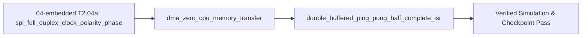

<!-- run-callout:start -->
> **Run this in the workbench.** [Open MechaLab](https://tle47.github.io/Mechatronics-Roadmap/) → **Tab 2, Run Python Lessons** → search `EX.04-embedded.T2.04a` and pick it from the list. The starter code, hints and graded check live there; this page is the reading copy, and nothing you type here is saved.
<!-- run-callout:end -->

## 1. Why it matters
In Tier 1, reading a sensor or sending serial bytes inside a polling loop tied up the CPU for tens of microseconds per byte. When your motor loop speeds up to $20\text{–}40\text{ kHz}$ in Step 2.5 (`04-embedded.T2.05`), the CPU has only $25\text{–}50\ \mu\text{s}$ total per tick! Understanding full-duplex **SPI (`CPOL`/`CPHA`) framing**, offloading peripheral transfers to a hardware **Direct Memory Access (DMA)** controller, and processing streaming samples out of a **double-buffered (ping-pong) ring buffer** lets your microcontroller read encoders and stream telemetry with near-zero CPU overhead. Already know this? Take the Skip test in section 7 first.

## 2. Intuition first
After mastering Arduino/Wiring (`04-embedded.T1.04a`) and non-blocking state machines (`04-embedded.T1.04b`), professional firmware progresses through two layers: **Vendor Hardware Abstraction Layers (`HAL`)** and **Bare-Metal Memory-Mapped Registers (`MMIO`)**:
- **Vendor HAL (`STM32Cube HAL`) & High-Speed SPI vs. I2C:** Think of **I2C** ($400\text{ kHz}$ shared 2-wire bus) as a single-lane village road where every packet waits for an address and `ACK`, whereas **SPI** ($10\text{–}20\text{ MHz}$ 4-wire bus: `SCLK`, `MOSI`, `MISO`, `CS_n`) is a dedicated twin-track expressway that shifts bits out on `MOSI` and in on `MISO` simultaneously as soon as Chip-Select (`CS_n`) goes LOW. Vendor SDKs provide a **Hardware Abstraction Layer (HAL)** organized around handle structs (`SPI_HandleTypeDef hspi1`, `UART_HandleTypeDef huart2`) with both blocking polling calls (`HAL_SPI_TransmitReceive`) and non-blocking DMA calls (`HAL_SPI_TransmitReceive_DMA`).
- **Peeling Back the HAL — Bare-Metal Register Basics (`ODR`, `BSRR`, `DMA`) & Zero-CPU DMA Offload:** What is `HAL_GPIO_WritePin` or `HAL_SPI_TransmitReceive_DMA` actually doing under the hood? Every microcontroller peripheral is controlled by **memory-mapped hardware registers (`MMIO`)** at fixed silicon addresses (e.g. `#define GPIOA_ODR (*(volatile uint32_t *)0x48000014UL)`). While modifying `GPIOA->ODR |= (1U << 5)` requires a 3-instruction read-modify-write sequence, writing `(1U << 5)` to the write-only **Bit-Set/Reset Register (`GPIOA->BSRR`)** sets (or `(1U << (5 + 16))` clears) the pin atomically in a single clock cycle! Similarly, starting a **DMA (Direct Memory Access)** transfer simply writes the peripheral register address (`CPAR = &SPI1->DR`), SRAM buffer address (`CMAR`), and transfer count (`CNDTR`) into the hardware DMA engine in $0.25\ \mu\text{s}$, freeing $100\%$ of the CPU while silicon moves the bytes in the background!
- **Double-Buffered (Ping-Pong) Circular DMA Ring Buffers:** A ping-pong buffer splits a $2N$-sample array into `Ping` $[0..N-1]$ and `Pong` $[N..2N-1]$: while DMA fills `Pong`, the CPU safely reads `Ping` inside `HAL_ADC_ConvHalfCpltCallback()` (`HT` ISR), and reads `Pong` inside `HAL_ADC_ConvCpltCallback()` (`TC` ISR) with zero race conditions.

## 3. Formalization
1. **Vendor HAL (`STM32Cube HAL`) & SPI Full-Duplex Transaction Time (`CPOL`, `CPHA`):** Shifting $B_{\text{bits}}$ bits at SPI clock frequency $f_{\text{sclk}}$ ($\text{Hz}$) with chip-select setup/hold overhead $t_{\text{cs}}$ ($\text{s}$) takes wire time:

$$
t_{\text{spi}} = \frac{B_{\text{bits}}}{f_{\text{sclk}}} + t_{\text{cs}}
$$

   Substituting a 16-bit magnetic encoder frame ($B_{\text{bits}} = 16$) at $f_{\text{sclk}} = 10\text{ MHz}$ ($10^7\text{ Hz}$) and $t_{\text{cs}} = 0.4\ \mu\text{s}$ gives $t_{\text{spi}} = 1.6\ \mu\text{s} + 0.4\ \mu\text{s} = 2.0\ \mu\text{s}$. SPI Mode 1 (`CPOL=0, CPHA=1`, used by `AS5048A`/`TLE5012B`) idles `SCLK` LOW, shifts on the rising edge, and samples on the falling edge.
2. **Bare-Metal Register Basics (`MMIO`, `ODR`, `BSRR`) & HAL DMA Offload (`CPAR`, `CMAR`, `CNDTR`):**
   - **Memory-Mapped Register & Atomic `BSRR`:** At physical address `0x48000014UL` (`GPIOA->ODR`), a read-modify-write `GPIOA->ODR |= (1U << n)` can be preempted mid-operation by an ISR; writing to the atomic Bit-Set/Reset Register `GPIOA->BSRR = (1U << n)` (set bit $n$) or `GPIOA->BSRR = (1U << (n + 16))` (clear bit $n$) completes in $1$ bus cycle with zero ISR race.
   - **Blocking HAL Polling vs. DMA Register Offload:** Blocking `HAL_UART_Transmit` / `HAL_SPI_TransmitReceive` stalls the CPU for $t_{\text{cpu,poll}} = \frac{B_{\text{bits}}}{R_{\text{bps}}}$, whereas `HAL_UART_Transmit_DMA` writes the bare-metal DMA registers (`CPAR`, `CMAR`, `CNDTR`, `CCR |= DMA_CCR_EN`) in $t_{\text{cpu,dma}} \approx 0.25\ \mu\text{s}$ while the DMA controller moves bytes across the AHB bus matrix.
3. **Ping-Pong Circular DMA Buffer Invariant:** For a circular DMA buffer of length $2N$ indexed $[0, 2N-1]$ (`HAL_ADC_Start_DMA(&hadc1, buf, 2*N)`):
   - **Half-Transfer (`HT`) ISR (`HAL_ADC_ConvHalfCpltCallback`)** fires when DMA write index reaches $N$: CPU reads slice `[0 : N]` while DMA writes `[N : 2N]`.
   - **Transfer-Complete (`TC`) ISR (`HAL_ADC_ConvCpltCallback`)** fires when DMA wraps at $2N \to 0$: CPU reads slice `[N : 2N]` while DMA writes `[0 : N]`.

## 4. Worked example
**Predict first (before you run it):** Commit to three numbers before the code runs. (1) A 16-bit SPI frame at $10\text{ MHz}$ plus $0.4\ \mu\text{s}$ of chip-select takes how long, and what fraction of a $50\ \mu\text{s}$ loop is that? (2) Sending $320$ UART bits at $1\text{ Mbps}$ by polling costs how many microseconds, and how many times over is that of the $50\ \mu\text{s}$ loop? (3) With two DMA setups at $0.25\ \mu\text{s}$ each, what percentage of the loop does the CPU still spend? Two tells that your result is wrong rather than the module: a polled total near $42\ \mu\text{s}$ means you divided the $320$ bits by $8$ and charged one stall per byte instead of per bit — a mistake that would hide the overflow, since it squeezes under the $50\ \mu\text{s}$ budget; and a ping-pong window of $160\ \mu\text{s}$ means you sized it with $2N = 32$ samples instead of the half-buffer's $N = 16$.

Compare CPU time blocked when reading a 16-bit encoder + sending a 32-byte telemetry frame (`320` UART bits at $1\text{ Mbps}$) using blocking polling vs. DMA offload inside a $20\text{ kHz}$ ($50\ \mu\text{s}$) control loop, and simulate a $2N = 8$ ping-pong circular DMA buffer over $16$ incoming ADC samples.

```python
import math

t_loop_us = 50.0  # 20 kHz loop period
t_spi_poll_us = (16.0 / 10e6) * 1e6 + 0.4
t_uart_poll_us = (320.0 / 1e6) * 1e6
cpu_poll_total_us = t_spi_poll_us + t_uart_poll_us  # 322.0 us -> overflows 50 us loop by 6.4x!
cpu_dma_total_us = 0.25 + 0.25                      # 0.50 us DMA trigger setup -> 1% of 50 us loop!

assert math.isclose(t_spi_poll_us, 2.0, rel_tol=1e-9)
assert cpu_poll_total_us > t_loop_us
assert cpu_dma_total_us < 1.0

# Simulate Ping-Pong buffer of total size 2N = 8 (N = 4 per half)
N = 4
dma_buf = [0] * (2 * N)
cpu_processed = []
for sample_idx in range(16):
    write_pos = sample_idx % (2 * N)
    dma_buf[write_pos] = (sample_idx + 1) * 10
    if write_pos == N - 1:          # Half-Transfer (HT) interrupt: read Ping [0:N]
        cpu_processed.extend(dma_buf[0:N])
    elif write_pos == 2 * N - 1:    # Transfer-Complete (TC) interrupt: read Pong [N:2N]
        cpu_processed.extend(dma_buf[N:2 * N])

assert cpu_processed == [(k + 1) * 10 for k in range(16)]
print(f"Polling CPU={cpu_poll_total_us:.1f} us (OVERFLOW) vs DMA CPU={cpu_dma_total_us:.2f} us; Ping-Pong items={len(cpu_processed)}")
```
Expected output:
```text
Polling CPU=322.0 us (OVERFLOW) vs DMA CPU=0.50 us; Ping-Pong items=16
```

## 5. Exercise
Calculate the available CPU processing window $t_{\text{window}} = N / f_{\text{adc}}$ in microseconds ($\mu\text{s}$) between Half-Transfer (`HT`) and Transfer-Complete (`TC`) interrupts when a circular DMA buffer with half-size $N = 16$ samples is fed by an ADC sampling at $f_{\text{adc}} = 200\text{ kHz}$ ($5\ \mu\text{s}$ per sample). Verify $t_{\text{window}} = 16 / 200{,}000 = 80.0\ \mu\text{s}$.
- **If your result differs:** Multiply the half-buffer length $N = 16$ (not $2N = 32$) by the sample period $T_{\text{adc}} = 5.0\ \mu\text{s}$ ($16 \times 5.0 = 80.0\ \mu\text{s}$).

### Graded package - the frame, the polled loop and the ping-pong half
[`exercises/04-embedded.T2.04a/`](../exercises/04-embedded.T2.04a/) turns this section into a test. `starter.py` holds seven holes: `spi_shift_us` (bits over clocks), `spi_frame_us` (the 0.4 µs of chip-select is part of it), `uart_poll_us` (every bit stalls the loop, not every byte), `cpu_load_fraction` (busy over period), `ping_pong_window_us` ($N$ samples, not the $2N$ total), `ht_frequency_hz` ($f_{\text{sample}}/N$) and `buffer_slice_for_position` (HT reads Ping, TC reads Pong, mid-half is `None`). Edit it, then run the tests the way CI does:

```bash
EXERCISE_TARGET=exercises/04-embedded.T2.04a/starter.py \
  python3 -m unittest discover -s exercises/04-embedded.T2.04a -p 'test_*.py'
```

**34 tests.** The frame is checked at the worked example's $2.0\ \mu\text{s}$ and at the skip test's $2.0\ \mu\text{s}$ of pure shift, so a dropped chip-select shows up as $1.6$; the polled write is checked at the skip test's $500\ \mu\text{s}$ ($500$ bits, not $50$ bytes), so a per-byte division reports $62.5$; the window is checked at the exercise's $80.0\ \mu\text{s}$, so a $2N$ window reports $160$; the HT rate is checked at $2000\ \text{Hz}$, so a $2N$ divisor reports $1000$; and the ping-pong replay grades the worked example's sixteen samples arriving in order, with HT reading Ping and mid-half positions refused. The transfer suite runs the plant's own clock: a $2.0\ \mu\text{s}$ encoder frame is $0.2\%$ of the $1\ \text{ms}$ tick, its encoder is a $12$-bit, $4096$-count word ($1.2\ \mu\text{s}$ of shift), a four-sample half fires HT at $250\ \text{Hz}$ - $250$ reads per second of plant time - and a $320\ \mu\text{s}$ telemetry frame fits one tick at $32\%$ but overflows a $50\ \mu\text{s}$ loop by $6.44\times$. Five planted faults - `spi_frame_drops_cs`, `uart_poll_per_byte`, `window_uses_full_buffer`, `ht_frequency_uses_total`, `slice_reads_written_half` - each fail the test named for them.

### Starter code
```python
# --- Exercise scaffold: fill in each TODO, then check against the numbers in the full solution below ---
DEFAULT_CS_US = 0.4


def spi_shift_us(n_bits, f_sclk_hz):
    """Clocks alone: B_bits / f_sclk, in microseconds."""
    # TODO 1: bits over clocks, then scale seconds to microseconds
    ...


def spi_frame_us(n_bits, f_sclk_hz, t_cs_us=DEFAULT_CS_US):
    """The whole frame: the shift time plus the chip-select overhead."""
    # TODO 2: the 0.4 us of chip-select is part of the frame
    ...


def uart_poll_us(n_bits, baud):
    """The CPU time a blocking polled write wastes, in microseconds."""
    # TODO 3: every bit stalls the loop - no division by 8
    ...


def cpu_load_fraction(t_busy_us, t_loop_us):
    """Busy time as a fraction of the loop period."""
    # TODO 4: busy over period, so 322 us in a 50 us loop is 6.44x
    ...


def ping_pong_window_us(n_half, f_adc_hz):
    """The time the CPU has to read one half of the buffer, in microseconds."""
    # TODO 5: N samples, not the 2N total
    ...


def ht_frequency_hz(f_sample_hz, n_half):
    """How often the Half-Transfer interrupt fires."""
    # TODO 6: one interrupt per N samples, so f_sample / N
    ...


def buffer_slice_for_position(write_pos, n_half):
    """Return (start, stop) of the readable half, or None mid-half."""
    # TODO 7: HT at write_pos == N-1 reads Ping [0, N); TC at 2N-1 reads Pong [N, 2N)
    ...


print("scaffold ready: 7 TODOs to fill, then compare against the numbers in the full solution")
```

**Expected numbers (the answer):** $t_{\text{window}} = 16 / 200{,}000\ \text{s} = 80.0\ \mu\text{s}$; a 16-bit frame at $8\ \text{MHz}$ shifts in $2.0\ \mu\text{s}$ ($2.4\ \mu\text{s}$ with chip-select); 500 bits at $1\ \text{Mbaud}$ stall the loop for $500\ \mu\text{s}$; $322\ \mu\text{s}$ of busy time is $32\%$ of a $1\ \text{ms}$ tick and $6.44\times$ a $50\ \mu\text{s}$ loop.

### Hint ladder
1. **Seconds, then microseconds.** `n_bits / f_sclk` is in seconds, so multiply by `1e6`; the chip-select term is already in microseconds and is added, never scaled.
2. **Polling stalls per bit.** A UART frame is one start bit, eight data bits and a stop bit, so 50 bytes is 500 bits at the baud rate - `500 / 1e6 * 1e6 = 500` µs. Dividing by 8 first reports `62.5` and hides the cost.
3. **The window is one half, not the buffer.** HT fires when $N$ samples are in, so the CPU has $N/f_{\text{adc}}$ before TC: $16/200000 = 80\ \mu\text{s}$, while $2N$ would report $160$.
4. **The half you may read is the one just finished.** At `write_pos == N - 1` the engine has filled `[0, N)` and moves to Pong, so Ping is safe: `(0, N)`. At `2N - 1` the roles swap: `(N, 2N)`. Anything else is mid-half, and the honest answer is `None`.
5. **What the suite refuses.** Zero frames or a zero clock in `spi_shift_us`; a negative chip-select time in `spi_frame_us`; a negative busy time or a zero period in `cpu_load_fraction`; a zero bit count in `uart_poll_us`; and a `buffer_slice_for_position` that is out of range or has no half to read (`n_half <= 0`) - each raises `ValueError` instead of reporting a plausible-looking zero.

### Full Solution
```python
DEFAULT_CS_US = 0.4


def _positive(value, name):
    if value <= 0.0:
        raise ValueError("%s must be positive, not %r" % (name, value))
    return value


def spi_shift_us(n_bits, f_sclk_hz):
    """t_shift = B_bits / f_sclk in microseconds: the clocks alone, no chip-select."""
    _positive(n_bits, "a frame's bit count")
    _positive(f_sclk_hz, "the SPI clock")
    return (n_bits / f_sclk_hz) * 1e6


def spi_frame_us(n_bits, f_sclk_hz, t_cs_us=DEFAULT_CS_US):
    """t_spi = B_bits / f_sclk + t_cs: chip-select setup and hold is part of the frame."""
    if t_cs_us < 0.0:
        raise ValueError("chip-select overhead cannot be negative")
    return spi_shift_us(n_bits, f_sclk_hz) + t_cs_us


def uart_poll_us(n_bits, baud):
    """The CPU time a blocking write wastes: every bit stalls the loop, DMA or not."""
    _positive(n_bits, "a packet's bit count")
    _positive(baud, "the baud rate")
    return (n_bits / baud) * 1e6


def cpu_load_fraction(t_busy_us, t_loop_us):
    """Busy CPU time as a fraction of the loop period; above 1.0 the loop cannot keep up."""
    if t_busy_us < 0.0:
        raise ValueError("busy time cannot be negative")
    _positive(t_loop_us, "the loop period")
    return t_busy_us / t_loop_us


def ping_pong_window_us(n_half, f_adc_hz):
    """How long the CPU has to read one half: N samples, each 1/f_adc apart."""
    _positive(n_half, "the half-buffer length")
    _positive(f_adc_hz, "the ADC sample rate")
    return (n_half / f_adc_hz) * 1e6


def ht_frequency_hz(f_sample_hz, n_half):
    """Half-Transfer interrupts arrive every N samples, so f_HT = f_sample / N."""
    _positive(f_sample_hz, "the ADC sample rate")
    _positive(n_half, "the half-buffer length")
    return f_sample_hz / n_half


def buffer_slice_for_position(write_pos, n_half):
    """The half the ISR may read when the DMA has just written index `write_pos`.

    HT fires once the engine has filled [0, N) and its write pointer lands on N-1; the CPU then
    reads Ping [0, N) while the engine fills Pong [N, 2N). At 2N-1 the roles swap and the CPU
    reads Pong. Any other position is mid-half: nothing is safe to read yet, so the answer is
    None rather than a guess.
    """
    _positive(n_half, "the half-buffer length")
    if isinstance(write_pos, bool) or not isinstance(write_pos, int):
        raise ValueError("the write position is an integer index, not %r" % (write_pos,))
    total = 2 * n_half
    if not 0 <= write_pos < total:
        raise ValueError("write position %d is outside a %d-sample buffer" % (write_pos, total))
    if write_pos == n_half - 1:
        return (0, n_half)
    if write_pos == total - 1:
        return (n_half, total)
    return None


# No `__main__` block on purpose: the browser grades this file's stdout against the appended
# self-check's single PASS line, and a second print here would be a mismatch for a correct answer.
```

The block prints nothing on its own - the comment above is deliberate: the browser grades this file's stdout against the appended self-check's single PASS line. The numbers it would print are the ones the worked example and the package's own suite already check.

**On the shared arm.** The package's Transfer suite times the frame and the half-buffer on the plant's own clock:
```python
import mechalab_plant as plant

# Its 12-bit encoder word is 1.2 us of shift at 10 MHz, 0.12% of the 1 ms tick.
assert plant.ENCODER_CPR == 2 ** plant.ENCODER_BITS
assert abs((plant.ENCODER_BITS / 10e6) * 1e6 - 1.2) < 1e-12
# At the plant's 1 kHz sample rate a four-sample half fires Half-Transfer at 250 Hz.
assert abs((1.0 / plant.DT) / 4.0 - 250.0) < 1e-9
print("plant: encoder=%d counts | %d-bit shift=%.1f us | tick=%.0f us | HT(4)=%.0f Hz"
      % (plant.ENCODER_CPR, plant.ENCODER_BITS, (plant.ENCODER_BITS / 10e6) * 1e6,
         plant.DT * 1e6, (1.0 / plant.DT) / 4.0))
```

### Break it on purpose
Use the worked example's $2N = 8$ buffer ($N = 4$ samples per half) and plant the `slice_reads_written_half` fault:
- **Inject:** in the Half-Transfer callback, read the half the DMA is currently writing — `dma_buf[N:2N]` on `HT` — instead of the completed `dma_buf[0:N]`.
- **Symptom:** the sixteen samples $10, 20, \dots, 160$ no longer arrive in order. The first `HT` reads four untouched zeros and the next one re-reads the previous half, so the stream comes out $0, 0, 0, 0, 50, 60, 70, 80, 50, 60, 70, 80, 130, 140, 150, 160$: samples $10\text{–}40$ and $90\text{–}120$ are never processed and two halves are delivered twice.
- **Diagnose:** the sample *rate* is right and `HT` still fires at $f_{\text{sample}}/N$, so a DMA configuration or clock fault is ruled out; what changes is which half each ISR reads, and the tell is that exactly one half of every pair is stale while the other is current.
- **Fix:** `HT` reads `dma_buf[0:N]` and `TC` reads `dma_buf[N:2N]`, never the half being written; prove it with the worked example's sixteen-sample replay arriving in exact order, then confirm the exercise's $80.0\ \mu\text{s}$ window still holds at $N = 16$ and $f_{\text{adc}} = 200\text{ kHz}$.

- **📚 What to Learn & Resources to Solve This Exercise:**
  - **Required Foundations Modules (`00-foundations`):** [`00-foundations.T1.00a`](00-foundations.T1.00a.md) (*Fixed-Point Iteration Loops*), [`00-foundations.T1.00c`](00-foundations.T1.00c.md) (*Clock Cycle & Microsecond Units*), and [`00-foundations.T1.00d`](00-foundations.T1.00d.md) (*Affine Range Mapping*).
  - **Prerequisite Bridge Module:** [`04-embedded.T1.04b`](04-embedded.T1.04b.md) and Legacy **Step 1.5 (`04-embedded.T1.05`)**.
  - **Core Concepts to Review First:** Vendor HAL SPI/I2C transaction timing, bare-metal memory-mapped registers (`MMIO`, `GPIOA->BSRR`, `DMA` `CPAR`/`CMAR`/`CNDTR`), and circular ping-pong DMA (`HT`/`TC`) processing windows in `## 3. Formalization` and `## 4. Worked example` above.
  - **Study Links & Resources:** [STMicroelectronics AN4031 (STM32 DMA Controller)](https://www.st.com/resource/en/application_note/an4031-using-the-stm32f2-stm32f4-and-stm32f7-series-dma-controller-stmicroelectronics.pdf), [Buttazzo *Hard Real-Time Computing Systems*](https://link.springer.com/book/10.1007/978-1-4614-0676-1), and [Track 04 Tier 2 (`04-embedded-and-realtime/README.md`)](../04-embedded-and-realtime/README.md#tier-2-intermediate--applied).

## 6. Simulation path
Open **Tab 8 (Real-Time Concurrency & DMA/ISR Timing)** in the MechaLab Workbench (`npm run dev`) or inspect logic-analyzer SPI/DMA traces in [PulseView (`sigrok`)](https://sigrok.org/wiki/PulseView) (`resources/open-source-toolchains.md`).

No hardware required for this module (`hardware_required: false`). In Step 2.5 (`04-embedded.T2.05`), the STM32 DMA controller runs in circular mode (`DMA_CIRCULAR`) attached to `ADC1` and `SPI1`, firing `DMA_ISR_HTIF` and `DMA_ISR_TCIF`:
```text
[ADC / SPI Peripheral] ===(Hardware DMA Channel)===> [Ping Buffer 0..N-1 | Pong Buffer N..2N-1]
                                                            | (HT ISR)          | (TC ISR)
                                                            v                   v
                                                     [CPU reads Ping]    [CPU reads Pong]
```
- **Hardware SWD Debugging (`ST-LINK` + `OpenOCD` + `gdb-multiarch`):** To inspect live DMA registers (`CNDTR`, `ISR`) or catch a `HardFault_Handler` on an `STM32G4` board over the 4-wire **Serial Wire Debug (`SWD`: `SWDIO`, `SWCLK`, `GND`, `3V3_REF`)** header, follow the canonical two-terminal `openocd` + `gdb-multiarch` walkthrough in [`04-embedded-and-realtime/README.md` (§2.2)](../04-embedded-and-realtime/README.md#tier-2-intermediate--applied).
- Pass/fail verification in simulation: `t_spi_poll_us == 2.0 us`, `cpu_dma_total_us == 0.50 us`, and all 16 ping-pong samples processed in exact order with zero overwrites.




## 7. Checkpoint
Pass criteria: run the worked example and exercise asserts with zero errors, or score $\ge 80\%$ ($4/5$) on the Skip test below.

### Skip test
<!-- skip-test:start -->
1. `[Recall] [Concept: spi_full_duplex_clock_polarity_phase]` Compute the pure clock shifting time $t_{\text{shift}} = B_{\text{bits}} / f_{\text{sclk}}$ in microseconds ($\mu\text{s}$, tolerance $\pm 10^{-9}$) to transfer a $24\text{-bit}$ SPI sensor frame at $f_{\text{sclk}} = 12\text{ MHz}$ ($12 \times 10^6\text{ Hz}$).
2. `[Apply] [Concept: dma_zero_cpu_memory_transfer]` Compute the CPU blocking time $t_{\text{poll}} = \frac{B_{\text{bits}}}{f_{\text{baud}}} \times 10^6$ in microseconds ($\mu\text{s}$, tolerance $\pm 10^{-6}$) wasted by polling a $50\text{-byte}$ ($500\text{-bit}$ in `8N1`) UART packet at $1\text{ Mbps}$ ($10^6\text{ bps}$) without DMA.
3. `[Transfer] [Concept: double_buffered_ping_pong_half_complete_isr]` A circular DMA buffer of total length $2N = 64$ samples ($N = 32$ samples per half-buffer) is filled by an ADC at $f_{\text{sample}} = 64\text{ kHz}$. Compute the **Half-Transfer (`HT`)** interrupt firing frequency $f_{\text{HT}} = f_{\text{sample}} / N$ in $\text{Hz}$ (tolerance $\pm 10^{-6}\text{ Hz}$).
4. `[Concept: spi_full_duplex_clock_polarity_phase]` On an SPI bus sharing `SCLK`, `MOSI`, and `MISO` across three slave devices (an encoder, an IMU, and a gate driver), what hardware rule must be obeyed regarding the three Chip-Select (`CS_n`) pins?
   - **A.** Pull all three `CS_n` pins LOW at the same time so all three chips drive `MISO` together.
   - **B.** Assert (pull LOW) **at most one** slave's `CS_n` pin at a time while holding the other two HIGH (tri-stated on `MISO`) so two slaves never fight each other on the `MISO` line.
   - **C.** Leave all `CS_n` pins disconnected.
   - **D.** Connect `CS_n` to `SCLK`.
5. `[Spaced review -> 04-embedded.T1.04b — Concept: non_blocking_tick_scheduler]` A $1\,\text{kHz}$ tick runs a task every $5$ ticks. Compute the task rate in hertz (tolerance $\pm 10^{-9}$).

**Answer key:**
```python
import math

q1_tshift_us = (24.0 / 12e6) * 1e6
q2_tpoll_us = (500.0 / 1e6) * 1e6
q3_f_ht_hz = 64_000.0 / 32.0
q4_choice = "B"
assert math.isclose(q1_tshift_us, 2.0, rel_tol=1e-9)
assert math.isclose(q2_tpoll_us, 500.0, rel_tol=1e-9)
assert math.isclose(q3_f_ht_hz, 2000.0, rel_tol=1e-9)
assert q4_choice == "B"
q5_review = 1000.0 / 5.0
assert math.isclose(q5_review, 200.0, rel_tol=1e-9, abs_tol=1e-09)
```
- **Pass mark:** $4/5$ ($80\%+$). If you missed Q1 or Q4, study `## 3. Formalization` item 1; if you missed Q2, study `## 3. Formalization` item 2; if you missed Q3, study `## 3. Formalization` item 3. If you missed  Q5, review `04-embedded.T1.04b`. On pass, proceed to `## 10. Next modules`.
<!-- skip-test:end -->

### Gate test
Covers the complete Track 04 Tier 2 bridge ladder (`04-embedded.T2.04a` $\to$ `04-embedded.T2.04b` $\to$ `04-embedded.T2.04c` $\to$ `04-embedded.T2.04d`) before Step 2.5 (`04-embedded.T2.05`):
1. `[Concept: spi_full_duplex_clock_polarity_phase]` Compute the pure clock-shift time in microseconds for a $24\text{-bit}$ frame at $f_{\text{sclk}} = 6\text{ MHz}$ (tolerance $\pm 10^{-9}\ \mu\text{s}$).
2. `[Concept: spi_full_duplex_clock_polarity_phase]` An `AS5048A` encoder needs SPI Mode 1. With `CPOL = 0` and `CPHA = 1`, when does the master sample `MISO`?
   - **A.** `SCLK` idles LOW, data shifts on the rising edge and is sampled on the falling edge.
   - **B.** `SCLK` idles HIGH and both edges sample.
   - **C.** `SCLK` idles LOW and data is sampled on the rising edge.
   - **D.** `SCLK` idles HIGH and data is sampled on the rising edge.
3. `[Concept: dma_zero_cpu_memory_transfer]` A $40\text{-byte}$ UART packet is $400$ bits in `8N1`. Compute the CPU time a blocking polled write wastes at $2\text{ Mbaud}$ in microseconds (tolerance $\pm 10^{-9}$).
4. `[Concept: dma_zero_cpu_memory_transfer]` What does the CPU actually do to start an RX DMA transfer?
   - **A.** It writes the peripheral address, buffer address and count into `CPAR`/`CMAR`/`CNDTR`, enables the channel and returns - the silicon moves the bytes.
   - **B.** It copies every byte into SRAM in a loop, one interrupt per byte.
   - **C.** It busy-waits on the peripheral flag for the whole frame.
   - **D.** It disables interrupts for the whole frame.
5. `[Concept: double_buffered_ping_pong_half_complete_isr]` A circular DMA buffer has $N = 20$ samples per half and an ADC sampling at $f_{\text{adc}} = 100\text{ kHz}$. Compute the CPU's reading window between HT and TC in microseconds (tolerance $\pm 10^{-9}$).
6. `[Concept: double_buffered_ping_pong_half_complete_isr]` For $f_{\text{sample}} = 120\text{ kHz}$ and $N = 30$ samples per half, compute the Half-Transfer interrupt frequency in Hz (tolerance $\pm 10^{-9}$).
7. `[Concept: rtos_preemptive_scheduling_and_cpu_utilization]` Two FreeRTOS tasks run at $(C_1, T_1) = (100, 500)\ \mu\text{s}$ and $(C_2, T_2) = (200, 1000)\ \mu\text{s}$. Compute $U = C_1/T_1 + C_2/T_2$ (tolerance $\pm 10^{-9}$).
8. `[Concept: can_bitwise_arbitration_and_mit_packing]` Pack $x = 0.0\text{ rad}$ over $[-12.0, +12.0]\text{ rad}$ into an unsigned 12-bit field with $u = \operatorname{round}\!\left(\frac{x - x_{\min}}{x_{\max} - x_{\min}}(2^{12} - 1)\right)$ (exact integer).
9. `[Concept: unbounded_priority_inversion_and_inheritance]` Task $H$ ($C_H = 60\ \mu\text{s}$) blocks on a mutex held by $L$ with $B = 25\ \mu\text{s}$ of its critical section left, while $M$ ($C_M = 500\ \mu\text{s}$) is ready. Compute $R_H$ in microseconds under priority inheritance (tolerance $\pm 10^{-9}$).
10. `[Concept: zephyr_devicetree_hardware_binding] [Concept: zephyr_west_and_kconfig_build] [Concept: zephyr_static_threads_and_k_mutex]` A board overlay marks `spi1` `status = "okay"` while `prj.conf` leaves `CONFIG_SPI` unset. What breaks, and when?
   - **A.** The link fails: the driver is not compiled in, so `DEVICE_DT_GET` has no device to bind, and the build stops before flashing.
   - **B.** Nothing: the Devicetree node alone is enough to instantiate the driver.
   - **C.** The bus runs at the wrong clock, which `device_is_ready` fixes at runtime.
   - **D.** Zephyr silently bit-bangs the bus on any spare GPIO.
11. `[Concept: rclc_static_lifecycle_and_executor] [Concept: microros_xrcedds_client_agent_bridge] [Concept: mcu_to_ros2_deterministic_transport]` Compute one `rclc_executor_spin_some` worst-case pass in microseconds when XRCE-DDS transport I/O costs $30\ \mu\text{s}$, the timer callback $45\ \mu\text{s}$ and the subscription callback $25\ \mu\text{s}$ (tolerance $\pm 10^{-9}$).

**Gate answer key:**
```python
import math

g1_shift_us = (24.0 / 6e6) * 1e6
g2_choice = "A"
g3_poll_us = (400.0 / 2e6) * 1e6
g4_choice = "A"
g5_window_us = (20.0 / 100e3) * 1e6
g6_ht_hz = 120_000.0 / 30.0
g7_util = (100.0 / 500.0) + (200.0 / 1000.0)
g8_u12 = round((0.0 - (-12.0)) / 24.0 * ((1 << 12) - 1))
g9_rh_us = 60.0 + 25.0
g10_choice = "A"
g11_spin_us = 30.0 + 45.0 + 25.0

assert math.isclose(g1_shift_us, 4.0, rel_tol=1e-9)
assert g2_choice == "A"
assert math.isclose(g3_poll_us, 200.0, rel_tol=1e-9)
assert g4_choice == "A"
assert math.isclose(g5_window_us, 200.0, rel_tol=1e-9)
assert math.isclose(g6_ht_hz, 4000.0, rel_tol=1e-9)
assert math.isclose(g7_util, 0.40, rel_tol=1e-9)
assert g8_u12 == 2048
assert math.isclose(g9_rh_us, 85.0, rel_tol=1e-9)
assert g10_choice == "A"
assert math.isclose(g11_spin_us, 100.0, rel_tol=1e-9)
```
- **Pass mark:** $9/11$ ($80\%+$). Remediation: Q1–Q6 $\to$ `04-embedded.T2.04a`; Q7–Q9 $\to$ `04-embedded.T2.04b`; Q10 $\to$ `04-embedded.T2.04c`; Q11 $\to$ `04-embedded.T2.04d`.

## 8. Common mistakes
| Symptom | Root cause | 2-minute fix |
| :--- | :--- | :--- |
| SPI magnetic encoder (`AS5048A`) returns bit-shifted garbage or `0xFFFF` | Configured MCU SPI peripheral in Mode 0 (`CPHA=0`) instead of Mode 1 (`CPOL=0, CPHA=1`), sampling on the wrong clock edge. | Match `CPOL` and `CPHA` exactly to the sensor datasheet timing diagram and verify on a logic analyzer. |
| DMA transmits stale zeros or old struct values on Cortex-M7 | CPU data cache (`D-Cache`) held updated values in cache lines without flushing to SRAM where the DMA controller reads. | Place DMA buffers in non-cacheable SRAM (`DTCM` / `CCM`) or call `SCB_CleanDCache_by_Addr()` before TX DMA and `SCB_InvalidateDCache_by_Addr()` after RX DMA. |
| SPI slave ignores every command even though `SCLK` and `MOSI` toggle | De-asserted `CS_n` (pulled HIGH) immediately after writing `SPI->DR` before the hardware shift register finished clocking out the last bit. | Wait for the SPI `TXE` + `BSY == 0` (or RX DMA complete) flag before pulling `CS_n` HIGH. |

## 9. Resources
- **Carmine Noviello — *Mastering STM32* & STMicroelectronics `AN4031` (*Using the STM32 DMA Controller*, `resources/textbooks-and-papers.md`):** Complete guide to circular DMA, `HT`/`TC` interrupts, and SPI framing `[VERIFIED 2026-10-15]`.
- **Track 04 (`04-embedded-and-realtime/README.md`):** Prepares directly for `04-embedded.T2.04b` and Step 2.5 (`04-embedded.T2.05`) `[VERIFIED 2026-10-15]`.
## 10. Next modules
- Proceed to [`04-embedded.T2.04b`](04-embedded.T2.04b.md) (*RTOS Tasks, FreeRTOS Preemptive Scheduling, Priority Inversion & CAN Bus Bitwise Arbitration*).
