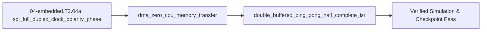

## 1. Why it matters
In Tier 1, reading a sensor or sending serial bytes inside a polling loop tied up the CPU for tens of microseconds per byte. When your motor loop speeds up to $20\text{–}40\text{ kHz}$ in Step 2.5 (`04-embedded.T2.05`), the CPU has only $25\text{–}50\ \mu\text{s}$ total per tick! Understanding full-duplex **SPI (`CPOL`/`CPHA`) framing**, offloading peripheral transfers to a hardware **Direct Memory Access (DMA)** controller, and processing streaming samples out of a **double-buffered (ping-pong) ring buffer** lets your microcontroller read encoders and stream telemetry with near-zero CPU overhead. Already know this? Take the Skip test in section 7 first.

## 2. Intuition first
After mastering Arduino/Wiring (`04-embedded.T1.04a`) and non-blocking state machines (`04-embedded.T1.04b`), professional firmware progresses through two layers: **Vendor Hardware Abstraction Layers (`HAL`)** and **Bare-Metal Memory-Mapped Registers (`MMIO`)**:
- **Vendor HAL (`STM32Cube HAL`) & High-Speed SPI vs. I2C:** Think of **I2C** ($400\text{ kHz}$ shared 2-wire bus) as a single-lane village road where every packet waits for an address and `ACK`, whereas **SPI** ($10\text{–}20\text{ MHz}$ 4-wire bus: `SCLK`, `MOSI`, `MISO`, `CS_n`) is a dedicated twin-track expressway that shifts bits out on `MOSI` and in on `MISO` simultaneously as soon as Chip-Select (`CS_n`) goes LOW. Vendor SDKs provide a **Hardware Abstraction Layer (HAL)** organized around handle structs (`SPI_HandleTypeDef hspi1`, `UART_HandleTypeDef huart2`) with both blocking polling calls (`HAL_SPI_TransmitReceive`) and non-blocking DMA calls (`HAL_SPI_TransmitReceive_DMA`).
- **Peeling Back the HAL — Bare-Metal Register Basics (`ODR`, `BSRR`, `DMA`) & Zero-CPU DMA Offload:** What is `HAL_GPIO_WritePin` or `HAL_SPI_TransmitReceive_DMA` actually doing under the hood? Every microcontroller peripheral is controlled by **memory-mapped hardware registers (`MMIO`)** at fixed silicon addresses (e.g. `#define GPIOA_ODR (*(volatile uint32_t *)0x48000014UL)`). While modifying `GPIOA->ODR |= (1U << 5)` requires a 3-instruction read-modify-write sequence, writing `(1U << 5)` to the write-only **Bit-Set/Reset Register (`GPIOA->BSRR`)** sets (or `(1U << (5 + 16))` clears) the pin atomically in a single clock cycle! Similarly, starting a **DMA (Direct Memory Access)** transfer simply writes the peripheral register address (`CPAR = &SPI1->DR`), SRAM buffer address (`CMAR`), and transfer count (`CNDTR`) into the hardware DMA engine in $0.25\ \mu\text{s}$, freeing $100\%$ of the CPU while silicon moves the bytes in the background!
- **Double-Buffered (Ping-Pong) Circular DMA Ring Buffers:** A ping-pong buffer splits a $2N$-sample array into `Ping` $[0..N-1]$ and `Pong` $[N..2N-1]$: while DMA fills `Pong`, the CPU safely reads `Ping` inside `HAL_ADC_ConvHalfCpltCallback()` (`HT` ISR), and reads `Pong` inside `HAL_ADC_ConvCpltCallback()` (`TC` ISR) with zero race conditions.

## 3. Formalization
1. **Vendor HAL (`STM32Cube HAL`) & SPI Full-Duplex Transaction Time (`CPOL`, `CPHA`):** Shifting $B_{\text{bits}}$ bits at SPI clock frequency $f_{\text{sclk}}$ ($\text{Hz}$) with chip-select setup/hold overhead $t_{\text{cs}}$ ($\text{s}$) takes wire time:

$$
t_{\text{spi}} = \frac{B_{\text{bits}}}{f_{\text{sclk}}} + t_{\text{cs}}
$$

   Substituting a 16-bit magnetic encoder frame ($B_{\text{bits}} = 16$) at $f_{\text{sclk}} = 10\text{ MHz}$ ($10^7\text{ Hz}$) and $t_{\text{cs}} = 0.4\ \mu\text{s}$ gives $t_{\text{spi}} = 1.6\ \mu\text{s} + 0.4\ \mu\text{s} = 2.0\ \mu\text{s}$. SPI Mode 1 (`CPOL=0, CPHA=1`, used by `AS5048A`/`TLE5012B`) idles `SCLK` LOW, shifts on the rising edge, and samples on the falling edge.
2. **Bare-Metal Register Basics (`MMIO`, `ODR`, `BSRR`) & HAL DMA Offload (`CPAR`, `CMAR`, `CNDTR`):**
   - **Memory-Mapped Register & Atomic `BSRR`:** At physical address `0x48000014UL` (`GPIOA->ODR`), a read-modify-write `GPIOA->ODR |= (1U << n)` can be preempted mid-operation by an ISR; writing to the atomic Bit-Set/Reset Register `GPIOA->BSRR = (1U << n)` (set bit $n$) or `GPIOA->BSRR = (1U << (n + 16))` (clear bit $n$) completes in $1$ bus cycle with zero ISR race.
   - **Blocking HAL Polling vs. DMA Register Offload:** Blocking `HAL_UART_Transmit` / `HAL_SPI_TransmitReceive` stalls the CPU for $t_{\text{cpu,poll}} = \frac{B_{\text{bits}}}{R_{\text{bps}}}$, whereas `HAL_UART_Transmit_DMA` writes the bare-metal DMA registers (`CPAR`, `CMAR`, `CNDTR`, `CCR |= DMA_CCR_EN`) in $t_{\text{cpu,dma}} \approx 0.25\ \mu\text{s}$ while the DMA controller moves bytes across the AHB bus matrix.
3. **Ping-Pong Circular DMA Buffer Invariant:** For a circular DMA buffer of length $2N$ indexed $[0, 2N-1]$ (`HAL_ADC_Start_DMA(&hadc1, buf, 2*N)`):
   - **Half-Transfer (`HT`) ISR (`HAL_ADC_ConvHalfCpltCallback`)** fires when DMA write index reaches $N$: CPU reads slice `[0 : N]` while DMA writes `[N : 2N]`.
   - **Transfer-Complete (`TC`) ISR (`HAL_ADC_ConvCpltCallback`)** fires when DMA wraps at $2N \to 0$: CPU reads slice `[N : 2N]` while DMA writes `[0 : N]`.

## 4. Worked example
Compare CPU time blocked when reading a 16-bit encoder + sending a 32-byte telemetry frame (`320` UART bits at $1\text{ Mbps}$) using blocking polling vs. DMA offload inside a $20\text{ kHz}$ ($50\ \mu\text{s}$) control loop, and simulate a $2N = 8$ ping-pong circular DMA buffer over $16$ incoming ADC samples.

```python
import math

t_loop_us = 50.0  # 20 kHz loop period
t_spi_poll_us = (16.0 / 10e6) * 1e6 + 0.4
t_uart_poll_us = (320.0 / 1e6) * 1e6
cpu_poll_total_us = t_spi_poll_us + t_uart_poll_us  # 322.0 us -> overflows 50 us loop by 6.4x!
cpu_dma_total_us = 0.25 + 0.25                      # 0.50 us DMA trigger setup -> 1% of 50 us loop!

assert math.isclose(t_spi_poll_us, 2.0, rel_tol=1e-9)
assert cpu_poll_total_us > t_loop_us
assert cpu_dma_total_us < 1.0

# Simulate Ping-Pong buffer of total size 2N = 8 (N = 4 per half)
N = 4
dma_buf = [0] * (2 * N)
cpu_processed = []
for sample_idx in range(16):
    write_pos = sample_idx % (2 * N)
    dma_buf[write_pos] = (sample_idx + 1) * 10
    if write_pos == N - 1:          # Half-Transfer (HT) interrupt: read Ping [0:N]
        cpu_processed.extend(dma_buf[0:N])
    elif write_pos == 2 * N - 1:    # Transfer-Complete (TC) interrupt: read Pong [N:2N]
        cpu_processed.extend(dma_buf[N:2 * N])

assert cpu_processed == [(k + 1) * 10 for k in range(16)]
print(f"Polling CPU={cpu_poll_total_us:.1f} us (OVERFLOW) vs DMA CPU={cpu_dma_total_us:.2f} us; Ping-Pong items={len(cpu_processed)}")
```
Expected output:
```text
Polling CPU=322.0 us (OVERFLOW) vs DMA CPU=0.50 us; Ping-Pong items=16
```

## 5. Exercise
Calculate the available CPU processing window $t_{\text{window}} = N / f_{\text{adc}}$ in microseconds ($\mu\text{s}$) between Half-Transfer (`HT`) and Transfer-Complete (`TC`) interrupts when a circular DMA buffer with half-size $N = 16$ samples is fed by an ADC sampling at $f_{\text{adc}} = 200\text{ kHz}$ ($5\ \mu\text{s}$ per sample). Verify $t_{\text{window}} = 16 / 200{,}000 = 80.0\ \mu\text{s}$.
- **If your result differs:** Multiply the half-buffer length $N = 16$ (not $2N = 32$) by the sample period $T_{\text{adc}} = 5.0\ \mu\text{s}$ ($16 \times 5.0 = 80.0\ \mu\text{s}$).


- **📚 What to Learn & Resources to Solve This Exercise:**
  - **Required Foundations Modules (`00-foundations`):** [`00-foundations.T1.00a`](00-foundations.T1.00a.md) (*Fixed-Point Iteration Loops*), [`00-foundations.T1.00c`](00-foundations.T1.00c.md) (*Clock Cycle & Microsecond Units*), and [`00-foundations.T1.00d`](00-foundations.T1.00d.md) (*Affine Range Mapping*).
  - **Prerequisite Bridge Module:** [`04-embedded.T1.04b`](04-embedded.T1.04b.md) and Legacy **Step 1.5 (`04-embedded.T1.05`)**.
  - **Core Concepts to Review First:** Vendor HAL SPI/I2C transaction timing, bare-metal memory-mapped registers (`MMIO`, `GPIOA->BSRR`, `DMA` `CPAR`/`CMAR`/`CNDTR`), and circular ping-pong DMA (`HT`/`TC`) processing windows in `## 3. Formalization` and `## 4. Worked example` above.
  - **Study Links & Resources:** [STMicroelectronics AN4031 (STM32 DMA Controller)](https://www.st.com/resource/en/application_note/an4031-using-the-stm32f2-stm32f4-and-stm32f7-series-dma-controller-stmicroelectronics.pdf), [Buttazzo *Hard Real-Time Computing Systems*](https://link.springer.com/book/10.1007/978-1-4614-0676-1), and [Track 04 Tier 2 (`04-embedded-and-realtime/README.md`)](../04-embedded-and-realtime/README.md#tier-2-intermediate--applied).

## 6. Simulation path
Open **Tab 8 (Real-Time Concurrency & DMA/ISR Timing)** in the MechaLab Workbench (`npm run dev`) or inspect logic-analyzer SPI/DMA traces in [PulseView (`sigrok`)](https://sigrok.org/wiki/PulseView) (`resources/open-source-toolchains.md`).

No hardware required for this module (`hardware_required: false`). In Step 2.5 (`04-embedded.T2.05`), the STM32 DMA controller runs in circular mode (`DMA_CIRCULAR`) attached to `ADC1` and `SPI1`, firing `DMA_ISR_HTIF` and `DMA_ISR_TCIF`:
```text
[ADC / SPI Peripheral] ===(Hardware DMA Channel)===> [Ping Buffer 0..N-1 | Pong Buffer N..2N-1]
                                                            | (HT ISR)          | (TC ISR)
                                                            v                   v
                                                     [CPU reads Ping]    [CPU reads Pong]
```
Pass/fail verification in simulation: `t_spi_poll_us == 2.0 us`, `cpu_dma_total_us == 0.50 us`, and all 16 ping-pong samples processed in exact order with zero overwrites.




## 7. Checkpoint
Pass criteria: run the worked example and exercise asserts with zero errors, or score $\ge 80\%$ ($4/4$) on the Skip test below.

### Skip test
1. `[Recall] [Concept: spi_full_duplex_clock_polarity_phase]` Compute the pure clock shifting time $t_{\text{shift}} = B_{\text{bits}} / f_{\text{sclk}}$ in microseconds ($\mu\text{s}$, tolerance $\pm 10^{-9}$) to transfer a $24\text{-bit}$ SPI sensor frame at $f_{\text{sclk}} = 12\text{ MHz}$ ($12 \times 10^6\text{ Hz}$).
2. `[Apply] [Concept: dma_zero_cpu_memory_transfer]` Compute the CPU blocking time $t_{\text{poll}} = \frac{B_{\text{bits}}}{f_{\text{baud}}} \times 10^6$ in microseconds ($\mu\text{s}$, tolerance $\pm 10^{-6}$) wasted by polling a $50\text{-byte}$ ($500\text{-bit}$ in `8N1`) UART packet at $1\text{ Mbps}$ ($10^6\text{ bps}$) without DMA.
3. `[Transfer] [Concept: double_buffered_ping_pong_half_complete_isr]` A circular DMA buffer of total length $2N = 64$ samples ($N = 32$ samples per half-buffer) is filled by an ADC at $f_{\text{sample}} = 64\text{ kHz}$. Compute the **Half-Transfer (`HT`)** interrupt firing frequency $f_{\text{HT}} = f_{\text{sample}} / N$ in $\text{Hz}$ (tolerance $\pm 10^{-6}\text{ Hz}$).
4. `[Spaced review -> 04-embedded.T1.05 — Concept: hardware_timer_isr_and_jitter] [Concept: spi_full_duplex_clock_polarity_phase]` On an SPI bus sharing `SCLK`, `MOSI`, and `MISO` across three slave devices (an encoder, an IMU, and a gate driver), what hardware rule must be obeyed regarding the three Chip-Select (`CS_n`) pins?
   - **A.** Pull all three `CS_n` pins LOW at the same time so all three chips drive `MISO` together.
   - **B.** Assert (pull LOW) **at most one** slave's `CS_n` pin at a time while holding the other two HIGH (tri-stated on `MISO`) so two slaves never fight each other on the `MISO` line.
   - **C.** Leave all `CS_n` pins disconnected.
   - **D.** Connect `CS_n` to `SCLK`.

**Answer key:**
```python
import math

q1_tshift_us = (24.0 / 12e6) * 1e6
q2_tpoll_us = (500.0 / 1e6) * 1e6
q3_f_ht_hz = 64_000.0 / 32.0
q4_choice = "B"
assert math.isclose(q1_tshift_us, 2.0, rel_tol=1e-9)
assert math.isclose(q2_tpoll_us, 500.0, rel_tol=1e-9)
assert math.isclose(q3_f_ht_hz, 2000.0, rel_tol=1e-9)
assert q4_choice == "B"
```
- **Pass mark:** $4/4$ ($80\%+$). If you missed Q1 or Q4, study `## 3. Formalization` item 1; if you missed Q2, study `## 3. Formalization` item 2; if you missed Q3, study `## 3. Formalization` item 3. On pass, proceed to `## 10. Next modules`.


## 8. Common mistakes
| Symptom | Root cause | 2-minute fix |
| :--- | :--- | :--- |
| SPI magnetic encoder (`AS5048A`) returns bit-shifted garbage or `0xFFFF` | Configured MCU SPI peripheral in Mode 0 (`CPHA=0`) instead of Mode 1 (`CPOL=0, CPHA=1`), sampling on the wrong clock edge. | Match `CPOL` and `CPHA` exactly to the sensor datasheet timing diagram and verify on a logic analyzer. |
| DMA transmits stale zeros or old struct values on Cortex-M7 | CPU data cache (`D-Cache`) held updated values in cache lines without flushing to SRAM where the DMA controller reads. | Place DMA buffers in non-cacheable SRAM (`DTCM` / `CCM`) or call `SCB_CleanDCache_by_Addr()` before TX DMA and `SCB_InvalidateDCache_by_Addr()` after RX DMA. |
| SPI slave ignores every command even though `SCLK` and `MOSI` toggle | De-asserted `CS_n` (pulled HIGH) immediately after writing `SPI->DR` before the hardware shift register finished clocking out the last bit. | Wait for the SPI `TXE` + `BSY == 0` (or RX DMA complete) flag before pulling `CS_n` HIGH. |

## 9. Resources
- **Carmine Noviello — *Mastering STM32* & STMicroelectronics `AN4031` (*Using the STM32 DMA Controller*, `resources/textbooks-and-papers.md`):** Complete guide to circular DMA, `HT`/`TC` interrupts, and SPI framing `[UNVERIFIED]`.
- **Track 04 (`04-embedded-and-realtime/README.md`):** Prepares directly for `04-embedded.T2.04b` and Step 2.5 (`04-embedded.T2.05`) `[VERIFIED 2026-10-15]`.
## 10. Next modules
- Proceed to [`04-embedded.T2.04b`](04-embedded.T2.04b.md) (*RTOS Tasks, FreeRTOS Preemptive Scheduling, Priority Inversion & CAN Bus Bitwise Arbitration*).
