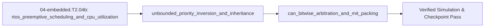

## 1. Why it matters
When your firmware grows to include a $1\text{ kHz}$ impedance controller, a $200\text{ Hz}$ CAN-FD bus manager, and a $50\text{ Hz}$ diagnostics logger, a single bare-metal `loop()` becomes brittle: one slow calculation delays the fast control tick. A **Real-Time Operating System (RTOS)** such as **FreeRTOS** lets high-priority tasks (`xTaskCreate`, `vTaskDelayUntil`) preempt low-priority tasks deterministically, **Priority Inheritance Mutexes** (`xSemaphoreCreateMutex`) prevent catastrophic priority inversion (the bug that froze the Mars Pathfinder!), and **CAN bitwise arbitration** lets multiple robot joints share a 2-wire differential bus without packet collisions. Already know this? Take the Skip test in section 7 first.

## 2. Intuition first
Imagine an emergency room with one doctor (a single-core CPU):
- **Rate-Monotonic Preemption & FreeRTOS Task States:** Every FreeRTOS task (`TaskFunction_t`) lives in one of four states: `Running`, `Ready`, `Blocked` (waiting on a timer tick via `vTaskDelayUntil(&xLastWakeTime, pdMS_TO_TICKS(1))` or a queue/semaphore), or `Suspended`. Under **Rate-Monotonic Scheduling (RMS)**, faster-repeating tasks receive higher fixed priority: a patient needing a 1-millisecond heartbeat check (`Task_Ctrl`, high priority) immediately preempts a 100-millisecond paperwork task (`Task_Log`, low priority) via the Cortex-M `PendSV` context-switch exception.
- **Unbounded Priority Inversion & Priority Inheritance:** Suppose `Task_Log` locks a shared medical chart (a mutex), gets interrupted by `Task_Ctrl` which also needs that chart and blocks waiting for `Task_Log`—and then a medium-priority task (`Task_Telem`, which doesn't even use the chart!) preempts `Task_Log` for $50\text{ ms}$, starving the high-priority `Task_Ctrl`! **Priority Inheritance** (`xSemaphoreCreateMutex()`) fixes this instantly: the moment `Task_Ctrl` waits on a mutex held by `Task_Log`, `Task_Log` temporarily inherits `Task_Ctrl`'s top priority so `Task_Telem` cannot cut in line.
- **CAN Bus Non-Destructive Arbitration:** On a **CAN bus**, every bit `0` is actively driven (**dominant**) while bit `1` is passive (**recessive**). If Joint 1 (`ID 0x01`) and Joint 2 (`ID 0x05`) transmit at the exact same microsecond, Joint 1's `0` bit overwrites Joint 2's `1` bit, so Joint 2 notices it lost arbitration and backs off automatically with zero corruption of Joint 1's frame.

## 3. Formalization
1. **Rate-Monotonic CPU Utilization & Preemptive Scheduling (`FreeRTOS`):** For $n$ periodic tasks with worst-case execution times $C_i$ ($\text{s}$) and periods $T_i$ ($\text{s}$), total CPU utilization is:

$$
U = \sum_{i=1}^{n} \frac{C_i}{T_i}
$$

   Necessary condition for schedulability on one core: $U \le 1.0$ (and the Liu-Layland sufficient bound $U \le n(2^{1/n} - 1)$, which evaluates to $\approx 0.7798$ for $n=3$; exact schedulability is verified via Response-Time Analysis $R_i = C_i + \sum_{j \in hp(i)} \lceil R_i / T_j \rceil C_j \le D_i$ in Step 2.5). In FreeRTOS, drift-free periodic execution uses absolute wake times:
   ```c
   TickType_t xLastWake = xTaskGetTickCount();
   for (;;) {
       run_1khz_control_step();
       vTaskDelayUntil(&xLastWake, pdMS_TO_TICKS(1)); // Exact 1.0 ms period, zero cumulative drift
   }
   ```
2. **Priority Inversion vs. Priority Inheritance Mutex (`xSemaphoreCreateMutex`):** If low-priority task $L$ holds a shared lock for critical section duration $B_i$, a naive binary semaphore (`xSemaphoreCreateBinary`) allows any medium-priority task $M$ ($P_L < P_M < P_H$) to preempt $L$, inflating $H$'s blocking delay by $\sum C_M$:

$$
R_{H,\text{inverted}} = C_H + B_i + \sum_{M} C_M, \qquad R_{H,\text{inherited}} = C_H + B_i
$$

   FreeRTOS mutexes (`xSemaphoreCreateMutex()`) implement **Priority Inheritance** automatically so high-priority task $H$ is blocked for at most $B_i$.
3. **CAN Non-Destructive Bitwise Arbitration & Fixed-Point MIT Mode Packing:**
   - **Arbitration:** CAN transmits the 11-bit Identifier MSB-first. Because `0` is dominant and `1` is recessive, the frame with the **lowest numeric CAN ID** always wins arbitration with zero bit delay.
   - **MIT Cheetah Fixed-Point Mapping:** Mapping float $x \in [x_{\min}, x_{\max}]$ into an $N$-bit unsigned integer $u \in [0, 2^N - 1]$ for compact 8-byte CAN frames:

$$
u = \operatorname{round}\!\left(\frac{x - x_{\min}}{x_{\max} - x_{\min}} (2^N - 1)\right), \quad \hat{x} = x_{\min} + \frac{u}{2^N - 1}(x_{\max} - x_{\min})
$$


## 4. Worked example
**Predict first (before you run it):** Commit to five numbers before the code runs. (1) What is $U$ for the three tasks $120/1000$, $250/2000$ and $800/10000\ \mu\text{s}$, and is it under the $0.7798$ three-task Liu-Layland bound? (2) What is $H$'s worst-case response with a priority-inheriting mutex, and what does it become with a plain binary semaphore while a $600\ \mu\text{s}$ medium task is ready? (3) Of $\{0x105, 0x012, 0x04A\}$, which identifier wins arbitration? (4) What is the 16-bit code for $0.0\text{ rad}$ over $[-12.5, +12.5]\text{ rad}$? Two tells that your result is wrong rather than the module: $U = 325$ means microseconds were divided by microseconds without the unit conversion, and a winner of $0x105$ means you picked the highest identifier — dominance makes the *lowest* number win.

Compute total CPU utilization $U$ for a 3-task FreeRTOS actuator node, compare worst-case high-priority response time with and without Priority Inheritance during mutex contention, and verify CAN bus arbitration + 16-bit MIT fixed-point quantization.

```python
import math

tasks = [
    ("Ctrl_1kHz",  120.0, 1000.0),   # C_1 = 120 us, T_1 = 1000 us
    ("CAN_500Hz",  250.0, 2000.0),   # C_2 = 250 us, T_2 = 2000 us
    ("Diag_100Hz", 800.0, 10000.0),  # C_3 = 800 us, T_3 = 10000 us
]
U_total = sum(c / t for _, c, t in tasks)
assert math.isclose(U_total, 0.12 + 0.125 + 0.08, rel_tol=1e-9)
assert U_total < 0.77976  # Below 3-task Liu-Layland bound!

# Priority Inversion vs Priority Inheritance (FreeRTOS xSemaphoreCreateMutex):
# Task_H (C_H=100us) blocked by Task_L critical section (B=40us), while Task_M (C_M=600us) is ready:
resp_no_inheritance_us = 100.0 + 40.0 + 600.0   # Task_M preempts Task_L -> 740 us!
resp_with_inheritance_us = 100.0 + 40.0         # Task_L inherits P_H, blocks Task_M -> 140 us!
assert resp_no_inheritance_us == 740.0 and resp_with_inheritance_us == 140.0

# CAN bitwise arbitration: lowest ID wins
bus_ids = [0x105, 0x012, 0x04A]
winner_id = min(bus_ids)
assert winner_id == 0x012

# 16-bit MIT position quantization over [-12.5, +12.5] rad
p_min, p_max, bits = -12.5, 12.5, 16
u_code = round((0.0 - p_min) / (p_max - p_min) * ((1 << bits) - 1))
p_rec = p_min + (u_code / ((1 << bits) - 1)) * (p_max - p_min)
assert abs(p_rec - 0.0) < 0.0005
print(f"U={U_total:.3f}, R_inv={resp_no_inheritance_us:.0f} us vs R_inh={resp_with_inheritance_us:.0f} us, CAN_win=0x{winner_id:03X}, u_zero={u_code}")
```
Expected output:
```text
U=0.325, R_inv=740 us vs R_inh=140 us, CAN_win=0x012, u_zero=32768
```

## 5. Exercise
Suppose a 12-bit (`0..4095`) MIT-mode torque command encodes $\tau \in [-18.0\text{ N}\cdot\text{m}, +18.0\text{ N}\cdot\text{m}]$. Compute (a) the integer code $u$ for $\tau = +9.0\text{ N}\cdot\text{m}$ ($\frac{9.0 - (-18.0)}{36.0} \times 4095$) rounded to the nearest integer, and (b) the quantization step size $\Delta\tau = \frac{36.0}{4095}$ in $\text{N}\cdot\text{m}$. Verify $u = 3071$ and $\Delta\tau \approx 0.0087912\text{ N}\cdot\text{m}$ ($\pm 10^{-6}$).
- **If your result differs:** Check that the full span is $18.0 - (-18.0) = 36.0\text{ N}\cdot\text{m}$, so $+9.0\text{ N}\cdot\text{m}$ sits at $75\%$ of full scale ($0.75 \times 4095 = 3071.25 \to 3071$).

### Graded package - the scheduler, the mutex and the CAN frame
[`exercises/04-embedded.T2.04b/`](../exercises/04-embedded.T2.04b/) turns this section into a test. `starter.py` holds seven holes: `cpu_utilization` ($\sum C_i / T_i$), `liu_layland_bound` ($n(2^{1/n} - 1)$), `response_time_us` (with and without priority inheritance), `can_winner` (the lowest 11-bit identifier), and `encode_fixed` / `decode_fixed` / `quantization_step` (the $2^N - 1$ MIT pack). Edit it, then run the tests the way CI does:

```bash
EXERCISE_TARGET=exercises/04-embedded.T2.04b/starter.py \
  python3 -m unittest discover -s exercises/04-embedded.T2.04b -p 'test_*.py'
```

**45 tests.** The utilisation sum is checked at the worked example's $0.325$ and the Skip test's $0.40$, so a microsecond/millisecond mix-up fails at once; the response time is checked with the mutex ($140\ \mu\text{s}$) and without it ($740\ \mu\text{s}$), so ignoring the flag fails; arbitration is checked on $\{0x105, 0x012, 0x04A\}$ in both orders, so picking the highest identifier fails; and the pack is checked at the exercise's $3071$, at both ends ($0$ and $4095$), and at the zero command's half-step straddle, so a $2^N$ scale fails. The transfer suite runs **the plant as the node**: its $1\text{ ms}$ tick is the worked example's $1000\ \mu\text{s}$ period, its $2.5\text{ N}\cdot\text{m}$ clamp packs to code $2332$ and both disturbance pulses survive the $12$-bit $[-18, +18]\text{ N}\cdot\text{m}$ frame within half a count, and its $4096$-count encoder is exactly one count finer than a 12-bit pack's $4095$ intervals. Five planted faults - `utilization_counts_milliseconds`, `response_time_always_inherits`, `can_winner_picks_highest`, `pack_uses_2_to_the_bits`, `quantization_step_uses_2_to_the_bits` - each fail the test named for them.

### Starter code
```python
# --- Exercise scaffold: fill in each TODO, then check against the numbers in the full solution below ---
def cpu_utilization(tasks):
    """U = sum C_i / T_i. Each task is (name, c_us, t_us) or (c_us, t_us)."""
    # TODO 1: a ratio, so C and T must be in the same unit; refuse a task whose C exceeds its T
    ...


def liu_layland_bound(n):
    """The sufficient Rate-Monotonic bound U <= n (2^(1/n) - 1)."""
    # TODO 2: the exponent is 1/n, and for one task the bound is 1.0
    ...


def response_time_us(c_h_us, b_i_us, c_m_us=0.0, inheritance=True):
    """Worst-case response of the high-priority task, with and without priority inheritance."""
    # TODO 3: with the mutex the medium task is kept out, so C_M is added only without it
    ...


def can_winner(ids):
    """The identifier that wins CAN bitwise arbitration."""
    # TODO 4: bit 0 is dominant, so the lowest number wins - not the first frame sent
    ...


def encode_fixed(x, x_min, x_max, bits):
    """u = round((x - x_min) / (x_max - x_min) * (2^bits - 1))."""
    # TODO 5: the scale is 2^bits - 1, the number of intervals, not 2^bits
    ...


def decode_fixed(u, x_min, x_max, bits):
    """The inverse pack."""
    # TODO 6: the offset goes back on after the scale, and the divisor is 2^bits - 1 again
    ...


def quantization_step(x_min, x_max, bits):
    """One count of the packed field, in the field's own units."""
    # TODO 7: span over 2^bits - 1, so a 12-bit 36 N*m field steps by 8.79 mN*m
    ...


print("scaffold ready: 7 TODOs to fill, then compare against the numbers in the full solution")
```

**Expected numbers (the answer):** $+9.0\ \text{N}\cdot\text{m}$ over $[-18, +18]$ packs to `3071` and one count is $36/4095 = 0.0087912\ \text{N}\cdot\text{m}$; the worked task set gives $U = 0.325$ against a bound of $0.7798$; $\{0x105, 0x012, 0x04A\}$ is won by `0x012`; the plant's $2.5\ \text{N}\cdot\text{m}$ clamp packs to `2332`.

### Hint ladder
1. **Utilisation is a ratio, not a sum.** `120/1000 + 500/4000 + 400/5000 = 0.12 + 0.125 + 0.08 = 0.325`; adding microseconds would give `1020`, and dividing one task in ms by a period in µs gives `1000×` too much.
2. **The bound is not 1.0.** For $n = 3$ it is $3(2^{1/3} - 1) = 0.7798$; the exponent is $1/n$, so a task set at $U = 0.325$ is provably schedulable under Rate Monotonic and one at $0.9$ is merely *not proven*.
3. **Priority inheritance removes the medium task's contribution.** $C_H + B_i = 140\ \mu\text{s}$ with the mutex; without it the medium task preempts inside the critical section and the same response becomes $140 + 600 = 740\ \mu\text{s}$.
4. **$2^N - 1$ is the number of intervals, not $2^N$.** The 12-bit field has `4095` steps across `36` N·m, so `9.0` sits at `(9 + 18)/36 × 4095 = 3071.25`, and rounding - not truncating - gives `3071`.
5. **What the suite refuses, not clamps.** `cpu_utilization` refuses an empty task set, a negative execution time, a non-positive period, and any task whose `C` exceeds its `T`; `liu_layland_bound` refuses `n < 1`; `response_time_us` refuses a negative compute or blocking time; `can_winner` refuses an empty arbitration set and an identifier that is negative, non-integer or above `0x7FF`; `encode_fixed` refuses a value outside the declared range (it has no code - do not clip it), an empty range (`x_max <= x_min`) and a zero-bit field; `decode_fixed` refuses a code outside `0..2**bits - 1`; and `quantization_step` refuses a field narrower than one bit. Every one raises `ValueError`; the guards are part of the contract, not defensive padding.

### Full Solution
```python
def _task_pair(task):
    """A task as (c_us, t_us), accepting the worked example's (name, c_us, t_us) triples too."""
    if not isinstance(task, (list, tuple)):
        raise ValueError("each task is (name, c_us, t_us) or (c_us, t_us)")
    if len(task) == 2:
        c_us, t_us = task
    elif len(task) == 3:
        _name, c_us, t_us = task
    else:
        raise ValueError("each task is (name, c_us, t_us) or (c_us, t_us)")
    return float(c_us), float(t_us)


def cpu_utilization(tasks):
    """U = sum C_i / T_i for a periodic task set, in the same unit of time for C and T.

    The worked example's three tasks give 0.12 + 0.125 + 0.08 = 0.325.
    """
    if not tasks:
        raise ValueError("a task set needs at least one task")
    total = 0.0
    for task in tasks:
        c_us, t_us = _task_pair(task)
        if c_us < 0.0:
            raise ValueError("a worst-case execution time cannot be negative")
        if t_us <= 0.0:
            raise ValueError("a period must be positive")
        if c_us > t_us:
            raise ValueError("a task whose worst case exceeds its period cannot be scheduled")
        total += c_us / t_us
    return total


def liu_layland_bound(n):
    """The sufficient Rate-Monotonic bound U <= n (2^(1/n) - 1): 0.7798 for three tasks."""
    if n < 1:
        raise ValueError("a task set has at least one task")
    return n * (2.0 ** (1.0 / n) - 1.0)


def response_time_us(c_h_us, b_i_us, c_m_us=0.0, inheritance=True):
    """Worst-case response of the high-priority task: C_H + B_i, plus C_M if the lock is not a
    priority-inheritance mutex (a binary semaphore lets every medium task in)."""
    for value, name in ((c_h_us, "c_h_us"), (b_i_us, "b_i_us"), (c_m_us, "c_m_us")):
        if value < 0.0:
            raise ValueError("%s cannot be negative" % name)
    preemption = 0.0 if inheritance else c_m_us
    return c_h_us + b_i_us + preemption


def can_winner(ids):
    """The 11-bit CAN identifier that wins non-destructive arbitration: the lowest number.

    Bit 0 is dominant, so the frame with the lowest identifier drives the bus first and every
    other node backs off without corrupting it.
    """
    if not ids:
        raise ValueError("arbitration needs at least one frame")
    winner = None
    for can_id in ids:
        if isinstance(can_id, bool) or not isinstance(can_id, int):
            raise ValueError("a CAN identifier is an integer")
        if not 0 <= can_id <= 0x7FF:
            raise ValueError("a standard CAN identifier is 11 bits, 0..0x7FF")
        if winner is None or can_id < winner:
            winner = can_id
    return winner


def _check_range(x_min, x_max, bits):
    if isinstance(bits, bool) or not isinstance(bits, int) or bits < 1:
        raise ValueError("a packed field is at least one bit wide")
    if x_max <= x_min:
        raise ValueError("the span must be positive: x_max > x_min")


def encode_fixed(x, x_min, x_max, bits):
    """u = round((x - x_min) / (x_max - x_min) * (2^bits - 1)), the MIT-mode pack."""
    _check_range(x_min, x_max, bits)
    if not x_min <= x <= x_max:
        raise ValueError("a value outside the declared range has no code: %r" % (x,))
    return int(round((x - x_min) / (x_max - x_min) * ((1 << bits) - 1)))


def decode_fixed(u, x_min, x_max, bits):
    """The inverse pack: x_hat = x_min + u / (2^bits - 1) * (x_max - x_min)."""
    _check_range(x_min, x_max, bits)
    if isinstance(u, bool) or not isinstance(u, int):
        raise ValueError("a packed code is an integer")
    if not 0 <= u <= (1 << bits) - 1:
        raise ValueError("a %d-bit field holds 0..%d, not %d" % (bits, (1 << bits) - 1, u))
    return x_min + (u / float((1 << bits) - 1)) * (x_max - x_min)


def quantization_step(x_min, x_max, bits):
    """One count of the packed field: (x_max - x_min) / (2^bits - 1), e.g. 36/4095 N*m."""
    _check_range(x_min, x_max, bits)
    return (x_max - x_min) / float((1 << bits) - 1)

tasks = (("sensor", 120.0, 1000.0), ("control", 500.0, 4000.0), ("telemetry", 400.0, 5000.0))
u = encode_fixed(9.0, -18.0, 18.0, 12)
step = quantization_step(-18.0, 18.0, 12)

assert abs(cpu_utilization(tasks) - 0.325) < 1e-12
assert abs(liu_layland_bound(3) - 3 * (2 ** (1 / 3) - 1)) < 1e-12
assert abs(response_time_us(140, 0, 600, inheritance=True) - 140.0) < 1e-12
assert abs(response_time_us(140, 0, 600, inheritance=False) - 740.0) < 1e-12
assert can_winner([0x105, 0x012, 0x04A]) == 0x012
assert can_winner([0x04A, 0x012, 0x105]) == 0x012
assert u == 3071 and encode_fixed(-18.0, -18.0, 18.0, 12) == 0
assert encode_fixed(18.0, -18.0, 18.0, 12) == 4095
assert abs(step - 36.0 / 4095) < 1e-15
assert abs(decode_fixed(u, -18.0, 18.0, 12) - 9.0) < step / 2
assert encode_fixed(2.5, -18.0, 18.0, 12) == 2332

print("U=%.3f (bound %.4f) | R_H with PI=%.0f us, without=%.0f us | CAN winner=0x%03X"
      % (cpu_utilization(tasks), liu_layland_bound(3),
         response_time_us(140, 0, 600, True), response_time_us(140, 0, 600, False),
         can_winner([0x105, 0x012, 0x04A])))
print("MIT pack: 9.0 N*m -> code %d, step=%.6f N*m/count | plant clamp 2.5 N*m -> %d"
      % (u, step, encode_fixed(2.5, -18.0, 18.0, 12)))

```

Printed: `U=0.325 (bound 0.7798) | R_H with PI=140 us, without=740 us | CAN winner=0x012`, then `MIT pack: 9.0 N*m -> code 3071, step=0.008791 N*m/count | plant clamp 2.5 N*m -> 2332`.

**On the shared arm.** The package's Transfer suite runs the actuator node as the plant: its clamp and disturbance pulses are the frames a real joint receives.
```python
import mechalab_plant as plant


def pack_12bit(torque, t_min=-18.0, t_max=18.0):
    return int(round((torque - t_min) / (t_max - t_min) * 4095))


# Its 1 ms tick is the worked example's 1000 us period.
assert abs(plant.DT * 1e6 - 1000.0) < 1e-9
# Its 2.5 N*m clamp packs to 2332 and the -0.15 N*m shoulder pulse to 2030.
assert pack_12bit(plant.TAU_LIMIT) == 2332
assert pack_12bit(plant.DIST_TAU1) == 2030
print("plant: tick=%.0f us | clamp %.1f N*m -> code %d | pulse %.2f N*m -> code %d"
      % (plant.DT * 1e6, plant.TAU_LIMIT, pack_12bit(plant.TAU_LIMIT),
         plant.DIST_TAU1, pack_12bit(plant.DIST_TAU1)))
```

### Break it on purpose
Keep the worked example's numbers — $C_H = 100\ \mu\text{s}$, $B_i = 40\ \mu\text{s}$, $C_M = 600\ \mu\text{s}$ — and plant the fault the `## 8. Common mistakes` table calls out:
- **Inject:** guard the shared struct with `xSemaphoreCreateBinary()` instead of `xSemaphoreCreateMutex()`, so the lock-holder inherits nothing.
- **Symptom:** $H$'s worst-case response jumps from $140\ \mu\text{s}$ to $740\ \mu\text{s}$ — $C_H + B_i + C_M$ — even though $U = 0.325$ never changed and the control task is still the highest priority. At a $1\text{ kHz}$ period that blocking is $74\%$ of the tick.
- **Diagnose:** the utilisation is unchanged, so the task set was and is schedulable by the Liu-Layland bound; what grew is the *blocking* term, and it grew by exactly the medium task's execution time, which no amount of priority assignment can fix — only a lock that hands the low-priority task the high-priority task's priority can.
- **Fix:** replace it with `xSemaphoreCreateMutex()` so $L$ inherits $P_H$ and blocks $M$; prove it the way the suite does, with $R_H = 140\ \mu\text{s}$ **while** the $600\ \mu\text{s}$ medium task is ready, and the binary-semaphore variant still reporting $740\ \mu\text{s}$.

- **📚 What to Learn & Resources to Solve This Exercise:**
  - **Required Foundations Modules (`00-foundations`):** [`00-foundations.T1.00a`](00-foundations.T1.00a.md)–[`00-foundations.T1.00d`](00-foundations.T1.00d.md) (*Python Loops, Lists, Timing Units & Linear Range Scaling*).
  - **Prerequisite Bridge Modules:** [`04-embedded.T1.04a`](04-embedded.T1.04a.md) (*Fixed-Width Integers & Bitwise Masks*) and [`04-embedded.T2.04a`](04-embedded.T2.04a.md) (*Non-Blocking Tick Schedulers & DMA*).
  - **Core Concepts to Review First:** Rate-Monotonic CPU utilization $U = \sum C_i / T_i$ with `vTaskDelayUntil()`, FreeRTOS Priority Inheritance mutexes (`xSemaphoreCreateMutex()`, bounding blocking time to $R_H = C_H + B_i$), and MIT Cheetah fixed-point quantization $u = \operatorname{round}\!\left(\frac{x - x_{\min}}{x_{\max} - x_{\min}}(2^N - 1)\right)$ in `## 3. Formalization` and `## 4. Worked example` above.
  - **Study Links & Resources:** [Mastering the FreeRTOS Real Time Kernel (`freertos.org`)](https://www.freertos.org/Documentation/02-Kernel/07-Books-and-manual/01-RTOS_book) and [`resources/open-source-toolchains.md`](../resources/open-source-toolchains.md).

## 6. Simulation path
Open **Tab 8 (Real-Time Concurrency, Scheduling & CAN Framing)** in the MechaLab Workbench (`npm run dev`) to inspect preemptive task timelines and priority inheritance mutex behavior.

No hardware required for this module (`hardware_required: false`). In Step 2.5 (`04-embedded.T2.05`), your `STM32G4` or `ESP32` runs `FreeRTOS` with `vTaskDelayUntil()` for drift-free periodic execution and `FDCAN` hardware filters for $1\text{ kHz}$ MIT-mode actuator frames:
```text
[Task_Ctrl 1 kHz (Prio 3)] <--(xSemaphoreCreateMutex / Queue)--> [Task_CAN 500 Hz (Prio 2)] <==> [CAN Bus 120 Ohm]
```
Pass/fail verification in simulation: `U_total == 0.325`, `resp_with_inheritance_us == 140.0 us`, and `winner_id == 0x012`.




## 7. Checkpoint
Pass criteria: run the worked example and exercise asserts with zero errors, or score $\ge 80\%$ ($4/5$) on the Skip test below.

### Skip test
<!-- skip-test:start -->
1. `[Recall] [Concept: rtos_preemptive_scheduling_and_cpu_utilization]` Compute the total CPU utilization $U = \frac{C_1}{T_1} + \frac{C_2}{T_2}$ (tolerance $\pm 10^{-9}$) for two FreeRTOS tasks: Task 1 ($C_1 = 200\ \mu\text{s}, T_1 = 1000\ \mu\text{s}$) and Task 2 ($C_2 = 500\ \mu\text{s}, T_2 = 2500\ \mu\text{s}$).
2. `[Apply] [Concept: unbounded_priority_inversion_and_inheritance]` A high-priority control task ($C_H = 100\ \mu\text{s}$) blocks on a FreeRTOS mutex (`xSemaphoreCreateMutex()`) held by a low-priority task ($B = 40\ \mu\text{s}$ remaining critical section) while a medium-priority task ($C_M = 600\ \mu\text{s}$) is ready. Compute the worst-case response time $R_H = C_H + B$ in microseconds ($\mu\text{s}$, tolerance $\pm 10^{-6}$) when **Priority Inheritance** is enabled.
3. `[Transfer] [Concept: can_bitwise_arbitration_and_mit_packing]` Encode a target velocity of $x = +15.0\text{ rad/s}$ over symmetric range $[x_{\min}, x_{\max}] = [-30.0, +30.0]\text{ rad/s}$ into a 12-bit unsigned integer $u = \operatorname{round}\!\left(\frac{x - x_{\min}}{x_{\max} - x_{\min}} \cdot 4095\right)$ (tolerance $\pm 10^{-9}$).
4. `[Concept: can_bitwise_arbitration_and_mit_packing]` Why must a high-speed ($1\text{ Mbps}$ / $5\text{ Mbps}$ CAN-FD) twisted-pair differential bus have a $120\ \Omega$ termination resistor at **each physical end** of the trunk cable (giving $60\ \Omega$ DC resistance between `CAN_H` and `CAN_L` when powered off)?
   - **A.** To warm up the cable in winter.
   - **B.** To match the $120\ \Omega$ characteristic impedance of the twisted pair at both ends, absorbing high-frequency signal edges so they do not reflect back and corrupt dominant/recessive arbitration bits.
   - **C.** To short `CAN_H` to $+48\text{ V}$.
   - **D.** To double the CAN ID range.
5. `[Spaced review -> 04-embedded.T2.04a — Concept: dma_zero_cpu_memory_transfer]` A DMA transfer moves $1024$ bytes as $2$-byte halfword transfers. Compute the number of transfers (tolerance $\pm 10^{-9}$).

**Answer key:**
```python
import math

q1_u = (200.0 / 1000.0) + (500.0 / 2500.0)
q2_rh_us = 100.0 + 40.0
q3_u12 = round((15.0 - (-30.0)) / 60.0 * 4095)
q4_choice = "B"
assert math.isclose(q1_u, 0.40, rel_tol=1e-9)
assert math.isclose(q2_rh_us, 140.0, rel_tol=1e-9)
assert math.isclose(q3_u12, 3071.0, rel_tol=1e-9)
assert q4_choice == "B"
q5_review = 1024.0 / 2.0
assert math.isclose(q5_review, 512.0, rel_tol=1e-9, abs_tol=1e-09)
```
- **Pass mark:** $4/5$ ($80\%+$). If you missed Q1, study `## 3. Formalization` item 1; if you missed Q2, study `## 3. Formalization` item 2; if you missed Q3 or Q4, study `## 3. Formalization` item 3. If you missed  Q5, review `04-embedded.T2.04a`. On pass, proceed to `## 10. Next modules`.
<!-- skip-test:end -->

### Gate test
Covers the complete Track 04 Tier 2 bridge ladder (`04-embedded.T2.04a` $\to$ `04-embedded.T2.04b` $\to$ `04-embedded.T2.04c` $\to$ `04-embedded.T2.04d`) before Step 2.5 (`04-embedded.T2.05`):
1. `[Concept: rtos_preemptive_scheduling_and_cpu_utilization]` Three tasks run at $(C_1, T_1) = (150, 1000)$, $(C_2, T_2) = (300, 2000)$ and $(C_3, T_3) = (600, 6000)\ \mu\text{s}$. Compute $U = \sum C_i/T_i$ (tolerance $\pm 10^{-9}$).
2. `[Concept: rtos_preemptive_scheduling_and_cpu_utilization]` What is the Liu-Layland sufficient bound for $n = 3$ tasks, and is $U = 0.40$ provably schedulable under Rate Monotonic?
   - **A.** $3(2^{1/3} - 1) = 0.7798$; yes, $0.40 < 0.7798$.
   - **B.** $1.0$; yes, because $0.40 < 1.0$.
   - **C.** $0.5$; no.
   - **D.** $n^2 = 9$; yes.
3. `[Concept: unbounded_priority_inversion_and_inheritance]` $C_H = 80\ \mu\text{s}$ and the holder has $B = 35\ \mu\text{s}$ of its critical section left. Compute $R_H$ in microseconds with a priority-inheritance mutex (tolerance $\pm 10^{-9}$).
4. `[Concept: unbounded_priority_inversion_and_inheritance]` Same numbers, but the lock is a binary semaphore and $M$ ($C_M = 500\ \mu\text{s}$) is ready. Compute $R_H$ in microseconds (tolerance $\pm 10^{-9}$).
5. `[Concept: can_bitwise_arbitration_and_mit_packing]` Three nodes start transmitting at the same instant with identifiers `0x210`, `0x0A4` and `0x180`. Report the identifier that wins arbitration, in hex (use Python's `0x` literal form).
6. `[Concept: can_bitwise_arbitration_and_mit_packing]` Pack $\tau = +6.0\ \text{N}\cdot\text{m}$ over $[-18.0, +18.0]\ \text{N}\cdot\text{m}$ into an unsigned 12-bit field with $u = \operatorname{round}\!\left(\frac{\tau - \tau_{\min}}{\tau_{\max} - \tau_{\min}}(2^{12} - 1)\right)$ (exact integer).
7. `[Concept: spi_full_duplex_clock_polarity_phase] [Concept: dma_zero_cpu_memory_transfer]` A $20\text{-byte}$ telemetry frame is $200$ bits. Compute the total CPU time in microseconds to shift a $16\text{-bit}$ SPI frame at $8\text{ MHz}$ ($2.0\ \mu\text{s}$) **plus** a blocking $200$-bit UART write at $1\text{ Mbaud}$ (tolerance $\pm 10^{-9}$).
8. `[Concept: double_buffered_ping_pong_half_complete_isr]` A circular DMA buffer has $N = 8$ samples per half and $f_{\text{adc}} = 80\text{ kHz}$. Compute the reading window between HT and TC in microseconds (tolerance $\pm 10^{-9}$).
9. `[Concept: zephyr_static_threads_and_k_mutex] [Concept: zephyr_west_and_kconfig_build] [Concept: zephyr_devicetree_hardware_binding]` Two `K_THREAD_DEFINE` threads have $1024\text{ B}$ and $512\text{ B}$ stacks, each with a $128\text{ B}$ TCB, and no static queues. Compute $\text{RAM}_{\text{static}}$ in bytes (exact integer).
10. `[Concept: rclc_static_lifecycle_and_executor] [Concept: microros_xrcedds_client_agent_bridge] [Concept: mcu_to_ros2_deterministic_transport]` Which statement is true of a static `rclc_executor` on an MCU?
   - **A.** Timers, subscriptions and the executor are allocated at compile time, and one `rclc_executor_spin_some` services them in a bounded pass over XRCE-DDS transport I/O, so the worst-case pass time can be bounded.
   - **B.** It creates a new thread per subscription at runtime, so the pass time is unbounded.
   - **C.** It needs a full ROS 2 node with DDS discovery running on the MCU.
   - **D.** It cannot carry timer callbacks.

**Gate answer key:**
```python
import math

g1_util = (150.0 / 1000.0) + (300.0 / 2000.0) + (600.0 / 6000.0)
g2_choice = "A"
g3_rh_pi_us = 80.0 + 35.0
g4_rh_sem_us = 80.0 + 35.0 + 500.0
g5_winner = 0x0A4
g6_u12 = round((6.0 - (-18.0)) / 36.0 * ((1 << 12) - 1))
g7_total_us = 2.0 + (200.0 / 1e6) * 1e6
g8_window_us = (8.0 / 80e3) * 1e6
g9_ram_bytes = (1024 + 128) + (512 + 128)
g10_choice = "A"

assert math.isclose(g1_util, 0.40, rel_tol=1e-9)
assert g2_choice == "A"
assert math.isclose(g3_rh_pi_us, 115.0, rel_tol=1e-9)
assert math.isclose(g4_rh_sem_us, 615.0, rel_tol=1e-9)
assert g5_winner == 0x0A4
assert g6_u12 == 2730
assert math.isclose(g7_total_us, 202.0, rel_tol=1e-9)
assert math.isclose(g8_window_us, 100.0, rel_tol=1e-9)
assert g9_ram_bytes == 1792
assert g10_choice == "A"
```
- **Pass mark:** $9/10$ ($80\%+$). Remediation: Q1–Q4, Q7–Q8 $\to$ `04-embedded.T2.04a`/`04-embedded.T2.04b`; Q5–Q6 $\to$ `04-embedded.T2.04b`; Q9 $\to$ `04-embedded.T2.04c`; Q10 $\to$ `04-embedded.T2.04d`.

## 8. Common mistakes
| Symptom | Root cause | 2-minute fix |
| :--- | :--- | :--- |
| Periodic FreeRTOS task drifts slowly in time (`1000 us` becomes `1040 us`) | Used relative `vTaskDelay(1)` (which sleeps 1 tick *after* the task finishes) instead of absolute deadline scheduling. | Always use `vTaskDelayUntil(&xLastWakeTime, period)` for periodic control tasks. |
| CAN bus works with 2 boards on the desk, then drops frames when a 3rd board is plugged in | Left the $120\ \Omega$ termination jumper enabled on **every** board ($120/3 = 40\ \Omega$ overload) or forgot termination altogether ($\infty\ \Omega$). | Enable $120\ \Omega$ termination **only** on the two physical end nodes of the daisy chain and verify $60\ \Omega$ between `CAN_H` and `CAN_L` with power off. |
| Used `xSemaphoreCreateBinary()` to guard a shared struct and suffered $50\text{ ms}$ control stalls | Binary semaphores do **not** implement Priority Inheritance, allowing medium-priority tasks to preempt the lock holder. | Replace `xSemaphoreCreateBinary()` with `xSemaphoreCreateMutex()` whenever guarding shared state across task priorities. |
| System deadlocks when two tasks acquire Mutex A and Mutex B in opposite orders | Classic AB-BA lock-ordering deadlock (`Task 1` locks A then waits for B; `Task 2` locks B then waits for A). | Acquire mutexes in a strict global order across all tasks, or keep critical sections single-lock and under $10\ \mu\text{s}$. |

## 9. Resources
- **Richard Barry — *Mastering the FreeRTOS Real Time Kernel* (`freertos.org`, `resources/open-source-toolchains.md`):** Preemptive task scheduling, `vTaskDelayUntil`, and priority-inheritance mutexes `[VERIFIED 2026-10-15]`.
- **Track 04 (`04-embedded-and-realtime/README.md`):** Prepares for `04-embedded.T2.04c` (Zephyr RTOS) and Step 2.5 (`04-embedded.T2.05`) `[VERIFIED 2026-10-15]`.

## 10. Next modules
- Proceed to [`04-embedded.T2.04c`](04-embedded.T2.04c.md) (*Zephyr RTOS: West Workspaces, Devicetree Hardware Binding, Kconfig & Static Kernel Primitives*).
