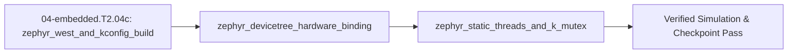

## 1. Why it matters
In `04-embedded.T2.04b`, you learned how **FreeRTOS** schedules tasks and prevents priority inversion, but FreeRTOS is only a scheduler kernel—you still have to stitch together vendor-specific HALs (`STM32Cube`, `ESP-IDF`, `NXP MCUXpresso`) whenever you change microcontrollers. **Zephyr RTOS** (Linux Foundation) is a complete, hardware-agnostic real-time operating system inspired by the Linux kernel architecture: you manage multi-repo workspaces and builds with **`west`**, enable kernel/driver features via **`Kconfig` (`prj.conf`)**, describe board hardware in a **Devicetree (`*.dts` / `.overlay`)** so your C application never hardcodes pin numbers or peripheral addresses, and allocate threads (`K_THREAD_DEFINE`) and priority-inheritance mutexes (`K_MUTEX_DEFINE`) statically at compile time with zero heap fragmentation. Already know this? Take the Skip test in section 7 first.

## 2. Intuition first
How does **Zephyr RTOS** differ from **FreeRTOS + Vendor HAL**, and how do its three pillars fit together?
- **FreeRTOS vs. Zephyr RTOS:** FreeRTOS gives you tasks and queues (`xTaskCreate`, `xQueueSend`), leaving pinmuxing, SPI, and CAN drivers to vendor-specific code (`HAL_SPI_TransmitReceive_DMA`). If you migrate a motor node from an `STM32G4` to an `NXP RT1060` or `ESP32-S3`, you rewrite every peripheral call. Zephyr unifies the RTOS kernel, hardware description, and unified device drivers (`<zephyr/drivers/can.h>`, `<zephyr/drivers/spi.h>`) so the **exact same C application** builds for an `nucleo_g474re` board or a Linux PC simulator (`native_sim`) just by changing `west build -b <board>`!
- **Devicetree (`*.dts` / `.overlay`) — What Hardware Exists:** Think of the **Devicetree** as the architectural blueprint of your PCB. Instead of scattering `#define MOTOR_CS_PIN GPIO_PIN_4` across ten `.c` files, a `.overlay` file declares that `spi1` has a magnetic encoder child node at `reg = <0>` with a specific chip-select GPIO. At compile time, Zephyr flattens the Devicetree into C macros (`DT_NODELABEL(fdcan1)`), so if a pin isn't wired properly in the `.overlay`, your code fails at **compile time** rather than crashing on the robot!
- **Kconfig (`prj.conf`) — Which Software Features Are Compiled In:** While Devicetree describes *hardware*, **Kconfig** (`prj.conf`) selects *software* compile-time options (`CONFIG_CAN=y`, `CONFIG_SPI=y`, `CONFIG_MAIN_STACK_SIZE=2048`), stripping every unused byte from flash.
- **Static Kernel Primitives (`K_THREAD_DEFINE` & `K_MUTEX_DEFINE`) & Priority Numbering:** Unlike FreeRTOS where `xTaskCreate()` allocates task stacks on the heap at runtime and higher numbers mean higher priority, Zephyr allocates threads, stacks, and mutexes **statically in RAM at compile time** (`K_THREAD_DEFINE`, `K_MUTEX_DEFINE`) and uses **lower numerical values for higher urgency**: cooperative threads have negative priorities ($-1, -2, \dots$, which cannot be preempted until they yield), while preemptible threads have non-negative priorities ($0, 1, 2, \dots$, where priority $0$ preempts priority $1$).

## 3. Formalization
1. **`west` Build Workflow & `Kconfig` (`prj.conf`) Static Footprint Budget:**
   - **Workspace & Build Commands:** `west init` / `west update` synchronizes the Zephyr manifest; `west build -b native_sim app/` (or `-b nucleo_g474re`) invokes CMake + Devicetree compiler (`dtc`) + Kconfig to produce `zephyr.elf`.
   - **Static RAM Allocation:** For $N_{\text{thr}}$ statically defined threads with stack sizes $S_i$ (aligned to $A$-byte boundaries, e.g. $A = 8\text{ bytes}$: $S_{i,\text{aligned}} = A \lceil S_i / A \rceil$), plus $N_{\text{msgq}}$ static message queues (`K_MSGQ_DEFINE(q, msg_size, max_msgs, align)`) of capacity $M_k \times B_k$, the compile-time kernel object RAM footprint is strictly bounded before `main()` runs:

$$
\text{RAM}_{\text{static}} = \sum_{i=1}^{N_{\text{thr}}} \left(S_{i,\text{aligned}} + B_{\text{tcb}}\right) + \sum_{k=1}^{N_{\text{msgq}}} M_k B_k, \qquad \text{RAM}_{\text{heap}} = 0\text{ B}
$$

2. **Devicetree (`*.dts` / `.overlay`) Compile-Time Binding & Device Readiness Contract:**
   - A board overlay binds a logical alias or node label (`fdcan1: can@4000a400`) to a C `const struct device *` pointer resolved at link time:
     ```c
     #include <zephyr/device.h>
     #include <zephyr/drivers/can.h>
     const struct device *const can_dev = DEVICE_DT_GET(DT_NODELABEL(fdcan1));
     if (!device_is_ready(can_dev)) { return -ENODEV; } // Mandatory runtime readiness guard
     ```
   - Every peripheral node requires `status = "okay";` in the merged Devicetree (`zephyr.dts`) and its corresponding driver enabled in `prj.conf` (`CONFIG_CAN=y`), otherwise `DT_NODE_HAS_STATUS(DT_NODELABEL(fdcan1), okay)` evaluates to `0` (`false`).
3. **Zephyr Thread Priority Ordering (`k_thread`) & Priority-Inheritance `k_mutex`:**
   - **Priority Comparison Rule:** Given two Zephyr threads with numerical priorities $p_A, p_B \in \mathbb{Z}$, thread $A$ has **strictly higher scheduling urgency** than thread $B$ iff:

$$
p_A < p_B
$$

     All **cooperative threads** ($p < 0$) outrank all **preemptible threads** ($p \ge 0$). Among preemptible threads ($0 \le p_A < p_B$), thread $A$ immediately preempts thread $B$.
   - **`K_MUTEX_DEFINE` Priority Inheritance & Reentrancy:** When a high-urgency thread ($p_H = 1$) calls `k_mutex_lock(&mtx, K_FOREVER)` on a `k_mutex` currently owned by a lower-urgency thread ($p_L = 5$, remaining critical section $B_L$), Zephyr temporarily elevates the owner's effective priority to:

$$
p_{L,\text{eff}} = \min(p_L, p_H) = p_H
$$

     preventing any intermediate preemptible thread ($p_M \in \{2, 3, 4\}$) from preempting $L$, bounding $H$'s worst-case response time to $R_H = C_H + B_L$.

## 4. Worked example
**Predict first (before you run it):** Commit to four numbers before the script runs. (1) With stacks of $2048$, $1536$ and $1020\text{ B}$, a $128\text{ B}$ TCB each, and one $16 \times 72\text{ B}$ queue, what is $\text{RAM}_{\text{static}}$ in bytes — and how many bytes does the $1020$ stack actually contribute? (2) With $p_H = 1$, $p_M = 3$ and $p_L = 5$, what is the owner's elevated priority, and is $R_H$ $120\ \mu\text{s}$ (`k_mutex`) or $570\ \mu\text{s}$ (`k_sem`)? (3) Which of `fdcan1` and `i2c2` is device-ready at boot? Two tells that a wrong answer is a mistake rather than the module: a total of $6140\text{ B}$ means the $1020$-byte stack was never rounded up to the $8$-byte boundary ($1024$), and a `k_mutex` response of $570\ \mu\text{s}$ means the medium thread was left inside the critical section, which inheritance forbids.
Simulate Zephyr's compile-time Devicetree + Kconfig binding validator, compute the static RAM footprint of a 3-thread Zephyr actuator firmware image (`K_THREAD_DEFINE` + `K_MSGQ_DEFINE`), and trace Zephyr's numerical priority scheduler ($p_A < p_B$) with `k_mutex` priority inheritance when a high-urgency thread ($p_H = 1$) contends with a low-urgency thread ($p_L = 5$) while a medium-urgency thread ($p_M = 3$) is ready.

```python
import math

# 1. Devicetree (.overlay) + Kconfig (prj.conf) compile-time & readiness check:
dts_nodes = {
    "fdcan1": {"status": "okay", "reg": 0x4000A400, "kconfig": "CONFIG_CAN"},
    "spi1":   {"status": "okay", "reg": 0x40013000, "kconfig": "CONFIG_SPI"},
    "i2c2":   {"status": "disabled", "reg": 0x40005800, "kconfig": "CONFIG_I2C"},
}
prj_conf = {"CONFIG_CAN": True, "CONFIG_SPI": True, "CONFIG_I2C": False}

def device_dt_ready(label: str) -> bool:
    node = dts_nodes[label]
    return (node["status"] == "okay") and prj_conf.get(node["kconfig"], False)

assert device_dt_ready("fdcan1") is True
assert device_dt_ready("spi1") is True
assert device_dt_ready("i2c2") is False

# 2. Static RAM footprint for K_THREAD_DEFINE + K_MSGQ_DEFINE (TCB = 128 B, 8-byte stack alignment):
threads_stack_req = [2048, 1536, 1020]  # 1020 rounds up to 1024 on 8-byte boundary
tcb_bytes = 128
aligned_stacks = [8 * math.ceil(s / 8) for s in threads_stack_req]
msgq_bytes = 16 * 72  # 16 CAN-FD frames of 72 bytes each = 1152 bytes
total_static_ram = sum(s + tcb_bytes for s in aligned_stacks) + msgq_bytes
assert aligned_stacks == [2048, 1536, 1024]
assert total_static_ram == (2048 + 1536 + 1024) + 3 * 128 + 1152  # 6144 bytes (6.0 KiB, 0 heap!)

# 3. Zephyr priority ordering (lower number = higher priority) & k_mutex priority inheritance:
# Preemptible threads: Ctrl (p_H = 1, C_H = 90 us), Telem (p_M = 3, C_M = 450 us), Log (p_L = 5, B_L = 30 us)
p_H, p_M, p_L = 1, 3, 5
C_H, C_M, B_L = 90.0, 450.0, 30.0
p_L_elevated = min(p_L, p_H)  # k_mutex_lock elevates owner p_L from 5 -> 1!
assert p_L_elevated == 1 and p_L_elevated < p_M  # Elevated owner outranks p_M = 3!
R_H_k_mutex_us = C_H + B_L
R_H_k_sem_us = C_H + B_L + C_M  # k_sem has NO priority inheritance -> p_M preempts p_L!
assert math.isclose(R_H_k_mutex_us, 120.0, rel_tol=1e-9)
assert math.isclose(R_H_k_sem_us, 570.0, rel_tol=1e-9)
print(f"DT_ready(fdcan1)={device_dt_ready('fdcan1')}, StaticRAM={total_static_ram} B, p_L_eff={p_L_elevated}, R_H={R_H_k_mutex_us:.0f} us")
```
Expected output:
```text
DT_ready(fdcan1)=True, StaticRAM=6144 B, p_L_eff=1, R_H=120 us
```

## 5. Exercise
A Zephyr application defines two preemptible threads via `K_THREAD_DEFINE`: `thread_fast` with priority $p_{\text{fast}} = 2$ ($C_{\text{fast}} = 110\ \mu\text{s}$) and `thread_slow` with priority $p_{\text{slow}} = 6$, plus an intermediate telemetry thread `thread_mid` with priority $p_{\text{mid}} = 4$ ($C_{\text{mid}} = 300\ \mu\text{s}$). If `thread_slow` holds a `k_mutex` with $B_{\text{slow}} = 35\ \mu\text{s}$ remaining when `thread_fast` calls `k_mutex_lock()`, compute (a) the elevated effective priority $p_{\text{slow,eff}} = \min(p_{\text{slow}}, p_{\text{fast}})$ of `thread_slow`, (b) the worst-case response time $R_{\text{fast}}$ in microseconds with `k_mutex` priority inheritance, and (c) the response time $R_{\text{fast,sem}}$ if a non-inheriting `k_sem` had been used instead while `thread_mid` was ready. Verify $p_{\text{slow,eff}} = 2$, $R_{\text{fast}} = 145.0\ \mu\text{s}$, and $R_{\text{fast,sem}} = 445.0\ \mu\text{s}$.
- **If your result differs:** Remember that in Zephyr, **smaller numbers mean higher priority** ($p = 2$ outranks $p = 4$, which outranks $p = 6$), so `k_mutex` lowers `thread_slow`'s numerical priority value from $6 \to 2$ ($\min(6, 2) = 2 < 4$), blocking `thread_mid` ($p=4$) from running during the $35\ \mu\text{s}$ critical section!

### Graded package - the static image, the overlay and the inheritance
[`exercises/04-embedded.T2.04c/`](../exercises/04-embedded.T2.04c/) turns this section into a test. `starter.py` holds seven holes: `align_stack` (round **up** to the ABI boundary), `static_ram_bytes` (aligned stacks, one TCB each, every queue's payload), `device_dt_ready` (`status = "okay"` **and** the Kconfig symbol), `binding_problems`, `outranks` (Zephyr's smaller number wins), `effective_priority` ($\min(p_{owner}, p_{waiter})$) and `worst_case_response_us` ($C_H + B_L + C_M$). Edit it, then run the tests the way CI does:

```bash
EXERCISE_TARGET=exercises/04-embedded.T2.04c/starter.py \
  python3 -m unittest discover -s exercises/04-embedded.T2.04c -p 'test_*.py'
```

**46 tests.** The alignment is checked at the worked example's $1020 \to 1024$ and at an already-aligned stack that must not move, so a floor or a nearest-multiple round fails; the worked image must total $6144\text{ B}$ and the Skip test's $3840\text{ B}$, so a dropped queue payload fails; readiness is checked with the node `okay` and its driver `n`, and with the node `disabled` while its driver is `y`, so reading either field alone fails; the ordering is checked at $2 < 4 < 6$, at a tie, and at the Skip test's $\min(5, 0, 3) = 0$; the elevation must be $2$ from an owner at $6$, so `max()` fails; and the response must be $145\ \mu\text{s}$ with inheritance against $445\ \mu\text{s}$ on a `k_sem`, so dropping the intermediate compute time fails. The transfer suite runs **the plant's own 1 ms tick**: $145\ \mu\text{s}$ is $14.5\%$ of a step and $445\ \mu\text{s}$ is $44.5\%$ (both inside the deadline, the second $89/29$ times the first), the plant's four-thread image is $5632\text{ B}$ - $17.19\%$ of a $32\text{ KiB}$ part - and the priority-1 loop outranks telemetry at 3 and logging at 7. Six planted faults - `stack_align_floor`, `msgq_not_counted`, `dt_ignores_kconfig`, `priority_higher_number_wins`, `inheritance_uses_max`, `response_ignores_intermediate` - each fail the test named for them.


- **📚 What to Learn & Resources to Solve This Exercise:**
  - **Required Foundations Modules (`00-foundations`):** [`00-foundations.T1.00a`](00-foundations.T1.00a.md) (*Iterative Recurrence Loops*) and [`00-foundations.T1.00c`](00-foundations.T1.00c.md) (*Microsecond Timing Budgets*).
  - **Prerequisite Bridge Modules:** [`04-embedded.T2.04a`](04-embedded.T2.04a.md) (*Rate-Monotonic RTA*) and [`04-embedded.T2.04b`](04-embedded.T2.04b.md) (*Zephyr Build & Devicetree*).
  - **Core Concepts to Review First:** Zephyr static thread allocation (`K_THREAD_DEFINE`) with cooperative vs. preemptive priority bands, `k_mutex` Priority Inheritance Protocol ($R_H = C_H + B_H$ vs. unbounded priority inversion), and zero-copy `k_msgq` ring buffers in `## 3. Formalization` and `## 4. Worked example` above.
  - **Study Links & Resources:** [Zephyr Kernel Services: Threads, Mutexes & Message Queues (`docs.zephyrproject.org`)](https://docs.zephyrproject.org/latest/kernel/services/index.html) and [Track 04 Tier 2 (`04-embedded-and-realtime/README.md`)](../04-embedded-and-realtime/README.md#tier-2-intermediate--applied).

### Starter code
```python
# --- Exercise scaffold: fill in each TODO, then compare against the numbers in the full solution below ---
import math

def align_stack(size_b, align=8):
    """Round a requested `K_THREAD_DEFINE` stack size up to the next `align`-byte boundary."""
    # TODO 1: round UP with ceil - never down, and never to the nearest multiple (1020 -> 1024)
    ...

def static_ram_bytes(stacks, tcb_bytes=128, msgq=None):
    """Aligned stacks + one TCB per thread + every static queue's payload."""
    # TODO 2: every thread pays a TCB *and* its queue's M x B payload counts too
    ...

def device_dt_ready(node, prj_conf):
    """True only when the node is `status = "okay"` and its Kconfig driver symbol is on."""
    # TODO 3: two independent conditions - the status string AND the Kconfig entry,
    #         which defaults to off when the node names a symbol prj.conf never sets
    ...

def binding_problems(nodes, prj_conf):
    """Sorted labels of the devicetree nodes that would not come up."""
    # TODO 4: filter the labels through device_dt_ready, then sort them
    ...

def outranks(priority_a, priority_b):
    """True when thread A preempts thread B."""
    # TODO 5: Zephyr is not FreeRTOS - the winning number is the smaller one
    ...

def effective_priority(priority_owner, priority_waiter):
    """The owner's priority while a more urgent thread waits on its `k_mutex`."""
    # TODO 6: min(owner, waiter) - a waiter that is not more urgent never raises the owner
    ...

def worst_case_response_us(c_high, b_holder, c_intermediate=0.0):
    """Worst-case response time of the high-urgency thread, in microseconds."""
    # TODO 7: add all three terms - the middle thread only runs when the primitive
    #         does not inherit priority (k_sem), so it contributes 0 under k_mutex
    ...

print("scaffold ready: 7 TODOs to fill, then compare against the numbers in the full solution")
```

**Expected numbers (the answer):** $p_{\text{slow,eff}} = 2$; $R_{\text{fast}} = 145.0\ \mu\text{s}$; $R_{\text{fast,sem}} = 445.0\ \mu\text{s}$.

### Hint ladder
1. **Zephyr's number runs the other way.** $p_{\text{fast}} = 2$ outranks $p_{\text{mid}} = 4$, which outranks $p_{\text{slow}} = 6$; so the owner at $6$ waiting under a $2$ is elevated to $\min(6, 2) = 2$, not to $6$.
2. **The inherited bound has exactly two terms.** While the mutex is held, $p_{\text{slow,eff}} = 2 < 4$ keeps `thread_mid` out, so $R_{\text{fast}} = C_{\text{fast}} + B_{\text{slow}} = 110 + 35 = 145\ \mu\text{s}$.
3. **The semaphore adds the middle thread's whole run.** With no ownership tracking, $p_{\text{slow}}$ stays at $6$, `thread_mid` preempts it for $C_{\text{mid}} = 300\ \mu\text{s}$, and $R_{\text{fast,sem}} = 110 + 35 + 300 = 445\ \mu\text{s}$.
4. **Check the ordering, not just the arithmetic.** $445/145 \approx 3.07$ is the whole point of the module: the same critical section costs three times as much without inheritance.
5. **What the suite refuses.** `align_stack` refuses a stack size or alignment that is not positive; `static_ram_bytes` refuses a negative TCB size and a queue with a negative message count or item size; `device_dt_ready` refuses a node missing `status` or `kconfig`; `effective_priority` refuses a waiter that is not more urgent than the owner; and `worst_case_response_us` refuses a negative compute, blocking or intermediate time. All raise `ValueError`. `outranks` is the only comparison that answers instead of refusing.

### Full Solution
```python
import math


def align_stack(size_b, align=8):
    """Round a requested `K_THREAD_DEFINE` stack size up to the next `align`-byte boundary."""
    if size_b <= 0:
        raise ValueError("a thread stack must be positive, not %r bytes" % (size_b,))
    if align <= 0:
        raise ValueError("an alignment must be positive, not %r bytes" % (align,))
    return int(math.ceil(float(size_b) / align)) * align


def static_ram_bytes(stacks, tcb_bytes=128, msgq=None):
    """Compile-time kernel RAM: aligned stacks + one TCB each + every static queue's payload."""
    if tcb_bytes < 0:
        raise ValueError("a thread control block cannot be %r bytes" % (tcb_bytes,))
    total = 0
    for size_b in stacks:
        total += align_stack(size_b) + tcb_bytes
    for max_msgs, msg_bytes in (msgq or []):
        if max_msgs < 0 or msg_bytes < 0:
            raise ValueError("a static message queue cannot hold %r messages of %r bytes"
                             % (max_msgs, msg_bytes))
        total += max_msgs * msg_bytes
    return total


def device_dt_ready(node, prj_conf):
    """`device_is_ready()` as a build-time contract: `status = "okay"` *and* the driver's Kconfig on."""
    for key in ("status", "kconfig"):
        if key not in node:
            raise ValueError("a devicetree node needs a %r field, not %r" % (key, sorted(node)))
    return node["status"] == "okay" and bool(prj_conf.get(node["kconfig"], False))


def binding_problems(nodes, prj_conf):
    """Every label in the merged devicetree whose driver would not come up, sorted."""
    return sorted(label for label, node in nodes.items()
                  if not device_dt_ready(node, prj_conf))


def outranks(priority_a, priority_b):
    """Zephyr urgency: the *smaller* number preempts. Equal priorities time-slice, neither wins."""
    return priority_a < priority_b


def effective_priority(priority_owner, priority_waiter):
    """`k_mutex` priority inheritance: the owner runs at min(p_owner, p_waiter) while it blocks a
    more urgent waiter - a lower number, therefore a higher urgency."""
    if priority_waiter >= priority_owner:
        raise ValueError("priority %r does not wait on an owner at %r: it is not the more urgent "
                         "thread" % (priority_waiter, priority_owner))
    return min(priority_owner, priority_waiter)


def worst_case_response_us(c_high, b_holder, c_intermediate=0.0):
    """Worst-case response of the high-urgency thread in microseconds.

    `b_holder` is the owner's *remaining* critical section. `c_intermediate` is 0 under `k_mutex`
    (priority inheritance keeps the medium thread out) and that thread's compute time under a
    non-inheriting `k_sem`, which lets it preempt the un-elevated owner.
    """
    if c_high < 0 or b_holder < 0 or c_intermediate < 0:
        raise ValueError("compute and blocking times cannot be negative")
    return c_high + b_holder + c_intermediate


# No `__main__` block: the browser grades this file's stdout against the appended self-check's
# single PASS line, and a second print here would be a mismatch for a correct answer.

p_fast, c_fast, p_mid, c_mid, p_slow, b_slow = 2, 110.0, 4, 300.0, 6, 35.0
p_slow_eff = effective_priority(p_slow, p_fast)
r_fast = worst_case_response_us(c_fast, b_slow)
r_fast_sem = worst_case_response_us(c_fast, b_slow, c_mid)

assert p_slow_eff == 2
assert math.isclose(r_fast, 145.0, rel_tol=1e-12)
assert math.isclose(r_fast_sem, 445.0, rel_tol=1e-12)
assert outranks(p_fast, p_mid) and not outranks(p_mid, p_fast)
assert align_stack(1020) == 1024
assert static_ram_bytes([2048, 1536, 1020], msgq=[(16, 72)]) == 6144
nodes = {"fdcan1": {"status": "okay", "kconfig": "CONFIG_CAN"},
         "i2c2": {"status": "disabled", "kconfig": "CONFIG_I2C"}}
assert binding_problems(nodes, {"CONFIG_CAN": True, "CONFIG_I2C": True}) == ["i2c2"]

print(f"p_slow_eff={p_slow_eff} | R_fast={r_fast:.1f} us | R_fast_sem={r_fast_sem:.1f} us")

```

Printed: `p_slow_eff=2 | R_fast=145.0 us | R_fast_sem=445.0 us`

**On the shared arm.** The package's Transfer suite reads both bounds against the plant's 1 ms control step:
```python
import mechalab_plant as plant

tick_us = plant.DT * 1e6
# 145 us is 14.5% of one tick; the semaphore's 445 us is 44.5% - both inside the deadline.
assert abs(tick_us - 1000.0) < 1e-9
assert abs(145.0 / tick_us - 0.145) < 1e-12
assert abs(445.0 / tick_us - 0.445) < 1e-12
print("plant: tick=%.0f us | k_mutex R=145 us (%.1f%%) | k_sem R=445 us (%.1f%%)"
      % (tick_us, 100.0 * 145.0 / tick_us, 100.0 * 445.0 / tick_us))
```

### Break it on purpose
Inject the common-mistakes row that swaps a mutex for a semaphore, keeping $p_H = 1$, $p_M = 3$, $p_L = 5$, $C_H = 90\ \mu\text{s}$, $C_M = 450\ \mu\text{s}$ and $B_L = 30\ \mu\text{s}$:
- **Inject:** replace `K_MUTEX_DEFINE(bus_lock)` with `K_SEM_DEFINE(bus_lock, 1, 1)` and guard the shared SPI bus with `k_sem_take` / `k_sem_give`.
- **Symptom:** $R_H$ rises from $120\ \mu\text{s}$ to $570\ \mu\text{s}$ — $4.75\times$ the inherited bound — because $p_L$ stays at $5$, so the ready $p_M = 3$ thread preempts it for its full $C_M = 450\ \mu\text{s}$ while it holds the bus. A trace shows the priority-$1$ thread waiting through the telemetry thread's entire run.
- **Diagnose:** the size of the excess localises it. A wrong priority-numbering convention would mis-order *who* runs first but would not add exactly $C_M = 450\ \mu\text{s}$ to one bounded wait; a longer critical section would scale $R_H$ with $B_L$, not with $C_M$. Only a primitive that does not track ownership lets every medium thread in.
- **Fix:** restore the `K_MUTEX_DEFINE`, then prove it twice in the trace: $p_{L,\text{eff}}$ must read $1$ while the mutex is held, and $R_H$ must return to $120\ \mu\text{s}$ with no telemetry execution inside the critical section.

## 6. Simulation path
You can build and run Zephyr RTOS applications natively on any Linux workstation or CI container **without physical microcontroller hardware** using Zephyr's POSIX architecture target (`native_sim`), or flash an `STM32G4` board (`nucleo_g474re`) using the exact same 4-file project layout:
- **One-Time `Zephyr RTOS` + `west` + `Zephyr SDK` Installation (Ubuntu 24.04 / WSL2 — see [`resources/open-source-toolchains.md` §0.4a](../resources/open-source-toolchains.md#0-core-supported-os-environment-terminal-bootstrap--python-venv-setup)):**
  ```bash
  sudo apt update && sudo apt install -y --no-install-recommends \
    git cmake ninja-build gperf ccache dfu-util device-tree-compiler wget \
    xz-utils file make gcc gcc-multilib g++-multilib libsdl2-dev libmagic1
  source ~/mechalab/.venv/bin/activate
  pip install west
  west init ~/zephyrproject && cd ~/zephyrproject && west update
  west zephyr-export && west packages pip --install && west sdk install
  ```
- **Canonical 4-File Zephyr Application Layout (`my_actuator_app/`):**
  1. `CMakeLists.txt`: `cmake_minimum_required(VERSION 3.20.0)` / `find_package(Zephyr REQUIRED HINTS ENV{ZEPHYR_BASE})` / `project(actuator)` / `target_sources(app PRIVATE src/main.c)`
  2. `prj.conf`: `CONFIG_CAN=y` and `CONFIG_SPI=y`
  3. `app.overlay`: `&fdcan1 { status = "okay"; bus-speed = <1000000>; bus-speed-data = <5000000>; };`
  4. `src/main.c`: Defines static threads (`K_THREAD_DEFINE`), priority-inheritance mutex (`K_MUTEX_DEFINE`), and checks `device_is_ready(DEVICE_DT_GET(DT_NODELABEL(fdcan1)))`.
```bash
# Path A — 100% Hardware-Free Linux Simulation (native_sim inside ~/zephyrproject/zephyr):
cd ~/zephyrproject/zephyr
west build -b native_sim samples/synchronization
./build/zephyr/zephyr.exe

# Path B — Physical STM32G474RE Nucleo Build & Flash:
west build -b nucleo_g474re my_actuator_app -- -DDTC_OVERLAY_FILE=app.overlay
west flash
```
*(If `west: command not found` occurs, activate your virtual environment with `source ~/mechalab/.venv/bin/activate`.)*
Or open **Tab 8 (Attitude ESKF & SeqLock)** in the MechaLab Workbench (`npm run dev`) to compare priority inheritance vs. priority inversion timelines.
```text
[app.overlay (.dts) + prj.conf (Kconfig)] ==(west build -b native_sim / nucleo_g474re)==> [Static Zephyr ELF: K_THREAD_DEFINE + K_MUTEX_DEFINE]
```
Pass/fail verification in simulation: `device_dt_ready("fdcan1") == True`, `total_static_ram == 6144 B`, and `R_H_k_mutex_us == 120.0 us`.




## 7. Checkpoint
Pass criteria: run the worked example and exercise asserts with zero errors, or score $\ge 80\%$ ($4/4$) on the Skip test below.

### Skip test
1. `[Recall] [Concept: zephyr_west_and_kconfig_build]` A Zephyr firmware image defines $2$ threads with aligned stack sizes $S_1 = 2048\text{ B}$ and $S_2 = 1024\text{ B}$ (each with a $128\text{ B}$ thread control block) and one `K_MSGQ_DEFINE` queue holding $M = 8$ messages of $B = 64\text{ B}$ each. Compute the total static RAM $\text{RAM}_{\text{static}} = (S_1 + 128) + (S_2 + 128) + M \cdot B$ in bytes (exact integer, tolerance $\pm 0$).
2. `[Apply] [Concept: zephyr_static_threads_and_k_mutex]` In Zephyr RTOS, three preemptible threads have numerical priorities $p_1 = 5$, $p_2 = 0$, and $p_3 = 3$. Which numerical priority value has the **highest** scheduling urgency (i.e. preempts the other two, $\min(p_1, p_2, p_3)$, exact integer, tolerance $\pm 0$)?
3. `[Transfer] [Concept: zephyr_static_threads_and_k_mutex]` A high-urgency Zephyr thread ($p_H = 1, C_H = 85\ \mu\text{s}$) blocks on a `K_MUTEX_DEFINE` mutex held by a low-urgency thread ($p_L = 7$, remaining critical section $B_L = 25\ \mu\text{s}$) while a medium-urgency thread ($p_M = 4, C_M = 400\ \mu\text{s}$) is ready. Compute the worst-case response time $R_H = C_H + B_L$ in microseconds ($\mu\text{s}$, tolerance $\pm 10^{-9}$) under Zephyr's `k_mutex` priority inheritance.
4. `[Spaced review -> 04-embedded.T2.04b — Concept: unbounded_priority_inversion_and_inheritance] [Concept: zephyr_devicetree_hardware_binding]` In Zephyr RTOS, what happens if your C code calls `DEVICE_DT_GET(DT_NODELABEL(spi1))` when `spi1` has `status = "disabled";` in the board's Devicetree `.dts` file and you did not add `&spi1 { status = "okay"; };` in your `.overlay` file?
   - **A.** Zephyr silently guesses random GPIO pins at runtime.
   - **B.** The build fails at **compile/link time** with an undefined Devicetree symbol error, catching the missing hardware configuration before the firmware can ever be flashed!
   - **C.** The SPI clock runs at $100\text{ GHz}$.
   - **D.** FreeRTOS is installed automatically.

**Answer key:**
```python
import math

q1_ram_bytes = (2048 + 128) + (1024 + 128) + (8 * 64)
q2_top_prio = min(5, 0, 3)
q3_rh_us = 85.0 + 25.0
q4_choice = "B"

assert q1_ram_bytes == 3840
assert q2_top_prio == 0
assert math.isclose(q3_rh_us, 110.0, rel_tol=1e-9)
assert q4_choice == "B"
```
- **Pass mark:** $4/4$ ($80\%+$). If you missed Q1, study `## 3. Formalization` item 1; if you missed Q2 or Q3, study `## 3. Formalization` item 3; if you missed Q4, study `## 3. Formalization` item 2. On pass, proceed to `## 10. Next modules`.

### Gate test
Covers the complete Track 04 Tier 2 bridge ladder (`04-embedded.T2.04a` $\to$ `04-embedded.T2.04b` $\to$ `04-embedded.T2.04c` $\to$ `04-embedded.T2.04d`) before Step 2.5 (`04-embedded.T2.05`):
1. `[Concept: zephyr_west_and_kconfig_build]` Two `K_THREAD_DEFINE` threads have $1024\text{ B}$ and $768\text{ B}$ stacks with a $128\text{ B}$ TCB each, plus one `K_MSGQ_DEFINE` queue of $4 \times 32\text{ B}$. Compute $\text{RAM}_{\text{static}}$ in bytes (exact integer).
2. `[Concept: zephyr_west_and_kconfig_build]` What does `west build -b native_sim app/` produce, and which file selects the compiled-in features?
   - **A.** A host executable built from the same sources, with Kconfig turning `prj.conf` symbols into `CONFIG_*` macros compiled into the image.
   - **B.** A `.dts` file that is flashed to the board.
   - **C.** A CAN bus trace for the host.
   - **D.** A Python package for the host.
3. `[Concept: zephyr_devicetree_hardware_binding]` `spi1` is `status = "disabled"` in the board `.dts` and the overlay never enables it, yet `main.c` calls `DEVICE_DT_GET(DT_NODELABEL(spi1))`. What happens?
   - **A.** The build fails at compile/link time: the Devicetree macro does not exist, so the missing hardware is caught before flashing.
   - **B.** The call returns `NULL` and the bus is skipped at runtime.
   - **C.** Zephyr enables any disabled node automatically.
   - **D.** The pin mux is guessed at runtime.
4. `[Concept: zephyr_devicetree_hardware_binding]` Two nodes are `status = "okay"` - `fdcan1` (driver symbol `CONFIG_CAN`) and `spi1` (driver symbol `CONFIG_SPI`) - but `prj.conf` sets only `CONFIG_CAN`. How many devices fail the binding test (exact integer)?
5. `[Concept: zephyr_static_threads_and_k_mutex]` Three preemptible threads have numerical priorities $7$, $2$ and $5$. Report the priority with the highest scheduling urgency (exact integer).
6. `[Concept: zephyr_static_threads_and_k_mutex]` A `k_mutex` is held by the priority-$8$ thread when the priority-$3$ thread calls `k_mutex_lock`. What is the owner's effective priority while it holds the lock (exact integer)?
7. `[Concept: zephyr_static_threads_and_k_mutex]` $C_H = 95\ \mu\text{s}$, the holder has $B = 20\ \mu\text{s}$ of its critical section left, and an intermediate priority-$4$ thread with $C_M = 400\ \mu\text{s}$ is ready. Compute $R_H$ under `K_MUTEX_DEFINE` in microseconds (tolerance $\pm 10^{-9}$).
8. `[Concept: spi_full_duplex_clock_polarity_phase] [Concept: dma_zero_cpu_memory_transfer]` Compute the CPU time in microseconds for a $12\text{-bit}$ SPI frame at $4\text{ MHz}$ plus a blocking $240$-bit UART write at $1.2\text{ Mbaud}$ (tolerance $\pm 10^{-9}$).
9. `[Concept: double_buffered_ping_pong_half_complete_isr]` A circular DMA buffer has $N = 12$ samples per half at $f_{\text{adc}} = 60\text{ kHz}$. Compute the reading window between HT and TC in microseconds (tolerance $\pm 10^{-9}$).
10. `[Concept: rtos_preemptive_scheduling_and_cpu_utilization] [Concept: unbounded_priority_inversion_and_inheritance]` Two tasks run at $(C_1, T_1) = (250, 1000)$ and $(C_2, T_2) = (400, 2000)\ \mu\text{s}$. Compute $U = C_1/T_1 + C_2/T_2$ (tolerance $\pm 10^{-9}$).
11. `[Concept: can_bitwise_arbitration_and_mit_packing]` Pack $x = 0.0\text{ rad}$ over $[-10.0, +10.0]\text{ rad}$ into an unsigned 12-bit field (exact integer).
12. `[Concept: rclc_static_lifecycle_and_executor] [Concept: microros_xrcedds_client_agent_bridge] [Concept: mcu_to_ros2_deterministic_transport]` Compute the worst-case `rclc_executor_spin_some` pass in microseconds when XRCE-DDS I/O costs $25\ \mu\text{s}$, the timer callback $40\ \mu\text{s}$ and the subscription callback $35\ \mu\text{s}$ (tolerance $\pm 10^{-9}$).

**Gate answer key:**
```python
import math

g1_ram_bytes = (1024 + 128) + (768 + 128) + 4 * 32
g2_choice = "A"
g3_choice = "A"
g4_not_ready = 1
g5_top_prio = min(7, 2, 5)
g6_eff_prio = min(8, 3)
g7_rh_us = 95.0 + 20.0
g8_total_us = (12.0 / 4e6) * 1e6 + (240.0 / 1.2e6) * 1e6
g9_window_us = (12.0 / 60e3) * 1e6
g10_util = (250.0 / 1000.0) + (400.0 / 2000.0)
g11_u12 = round((0.0 - (-10.0)) / 20.0 * ((1 << 12) - 1))
g12_spin_us = 25.0 + 40.0 + 35.0

assert g1_ram_bytes == 2176
assert g2_choice == "A"
assert g3_choice == "A"
assert g4_not_ready == 1
assert g5_top_prio == 2
assert g6_eff_prio == 3
assert math.isclose(g7_rh_us, 115.0, rel_tol=1e-9)
assert math.isclose(g8_total_us, 203.0, rel_tol=1e-9)
assert math.isclose(g9_window_us, 200.0, rel_tol=1e-9)
assert math.isclose(g10_util, 0.45, rel_tol=1e-9)
assert g11_u12 == 2048
assert math.isclose(g12_spin_us, 100.0, rel_tol=1e-9)
```
- **Pass mark:** $10/12$ ($80\%+$). Remediation: Q1–Q3, Q5–Q7 $\to$ `04-embedded.T2.04c`; Q4 $\to$ `04-embedded.T2.04c` (`## 3. Formalization` item 2); Q8–Q9 $\to$ `04-embedded.T2.04a`; Q10–Q11 $\to$ `04-embedded.T2.04b`; Q12 $\to$ `04-embedded.T2.04d`.

## 8. Common mistakes
| Symptom | Root cause | 2-minute fix |
| :--- | :--- | :--- |
| Assigned priority `10` to the $1\text{ kHz}$ control thread and priority `1` to the logging thread, starving the control loop | Applied FreeRTOS priority conventions (higher number = higher priority) to Zephyr, where **lower number = higher priority** ($1 < 10$). | In Zephyr, assign smaller priority numbers (e.g., `0` or `1`) to your fastest real-time control threads and larger numbers (`5`–`10`) to background logging threads. |
| Build fails with `__device_dts_ord_XX undeclared` on `DEVICE_DT_GET(DT_NODELABEL(fdcan1))` | Forgot to enable the driver in `prj.conf` (`CONFIG_CAN=y`) or forgot `&fdcan1 { status = "okay"; };` in the `.overlay` file. | Check `build/zephyr/zephyr.dts` and `build/zephyr/.config` to confirm both the Devicetree node is `"okay"` and the Kconfig driver symbol is `y`. |
| Used `k_sem` instead of `k_mutex` to lock a shared SPI bus and experienced priority inversion | Zephyr `k_sem` is a counting/signaling semaphore (like FreeRTOS binary semaphore) and does **not** track thread ownership or perform priority inheritance. | Always use `K_MUTEX_DEFINE` + `k_mutex_lock()` / `k_mutex_unlock()` for mutual exclusion between threads of different priorities. |

## 9. Resources
- **Linux Foundation — *Official Zephyr Project Documentation (`docs.zephyrproject.org`, West, Devicetree, Kconfig & Kernel Services)* (`resources/open-source-toolchains.md`):** Complete reference on `west`, Devicetree bindings, `K_THREAD_DEFINE`, and `K_MUTEX_DEFINE` `[VERIFIED 2026-10-15]`.
- **Track 04 (`04-embedded-and-realtime/README.md`):** Directly prepares for `04-embedded.T2.04d` (`micro-ROS`) and Step 2.5 (`04-embedded.T2.05`) `[VERIFIED 2026-10-15]`.

## 10. Next modules
- Proceed to [`04-embedded.T2.04d`](04-embedded.T2.04d.md) (*micro-ROS on Microcontrollers: XRCE-DDS Client-Agent Transport, Static `rclc_executor` & MCU-to-ROS 2 Bridging*).
