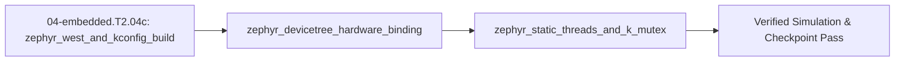

## 1. Why it matters
In `04-embedded.T2.04b`, you learned how **FreeRTOS** schedules tasks and prevents priority inversion, but FreeRTOS is only a scheduler kernel—you still have to stitch together vendor-specific HALs (`STM32Cube`, `ESP-IDF`, `NXP MCUXpresso`) whenever you change microcontrollers. **Zephyr RTOS** (Linux Foundation) is a complete, hardware-agnostic real-time operating system inspired by the Linux kernel architecture: you manage multi-repo workspaces and builds with **`west`**, enable kernel/driver features via **`Kconfig` (`prj.conf`)**, describe board hardware in a **Devicetree (`*.dts` / `.overlay`)** so your C application never hardcodes pin numbers or peripheral addresses, and allocate threads (`K_THREAD_DEFINE`) and priority-inheritance mutexes (`K_MUTEX_DEFINE`) statically at compile time with zero heap fragmentation. Already know this? Take the Skip test in section 7 first.

## 2. Intuition first
How does **Zephyr RTOS** differ from **FreeRTOS + Vendor HAL**, and how do its three pillars fit together?
- **FreeRTOS vs. Zephyr RTOS:** FreeRTOS gives you tasks and queues (`xTaskCreate`, `xQueueSend`), leaving pinmuxing, SPI, and CAN drivers to vendor-specific code (`HAL_SPI_TransmitReceive_DMA`). If you migrate a motor node from an `STM32G4` to an `NXP RT1060` or `ESP32-S3`, you rewrite every peripheral call. Zephyr unifies the RTOS kernel, hardware description, and unified device drivers (`<zephyr/drivers/can.h>`, `<zephyr/drivers/spi.h>`) so the **exact same C application** builds for an `nucleo_g474re` board or a Linux PC simulator (`native_sim`) just by changing `west build -b <board>`!
- **Devicetree (`*.dts` / `.overlay`) — What Hardware Exists:** Think of the **Devicetree** as the architectural blueprint of your PCB. Instead of scattering `#define MOTOR_CS_PIN GPIO_PIN_4` across ten `.c` files, a `.overlay` file declares that `spi1` has a magnetic encoder child node at `reg = <0>` with a specific chip-select GPIO. At compile time, Zephyr flattens the Devicetree into C macros (`DT_NODELABEL(fdcan1)`), so if a pin isn't wired properly in the `.overlay`, your code fails at **compile time** rather than crashing on the robot!
- **Kconfig (`prj.conf`) — Which Software Features Are Compiled In:** While Devicetree describes *hardware*, **Kconfig** (`prj.conf`) selects *software* compile-time options (`CONFIG_CAN=y`, `CONFIG_SPI=y`, `CONFIG_MAIN_STACK_SIZE=2048`), stripping every unused byte from flash.
- **Static Kernel Primitives (`K_THREAD_DEFINE` & `K_MUTEX_DEFINE`) & Priority Numbering:** Unlike FreeRTOS where `xTaskCreate()` allocates task stacks on the heap at runtime and higher numbers mean higher priority, Zephyr allocates threads, stacks, and mutexes **statically in RAM at compile time** (`K_THREAD_DEFINE`, `K_MUTEX_DEFINE`) and uses **lower numerical values for higher urgency**: cooperative threads have negative priorities ($-1, -2, \dots$, which cannot be preempted until they yield), while preemptible threads have non-negative priorities ($0, 1, 2, \dots$, where priority $0$ preempts priority $1$).

## 3. Formalization
1. **`west` Build Workflow & `Kconfig` (`prj.conf`) Static Footprint Budget:**
   - **Workspace & Build Commands:** `west init` / `west update` synchronizes the Zephyr manifest; `west build -b native_sim app/` (or `-b nucleo_g474re`) invokes CMake + Devicetree compiler (`dtc`) + Kconfig to produce `zephyr.elf`.
   - **Static RAM Allocation:** For $N_{\text{thr}}$ statically defined threads with stack sizes $S_i$ (aligned to $A$-byte boundaries, e.g. $A = 8\text{ bytes}$: $S_{i,\text{aligned}} = A \lceil S_i / A \rceil$), plus $N_{\text{msgq}}$ static message queues (`K_MSGQ_DEFINE(q, msg_size, max_msgs, align)`) of capacity $M_k \times B_k$, the compile-time kernel object RAM footprint is strictly bounded before `main()` runs:

$$
\text{RAM}_{\text{static}} = \sum_{i=1}^{N_{\text{thr}}} \left(S_{i,\text{aligned}} + B_{\text{tcb}}\right) + \sum_{k=1}^{N_{\text{msgq}}} M_k B_k, \qquad \text{RAM}_{\text{heap}} = 0\text{ B}
$$

2. **Devicetree (`*.dts` / `.overlay`) Compile-Time Binding & Device Readiness Contract:**
   - A board overlay binds a logical alias or node label (`fdcan1: can@4000a400`) to a C `const struct device *` pointer resolved at link time:
     ```c
     #include <zephyr/device.h>
     #include <zephyr/drivers/can.h>
     const struct device *const can_dev = DEVICE_DT_GET(DT_NODELABEL(fdcan1));
     if (!device_is_ready(can_dev)) { return -ENODEV; } // Mandatory runtime readiness guard
     ```
   - Every peripheral node requires `status = "okay";` in the merged Devicetree (`zephyr.dts`) and its corresponding driver enabled in `prj.conf` (`CONFIG_CAN=y`), otherwise `DT_NODE_HAS_STATUS(DT_NODELABEL(fdcan1), okay)` evaluates to `0` (`false`).
3. **Zephyr Thread Priority Ordering (`k_thread`) & Priority-Inheritance `k_mutex`:**
   - **Priority Comparison Rule:** Given two Zephyr threads with numerical priorities $p_A, p_B \in \mathbb{Z}$, thread $A$ has **strictly higher scheduling urgency** than thread $B$ iff:

$$
p_A < p_B
$$

     All **cooperative threads** ($p < 0$) outrank all **preemptible threads** ($p \ge 0$). Among preemptible threads ($0 \le p_A < p_B$), thread $A$ immediately preempts thread $B$.
   - **`K_MUTEX_DEFINE` Priority Inheritance & Reentrancy:** When a high-urgency thread ($p_H = 1$) calls `k_mutex_lock(&mtx, K_FOREVER)` on a `k_mutex` currently owned by a lower-urgency thread ($p_L = 5$, remaining critical section $B_L$), Zephyr temporarily elevates the owner's effective priority to:

$$
p_{L,\text{eff}} = \min(p_L, p_H) = p_H
$$

     preventing any intermediate preemptible thread ($p_M \in \{2, 3, 4\}$) from preempting $L$, bounding $H$'s worst-case response time to $R_H = C_H + B_L$.

## 4. Worked example
Simulate Zephyr's compile-time Devicetree + Kconfig binding validator, compute the static RAM footprint of a 3-thread Zephyr actuator firmware image (`K_THREAD_DEFINE` + `K_MSGQ_DEFINE`), and trace Zephyr's numerical priority scheduler ($p_A < p_B$) with `k_mutex` priority inheritance when a high-urgency thread ($p_H = 1$) contends with a low-urgency thread ($p_L = 5$) while a medium-urgency thread ($p_M = 3$) is ready.

```python
import math

# 1. Devicetree (.overlay) + Kconfig (prj.conf) compile-time & readiness check:
dts_nodes = {
    "fdcan1": {"status": "okay", "reg": 0x4000A400, "kconfig": "CONFIG_CAN"},
    "spi1":   {"status": "okay", "reg": 0x40013000, "kconfig": "CONFIG_SPI"},
    "i2c2":   {"status": "disabled", "reg": 0x40005800, "kconfig": "CONFIG_I2C"},
}
prj_conf = {"CONFIG_CAN": True, "CONFIG_SPI": True, "CONFIG_I2C": False}

def device_dt_ready(label: str) -> bool:
    node = dts_nodes[label]
    return (node["status"] == "okay") and prj_conf.get(node["kconfig"], False)

assert device_dt_ready("fdcan1") is True
assert device_dt_ready("spi1") is True
assert device_dt_ready("i2c2") is False

# 2. Static RAM footprint for K_THREAD_DEFINE + K_MSGQ_DEFINE (TCB = 128 B, 8-byte stack alignment):
threads_stack_req = [2048, 1536, 1020]  # 1020 rounds up to 1024 on 8-byte boundary
tcb_bytes = 128
aligned_stacks = [8 * math.ceil(s / 8) for s in threads_stack_req]
msgq_bytes = 16 * 72  # 16 CAN-FD frames of 72 bytes each = 1152 bytes
total_static_ram = sum(s + tcb_bytes for s in aligned_stacks) + msgq_bytes
assert aligned_stacks == [2048, 1536, 1024]
assert total_static_ram == (2048 + 1536 + 1024) + 3 * 128 + 1152  # 6144 bytes (6.0 KiB, 0 heap!)

# 3. Zephyr priority ordering (lower number = higher priority) & k_mutex priority inheritance:
# Preemptible threads: Ctrl (p_H = 1, C_H = 90 us), Telem (p_M = 3, C_M = 450 us), Log (p_L = 5, B_L = 30 us)
p_H, p_M, p_L = 1, 3, 5
C_H, C_M, B_L = 90.0, 450.0, 30.0
p_L_elevated = min(p_L, p_H)  # k_mutex_lock elevates owner p_L from 5 -> 1!
assert p_L_elevated == 1 and p_L_elevated < p_M  # Elevated owner outranks p_M = 3!
R_H_k_mutex_us = C_H + B_L
R_H_k_sem_us = C_H + B_L + C_M  # k_sem has NO priority inheritance -> p_M preempts p_L!
assert math.isclose(R_H_k_mutex_us, 120.0, rel_tol=1e-9)
assert math.isclose(R_H_k_sem_us, 570.0, rel_tol=1e-9)
print(f"DT_ready(fdcan1)={device_dt_ready('fdcan1')}, StaticRAM={total_static_ram} B, p_L_eff={p_L_elevated}, R_H={R_H_k_mutex_us:.0f} us")
```
Expected output:
```text
DT_ready(fdcan1)=True, StaticRAM=6144 B, p_L_eff=1, R_H=120 us
```

## 5. Exercise
A Zephyr application defines two preemptible threads via `K_THREAD_DEFINE`: `thread_fast` with priority $p_{\text{fast}} = 2$ ($C_{\text{fast}} = 110\ \mu\text{s}$) and `thread_slow` with priority $p_{\text{slow}} = 6$, plus an intermediate telemetry thread `thread_mid` with priority $p_{\text{mid}} = 4$ ($C_{\text{mid}} = 300\ \mu\text{s}$). If `thread_slow` holds a `k_mutex` with $B_{\text{slow}} = 35\ \mu\text{s}$ remaining when `thread_fast` calls `k_mutex_lock()`, compute (a) the elevated effective priority $p_{\text{slow,eff}} = \min(p_{\text{slow}}, p_{\text{fast}})$ of `thread_slow`, (b) the worst-case response time $R_{\text{fast}}$ in microseconds with `k_mutex` priority inheritance, and (c) the response time $R_{\text{fast,sem}}$ if a non-inheriting `k_sem` had been used instead while `thread_mid` was ready. Verify $p_{\text{slow,eff}} = 2$, $R_{\text{fast}} = 145.0\ \mu\text{s}$, and $R_{\text{fast,sem}} = 445.0\ \mu\text{s}$.
- **If your result differs:** Remember that in Zephyr, **smaller numbers mean higher priority** ($p = 2$ outranks $p = 4$, which outranks $p = 6$), so `k_mutex` lowers `thread_slow`'s numerical priority value from $6 \to 2$ ($\min(6, 2) = 2 < 4$), blocking `thread_mid` ($p=4$) from running during the $35\ \mu\text{s}$ critical section!


- **📚 What to Learn & Resources to Solve This Exercise:**
  - **Required Foundations Modules (`00-foundations`):** [`00-foundations.T1.00a`](00-foundations.T1.00a.md) (*Iterative Recurrence Loops*) and [`00-foundations.T1.00c`](00-foundations.T1.00c.md) (*Microsecond Timing Budgets*).
  - **Prerequisite Bridge Modules:** [`04-embedded.T2.04a`](04-embedded.T2.04a.md) (*Rate-Monotonic RTA*) and [`04-embedded.T2.04b`](04-embedded.T2.04b.md) (*Zephyr Build & Devicetree*).
  - **Core Concepts to Review First:** Zephyr static thread allocation (`K_THREAD_DEFINE`) with cooperative vs. preemptive priority bands, `k_mutex` Priority Inheritance Protocol ($R_H = C_H + B_H$ vs. unbounded priority inversion), and zero-copy `k_msgq` ring buffers in `## 3. Formalization` and `## 4. Worked example` above.
  - **Study Links & Resources:** [Zephyr Kernel Services: Threads, Mutexes & Message Queues (`docs.zephyrproject.org`)](https://docs.zephyrproject.org/latest/kernel/services/index.html) and [Track 04 Tier 2 (`04-embedded-and-realtime/README.md`)](../04-embedded-and-realtime/README.md#tier-2-intermediate--applied).

## 6. Simulation path
You can build and run Zephyr RTOS applications natively on any Linux workstation or CI container **without physical microcontroller hardware** using Zephyr's POSIX architecture target (`native_sim`), or flash an `STM32G4` board (`nucleo_g474re`) using the exact same 4-file project layout:
- **Canonical 4-File Zephyr Application Layout (`my_actuator_app/`):**
  1. `CMakeLists.txt`: `cmake_minimum_required(VERSION 3.20.0)` / `find_package(Zephyr REQUIRED HINTS ENV{ZEPHYR_BASE})` / `project(actuator)` / `target_sources(app PRIVATE src/main.c)`
  2. `prj.conf`: `CONFIG_CAN=y` and `CONFIG_SPI=y`
  3. `app.overlay`: `&fdcan1 { status = "okay"; bus-speed = <1000000>; bus-speed-data = <5000000>; };`
  4. `src/main.c`: Defines static threads (`K_THREAD_DEFINE`), priority-inheritance mutex (`K_MUTEX_DEFINE`), and checks `device_is_ready(DEVICE_DT_GET(DT_NODELABEL(fdcan1)))`.
```bash
# Path A — 100% Hardware-Free Linux Simulation (native_sim):
west build -b native_sim samples/synchronization
./build/zephyr/zephyr.exe

# Path B — Physical STM32G474RE Nucleo Build & Flash:
west build -b nucleo_g474re my_actuator_app -- -DDTC_OVERLAY_FILE=app.overlay
west flash
```
Or open **Tab 8 (Real-Time Concurrency & Scheduling)** in the MechaLab Workbench (`npm run dev`) to compare priority inheritance vs. priority inversion timelines.
```text
[app.overlay (.dts) + prj.conf (Kconfig)] ==(west build -b native_sim / nucleo_g474re)==> [Static Zephyr ELF: K_THREAD_DEFINE + K_MUTEX_DEFINE]
```
Pass/fail verification in simulation: `device_dt_ready("fdcan1") == True`, `total_static_ram == 6144 B`, and `R_H_k_mutex_us == 120.0 us`.




## 7. Checkpoint
Pass criteria: run the worked example and exercise asserts with zero errors, or score $\ge 80\%$ ($4/4$) on the Skip test below.

### Skip test
1. `[Recall] [Concept: zephyr_west_and_kconfig_build]` A Zephyr firmware image defines $2$ threads with aligned stack sizes $S_1 = 2048\text{ B}$ and $S_2 = 1024\text{ B}$ (each with a $128\text{ B}$ thread control block) and one `K_MSGQ_DEFINE` queue holding $M = 8$ messages of $B = 64\text{ B}$ each. Compute the total static RAM $\text{RAM}_{\text{static}} = (S_1 + 128) + (S_2 + 128) + M \cdot B$ in bytes (exact integer, tolerance $\pm 0$).
2. `[Apply] [Concept: zephyr_static_threads_and_k_mutex]` In Zephyr RTOS, three preemptible threads have numerical priorities $p_1 = 5$, $p_2 = 0$, and $p_3 = 3$. Which numerical priority value has the **highest** scheduling urgency (i.e. preempts the other two, $\min(p_1, p_2, p_3)$, exact integer, tolerance $\pm 0$)?
3. `[Transfer] [Concept: zephyr_static_threads_and_k_mutex]` A high-urgency Zephyr thread ($p_H = 1, C_H = 85\ \mu\text{s}$) blocks on a `K_MUTEX_DEFINE` mutex held by a low-urgency thread ($p_L = 7$, remaining critical section $B_L = 25\ \mu\text{s}$) while a medium-urgency thread ($p_M = 4, C_M = 400\ \mu\text{s}$) is ready. Compute the worst-case response time $R_H = C_H + B_L$ in microseconds ($\mu\text{s}$, tolerance $\pm 10^{-9}$) under Zephyr's `k_mutex` priority inheritance.
4. `[Spaced review -> 04-embedded.T2.04b — Concept: unbounded_priority_inversion_and_inheritance] [Concept: zephyr_devicetree_hardware_binding]` In Zephyr RTOS, what happens if your C code calls `DEVICE_DT_GET(DT_NODELABEL(spi1))` when `spi1` has `status = "disabled";` in the board's Devicetree `.dts` file and you did not add `&spi1 { status = "okay"; };` in your `.overlay` file?
   - **A.** Zephyr silently guesses random GPIO pins at runtime.
   - **B.** The build fails at **compile/link time** with an undefined Devicetree symbol error, catching the missing hardware configuration before the firmware can ever be flashed!
   - **C.** The SPI clock runs at $100\text{ GHz}$.
   - **D.** FreeRTOS is installed automatically.

**Answer key:**
```python
import math

q1_ram_bytes = (2048 + 128) + (1024 + 128) + (8 * 64)
q2_top_prio = min(5, 0, 3)
q3_rh_us = 85.0 + 25.0
q4_choice = "B"

assert q1_ram_bytes == 3840
assert q2_top_prio == 0
assert math.isclose(q3_rh_us, 110.0, rel_tol=1e-9)
assert q4_choice == "B"
```
- **Pass mark:** $4/4$ ($80\%+$). If you missed Q1, study `## 3. Formalization` item 1; if you missed Q2 or Q3, study `## 3. Formalization` item 3; if you missed Q4, study `## 3. Formalization` item 2. On pass, proceed to `## 10. Next modules`.

## 8. Common mistakes
| Symptom | Root cause | 2-minute fix |
| :--- | :--- | :--- |
| Assigned priority `10` to the $1\text{ kHz}$ control thread and priority `1` to the logging thread, starving the control loop | Applied FreeRTOS priority conventions (higher number = higher priority) to Zephyr, where **lower number = higher priority** ($1 < 10$). | In Zephyr, assign smaller priority numbers (e.g., `0` or `1`) to your fastest real-time control threads and larger numbers (`5`–`10`) to background logging threads. |
| Build fails with `__device_dts_ord_XX undeclared` on `DEVICE_DT_GET(DT_NODELABEL(fdcan1))` | Forgot to enable the driver in `prj.conf` (`CONFIG_CAN=y`) or forgot `&fdcan1 { status = "okay"; };` in the `.overlay` file. | Check `build/zephyr/zephyr.dts` and `build/zephyr/.config` to confirm both the Devicetree node is `"okay"` and the Kconfig driver symbol is `y`. |
| Used `k_sem` instead of `k_mutex` to lock a shared SPI bus and experienced priority inversion | Zephyr `k_sem` is a counting/signaling semaphore (like FreeRTOS binary semaphore) and does **not** track thread ownership or perform priority inheritance. | Always use `K_MUTEX_DEFINE` + `k_mutex_lock()` / `k_mutex_unlock()` for mutual exclusion between threads of different priorities. |

## 9. Resources
- **Linux Foundation — *Official Zephyr Project Documentation (`docs.zephyrproject.org`, West, Devicetree, Kconfig & Kernel Services)* (`resources/open-source-toolchains.md`):** Complete reference on `west`, Devicetree bindings, `K_THREAD_DEFINE`, and `K_MUTEX_DEFINE` `[VERIFIED 2026-10-15]`.
- **Track 04 (`04-embedded-and-realtime/README.md`):** Directly prepares for `04-embedded.T2.04d` (`micro-ROS`) and Step 2.5 (`04-embedded.T2.05`) `[VERIFIED 2026-10-15]`.

## 10. Next modules
- Proceed to [`04-embedded.T2.04d`](04-embedded.T2.04d.md) (*micro-ROS on Microcontrollers: XRCE-DDS Client-Agent Transport, Static `rclc_executor` & MCU-to-ROS 2 Bridging*).
