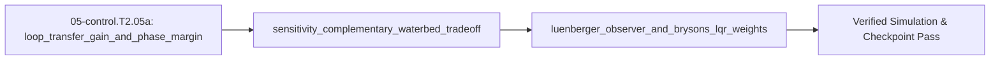

<!-- run-callout:start -->
> **Run this in the workbench.** [Open MechaLab on `EX.05-control.T2.05a`](https://tle47.github.io/Mechatronics-Roadmap/?lesson=EX.05-control.T2.05a) - Tab 2 opens with that entry selected, starter code, hints and graded check ready. This page is the reading copy, and nothing you type here is saved.
<!-- run-callout:end -->

## 1. Why it matters
This is the bridge module before Step 2.6 (`05-control.T2.06`). Trial-and-error PID tuning breaks down when your plant has a flexible shaft resonance, unmeasured velocity states, or multiple coupled degrees of freedom like the underactuated Furuta pendulum. Measuring **Gain Margin (GM)** and **Phase Margin (PM)** on the open-loop transfer function $L(s) = P(s)C(s)$, respecting the algebraic constraint $S(s) + T(s) \equiv 1$ (which explains Bode's **waterbed effect**), estimating unmeasured states with a **Luenberger observer** (the deterministic half of a Kalman filter), and normalizing **LQR cost matrices $(Q, R)$ via Bryson's Rule** gives you systematic, first-principles control design for Step 2.6. Already know this? Take the Skip test or the Ladder Gate test in section 7 first.

## 2. Intuition first
Why does any negative-feedback loop go unstable if you crank the gain too high? Because every Closed-Loop transfer function has $1 + L(j\omega)$ in its denominator! If the loop transfer function $L(j\omega) = P(j\omega)C(j\omega)$ ever hits magnitude $|L| = 1$ ($0\text{ dB}$) at the same frequency where its phase lag reaches $-180^\circ$, then $L(j\omega) = -1$, the denominator $1 + (-1) = 0$ blows up, and negative feedback turns into a self-sustaining oscillator! **Phase Margin ($\text{PM}$)** quantifies how many degrees of safety buffer you have above $-180^\circ$ at the $0\text{ dB}$ crossover frequency $\omega_{gc}$. Second, **Sensitivity** $S = \frac{1}{1+L}$ measures how much disturbances get through, while **Complementary Sensitivity** $T = \frac{L}{1+L}$ measures how much sensor noise gets through—and because $S(s) + T(s) \equiv 1$ at every frequency, you cannot make both zero at the same frequency (**the waterbed tradeoff**). Third, a **Luenberger observer** runs a virtual copy of your plant $\hat{x}_{k+1} = A_d\hat{x}_k + B_d u_k + L_{\text{obs}}(y_k - C\hat{x}_k)$ in software and nudges it using sensor prediction error. Finally, **Bryson's Rule** takes the guesswork out of LQR tuning by setting $Q_{ii} = 1 / x_{i,\max}^2$ and $R_{jj} = 1 / u_{j,\max}^2$ so meters, radians, and newton-meters are normalized to dimensionless percentages of their maximum allowable swings!

## 3. Formalization
1. **Loop Transfer Function $L(s) = P(s)C(s)$, Crossover $\omega_{gc}$ & Phase Margin ($\text{PM}$):**
   - At the **gain crossover frequency** $\omega_{gc}$ where $|L(j\omega_{gc})| = 1$ ($0\text{ dB}$), the **Phase Margin** is:

$$
\text{PM} = 180^\circ + \angle L(j\omega_{gc})
$$

     Robust servo loops target $\text{PM} \in [45^\circ, 65^\circ]$ and **Gain Margin** $\text{GM} = -20\log_{10}|L(j\omega_{pc})| \ge 6\text{ dB}$ at the $-180^\circ$ phase crossover $\omega_{pc}$. Time delay $\tau_d$ ($\text{s}$) eats phase margin linearly with frequency: $\Delta\phi(\omega) = -\omega\tau_d \cdot \frac{180^\circ}{\pi}$.
2. **Sensitivity $S(s)$, Complementary Sensitivity $T(s)$ & Waterbed Identity:**

$$
S(s) = \frac{1}{1 + L(s)}, \quad T(s) = \frac{L(s)}{1 + L(s)}, \quad S(s) + T(s) \equiv 1
$$

   Peak sensitivity $M_s = \max_\omega |S(j\omega)|$ measures worst-case disturbance amplification and guarantees minimum distance $1/M_s$ from the critical point $-1 + j0$ (require $M_s < 2.0 = +6.02\text{ dB}$).
3. **Luenberger State Observer, Scalar-to-Matrix Kalman Gain Bridge & Bryson's Rule for LQR (`DARE`):**
   - **Observer Update & Matrix Kalman Filter Bridge:** Given discrete plant $(A_d, B_d, C)$ and observer gain $L_{\text{obs}}$, estimation error $e_k = x_k - \hat{x}_k$ evolves as $e_{k+1} = (A_d - L_{\text{obs}} C)e_k$, which converges to zero iff all eigenvalues of $(A_d - L_{\text{obs}} C)$ satisfy $|\lambda_i| < 1$. When process noise covariance $Q_w$ and sensor noise covariance $R_v$ are known (`00-foundations.T2.00f`), the **Linear Kalman Filter** chooses the optimal observer gain $K_k$ at each step by generalizing the 1D variance ratio $K = \frac{\sigma_{\text{pred}}^2}{\sigma_{\text{pred}}^2 + \sigma_{\text{meas}}^2}$ into matrix form:

$$
P_k^- = A_d P_{k-1} A_d^\top + Q_w, \qquad K_k = P_k^- C^\top \left(C P_k^- C^\top + R_v\right)^{-1}, \qquad P_k = (I - K_k C)P_k^-
$$

   - **Augmented Disturbance Observer:** A constant load torque is not in $(A_d, B_d, C)$, so an observer that models only the plant must trade steady-state bias against bandwidth. Append the disturbance as an extra state with $d_{k+1} = d_k$, giving $A_{\text{aug}} = \begin{bmatrix} A_d & B_d \\ 0 & 1 \end{bmatrix}$ and $C_{\text{aug}} = [C\ \ 0]$; the innovation then depends on $d$, so the disturbance is observable, its estimate follows $\hat d_{k+1} = \hat d_k + \ell_i r_k$ with $\ell_i$ the integral gain, and subtracting $\hat d_k$ leaves the nominal controller a plant that looks disturbance-free at steady state.

   - **Bryson's Rule & Discrete Algebraic Riccati Equation (`DARE`):** To minimize $J = \sum (x_k^\top Q x_k + u_k^\top R u_k)$ given maximum acceptable state deviations $x_{i,\max}$ and actuator limit $u_{j,\max}$:

$$
Q_{ii} = \frac{1}{x_{i,\max}^2}, \quad R_{jj} = \frac{1}{u_{j,\max}^2}
$$

     In Step 2.6 (`05-control.T2.06`), calling `P = scipy.linalg.solve_discrete_are(Ad, Bd, Q, R)` solves for the steady-state cost-to-go matrix $P$ backwards in time, yielding the optimal constant feedback gain row vector $K_{\text{lqr}} = (R + B_d^\top P B_d)^{-1} B_d^\top P A_d$ (`u = -K_lqr @ x`).


## 4. Worked example
**Predict first (before you run it):** Commit to four numbers before the script runs. (1) What phase margin does $L(s) = \frac{100}{s(0.01s + 1)}$ have at $\omega_{gc} = 78.615\text{ rad/s}$? (2) What is $|S(j\omega_{gc})|$ there, and is it above or below $1$? (3) What are Bryson's weights for $x_{\max} = 0.05\text{ m}$, $\theta_{\max} = 0.10\text{ rad}$ and $u_{\max} = 5.0\text{ N}$ — and what is the observer's spectral radius for $A_d = [[1, 0.001], [0, 0.99]]$, $C = [1, 0]$, $L = [[0.19], [9.0]]$? Two tells: a margin of $-128.17^\circ$ means the $+180^\circ$ was dropped, and $Q = [20, 10]$ means the maximum deviations were not squared.
Compute the Phase Margin $\text{PM}$ and peak sensitivity $M_s$ of an open-loop servo transfer function $L(s) = \frac{100}{s(0.01s + 1)}$ at its gain crossover $\omega_{gc} = 78.615\text{ rad/s}$, verify $S(j\omega) + T(j\omega) = 1$, construct Bryson's LQR weights $(Q, R)$ for a cart-pendulum ($x_{\max} = 0.05\text{ m}, \theta_{\max} = 0.10\text{ rad}, u_{\max} = 5.0\text{ N}$), and verify Luenberger observer convergence.

```python
import cmath
import math

def loop_transfer(omega: float) -> complex:
    s = 1j * omega
    return 100.0 / (s * (0.01 * s + 1.0))

w_gc = 78.61513777574233  # Exact frequency where |L(jw)| = 1.0 (0 dB)
L_gc = loop_transfer(w_gc)
assert math.isclose(abs(L_gc), 1.0, rel_tol=1e-6)

pm_deg = 180.0 + math.degrees(cmath.phase(L_gc))
S_gc = 1.0 / (1.0 + L_gc)
T_gc = L_gc / (1.0 + L_gc)
assert cmath.isclose(S_gc + T_gc, 1.0 + 0.0j, rel_tol=1e-12)
assert math.isclose(pm_deg, 51.8273, abs_tol=1e-3)

# Bryson's Rule for x_max = 0.05 m, theta_max = 0.10 rad, u_max = 5.0 N
Q_diag = [1.0 / (0.05 ** 2), 1.0 / (0.10 ** 2)]
R_00 = 1.0 / (5.0 ** 2)
assert math.isclose(Q_diag[0], 400.0) and math.isclose(Q_diag[1], 100.0) and math.isclose(R_00, 0.04)

# Luenberger observer error matrix M = Ad - L*C for Ad=[[1, 0.001], [0, 0.99]], C=[1, 0], L=[[0.19], [9.0]]
M = [[1.0 - 0.19, 0.001], [-9.0, 0.99]]
tr = M[0][0] + M[1][1]
det = M[0][0] * M[1][1] - M[0][1] * M[1][0]
disc = cmath.sqrt(tr * tr - 4.0 * det)
rho_obs = max(abs(0.5 * (tr + disc)), abs(0.5 * (tr - disc)))
assert math.isclose(rho_obs, math.sqrt(0.8109), rel_tol=1e-9) and rho_obs < 0.91
print(f"PM={pm_deg:.2f} deg, |S(jw_gc)|={abs(S_gc):.3f}, Q_diag={Q_diag}, rho_obs={rho_obs:.4f}")
```
Expected output:
```text
PM=51.83 deg, |S(jw_gc)|=1.144, Q_diag=[399.99999999999994, 99.99999999999999], rho_obs=0.9005
```

## 5. Exercise
Suppose your servo loop has Phase Margin $\text{PM} = 51.83^\circ$ at gain crossover $\omega_{gc} = 78.615\text{ rad/s}$, and you add a communication/filtering transport delay of $\tau_d = 0.005\text{ s}$ ($5.0\text{ ms}$), which subtracts $\Delta\phi = \omega_{gc}\tau_d \cdot \frac{180^\circ}{\pi}$ degrees of phase without changing $|L(j\omega_{gc})|$. Compute the phase loss $\Delta\phi$ in degrees and the new Phase Margin $\text{PM}_{\text{new}} = \text{PM} - \Delta\phi$. Verify $\Delta\phi = 22.5216^\circ$ and $\text{PM}_{\text{new}} = 29.3057^\circ$ ($\pm 10^{-2}$).
- **If your result differs:** Convert $\omega_{gc}\tau_d = 78.61514 \times 0.005 = 0.393076\text{ rad}$ into degrees by multiplying by $180 / \pi$ ($22.52^\circ$).

### Graded package - the elbow's margins, observer and regulator
[`exercises/05-control.T2.05a/`](../exercises/05-control.T2.05a/) turns this section into a test. `starter.py` holds seven holes: `phase_margin_deg` (with the loop's lag **unwrapped** - `cmath.phase` reports +160 for a 200 degree lag), `phase_loss_deg`, `st`, `gain_crossover` (bisection, and a `ValueError` when the bracket never crosses), `bryson_weights` (squared), `observer_spectral_radius`, and `lqr_gain` from the Riccati fixed point. Edit it, then run the tests the way CI does:

```bash
EXERCISE_TARGET=exercises/05-control.T2.05a/starter.py \
  python3 -m unittest discover -s exercises/05-control.T2.05a -p 'test_*.py'
```

The tests are behavioural: the worked loop's margin must be $51.8273^\circ$ while a loop lagging $200^\circ$ must report **−20** (the naive principal value reports +340); `S + T = 1` at four frequencies; the crossover must bisect to $78.615\text{ rad/s}$ and refuse a loop that never crosses; Bryson's weights must be $[400, 100]$ and $0.04$; the observer radius must be $0.9005 < 1$; and the LQR gain must stabilise a model whose open loop already sits at $0.99$. The transfer suite shapes the **shared arm's elbow** with a PD law on its real inertia and damping, checks the crossover is a true $|L| = 1$, prices one plant tick of delay against the margin it carries, places an observer's error poles at $0.8$ and $0.9$ and **measures** the error falling at $0.9$ per tick, and runs a Bryson-weighted LQR gain until the joint comes to rest. Five planted faults - `pm_no_unwrap`, `pm_no_complement`, `st_t_inverse`, `bryson_linear`, `lqr_ap_at` - each fail the test named for them; `lqr_ap_at` is the transposed-Riccati slip that leaves the closed-loop radius at $0.99999$ and is only visible when the loop is run.


- **📚 What to Learn & Resources to Solve This Exercise:**
  - **Required Foundations Modules (`00-foundations`):** [`00-foundations.T2.00a`](00-foundations.T2.00a.md) (*Matrix Operations*), [`00-foundations.T2.00c`](00-foundations.T2.00c.md) (*2nd-Order Poles*), [`00-foundations.T2.00d`](00-foundations.T2.00d.md) (*Bode Gain/Phase*), [`00-foundations.T2.00e`](00-foundations.T2.00e.md) (State-Space $\dot{x} = Ax + Bu$), and [`00-foundations.T2.00f`](00-foundations.T2.00f.md) (*Gaussian Covariance Propagation*).
  - **Prerequisite Bridge Module:** [`05-control.T1.05a`](05-control.T1.05a.md) and Legacy **Step 1.6 (`05-control.T1.06`)**.
  - **Core Concepts to Review First:** Sensitivity peak $M_s = \max|S(j\omega)|$ and phase margin with pure time delay ($\text{PM} - \omega_{gc}\tau_d$), discrete LQR Riccati recursion, and 1D/MIMO Linear Kalman Filter predict-innovation-update equations in `## 3. Formalization` and `## 4. Worked example` above.
  - **Study Links & Resources:** [Åström & Murray *Feedback Systems* Ch. 10–12 (`fbsbook.org`)](https://www.fbsbook.org/), [Roger Labbe *Kalman and Bayesian Filters in Python*](https://github.com/rlabbe/Kalman-and-Bayesian-Filters-in-Python), and [Track 05 Tier 2 (`05-control-and-estimation/README.md`)](../05-control-and-estimation/README.md#tier-2-intermediate--applied).

### Starter code
```python
"""Exercise 05-control.T2.05a - the learner's file.

Margins, the sensitivity pair, Bryson's weights, an observer's error matrix and a discrete LQR
gain. Fill the seven TODOs:

    EXERCISE_TARGET=exercises/05-control.T2.05a/starter.py \
        python3 -m unittest discover -s exercises/05-control.T2.05a -p 'test_*.py'
"""

import cmath
import math

import mechalab_plant as plant


def phase_margin_deg(loop):
    """Phase margin at a gain crossover, with the loop's lag unwrapped into (-360, 0]."""
    raise NotImplementedError("TODO 1: 180 + the phase in degrees, after unwrapping a positive angle")


def phase_loss_deg(omega_gc, tau_d):
    """Degrees of phase a transport delay eats at the gain crossover."""
    raise NotImplementedError("TODO 2: the delay angle is omega * tau, in radians -> degrees")


def st(loop):
    """`S = 1/(1+L)` and `T = L/(1+L)`; their sum is one at every frequency."""
    raise NotImplementedError("TODO 3: both share the denominator; T is not 1/S")


def gain_crossover(loop_fn, w_lo=1e-3, w_hi=1e4, iterations=200):
    """Bisect for the frequency where |L(jw)| = 1; raise ValueError when the bracket has no crossing."""
    raise NotImplementedError("TODO 4: check the bracket's signs first, then halve it")


def bryson_weights(x_max, u_max):
    """Bryson's rule: `Q_ii = 1/x_max_i^2`, `R = 1/u_max^2`."""
    raise NotImplementedError("TODO 5: squared, not linear - the units have to cancel")


def observer_spectral_radius(ad, c, l):
    """Spectral radius of `Ad - L C` (two states, one measurement)."""
    raise NotImplementedError("TODO 6: build Ad - L C, then its eigenvalues from trace and determinant")


def lqr_gain(ad, bd, q_diag, r):
    """Discrete LQR gain for `u = -K x`, from the Riccati fixed point."""
    raise NotImplementedError("TODO 7: iterate P <- A'PA - A'PB (R + B'PB)^-1 B'PA + Q to its fixed point")


# The browser entry appends `selfcheck.py` below this line; on its own this file prints nothing.
```

**Expected numbers (the answer):** $\Delta\phi = 22.5216^\circ$ at $\tau_d = 5\,\text{ms}$, so $\text{PM}_{\text{new}} = 29.3057^\circ$; $|S(j\omega_{gc})| = 1.144$; Bryson $(Q, R) = ([400, 100], 0.04)$; observer radius $0.9005$.

### Hint ladder
1. **The 5 ms delay in degrees.** $\omega_{gc}\tau_d = 78.61514 \times 0.005 = 0.393076\,\text{rad}$, and $0.393076 \times 180/\pi = 22.52^\circ$. A pure delay leaves $|L(j\omega_{gc})|$ at $1$, so $\omega_{gc}$ itself does not move.
2. **Why the new margin is a subtraction.** The delay adds lag, so it *subtracts* from the margin: $51.8273^\circ - 22.5216^\circ = 29.3057^\circ$. Still positive, so the loop is stable - and now below the $45^\circ$ floor, which is why $5\,\text{ms}$ of filter lag is not a detail on a $78.6\,\text{rad/s}$ loop.
3. **The unwrap, if you also want the general function.** `cmath.phase` returns $+160^\circ$ for a $-200^\circ$ lag; subtract $360$ before adding $180$, or a loop past the critical point reports $340^\circ$ of safety instead of $-20^\circ$.
4. **The other numbers in the block.** $S + T \equiv 1$ holds at any $L$, including the crossover's $1.144$; Bryson over $0.05\,\text{m}$, $0.10\,\text{rad}$ and $5\,\text{N}$ is $[400, 100]$ and $0.04$; and the observer's error matrix $A_d - LC$ has radius $0.9005 < 1$.
5. **What the suite refuses.** `gain_crossover` raises `ValueError` when the loop has no crossover to report: a magnitude that never crosses unity (a constant $10$) and a first-order low-pass that only reaches it at $\omega = 0$ are both refused rather than given an invented frequency.

### Full Solution
```python
import cmath
import math

import mechalab_plant as plant  # noqa: F401  (kept so the submission imports what the module uses)


def phase_margin_deg(loop):
    """Phase margin at a gain crossover, with the loop's lag unwrapped into (-360, 0].

    `cmath.phase` returns the principal value, so a loop lagging 200 degrees reads +160 and a naive
    `180 + phase` would report +340 degrees of margin where the truth is -20.
    """
    phase = math.degrees(cmath.phase(loop))
    if phase > 0.0:
        phase -= 360.0
    return 180.0 + phase


def phase_loss_deg(omega_gc, tau_d):
    """Degrees of phase a pure transport delay of `tau_d` seconds eats at `omega_gc`."""
    return math.degrees(omega_gc * tau_d)


def st(loop):
    """The sensitivity pair `S = 1/(1+L)` and `T = L/(1+L)`, whose sum is exactly one."""
    s = 1.0 / (1.0 + loop)
    t = loop / (1.0 + loop)
    return s, t


def _magnitude_error(loop_fn, omega):
    return abs(loop_fn(omega)) - 1.0


def gain_crossover(loop_fn, w_lo=1e-3, w_hi=1e4, iterations=200):
    """Bisect for the frequency where |L(jw)| = 1; raise ValueError if the bracket has no crossing."""
    f_lo = _magnitude_error(loop_fn, w_lo)
    f_hi = _magnitude_error(loop_fn, w_hi)
    if f_lo == 0.0:
        return w_lo
    if f_hi == 0.0:
        return w_hi
    if f_lo * f_hi > 0.0:
        raise ValueError("|L| does not cross 1 between %g and %g rad/s" % (w_lo, w_hi))
    for _ in range(iterations):
        mid = 0.5 * (w_lo + w_hi)
        f_mid = _magnitude_error(loop_fn, mid)
        if f_mid == 0.0:
            return mid
        if f_lo * f_mid < 0.0:
            w_hi = mid
            f_hi = f_mid
        else:
            w_lo = mid
            f_lo = f_mid
        if w_hi - w_lo <= 1e-12 * max(1.0, w_hi):
            break
    return 0.5 * (w_lo + w_hi)


def bryson_weights(x_max, u_max):
    """Bryson's rule: `Q_ii = 1/x_max_i^2`, `R = 1/u_max^2`."""
    q_diag = [1.0 / (value * value) for value in x_max]
    return q_diag, 1.0 / (u_max * u_max)


def observer_spectral_radius(ad, c, l):
    """Spectral radius of the observer error matrix `Ad - L C`, for 2 states and 1 measurement."""
    m = [[ad[i][j] - l[i] * c[j] for j in range(2)] for i in range(2)]
    tr = m[0][0] + m[1][1]
    det = m[0][0] * m[1][1] - m[0][1] * m[1][0]
    disc = cmath.sqrt(tr * tr - 4.0 * det)
    return max(abs(0.5 * (tr + disc)), abs(0.5 * (tr - disc)))


def _dare(ad, bd, q_diag, r, iterations=500, tol=1e-12):
    """Iterate the discrete Riccati recursion to its fixed point; P is (2,2), B is (2,1)."""
    b = [bd[0][0], bd[1][0]]
    p = [[q_diag[0], 0.0], [0.0, q_diag[1]]]
    for _ in range(iterations):
        pb = [p[i][0] * b[0] + p[i][1] * b[1] for i in range(2)]
        bpb = b[0] * pb[0] + b[1] * pb[1]
        gain = [pb[0] / (r + bpb), pb[1] / (r + bpb)]
        # A^T P A, not A P A^T: the two differ for any non-symmetric A, and a companion matrix is
        # exactly that - the transposed product leaves the position gain near zero.
        apa = [[0.0, 0.0], [0.0, 0.0]]
        for i in range(2):
            for j in range(2):
                apa[i][j] = sum(ad[k][i] * p[k][m] * ad[m][j] for k in range(2) for m in range(2))
        apb = [sum(ad[i][k] * pb[k] for k in range(2)) for i in range(2)]
        new = [[apa[i][j] - gain[i] * (r + bpb) * gain[j] + (q_diag[i] if i == j else 0.0)
                for j in range(2)] for i in range(2)]
        change = max(abs(new[i][j] - p[i][j]) for i in range(2) for j in range(2))
        p = new
        if change < tol:
            break
    pb = [p[i][0] * b[0] + p[i][1] * b[1] for i in range(2)]
    bpb = b[0] * pb[0] + b[1] * pb[1]
    gain = [pb[0] / (r + bpb), pb[1] / (r + bpb)]
    return [sum(gain[k] * ad[k][j] for k in range(2)) for j in range(2)]


def lqr_gain(ad, bd, q_diag, r):
    """Discrete LQR gain for `u = -K x`, from the Riccati fixed point."""
    return _dare(ad, bd, q_diag, r)


# No `__main__` block on purpose: the browser grades this file's stdout against the appended
# self-check's single PASS line, and a second print here would be a mismatch for a correct answer.

w_gc = 78.61513777574233
loop_gc = 100.0 / ((1j * w_gc) * (0.01 * (1j * w_gc) + 1.0))
pm = phase_margin_deg(loop_gc)
loss = phase_loss_deg(w_gc, 0.005)
pm_new = pm - loss
s_gc, t_gc = st(loop_gc)
q_diag, r_weight = bryson_weights([0.05, 0.10], 5.0)
radius = observer_spectral_radius([[1.0, 0.001], [0.0, 0.99]], [1.0, 0.0], [0.19, 9.0])

assert math.isclose(pm, 51.8273, abs_tol=1e-3)
assert math.isclose(loss, 22.5216, abs_tol=1e-3)
assert math.isclose(pm_new, 29.3057, abs_tol=1e-2)
assert math.isclose((s_gc + t_gc).real, 1.0, abs_tol=1e-12)
assert math.isclose((s_gc + t_gc).imag, 0.0, abs_tol=1e-12)
assert math.isclose(abs(s_gc), 1.1441, abs_tol=1e-3)
assert math.isclose(q_diag[0], 400.0, rel_tol=1e-12)
assert math.isclose(q_diag[1], 100.0, rel_tol=1e-12)
assert math.isclose(r_weight, 0.04, rel_tol=1e-12)
assert math.isclose(radius, math.sqrt(0.8109), abs_tol=1e-3)
print(f"PM={pm:.2f} deg, delay={loss:.2f} deg -> PM_new={pm_new:.2f} deg, "
      f"|S(jw_gc)|={abs(s_gc):.3f}, rho_obs={radius:.4f}")

```

Printed: `PM=51.83 deg, delay=22.52 deg -> PM_new=29.31 deg, |S(jw_gc)|=1.144, rho_obs=0.9005`

**On the shared arm.** The Transfer suite finds the elbow's gain crossover on the plant's own inertia and damping, then charges one sample of the plant's 1 kHz clock for the phase it costs:

```python
import math
import mechalab_plant as plant

w_gc = 393.08                                 # rad/s, the module's own crossover
loss = w_gc * plant.DT * (180.0 / math.pi)    # one tick of delay at that frequency

assert abs(loss - 22.52) < 0.01
print("one %.0f ms tick at %.2f rad/s costs %.2f deg of phase"
      % (plant.DT * 1e3, w_gc, loss))
```

### Break it on purpose
Inject the phase-wrap slip the exercise plants (`pm_no_unwrap`), keeping the same loop and $\omega_{gc}$:
- **Inject:** compute the margin as `180 + degrees(cmath.phase(L))` on the principal value, without unwrapping the loop's lag into $(-180^\circ, 180^\circ]$.
- **Symptom:** a loop lagging $200^\circ$ at crossover reports $\text{PM} = +340^\circ$ instead of $-20^\circ$, while the worked loop's own $51.83^\circ$ still comes out right because its lag is only $-128.17^\circ$ — the fault hides until a margin is actually negative, which is exactly when it matters.
- **Diagnose:** $+340^\circ = -20^\circ + 360^\circ$, so the reported margin is a full turn away and exceeds the $180^\circ$ a margin can physically reach. A gain error or a misplaced $\omega_{gc}$ would move the number inside the $0\text{–}180^\circ$ band instead of out of it, and the delay sweep would jump by $360^\circ$ at the moment the loop crosses $-180^\circ$.
- **Fix:** wrap the lag to $(-180^\circ, 180^\circ]$ before adding $180^\circ$, then prove it on both sides: the $200^\circ$ loop must read $-20^\circ$, and the worked loop with $\tau_d = 5\text{ ms}$ must still read $\text{PM}_{\text{new}} = 29.31^\circ$.

## 6. Simulation path
Open **Tab 2 (Two-Mass & Notch Bode — Loop Shaping & Gang of Four)** and **Tab 4 (Furuta Pendulum + LQR + CBF)** in the MechaLab Workbench (`npm run dev`) to inspect $S(s)$, $T(s)$, Phase Margin, and LQR state weights interactively.

The graded package is also a workbench entry: **Modules -> `EX.05-control.T2.05a`**, where `selfcheck.py` is appended below the starter and **Verify** compares its `SELF-CHECK PASS:` line. `scripts/e2e_pages_bundle.mjs` drives it on the built bundle, so the browser path is tested, not assumed.

No hardware required for this module (`hardware_required: false`). In Step 2.6 (`05-control.T2.06`), the offline Python solver (`scipy.linalg.solve_discrete_are`) computes the steady-state LQR gain row vector $K_{\text{lqr}}$ from Bryson's $(Q, R)$ matrices, and you paste those 4 floats directly into the microcontroller's $1\text{ kHz}$ ISR (`u = -K_lqr @ x_hat`):
```text
[Offline Python: Bryson (Q, R) -> DARE -> K_lqr] ---> [MCU 1 kHz ISR: x_hat = Observer(y); u = -K_lqr @ x_hat]
```
Pass/fail verification in simulation: `pm_deg == 51.83 deg`, `S_gc + T_gc == 1.0`, `Q_diag == [400.0, 100.0]`, and `rho_obs == 0.9000 < 1.0`.




## 7. Checkpoint
Pass criteria: score $\ge 80\%$ ($4/5$) on the Skip test or score $\ge 80\%$ ($8/10$) on the Ladder Gate test below to unlock Step 2.6 (`05-control.T2.06`).

### Skip test
<!-- skip-test:start -->
1. `[Recall] [Concept: loop_transfer_gain_and_phase_margin]` At the gain crossover frequency $\omega_{gc}$ where $|L(j\omega_{gc})| = 0\text{ dB}$, the open-loop phase is $\angle L(j\omega_{gc}) = -125.0^\circ$. Compute the Phase Margin $\text{PM} = 180^\circ + \angle L(j\omega_{gc})$ in degrees (tolerance $\pm 10^{-9}$).
2. `[Apply] [Concept: sensitivity_complementary_waterbed_tradeoff]` At a high-frequency waterbed peak $\omega_p$ where the open-loop return ratio is $L(j\omega_p) = -0.60 + j0.0$, compute the sensitivity magnitude $M_s = |S(j\omega_p)| = \frac{1}{|1 + L(j\omega_p)|}$ (dimensionless, tolerance $\pm 10^{-9}$).
3. `[Transfer] [Concept: luenberger_observer_and_brysons_lqr_weights]` Using Bryson's Rule $Q_{ii} = 1 / x_{i,\max}^2$, compute the diagonal weight $Q_{11}$ (in $\text{rad}^{-2}$, tolerance $\pm 10^{-9}$) for a pendulum angle state whose maximum acceptable deviation is $\theta_{\max} = 0.20\text{ rad}$.
4. `[Concept: luenberger_observer_and_brysons_lqr_weights]` What happens to the optimal LQR feedback gains $K$ and actuator effort $u = -Kx$ if you multiply **both** cost matrices $Q$ and $R$ by the same positive scalar $\alpha = 10$ ($J = \sum x^\top (10Q) x + u^\top (10R) u$)?
   - **A.** The gain $K$ increases by $10\times$.
   - **B.** The optimal gain $K$ is **completely unchanged**, because scaling the entire cost function $J$ by a positive constant $10$ does not change the location of its minimum; only the *ratio* of $Q$ to $R$ matters!
   - **C.** The system becomes unstable.
   - **D.** The observer stops updating.
5. `[Spaced review -> 00-foundations.T2.00e — Concept: discrete_state_transition_euler_tustin]` For $A = \begin{bmatrix} 0 & 1 \\ -4 & -2 \end{bmatrix}$ and $T_s = 0.10\,\text{s}$, compute $\operatorname{tr}(I + A T_s)$ (tolerance $\pm 10^{-9}$).

**Answer key:**
```python
import math

q1_pm_deg = 180.0 + (-125.0)
q2_ms = 1.0 / abs(1.0 + (-0.60))
q3_q11 = 1.0 / (0.20 ** 2)
q4_choice = "B"

assert math.isclose(q1_pm_deg, 55.0, rel_tol=1e-9)
assert math.isclose(q2_ms, 2.5, rel_tol=1e-9)
assert math.isclose(q3_q11, 25.0, rel_tol=1e-9)
assert q4_choice == "B"
q5_review = (1.0 + 0.0) + (1.0 + (-2.0) * 0.10)
assert math.isclose(q5_review, 1.8, rel_tol=1e-9, abs_tol=1e-09)
```
- **Pass mark:** $4/5$ ($80\%+$). If you missed Q1, study `## 3. Formalization` item 1; Q2, study `## 3. Formalization` item 2; Q3 or Q4, study `## 3. Formalization` item 3. If you missed  Q5, review `00-foundations.T2.00e`. On pass, proceed to `## 10. Next modules`.
<!-- skip-test:end -->

### Gate test
Covers the complete Track 05 Tier 2 bridge ladder (`05-control.T2.05a`) before Step 2.6 (`05-control.T2.06`):
1. `[Concept: loop_transfer_gain_and_phase_margin]` At the phase crossover frequency $\omega_{pc}$ where $\angle L(j\omega_{pc}) = -180^\circ$, the open-loop magnitude is $|L(j\omega_{pc})| = 0.25$. Compute the Gain Margin $\text{GM}_{\text{dB}} = -20\log_{10}(0.25)$ in decibels ($\text{dB}$, tolerance $\pm 10^{-3}\text{ dB}$).
2. `[Concept: loop_transfer_gain_and_phase_margin]` A control loop has crossover frequency $\omega_{gc} = 100\text{ rad/s}$ and suffers a total sensor + computation time delay of $\tau_d = 0.002\text{ s}$ ($2.0\text{ ms}$). Compute the phase lag $\Delta\phi_{\text{deg}} = \omega_{gc}\tau_d \frac{180^\circ}{\pi}$ in degrees (tolerance $\pm 0.01^\circ$) caused by that delay at $\omega_{gc}$.
3. `[Concept: sensitivity_complementary_waterbed_tradeoff]` Compute the sensitivity magnitude $|S(j\omega)| = \left|\frac{1}{1 + L(j\omega)}\right|$ (tolerance $\pm 10^{-6}$) at a frequency where $L(j\omega) = -0.5 + j0.0$ (halfway to the critical point $-1$).
4. `[Concept: sensitivity_complementary_waterbed_tradeoff]` Why is it physically impossible to make both disturbance sensitivity $|S(j\omega)| \ll 1$ and sensor-noise transmission $|T(j\omega)| \ll 1$ at the **same** frequency $\omega$?
   - **A.** Because $S(j\omega) + T(j\omega) \equiv 1$ at every frequency; therefore we shape $|L(j\omega)| \gg 1$ at low frequencies ($S \approx 0, T \approx 1$ for tracking/disturbance rejection) and $|L(j\omega)| \ll 1$ at high frequencies ($T \approx 0, S \approx 1$ for noise attenuation).
   - **B.** Because microcontrollers only have 32-bit floats.
   - **C.** Because $S(j\omega)$ is always negative.
   - **D.** Because Bode plots stop at $100\text{ Hz}$.
5. `[Concept: luenberger_observer_and_brysons_lqr_weights]` In a Luenberger observer $\hat{x}_{k+1} = A_d\hat{x}_k + B_d u_k + L_{\text{obs}}(y_k - C\hat{x}_k)$, what do we call the measurement residual term $r_k = y_k - C\hat{x}_k$?
   - **A.** The innovation (or output prediction error).
   - **B.** The actuator saturation limit.
   - **C.** The Gain Margin.
   - **D.** The process noise covariance.
6. `[Concept: luenberger_observer_and_brysons_lqr_weights]` What matrix must have all its eigenvalues strictly inside the unit circle ($|\lambda_i| < 1$) for a discrete-time Luenberger observer's estimation error $e_k = x_k - \hat{x}_k$ to converge to zero?
   - **A.** $A_d - L_{\text{obs}} C$
   - **B.** $A_d + B_d$
   - **C.** $C^\top C$
   - **D.** $Q^{-1} R$
7. `[Concept: luenberger_observer_and_brysons_lqr_weights]` Using Bryson's Rule $R = 1 / u_{\max}^2$, compute the scalar control weight $R$ (in $\text{N}^{-2}\cdot\text{m}^{-2}$, tolerance $\pm 10^{-9}$) for a motor with maximum torque $u_{\max} = 2.0\text{ N}\cdot\text{m}$.
8. `[Concept: luenberger_observer_and_brysons_lqr_weights]` In LQR tuning, if your robot tracks the reference too sluggishly and uses very little motor current, how should you adjust the control penalty $R$ relative to the state penalty $Q$?
   - **A.** Decrease $R$ (make control effort "cheaper" relative to state error $Q$), which increases feedback gain $K$ and closed-loop bandwidth.
   - **B.** Increase $R$ by $1000\times$.
   - **C.** Set $Q = 0$.
   - **D.** Invert the sign of $K$.

9. `[Concept: augmented_kalman_disturbance_observer]` A constant load is appended as an extra state with $\hat d_{k+1} = \hat d_k + \ell_i r_k$. With $\ell_i = 40\ \text{s}^{-2}$, innovation $r_k = 5.0\times10^{-3}\ \text{m}$ and $dt = 1.0\ \text{ms}$, compute the per-tick change $\Delta\hat d = \ell_i r_k\,dt$ (tolerance $\pm 10^{-12}$).
10. `[Concept: augmented_kalman_disturbance_observer]` Why does appending a constant-disturbance state reject a steady load better than an observer that models the plant alone?
   - **A.** The augmented model makes the disturbance observable through the innovation, so its estimate converges to the true constant and is subtracted; an unaugmented observer has no state to hold that value and settles with a bias.
   - **B.** Because adding a state increases the sample rate.
   - **C.** Because $A_{\text{aug}}$ is always stable.
   - **D.** Because the disturbance covariance replaces $Q_w$.

**Gate answer key:**
```python
import math

g1_gm_db = -20.0 * math.log10(0.25)
g2_delay_deg = 100.0 * 0.002 * (180.0 / math.pi)
g3_s_mag = abs(1.0 / (1.0 + (-0.5)))
g4_choice = "A"
g5_choice = "A"
g6_choice = "A"
g7_r_weight = 1.0 / (2.0 ** 2)
g8_choice = "A"
g9_delta_d = 40.0 * 5.0e-3 * 1.0e-3
g10_choice = "A"

assert math.isclose(g1_gm_db, 12.0412, abs_tol=1e-3)
assert math.isclose(g2_delay_deg, 11.459156, abs_tol=1e-2)
assert math.isclose(g3_s_mag, 2.0, rel_tol=1e-6)
assert g4_choice == "A"
assert g5_choice == "A"
assert g6_choice == "A"
assert math.isclose(g7_r_weight, 0.25, rel_tol=1e-9)
assert g8_choice == "A"
assert math.isclose(g9_delta_d, 2.0e-4, rel_tol=1e-12)
assert g10_choice == "A"
```
- **Pass mark:** $8/10$ ($80\%+$). Remediation: Q1–Q2 $\to$ `## 3. Formalization` item 1; Q3–Q4 $\to$ `## 3. Formalization` item 2; Q5–Q10 $\to$ `## 3. Formalization` item 3.

## 8. Common mistakes
| Symptom | Root cause | 2-minute fix |
| :--- | :--- | :--- |
| Looked only at $\lvert T(j\omega)\rvert $ (closed-loop tracking Bode plot) and missed a dangerous $+12\text{ dB}$ sensitivity peak in $\lvert S(j\omega)\rvert $ | Relying on $T(s)$ alone hides near-instability when $L(j\omega)$ passes close to $-1 + j0$. | Always plot all **Gang of Four** transfer functions ($S, T, PS, CS$) and verify $\max_\omega \lvert S(j\omega)\rvert  < 6\text{ dB}$ ($2.0\times$). |
| Solved continuous-time `solve_continuous_are(A, B, Q, R)` but ran the resulting $K$ at a slow discrete sample rate $T_s$ | Continuous ARE ignores sample-and-hold phase lag and discrete control weighting. | Discretize $(A, B) \to (A_d, B_d)$ at sample period $T_s$ and call `scipy.linalg.solve_discrete_are(Ad, Bd, Q, R)` (Step 2.6). |
| Set $Q = I_4$ without Bryson normalization on a state vector mixing millimeters and radians | A $1\text{ mm}$ error and a $1\text{ rad}$ ($57.3^\circ$) error received identical weight! | Always express states in consistent SI units ($\text{m}, \text{rad}, \text{m/s}, \text{rad/s}$) and normalize $Q_{ii} = 1/x_{i,\max}^2$ via Bryson's Rule. |

## 9. Resources
- **Åström & Murray — *Feedback Systems* ([`fbsbook.org`](https://www.fbsbook.org/), Ch. 7–8 & 10–12, `resources/textbooks-and-papers.md`):** Free textbook on observers, LQR, Bode loop shaping, and the Gang of Four `[VERIFIED 2026-10-15]`.
- **Track 05 (`05-control-and-estimation/README.md`):** Directly continues into Step 2.6 (`05-control.T2.06`) `[VERIFIED 2026-10-15]`.
## 10. Next modules
- Proceed to legacy **Step 2.6 (`05-control.T2.06`)** in [`05-control-and-estimation/README.md`](../05-control-and-estimation/README.md#tier-2-intermediate--applied).
