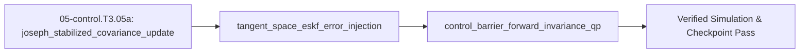

## 1. Why it matters
This is the final bridge module in the Track 05 Tier 3 ladder before Step 3.6 (`05-control.T3.06`). In Tier 2 (`05-control.T2.06`), you designed linear Kalman filters and infinite-horizon LQR controllers that assume flat Euclidean vector spaces and unconstrained actuators. On a 3D aerial, legged, or mobile manipulator robot, three production challenges break linear Tier 2 methods: (1) the standard textbook Kalman covariance update $P^+ = (I - KH)P^-$ subtracts two matrices and can lose symmetry or positive-definiteness under finite floating-point precision, requiring the **Joseph-form stabilized update**, (2) a $4\times 4$ quaternion covariance matrix is rank-deficient because $\|q\| = 1$ lives on a 3D manifold, requiring an **Error-State Kalman Filter (`ESKF`)** that tracks a minimal 3D tangent-space rotation error $\delta\theta \in \mathbb{R}^3$ and injects it multiplicatively onto $SO(3)$, and (3) LQR ignores physical joint/torque/obstacle limits, requiring **Receding-Horizon Model Predictive Control (`MPC`)** and **Control Barrier Function Quadratic Programs (`CBF-QP`)** that minimally modify the nominal torque $u_{\text{nom}}$ to guarantee forward invariance of the safe set $h(x) \ge 0$! Already know this? Take the Skip test or the Ladder Gate test in section 7 first.

## 2. Intuition first
Three geometric and optimization concepts form the backbone of Tier 3 estimation and control:
- **Why $(I - KH)P^-$ Fails & Why Joseph Form Never Goes Negative:** In floating-point arithmetic, subtracting $K H P^-$ from $P^-$ when measurements are very accurate ($K H \approx I$) can produce tiny negative eigenvalues due to roundoff, causing the Kalman filter to diverge explosively! The **Joseph-form update** $P^+ = (I - KH)P^-(I - KH)^\top + K R K^\top$ is a sum of two symmetric positive semi-definite quadratic forms ($A P A^\top + B R B^\top \succeq 0$): even if $K$ is suboptimal or rounded to 32-bit `float`, $P^+$ is guaranteed to remain symmetric and **positive semi-definite** ($P^+ \succeq 0$). The stronger claim — positive definite, $P^+ \succ 0$ — needs an assumption, not just the Joseph form: take $P^- = 0$ with a bug that leaves $K = 0$, and the update returns exactly $P^+ = 0$, which is semi-definite but singular. Stated assumptions: $P^- \succeq 0$, $R \succ 0$, and $K R K^\top \succ 0$ (a gain with full row rank), which is what makes every eigenvalue strictly positive.
- **Why the Error-State Kalman Filter (`ESKF`) Lives in 3D Tangent Space:** You cannot add Gaussian noise to a rotation matrix $R_1 + \Delta R$ without leaving $SO(3)$. Instead, the **ESKF** splits orientation into a noise-free **nominal orientation** $R \in SO(3)$ (integrated at $1\text{–}2\text{ kHz}$ from the IMU gyro via $R_{k+1} = R_k \exp([\omega_m \Delta t]_\times)$) and a small **3D tangent-space error vector** $\delta\theta \in \mathbb{R}^3$ with a well-conditioned $3\times 3$ covariance $P_{\theta\theta}$. Whenever a camera, LiDAR, or gravity measurement arrives, the Kalman update computes $\delta\hat{\theta}^+$, folds it into the nominal rotation via $R \leftarrow R \exp([\delta\hat{\theta}^+]_\times)$, and resets $\delta\hat{\theta} \leftarrow 0$!
- **Control Barrier Functions (`CBF-QP`) as an Active Safety Wall:** Suppose $h(x) = q_{\max} - q \ge 0$ defines the distance to a hard joint or obstacle limit. Instead of slamming on the brakes only *after* hitting $h(x) = 0$, a **Control Barrier Function** enforces $\dot{h}(x, u) + \alpha h(x) \ge 0$ (for rate constant $\alpha > 0$). That bounds the approach speed by $\dot{h}(x) \ge -\alpha h(x)$—just like an exponential landing flare $h(t) \ge h(0)e^{-\alpha t} > 0$ that smoothly decelerates the robot so it can never cross $h(x) = 0$!

## 3. Formalization
1. **Joseph-Form Stabilized Kalman Covariance Update:** For prior covariance $P^- \succeq 0$, measurement Jacobian $H$, measurement noise covariance $R \succ 0$, and any gain matrix $K$ (including optimal $K = P^- H^\top (H P^- H^\top + R)^{-1}$), the posterior covariance is:

$$
P^+ = (I - K H) P^- (I - K H)^\top + K R K^\top = (P^+)^\top \succeq 0 \qquad (\succ 0 \ \text{iff} \ K R K^\top \succ 0)
$$

2. **Manifold Error-State Kalman Filter (`ESKF`) Injection & Reset on $SO(3)$:**
   - **True vs. Nominal Orientation:** $R_{\text{true}} = R \exp([\delta\theta]_\times)$ where $\delta\theta \in \mathbb{R}^3$ has prior mean $\delta\hat{\theta}^- = 0$ and covariance $P^-$.
   - **Measurement Update, Manifold Injection & Reset:** Given innovation $r = y - h(\hat{x}_{\text{nom}})$, compute posterior error $\delta\hat{x}^+ = K r$, inject onto the manifold, and reset the error state to zero:

$$
R^+ = R^- \exp([\delta\hat{\theta}^+]_\times), \qquad \delta\hat{\theta} \leftarrow 0_{3\times 1}
$$

3. **Control Barrier Function Quadratic Program (`CBF-QP`) Safety Filter:** Given a safe set $\mathcal{C} = \{x : h(x) \ge 0\}$ with affine dynamics $\dot{h}(x, u) = L_f h(x) + L_g h(x) u$ (or relative-degree-2 exponential CBF $\ddot{h} + k_1 \dot{h} + k_0 h \ge 0$), the minimally invasive safety filter solves at $1\text{ kHz}$:

$$
u^* = \arg\min_{u \in [u_{\min}, u_{\max}]} \frac{1}{2}\|u - u_{\text{nom}}\|^2 \quad \text{subject to} \quad L_f h(x) + L_g h(x) u \ge -\alpha h(x)
$$

   For a 1D scalar input with $L_g h(x) \ne 0$, the exact closed-form solution projects $u_{\text{nom}}$ onto the admissible half-space and actuator bounds $[u_{\min}, u_{\max}]$.

## 4. Worked example
**Predict first (before you run it):** Commit to four numbers before the code runs. (1) With $P^- = 4.0$, $H = 1.0$, $R = 1.0$, what gain does the Riccati formula return, and what posterior variance does the Joseph form give at that gain? (2) If a bug sets $K = 1.5$ instead, what does the naive $(1 - KH)P^-$ return, and can the Joseph form return the same sign? (3) At $x = 0.46\text{ m}$ against the wall at $x_{\max} = 0.50\text{ m}$ with $\alpha = 5.0\text{ s}^{-1}$, what is the largest admissible $u$, and does $u_{\text{nom}} = 0.80\text{ m/s}$ survive it? Two tells: at the *optimal* gain the Joseph and naive posteriors must agree exactly, so a disagreement means an algebra slip in $(1 - KH)^2$; and a barrier command that comes out above $5.0 \times 0.04 = 0.20\text{ m/s}$ means the inequality was solved with the sign flipped.

Verify (1) that the Joseph-form covariance update preserves exact symmetry and non-negative variance even under a perturbed suboptimal Kalman gain $K$, (2) execute a 3D $SO(3)$ ESKF measurement injection $R^+ = R^- \exp([\delta\hat{\theta}^+]_\times)$ with $\det(R^+) = 1$, and (3) solve a 1D CBF-QP safety filter that smoothly brakes an actuator approaching a wall at $x_{\max} = 0.50\text{ m}$.

```python
import math

# 1. Scalar/2x2 Joseph-form covariance update: P^+ = (1 - K*H)^2 * P^- + K^2 * R
P_minus, H, R_meas = 4.0, 1.0, 1.0
K_opt = P_minus * H / (H * P_minus * H + R_meas)  # K = 4/5 = 0.8
P_joseph = ((1.0 - K_opt * H) ** 2) * P_minus + (K_opt ** 2) * R_meas
P_naive = (1.0 - K_opt * H) * P_minus
assert math.isclose(P_joseph, 0.80, rel_tol=1e-12)
assert math.isclose(P_joseph, P_naive, rel_tol=1e-12)
# Even if K is corrupted to K_bad = 1.5 (where naive (1 - K*H)*P^- = -2.0 < 0!), Joseph stays positive:
K_bad = 1.5
assert (1.0 - K_bad * H) * P_minus < 0.0
assert ((1.0 - K_bad * H) ** 2) * P_minus + (K_bad ** 2) * R_meas > 0.0

# 2. ESKF tangent-space injection on SO(3) about Z by d_theta = [0, 0, 0.05] rad:
d_theta_z = 0.05
c, s = math.cos(d_theta_z), math.sin(d_theta_z)
R_plus = [[c, -s, 0.0], [s, c, 0.0], [0.0, 0.0, 1.0]]
det_R_plus = R_plus[0][0] * R_plus[1][1] - R_plus[0][1] * R_plus[1][0]
assert math.isclose(det_R_plus, 1.0, rel_tol=1e-15)

# 3. 1D CBF-QP safety filter: h(x) = x_max - x >= 0 with dot_x = u (so dot_h = -u >= -alpha * h => u <= alpha * h)
x_max, x_curr, alpha = 0.50, 0.46, 5.0
h_val = x_max - x_curr          # h = 0.04 m remaining to wall
u_cbf_max = alpha * h_val       # u <= 5.0 * 0.04 = 0.20 m/s
u_nom = 0.80                    # Nominal controller wants +0.80 m/s toward wall!
u_safe = min(u_nom, u_cbf_max)  # Minimally invasive projection onto u <= u_cbf_max
assert math.isclose(u_safe, 0.20, rel_tol=1e-9)
print(f"P_joseph={P_joseph:.2f}, det(R_plus)={det_R_plus:.6f}, h={h_val:.2f} m -> u_safe={u_safe:.2f} (from u_nom={u_nom:.2f})")
```
Expected output:
```text
P_joseph=0.80, det(R_plus)=1.000000, h=0.04 m -> u_safe=0.20 (from u_nom=0.80)
```

## 5. Exercise
For a 1D velocity-controlled joint approaching an upper limit $q_{\max} = 1.50\text{ rad}$ from current angle $q = 1.40\text{ rad}$, define the Control Barrier Function $h(q) = q_{\max} - q$ so $\dot{h} = -\dot{q} = -u$. With barrier gain $\alpha = 8.0\text{ s}^{-1}$, nominal velocity command $u_{\text{nom}} = +1.20\text{ rad/s}$, and actuator bounds $u \in [-2.0, +2.0]\text{ rad/s}$, solve the CBF-QP $\min_u \frac{1}{2}(u - u_{\text{nom}})^2$ subject to $-u \ge -\alpha h(q)$ (i.e., $u \le \alpha(q_{\max} - q)$). Verify that $h(q) = 0.10\text{ rad}$ and the optimal safe command is $u^* = 0.80\text{ rad/s}$ ($\pm 10^{-9}\text{ rad/s}$).
- **If your result differs:** Since $u_{\text{nom}} = 1.20\text{ rad/s}$ violates $u \le 8.0 \times 0.10 = 0.80\text{ rad/s}$, the closest admissible value in $(-\infty, 0.80]$ is the boundary $u^* = 0.80\text{ rad/s}$.

### Graded package - the covariance, the tangent-space correction and the safety filter
[`exercises/05-control.T3.05a/`](../exercises/05-control.T3.05a/) turns this section into a test. `starter.py` holds seven holes: `optimal_gain` ($P^-H/(HP^-H+R)$), `joseph_variance` (the squared $(1-KH)$ form), `cbf_command` (the projection onto $u \le \alpha h$ and $[u_{\min}, u_{\max}]$), `barrier_lower_bound` ($h_0e^{-\alpha t}$), `exp_so3` (Rodrigues), `inject_rotation` ($R^+ = R^-\exp([\delta\theta]_\times)$) and `nees_diagonal`. Edit it, then run the tests the way CI does:

```bash
EXERCISE_TARGET=exercises/05-control.T3.05a/starter.py \
  python3 -m unittest discover -s exercises/05-control.T3.05a -p 'test_*.py'
```

**39 tests.** The Joseph update is checked at the worked $0.80$, the Skip test's $1.0$ and the Gate test's $1.84$, and - the point of the form - at a gain of $1.5$, where the naive $(1-KH)P^-$ is $-2.0$ and the Joseph form is $11.25$. The CBF filter must return $0.20\text{ m/s}$ at the worked wall, $0.80\text{ rad/s}$ on the exercise and $0.30\text{ rad/s}$ on the Skip test, leave a $-0.40\text{ rad/s}$ retreat untouched, refuse an infeasible barrier and still honour the $\pm 2\text{ rad/s}$ actuator. The rotation suite pins $\exp$ at the worked $0.05\text{ rad}$ about $+z$ and about $+x$, the determinant and orthogonality of the injection, the zero correction and the composition of two small ones. The transfer suite runs **the plant's own numbers**: its $1\text{ kHz}$ tick is one time constant of a $1000\text{ s}^{-1}$ barrier, its $2.5\text{ N}\cdot\text{m}$ clamp over `I1` removes $0.3125\text{ rad/s}$ per tick for a $1.5625\times10^{-4}\text{ rad}$ stopping distance that a position-only barrier ignores, the Joseph form reproduces the Riccati solution $PR/(P+R)$, a gain $20\%$ over optimal goes negative naively, and one encoder count is a tangent-space step whose NEES against uniform quantisation is exactly $12$. Six planted faults - `joseph_uses_naive_subtraction`, `optimal_gain_forgets_r`, `cbf_ignores_barrier`, `cbf_limit_sign_flipped`, `rotation_wrong_sign`, `barrier_bound_ignores_alpha` - each fail the test named for them.


- **📚 What to Learn & Resources to Solve This Exercise:**
  - **Required Foundations Modules (`00-foundations`):** [`00-foundations.T2.00e`](00-foundations.T2.00e.md)–[`00-foundations.T2.00f`](00-foundations.T2.00f.md) (*State-Space & Covariance*), [`00-foundations.T3.00a`](00-foundations.T3.00a.md) ($SO(3)$ Hat/Vee Maps, Rodrigues' Formula & Hamiltonian Passivity), and Legacy **Step 3.1 (`00-foundations.T3.01`)**.
  - **Prerequisite Bridge Module:** [`05-control.T2.05a`](05-control.T2.05a.md) and Legacy **Step 2.6 (`05-control.T2.06`)**.
  - **Core Concepts to Review First:** Joseph-form covariance update $P^+ = (I-KH)P^-(I-KH)^\top + KRK^\top$ & $SO(3)$ ESKF multiplicative injection, condensed single-shooting linear MPC Hessian $(G^\top \bar{Q} G + \bar{R})$, and Control Barrier Function (CBF) 1D safety clamp $\dot{h}(x,u) + \gamma h(x) \ge 0$ in `## 3. Formalization` and `## 4. Worked example` above.
  - **Study Links & Resources:** [Joan Solà *Quaternion Kinematics for the ESKF* (`arXiv:1711.02508`)](https://arxiv.org/abs/1711.02508), [Ames et al. *Control Barrier Functions* (`arXiv:1903.11199`)](https://arxiv.org/abs/1903.11199), and [Track 05 Tier 3 (`05-control-and-estimation/README.md`)](../05-control-and-estimation/README.md#tier-3-advanced--production) (**Tab 4 & Tab 8**).

### Break it on purpose
Inject the mistake from the `## 8. Common mistakes` table: apply $R^+ = R^-\exp([\delta\hat{\theta}^+]_\times)$ and forget to reset $\delta\hat{\theta} \leftarrow 0$ afterwards, keeping the worked example's $\delta\theta_z = 0.05\text{ rad}$.
- **Inject:** apply the same $0.05\text{ rad}$ correction twice in a row without zeroing the error-state mean between updates, as a filter that never resets its posterior mean does.
- **Symptom:** the nominal orientation turns $0.10\text{ rad}$ instead of $0.05\text{ rad}$ - twice the correction the innovation asked for - while $\det(R^+) = 1.000000$ and $R^\top R = I$ stay perfect, because both updates are valid rotations.
- **Diagnose:** the determinant and orthogonality checks cannot see this, so they rule out a bad $\exp$ or a non-orthonormal matrix; the giveaway is that the rotation error doubles on every measurement, which only a retained error-state mean can cause.
- **Fix:** reset $\delta\hat{\theta} \leftarrow 0$ immediately after injecting, and prove it by feeding two identical corrections and asserting the composed rotation is $0.05\text{ rad}$, not $0.10\text{ rad}$.

## 6. Simulation path
Open **Tab 4 (Swing-Up, LQR & Predictive Control Barrier Function QP)** and **Tab 8 (6-DOF Manifold Attitude ESKF on $SO(3)$)** in the MechaLab Workbench (`npm run dev`), or run `05-control-and-estimation/lab/lab05_eskf_mpc_and_cbf.py` to verify Joseph-form ESKF NEES consistency and CBF-QP state-limit invariance.

No hardware required for this module (`hardware_required: false`). In Step 3.6 (`05-control.T3.06`), the Joseph-form ESKF and CBF-QP safety filter run at $1\text{–}2\text{ kHz}$ between the nominal LQR/MPC controller and the FOC torque loop:
```text
[IMU + Encoder] ---> [Manifold ESKF (Joseph P^+)] ---> [Nominal LQR / MPC u_nom] ---> [CBF-QP Safety Filter u*] ---> [Plant]
```
Pass/fail verification in simulation: `P_joseph == 0.80`, `det(R_plus) == 1.0`, and `u_safe == 0.20`.




## 7. Checkpoint
Pass criteria: score $\ge 80\%$ ($4/4$) on the Skip test or score $\ge 80\%$ ($7/8$) on the Ladder Gate test below to unlock Step 3.6 (`05-control.T3.06`).

### Skip test
1. `[Recall] [Concept: joseph_stabilized_covariance_update]` For a 1D Kalman update with prior variance $P^- = 2.0$, measurement gain $H = 1.0$, measurement noise variance $R = 2.0$, and Kalman gain $K = 0.50$, compute the posterior variance $P^+ = (1 - KH)^2 P^- + K^2 R$ using the Joseph-form formula (tolerance $\pm 10^{-9}$).
2. `[Apply] [Concept: control_barrier_forward_invariance_qp]` A joint at $q = 0.95\text{ rad}$ approaches its hard upper stop $q_{\max} = 1.00\text{ rad}$ with barrier function $h(q) = q_{\max} - q = 0.05\text{ rad}$ and kinematics $\dot{q} = u$ ($\dot{h} = -u$). For barrier rate $\alpha = 6.0\text{ s}^{-1}$ and nominal command $u_{\text{nom}} = +0.80\text{ rad/s}$, compute the CBF-QP filtered command $u^* = \min(u_{\text{nom}}, \alpha h(q))$ in $\text{rad/s}$ (tolerance $\pm 10^{-9}\text{ rad/s}$).
3. `[Transfer] [Concept: control_barrier_forward_invariance_qp]` In Q2 ($h(q) = 0.05\text{ rad}$, $\alpha = 6.0\text{ s}^{-1}$, so $u \le 0.30\text{ rad/s}$), if the nominal controller instead commands $u_{\text{nom}} = -0.40\text{ rad/s}$ (moving *away* from the upper stop), what optimal command $u^*$ in $\text{rad/s}$ (tolerance $\pm 10^{-9}\text{ rad/s}$) does the CBF-QP output?
4. `[Spaced review -> 00-foundations.T3.01 — Concept: rodrigues_so3_se3_exp_log_maps] [Concept: tangent_space_eskf_error_injection]` Why does a 3D attitude Error-State Kalman Filter (`ESKF`) maintain its covariance matrix $P_{\theta\theta}$ over a **3D tangent-space error vector** $\delta\theta \in \mathbb{R}^3$ instead of directly filtering the 4 components of a unit quaternion $q \in \mathbb{R}^4$ with a $4\times 4$ additive covariance?
   - **A.** Because the unit-norm constraint $\|q\| = 1$ restricts rotations to a 3D manifold, making a $4\times 4$ quaternion covariance singular along the radial direction $q$, whereas the 3D tangent-space error $\delta\theta \in \mathbb{R}^3$ is unconstrained, minimal, and free of gimbal lock.
   - **B.** Because quaternions have 12 components.
   - **C.** Because $3\times 3$ matrices cannot be multiplied in Python.
   - **D.** Because gyroscopes only measure 1 axis.

**Answer key:**
```python
import math

q1_p_plus = ((1.0 - 0.50 * 1.0) ** 2) * 2.0 + (0.50 ** 2) * 2.0
q2_u_star = min(0.80, 6.0 * (1.00 - 0.95))
q3_u_away = min(-0.40, 6.0 * 0.05)
q4_choice = "A"

assert math.isclose(q1_p_plus, 1.0, rel_tol=1e-9)
assert math.isclose(q2_u_star, 0.30, rel_tol=1e-9)
assert math.isclose(q3_u_away, -0.40, rel_tol=1e-9)
assert q4_choice == "A"
```
- **Pass mark:** $4/4$ ($80\%+$). If you missed Q1, study `## 3. Formalization` item 1; Q2 or Q3, study `## 3. Formalization` item 3; Q4, study `## 3. Formalization` item 2. On pass, proceed to `## 10. Next modules`.

### Gate test
Covers the complete Track 05 Tier 3 bridge ladder (`05-control.T3.05a`) before Step 3.6 (`05-control.T3.06`):
1. `[Concept: joseph_stabilized_covariance_update]` Suppose a scalar filter has prior variance $P^- = 10.0$, $H = 1.0$, $R = 1.0$, and a bug sets the gain to $K = 1.20$. Compute the naive update $(1 - KH)P^-$ (which becomes negative!) vs. the Joseph-form update $(1 - KH)^2 P^- + K^2 R$. Report the **Joseph-form** posterior variance $P^+$ (tolerance $\pm 10^{-9}$).
2. `[Concept: joseph_stabilized_covariance_update]` Why is the Joseph-form covariance update $P^+ = (I - KH)P^-(I - KH)^\top + KRK^\top$ mandatory in 32-bit `float` embedded navigation filters?
   - **A.** Because it is the sum of two symmetric positive semi-definite quadratic forms, preserving symmetry and positive semi-definiteness even under floating-point roundoff or suboptimal gains (and positive definiteness whenever $K R K^\top$ has full rank).
   - **B.** Because it avoids using measurement noise $R$.
   - **C.** Because it sets $P^+ = 0$ after one step.
   - **D.** Because it does not use the measurement matrix $H$.
3. `[Concept: tangent_space_eskf_error_injection]` After an ESKF measurement update computes a non-zero posterior tangent-space attitude correction $\delta\hat{\theta}^+ \in \mathbb{R}^3$ and injects it into the nominal rotation via $R^+ = R^- \exp([\delta\hat{\theta}^+]_\times)$, what value must the error-state mean $\delta\hat{\theta}$ be reset to (report the Euclidean norm $\|\delta\hat{\theta}_{\text{reset}}\|$, tolerance $\pm 10^{-12}$)?
4. `[Concept: tangent_space_eskf_error_injection]` For a 3D state vector $e \in \mathbb{R}^3$ with true error $e = [0.20, 0.0, 0.0]^\top$ and diagonal covariance $P = \operatorname{diag}(0.04, 0.04, 0.04)$, compute the Normalized Estimation Error Squared $\text{NEES} = e^\top P^{-1} e$ (tolerance $\pm 10^{-9}$).
5. `[Concept: control_barrier_forward_invariance_qp]` If a trajectory satisfies the Control Barrier Function differential inequality $\dot{h}(t) \ge -\alpha h(t)$ with initial safe margin $h(0) = 0.20\text{ m}$ and $\alpha = 2.0\text{ s}^{-1}$, compute the theoretical lower bound $h_{\min}(t) = h(0)e^{-\alpha t}$ at $t = 0.50\text{ s}$ in meters ($\text{m}$, tolerance $\pm 10^{-6}\text{ m}$).
6. `[Concept: control_barrier_forward_invariance_qp]` Why is a **Control Barrier Function QP (`CBF-QP`)** considered *minimally invasive* compared to an artificial potential field that pushes the robot away from walls everywhere in the workspace?
   - **A.** Because when the nominal command $u_{\text{nom}}$ already satisfies $\dot{h}(x, u_{\text{nom}}) \ge -\alpha h(x)$, the CBF constraint is inactive and the QP passes $u^* = u_{\text{nom}}$ through with zero modification.
   - **B.** Because a CBF-QP turns off all motors when $h(x) > 0$.
   - **C.** Because a CBF-QP ignores obstacle positions.
   - **D.** Because a CBF-QP only runs once at startup.
7. `[Concept: control_barrier_forward_invariance_qp]` In Receding-Horizon Model Predictive Control (`MPC`), if the optimization solves for a sequence of $N = 20$ future control inputs $\{u_0^*, u_1^*, \dots, u_{19}^*\}$ at step $k$, how many of those inputs are actually applied to the physical actuator before re-solving the QP at step $k + 1$ (tolerance $\pm 10^{-9}$)?
8. `[Concept: control_barrier_forward_invariance_qp]` Why can linear MPC (`TinyMPC` / `OSQP`) outperform infinite-horizon LQR (`u = -Kx`) when swinging and stopping a fast robot arm near its $\pm 18\text{ N}\cdot\text{m}$ torque limits?
   - **A.** Because MPC explicitly incorporates future state and input inequality constraints ($u_{\min} \le u_k \le u_{\max}$, $q_{\min} \le q_k \le q_{\max}$) over the $N$-step lookahead horizon, initiating braking early before saturation occurs.
   - **B.** Because LQR cannot stabilize linear systems.
   - **C.** Because MPC does not use a state-space model.
   - **D.** Because MPC requires zero CPU computations.

**Gate answer key:**
```python
import math

g1_p_joseph = ((1.0 - 1.20 * 1.0) ** 2) * 10.0 + (1.20 ** 2) * 1.0
g2_choice = "A"
g3_reset_norm = 0.0
g4_nees = (0.20 ** 2) / 0.04
g5_h_min = 0.20 * math.exp(-2.0 * 0.50)
g6_choice = "A"
g7_mpc_applied = 1
g8_choice = "A"

assert math.isclose(g1_p_joseph, 1.84, rel_tol=1e-9)
assert g2_choice == "A"
assert math.isclose(g3_reset_norm, 0.0, abs_tol=1e-12)
assert math.isclose(g4_nees, 1.0, rel_tol=1e-9)
assert math.isclose(g5_h_min, 0.20 * math.exp(-1.0), rel_tol=1e-6)
assert g6_choice == "A"
assert g7_mpc_applied == 1
assert g8_choice == "A"
```
- **Pass mark:** $7/8$ ($80\%+$). Remediation: Q1–Q2 $\to$ `## 3. Formalization` item 1; Q3–Q4 $\to$ `## 3. Formalization` item 2; Q5–Q8 $\to$ `## 3. Formalization` item 3.

## 8. Common mistakes
| Symptom | Root cause | 2-minute fix |
| :--- | :--- | :--- |
| Kalman covariance matrix $P$ develops asymmetric off-diagonal entries or a negative diagonal entry after $10{,}000$ ticks | Used the textbook $(I - KH)P^-$ subtraction formula in 32-bit floating point. | Replace with the Joseph-form update $P^+ = (I - KH)P^-(I - KH)^\top + KRK^\top$ and enforce $P \leftarrow \frac{1}{2}(P + P^\top)$. |
| ESKF orientation drifts or jumps double the expected correction on every camera update | Forgot to reset the tangent-space error state $\delta\hat{\theta} \leftarrow 0$ after injecting $R^+ = R^- \exp([\delta\hat{\theta}^+]_\times)$ into the nominal orientation. | Always zero out the error-state mean $\delta\hat{x} \leftarrow 0$ immediately after folding it into the nominal manifold state. |
| CBF-QP becomes infeasible (`OSQP_PRIMAL_INFEASIBLE`) when the robot approaches a position wall at high speed under tight torque limits $\pm\tau_{\max}$ | Used a relative-degree-1 barrier $h(q) = q_{\max} - q$ on a second-order inertial plant ($\ddot{q} = u/J$) where position velocity $\dot{q}$ does not depend directly on torque $u$, or chose $\alpha$ too large for $\tau_{\max}$. | Use an **Exponential CBF (ECBF)** or Kinetic-Energy-aware barrier $h(q, \dot{q}) = (q_{\max} - q) - \frac{\dot{q}\lvert \dot{q}\rvert }{2 a_{\max}}$ that accounts for the stopping distance under maximum deceleration $a_{\max} = \tau_{\max}/J$! |

## 9. Resources
- **Joan Solà — *Quaternion Kinematics for the Error-State Kalman Filter* (`arXiv:1711.02508`), Aaron D. Ames et al. — *Control Barrier Functions: Theory and Applications* (`arXiv:1903.11199`), & `TinyMPC` / `acados` Docs (`resources/textbooks-and-papers.md`):** Joseph-form ESKF on $SO(3)$, embedded MPC, and CBF-QP safety filters `[VERIFIED 2026-10-15]`.
- **Track 05 (`05-control-and-estimation/README.md`):** Directly continues into Step 3.6 (`05-control.T3.06`) `[VERIFIED 2026-10-15]`.

## 10. Next modules
- Proceed to legacy **Step 3.6 (`05-control.T3.06`)** in [`05-control-and-estimation/README.md`](../05-control-and-estimation/README.md#tier-3-advanced--production).
