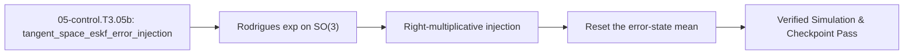

<!-- run-callout:start -->
> **Run this in the workbench.** [Open MechaLab on `EX.05-control.T3.05b`](https://tle47.github.io/Mechatronics-Roadmap/?lesson=EX.05-control.T3.05b) - Tab 2 opens with that entry selected, starter code, hints and graded check ready. This page is the reading copy, and nothing you type here is saved.
<!-- run-callout:end -->

## 1. Why it matters
An attitude filter cannot add a correction to a rotation matrix the way it adds a number to a scalar: $R + \delta$ is not a rotation. The Error-State Kalman Filter keeps its error in the 3-D **tangent space** $\delta\theta \in \mathbb{R}^3$, then folds that error into the nominal rotation with $R^+ = R^-\exp([\delta\hat{\theta}]_\times)$ and **resets the error-state mean to zero**, because the correction has just been consumed. Skip the reset and the same correction is applied again on the next update - the filter double-counts, and every determinant and orthogonality check still says the matrix is perfect. This is the second Track 05 Tier 3 bridge: `05-control.T3.05a` fixed the covariance, this module fixes the injection, and `05-control.T3.05c` adds the safety filter. Already know this? Take the Skip test in section 7 first.

## 2. Intuition first
You are steering with a compass that reads $2^\circ$ left of north. You do not bend the needle; you turn the wheel by that correction and then **write the correction off your to-do list**. If you left it on the list and turned again on the next reading - even a reading that says you are now dead on - you would drift another $2^\circ$, and another. The wheel is the nominal rotation, the note is the error-state mean, and the reset is the crossing-out. The tangent space is just the language the note is written in: a small rotation is described by an axis and an angle, and for small angles that is a plain 3-vector.

## 3. Formalization
1. **Rodrigues' Exponential:** For a rotation vector $\phi \in \mathbb{R}^3$ with $\theta = \|\phi\|$ and $[\phi]_\times$ its skew matrix,

$$
\exp([\phi]_\times) = I + \frac{\sin\theta}{\theta}[\phi]_\times + \frac{1 - \cos\theta}{\theta^2}[\phi]_\times^2
$$

   About $+z$ with $\theta = 0.05$ rad this is $\begin{bmatrix}\cos & -\sin & 0\\ \sin & \cos & 0\\ 0 & 0 & 1\end{bmatrix}$ with $\cos(0.05) = 0.998750$ and $\sin(0.05) = 0.049979$.
2. **Multiplicative Injection (right multiplication):** the posterior error is a **body-frame** step, so it multiplies on the right:

$$
R^+ = R^-\exp([\delta\hat{\theta}^+ ]_\times)
$$

   Left-multiplying by the same step is also a valid rotation, which is why orthogonality and determinant tests cannot tell the two apart; the difference appears as soon as $R^-$ is not the identity.
3. **The Reset:** the injection consumes the mean, so

$$
\delta\hat{\theta} \leftarrow 0_{3\times1}
$$

   and the next update starts from zero. With the reset, a $0.05$ rad correction followed by a **zero** innovation holds $0.05$ rad; without it the stale mean injects another $0.05$ and the frame reads $0.10$ rad. Two *non-zero* corrections of $0.05$ compose to $0.10$ either way - which is why the discriminating test must use a zero innovation, not two equal ones.

### Use & Understand
Reach for this the moment a filter's state is a rotation and its covariance lives in a vector: an IMU attitude estimate, a camera's pose, a joint frame fed by two encoders. You do not need the Lie-algebra derivation to use it - you need three habits, and each has a check you can run in one line.

- **Build the step with both coefficients.** $\exp([\phi]_\times) = I + \frac{\sin\theta}{\theta}[\phi]_\times + \frac{1-\cos\theta}{\theta^2}[\phi]_\times^2$, and use $\theta = 0.05$ rad about $+z$: the $(1,0)$ entry is $\sin(0.05) = 0.049979$ and $\det R = 1$ to $10^{-15}$. A determinant that is not exactly $1$ means the $K^2$ term was dropped, not that the angle is wrong.
- **Multiply on the right.** $R^+ = R^-\exp([\delta\hat{\theta}]_\times)$ puts the step in the body frame. The cheap check is a frame that does not commute: build the case from a $90^\circ$ rotation about $+x$, because a $+z$-only frame commutes and a left multiplication hides there.
- **Zero the mean after folding it in.** With the reset, a $0.05$ rad correction followed by a zero-innovation measurement holds $0.05$ rad (the entry stays $0.049979$); a real $0.02$ rad innovation then reaches $0.07$. Without the reset the zero innovation turns the frame again and it reads $0.10$ - a perfect rotation of the wrong pose.
- **Sanity checks that cost nothing.** Read the angle back with $\theta = \arccos((\operatorname{tr}R - 1)/2)$, confirm $R^\top R = I$, and confirm one encoder count is $2\pi/4096 = 0.0015339808$ rad and that injecting it leaves the determinant at $1$.

If the arm corrects in the wrong direction only when it is away from the origin, the injection is on the left; if every correction is applied twice, the reset is missing. Neither fault shows up in a determinant test.

### Derive & Extend
1. **Define the error where the correction lives.** Let $R$ be the true attitude and $\hat{R}$ the nominal one the filter carries. The body-frame error is defined by

$$
R = \hat{R}\,\exp\big([\delta\theta]_\times\big)
$$

   so $\delta\theta \in \mathbb{R}^3$ is the rotation that takes the nominal into the truth, expressed in the body frame. This is a definition, not a modelling choice.
2. **The update is the definition, rearranged.** A measurement produces a posterior error $\delta\hat{\theta}^+$; substituting it into the same definition with the new nominal gives $R^+ = \hat{R}\,\exp([\delta\hat{\theta}^+]_\times)$ at once. Nothing was approximated.
3. **Left multiplication is a different error.** If instead one writes $R = \exp([\delta\theta]_\times)\,\hat{R}$, the step is a *spatial* rotation, and the two agree only when they commute. Conjugating shows the difference exactly:

$$
\exp([\delta]_\times)\,\hat{R} = \hat{R}\,\exp\big([\hat{R}^\top \delta]_\times\big)
$$

   so the left form injects $\hat{R}^\top\delta$ into the body - the same magnitude, a rotated axis. At $\hat{R} = I$ the two coincide, which is why only a non-commuting frame exposes the fault.
4. **The reset follows from consuming the state.** After the injection the nominal *is* the posterior, so the error it already contains is zero. If the mean is not cleared, the next posterior $\delta'$ is applied to a nominal that has already absorbed $\delta\hat{\theta}^+$, and two equal steps about a common axis compose as $\exp([\delta]_\times)\exp([\delta]_\times) = \exp([2\delta]_\times)$: $0.10$ rad for $\delta = 0.05$.
5. **Check the algebra against the trace.** $\operatorname{tr}\exp([\theta \hat{n}]_\times) = 1 + 2\cos\theta$ for any unit axis, so $R^+$ from step 2 must read $\theta = 0.05$ rad back. That single identity catches a sign error, a missing term and a double count.

**Extend.** Take a measurement whose innovation is not zero and inject $\delta + Ke$ in one step. Expand both exponentials to second order and show that $\exp([a]_\times)\exp([b]_\times) \ne \exp([a+b]_\times)$ whenever $a \times b \ne 0$, with the leading error term $\tfrac12[a,b]$ - then compute that commutator for the module's two in-plane cases ($a = 0.05\hat{z}$, $b = 0.02\hat{z}$, which is zero, and $a = 0.05\hat{z}$, $b = 0.02\hat{x}$, which is not) and say which one a scalar-angle test can still catch.

## 4. Worked example
**Predict first (before you run it):** commit to four things before the block runs: (1) the two entries of `exp_so3([0, 0, 0.05])` that carry $\sin$ and $\cos$; (2) whether injecting the zero vector returns the nominal matrix exactly; (3) the angle left after a $0.05$ rad correction followed by a **zero-innovation** update - $0.05$ or $0.10$; (4) the angle after a real $0.02$ rad innovation follows it - $0.07$ or $0.12$. Two tells that a wrong answer is a mistake rather than a surprise: a determinant other than exactly $1$ means the exponential was truncated (the $K^2$ term is missing), and a zero-innovation result of $0.10$ is the missing reset, not a gain error.

Build the rotation, inject it, then run the reset the way a filter does: consume the correction, zero the mean, and take one more step.

```python
import math

import mechalab_plant as plant


def exp_so3(rotvec):
    w = [float(v) for v in rotvec]
    theta = math.sqrt(w[0] * w[0] + w[1] * w[1] + w[2] * w[2])
    k = [[0.0, -w[2], w[1]], [w[2], 0.0, -w[0]], [-w[1], w[0], 0.0]]
    k2 = [[sum(k[i][m] * k[m][j] for m in range(3)) for j in range(3)] for i in range(3)]
    if theta < 1e-8:
        a, b = 1.0, 0.5
    else:
        a, b = math.sin(theta) / theta, 2.0 * math.sin(0.5 * theta) ** 2 / (theta * theta)
    return [[(1.0 if i == j else 0.0) + a * k[i][j] + b * k2[i][j] for j in range(3)]
            for i in range(3)]


def inject(r_nominal, d_theta):
    step = exp_so3(d_theta)
    return [[sum(r_nominal[i][m] * step[m][j] for m in range(3)) for j in range(3)]
            for i in range(3)]


r = exp_so3([0.0, 0.0, 0.05])
det = (r[0][0] * (r[1][1] * r[2][2] - r[1][2] * r[2][1])
       - r[0][1] * (r[1][0] * r[2][2] - r[1][2] * r[2][0])
       + r[0][2] * (r[1][0] * r[2][1] - r[1][1] * r[2][0]))
held = inject(r, [0.0, 0.0, 0.0])          # reset the mean, zero innovation: hold 0.05
stepped = inject(r, [0.0, 0.0, 0.02])      # a real next innovation: 0.05 + 0.02
one_count = 2.0 * math.pi / plant.ENCODER_CPR

assert math.isclose(det, 1.0, rel_tol=1e-15)
assert math.isclose(held[1][0], math.sin(0.05), rel_tol=1e-15)
assert math.isclose(stepped[1][0], math.sin(0.07), rel_tol=1e-15)
assert math.isclose(one_count, 0.0015339807878856412, rel_tol=1e-15)
print(f"R00={r[0][0]:.5f}, R10={r[1][0]:.5f}, det={det:.6f}, "
      f"held={held[1][0]:.5f}, stepped={stepped[1][0]:.5f}, count={one_count:.10f}")
```
Expected output:
```text
R00=0.99875, R10=0.04998, det=1.000000, held=0.04998, stepped=0.06994, count=0.0015339808
```

## 5. Exercise
A joint's attitude update injects a posterior correction of $0.05$ rad about $+z$, resets the error-state mean, and then runs one more measurement whose innovation is exactly zero. Predicted angle: $0.05$ rad, not $0.10$. Then repeat with a real $0.02$ rad innovation and verify $0.07$ rad ($\pm 10^{-15}$ on the matrix entries). Finally, inject one encoder count of the shared $4096$-count encoder and confirm the result is still in $SO(3)$.
- **If your result differs:** A zero-innovation step that reads $0.10$ rad means the mean was never cleared; a real innovation that changes nothing means the update returned before applying it.

### Graded package - the correction, the reset and the retry
[`exercises/05-control.T3.05b/`](../exercises/05-control.T3.05b/) turns this section into a test. `starter.py` holds three holes: `exp_so3` (Rodrigues), `inject_rotation` ($R^-\exp([\delta\theta]_\times)$) and `eskf_rotation_update` (inject, reset, next step). Edit it, then run the tests the way CI does:

```bash
EXERCISE_TARGET=exercises/05-control.T3.05b/starter.py \
  python3 -m unittest discover -s exercises/05-control.T3.05b -p 'test_*.py'
```

**14 tests.** The rotation suite pins the worked $0.05$ rad entry about $+z$ and the $0.10$ rad step about $+x$ (the second is what catches a Rodrigues expansion that drops the $K^2$ term), checks the injection stays in $SO(3)$ with determinant $1$ and $R^\top R = I$, and checks that the step multiplies on the **right** - a case built from a $90^\circ$ frame, because a $+z$-only frame commutes and hides the fault. The reset suite is the one this module exists for: a $0.05$ rad correction followed by a zero innovation must hold $0.05$, the buggy stale-mean composition is asserted at $0.10$ so the two are visibly different, a real $0.02$ rad innovation must reach $0.07$, and a zero/zero update must return the identity unchanged. The transfer suite runs **the plant's encoder**: one count is $2\pi/4096 = 0.0015339808$ rad, its exponential has determinant $1$ to $10^{-15}$, injecting it turns the body by exactly one count (read back from the trace), and the reset does not swallow it. Five planted faults - `rotation_wrong_sign`, `rodrigues_drops_the_square_term`, `inject_multiplies_on_the_left`, `no_reset_double_counts`, `reset_drops_the_innovation` - each fail the test named for them.

- **📚 What to Learn & Resources to Solve This Exercise:**
  - **Required Foundations Modules (`00-foundations`):** [`00-foundations.T3.00a`](00-foundations.T3.00a.md) (SO(3) Hat/Vee Maps, Rodrigues' Formula & Hamiltonian Passivity) and Legacy **Step 3.1 (`00-foundations.T3.01`)** (*Van Loan ZOH & Lie Groups*).
  - **Prerequisite Bridge Module:** [`05-control.T3.05a`](05-control.T3.05a.md) (*Joseph-form covariance and NEES*).
  - **Core Concepts to Review First:** Rodrigues' exponential, right-multiplicative injection and the reset in `## 3. Formalization` (Items 1-3) and the zero-innovation comparison in `## 4. Worked example` above.
  - **Study Links & Resources:** [Joan Solà *Quaternion Kinematics for the Error-State Kalman Filter* (`arXiv:1711.02508`)](https://arxiv.org/abs/1711.02508) and [Track 05 Tier 3 (`05-control-and-estimation/README.md#tier-3-advanced--production`)](../05-control-and-estimation/README.md#tier-3-advanced--production) (**Tab 8**).

### Starter code
```python
# --- Exercise scaffold: fill in each TODO, then check against the numbers in the full solution ---
import math


def exp_so3(rotvec):
    """Rodrigues' formula for exp([rotvec]_x), returning a 3x3 list of lists."""
    # TODO 1: theta = |rotvec|; build the skew matrix K, then I + (sin t / t) K + ((1 - cos t) / t^2) K^2
    ...


def inject_rotation(r_nominal, d_theta):
    """R^+ = R^- exp([d_theta]_x): the correction multiplies the nominal rotation on the right."""
    # TODO 2: matrix-multiply r_nominal by exp_so3(d_theta) - order matters
    ...


def eskf_rotation_update(r_nominal, d_theta, innovation):
    """Inject d_theta, reset the error-state mean to zero, then apply the next innovation."""
    # TODO 3: inject, reset the mean to [0, 0, 0], then inject `innovation` - not d_theta again
    ...


print("scaffold ready: 3 TODOs to fill, then compare against the numbers in the full solution")
```

**Expected numbers (the answer):** a $0.05$ rad correction followed by a zero innovation holds $0.05$ rad (a stale mean composes to $0.10$); a real $0.02$ rad innovation reaches $0.07$ rad; one encoder count is $2\pi/4096 = 0.0015339808$ rad and its exponential has determinant $1$.

### Hint ladder
1. **The exponential's three coefficients.** With $\theta = |\delta\theta|$ the rotation is $I + \frac{\sin\theta}{\theta}K + \frac{1-\cos\theta}{\theta^2}K^2$; dropping the $K^2$ term makes a $0.10$ rad step about $+x$ land too small, which is what the package's second test measures.
2. **Why the injection is on the right.** $R^+ = R^-\exp([\delta\theta]_\times)$ perturbs the *body* frame. Building the case from a $90^\circ$ frame is what exposes a left-multiplication, because a pure $+z$ frame commutes and hides it.
3. **The reset is the exercise.** The injection has just consumed the posterior error, so the mean must go back to $[0, 0, 0]$ before the next measurement. Leave it set and a zero innovation applies the same $0.05$ rad a second time: the frame reads $0.10$ with the determinant still $1$ - a perfect rotation of the wrong pose.
4. **Reading the angle back.** $\operatorname{tr}R = 1 + 2\cos\theta$, so $\theta = \arccos((\operatorname{tr}R - 1)/2)$; one count is $2\pi/4096$, and $\det R = 1$ to $10^{-15}$ is the cheap $SO(3)$ check.

5. **What the suite refuses.** `exp_so3` and `inject_rotation` refuse a two-component correction: a rotation vector is three numbers, and a short one is a typo rather than a smaller rotation, so it raises `ValueError`. `inject_rotation` refuses a nominal rotation that is not $3 \times 3$ for the same reason - a $2 \times 2$ matrix is a different problem, not a smaller rotation, and a matrix multiply against it would index past its columns rather than answer.

### Full Solution
```python
import math


def _vector(value, length, name):
    """A plain list of floats of exactly `length` entries, or a ValueError naming the argument."""
    if not isinstance(value, (list, tuple)) or len(value) != length:
        raise ValueError("%s must be a %d-vector" % (name, length))
    return [float(item) for item in value]


def _matrix(value):
    """A 3x3 matrix as a list of three lists of three floats."""
    if not isinstance(value, (list, tuple)) or len(value) != 3:
        raise ValueError("a rotation is a 3x3 matrix")
    rows = []
    for row in value:
        if not isinstance(row, (list, tuple)) or len(row) != 3:
            raise ValueError("a rotation is a 3x3 matrix")
        rows.append([float(item) for item in row])
    return rows


def exp_so3(rotvec):
    """Rodrigues: exp([rotvec]_x), the rotation its axis-angle vector names."""
    w = _vector(rotvec, 3, "rotvec")
    theta = math.sqrt(w[0] * w[0] + w[1] * w[1] + w[2] * w[2])
    skew = [
        [0.0, -w[2], w[1]],
        [w[2], 0.0, -w[0]],
        [-w[1], w[0], 0.0],
    ]
    square = [
        [sum(skew[i][m] * skew[m][j] for m in range(3)) for j in range(3)]
        for i in range(3)
    ]
    if theta < 1e-8:
        # sin(theta)/theta -> 1 and (1 - cos theta)/theta^2 -> 1/2; the half-angle form keeps
        # the second coefficient exact instead of subtracting two numbers that are both 1.
        first, second = 1.0, 0.5
    else:
        first = math.sin(theta) / theta
        second = 2.0 * math.sin(0.5 * theta) ** 2 / (theta * theta)
    return [
        [(1.0 if i == j else 0.0) + first * skew[i][j] + second * square[i][j]
         for j in range(3)]
        for i in range(3)
    ]


def inject_rotation(r_nominal, d_theta):
    """R^+ = R^- exp([d_theta]_x): fold the posterior tangent-space error into the rotation."""
    r = _matrix(r_nominal)
    step = exp_so3(d_theta)
    return [
        [sum(r[i][m] * step[m][j] for m in range(3)) for j in range(3)]
        for i in range(3)
    ]


def eskf_rotation_update(r_nominal, d_theta, innovation):
    """One rotation step of the filter: inject, reset, then apply the next innovation.

    The reset is the whole point. `d_theta` is the *posterior* error that the injection has just
    consumed, so the error-state mean must go back to zero; a filter that leaves it set applies
    the same correction again on the next update, even one whose innovation is zero.
    """
    r_plus = inject_rotation(r_nominal, d_theta)
    # The injection consumed the posterior mean: reset the tangent error to zero first.
    error_mean = [0.0, 0.0, 0.0]
    r_next = inject_rotation(r_plus, error_mean)
    return inject_rotation(r_next, innovation)

def angle_of(r):
    return math.acos(max(-1.0, min(1.0, (r[0][0] + r[1][1] + r[2][2] - 1.0) / 2.0)))


def determinant(r):
    return (r[0][0] * (r[1][1] * r[2][2] - r[1][2] * r[2][1])
            - r[0][1] * (r[1][0] * r[2][2] - r[1][2] * r[2][0])
            + r[0][2] * (r[1][0] * r[2][1] - r[1][1] * r[2][0]))


identity = [[1.0, 0.0, 0.0], [0.0, 1.0, 0.0], [0.0, 0.0, 1.0]]
step = exp_so3([0.0, 0.0, 0.05])
held = eskf_rotation_update(identity, [0.0, 0.0, 0.05], [0.0, 0.0, 0.0])
real = eskf_rotation_update(identity, [0.0, 0.0, 0.05], [0.0, 0.0, 0.02])
count = 2.0 * math.pi / 4096.0
one_count = exp_so3([0.0, 0.0, count])

assert math.isclose(step[1][0], math.sin(0.05), abs_tol=1e-15)
assert math.isclose(determinant(step), 1.0, abs_tol=1e-15)
assert math.isclose(angle_of(held), 0.05, abs_tol=1e-12)
assert math.isclose(angle_of(real), 0.07, abs_tol=1e-12)
assert math.isclose(count, 0.0015339808, abs_tol=1e-10)
assert math.isclose(determinant(one_count), 1.0, abs_tol=1e-15)
print(f"R10={step[1][0]:.5f}, held={angle_of(held):.6f} rad, real={angle_of(real):.6f} rad, "
      f"count={count:.10f} rad, det={determinant(step):.6f}")
```

Printed: `R10=0.04998, held=0.050000 rad, real=0.070000 rad, count=0.0015339808 rad, det=1.000000`

### Break it on purpose
Inject the `## 8. Common mistakes` row about the missing reset, keeping the worked example's $0.05$ rad correction and its zero-innovation follow-up:
- **Inject:** inject the correction, then run the next update with a **zero innovation** while leaving the error-state mean set - a filter that patches the nominal rotation but never zeroes $\delta\hat{\theta}$.
- **Symptom:** the first update turns the frame $0.05$ rad as intended, but the zero-innovation update turns it another $0.05$: the frame ends at $0.10$ rad with the mean still reading $0.05$, while the determinant is $1.000000$ and $R^\top R = I$ in both steps - the matrices are perfect rotations of the wrong pose.
- **Diagnose:** two *non-zero* corrections of $0.05$ would legitimately compose to $0.10$ ($R_z(0.05)R_z(0.05) = R_z(0.10)$), so that test proves nothing. The discriminator is the zero innovation: with the reset, $\exp([0]_\times) = I$ and the frame holds; without it, the consumed $0.05$ goes in again. The determinant and the first step being correct rule out the exponential and the gain.
- **Fix:** reset the mean to zero immediately after injecting. The same pair then reads $0.049979$ on the second step (one count of $\sin(0.05)$), the $0.02$ rad innovation reaches $0.069943$, and the stale case stays at $0.10$ where the filter without the reset can be seen for what it is.

## 6. Simulation path
Open **Tab 8 (6-DOF Manifold Attitude ESKF on $SO(3)$)** in the MechaLab Workbench (`npm run dev`) and watch the nominal rotation move while the error-state mean returns to zero after each update, or run `05-control-and-estimation/lab/lab05_eskf_mpc_and_cbf.py`.

The graded package is also a workbench entry: **Modules -> `EX.05-control.T3.05b`**, where `selfcheck.py` is appended below the starter and **Verify** compares it against the instructor copy of the same self-check. `scripts/e2e_pages_bundle.mjs` drives it on the built bundle, so the browser path is tested, not assumed.

No hardware required for this module (`hardware_required: false`). In Step 3.6 (`05-control.T3.06`) this injection runs at $1\text{ kHz}$ between the IMU prediction and the next propagation:
```text
[IMU prediction] ---> [delta theta from K r] ---> [R+ = R exp([delta]x)] ---> [delta <- 0] ---> [next tick]
```
Pass/fail verification in simulation: `det(R+) == 1.000000`, `held == 0.049979` after the reset, `stepped == 0.069943` after a real innovation.

### Safety notes
> **No hardware required (`safety_level: none`):** the injection is exercised on the plant's model in the browser; nothing is energised.



## 7. Checkpoint
Pass criteria: run the worked example and the exercise asserts clean, or score $\ge 80\%$ ($4/4$) on the Skip test below and $\ge 80\%$ ($6/7$) on the ladder's Gate test.

### Skip test
<!-- skip-test:start -->
1. `[Recall] [Concept: tangent_space_eskf_error_injection]` Compute $\exp([0, 0, 0.05]_\times)_{10}$ - the $(1,0)$ entry, i.e. $\sin(0.05)$ - to $\pm 10^{-9}$.
2. `[Apply] [Concept: tangent_space_eskf_error_injection]` A filter injects a $0.05$ rad correction and then runs a measurement whose innovation is zero. What angle has the frame turned in total (tolerance $\pm 10^{-9}$ rad)?
3. `[Transfer] [Concept: tangent_space_eskf_error_injection]` The plant's encoder has $4096$ counts per revolution. Compute the tangent-space step of one count in radians (tolerance $\pm 10^{-12}$).
4. `[Spaced review -> 00-foundations.T3.00a — Concept: rodrigues_so3_se3_exp_log_maps] [Concept: tangent_space_eskf_error_injection]` Why does the ESKF multiply the correction on the right instead of adding it to the matrix?
   - **A.** Because the correction is a body-frame tangent step, and $R\exp([\delta]_\times)$ stays in $SO(3)$ while $R + \delta$ does not.
   - **B.** Because matrix addition is slower than multiplication.
   - **C.** Because the correction is always zero.
   - **D.** Because a rotation matrix has only three entries.

**Answer key:**
```python
import math

q1_sin = math.sin(0.05)
q2_held = 0.05
q3_count = 2.0 * math.pi / 4096.0

assert math.isclose(q1_sin, 0.049979169270678324, rel_tol=1e-12)
assert math.isclose(q2_held, 0.05, abs_tol=1e-12)
assert math.isclose(q3_count, 0.0015339807878856412, rel_tol=1e-12)

q4_choice = "A"
assert q4_choice == "A"
```
- **Pass mark:** $4/4$ ($80\%+$). If you missed Q1, study `## 3. Formalization` item 1; if you missed Q2, item 3; if you missed Q3, study `## 4. Worked example`; if you missed Q4, study `## 2. Intuition first`. On pass, proceed to `05-control.T3.05c`.
<!-- skip-test:end -->

### Gate test
Covers the complete Track 05 Tier 3 ladder ([`05-control.T3.05a`](05-control.T3.05a.md) $\to$ this module $\to$ [`05-control.T3.05c`](05-control.T3.05c.md)) before Step 3.6 (`05-control.T3.06`):
1. `[Concept: tangent_space_eskf_error_injection]` Compute the $(1,0)$ entry of $\exp([0, 0, 0.04]_\times)$, i.e. $\sin(0.04)$ (tolerance $\pm 10^{-12}$).
2. `[Concept: tangent_space_eskf_error_injection]` A filter injects a $0.03$ rad correction, resets the error-state mean, and then runs a measurement whose innovation is zero. What angle has the frame turned in total (tolerance $\pm 10^{-12}$ rad)?
3. `[Concept: tangent_space_eskf_error_injection]` One encoder count of the plant's $4096$-count encoder is $2\pi/4096$ rad. Compute that tangent-space step (tolerance $\pm 10^{-12}$ rad).
4. `[Concept: joseph_stabilized_covariance_update]` A scalar update has $P^- = 8.0$, $H = 1.0$, $R = 2.0$ and the optimal gain $K = 0.80$. Compute the Joseph posterior $(1 - KH)^2 P^- + K^2 R$ (tolerance $\pm 10^{-9}$).
5. `[Concept: joseph_stabilized_covariance_update]` Repeat the update of Q4 with a gain $K = 1.10$ instead. Compute the Joseph posterior (tolerance $\pm 10^{-9}$) - the naive $(1 - KH)P^-$ reads $-0.50$ here.
6. `[Concept: control_barrier_forward_invariance_qp]` At $h = 0.05\,\text{rad}$, $\alpha = 10.0\,\text{s}^{-1}$, $u_{\text{nom}} = +0.60\,\text{rad/s}$ and $u \in [-2, +2]\,\text{rad/s}$, what command does the CBF-QP return (tolerance $\pm 10^{-9}\,\text{rad/s}$)?
7. `[Concept: control_barrier_forward_invariance_qp]` At the same $h$ and $\alpha$, a retreat asks for $u_{\text{nom}} = -0.60\,\text{rad/s}$. What command does the filter return (tolerance $\pm 10^{-9}\,\text{rad/s}$)?

**Gate answer key:**
```python
import math

g1_sin = math.sin(0.04)
g2_held = 0.03
g3_count = 2.0 * math.pi / 4096.0
g4_p_joseph = ((1.0 - 0.80 * 1.0) ** 2) * 8.0 + (0.80 ** 2) * 2.0
g5_p_joseph_bad = ((1.0 - 1.10 * 1.0) ** 2) * 8.0 + (1.10 ** 2) * 2.0
g6_u = min(max(0.60, -2.0), min(2.0, 10.0 * 0.05))
g7_u_retreat = min(max(-0.60, -2.0), min(2.0, 10.0 * 0.05))

assert math.isclose(g1_sin, 0.03998933418663416, rel_tol=1e-12)
assert math.isclose(g2_held, 0.03, abs_tol=1e-12)
assert math.isclose(g3_count, 0.0015339807878856412, rel_tol=1e-12)
assert math.isclose(g4_p_joseph, 1.6, rel_tol=1e-9)
assert math.isclose(g5_p_joseph_bad, 0.08 + 2.42, rel_tol=1e-9)
assert math.isclose(g6_u, 0.50, rel_tol=1e-9)
assert math.isclose(g7_u_retreat, -0.60, rel_tol=1e-9)
```
- **Pass mark:** $\ge 80\%$ ($6/7$ on the Gate test). Missed Q1–Q3: study `05-control.T3.05b`; Q4–Q5: `05-control.T3.05a`; Q6–Q7: `05-control.T3.05c`.

## 8. Common mistakes
| Symptom | Root cause | 2-minute fix |
| :--- | :--- | :--- |
| Orientation drifts or jumps by double the expected correction on every camera update | Forgot to reset the tangent-space error after injecting $R^+ = R^-\exp([\delta\hat{\theta}]_\times)$. | Zero the error-state mean immediately after folding it into the nominal rotation. |
| The injection is orthogonal but the arm corrects in the wrong direction when it is not at the origin | Multiplied the step on the left ($\exp([\delta]_\times)R^-$) instead of the right. | The correction is a body-frame step: `r_nominal @ step`. |
| A large correction leaves a matrix that is not a rotation | Rodrigues implemented without the $\frac{1-\cos\theta}{\theta^2}[\phi]_\times^2$ term. | Use the half-angle form `2*sin(theta/2)**2/theta**2` so small angles stay exact. |

## 9. Resources
- **Joan Solà - [*Quaternion Kinematics for the Error-State Kalman Filter* (`arXiv:1711.02508`)](https://arxiv.org/abs/1711.02508):** the definitive treatment of injection and reset `[VERIFIED 2026-10-15]`.
- **Lynch & Park - [*Modern Robotics* (`modernrobotics.org`)](https://modernrobotics.org/) ([`resources/textbooks-and-papers.md`](../resources/textbooks-and-papers.md)):** the exponential coordinates of rotation `[VERIFIED 2026-10-15]`.
- **Track 05 Tier 3 ([`05-control-and-estimation/README.md`](../05-control-and-estimation/README.md#tier-3-advanced--production)):** where this injection sits in the control stack `[VERIFIED 2026-10-15]`.

## 10. Next modules
- Proceed to [`05-control.T3.05c`](05-control.T3.05c.md) (*Control Barrier Function QP Safety Filter*), then Step 3.6 (`05-control.T3.06`).
