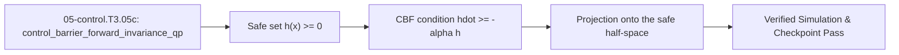

<!-- run-callout:start -->
> **Step 8 of 10 · Make it hold still: control**
>
> **Run this in the workbench.** [Open MechaLab with `EX.05-control.T3.05c` loaded](https://tle47.github.io/Mechatronics-Roadmap/?lesson=EX.05-control.T3.05c) - it opens on the **Run Python Lessons** tab with that entry selected. Starter code, hints and the graded check are ready; this page is the reading copy, and nothing you type here is saved.
<!-- run-callout:end -->

## 1. Why it matters
A controller that is fast and correct in free space can still drive a joint through its hard stop, because nothing in an LQR cost knows where the stop is. A **Control Barrier Function** turns "stay inside the safe set" into one linear inequality on the command, and the **CBF-QP** projects the nominal command onto it - minimally, so tracking is untouched until the constraint actually binds. This is the last of the three Track 05 Tier 3 bridges: `05-control.T3.05a` fixed the covariance, `05-control.T3.05b` fixed the injection, and this module adds the safety layer that runs between the nominal controller and the torque loop. Already know this? Take the Skip test in section 7 first.

## 2. Intuition first

<!-- figure: safety-filter | The filter returns the largest command that stays inside the safe set. -->

A guardrail at the edge of a road does not steer the car all the time; it only matters when you drift into it, and then it pushes exactly as hard as needed and no harder. That "only as hard as needed" is what **minimally invasive** means: when the nominal command already stays clear of the rail, the filter hands it back unchanged. The second half of the idea is **braking distance**: a heavy joint that is already moving cannot stop instantly, so the barrier must be applied to the margin you still have, not to zero.

## 3. Formalization
1. **Safe Set and Barrier Function:** for a state $x$ and constraint $x \le x_{\max}$, define

$$
h(x) = x_{\max} - x \ge 0
$$

   so $h$ is the margin left before the stop, in the constraint's own unit (metres or radians).
2. **Forward Invariance (the CBF Condition):** the set $\{h \ge 0\}$ is forward invariant if, for a class-$\mathcal{K}$ gain $\alpha > 0$,

$$
\dot{h}(x, u) \ge -\alpha h(x)
$$

   With $\dot{h} = -u$ (a velocity-controlled joint moving toward $x_{\max}$) this becomes $u \le \alpha h(x)$, which caps the command and leaves a retreat untouched.
3. **The 1D CBF-QP in Closed Form:** solving $\min_u \frac{1}{2}(u - u_{\text{nom}})^2$ subject to $u \le \alpha h$ and $u \in [u_{\min}, u_{\max}]$ gives the projection

$$
u^\ast = \min\big(\max(u_{\text{nom}}, u_{\min}),\ \min(u_{\max}, \alpha h)\big)
$$

   With $u_{\text{nom}} = 0.80\,\text{m/s}$, $h = 0.04\,\text{m}$ and $\alpha = 5.0\,\text{s}^{-1}$ the cap is $0.20\,\text{m/s}$ and $u^\ast = 0.20$; with $u_{\text{nom}} = -0.40$ and the same cap it is $-0.40$, untouched. The guaranteed margin under the condition is $h(t) \ge h_0e^{-\alpha t}$, so $h_0 = 0.20$ at $\alpha = 2.0$ is still $0.0736\,\text{m}$ after $0.50\,\text{s}$.

### Use & Understand
Reach for a CBF filter whenever a nominal controller is good at the task and ignorant of a hard limit: an LQR that does not know the hard stop, an MPC whose horizon is shorter than the braking distance, a learned policy with no model of the clamp. You add one inequality between the controller and the actuator and leave the controller alone.

- **Compute the ceiling, then clip.** With $\dot{h} = -u$ the condition $\dot{h} \ge -\alpha h$ is $u \le \alpha h$ - a ceiling. At $h = 0.04\,\text{m}$, $\alpha = 5.0\,\text{s}^{-1}$ it is $0.20\,\text{m/s}$, so a $0.80$ request comes out at $0.20$; at $h = 0.10\,\text{rad}$, $\alpha = 8.0$ it is $0.80$ against a $1.20$ request.
- **Check that a retreat is untouched.** At $h = 0.05$, $\alpha = 6.0$ the ceiling is $0.30$ and a $-0.40$ command passes through exactly: the filter only ever pushes one way.
- **Past the stop, expect a reversal, not a zero.** At $h = -0.05$ with $\alpha = 8.0$ the ceiling is $-0.40$: the filter commands a retreat that drives $h$ back up. A returned $0$ means the constraint was imposed as an equality, which is the bug to look for.
- **Know when to declare infeasible.** At $h = -0.50$ the ceiling is $-4.0$, below $u_{\min} = -2.0$; no admissible command exists, and the honest response is to raise and fall back to braking rather than clamp and silently disobey the barrier.
- **Check the margin decay.** $h(t) \ge h_0e^{-\alpha t}$: $h_0 = 0.20\,\text{m}$ at $\alpha = 2.0\,\text{s}^{-1}$ leaves $0.073576\,\text{m}$ after $0.50\,\text{s}$. On the shared shoulder a $1\,\text{ms}$ tick at the $2.5\,\text{N}\cdot\text{m}$ clamp removes $0.3125\,\text{rad/s}$ over $1.5625\times10^{-4}\,\text{rad}$, and a $1000\,\text{s}^{-1}$ barrier admits only $0.15625\,\text{rad/s}$ at that margin.

If the arm tracks perfectly in free space and overshoots the stop at full speed, the barrier term is missing from the return value. If a retreat changes but an approach does not, the inequality is a floor. If the filter raises the moment the joint gets fast, the barrier has the wrong relative degree.

### Derive & Extend
1. **Write the QP and its Lagrangian.** The filter solves $\min_u \tfrac12 (u - u_{\text{nom}})^2$ subject to $u - \alpha h \le 0$, $u_{\min} - u \le 0$ and $u - u_{\max} \le 0$. With multipliers $\lambda, \mu_1, \mu_2 \ge 0$,

$$
\mathcal{L} = \tfrac12 (u - u_{\text{nom}})^2 + \lambda (u - \alpha h) + \mu_1 (u_{\min} - u) + \mu_2 (u - u_{\max})
$$

2. **Stationarity gives the projection rule.** $\partial \mathcal{L}/\partial u = u - u_{\text{nom}} + \lambda - \mu_1 + \mu_2 = 0$. If no constraint is active, $\lambda = \mu_1 = \mu_2 = 0$ and $u^\ast = u_{\text{nom}}$. If only the barrier binds, $\lambda = u_{\text{nom}} - \alpha h > 0$ and $u^\ast = \alpha h$; if only the lower bound binds, $\mu_1 > 0$ and $u^\ast = u_{\min}$. Complementary slackness then says the solution is the *nearest admissible* value, which is the nested clip

$$
u^\ast = \min\big(\max(u_{\text{nom}}, u_{\min}),\ \min(u_{\max}, \alpha h)\big)
$$

3. **The barrier condition gives the exponential bound.** Let $v(t) = h(t)e^{\alpha t}$. Differentiating, $\dot{v} = e^{\alpha t}(\dot{h} + \alpha h) \ge 0$, so $v$ is non-decreasing and $h(t)e^{\alpha t} \ge h_0$ - that is $h(t) \ge h_0 e^{-\alpha t}$ by Grönwall's inequality in its simplest form. The set $\{h \ge 0\}$ is therefore forward invariant: a margin that starts non-negative can decay toward zero but never crosses it.
4. **Feasibility is a separate question.** The barrier and the actuator bound are both ceilings here, so the feasible interval is $[u_{\min}, \min(u_{\max}, \alpha h)]$, which is non-empty exactly when $\alpha h \ge u_{\min}$. When it is empty, the QP has no primal solution; the dual grows without bound, and no amount of clipping produces a command that satisfies both.

**Extend.** Take the infeasible case $\alpha h = -4.0$ with $u_{\min} = -2.0$ and show that the dual problem is unbounded, then replace the relative-degree-1 barrier with the stopping-distance form $h(q, \dot{q}) = (q_{\max} - q) - \frac{\dot{q}\lvert\dot{q}\rvert}{2a_{\max}}$, $a_{\max} = \tau_{\max}/J$. Compute the margin the plant's $2.5\,\text{N}\cdot\text{m}$ clamp over `I1` leaves at $\dot{q} = 0.3125\,\text{rad/s}$ and say why that barrier is feasible where the first one was not.

## 4. Worked example
**Predict first (before you run it):** commit to four numbers before the block runs: (1) the cap $\alpha h$ at $h = 0.04\,\text{m}$ and $\alpha = 5.0\,\text{s}^{-1}$, and whether a $0.80\,\text{m/s}$ request survives it; (2) $u^\ast$ for the exercise's $h = 0.10\,\text{rad}$ and $\alpha = 8.0\,\text{s}^{-1}$ against a $1.20\,\text{rad/s}$ request; (3) whether a $-0.40\,\text{rad/s}$ retreat at $h = 0.05\,\text{rad}$ is modified at all; (4) the margin left after $0.50\,\text{s}$ from $h_0 = 0.20\,\text{m}$ at $\alpha = 2.0\,\text{s}^{-1}$. Two tells that a wrong answer is a mistake rather than a surprise: a command *above* $\alpha h$ means the inequality was solved with the sign flipped, and a retreat that changes means the cap was applied as a floor.

Solve the filter for a joint approaching a wall, on the shared arm's own clamp numbers.

```python
import math

import mechalab_plant as plant


def cbf_command(u_nom, h_value, alpha, u_min=-2.0, u_max=2.0):
    upper = min(u_max, alpha * h_value)
    if upper < u_min:
        raise ValueError("infeasible: the barrier allows at most %r, below u_min %r"
                         % (upper, u_min))
    return min(max(u_nom, u_min), upper)


def barrier_lower_bound(h0, alpha, t):
    return h0 * math.exp(-alpha * t)


u_safe = cbf_command(0.80, 0.04, 5.0)                     # worked: 0.80 -> 0.20
u_ex = cbf_command(1.20, 0.10, 8.0, -2.0, 2.0)            # exercise: 1.20 -> 0.80
u_skip = cbf_command(0.80, 0.05, 6.0)                     # skip test: 0.80 -> 0.30
retreat = cbf_command(-0.40, 0.05, 6.0)                   # away from the stop: untouched
h_min = barrier_lower_bound(0.20, 2.0, 0.50)              # 0.20 * exp(-1)

# The plant's own numbers: a 1 ms tick is one time constant at alpha = 1/DT, and the 2.5 N*m
# clamp over I1 stops 0.3125 rad/s in one tick, a 1.5625e-4 rad stopping distance.
tick_margin = barrier_lower_bound(0.05, 1.0 / plant.DT, plant.DT)
accel = plant.TAU_LIMIT / plant.I1
stop_speed = accel * plant.DT

assert math.isclose(u_safe, 0.20, rel_tol=1e-12)
assert math.isclose(u_ex, 0.80, rel_tol=1e-12)
assert math.isclose(u_skip, 0.30, rel_tol=1e-12)
assert math.isclose(retreat, -0.40, rel_tol=1e-15)
assert math.isclose(h_min, 0.20 * math.exp(-1.0), rel_tol=1e-15)
assert math.isclose(tick_margin, 0.05 * math.exp(-1.0), rel_tol=1e-15)
assert math.isclose(accel, 312.5, rel_tol=1e-12)
assert math.isclose(stop_speed, 0.3125, rel_tol=1e-15)
print(f"u_safe={u_safe:.2f}, u_ex={u_ex:.2f}, u_skip={u_skip:.2f}, "
      f"retreat={retreat:.2f}, h_min={h_min:.6f}, tick_margin={tick_margin:.6f}")
```
Expected output:
```text
u_safe=0.20, u_ex=0.80, u_skip=0.30, retreat=-0.40, h_min=0.073576, tick_margin=0.018394
```

## 5. Exercise
A velocity-controlled joint approaches an upper limit $q_{\max} = 1.50\,\text{rad}$ from $q = 1.40\,\text{rad}$, with $h(q) = q_{\max} - q$, barrier gain $\alpha = 8.0\,\text{s}^{-1}$, nominal command $u_{\text{nom}} = +1.20\,\text{rad/s}$ and actuator bounds $u \in [-2.0, +2.0]\,\text{rad/s}$. Verify $h = 0.10\,\text{rad}$ and $u^\ast = 0.80\,\text{rad/s}$ ($\pm 10^{-9}$), then move the same joint past the stop to $h = -0.05$ and confirm the filter reverses the command to $-0.40\,\text{rad/s}$ instead of clamping it to zero.
- **If your result differs:** $u_{\text{nom}} = 1.20$ violates $u \le 8.0 \times 0.10 = 0.80$, so the closest admissible value is the boundary $0.80$; a result of $0.0$ means the constraint was applied as an equality instead of a one-sided cap.

### Graded package - the barrier, the bound and the infeasible case
[`exercises/05-control.T3.05c/`](../exercises/05-control.T3.05c/) turns this section into a test. `starter.py` holds two holes: `cbf_command` (the projection onto $u \le \alpha h$ and $[u_{\min}, u_{\max}]$) and `barrier_lower_bound` ($h_0e^{-\alpha t}$). Edit it, then run the tests the way CI does:

```bash
EXERCISE_TARGET=exercises/05-control.T3.05c/starter.py \
  python3 -m unittest discover -s exercises/05-control.T3.05c -p 'test_*.py'
```

**16 tests.** The filter must return $0.20$ at the worked wall, $0.80$ on the exercise and $0.30$ at the Skip test's margin, leave a $-0.40$ retreat untouched, pass a satisfied command through unmodified, honour the $\pm 2\,\text{rad/s}$ actuator bound even at a far wall, reverse past the stop ($h = -0.05$ at $8\,\text{s}^{-1}$ admits only $u \le -0.40$), and refuse an infeasible barrier ($h = -0.50$ needs $u \le -4.0$). The bound is checked at $0.20e^{-1}$, at $t = 0$ (the initial margin), and it must shrink monotonically; bad margins, gains and times are refused. The transfer suite runs **the plant's own shoulder**: its $1\,\text{ms}$ tick is exactly one time constant of a $1000\,\text{s}^{-1}$ barrier, a $0.05\,\text{rad}$ margin allows $50\,\text{rad/s}$ so a $0.50\,\text{rad/s}$ command passes untouched, and the $2.5\,\text{N}\cdot\text{m}$ clamp over `I1` removes $0.3125\,\text{rad/s}$ per tick - a $1.5625\times10^{-4}\,\text{rad}$ stopping distance at which the barrier admits only $0.15625\,\text{rad/s}$. Five planted faults - `cbf_ignores_barrier`, `cbf_limit_sign_flipped`, `barrier_bound_ignores_alpha`, `cbf_ignores_actuator_max`, `cbf_ignores_infeasibility` - each fail the test named for them.

- **📚 What to Learn & Resources to Solve This Exercise:**
  - **Required Foundations Modules (`00-foundations`):** [`00-foundations.T2.00f`](00-foundations.T2.00f.md) (*State-Space & Covariance*) and Legacy **Step 3.1 (`00-foundations.T3.01`)** (*Van Loan ZOH & Lie Groups*).
  - **Prerequisite Bridge Modules:** [`05-control.T3.05a`](05-control.T3.05a.md) (*Joseph-form covariance*) and [`05-control.T3.05b`](05-control.T3.05b.md) (*tangent-space injection and reset*).
  - **Core Concepts to Review First:** the safe set, the CBF condition $\dot{h} \ge -\alpha h$ and the closed-form projection in `## 3. Formalization` (Items 1-3) and the four commands in `## 4. Worked example` above.
  - **Study Links & Resources:** [Ames et al. *Control Barrier Functions: Theory and Applications* (`arXiv:1903.11199`)](https://arxiv.org/abs/1903.11199) and [Track 05 Tier 3 (`05-control-and-estimation/README.md#tier-3-advanced--production`)](../05-control-and-estimation/README.md#tier-3-advanced--production) (**Pendulum Balance & Safety Walls**).

### Starter code
```python
"""Exercise 05-control.T3.05c - your implementation.

Two holes, one per idea the module promised: the CBF-QP projection that caps a velocity command at
`alpha h` inside the actuator interval, and the exponential margin it guarantees afterwards.

Fill each one in, then run the tests the way CI does:

    EXERCISE_TARGET=exercises/05-control.T3.05c/starter.py \
      python3 -m unittest discover -s exercises/05-control.T3.05c -p 'test_*.py'
"""

import math


def cbf_command(u_nom, h_value, alpha, u_min=-2.0, u_max=2.0):
    """The command after the safety limit and the actuator bounds, as close to the request as both allow.

    The safety limit is an upper bound on the command. Refuse an empty admissible interval instead
    of clamping to nonsense.
    """
    raise NotImplementedError(
        "cbf_command: the command after the safety limit and the actuator bounds, or a refusal when nothing is admissible"
    )


def barrier_lower_bound(h0, alpha, t):
    """The margin the barrier guarantees at this time; with no decay it stays at its starting value."""
    raise NotImplementedError("barrier_lower_bound: the margin the barrier guarantees at this time")
```

**Expected numbers (the answer):** $h = 0.10$, $\alpha = 8.0$ caps $1.20$ at $0.80\,\text{rad/s}$; $h = -0.05$ reverses the command to $-0.40$; $h = -0.50$ admits only $-4.0$ and is infeasible; $h_0 = 0.20$ at $\alpha = 2.0$ is $0.073576\,\text{m}$ after $0.50\,\text{s}$; one tick removes $0.3125\,\text{rad/s}$ over $1.5625\times10^{-4}\,\text{rad}$.

### Hint ladder
1. **Sign of the inequality.** With $\dot{h} = -u$, the condition $\dot{h} \ge -\alpha h$ is $u \le \alpha h$ - a **ceiling**, not a floor. At $h = 0.10$, $\alpha = 8.0$ the ceiling is $0.80$, so the $1.20$ request lands exactly on it.
2. **Past the stop.** At $h = -0.05$ the ceiling is $-0.40$: the filter does not clamp to zero, it commands a retreat that drives $h$ back up. A result of $0$ means the constraint was imposed as an equality.
3. **The infeasible case.** At $h = -0.50$ the ceiling is $-4.0$, below $u_{\min} = -2.0$; there is no admissible command and clamping to $-2.0$ would silently disobey the barrier, so raise instead.
4. **Braking distance, on the plant.** $a = 2.5/0.008 = 312.5\,\text{rad/s}^2$, so one $1\,\text{ms}$ tick removes $0.3125\,\text{rad/s}$ over $\tfrac12 a\Delta t^2 = 1.5625\times10^{-4}\,\text{rad}$; at that margin a $1000\,\text{s}^{-1}$ barrier admits only $0.15625\,\text{rad/s}$.
5. **What the suite refuses.** `cbf_command` refuses the infeasible barrier (a ceiling below `u_min`, as at $h = -0.50$), a zero or negative barrier gain, and a window whose `u_min` is not below `u_max`; `barrier_lower_bound` refuses a negative margin, a non-positive gain and a negative time. All raise `ValueError` rather than clamping or extrapolating.

### Full Solution
```python
import math


def cbf_command(u_nom, h_value, alpha, u_min=-2.0, u_max=2.0):
    """The CBF-QP's closed form for `hdot = -u`: u <= alpha * h, clipped to the actuator bounds.

    The constraint is `hdot + alpha h >= 0`; with `hdot = -u` it is `u <= alpha h`. When the
    nominal command already satisfies it the projection returns it unchanged - that is what
    "minimally invasive" means.
    """
    if alpha <= 0.0:
        raise ValueError("the barrier gain must be positive")
    if u_min >= u_max:
        raise ValueError("the actuator bounds must leave an interval, not %r >= %r"
                         % (u_min, u_max))
    upper = min(u_max, alpha * h_value)
    if upper < u_min:
        raise ValueError("infeasible: the barrier allows at most %r, below u_min %r"
                         % (upper, u_min))
    return min(max(u_nom, u_min), upper)


def barrier_lower_bound(h0, alpha, t):
    """The guaranteed margin h(t) >= h0 exp(-alpha t) under the CBF condition, in the same unit."""
    if h0 < 0.0:
        raise ValueError("the initial margin is a distance, so it cannot be negative")
    if alpha <= 0.0:
        raise ValueError("the barrier gain must be positive")
    if t < 0.0:
        raise ValueError("time only runs forwards in this filter")
    return h0 * math.exp(-alpha * t)

def stopping_speed(tau_limit, inertia, dt):
    return (tau_limit / inertia) * dt


def stopping_distance(tau_limit, inertia, dt):
    return 0.5 * (tau_limit / inertia) * dt * dt


u_ex = cbf_command(1.20, 0.10, 8.0)
retreat = cbf_command(-0.40, 0.05, 6.0)
u_work = cbf_command(0.80, 0.04, 5.0)
h_min = barrier_lower_bound(0.20, 2.0, 0.50)
speed = stopping_speed(2.5, 0.008, 1e-3)
distance = stopping_distance(2.5, 0.008, 1e-3)
one_tick = cbf_command(speed, distance, 1.0 / 1e-3)

assert math.isclose(u_ex, 0.80, abs_tol=1e-9)
assert math.isclose(retreat, -0.40, abs_tol=1e-15)
assert math.isclose(u_work, 0.20, abs_tol=1e-12)
assert math.isclose(h_min, 0.20 * math.exp(-1.0), rel_tol=1e-12)
assert math.isclose(speed, 0.3125, abs_tol=1e-15)
assert math.isclose(distance, 1.5625e-4, rel_tol=1e-12)
assert math.isclose(one_tick, 0.15625, abs_tol=1e-12)
try:
    cbf_command(0.0, -0.50, 8.0)
except ValueError:
    infeasible = True
else:
    infeasible = False
assert infeasible
print(f"u_ex={u_ex:.2f}, retreat={retreat:.2f}, u_work={u_work:.2f}, h_min={h_min:.6f}, "
      f"one_tick={one_tick:.5f}, infeasible={infeasible}")
```

Printed: `u_ex=0.80, retreat=-0.40, u_work=0.20, h_min=0.073576, one_tick=0.15625, infeasible=True`

### Break it on purpose
Inject the `## 8. Common mistakes` row about ignoring the barrier, keeping the worked example's $u_{\text{nom}} = 0.80\,\text{m/s}$, $h = 0.04\,\text{m}$ and $\alpha = 5.0\,\text{s}^{-1}$:
- **Inject:** delete the cap - `return min(max(u_nom, u_min), u_max)` - so the filter is only an actuator clamp and the barrier inequality never enters.
- **Symptom:** the command reads $0.80\,\text{m/s}$ instead of $0.20$ at a wall $0.04\,\text{m}$ away, a $4\times$ overshoot that closes the gap in $0.05\,\text{s}$; the retreat case and the infeasible case look fine, because neither one touches the barrier.
- **Diagnose:** only the cases where the barrier binds are wrong, and they are wrong by exactly $u_{\text{nom}} - \alpha h = 0.60$, which is the constraint itself - so the gain, the bounds and the retreat path are all ruled out. A sign flip would instead *raise* the command beyond $\alpha h$ while also modifying the retreat, and the retreat is untouched here.
- **Fix:** restore `upper = min(u_max, alpha * h_value)` and return `min(max(u_nom, u_min), upper)`. The worked case then reads $0.20$, the exercise $0.80$, the retreat stays $-0.40$, and the plant's one-tick margin admits only $0.15625\,\text{rad/s}$ against a $0.3125\,\text{rad/s}$ approach.

## 6. Simulation path
Open **Swing-Up, LQR & Predictive Control Barrier Function QP** in the MechaLab Workbench (`npm run dev`) and watch the nominal command and the filtered command separate only as the joint nears its stop, or run `05-control-and-estimation/lab/lab05_eskf_mpc_and_cbf.py`.

The graded package is also a workbench entry: **Modules -> `EX.05-control.T3.05c`**, where `selfcheck.py` is appended below the starter and **Verify** compares it against the instructor copy of the same self-check. `scripts/e2e_pages_bundle.mjs` drives it on the built bundle, so the browser path is tested, not assumed.

No hardware required for this module (`hardware_required: false`). In Step 3.6 (`05-control.T3.06`) this QP runs at $1\text{-}2\,\text{kHz}$ between the nominal controller and the FOC torque loop:
```text
[Nominal LQR / MPC u_nom] ---> [CBF-QP: min ||u - u_nom||^2 s.t. hdot >= -alpha h] ---> [Safe torque]
```
Pass/fail verification in simulation: `u_safe == 0.20`, `u_ex == 0.80`, `retreat == -0.40`, and `h_min == 0.073576` at $0.50\,\text{s}$.

### Safety notes
> **No hardware required (`safety_level: none`):** the filter is exercised on the plant's model in the browser. On a real joint the same inequality is the last software layer before the torque clamp, so it is never the only safeguard.



## 7. Checkpoint
Pass criteria: run the worked example and the exercise asserts clean, or score $\ge 80\%$ ($4/5$) on the Skip test below.

### Skip test
<!-- skip-test:start -->
1. `[Recall] [Concept: control_barrier_forward_invariance_qp]` A joint at $q = 0.95\,\text{rad}$ approaches $q_{\max} = 1.00\,\text{rad}$ with $\alpha = 6.0\,\text{s}^{-1}$ and $u_{\text{nom}} = +0.80\,\text{rad/s}$. Compute $u^\ast$ (tolerance $\pm 10^{-9}\,\text{rad/s}$).
2. `[Apply] [Concept: control_barrier_forward_invariance_qp]` With the same margin and gain, what does the filter return for $u_{\text{nom}} = -0.40\,\text{rad/s}$ (moving away from the stop)?
3. `[Transfer] [Concept: control_barrier_forward_invariance_qp]` The guaranteed margin is $h_0e^{-\alpha t}$. Compute $h(0.50\,\text{s})$ from $h_0 = 0.20\,\text{m}$ at $\alpha = 2.0\,\text{s}^{-1}$ (tolerance $\pm 10^{-6}\,\text{m}$).
4. `[Concept: control_barrier_forward_invariance_qp]` Why is the CBF-QP called *minimally invasive*?
   - **A.** Because when the nominal command already satisfies $\dot{h} \ge -\alpha h$ the constraint is inactive and $u^\ast = u_{\text{nom}}$ exactly.
   - **B.** Because it turns the motors off near a wall.
   - **C.** Because it ignores the actuator limits.
   - **D.** Because it only runs at startup.
5. `[Spaced review -> 05-control.T3.05b — Concept: tangent_space_eskf_error_injection]` A tangent-space error $\delta\theta = 0.020\,\text{rad}$ about $z$ is injected into $R = I$ as $R \approx I + [\delta\theta]_\times$. Compute the $(0,1)$ entry of the result (tolerance $\pm 10^{-9}$).

**Answer key:**
```python
import math

q1_u_star = min(0.80, 6.0 * (1.00 - 0.95))
q2_u_away = min(-0.40, 6.0 * 0.05)
q3_h_min = 0.20 * math.exp(-2.0 * 0.50)
q4_choice = "A"

assert math.isclose(q1_u_star, 0.30, rel_tol=1e-9)
assert math.isclose(q2_u_away, -0.40, rel_tol=1e-9)
assert math.isclose(q3_h_min, 0.20 * math.exp(-1.0), rel_tol=1e-9)
assert q4_choice == "A"
q5_review = -0.020
assert math.isclose(q5_review, -0.02, rel_tol=1e-9, abs_tol=1e-09)
```
- **Pass mark:** $4/5$ ($80\%+$). If you missed Q1 or Q2, study `## 3. Formalization` item 3; if you missed Q3, item 2; if you missed Q4, study `## 2. Intuition first`. If you missed  Q5, review `05-control.T3.05b`. On pass, proceed to Step 3.6 (`05-control.T3.06`).
<!-- skip-test:end -->

### Gate test
This is the exit examination for the whole Track 05 Tier 3 ladder - the three bridges [`05-control.T3.05a`](05-control.T3.05a.md), [`05-control.T3.05b`](05-control.T3.05b.md) and this module - before Step 3.6 (`05-control.T3.06`).
1. `[Concept: joseph_stabilized_covariance_update]` A scalar filter has $P^- = 10.0$, $H = 1.0$, $R = 1.0$, and a bug sets $K = 1.20$. Compute the Joseph-form posterior $(1-KH)^2P^- + K^2R$ (tolerance $\pm 10^{-9}$).
2. `[Concept: joseph_stabilized_covariance_update]` Why is that form mandatory in a 32-bit navigation filter?
   - **A.** Because it is a sum of two positive semi-definite quadratic forms, so symmetry and non-negativity survive roundoff and suboptimal gains.
   - **B.** Because it avoids the measurement noise $R$.
   - **C.** Because it sets $P^+ = 0$ after one step.
   - **D.** Because it does not use $H$.
3. `[Concept: tangent_space_eskf_error_injection]` A $0.05$ rad correction is injected, the error-state mean is reset, and the next update carries a zero innovation. What angle has the frame turned in total (tolerance $\pm 10^{-9}$ rad)?
4. `[Concept: tangent_space_eskf_error_injection]` The plant's encoder resolves $2\pi/4096$ rad per count. Compute that tangent-space step (tolerance $\pm 10^{-12}$ rad).
5. `[Concept: control_barrier_forward_invariance_qp]` At $h = -0.05\,\text{rad}$, $\alpha = 8.0\,\text{s}^{-1}$ and $u_{\text{nom}} = 0$, what command does the filter return (tolerance $\pm 10^{-9}\,\text{rad/s}$)?
6. `[Concept: control_barrier_forward_invariance_qp]` At $h = -0.50\,\text{rad}$, $\alpha = 8.0\,\text{s}^{-1}$ and $u \in [-2, 2]$, is the QP feasible? Answer `True` or `False`.

**Gate answer key:**
```python
import math

g1_p_joseph = ((1.0 - 1.20 * 1.0) ** 2) * 10.0 + (1.20 ** 2) * 1.0
g2_choice = "A"
g3_angle = 0.05
g4_count = 2.0 * math.pi / 4096.0
g5_u = max(min(0.0, 8.0 * -0.05), -2.0)
g6_feasible = 8.0 * -0.50 >= -2.0

assert math.isclose(g1_p_joseph, 1.84, rel_tol=1e-9)
assert g2_choice == "A"
assert math.isclose(g3_angle, 0.05, rel_tol=1e-9)
assert math.isclose(g4_count, 0.0015339807878856412, rel_tol=1e-12)
assert math.isclose(g5_u, -0.40, rel_tol=1e-9)
assert g6_feasible is False
```
- **Pass mark:** $5/6$ ($80\%+$); on pass, proceed to Step 3.6 (`05-control.T3.06`).

## 8. Common mistakes
| Symptom | Root cause | 2-minute fix |
| :--- | :--- | :--- |
| The arm drives straight through its soft limit at full speed while every other behaviour looks normal | The barrier command is only an actuator clamp; $\alpha h$ never enters the return value. | Cap the command: `upper = min(u_max, alpha * h)`, then clip $u_{\text{nom}}$ into $[u_{\min}, upper]$. |
| A command moving *away* from the stop is modified, while one moving toward it is not | The inequality was applied as a floor ($u \ge \alpha h$) instead of a cap ($u \le \alpha h$). | With $\dot{h} = -u$, the condition $\dot{h} \ge -\alpha h$ becomes $u \le \alpha h$. |
| The QP raises an infeasibility error near the wall at high speed | A relative-degree-1 barrier on a second-order plant, or $\alpha$ too large for the available torque. | Use a stopping-distance barrier $h(q, \dot{q}) = (q_{\max} - q) - \frac{\dot{q}\lvert\dot{q}\rvert}{2a_{\max}}$ with $a_{\max} = \tau_{\max}/J$. |

## 9. Resources
- **Ames et al. - [*Control Barrier Functions: Theory and Applications* (`arXiv:1903.11199`)](https://arxiv.org/abs/1903.11199):** forward invariance, class-$\mathcal{K}$ gains and the QP formulation `[VERIFIED 2026-10-15]`.
- **Tedrake - [*Underactuated Robotics* (`underactuated.mit.edu`)](https://underactuated.mit.edu/):** barrier functions and safety filters in the control stack `[VERIFIED 2026-10-15]`.
- **Track 05 Tier 3 ([`05-control-and-estimation/README.md`](../05-control-and-estimation/README.md#tier-3-advanced--production)):** where the safety filter sits before the torque loop `[VERIFIED 2026-10-15]`.

## 10. Next modules

<!-- next-step:start -->
👉 **Next:** [Step 9 · Plan motion and bring it up safely — 07-systems.T2.07a: Regenerative Braking Shunt Choppers, CAN-FD CRC-16 + Rolling-Counter Watchdogs & SIL/HIL Fault Injection](07-systems.T2.07a.md)
<!-- next-step:end -->
