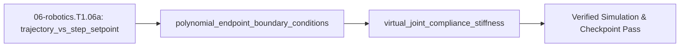

## 1. Why it matters
This is the bridge module before Step 1.7 (`06-robotics.T1.07`). Feeding an instantaneous step jump ($q_{\text{des}}: 0^\circ \to 90^\circ$ in $0\text{ s}$) into a robot arm controller demands infinite velocity and slams the actuator into saturation. Generating a smooth time-parameterized **trajectory** $q_d(t), \dot{q}_d(t), \ddot{q}_d(t)$ that starts and ends at zero velocity—and tracking it with a **virtual joint spring-damper** plus gravity feedforward—lets your arm glide smoothly and yield safely when touched. Already know this? Take the Skip test or the Ladder Gate test in section 7 first.

## 2. Intuition first
Imagine an elevator moving from Floor 1 to Floor 5 in $T = 2.0\text{ s}$. A **step setpoint** is teleporting the target indicator to Floor 5 at $t = 0.001\text{ s}$: the controller panics, sees a massive error, and yanks the cable at $100\%$ torque. A **smooth trajectory** is a moving ghost cab that accelerates gently from rest ($\dot{q}_d(0) = 0$), cruises smoothly through the middle, and decelerates to a feather-soft stop at Floor 5 ($\dot{q}_d(T) = 0$). Because we have four boundary conditions (start position, start velocity, end position, end velocity), a cubic polynomial $q_d(t) = a_0 + a_1 t + a_2 t^2 + a_3 t^3$ has the exact four knobs $(a_0, a_1, a_2, a_3)$ needed to satisfy all four! Then, instead of fighting external contact with an infinite-gain integrator, a **virtual joint spring-damper** $\tau = K_p(q_d - q) + K_d(\dot{q}_d - \dot{q}) + \tau_g(q)$ lets you dial the mechanical stiffness $K_p$ up for precision or down for soft human-safe compliance.

## 3. Formalization
1. **Step Setpoint vs. Time-Parameterized Trajectory:** A trajectory generator outputs continuous reference state $(q_d(t), \dot{q}_d(t), \ddot{q}_d(t))$ over $t \in [0, T]$ so tracking error $e(t) = q_d(t) - q(t)$ remains small throughout the move and never saturates the motor.
2. **Rest-to-Rest Cubic Polynomial Boundary Conditions:** Requiring $q_d(0) = q_0$, $\dot{q}_d(0) = 0$, $q_d(T) = q_f$, and $\dot{q}_d(T) = 0$ over duration $T$ ($\text{s}$) uniquely determines the cubic polynomial in normalized time $s = t/T \in [0, 1]$:

$$
q_d(t) = q_0 + \Delta q\left(3s^2 - 2s^3\right), \quad \dot{q}_d(t) = \frac{6\Delta q}{T}\left(s - s^2\right), \quad \ddot{q}_d(t) = \frac{6\Delta q}{T^2}\left(1 - 2s\right)
$$

   where $\Delta q = q_f - q_0$ ($\text{rad}$). At the midpoint $t = T/2$ ($s = 0.5$), position is halfway ($q_0 + 0.5\Delta q$), velocity reaches its peak $\dot{q}_{\max} = \frac{1.5\Delta q}{T}$, and acceleration passes through zero. Substituting $\Delta q = 1.0\text{ rad}$ and $T = 2.0\text{ s}$ gives $\dot{q}_{\max} = 0.75\text{ rad/s}$ and $|\ddot{q}(0)| = 1.5\text{ rad/s}^2$.
3. **Virtual Joint Compliance + Gravity Feedforward:** Commanding joint torque $\tau$ ($\text{N}\cdot\text{m}$) with stiffness $K_p$ ($\text{N}\cdot\text{m/rad}$) and damping $K_d$ ($\text{N}\cdot\text{m}\cdot\text{s/rad}$):

$$
\tau = K_p\left(q_d(t) - q\right) + K_d\left(\dot{q}_d(t) - \dot{q}\right) + \tau_g(q)
$$

   Under an external hand push torque $\tau_{\text{ext}}$ at rest ($\dot{q} = \dot{q}_d = 0$), the joint yields like a physical torsion spring by $\Delta q = \tau_{\text{ext}} / K_p$.

## 4. Worked example
**Predict first (before you run it):** The block sweeps $q_0 = 0.0\ \text{rad}$ to $q_f = 1.2\ \text{rad}$ in $T = 2.0\ \text{s}$, then computes the yield under a $\tau_{\text{ext}} = 0.50\ \text{N}\cdot\text{m}$ hand push with $K_p = 5.0\ \text{N}\cdot\text{m/rad}$. Before you run it, commit to three numbers: the position at the midpoint $t = 1.0\ \text{s}$, the peak speed of the move, and the angle the joint gives up to the push. Two tells that a wrong answer is a mistake rather than a surprise: the midpoint must be exactly half of $\Delta q$, since $3s^2 - 2s^3 = 0.5$ at $s = 0.5$, so a midpoint near a third means the cubic term was dropped; and the peak speed must be $1.5\times$ the average $\Delta q / T$, so a peak of $0.60\ \text{rad/s}$ means you divided by $T$ and lost the $1.5$.

Generate a rest-to-rest cubic trajectory from $q_0 = 0.0\text{ rad}$ to $q_f = 1.2\text{ rad}$ over $T = 2.0\text{ s}$, verify all four endpoint boundary conditions and the midpoint peak velocity, and compute the compliant deflection under a $\tau_{\text{ext}} = 0.50\text{ N}\cdot\text{m}$ hand push when $K_p = 5.0\text{ N}\cdot\text{m/rad}$.

```python
import math

def cubic_rest_to_rest(t: float, q0: float, qf: float, T: float) -> tuple[float, float, float]:
    s = max(0.0, min(1.0, t / T))
    dq = qf - q0
    q = q0 + dq * (3.0 * s**2 - 2.0 * s**3)
    qd = (6.0 * dq / T) * (s - s**2)
    qdd = (6.0 * dq / (T**2)) * (1.0 - 2.0 * s)
    return q, qd, qdd

q_start, qd_start, qdd_start = cubic_rest_to_rest(0.0, 0.0, 1.2, 2.0)
q_mid, qd_mid, qdd_mid = cubic_rest_to_rest(1.0, 0.0, 1.2, 2.0)
q_end, qd_end, qdd_end = cubic_rest_to_rest(2.0, 0.0, 1.2, 2.0)
deflection_rad = 0.50 / 5.0

assert math.isclose(q_start, 0.0, abs_tol=1e-9) and math.isclose(qd_start, 0.0, abs_tol=1e-9)
assert math.isclose(q_mid, 0.6, rel_tol=1e-9) and math.isclose(qd_mid, 0.9, rel_tol=1e-9)
assert math.isclose(qdd_mid, 0.0, abs_tol=1e-9)
assert math.isclose(q_end, 1.2, rel_tol=1e-9) and math.isclose(qd_end, 0.0, abs_tol=1e-9)
assert math.isclose(deflection_rad, 0.10, rel_tol=1e-9)
print(f"Midpoint: q={q_mid:.2f} rad, qd_max={qd_mid:.2f} rad/s, deflection={deflection_rad:.2f} rad")
```
Expected output:
```text
Midpoint: q=0.60 rad, qd_max=0.90 rad/s, deflection=0.10 rad
```

## 5. Exercise
Compute the minimum move duration $T_{\min}$ in seconds ($\text{s}$) required for a rest-to-rest cubic trajectory covering $\Delta q = 2.0\text{ rad}$ if the actuator's maximum speed is $\dot{q}_{\max} = 3.0\text{ rad/s}$ ($\dot{q}_{\max} = \frac{1.5\Delta q}{T_{\min}}$). Verify $T_{\min} = \frac{1.5 \times 2.0}{3.0} = 1.0\text{ s}$ and check that `cubic_rest_to_rest(0.5, 0.0, 2.0, 1.0)[1]` equals `3.0` $\text{rad/s}$.
- **If your result differs:** Recall that a cubic rest-to-rest profile has peak velocity $1.5\times$ the average velocity ($\frac{1.5\Delta q}{T}$, not $\frac{\Delta q}{T}$) because it spends the first and last halves accelerating and decelerating.

### Graded package - the moving ghost cab and the spring
[`exercises/06-robotics.T1.06a/`](../exercises/06-robotics.T1.06a/) turns this section into a test. `starter.py` holds seven holes: `cubic_rest_to_rest` (the clamped cubic, held still past $T$), `cubic_coefficients`, `peak_velocity`, `min_duration_s`, `min_duration_for_acceleration`, `spring_damper_torque` and `compliance_deflection`. Edit it, then run the tests the way CI does:

```bash
EXERCISE_TARGET=exercises/06-robotics.T1.06a/starter.py \
  python3 -m unittest discover -s exercises/06-robotics.T1.06a -p 'test_*.py'
```

**27 tests.** The cubic is checked at **all four** boundary conditions, at the midpoint, at $t > T$ (held still, not extrapolated) and across 101 samples for overshoot, so a parabola in $s$ fails on arrival speed; the coefficients are evaluated at three times and their endpoint derivatives must vanish; the peak is checked against $1.5\Delta q/T$; both duration limits are checked by substituting the duration back into the profile; the spring-damper is checked at the Gate test's numbers and with the damping acting only on velocity; and the compliance yield is checked against a stiffer spring. The transfer suite feeds the submission **the plant's own gains**: its spring-damper must equal `plant.pd_gravity_torque` at three states to $10^{-12}$, a cubic from the plant's current figure-8 pose must land on the next target with zero speed and a $1.5\Delta q/T$ peak, the $1\text{ kHz}$ step setpoint is shown to demand $1000\text{ rad/s}$ where the cubic peaks at $1.5$, and the yield must be the plant's static equilibrium $\tau/K_p$. Five planted faults - `cubic_s_squared_only`, `peak_is_average_speed`, `min_duration_uses_average`, `spring_damper_gain_swapped`, `deflection_times_stiffness` - each fail the test named for them.


- **📚 What to Learn & Resources to Solve This Exercise:**
  - **Required Foundations Modules (`00-foundations`):** [`00-foundations.T1.00a`](00-foundations.T1.00a.md) (*Functions & Loops*), [`00-foundations.T1.00d`](00-foundations.T1.00d.md) (*Cosine Gravity Projection*), and [`00-foundations.T1.00e`](00-foundations.T1.00e.md) (*Kinematics & Spring Energy*).
  - **Prerequisite Bridge Modules:** [`02-mechanics.T1.02a`](02-mechanics.T1.02a.md) (*2-Link Arm & Lever Torque*) and [`05-control.T1.05a`](05-control.T1.05a.md) (*PD Virtual Spring-Damper*).
  - **Core Concepts to Review First:** Rest-to-rest cubic polynomial interpolation $q(t) = q_0 + (3s^2 - 2s^3)\Delta q$ (peak velocity $\frac{3\Delta q}{2T}$), symmetric trapezoidal velocity profiles, and joint-space compliant PD + gravity compensation $\tau = K_p(q_d - q) - K_d\dot{q} + m g L_{\text{com}}\cos q$ in `## 3. Formalization` and `## 4. Worked example` above.
  - **Study Links & Resources:** [Lynch & Park *Modern Robotics* Ch. 9 (`hades.mech.northwestern.edu`)](https://hades.mech.northwestern.edu/index.php/Modern_Robotics) and [Track 06 Tier 1 (`06-robotics-and-autonomy/README.md`)](../06-robotics-and-autonomy/README.md#tier-1-beginner--intuitive).

### Starter code
```python
# --- Exercise scaffold: fill in each TODO, then check against the numbers in the full solution ---
import math


def cubic_rest_to_rest(t, q0, qf, T):
    """(q, qd, qdd) at time t for a rest-to-rest cubic."""
    # TODO: s = t/T clamped to [0, 1] through 3s^2 - 2s^3, and hold the final pose, still, once t > T (at exactly t = T the cubic still carries its terminal deceleration, -6 dq / T^2)
    ...


def cubic_coefficients(q0, qf, T):
    """(a0, a1, a2, a3) with zero endpoint velocities."""
    # TODO: a0 = q0, a1 = 0, a2 = 3dq/T^2, a3 = -2dq/T^3
    ...


def peak_velocity(dq, T):
    """Peak speed of a rest-to-rest cubic."""
    # TODO: 1.5x the average speed dq/T, not the average itself
    ...


def min_duration_s(dq, qd_max):
    """Shortest move inside a speed limit."""
    # TODO: solve 1.5|dq|/T = qd_max for T
    ...


def min_duration_for_acceleration(dq, qdd_max):
    """Shortest move inside an acceleration limit."""
    # TODO: the peak acceleration is 6|dq|/T^2 at the endpoints; solve for T
    ...


def spring_damper_torque(q_d, q, dq_d, dq, kp, kd, tau_g=0.0):
    """tau = kp (q_d - q) + kd (dq_d - dq) + tau_g."""
    # TODO: stiffness multiplies the POSITION error, damping the VELOCITY error
    ...


def compliance_deflection(tau_ext, kp):
    """Steady yield under a hand push."""
    # TODO: a stiffer spring yields less, so divide
    ...


print("scaffold ready: 7 TODOs to fill, then compare against the numbers in the full solution")
```

### Hint ladder
1. **The four coefficients.** $q(0) = q_0$ and $\dot{q}(0) = 0$ give $a_0 = q_0$, $a_1 = 0$; the two conditions at $t = T$ then give $a_2 = 3\Delta q/T^2$, $a_3 = -2\Delta q/T^3$. For the exercise's $\Delta q = 2.0\ \text{rad}$, $T = 1.0\ \text{s}$ that is $a_2 = 6.0$ and $a_3 = -4.0$, and $q(0.5) = 6(0.25) - 4(0.125) = 1.0\ \text{rad}$ - exactly halfway, as every rest-to-rest cubic is.
2. **Peak speed.** $\dot{q}_d = (6\Delta q/T)(s - s^2)$ is a parabola in $s$ with its maximum at $s = 0.5$, where it equals $(6\Delta q/T)(0.25) = 1.5\Delta q/T$. So the same move peaks at $3.0\ \text{rad/s}$, and the $3.0\ \text{rad/s}$ actuator limit is reached by $T_{\min} = 1.5 \times 2.0 / 3.0 = 1.0\ \text{s}$.
3. **When the limit is acceleration.** $|\ddot{q}_d|$ is largest at the endpoints, $\ddot{q}_d(0) = -\ddot{q}_d(T) = 6\Delta q/T^2$, so the duration is the square root, $T = \sqrt{6\Delta q/\ddot{q}_{\max}}$ - not $6\Delta q/\ddot{q}_{\max}$.
4. **Holding still, and the spring.** Clamping $s$ to $1$ returns $q_f$ with $\dot{q}_d = \ddot{q}_d = 0$; without the clamp $3s^2 - 2s^3$ turns over past $s = 1$ and the arm swings back through its start. For the torque, $K_p$ multiplies the position error and $K_d$ the velocity error, so a $0.80\ \text{N}\cdot\text{m}$ push against $K_p = 4.0\ \text{N}\cdot\text{m/rad}$ yields $0.20\ \text{rad}$.

5. **What the suite refuses.** `cubic_rest_to_rest` refuses a zero move duration; `min_duration_s` and `min_duration_for_acceleration` refuse a velocity or acceleration limit at or below zero; `spring_damper_torque` refuses a negative stiffness or damping gain; and `compliance_deflection` refuses a zero stiffness, which has no deflection to divide into. All raise `ValueError`.

### Full Solution
```python
import math

import mechalab_plant as plant  # noqa: F401  (kept so the submission imports what the module uses)


def cubic_rest_to_rest(t, q0, qf, T):
    """(q, qd, qdd) at time t for a rest-to-rest cubic; clamped to the endpoints outside [0, T]."""
    if T <= 0.0:
        raise ValueError("a move needs a positive duration")
    if t > T:
        return qf, 0.0, 0.0
    s = min(1.0, max(0.0, t / T))
    dq = qf - q0
    q = q0 + dq * (3.0 * s * s - 2.0 * s * s * s)
    qd = (6.0 * dq / T) * (s - s * s)
    qdd = (6.0 * dq / (T * T)) * (1.0 - 2.0 * s)
    return q, qd, qdd


def cubic_coefficients(q0, qf, T):
    """(a0, a1, a2, a3) of q(t) = a0 + a1 t + a2 t^2 + a3 t^3 with zero endpoint velocities."""
    if T <= 0.0:
        raise ValueError("a move needs a positive duration")
    dq = qf - q0
    return q0, 0.0, 3.0 * dq / (T * T), -2.0 * dq / (T * T * T)


def peak_velocity(dq, T):
    """Peak speed of a rest-to-rest cubic: 1.5 * dq / T."""
    if T <= 0.0:
        raise ValueError("a move needs a positive duration")
    return 1.5 * dq / T


def min_duration_s(dq, qd_max):
    """Shortest move whose peak speed stays inside the actuator's limit."""
    if qd_max <= 0.0:
        raise ValueError("a speed limit must be positive")
    return 1.5 * abs(dq) / qd_max


def min_duration_for_acceleration(dq, qdd_max):
    """Shortest move whose peak acceleration 6|dq|/T^2 stays inside the actuator's limit."""
    if qdd_max <= 0.0:
        raise ValueError("an acceleration limit must be positive")
    return math.sqrt(6.0 * abs(dq) / qdd_max)


def spring_damper_torque(q_d, q, dq_d, dq, kp, kd, tau_g=0.0):
    """tau = kp (q_d - q) + kd (dq_d - dq) + tau_g."""
    if kp < 0.0 or kd < 0.0:
        raise ValueError("stiffness and damping cannot be negative")
    return kp * (q_d - q) + kd * (dq_d - dq) + tau_g


def compliance_deflection(tau_ext, kp):
    """Steady yield under a hand push at rest: tau_ext / kp."""
    if kp <= 0.0:
        raise ValueError("a spring needs positive stiffness")
    return tau_ext / kp


# No `__main__` block on purpose: the browser grades this file's stdout against the appended
# self-check's single PASS line, and a second print here would be a mismatch for a correct answer.

q_mid, qd_mid, qdd_mid = cubic_rest_to_rest(0.5, 0.0, 2.0, 1.0)
q_held, qd_held, _ = cubic_rest_to_rest(1.5, 0.0, 2.0, 1.0)
T_min = min_duration_s(2.0, 3.0)
T_acc = min_duration_for_acceleration(2.0, 12.0)
tau = spring_damper_torque(0.8, 0.7, 0.5, 0.2, 10.0, 1.0, 0.4)
yield_rad = compliance_deflection(0.80, 4.0)

assert math.isclose(q_mid, 1.0, rel_tol=1e-12) and math.isclose(qd_mid, 3.0, rel_tol=1e-12)
assert math.isclose(qdd_mid, 0.0, abs_tol=1e-12)
assert math.isclose(q_held, 2.0, rel_tol=1e-12) and math.isclose(qd_held, 0.0, abs_tol=1e-12)
assert math.isclose(T_min, 1.0, rel_tol=1e-12) and math.isclose(T_acc, 1.0, rel_tol=1e-12)
assert math.isclose(peak_velocity(2.0, 1.0), 3.0, rel_tol=1e-12)
assert cubic_coefficients(0.0, 2.0, 1.0) == (0.0, 0.0, 6.0, -4.0)
assert math.isclose(tau, 1.7, rel_tol=1e-12) and math.isclose(yield_rad, 0.20, rel_tol=1e-12)

print(f"T_min={T_min:.3f} s | q(T/2)={q_mid:.4f} rad, qd_max={qd_mid:.4f} rad/s | "
      f"tau={tau:.3f} N*m | yield={yield_rad:.4f} rad")

```
Printed: `T_min=1.000 s | q(T/2)=1.0000 rad, qd_max=3.0000 rad/s | tau=1.700 N*m | yield=0.2000 rad`

**On the shared arm.** The Transfer suite checks this spring against the plant's own shipped PD+gravity law, term for term, at the plant's gains:

```python
import mechalab_plant as plant

q, dq, q_des, dq_des = (0.4, -0.7), (0.2, -0.3), (0.5, 0.3), (0.1, 0.0)
tau_plant = plant.pd_gravity_torque(q, dq, q_des, dq_des, limit=1e9)
tau_g = plant.gravity_torque(*q)
tau_mine = (plant.KP1 * (q_des[0] - q[0]) + plant.KD1 * (dq_des[0] - dq[0]) + tau_g[0],
            plant.KP2 * (q_des[1] - q[1]) + plant.KD2 * (dq_des[1] - dq[1]) + tau_g[1])

assert abs(tau_mine[0] - tau_plant[0]) < 1e-9
assert abs(tau_mine[1] - tau_plant[1]) < 1e-9
print("plant PD+gravity=(%.4f, %.4f) N*m = spring+damping+feedforward" % tau_plant)
```

### Break it on purpose
- **Inject:** delete the clamp inside `cubic_rest_to_rest` so it reads `s = t / T`, and evaluate the $T = 2.0\ \text{s}$ profile half a second past arrival, at $t = 3.0\ \text{s}$.
- **Symptom:** the arm is no longer at $q_f = 1.2\ \text{rad}$: with $s = 1.5$, $3s^2 - 2s^3 = 6.75 - 6.75 = 0$, so the position reads $0.0\ \text{rad}$ and the velocity $(6 \times 1.2 / 2)(1.5 - 2.25) = -2.7\ \text{rad/s}$ — it swings back through the start at speed instead of holding still.
- **Diagnose:** every sample up to $t = 2.0\ \text{s}$ still matches the worked example (midpoint $0.60\ \text{rad}$, peak $0.90\ \text{rad/s}$), so the coefficients and the gains are right and only the region $t > T$ is wrong; $3s^2 - 2s^3$ stops being monotone past $s = 1$, which localises the fault to the missing clamp rather than to the spring.
- **Fix:** clamp `s = max(0.0, min(1.0, t / T))`, then re-check the same sample: at $t = 3.0\ \text{s}$ the profile holds $q = 1.2\ \text{rad}$ with $\dot{q}_d = 0.0\ \text{rad/s}$, and the midpoint and peak values are unchanged.

## 6. Simulation path
Open **Tab 5 (URDF / MuJoCo & STO)** in the MechaLab Workbench (`npm run dev`) to compare step setpoints against cubic, trapezoidal, and minimum-jerk profiles interactively.

The graded package is also a workbench entry: **Modules -> `EX.06-robotics.T1.06a`**, where `selfcheck.py` is appended below the starter and **Verify** compares its `SELF-CHECK PASS:` line. `scripts/e2e_pages_bundle.mjs` drives it on the built bundle, so the browser path is tested, not assumed.

No hardware required for this module (`hardware_required: false`). In Step 1.7 (`06-robotics.T1.07`), `cubic_rest_to_rest(t, q0, qf, T)` runs at $1\text{ kHz}$ on the microcontroller to feed $(q_d(t), \dot{q}_d(t))$ into the joint PD + gravity compensation loop:
```text
[1 kHz Clock t] ---> [Cubic Trajectory q_d(t), qd_d(t)] ---> [PD Spring-Damper + tau_g(q)] ---> [Actuator]
```
Pass/fail verification in simulation: `qd_start == 0.0`, `qd_end == 0.0`, `qd_mid == 0.90 rad/s`, and `deflection_rad == 0.10 rad`.




## 7. Checkpoint
Pass criteria: score $\ge 80\%$ ($4/4$) on the Skip test or score $\ge 80\%$ ($7/8$) on the Ladder Gate test below to unlock Step 1.7 (`06-robotics.T1.07`).

### Skip test
1. `[Recall] [Concept: polynomial_endpoint_boundary_conditions]` For a rest-to-rest cubic trajectory from $q_0 = 0.0\text{ rad}$ to $q_f = 2.0\text{ rad}$ in $T = 4.0\text{ s}$, compute the midpoint position $q_d(2.0)$ in $\text{rad}$ and peak velocity $\dot{q}_d(2.0) = \frac{1.5\Delta q}{T}$ in $\text{rad/s}$ (tolerance $\pm 10^{-9}$).
2. `[Apply] [Concept: polynomial_endpoint_boundary_conditions]` Compute the initial acceleration $\ddot{q}_d(0) = \frac{6\Delta q}{T^2}$ in $\text{rad/s}^2$ (tolerance $\pm 10^{-9}$) for $\Delta q = 2.0\text{ rad}$ and $T = 2.0\text{ s}$.
3. `[Transfer] [Concept: virtual_joint_compliance_stiffness]` A compliant joint controller $\tau = K_p(q_d - q) - K_d\dot{q} + \tau_g(q)$ with $K_p = 4.0\text{ N}\cdot\text{m/rad}$ is pushed by an external human hand torque of $\tau_{\text{ext}} = 0.80\text{ N}\cdot\text{m}$ at rest. By what angle $\Delta q = \tau_{\text{ext}} / K_p$ in radians (tolerance $\pm 10^{-9}$) does the joint yield?
4. `[Spaced review -> 02-mechanics.T1.03 — Concept: discrete_pid_controller] [Concept: trajectory_vs_step_setpoint]` Why do collaborative robots omit the integral term ($K_i = 0$, using PD + gravity feedforward instead) when operating in compliant human-interaction mode?
   - **A.** Because $K_i$ is difficult to program in C.
   - **B.** Because if a human pushes and holds the arm away from $q_d$, an integral term would wind up to maximum stall torque fighting the human, whereas PD + gravity feedforward yields like a gentle mechanical spring!
   - **C.** Because gravity feedforward eliminates inertia.
   - **D.** Because cubic trajectories have zero velocity everywhere.

**Answer key:**
```python
import math

q1_pos_mid = 1.0
q1_vel_max = 1.5 * 2.0 / 4.0
q2_acc_0 = 6.0 * 2.0 / (2.0 ** 2)
q3_deflection = 0.80 / 4.0
q4_choice = "B"

assert math.isclose(q1_pos_mid, 1.0, rel_tol=1e-9)
assert math.isclose(q1_vel_max, 0.75, rel_tol=1e-9)
assert math.isclose(q2_acc_0, 3.0, rel_tol=1e-9)
assert math.isclose(q3_deflection, 0.20, rel_tol=1e-9)
assert q4_choice == "B"
```
- **Pass mark:** $4/4$ ($80\%+$). If you missed Q1 or Q2, study `## 3. Formalization` item 2; Q3 or Q4, study `## 3. Formalization` item 1 & 3. On pass, proceed to `## 10. Next modules`.
### Gate test
Covers the complete Track 06 Tier 1 bridge ladder (`06-robotics.T1.06a`) before Step 1.7 (`06-robotics.T1.07`):
1. `[Concept: trajectory_vs_step_setpoint]` What is the initial tracking error $e(0) = q_d(0) - q(0)$ at $t = 0\text{ s}$ when a rest-to-rest trajectory starts from the robot's current position $q(0) = q_0$ (tolerance $\pm 10^{-9}$)?
2. `[Concept: polynomial_endpoint_boundary_conditions]` How many independent boundary conditions $(q(0), \dot{q}(0), q(T), \dot{q}(T))$ does a cubic polynomial $a_0 + a_1 t + a_2 t^2 + a_3 t^3$ satisfy?
3. `[Concept: polynomial_endpoint_boundary_conditions]` Compute $q_d(t)$ at $s = t/T = 0.25$ for $q_0 = 0.0\text{ rad}$ and $q_f = 1.0\text{ rad}$ using $q_d = q_0 + \Delta q(3s^2 - 2s^3)$ (tolerance $\pm 10^{-9}$).
4. `[Concept: polynomial_endpoint_boundary_conditions]` Compute the final velocity $\dot{q}_d(T)$ in $\text{rad/s}$ at $s = 1.0$ for any rest-to-rest cubic polynomial (tolerance $\pm 10^{-9}$).
5. `[Concept: polynomial_endpoint_boundary_conditions]` Compute the terminal deceleration $\ddot{q}_d(T) = -\frac{6\Delta q}{T^2}$ in $\text{rad/s}^2$ (tolerance $\pm 10^{-9}$) for $\Delta q = 1.5\text{ rad}$ and $T = 3.0\text{ s}$.
6. `[Concept: virtual_joint_compliance_stiffness]` Compute the commanded joint torque $\tau = K_p(q_d - q) + K_d(\dot{q}_d - \dot{q}) + \tau_g$ in $\text{N}\cdot\text{m}$ (tolerance $\pm 10^{-9}$) given $K_p = 10.0, K_d = 1.0, q_d = 0.8\text{ rad}, q = 0.7\text{ rad}, \dot{q}_d = 0.5\text{ rad/s}, \dot{q} = 0.2\text{ rad/s}$, and $\tau_g = 0.4\text{ N}\cdot\text{m}$.
7. `[Concept: virtual_joint_compliance_stiffness]` If you reduce virtual stiffness $K_p$ from $20.0\text{ N}\cdot\text{m/rad}$ to $2.0\text{ N}\cdot\text{m/rad}$ while keeping gravity feedforward $\tau_g(q)$ active, how does the arm feel when pushed by hand?
   - **A.** Ten times softer (compliant and backdrivable) while still floating weightlessly against gravity.
   - **B.** Ten times stiffer.
   - **C.** It drops to the table because gravity feedforward is disabled.
   - **D.** It spins at constant speed.
8. `[Concept: polynomial_endpoint_boundary_conditions]` Why does a cubic polynomial have a discontinuous step jump in acceleration $\ddot{q}_d(0^+) = \frac{6\Delta q}{T^2} \ne 0$ at $t=0$ (infinite jerk), motivating 5th-order polynomials or S-curves in Tier 2?
   - **A.** Because a cubic has only 4 coefficients, which are all used up matching position and velocity at $t=0$ and $t=T$, leaving no free parameters to force $\ddot{q}_d(0) = \ddot{q}_d(T) = 0$.
   - **B.** Because $3s^2 - 2s^3$ is not differentiable.
   - **C.** Because time $T$ is negative.
   - **D.** Because velocity is discontinuous at $t=0$.

**Gate answer key:**
```python
import math

g1_e0 = 0.0
g2_n_cond = 4
s = 0.25
g3_q025 = 3.0 * (s ** 2) - 2.0 * (s ** 3)
g4_qd_end = 0.0
g5_qdd_end = -6.0 * 1.5 / (3.0 ** 2)
g6_tau = 10.0 * (0.8 - 0.7) + 1.0 * (0.5 - 0.2) + 0.4
g7_choice = "A"
g8_choice = "A"

assert math.isclose(g1_e0, 0.0, abs_tol=1e-9)
assert g2_n_cond == 4
assert math.isclose(g3_q025, 0.15625, rel_tol=1e-9)
assert math.isclose(g4_qd_end, 0.0, abs_tol=1e-9)
assert math.isclose(g5_qdd_end, -1.0, rel_tol=1e-9)
assert math.isclose(g6_tau, 1.7, rel_tol=1e-9)
assert g7_choice == "A"
assert g8_choice == "A"
```
- **Pass mark:** $7/8$ ($80\%+$). Remediation: Q1 $\to$ `## 3. Formalization` item 1; Q2–Q5, Q8 $\to$ `## 3. Formalization` item 2; Q6–Q7 $\to$ `## 3. Formalization` item 3.

## 8. Common mistakes
| Symptom | Root cause | 2-minute fix |
| :--- | :--- | :--- |
| Arm lurches violently at $t=0$ when starting a trajectory | Initialized $q_0$ to `0.0` instead of reading the encoder's *actual* current angle `q_actual` at the start of the move. | Always latch `q0 = read_encoder_rad()` at $t = 0$ so initial tracking error $q_d(0) - q(0)$ is strictly zero. |
| Position overshoots or runs away after $t > T$ | Evaluated $3s^2 - 2s^3$ for $s = t/T > 1.0$ without clamping $s \in [0, 1]$. | Clamp `s = min(1.0, max(0.0, t / T))` and set $\dot{q}_d = \ddot{q}_d = 0$ for $t > T$ - at exactly $t = T$ the cubic itself is still the reference, with $\ddot{q}_d = -6\Delta q/T^2$. |
| Compliant arm sags when $K_p$ is lowered | Omitted the gravity feedforward term $\tau_g(q)$ in $\tau = K_p(q_d - q) + K_d(\dot{q}_d - \dot{q}) + \tau_g(q)$. | Add model-based gravity compensation $\tau_g(q)$ so $K_p$ only handles tracking stiffness, not static weight support. |

## 9. Resources
- **Kevin Lynch & Frank Park — *Modern Robotics* (`modernrobotics.org`, Ch. 9 Trajectory Generation, `resources/textbooks-and-papers.md`):** Free textbook + video lectures on polynomial and trapezoidal time scaling `[VERIFIED 2026-10-15]`.
- **Track 06 (`06-robotics-and-autonomy/README.md`):** Directly continues into Step 1.7 (`06-robotics.T1.07`) `[VERIFIED 2026-10-15]`.
## 10. Next modules
- Proceed to legacy **Step 1.7 (`06-robotics.T1.07`)** in [`06-robotics-and-autonomy/README.md`](../06-robotics-and-autonomy/README.md#tier-1-beginner--intuitive).
