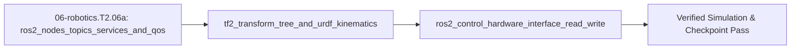

## 1. Why it matters
This is the dedicated **ROS 2 bridge module** before Step 2.7 (`06-robotics.T2.07`) and your gateway to the Graduate Goal (building and tuning a custom robot arm with ROS 2 and a learned policy). Before running Cartesian impedance controllers (`06-robotics.T2.07`), `MoveIt 2`, or `Hugging Face LeRobot` policies (`06-robotics.T3.07`), you must master the complete **ROS 2 (`Jazzy` / `Lyrical`)** architecture: how **Nodes** and **Executors** (`SingleThreadedExecutor` vs. `MultiThreadedExecutor` + `CallbackGroups`) schedule callbacks, how **Topics**, **Services**, **Actions**, and **Parameters** exchange typed messages under strict **QoS** rules (`Reliable` vs. `Best-Effort`, `Transient Local` vs. `Volatile`), how workspaces are built (`package.xml`, `colcon build`, Python `LaunchDescription`), how the **`tf2` transform tree** chains 3D coordinate frames (`world -> base_link -> link_1 -> tool0`) from your **URDF/Xacro** robot description, and how **`ros2_control`** separates real-time hardware drivers (`SystemInterface::read()` / `write()`) from controllers (`joint_trajectory_controller`) without DDS network jitter! Already know this? Take the Skip test in section 7 first.

## 2. Intuition first
Imagine a robot software stack as a modern airport:
- **ROS 2 Nodes, Executors & Callback Groups:** Each **Node** (`rclcpp::Node` / `rclpy.node.Node`) is a modular specialist team (Camera Node, Planner Node, Safety Monitor Node). An **Executor** is the dispatcher that pulls incoming events (timers, topic messages, service requests) from the DDS middleware queue and runs your callback functions. A `SingleThreadedExecutor` runs one callback at a time sequentially (if one callback blocks for $200\text{ ms}$, every timer in that node stalls!), whereas a `MultiThreadedExecutor` paired with `MutuallyExclusiveCallbackGroup` or `ReentrantCallbackGroup` lets a slow planning service run on Thread B without delaying a $100\text{ Hz}$ state-publishing timer on Thread A.
- **Topics, Services, Actions & Parameters:**
  - **Topics (Publish / Subscribe):** Continuous radio broadcast streams (`sensor_msgs/msg/JointState`, `geometry_msgs/msg/Twist`) governed by **Quality of Service (QoS)**: high-rate camera/IMU streams use `Best-Effort / Volatile / KeepLast(1)` (drop an old frame rather than stall on a retry), whereas latched maps and robot descriptions (`/robot_description`) use `Reliable / Transient Local`.
  - **Services (`srv`):** Fast synchronous request-reply calls (`std_srvs/srv/SetBool` to zero a force sensor—never use for long blocking motions!).
  - **Actions (`action`):** Long-running preemptible state machines (`control_msgs/action/FollowJointTrajectory`) consisting of a **Goal** request, a continuous **Feedback** stream (percent complete / tracking error), a final **Result**, and mid-flight **Cancel** support.
  - **Parameters & Launch Files:** Dynamic node settings (`kp`, `max_vel`, `urdf_path`) loaded at startup from YAML via a Python `LaunchDescription` (`ros2 launch my_arm_bringup arm.launch.py`) after building the workspace with `colcon build --symlink-install`.
- **`tf2` & URDF/Xacro:** The airport's live 3D radar map. Your **URDF** file declares each `<link>` (`<inertial>`, `<visual>`, `<collision>`) and `<joint>` (`parent`, `child`, `<origin xyz rpy>`, `<axis xyz>`). The `robot_state_publisher` node reads the URDF plus `/joint_states` and broadcasts the $SE(3)$ transform tree onto `/tf` (dynamic joints) and `/tf_static` (rigidly bolted sensors) so any node can ask "Where is `camera_optical_frame` relative to `tool0` at timestamp $t$?"
- **`ros2_control` (`controller_manager`):** The hard-real-time engine room. Instead of sending $1\text{ kHz}$ motor torques over network topics, `ros2_control` loads your C++ controller plugin and your C++ hardware driver (`SystemInterface::read(time, period)` $\to$ `update(time, period)` $\to$ `write(time, period)`) into the **same real-time process**, passing raw C++ pointers to `state_interfaces` (`position`, `velocity`, `effort`) and `command_interfaces` (`effort`, `position`) with zero serialization jitter!

## 3. Formalization
1. **ROS 2 Graph, Executor Scheduling & QoS Compatibility Rule:**
   - **QoS `offered >= requested` Rule:** A publisher offering `(Reliability_pub, Durability_pub)` and a subscriber requesting `(Reliability_sub, Durability_sub)` connect iff **both** policies are compatible:

$$
\text{Compatible} \iff (\text{Rel}_{\text{pub}} \ge \text{Rel}_{\text{sub}}) \;\land\; (\text{Dur}_{\text{pub}} \ge \text{Dur}_{\text{sub}})
$$

     where $\text{Reliable (1)} > \text{Best-Effort (0)}$ and $\text{Transient Local (1)} > \text{Volatile (0)}$. A `Best-Effort` publisher **cannot** connect to a `Reliable` subscriber, and a `Volatile` publisher **cannot** connect to a `Transient Local` subscriber!
   - **Topic Bandwidth & Executor Budget:** Publishing messages of size $B_{\text{msg}}$ bytes at frequency $f_{\text{pub}}$ ($\text{Hz}$) to $N_{\text{sub}}$ unicast subscribers consumes network bandwidth $R_{\text{MB/s}} = \frac{N_{\text{sub}} \cdot B_{\text{msg}} \cdot f_{\text{pub}}}{10^6}\text{ MB/s}$. In a `SingleThreadedExecutor`, the worst-case blocking delay before a high-priority timer callback can fire is the maximum execution time $\max_k C_k$ of any callback in that executor.
2. **`tf2` Tree Structure & $SE(3)$ Frame Lookup:** Every `tf2` coordinate frame has **at most one parent** (forming a directed tree with $N - 1$ directed edges for $N$ frames, never a cycle or multi-parent diamond). Given chain `base_link` $\xrightarrow{T_{b1}(q_1)}$ `link_1` $\xrightarrow{T_{12}(q_2)}$ `tool0`, `tf2` computes the transform from `tool0` to `base_link` at timestamp $t$ via:

$$
T_{\text{base}\leftarrow\text{tool0}}(t) = T_{b1}(q_1(t)) \cdot T_{12}(q_2(t)), \quad p_{\text{base}}(t) = T_{\text{base}\leftarrow\text{tool0}}(t) \, p_{\text{tool0}}
$$

   For a revolute URDF joint with origin offset $p_{\text{xyz}}$ and unit axis $\hat{a} = [0, 0, 1]^\top$, $T_{\text{parent}\leftarrow\text{child}}(q) = \begin{bmatrix} R_z(q) & p_{\text{xyz}} \\ 0 & 1 \end{bmatrix}$. When querying `lookupTransform(target, source, t_sensor)` between asynchronous streams, `tf2` linearly/SLERP interpolates between buffered timestamps $t_a \le t_{\text{sensor}} \le t_b$:

$$
\alpha = \frac{t_{\text{sensor}} - t_a}{t_b - t_a} \in [0, 1], \qquad p(t_{\text{sensor}}) = (1 - \alpha)p(t_a) + \alpha p(t_b)
$$

   (requesting $t_{\text{sensor}} > t_b$ throws `tf2::ExtrapolationException`).
3. **`ros2_control` Lifecycle & Real-Time `read -> update -> write` Loop:** Inside `controller_manager` running on a `SCHED_FIFO` real-time thread at period $\Delta t = 1/f_{\text{ctrl}}$ ($\text{s}$):
   - **Step A (`read`):** `hardware_interface::SystemInterface::read(time, period)` unpacks encoder/current feedback from SocketCAN (`04-embedded.T2.05`) or `micro-ROS` into exported `state_interfaces` $(q_i, \dot{q}_i, \tau_{i,\text{meas}})$.
   - **Step B (`update`):** Active controllers (`JointTrajectoryController`, Cartesian impedance) execute `update(time, period)` in-memory and write `command_interfaces` $(\tau_{i,\text{cmd}})$.
   - **Step C (`write`):** `SystemInterface::write(time, period)` packs $\tau_{i,\text{cmd}}$ into CAN-FD MIT frames and transmits them to the actuators, satisfying $t_{\text{read}} + t_{\text{update}} + t_{\text{write}} \le \Delta t$.

## 4. Worked example
Simulate a complete ROS 2 + `tf2` + `ros2_control` pipeline in pure Python: (1) verify the full 2D QoS `(Reliability, Durability)` compatibility matrix and compute camera topic bandwidth, (2) run `robot_state_publisher` forward kinematics and `tf2` temporal interpolation on a 2-DOF URDF chain (`base_link -> link_1 -> tool0`), and (3) execute one $1\text{ kHz}$ `ros2_control` `read() -> update() -> write()` tick.

```python
import math

def qos_compatible(pub_rel: bool, pub_trans_local: bool, sub_rel: bool, sub_trans_local: bool) -> bool:
    # Offered >= Requested for both Reliability (Reliable=True > BestEffort=False)
    # and Durability (TransientLocal=True > Volatile=False)
    rel_ok = int(pub_rel) >= int(sub_rel)
    dur_ok = int(pub_trans_local) >= int(sub_trans_local)
    return rel_ok and dur_ok

assert qos_compatible(True, True, True, True) is True
assert qos_compatible(True, False, False, False) is True
assert qos_compatible(False, False, True, False) is False  # Best-Effort pub -> Reliable sub FAILS!
assert qos_compatible(True, False, True, True) is False    # Volatile pub -> TransientLocal sub FAILS!

def urdf_revolute_z(xyz: tuple[float, float, float], q_rad: float) -> list[list[float]]:
    c, s = math.cos(q_rad), math.sin(q_rad)
    return [[c, -s, 0.0, xyz[0]],
            [s,  c, 0.0, xyz[1]],
            [0.0, 0.0, 1.0, xyz[2]],
            [0.0, 0.0, 0.0, 1.0]]

def mat4_mul(A: list[list[float]], B: list[list[float]]) -> list[list[float]]:
    return [[sum(A[i][k] * B[k][j] for k in range(4)) for j in range(4)] for i in range(4)]

# TF2 chain: base_link --(joint1 at [0,0,0.1], q1=0)--> link_1 --(joint2 at [0.25,0,0], q2=pi/2)--> tool0
T_b_l1 = urdf_revolute_z((0.0, 0.0, 0.10), q_rad=0.0)
T_l1_tool = urdf_revolute_z((0.25, 0.0, 0.0), q_rad=math.pi / 2.0)
T_b_tool = mat4_mul(T_b_l1, T_l1_tool)
p_in_tool = [0.15, 0.0, 0.0, 1.0]  # 15 cm along tool0 +X
p_in_base = [sum(T_b_tool[i][j] * p_in_tool[j] for j in range(4)) for i in range(3)]
assert all(math.isclose(p_in_base[i], [0.25, 0.15, 0.10][i], abs_tol=1e-9) for i in range(3))

# tf2 buffer interpolation between t_a = 1.000 s (x = 0.20 m) and t_b = 1.010 s (x = 0.25 m) at t_query = 1.004 s:
alpha = (1.004 - 1.000) / (1.010 - 1.000)
x_interp = (1.0 - alpha) * 0.20 + alpha * 0.25
assert math.isclose(x_interp, 0.22, rel_tol=1e-9)

# ros2_control 1 kHz cycle: read() -> controller.update() -> write()
state_if = {"q": 0.0, "dq": 0.0}
cmd_if = {"effort": 0.0}
def hw_read(can_q: float, can_dq: float) -> None:
    state_if["q"], state_if["dq"] = can_q, can_dq
def controller_update(q_des: float, kp: float = 20.0, kd: float = 1.5) -> None:
    cmd_if["effort"] = kp * (q_des - state_if["q"]) - kd * state_if["dq"]

hw_read(can_q=0.40, can_dq=0.20)
controller_update(q_des=0.50)
assert math.isclose(cmd_if["effort"], 20.0 * 0.10 - 1.5 * 0.20, rel_tol=1e-9)
print(f"p_in_base={[round(x, 4) for x in p_in_base]}, x_tf2={x_interp:.3f} m, effort_cmd={cmd_if['effort']:.2f} N*m")
```
Expected output:
```text
p_in_base=[0.25, 0.15, 0.1], x_tf2=0.220 m, effort_cmd=1.70 N*m
```

## 5. Exercise
In the `tf2` tree above (`T_b_l1 = urdf_revolute_z((0, 0, 0.10), q1)` and `T_l1_tool = urdf_revolute_z((0.25, 0, 0), q2)`), compute (a) the 3D position of `p_in_tool = [0.15, 0.0, 0.0, 1.0]` in `base_link` when $q_1 = \pi/2\text{ rad}$ and $q_2 = 0.0\text{ rad}$, and (b) the interpolated `tf2` joint angle $q(t_{\text{query}})$ at $t_{\text{query}} = 2.006\text{ s}$ between buffered samples $(t_a = 2.000\text{ s}, q_a = 0.50\text{ rad})$ and $(t_b = 2.010\text{ s}, q_b = 0.70\text{ rad})$. Verify that `p_in_base` equals `[0.0, 0.40, 0.10]` $\text{m}$ ($\pm 10^{-9}\text{ m}$) and $q(2.006\text{ s}) = 0.62\text{ rad}$ ($\pm 10^{-9}\text{ rad}$).
- **If your result differs:** When $q_1 = \pi/2\text{ rad}$ and $q_2 = 0\text{ rad}$, both the $0.25\text{ m}$ `link_1` offset and the $0.15\text{ m}$ `tool0` offset point along the $+Y$ axis of `base_link` ($0.25 + 0.15 = 0.40\text{ m}$); and $\alpha = \frac{2.006 - 2.000}{0.010} = 0.60 \implies 0.50 + 0.60(0.20) = 0.62\text{ rad}$.


- **📚 What to Learn & Resources to Solve This Exercise:**
  - **Required Foundations Modules (`00-foundations`):** [`00-foundations.T1.00d`](00-foundations.T1.00d.md) (*2D Rotation Angles*), **Step 1.1 (`00-foundations.T1.01`)** ($SO(2)$ Rotation Matrices), [`00-foundations.T2.00a`](00-foundations.T2.00a.md) (*Matrix Multiplication & Transpose*), and [`00-foundations.T2.00b`](00-foundations.T2.00b.md) (*3D Coordinate Frames*).
  - **Prerequisite Bridge Modules:** [`02-mechanics.T1.03`](../02-mechanics-kinematics-dynamics/README.md), [`04-embedded.T1.05`](../04-embedded-and-realtime/README.md), [`05-control.T1.06`](../05-control-and-estimation/README.md), and [`06-robotics.T1.06a`](06-robotics.T1.06a.md).
  - **Core Concepts to Review First:** ROS 2 DDS QoS compatibility truth table (`RELIABLE` vs. `BEST_EFFORT`) and deadline period, `SingleThreadedExecutor` deterministic ready-set priority (Timers $\to$ Subscriptions $\to$ Services $\to$ Clients), and `tf2` homogeneous rigid-body transform chaining ${}^W T_C = {}^W T_B \, {}^B T_C$ and inverse ${}^C T_W = ({}^W T_C)^{-1}$ in `## 3. Formalization` and `## 4. Worked example` above.
  - **Study Links & Resources:** [Official ROS 2 Jazzy/Humble Tutorials: QoS, Executors & TF2 (`docs.ros.org`)](https://docs.ros.org/en/jazzy/Tutorials.html) and [`resources/open-source-toolchains.md`](../resources/open-source-toolchains.md).

## 6. Simulation path
Open **Tab 3 (URDF Kinematics & Jacobian Workspace)** and **Tab 6 (Trajectory Generation)** in the MechaLab Workbench (`npm run dev`), or load the repository's reference URDF (`08-capstone-projects/urdf-mujoco-capstone3-6dof/capstone3_6dof_arm.urdf`) in `RViz2`, `Foxglove Studio`, or `MuJoCo` (`resources/open-source-toolchains.md`).
- **Canonical First-Use `ROS 2 Jazzy` + `colcon` Workspace Walkthrough (Ubuntu 24.04 / WSL2):**
  ```bash
  source /opt/ros/jazzy/setup.bash
  mkdir -p ~/ros2_ws/src && cd ~/ros2_ws/src
  ros2 pkg create --build-type ament_python my_arm_bringup --dependencies rclpy sensor_msgs geometry_msgs tf2_ros
  cd ~/ros2_ws && colcon build --symlink-install
  source ~/ros2_ws/install/setup.bash
  ros2 topic list && ros2 run tf2_tools view_frames
  ```

No hardware required for this module (`hardware_required: false`). In Step 2.7 (`06-robotics.T2.07`), Step 2.8 (`07-systems.T2.08`), and Step 3.7 (`06-robotics.T3.07`), your custom CAN-FD actuator (`04-embedded.T2.05`) plugs into a Linux host via a SocketCAN USB adapter (`can0`) driven by a `ros2_control` `SystemInterface`:
```text
[MoveIt 2 / LeRobot Policy] --(Action: FollowJointTrajectory)--> [ros2_control 1 kHz read/update/write]
                                                                                || (SocketCAN can0 / micro-ROS)
                                                                      [STM32G4 4-Layer FOC Actuator]
```
Pass/fail verification in simulation: `p_in_base == [0.25, 0.15, 0.10]`, `x_interp == 0.22 m`, `cmd_if["effort"] == 1.70 N*m`, and `qos_compatible(False, False, True, False) == False`.




## 7. Checkpoint
Pass criteria: run the worked example and exercise asserts with zero errors, or score $\ge 80\%$ ($4/4$) on the Skip test below.

### Skip test
1. `[Recall] [Concept: ros2_nodes_topics_services_and_qos]` A stereo camera node publishes depth frames of size $B_{\text{msg}} = 250{,}000\text{ bytes}$ at $f_{\text{pub}} = 60.0\text{ Hz}$ to $N_{\text{sub}} = 2$ unicast subscribers. Compute the total network data rate $R_{\text{MB/s}} = \frac{N_{\text{sub}} \cdot B_{\text{msg}} \cdot f_{\text{pub}}}{10^6}$ in $\text{MB/s}$ (tolerance $\pm 10^{-6}\text{ MB/s}$).
2. `[Apply] [Concept: tf2_transform_tree_and_urdf_kinematics]` A `tf2` buffer holds two consecutive transforms for `base_link -> tool0` at $t_a = 10.00\text{ s}$ ($z_a = 0.30\text{ m}$) and $t_b = 10.02\text{ s}$ ($z_b = 0.38\text{ m}$). Compute the linearly interpolated height $z(t_{\text{query}})$ in meters ($\text{m}$, tolerance $\pm 10^{-9}\text{ m}$) returned by `lookupTransform` at $t_{\text{query}} = 10.015\text{ s}$.
3. `[Transfer] [Concept: tf2_transform_tree_and_urdf_kinematics]` Given `T_base_link1` translating $+0.30\text{ m}$ along $Z$ (zero rotation) and `T_link1_ee` translating $+0.40\text{ m}$ along $X$ (zero rotation), compute the Euclidean distance $\|p_{\text{ee}}\|$ from `base` origin to `ee` origin in meters ($\text{m}$, tolerance $\pm 10^{-9}\text{ m}$).
4. `[Spaced review -> 02-mechanics.T2.03 — Concept: se3_homogeneous_transformation_matrix] [Concept: ros2_control_hardware_interface_read_write]` Why does `ros2_control` execute controllers (`update()`) and hardware drivers (`read()` / `write()`) inside the same real-time C++ process via shared double pointers instead of sending motor commands over standard ROS 2 DDS network topics?
   - **A.** Because DDS topics cannot send floating-point numbers.
   - **B.** To guarantee deterministic sub-millisecond ($1\text{ kHz}$) loop execution with zero network serialization latency, packet loss, or OS socket jitter inside the feedback loop.
   - **C.** Because `ros2_control` does not support URDF files.
   - **D.** To slow the control loop down to $10\text{ Hz}$.

**Answer key:**
```python
import math

q1_rate_mbs = (2.0 * 250_000.0 * 60.0) / 1e6
alpha_q2 = (10.015 - 10.00) / (10.02 - 10.00)
q2_z_interp = (1.0 - alpha_q2) * 0.30 + alpha_q2 * 0.38
q3_dist_m = math.sqrt(0.40**2 + 0.0**2 + 0.30**2)
q4_choice = "B"

assert math.isclose(q1_rate_mbs, 30.0, rel_tol=1e-9)
assert math.isclose(q2_z_interp, 0.36, rel_tol=1e-9)
assert math.isclose(q3_dist_m, 0.50, rel_tol=1e-9)
assert q4_choice == "B"
```
- **Pass mark:** $4/4$ ($80\%+$). If you missed Q1, study `## 3. Formalization` item 1; Q2 or Q3, study `## 3. Formalization` item 2; Q4, study `## 3. Formalization` item 3. On pass, proceed to `## 10. Next modules`.

## 8. Common mistakes
| Symptom | Root cause | 2-minute fix |
| :--- | :--- | :--- |
| `ros2 topic echo` or subscriber node shows nothing even though `ros2 topic list` shows the topic exists | QoS incompatibility (`Best-Effort` sensor publisher vs `Reliable` subscriber, or `Volatile` publisher vs `Transient Local` subscriber) or mismatched `ROS_DOMAIN_ID`. | Run `ros2 topic info -v <topic>` to inspect offered vs. requested QoS policies and use `SensorDataQoS` (`Best-Effort`) when subscribing to camera/IMU streams. |
| Fast $100\text{ Hz}$ timer freezes whenever a service callback or action server runs | Used the default `SingleThreadedExecutor` without `CallbackGroups`, so the long callback blocks the single thread. | Assign the slow callback to a separate `MutuallyExclusiveCallbackGroup` (or `ReentrantCallbackGroup`) and spin the node with a `MultiThreadedExecutor`. |
| `tf2::ExtrapolationException: Lookup would require extrapolation into the future` | Asked `tf2` for the transform at `now()` before `robot_state_publisher`'s latest message arrived, or clock skew exists between two machines. | Query `tf2::TimePointZero` for the latest available transform, or pass the sensor message's `header.stamp` with a short timeout (`50 ms`) and synchronize clocks via `chrony`/`PTP`. |
| `ros2_control` loop prints `Overrun detected!` every few seconds | Performed blocking socket/serial reads or dynamic memory allocation (`new`/`std::vector::push_back`) inside `read()` or `update()`. | Use non-blocking `O_NONBLOCK` SocketCAN / lock-free ring buffers in `read()` and pre-allocate all buffers inside `on_init()` / `on_configure()`. |

## 9. Resources
- **Open Robotics — *Official ROS 2 Documentation (`docs.ros.org`, Jazzy / Lyrical LTS)* & `ros2_control` Docs (`control.ros.org`, `resources/open-source-toolchains.md`):** Tutorials on Nodes, Executors, CallbackGroups, Topics, Services, Actions, QoS, `tf2`, URDF, and writing a `ros2_control` `SystemInterface` `[UNVERIFIED]`.
- **Track 06 (`06-robotics-and-autonomy/README.md`):** Directly continues into `06-robotics.T2.06b` and Step 2.7 (`06-robotics.T2.07`) `[VERIFIED 2026-10-15]`.

## 10. Next modules
- Proceed to [`06-robotics.T2.06b`](06-robotics.T2.06b.md) (*ROS 2 Operations: Launch & Parameter Composition, Deterministic `rosbag2` Recording/Replay & Simulator Integration*).
