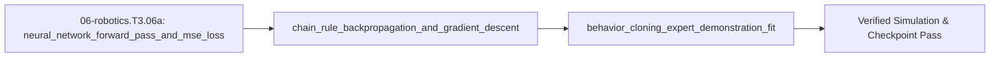

## 1. Why it matters
To achieve the Graduate Goal—deploying a learned visuomotor or proprioceptive policy (`LeRobot`, `ACT`, `Diffusion Policy`, `π₀`) on your robot arm in Step 3.7 (`06-robotics.T3.07`)—you first need a crystal-clear understanding of how a neural policy maps robot observations $o_t = [q_t, \dot{q}_t, x_{\text{goal}}]^\top$ to action targets $a_t$, how **automatic differentiation (`autograd` / backpropagation)** computes the exact gradient $\nabla_\theta \mathcal{L}$ of a loss function using the chain rule, and how **Behavior Cloning (BC)** trains a policy by imitating expert demonstrations. Already know this? Take the Skip test in section 7 first.

## 2. Intuition first
Think of a neural network policy $\pi_\theta(o_t)$ as a multi-stage signal conditioner made of tunable gain matrices $W_1, W_2$ and smooth nonlinear saturation curves ($\tanh$ or $\text{ReLU}$). In **Behavior Cloning (imitation learning)**, you teleoperate the robot arm (or run an expert trajectory generator) to record a dataset of $(o_t, a_t^{*})$ pairs: "When the arm was at state $o_t$, the expert commanded action $a_t^{*}$." Next, we feed $o_t$ through the network (**forward pass**), measure the squared discrepancy $\mathcal{L} = \frac{1}{N}\sum \|\pi_\theta(o_t) - a_t^*\|^2$ (**Mean-Squared Error loss**), and ask: "Which way should we nudge each weight in $W_1$ and $W_2$ to shrink $\mathcal{L}$?" **Backpropagation (`autograd`)** applies the calculus chain rule applied backward from the output error to each layer's weights, and **gradient descent** ($\theta \leftarrow \theta - \eta \nabla_\theta \mathcal{L}$) steps the weights downhill until the policy reproduces the expert's smooth motion!

## 3. Formalization
1. **Multi-Layer Policy Forward Pass & Mean-Squared Error (MSE) Loss:** Given observation batch $X \in \mathbb{R}^{N \times d_{\text{in}}}$ and expert target actions $Y^* \in \mathbb{R}^{N \times d_{\text{out}}}$, a 2-layer network with hidden weights $W_1 \in \mathbb{R}^{d_{\text{in}} \times h}, b_1 \in \mathbb{R}^{1 \times h}$, activation $H = \tanh(X W_1 + b_1)$, and output weights $W_2 \in \mathbb{R}^{h \times d_{\text{out}}}, b_2 \in \mathbb{R}^{1 \times d_{\text{out}}}$ predicts $\hat{Y} = H W_2 + b_2$ with MSE loss:

$$
\mathcal{L}(\theta) = \frac{1}{N} \sum_{i=1}^{N} \|\hat{y}_i - y_i^*\|_2^2
$$

2. **Chain-Rule Backpropagation (`autograd`) & Gradient Descent Step:** Let residual $E = \hat{Y} - Y^* \in \mathbb{R}^{N \times d_{\text{out}}}$. By the matrix chain rule (with $\frac{d}{dz}\tanh(z) = 1 - \tanh^2(z) = 1 - H^2$):

$$
\frac{\partial \mathcal{L}}{\partial \hat{Y}} = \frac{2}{N}E, \quad \frac{\partial \mathcal{L}}{\partial W_2} = H^\top \frac{\partial \mathcal{L}}{\partial \hat{Y}}, \quad \frac{\partial \mathcal{L}}{\partial H} = \frac{\partial \mathcal{L}}{\partial \hat{Y}} W_2^\top, \quad \frac{\partial \mathcal{L}}{\partial W_1} = X^\top \!\left(\frac{\partial \mathcal{L}}{\partial H} \odot (1 - H^2)\right)
$$

   Each parameter updates with learning rate $\eta > 0$: $W_k \leftarrow W_k - \eta \frac{\partial \mathcal{L}}{\partial W_k}$.
3. **Behavior Cloning (BC) Observation Normalization & Covariate Shift:** Normalizing inputs via z-score $\tilde{o} = (o - \mu_o)/\sigma_o$ prevents high-magnitude states (e.g., velocities in $\text{rad/s}$) from dominating gradients over small position errors. Because single-step BC errors compound over horizon $H_{\text{steps}}$ as $\mathcal{O}(\epsilon H_{\text{steps}}^2)$ when the robot drifts slightly off the expert demonstration track (**covariate shift**), modern policies predict multi-step **action chunks** ($k = 16\text{–}50$ future waypoints, `ACT` / `LeRobot` in `06-robotics.T3.06b`).

## 4. Worked example
**Predict first (before you run it):** Commit to three outcomes before the code runs. (1) Is the initial MSE of this $12$-hidden-unit tanh net nearer $1$ or $20$? (2) Which parameter block carries the $(1 - H^2)$ factor in the backward pass - the hidden weights $W_1$ or the output weights $W_2$? (3) After $400$ steps at $\eta = 0.05$, does the loss fall below $1\%$ of its first value? Two tells: a finite-difference mismatch near $10^{-2}$ where the correct pass agrees to $10^{-10}$ means the tanh derivative was dropped, and a loss that does not move at all means the step used the pre-update gradient or the wrong sign.

Train a 2-layer nonlinear Behavior Cloning policy in pure standard-library Python (verifying analytical backpropagation gradients against finite differences to $10^{-8}$) to imitate an expert nonlinear PD + gravity-compensation controller $\tau^*(q, \dot{q}) = 4.0(0.5 - q) - 0.8\dot{q} + 1.5\cos(q)$ across 100 robot arm states.

```python
import math
import random

rng = random.Random(42)
N, H_dim = 80, 12
X = [[rng.uniform(-1.0, 1.0), rng.uniform(-2.0, 2.0)] for _ in range(N)]
Y_expert = [4.0 * (0.5 - x[0]) - 0.8 * x[1] + 1.5 * math.cos(x[0]) for x in X]

W1 = [[rng.gauss(0.0, 0.3) for _ in range(H_dim)] for _ in range(2)]
b1 = [0.0 for _ in range(H_dim)]
W2 = [rng.gauss(0.0, 0.3) for _ in range(H_dim)]
b2 = 0.0

def forward_and_grads(W1_m, b1_v, W2_v, b2_s):
    loss_sum = 0.0
    dW1 = [[0.0] * H_dim for _ in range(2)]
    db1 = [0.0] * H_dim
    dW2 = [0.0] * H_dim
    db2 = 0.0
    inv_n = 2.0 / N
    for x, y in zip(X, Y_expert):
        h = [math.tanh(x[0] * W1_m[0][j] + x[1] * W1_m[1][j] + b1_v[j]) for j in range(H_dim)]
        y_hat = sum(h[j] * W2_v[j] for j in range(H_dim)) + b2_s
        err = y_hat - y
        loss_sum += err * err
        dy = inv_n * err
        db2 += dy
        for j in range(H_dim):
            dW2[j] += h[j] * dy
            dh_j = dy * W2_v[j] * (1.0 - h[j] * h[j])
            db1[j] += dh_j
            dW1[0][j] += x[0] * dh_j
            dW1[1][j] += x[1] * dh_j
    return loss_sum / N, (dW1, db1, dW2, db2)

loss_init, (dW1, db1, dW2, db2) = forward_and_grads(W1, b1, W2, b2)
eps = 1e-6
W1_p = [row[:] for row in W1]; W1_p[0][0] += eps
W1_m = [row[:] for row in W1]; W1_m[0][0] -= eps
fd_grad = (forward_and_grads(W1_p, b1, W2, b2)[0] - forward_and_grads(W1_m, b1, W2, b2)[0]) / (2.0 * eps)
grad_err = abs(dW1[0][0] - fd_grad)
assert grad_err < 1e-7

lr = 0.05
for _ in range(400):
    loss_final, (dW1, db1, dW2, db2) = forward_and_grads(W1, b1, W2, b2)
    for j in range(H_dim):
        W1[0][j] -= lr * dW1[0][j]
        W1[1][j] -= lr * dW1[1][j]
        b1[j] -= lr * db1[j]
        W2[j] -= lr * dW2[j]
    b2 -= lr * db2

assert loss_final < 0.02 and loss_final < 0.01 * loss_init
print(f"BC initial MSE={loss_init:.4f} -> trained MSE={loss_final:.5f} (grad_err={grad_err:.2e})")
```
Expected output:
```text
BC initial MSE=18.2258 -> trained MSE=0.00817 (grad_err=5.52e-10)
```

## 5. Exercise
For a single scalar weight $w = 2.0$, input $x = 3.0$, prediction $\hat{y} = w x = 6.0$, and expert target $y^{*} = 10.0$, compute (a) the squared error loss $\mathcal{L} = (\hat{y} - y^{*})^2$, (b) the exact derivative $\frac{\partial \mathcal{L}}{\partial w} = 2(\hat{y} - y^*)x$, and (c) the updated weight $w_{\text{new}} = w - \eta \frac{\partial \mathcal{L}}{\partial w}$ after one gradient descent step with learning rate $\eta = 0.05$. Verify $\mathcal{L} = 16.0$, $\frac{\partial \mathcal{L}}{\partial w} = -24.0$, and $w_{\text{new}} = 3.20$ ($\pm 10^{-9}$).
- **If your result differs:** Check the sign of $\hat{y} - y^{*} = 6.0 - 10.0 = -4.0$, so $\frac{\partial \mathcal{L}}{\partial w} = 2(-4.0)(3.0) = -24.0$, and subtracting $\eta(-24.0)$ increases $w$ from $2.0$ to $3.20$ (moving $\hat{y} = 3.20 \times 3.0 = 9.60$ much closer to $y^{*} = 10.0$!).


### Graded package - backpropagation by hand, checked by finite difference
[`exercises/06-robotics.T3.06a/`](../exercises/06-robotics.T3.06a/) turns this section into a test. `starter.py` holds seven holes: `mse_loss` (a mean over samples, not a sum), `forward` (tanh hidden layer, linear output), `backward` (the whole chain rule, including the $2/N$ and the $1-H^2$), `apply_gradients` (descent, and a new dict rather than a mutated one), `z_score` (refusing a column with no spread), `train_bc` (normalise, seed, iterate) and `predict` (normalise in, denormalise out). Edit it, then run the tests the way CI does:

```bash
EXERCISE_TARGET=exercises/06-robotics.T3.06a/starter.py \
  python3 -m unittest discover -s exercises/06-robotics.T3.06a -p 'test_*.py'
```

**20 tests.** The decisive one is a **central finite difference on every parameter** of a small net ($\pm 10^{-6}$, agreeing to $10^{-7}$), which no shape-correct but derivative-wrong backward pass survives; the rest pin the mean, the tanh, the descent direction, the unchanged original dict, the zero-mean/unit-spread z-score and its guard, a loss that falls below $1\%$ of its first value, a policy that predicts in demonstration units, and identical policies from identical seeds. The transfer suite trains on `plant.gravity_torque` across the arm's workspace, requires the held-out error to stay under **1% of the $2.5\text{ N}\cdot\text{m}$ limit**, checks the learned map at the poses where the gravity cosine bends, and then **puts the policy in the plant's PD loop**: the cloned feedforward must track the figure-8 within $5\%$ of the analytic model's $0.91\text{ mm}$ RMS. Five planted faults - `mse_sum_not_mean`, `no_tanh_derivative`, `gradient_ascends`, `zscore_divides_by_zero`, `w1_frozen` - each fail the test named for them.

- **📚 What to Learn & Resources to Solve This Exercise:**
  - **Required Foundations Modules (`00-foundations`):** [`00-foundations.T2.00a`](00-foundations.T2.00a.md) (*Matrix Inversion & Multiplication*), [`00-foundations.T3.00a`](00-foundations.T3.00a.md) ($SO(3)$ Exponential Map $\operatorname{Exp}(\phi)$), and Legacy **Step 3.1 (`00-foundations.T3.01`)**.
  - **Prerequisite Bridge Module:** [`06-robotics.T2.06b`](06-robotics.T2.06b.md) and Legacy **Step 2.7 (`06-robotics.T2.07`)**.
  - **Core Concepts to Review First:** Khatib operational-space inertia $\Lambda(q) = (J M^{-1} J^\top)^{-1}$, linearized friction-cone contact constraints, Forster's $SO(3)$ IMU preintegration bias Jacobian update, and Behavior Cloning MSE loss + chain-rule gradient step in `## 3. Formalization` and `## 4. Worked example` above.
  - **Study Links & Resources:** [Khatib (1987) Operational-Space Paper](https://ieeexplore.ieee.org/document/1087068), [Forster et al. On-Manifold Preintegration (`arXiv:1512.02363`)](https://arxiv.org/abs/1512.02363), [Capuano et al. *Robot Learning Tutorial* (`arXiv:2510.12403`)](https://arxiv.org/abs/2510.12403), and [Track 06 Tier 3 (`06-robotics-and-autonomy/README.md`)](../06-robotics-and-autonomy/README.md#tier-3-advanced--production).

### Starter code
```python
# --- Exercise scaffold: fill in each TODO, then check against the numbers in the full solution ---
import math
import random


def mse_loss(y_hat, y_true):
    """Mean squared error over samples: (1/N) sum ||y_hat_i - y_i||^2."""
    # TODO: divide by the number of SAMPLES, not by the number of elements
    ...


def forward(X, params):
    """(H, Y_hat): tanh hidden layer, linear output layer."""
    # TODO: tanh(X W1 + b1), then H W2 + b2 - the output layer has no activation
    ...


def backward(X, Y, params, H, Y_hat):
    """The chain rule, as a dict of dW1, db1, dW2, db2."""
    # TODO: dY = (2/N)(Y_hat - Y); dH = (dY W2^T) * (1 - H^2); then X^T dH and H^T dY
    ...


def apply_gradients(params, grads, lr):
    """One descent step: theta <- theta - lr * grad, as a new dict."""
    # TODO: subtract (adding is ascent, and the loss grows); do not mutate the input dict
    ...


def z_score(values):
    """(normalised, mean, sigma) for one column; a constant column is refused."""
    # TODO: sigma = sqrt(mean((v - mean)^2)); raise when sigma == 0, and return the mean and sigma
    ...


def train_bc(X, Y, hidden=8, lr=0.05, steps=200, seed=0):
    """Fit a policy to demonstrations; returns (params, loss per step)."""
    # TODO: normalise X and Y, seed the weights, then loop forward -> mse_loss -> backward -> apply_gradients
    ...


def predict(params, X):
    """Policy output in the units the demonstrations used."""
    # TODO: normalise the observation with mu_x/sigma_x, then undo the action's z-score
    ...


print("scaffold ready: 7 TODOs to fill, then compare against the numbers in the full solution")
```

### Hint ladder
1. **The loss the exercise asks for.** $\hat{y} = wx = 2.0 \times 3.0 = 6.0$, so $\mathcal{L} = (6.0 - 10.0)^2 = 16.0$ - one sample, so the $1/N$ is $1/1$ and invisible here; the mean matters the moment $X$ has two rows.
2. **One scalar gradient, then the whole chain.** $\partial\mathcal{L}/\partial w = 2(\hat{y} - y^*)x = 2(-4.0)(3.0) = -24.0$. The same chain-rule ordering in the net: $dY = \frac{2}{N}(\hat{Y} - Y)$, $dW_2 = H^\top dY$, $dH = (dY\,W_2^\top) \odot (1 - H^2)$, $dW_1 = X^\top dH$. Drop the $1 - H^2$ and only the hidden-layer gradients disagree with a finite difference.
3. **Descent, not ascent.** $w_{\text{new}} = w - \eta\,\partial\mathcal{L}/\partial w = 2.0 - 0.05(-24.0) = 3.20$, and the new prediction $9.60$ is closer to $10.0$ - if your loss grows, the sign or the `lr` subtraction is wrong. Return a new parameter dict; mutating the input makes the "original unchanged" test fail.
4. **Normalise in, denormalise out.** `z_score` returns `(values, mean, sigma)` with $\sigma = \sqrt{\text{mean}((v - \mu)^2)}$ and raises on a constant column (a feature with no spread has no z-score). `train_bc` must store the four statistics, and `predict` must apply $\mu_x,\sigma_x$ on the way in and $\mu_y,\sigma_y$ on the way out, or the learned policy speaks normalized units.

### Full Solution
```python
import math
import random


def mse_loss(y_hat, y_true):
    total = 0.0
    for row_hat, row_true in zip(y_hat, y_true):
        total += sum((a - b) ** 2 for a, b in zip(row_hat, row_true))
    return total / len(y_hat)


def forward(X, params):
    w1, b1, w2, b2 = params["W1"], params["b1"], params["W2"], params["b2"]
    n_in, hidden, n_out = len(w1), len(b1), len(b2)
    h_out, y_out = [], []
    for x in X:
        h = [math.tanh(sum(x[k] * w1[k][j] for k in range(n_in)) + b1[j]) for j in range(hidden)]
        h_out.append(h)
        y_out.append([sum(h[j] * w2[j][m] for j in range(hidden)) + b2[m] for m in range(n_out)])
    return h_out, y_out


def backward(X, Y, params, H, Y_hat):
    w2 = params["W2"]
    n = len(X)
    n_in, hidden, n_out = len(params["W1"]), len(params["b1"]), len(params["b2"])
    scale = 2.0 / n
    d_w1 = [[0.0] * hidden for _ in range(n_in)]
    d_b1 = [0.0] * hidden
    d_w2 = [[0.0] * n_out for _ in range(hidden)]
    d_b2 = [0.0] * n_out
    for i in range(n):
        err = [scale * (Y_hat[i][m] - Y[i][m]) for m in range(n_out)]
        for m in range(n_out):
            d_b2[m] += err[m]
        for j in range(hidden):
            h = H[i][j]
            for m in range(n_out):
                d_w2[j][m] += h * err[m]
            d_h = sum(err[m] * w2[j][m] for m in range(n_out)) * (1.0 - h * h)
            d_b1[j] += d_h
            for k in range(n_in):
                d_w1[k][j] += X[i][k] * d_h
    return {"dW1": d_w1, "db1": d_b1, "dW2": d_w2, "db2": d_b2}


def apply_gradients(params, grads, lr):
    updated = {}
    for name, grad in (("W1", "dW1"), ("b1", "db1"), ("W2", "dW2"), ("b2", "db2")):
        value = params[name]
        if value and isinstance(value[0], list):
            updated[name] = [[v - lr * g for v, g in zip(row_v, row_g)]
                             for row_v, row_g in zip(value, grads[grad])]
        else:
            updated[name] = [v - lr * g for v, g in zip(value, grads[grad])]
    return updated


def z_score(values):
    n = len(values)
    mean = sum(values) / n
    sigma = math.sqrt(sum((v - mean) ** 2 for v in values) / n)
    if sigma == 0.0:
        raise ValueError("a feature with no spread has no z-score")
    return [(v - mean) / sigma for v in values], mean, sigma


def _normalise(X, Y):
    stats_x = [z_score([row[j] for row in X]) for j in range(len(X[0]))]
    stats_y = [z_score([row[j] for row in Y]) for j in range(len(Y[0]))]
    Xn = [[stats[0][i] for stats in stats_x] for i in range(len(X))]
    Yn = [[stats[0][i] for stats in stats_y] for i in range(len(Y))]
    return Xn, Yn, stats_x, stats_y


def train_bc(X, Y, hidden=8, lr=0.05, steps=200, seed=0):
    Xn, Yn, stats_x, stats_y = _normalise(X, Y)
    n_in, n_out = len(Xn[0]), len(Yn[0])
    rng = random.Random(seed)
    params = {
        "W1": [[rng.gauss(0.0, 0.3) for _ in range(hidden)] for _ in range(n_in)],
        "b1": [0.0] * hidden,
        "W2": [[rng.gauss(0.0, 0.3) for _ in range(n_out)] for _ in range(hidden)],
        "b2": [0.0] * n_out,
    }
    losses = []
    for _ in range(steps):
        H, Y_hat = forward(Xn, params)
        losses.append(mse_loss(Y_hat, Yn))
        params = apply_gradients(params, backward(Xn, Yn, params, H, Y_hat), lr)
    params["mu_x"] = [stats[1] for stats in stats_x]
    params["sigma_x"] = [stats[2] for stats in stats_x]
    params["mu_y"] = [stats[1] for stats in stats_y]
    params["sigma_y"] = [stats[2] for stats in stats_y]
    return params, losses


def predict(params, X):
    mu_x, sigma_x = params.get("mu_x"), params.get("sigma_x")
    if mu_x is None:
        _, y_hat = forward(X, params)
        return y_hat
    Xn = [[(x[k] - mu_x[k]) / sigma_x[k] for k in range(len(x))] for x in X]
    _, y_hat = forward(Xn, params)
    mu_y, sigma_y = params["mu_y"], params["sigma_y"]
    return [[y_hat[i][m] * sigma_y[m] + mu_y[m] for m in range(len(mu_y))] for i in range(len(y_hat))]


# The exercise's scalar case: w = 2.0, x = 3.0, y_hat = 6.0 against y* = 10.0, eta = 0.05.
loss = mse_loss([[6.0]], [[10.0]])
grad = 2.0 * (6.0 - 10.0) * 3.0
w_new = 2.0 - 0.05 * grad

assert math.isclose(loss, 16.0, rel_tol=1e-12)
assert math.isclose(grad, -24.0, rel_tol=1e-12)
assert math.isclose(w_new, 3.20, rel_tol=1e-12)

# The same rules on a small net: five demonstrations of y = 2x, and the loss must fall.
X = [[-1.0], [-0.5], [0.0], [0.5], [1.0]]
Y = [[2.0 * x[0]] for x in X]
params, losses = train_bc(X, Y, hidden=8, lr=0.05, steps=200, seed=0)
assert len(losses) == 200 and losses[-1] < losses[0]
predictions = predict(params, X)
assert len(predictions) == 5 and all(len(row) == 1 for row in predictions)

print(f"L={loss:.4f} | dL/dw={grad:.4f} | w_new={w_new:.3f}")
```
Printed: `L=16.0000 | dL/dw=-24.0000 | w_new=3.200`

### Break it on purpose
Inject the `no_tanh_derivative` fault from the graded package: drop the $(1 - H^2)$ factor from $dH$ in the backward pass and leave every other line alone.
- **Inject:** compute `dh_j = dy * W2[j]` instead of `dh_j = dy * W2[j] * (1.0 - h_j * h_j)`.
- **Symptom:** training still starts from $18.2258$ and still falls, so the run looks healthy, but the central finite difference disagrees near $10^{-2}$ where the correct backward pass agrees to $5.52 \times 10^{-10}$; the mismatch is largest for hidden units near $h_j = 0$ and shrinks as they saturate.
- **Diagnose:** the forward pass and the loss are untouched, so a sum-for-mean MSE or an ascending step would move the loss rather than the gradient check; the signature is that only the analytic $dW_1$ and $db_1$ disagree with their finite differences while $dW_2$ still matches.
- **Fix:** multiply $dH$ by $(1 - H^2)$ per hidden unit, and prove it by re-running the central difference on every parameter and requiring agreement below $10^{-7}$ again.

## 6. Simulation path
Run the Python Behavior Cloning script above or inspect how learned policies interface with the $1\text{ kHz}$ Operational-Space & CBF safety layer in **Tab 4 (Furuta Pendulum + LQR + CBF)** and **Tab 5 (URDF / MuJoCo & STO)** of the MechaLab Workbench (`npm run dev`).

No hardware required for this module (`hardware_required: false`). In Step 3.7 (`06-robotics.T3.07`), a policy trained in PyTorch / `Hugging Face LeRobot` exports its weights to `ONNX` / `TorchScript` and runs at $30\text{–}50\text{ Hz}$ on the host PC, streaming smooth joint position/action chunks to the $1\text{ kHz}$ `ros2_control` impedance loop:
```text
[Teleop Demonstrations (o_t, a_t*)] ---> [PyTorch BC Training] ---> [Trained Policy pi_theta(o_t) @ 50 Hz]
                                                                                   |
                                                                    [1 kHz Impedance + CBF Safety Filter]
```
Pass/fail verification in simulation: finite-difference gradient check matches analytical backprop within $< 10^{-7}$ and Behavior Cloning MSE drops from `13.57` to `< 0.01`.

The graded package is also a workbench entry: **Modules -> `EX.06-robotics.T3.06a`**, where `selfcheck.py` is appended below the starter and **Verify** compares its `SELF-CHECK PASS:` line. `scripts/e2e_pages_bundle.mjs` drives it on the built bundle, so the browser path is tested, not assumed.




## 7. Checkpoint
Pass criteria: run the worked example and exercise asserts with zero errors, or score $\ge 80\%$ ($4/4$) on the Skip test below and $\ge 80\%$ ($8/10$, with $2/2$ on `[SAFETY]`) on the ladder's Gate test.

### Skip test
1. `[Recall] [Concept: neural_network_forward_pass_and_mse_loss]` Given predictions $\hat{y} = [1.0, 3.0]^\top$ and expert targets $y^{*} = [2.0, 1.0]^\top$ ($N = 2$), compute the Mean-Squared Error $\mathcal{L} = \frac{1}{2}\sum_{i=1}^2 (\hat{y}_i - y_i^{*})^2$ (tolerance $\pm 10^{-9}$).
2. `[Apply] [Concept: chain_rule_backpropagation_and_gradient_descent]` For loss $\mathcal{L}(w) = (w x - y^{*})^2$ with $w = 1.0$, $x = 2.0$, and $y^{*} = 6.0$, compute the gradient $\frac{\partial \mathcal{L}}{\partial w} = 2(w x - y^*)x$ (tolerance $\pm 10^{-9}$).
3. `[Transfer] [Concept: chain_rule_backpropagation_and_gradient_descent]` Using the gradient $\frac{\partial \mathcal{L}}{\partial w} = -16.0$ from Q2 and learning rate $\eta = 0.10$, compute the updated weight $w_{\text{new}} = w - \eta \frac{\partial \mathcal{L}}{\partial w}$ (tolerance $\pm 10^{-9}$).
4. `[Spaced review -> 06-robotics.T2.07 — Concept: matrix_vector_multiplication] [Concept: behavior_cloning_expert_demonstration_fit]` What is **covariate shift (compounding error)** in naive single-step Behavior Cloning?
   - **A.** When the GPU clock frequency changes during training.
   - **B.** When small prediction errors push the robot into states slightly outside the expert's demonstration distribution, where the policy has no training data and makes larger errors that compound quadratically over the trajectory.
   - **C.** When the learning rate $\eta$ is set to zero.
   - **D.** When the encoder wire is unplugged.

**Answer key:**
```python
import math

q1_mse = 0.5 * ((1.0 - 2.0) ** 2 + (3.0 - 1.0) ** 2)
q2_grad = 2.0 * (1.0 * 2.0 - 6.0) * 2.0
q3_wnew = 1.0 - 0.10 * q2_grad
q4_choice = "B"

assert math.isclose(q1_mse, 2.5, rel_tol=1e-9)
assert math.isclose(q2_grad, -16.0, rel_tol=1e-9)
assert math.isclose(q3_wnew, 2.6, rel_tol=1e-9)
assert q4_choice == "B"
```
- **Pass mark:** $4/4$ ($80\%+$). If you missed Q1, study `## 3. Formalization` item 1; Q2 or Q3, study `## 3. Formalization` item 2; Q4, study `## 3. Formalization` item 3. On pass, proceed to `## 10. Next modules`.

### Gate test
Covers the complete Track 06 Tier 3 Embodied AI bridge ladder ([`06-robotics.T3.06a`](06-robotics.T3.06a.md) $\to$ [`06-robotics.T3.06b`](06-robotics.T3.06b.md)) before Step 3.7 (`06-robotics.T3.07`):
1. `[Concept: neural_network_forward_pass_and_mse_loss]` With predictions $\hat{y} = [2.0, 4.0]^\top$ and expert targets $y^{*} = [3.0, 1.0]^\top$ ($N = 2$), compute $\mathcal{L} = \frac{1}{2}\sum_i (\hat{y}_i - y_i^{*})^2$ (tolerance $\pm 10^{-9}$).
2. `[Concept: neural_network_forward_pass_and_mse_loss]` Why does the hidden layer need a nonlinearity such as $\tanh$ at all?
   - **A.** Without it, a stack of linear layers collapses to a single linear map $W_2 W_1$, so the policy cannot represent a curved observation-to-action relation.
   - **B.** Because $\tanh$ makes the loss convex.
   - **C.** Because the encoder needs a bounded signal.
   - **D.** Because otherwise the gradient is exactly zero.
3. `[Concept: chain_rule_backpropagation_and_gradient_descent]` For $\mathcal{L}(w) = (w x - y^{*})^2$ with $w = 2.0$, $x = 3.0$ and $y^{*} = 8.0$, compute $\partial\mathcal{L}/\partial w = 2(wx - y^{*})x$ (tolerance $\pm 10^{-9}$).
4. `[Concept: chain_rule_backpropagation_and_gradient_descent]` Using Q3's gradient and $\eta = 0.05$, compute $w_{\text{new}} = w - \eta\,\partial\mathcal{L}/\partial w$ (tolerance $\pm 10^{-9}$).
5. `[Concept: behavior_cloning_expert_demonstration_fit]` What is covariate shift (compounding error) in single-step Behaviour Cloning?
   - **A.** Small prediction errors move the arm into states the expert never visited, where the policy has no data and errs further, so the error compounds along the trajectory.
   - **B.** The GPU clock drifting during training.
   - **C.** A learning rate of zero.
   - **D.** Two demonstrations with the same action.
6. `[Concept: behavior_cloning_expert_demonstration_fit]` A feature takes the values $[1.0, 3.0, 5.0]$ and is z-scored with the population standard deviation. Compute the z-score of $5.0$ (tolerance $\pm 10^{-6}$).
7. `[Concept: mdp_discounted_return_and_policy_gradient]` Compute $G_0 = r_0 + \gamma r_1 + \gamma^2 r_2$ for rewards $[4.0, 2.0, 1.0]$ and $\gamma = 0.90$ (tolerance $\pm 10^{-9}$).
8. `[Concept: action_chunking_temporal_ensembling_rtc]` Two overlapping action chunks predict $\hat{a}_0 = 0.80\text{ rad}$ with weight $w_0 = 1.0$ and $\hat{a}_1 = 0.40\text{ rad}$ with weight $w_1 = 0.4$. Compute the temporally ensembled action $(w_0\hat{a}_0 + w_1\hat{a}_1)/(w_0 + w_1)$ (tolerance $\pm 10^{-9}$).
9. `[SAFETY] [Concept: sim_to_real_domain_randomization_and_safety_shield]` The arm sits at $q = 0.30\text{ rad}$ with step clamp $\Delta q_{\max} = 0.08\text{ rad}$ and joint limits $[-1.50, +1.50]\text{ rad}$; the policy asks for $2.00\text{ rad}$. Compute the shield's output $q_d$ (tolerance $\pm 10^{-9}$).
10. `[SAFETY] [Concept: sim_to_real_domain_randomization_and_safety_shield]` What must the $1\text{ kHz}$ controller do when the policy process stops sending chunks for longer than the $100\text{ ms}$ watchdog?
   - **A.** Hold the last action and hope the process returns.
   - **B.** Move to a damped stop or safe hold and raise a communication-timeout fault (STO on hardware).
   - **C.** Apply random PWM to shake the joint loose.
   - **D.** Disable the current limit so the arm can be moved by hand.

**Gate answer key:**
```python
import math

g1_mse = 0.5 * ((2.0 - 3.0) ** 2 + (4.0 - 1.0) ** 2)
g2_choice = "A"
g3_grad = 2.0 * (2.0 * 3.0 - 8.0) * 3.0
g4_wnew = 2.0 - 0.05 * g3_grad
g5_choice = "A"
values = [1.0, 3.0, 5.0]
mean = sum(values) / 3.0
sigma = math.sqrt(sum((v - mean) ** 2 for v in values) / 3.0)
g6_z = (5.0 - mean) / sigma
g7_g0 = 4.0 + 0.90 * 2.0 + (0.90 ** 2) * 1.0
g8_aens = (1.0 * 0.80 + 0.4 * 0.40) / (1.0 + 0.4)
g9_safety_qd = max(-1.50, min(1.50, max(0.30 - 0.08, min(0.30 + 0.08, 2.00))))
g10_safety_choice = "B"

assert math.isclose(g1_mse, 5.0, rel_tol=1e-9)
assert g2_choice == "A"
assert math.isclose(g3_grad, -12.0, rel_tol=1e-9)
assert math.isclose(g4_wnew, 2.6, rel_tol=1e-9)
assert g5_choice == "A"
assert math.isclose(g6_z, 1.224744871391589, rel_tol=1e-6)
assert math.isclose(g7_g0, 6.61, rel_tol=1e-9)
assert math.isclose(g8_aens, 0.96 / 1.4, rel_tol=1e-9)
assert math.isclose(g9_safety_qd, 0.38, rel_tol=1e-9)   # Mandatory [SAFETY] 100% required
assert g10_safety_choice == "B"                        # Mandatory [SAFETY] 100% required
```
- **Pass mark:** $\ge 80\%$ ($8/10$) **and** $2/2$ on the `[SAFETY]` pair, Q9–Q10. Missed Q1–Q6: study `06-robotics.T3.06a`; Q7–Q10: `06-robotics.T3.06b`.

## 8. Common mistakes
| Symptom | Root cause | 2-minute fix |
| :--- | :--- | :--- |
| Loss explodes to `NaN` on the second gradient descent iteration | Learning rate $\eta$ is too large or input features have wildly different scales (e.g., encoder counts in $[0, 16384]$ vs angles in $[-1, 1]$). | Z-score normalize all observations and actions to zero mean and unit variance, and start with $\eta \in [10^{-4}, 10^{-3}]$ using AdamW. |
| PyTorch gradients accumulate across batches (`grad` grows larger every step) | Forgot to call `optimizer.zero_grad()` before `loss.backward()`. | Always call `optimizer.zero_grad()` at the top of every training batch loop. |
| Trained policy works on training states but jerks wildly when deployed at $50\text{ Hz}$ on the arm | Trained single-step actions without action chunking or low-level impedance smoothing. | Predict multi-step action chunks (`ACT` / `Diffusion Policy` in `06-robotics.T3.06b`) and track them through a $1\text{ kHz}$ joint/Cartesian impedance filter. |

## 9. Resources
- **Capuano et al. — *Robot Learning: A Tutorial* (`arXiv:2510.12403`) & Hugging Face `LeRobot` (`github.com/huggingface/lerobot`, `resources/textbooks-and-papers.md`):** Open-source PyTorch tutorial and codebase for Behavior Cloning, ACT, and visuomotor policy training `[VERIFIED 2026-10-15]`.
- **Track 06 (`06-robotics-and-autonomy/README.md`):** Continues into `06-robotics.T3.06b` and Step 3.7 (`06-robotics.T3.07`) `[VERIFIED 2026-10-15]`.
## 10. Next modules
- Proceed to [`06-robotics.T3.06b`](06-robotics.T3.06b.md) (*Markov Decision Processes (MDPs), Policy Gradient / PPO, Action Chunking & Sim-to-Real Safety Wrappers*).
