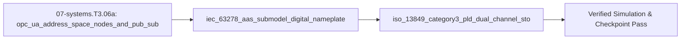

## 1. Why it matters
This is the bridge module in Track 07 Tier 3 before Step 3.7 (`06-robotics.T3.07`) and Step 3.8 (`08-capstones.T3.08`). When a mechatronic workcell moves from a research lab onto a factory floor, it must speak two industrial standards and pass a hardware functional-safety audit: **OPC UA (`IEC 62541`)** exposes live typed variables and methods across machines, the **Asset Administration Shell (`IEC 63278` AAS)** packages the machine's standardized Digital Twin metadata (`DigitalNameplate`, `TechnicalData`, `OperationalData`), and **ISO 13849-1 Category 3 / Performance Level d (`PLd`)** with **IEC 61800-5-2 Safe Torque Off (`STO`)** guarantees that a single welded relay or stuck transistor can never prevent the E-stop from removing motor torque! Already know this? Read `### Safety notes` first, then take the Skip test or the Ladder Gate test in section 7.

## 2. Intuition first
Why not directly stream custom JSON strings over a raw TCP socket on the factory floor? Because in a plant with 200 machines from 30 vendors, custom JSON means nobody knows whether `temp_1` is Celsius or Kelvin, or whether `stop()` is safe to call while the spindle is spinning!
- **OPC UA (`IEC 62541`)** turns your machine into a strongly-typed, browseable **Object Graph (Address Space)** where every `NodeId` (`ns=2;s=Actuator1.BusVoltage`) carries its engineering unit (`V`), access permissions, and real-time `PubSub` rate.
- **Asset Administration Shell (`IEC 63278` AAS)** is the standardized "digital passport" of every physical asset (identified by a globally unique `globalAssetId` URI): its **Submodels** (`DigitalNameplate`, `CarbonFootprint`, `PredictiveMaintenance`) use universal semantic dictionary IDs (`ECLASS` / `IEC CDD` IRDIs) so any ERP/MES system can query peak torque, serial number, and remaining bearing life automatically.
- **ISO 13849-1 Category 3 / `PLd` Dual-Channel Safety** solves a life-critical problem: what if the single relay cutting power to your $48\text{ V}$ robot arm welds its contacts shut during a high-current arc? A single-channel E-stop would fail! **Category 3** requires **two independent hardware channels (`STO_A` and `STO_B`)** cutting gate drive power in series, plus **cross-monitoring (`Diagnostic Coverage` $DC_{\text{avg}} \ge 60\%$)** that checks whether both channels switched together and latches a permanent fault if one channel sticks!

## 3. Formalization
1. **OPC UA Address Space & NodeId Addressing (`IEC 62541`):** Every node in an OPC UA Server belongs to a Namespace index `ns` and has an identifier (`i=` numeric, `s=` string, `g=` GUID), e.g., `ns=2;s=RobotArm.Joint1.Torque` (`NodeClass = Variable`, `DataType = Double`, `EURange = [-18.0, +18.0]`, `EngineeringUnits = N*m`).
2. **IEC 63278 Asset Administration Shell (AAS) Metamodel:** An AAS instance binds an `AssetInformation` record (`assetKind = Instance | Type`, `globalAssetId`) to a list of standardized `Submodel` objects (`idShort`, `semanticId`), each containing `SubmodelElement` items (`Property`, `Range`, `SubmodelElementCollection`).
3. **ISO 13849-1 Category 3 / `PLd` Dual-Channel Architecture & Safe Torque Off (`IEC 61800-5-2 STO`):**
   - **Performance Level d (`PLd`) Target:** Probability of Dangerous Failure per Hour:

$$
\text{PFH}_d \in [10^{-7},\ 10^{-6})\ \text{h}^{-1}
$$

   - **Category 3 Requirements:** (i) Redundant 2-channel hardware path ($I_1 \to L_1 \to O_1$ and $I_2 \to L_2 \to O_2$) so **any single fault does not lead to the loss of the safety function** ($\text{STO} = \text{STO}_A \lor \text{STO}_B$ removes torque even if one channel fails closed), and (ii) **Cross-Monitoring Discrepancy Check**: if $\text{Ch}_A \ne \text{Ch}_B$ for longer than discrepancy filter time $t_{\text{disc}}$ (e.g., $20\text{ ms}$), the safety logic latches `FAULT_LOCKOUT` and prevents restart until both channels return to the safe state and are repaired.

## 4. Worked example
**Predict first (before you run it):** Commit to three booleans and one number. (1) With Channel A in the safe state and Channel B welded closed for $25\text{ ms}$, is motor torque removed - and may the drive re-enable? (2) At a $12\text{ ms}$ skew with $t_{\text{disc,max}} = 20\text{ ms}$, does the discrepancy latch? (3) Is $\text{PFH}_d = 2.4\times10^{-7}\text{ h}^{-1}$ inside `PLd`? (4) Does a PubSub stream of $8$ doubles plus a $14$-byte header at $250\text{ Hz}$ fit a $115.2\text{ kbaud}$ 8N1 link? Two tells that a wrong answer is a mistake rather than a different reading: a latch at $12\text{ ms}$ means the discrepancy filter was dropped entirely (normal contact skew is $2\text{–}8\text{ ms}$, which is exactly why the window exists), and `can_enable = True` with one channel in the safe state means the two channel states were combined with OR where the enable path needs AND.

Validate an IEC 63278 AAS JSON submodel alongside an OPC UA `NodeId` mapping, and simulate an ISO 13849-1 Category 3 dual-channel `STO` monitor proving that (1) a single stuck-closed contact still removes motor torque, and (2) cross-monitoring detects the discrepancy within $t_{\text{disc}} = 20\text{ ms}$ and blocks re-enable.

```python
import math

aas_shell = {
    "idShort": "MechaArm6DOF_AAS",
    "assetInformation": {"assetKind": "Instance", "globalAssetId": "urn:mechalab:asset:arm6dof:sn0042"},
    "submodels": [{
        "idShort": "TechnicalData",
        "semanticId": "0173-1#01-AFZ615#016",
        "submodelElements": [
            {"idShort": "MaxPayloadKg", "valueType": "xs:double", "value": 3.0, "opcUaNodeId": "ns=2;s=Arm.MaxPayloadKg"},
            {"idShort": "SupplyVoltageV", "valueType": "xs:double", "value": 48.0, "opcUaNodeId": "ns=2;s=Arm.SupplyVoltageV"},
        ],
    }],
}
assert aas_shell["assetInformation"]["assetKind"] == "Instance"
assert aas_shell["submodels"][0]["submodelElements"][0]["opcUaNodeId"].startswith("ns=2;s=")

def cat3_sto_evaluator(ch_a_safe: bool, ch_b_safe: bool, discrepancy_ms: float, t_disc_max_ms: float = 20.0) -> dict:
    # Either channel in safe state (True = gate power removed) cuts inverter torque (redundant series inhibition)
    torque_removed = ch_a_safe or ch_b_safe
    discrepancy_fault = (ch_a_safe != ch_b_safe) and (discrepancy_ms > t_disc_max_ms)
    can_enable_drive = (not ch_a_safe) and (not ch_b_safe) and (not discrepancy_fault)
    return {"torque_removed": torque_removed, "discrepancy_fault": discrepancy_fault, "can_enable": can_enable_drive}

# Case 1: E-Stop pressed, Channel A cuts power (True), but Channel B relay welded shut (False) for 25 ms!
fault_case = cat3_sto_evaluator(ch_a_safe=True, ch_b_safe=False, discrepancy_ms=25.0)
assert fault_case["torque_removed"] is True       # Single fault did NOT cause loss of safety function!
assert fault_case["discrepancy_fault"] is True    # Cross-monitoring caught the welded relay!
assert fault_case["can_enable"] is False

pfh_d = 2.4e-7  # 2.4e-7 dangerous failures per hour -> meets PLd [1e-7, 1e-6)
assert 1e-7 <= pfh_d < 1e-6
print(f"AAS={aas_shell['idShort']}, Cat3 Single-Fault TorqueRemoved={fault_case['torque_removed']}, FaultLatched={fault_case['discrepancy_fault']}")
```
Expected output:
```text
AAS=MechaArm6DOF_AAS, Cat3 Single-Fault TorqueRemoved=True, FaultLatched=True
```

## 5. Exercise
Suppose a dual-channel E-stop switch has Channel A and Channel B inputs sampled every $1\text{ ms}$, with a mechanical contact bounce discrepancy tolerance of $t_{\text{disc,max}} = 20\text{ ms}$. If an operator presses the E-stop slightly obliquely so Channel A opens at $t = 0\text{ ms}$ (`ch_a_safe = True`) and Channel B opens at $t = 12\text{ ms}$ (`ch_b_safe = True`), evaluate `cat3_sto_evaluator(True, False, discrepancy_ms=12.0)` at $t = 12\text{ ms}$ and `cat3_sto_evaluator(True, True, discrepancy_ms=0.0)` at $t = 13\text{ ms}$. Verify that `torque_removed` is `True` immediately at $t=0\text{ ms}$ and `discrepancy_fault` remains `False` because $12.0\text{ ms} \le 20.0\text{ ms}$.
- **If your result differs:** Check the inequality `discrepancy_ms > t_disc_max_ms` ($12.0 > 20.0$ is `False`); the $20\text{ ms}$ window prevents nuisance lockout from normal mechanical switch skew while catching permanently stuck contacts.

### Graded package - the audit arithmetic and the dual channel
[`exercises/07-systems.T3.06a/`](../exercises/07-systems.T3.06a/) turns this section into a test. `starter.py` holds seven holes: `opc_ua_pubsub_rate_bps` (the header once per frame), `diagnostic_coverage_pct` (a percentage), `pfh_common_cause` (not doubled), `pld_ok` (the exclusive upper bound), `sto_evaluate` (the filtered discrepancy), `aas_opcua_nodes` (the `ns=<n>;i=|s=|g=` form) and `reset_interlock` (manual, never automatic). Edit it, then run the tests the way CI does:

```bash
EXERCISE_TARGET=exercises/07-systems.T3.06a/starter.py \
  python3 -m unittest discover -s exercises/07-systems.T3.06a -p 'test_*.py'
```

**31 tests.** The rate is checked at one variable and at eight, so a per-variable header shows; coverage is checked against two different failure mixes, so a fraction fails; the common-cause term is checked against $\beta\lambda_{DU}$ exactly, so doubling it fails; $10^{-6}$ is refused and $9.9\times10^{-7}$ accepted; a $12\text{ ms}$ skew must **not** latch while $25\text{ ms}$ must; a bare string is not a NodeId; and a cleared fault still refuses to restart without a press. The transfer suite runs **the plant's own numbers**: its $20\text{ B} / 1\text{ kHz}$ frame as a PubSub stream is $30000\text{ B/s}$ (and fits the 500 kbaud link that already proves zero drops, while exceeding the 115.2 kbaud one that drops 412 frames), the STO decision is evaluated on **every tick** of the $1\text{ kHz}$ loop - torque gone on the tick Channel A opens, a latch exactly one tick after the $20\text{ ms}$ window - and the reset interlock is checked after that latch. Five planted faults - `rate_charges_header_per_variable`, `dc_as_fraction`, `ccf_doubles_channels`, `sto_no_filter`, `reset_auto_restarts` - each fail the test named for them.

### Starter code
```python
# --- Exercise scaffold: fill in each TODO, then check against the numbers in the full solution below ---
import math


def opc_ua_pubsub_rate_bps(n_vars, f_pub, header_bytes=14, value_bytes=8):
    """Cyclic PubSub payload byte rate."""
    # TODO 1: the 14-byte header is per FRAME, not per variable
    ...


def diagnostic_coverage_pct(lambda_dd, lambda_du):
    """DC_avg in percent."""
    # TODO 2: a ratio of detected to total dangerous failures, times 100
    ...


def pfh_common_cause(lambda_du, beta):
    """beta * lambda_du, in failures per hour."""
    # TODO 3: the CCF term is per channel - do not double it for two channels
    ...


def pld_ok(pfh_d):
    """True inside the PLd band [1e-7, 1e-6)."""
    # TODO 4: the upper bound is exclusive
    ...


def sto_evaluate(ch_a_safe, ch_b_safe, discrepancy_ms, t_disc_max_ms=20.0):
    """The Category 3 STO decision for one sample."""
    # TODO 5: either channel cuts torque; a skew under t_disc is bounce, not a fault
    ...


def aas_opcua_nodes(shell):
    """Every SubmodelElement's NodeId, validated."""
    # TODO 6: check `ns=<n>;` then `i=`, `s=` or `g=` for every element
    ...


def reset_interlock(ch_a_safe, ch_b_safe, fault_latched, reset_pressed):
    """Whether a restart may be granted."""
    # TODO 7: no automatic restart, and never past a latched fault
    ...


print("scaffold ready: 7 TODOs to fill, then compare against the numbers in the full solution")
```

**Expected numbers (the answer):** $R = (14 + 8 \times 8) \times 250 = 19\,500\ \text{B/s}$; $\text{DC}_{\text{avg}} = 95.0\%$ at $95.0/100.0$ FIT; $\text{PFH}_{d,\text{CCF}} = 4.0 \times 10^{-9}\ \text{h}^{-1}$; $\text{PFH}_d = 4.5\times10^{-7}\ \text{h}^{-1}$ is inside `PLd`. The $12\ \text{ms}$ skew does **not** latch, the $25\ \text{ms}$ one does, and torque is removed at $t = 0$ either way.

### Hint ladder
1. **The header is per frame.** Eight doubles are $64$ bytes, plus $14$ bytes of NetworkMessage header, is $78$ bytes every frame; at $250\ \text{Hz}$ that is $19\,500\ \text{B/s}$ - charging the header per variable gives $8 \times 78 \times 250$ instead.
2. **`DC` is a percentage of the dangerous failures you can see.** $100 \times 95.0/(95.0 + 5.0) = 95.0\%$; returning $0.95$ fails the audit even though the ratio is right.
3. **The CCF term is not doubled.** $\beta \lambda_{DU} = 0.02 \times 2.0\times10^{-7} = 4.0\times10^{-9}\ \text{h}^{-1}$ is the common-cause share of the *subsystem*; multiplying by two counts the same cause twice.
4. **`PLd` has an exclusive top end.** $[10^{-7}, 10^{-6})$ accepts $9.9\times10^{-7}$ and rejects exactly $10^{-6}$ - the boundary is where an audit fails a design that merely rounds to `PLd`.
5. **Two channels, one filter.** `torque_removed = ch_a_safe or ch_b_safe` is immediate; only `discrepancy_fault` waits for `discrepancy_ms > t_disc_max_ms`, so $12\ \text{ms}$ is normal contact skew and $25\ \text{ms}$ is a welded pole.

### Full Solution
```python
import math


def opc_ua_pubsub_rate_bps(n_vars, f_pub, header_bytes=14, value_bytes=8):
    return (header_bytes + n_vars * value_bytes) * f_pub


def diagnostic_coverage_pct(lambda_dd, lambda_du):
    total = lambda_dd + lambda_du
    if total == 0.0:
        raise ValueError("a subsystem with no failures has no diagnostic coverage")
    return 100.0 * lambda_dd / total


def pfh_common_cause(lambda_du, beta):
    if not 0.0 <= beta <= 1.0:
        raise ValueError("the common-cause factor is a fraction in [0, 1]")
    return beta * lambda_du


def pld_ok(pfh_d):
    return 1e-7 <= pfh_d < 1e-6


def sto_evaluate(ch_a_safe, ch_b_safe, discrepancy_ms, t_disc_max_ms=20.0):
    torque_removed = ch_a_safe or ch_b_safe
    discrepancy_fault = (ch_a_safe != ch_b_safe) and (discrepancy_ms > t_disc_max_ms)
    can_enable = (not ch_a_safe) and (not ch_b_safe) and (not discrepancy_fault)
    return {"torque_removed": torque_removed,
            "discrepancy_fault": discrepancy_fault,
            "can_enable": can_enable}


def aas_opcua_nodes(shell):
    nodes = []
    for submodel in shell["submodels"]:
        for element in submodel.get("submodelElements", []):
            node_id = element.get("opcUaNodeId")
            if not isinstance(node_id, str) or not node_id.startswith("ns=") or ";" not in node_id:
                raise ValueError("every mapped element needs an `ns=<index>;<type>=<id>` NodeId")
            namespace, _, rest = node_id[3:].partition(";")
            if not namespace.isdigit() or rest[:2] not in ("i=", "s=", "g="):
                raise ValueError("NodeId %r is not `ns=<n>;i=|s=|g=<id>`" % node_id)
            nodes.append(node_id)
    return nodes


def reset_interlock(ch_a_safe, ch_b_safe, fault_latched, reset_pressed):
    if ch_a_safe != ch_b_safe:
        return False
    if ch_a_safe:
        return False
    return bool(reset_pressed) and not fault_latched


# The exercise: a 12 ms oblique press, and the 25 ms welded-pole case.
rate = opc_ua_pubsub_rate_bps(8, 250.0)
dc = diagnostic_coverage_pct(95.0, 5.0)
ccf = pfh_common_cause(2.0e-7, 0.02)
assert math.isclose(rate, 19500.0, rel_tol=1e-12)
assert math.isclose(dc, 95.0, rel_tol=1e-12)
assert math.isclose(ccf, 4.0e-9, rel_tol=1e-12)
assert pld_ok(4.5e-7) and not pld_ok(1e-6) and pld_ok(9.9e-7)

skew12 = sto_evaluate(True, False, 12.0)
skew25 = sto_evaluate(True, False, 25.0)
settled = sto_evaluate(True, True, 0.0)
for case in (skew12, skew25, settled):
    assert case["torque_removed"] is True and case["can_enable"] is False
assert skew12["discrepancy_fault"] is False
assert skew25["discrepancy_fault"] is True and settled["discrepancy_fault"] is False

shell = {"submodels": [{"submodelElements": [
    {"idShort": "MaxPayloadKg", "opcUaNodeId": "ns=2;s=Arm.MaxPayloadKg"},
    {"idShort": "SupplyVoltageV", "opcUaNodeId": "ns=2;s=Arm.SupplyVoltageV"},
]}]}
nodes = aas_opcua_nodes(shell)
assert nodes == ["ns=2;s=Arm.MaxPayloadKg", "ns=2;s=Arm.SupplyVoltageV"]
assert reset_interlock(False, False, False, True) is True
assert reset_interlock(True, True, True, True) is False
assert reset_interlock(False, False, False, False) is False

print("rate=%.0f B/s | DC=%.1f%% | CCF=%.0e | pld_ok=%s" % (rate, dc, ccf, pld_ok(4.5e-7)))
print("sto12=%s | sto25=%s | settled=%s | reset=%s"
      % (tuple(skew12.values()), tuple(skew25.values()), tuple(settled.values()),
         reset_interlock(False, False, False, True)))
```

Printed: `rate=19500 B/s | DC=95.0% | CCF=4e-09 | pld_ok=True`, then `sto12=(True, False, False) | sto25=(True, True, False) | settled=(True, False, False) | reset=True`.

### Break it on purpose
Inject the `sto_no_filter` fault and diagnose it from the restart behaviour alone, keeping $t_{\text{disc,max}} = 20\text{ ms}$:
- **Inject:** decide the discrepancy on the channel states alone, `discrepancy_fault = (ch_a_safe != ch_b_safe)`, deleting the `discrepancy_ms > t_disc_max_ms` comparison.
- **Symptom:** every ordinary E-stop press latches `FAULT_LOCKOUT`, because real contacts skew by $2\text{–}8\text{ ms}$; the exercise's $12\text{ ms}$ case now returns `discrepancy_fault = True` where the module expects `False`, and at the plant's $1\text{ kHz}$ tick the latch is set on the first of those twelve ticks. Torque removal is unchanged (`True`, from Channel A), so the safety function appears healthy while the machine refuses to restart.
- **Diagnose:** the lifetime of the disagreement separates it from a welded contact. A stuck channel disagrees *persistently* and would latch with or without the filter, whereas a fault that appears only for skews below $20\text{ ms}$ and clears when both channels settle localises the missing term to the time comparison - not to the channel wiring, the `PLd` arithmetic, or the reset interlock.
- **Fix:** restore `(ch_a_safe != ch_b_safe) and (discrepancy_ms > t_disc_max_ms)` and prove it on the three cases the module already states: $12\text{ ms}$ gives `False`, $25\text{ ms}$ gives `True`, and both channels safe gives `False` at any skew. `sto_no_filter` must fail `test_behavior`, and the plant's per-tick check (latch exactly one tick after the $20\text{ ms}$ window) must pass.


- **📚 What to Learn & Resources to Solve This Exercise:**
  - **Required Foundations Modules (`00-foundations`):** [`00-foundations.T2.00d`](00-foundations.T2.00d.md) (*Frequency Response*) and [`00-foundations.T2.00f`](00-foundations.T2.00f.md) (*Spectral Estimation*).
  - **Prerequisite Bridge Module:** [`07-systems.T2.07a`](07-systems.T2.07a.md) and Legacy **Step 2.8 (`07-systems.T2.08`)**.
  - **Core Concepts to Review First:** `OPC UA` (`IEC 62541`) & Asset Administration Shell (`IEC 63278 AAS`), Schroeder-phased multisine Crest Factor minimization $\phi_k = -\frac{\pi k(k-1)}{K}$, and `ISO 13849-1` Category 3 / `PLd` dual-channel Safe Torque Off (STO) discrepancy monitoring in `## 3. Formalization` and `## 4. Worked example` above.
  - **Study Links & Resources:** [open62541 OPC UA Docs (`open62541.org`)](https://www.open62541.org/), [IDTA Asset Administration Shell Specs (`industrialdigitaltwin.org`)](https://industrialdigitaltwin.org/), and [Track 07 Tier 3 (`07-systems-hil-and-production/README.md`)](../07-systems-hil-and-production/README.md#tier-3-advanced--production) (**Tab 5 & Tab 7**).

## 6. Simulation path
Open **Tab 5 (URDF / MuJoCo & STO — Dual-Channel Hardware STO)** and **Tab 7 (Schroeder Multisine SysID)** in the MechaLab Workbench (`npm run dev`), or explore open-source OPC UA / AAS tools (`open62541`, `python-opcua`, `Eclipse BaSyx`, `AASX Package Explorer`) in `resources/open-source-toolchains.md`.

The graded package is also a workbench entry: **Modules -> `EX.07-systems.T3.06a`**, where `selfcheck.py` is appended below the starter and **Verify** compares its `SELF-CHECK PASS:` line. `scripts/e2e_pages_bundle.mjs` drives it on the built bundle, so the browser path is tested, not assumed.

### Safety notes
> **⚠️ Mandatory Safety Briefing (`safety_level: high` — read before wiring industrial E-stop/STO chains or taking the Skip/Gate test):**
> 1. **A Software Boolean on a ROS 2 Topic or Microcontroller GPIO Is NOT an E-Stop (ISO 13849-1 / IEC 60204-1):** Emergency Stop circuits and Safe Torque Off (`STO`, IEC 61800-5-2) must interrupt gate-driver supply power (`GVDD` / optocoupler LED current) via **hardware-redundant electro-mechanical or safety-rated semiconductor paths** independent of main CPU firmware execution.
> 2. **Dual-Channel Redundancy + Cross-Monitoring (Category 3 / `PLd`):** Both `STO_A` and `STO_B` channels must be wired with normally-closed (`NC`) positive-opening safety contacts so a broken wire triggers an immediate safe stop, and cross-monitoring must lock out restart if the two channels disagree for $> t_{\text{disc}}$.
> 3. **Manual Reset Required After E-Stop Release:** Releasing (twisting out) a physical E-stop mushroom button **must never** automatically re-energize motor motion; a deliberate separate manual `RESET` action after clearing faults is mandatory under ISO 13850 / IEC 60204-1.




## 7. Checkpoint
Pass criteria: read `### Safety notes`, score $\ge 80\%$ ($4/5$, $100\%$ on `[SAFETY]` items) on the Skip test, or score $\ge 80\%$ ($7/8$, $100\%$ on `[SAFETY]` items) on the Ladder Gate test to unlock Step 3.7 (`06-robotics.T3.07`).

### Skip test
1. `[Recall] [Concept: opc_ua_address_space_nodes_and_pub_sub]` An OPC UA PubSub UDP cyclic frame carries a $14\text{-byte}$ NetworkMessage header plus $N_{\text{var}} = 8$ `Double` ($8\text{-byte}$) telemetry variables published at $f_{\text{pub}} = 250\text{ Hz}$. Compute the total payload byte rate $R_{\text{B/s}} = (14 + 8 N_{\text{var}}) f_{\text{pub}}$ in bytes per second ($\text{B/s}$, exact integer, tolerance $\pm 0$).
2. `[Apply] [Concept: iec_63278_aas_submodel_digital_nameplate]` An IEC 63278 AAS `SafetySubmodel` reports detected dangerous failure rate $\lambda_{DD} = 95.0\text{ FIT}$ and undetected dangerous failure rate $\lambda_{DU} = 5.0\text{ FIT}$. Compute the Diagnostic Coverage percentage $\text{DC}_{\text{avg}}\% = 100 \times \frac{\lambda_{DD}}{\lambda_{DD} + \lambda_{DU}}$ (tolerance $\pm 10^{-6}$).
3. `[Transfer] [Concept: iso_13849_category3_pld_dual_channel_sto]` In an ISO 13849-1 Category 3 dual-channel Safe Torque Off (`STO`) subsystem, the undetected dangerous failure rate per channel is $\lambda_{DU} = 2.0 \times 10^{-7}\text{ h}^{-1}$ and the common-cause failure factor is $\beta = 0.02$. Compute the common-cause dangerous failure contribution $\text{PFH}_{d,\text{CCF}} = \beta \lambda_{DU}$ in $\text{h}^{-1}$ (tolerance $\pm 10^{-11}\text{ h}^{-1}$).
4. `[Spaced review -> 06-robotics.T3.06b — Concept: opc_ua_industrial_telemetry] [SAFETY] [Concept: iso_13849_category3_pld_dual_channel_sto]` Under ISO 13849-1 Category 3 / `PLd`, if Channel A of a dual-channel Safe Torque Off (`STO`) circuit opens properly when E-Stop is pressed, but Channel B's transistor fails shorted, what must happen to the motor torque and the restart interlock?
   - **A.** The motor keeps spinning at half speed.
   - **B.** Motor torque is **still immediately removed** by Channel A (single-fault tolerance), AND the cross-monitoring diagnostics detect the `Ch_A != Ch_B` discrepancy and **lock out** any future restart until Channel B is repaired.
   - **C.** The firmware ignores Channel A and keeps running.
   - **D.** The robot resets automatically.
5. `[SAFETY] [Concept: iso_13849_category3_pld_dual_channel_sto]` Under ISO 13850 and IEC 60204-1, when an operator twists and releases a latched mushroom E-stop button back to its unpressed position, what is the machine allowed to do immediately upon release?
   - **A.** Immediately resume the interrupted trajectory at full speed.
   - **B.** Remain in the safe stopped (`STO`) state; releasing the E-stop actuator **must never** automatically restart motion without a separate, deliberate manual reset command once all safety conditions are verified.
   - **C.** Spin all joints to `0.0 rad` at maximum torque.
   - **D.** Disable the E-stop monitoring relay.

**Answer key:**
```python
import math

q1_rate_bps = (14 + 8 * 8) * 250
q2_dc_pct = 100.0 * (95.0 / (95.0 + 5.0))
q3_pfh_ccf = 0.02 * 2.0e-7
q4_safety_choice = "B"
q5_safety_choice = "B"
assert q1_rate_bps == 19500
assert math.isclose(q2_dc_pct, 95.0, rel_tol=1e-9)
assert math.isclose(q3_pfh_ccf, 4.0e-9, rel_tol=1e-9)
assert q4_safety_choice == "B"  # Mandatory [SAFETY] 100% required
assert q5_safety_choice == "B"  # Mandatory [SAFETY] 100% required
```
- **Pass mark:** $4/5$ overall ($80\%+$) AND $2/2$ ($100\%$) on Q4 and Q5 (`[SAFETY]`). If you missed Q1, study `## 3. Formalization` item 1; if you missed Q2, study `## 3. Formalization` item 2; if you missed Q3–Q5, study `## 3. Formalization` item 3 and `### Safety notes`. On pass, proceed to `## 10. Next modules`.


### Gate test
Covers the complete Track 07 Tier 3 bridge ladder (`07-systems.T3.06a`) before Step 3.7 (`06-robotics.T3.07`):
1. `[Concept: opc_ua_address_space_nodes_and_pub_sub]` Why is OPC UA (`IEC 62541`) preferred over raw unschema'd Modbus registers or ad-hoc JSON sockets in industrial automation?
   - **A.** It provides an object-oriented, strongly-typed Address Space with standardized semantic engineering units, built-in X.509 security, and deterministic `PubSub` over UDP/TSN.
   - **B.** It only supports 8-bit integers.
   - **C.** It requires no network cable.
   - **D.** It replaces the mechanical gearbox.
2. `[Concept: iec_63278_aas_submodel_digital_nameplate]` In an IEC 63278 Asset Administration Shell (AAS), what is a `Submodel`?
   - **A.** A modular, standardized aspect of an asset (such as `DigitalNameplate`, `TechnicalData`, or `OperationalData`) identified by a globally unique `semanticId`.
   - **B.** A smaller physical electric motor bolted inside the main motor.
   - **C.** A reduced-order Luenberger observer.
   - **D.** A broken URDF link.
3. `[Concept: iec_63278_aas_submodel_digital_nameplate]` Why do AAS Submodel elements include a `semanticId` referencing an international dictionary like `ECLASS` or `IEC CDD` (e.g., `0173-1#02-AAO677#002`)?
   - **A.** So software from different manufacturers can automatically understand the exact meaning and units of a property without human translation.
   - **B.** To encrypt the serial port.
   - **C.** To set the PWM switching frequency.
   - **D.** To increase CAN bus baud rate.
4. `[Concept: iso_13849_category3_pld_dual_channel_sto]` What does `IEC 61800-5-2 Safe Torque Off (STO)` guarantee physically inside a motor drive?
   - **A.** No torque-producing energy can reach the motor windings because hardware inhibit paths block gate-drive pulses from reaching the power MOSFETs/IGBTs.
   - **B.** The motor actively holds position using high PID gains.
   - **C.** The mechanical brake is permanently removed.
   - **D.** The encoder is recalibrated.
5. `[Concept: iso_13849_category3_pld_dual_channel_sto]` Why are physical E-stop switches wired using **Normally-Closed (`NC`) positive-opening contacts** (where Closed = $24\text{ V}$ present = Run, Open = $0\text{ V}$ = Stop) rather than Normally-Open (`NO`) contacts?
   - **A.** Wire-break fail-safe: if a cable is severed or a connector vibrates loose, the signal drops to $0\text{ V}$ and immediately triggers a safe stop!
   - **B.** Because `NC` switches cost less copper.
   - **C.** Because `NO` switches cannot carry DC current.
   - **D.** To save $24\text{ V}$ power during operation.
6. `[Concept: iso_13849_category3_pld_dual_channel_sto]` If a dual-channel safety system has $\text{PFH}_d = 4.5 \times 10^{-7}\text{ h}^{-1}$, does it satisfy the numerical $\text{PFH}_d$ range $[10^{-7}, 10^{-6})\text{ h}^{-1}$ for ISO 13849-1 `PLd` (`1` for Yes, `0` for No)?
7. `[SAFETY] [Concept: iso_13849_category3_pld_dual_channel_sto]` An engineer proposes implementing the robot's E-stop by reading a push-button on an `Arduino` GPIO pin inside a `ros2` Python node and publishing `/cmd_vel = 0` over Wi-Fi. Why does this violate ISO 13849-1 Category 3 / `PLd`?
   - **A.** Wi-Fi, OS processes, and single-channel MCU firmware are non-deterministic single points of failure with zero hardware fault tolerance; if the CPU hangs or Wi-Fi drops, the E-stop fails completely!
   - **B.** Because Python uses 64-bit floats.
   - **C.** Because `/cmd_vel` is a `Twist` message.
   - **D.** Because GPIO pins operate at $3.3\text{ V}$.
8. `[SAFETY] [Concept: iso_13849_category3_pld_dual_channel_sto]` In a Category 3 dual-channel `STO` circuit with discrepancy timeout $t_{\text{disc,max}} = 20\text{ ms}$, if `ch_a_safe = True` and `ch_b_safe = False` persists for $150\text{ ms}$, what two boolean outputs must `(torque_removed, can_enable_drive)` equal?
   - **A.** `(True, False)` — torque is removed immediately by Channel A, and re-enabling the drive is locked out (`False`) until the Channel B fault is cleared and repaired.
   - **B.** `(False, True)`
   - **C.** `(True, True)`
   - **D.** `(False, False)`

**Gate answer key:**
```python
g1_choice = "A"
g2_choice = "A"
g3_choice = "A"
g4_choice = "A"
g5_choice = "A"
g6_pld_ok = 1 if (1e-7 <= 4.5e-7 < 1e-6) else 0
g7_safety_choice = "A"
g8_safety_choice = "A"

assert g1_choice == "A"
assert g2_choice == "A"
assert g3_choice == "A"
assert g4_choice == "A"
assert g5_choice == "A"
assert g6_pld_ok == 1
assert g7_safety_choice == "A"  # Mandatory [SAFETY] 100% required
assert g8_safety_choice == "A"  # Mandatory [SAFETY] 100% required
```
- **Pass mark:** $7/8$ overall AND $2/2$ ($100\%$) on `[SAFETY]` questions Q7 and Q8. Remediation: Q1 $\to$ `## 3. Formalization` item 1; Q2–Q3 $\to$ `## 3. Formalization` item 2; Q4–Q8 $\to$ `## 3. Formalization` item 3 and `### Safety notes`.

## 8. Common mistakes
| Symptom | Root cause | 2-minute fix |
| :--- | :--- | :--- |
| Dual-channel E-stop trips into a permanent discrepancy fault (`Ch_A != Ch_B`) on every normal button press | Set the discrepancy filter window $t_{\text{disc}}$ to $0\text{ ms}$, so normal $2\text{–}8\text{ ms}$ mechanical contact skew between Pole A and Pole B is flagged as a welded contact. | Set the cross-monitoring discrepancy timer $t_{\text{disc}} \in [15\text{ ms}, 50\text{ ms}]$ per the safety switch datasheet while keeping torque cut-off instantaneous ($0\text{ ms}$) on either channel opening. |
| Wired both channels of a dual-channel E-stop cable in parallel onto a single relay coil | Defeated Category 3 redundancy: both wires still depend on one single relay contact, and a short between the two wires hides cable faults. | Keep Channel A and Channel B completely separate through independent safety inputs and dual series output contactors/STO optocouplers with cross-short detection test pulses. |
| OPC UA client sees raw integer `16384` without knowing whether it means rad, deg, or counts | Published bare primitive nodes without `EngineeringUnits` (`EUInformation`) or `EURange` properties. | Use `AnalogItemType` nodes in OPC UA and bind every node to its `IEC 63278` AAS `SubmodelElement` semantic property. |

## 9. Resources
- **Industrial Digital Twin Association (`IDTA`) — *Specification of the Asset Administration Shell (`IEC 63278`)*, OPC Foundation (`opcfoundation.org`), & ISO 13849-1 / SISTEMA Cookbook (`resources/textbooks-and-papers.md`):** Official specifications for AAS submodels, OPC UA information modeling, and Category 3 / `PLd` safety validation `[VERIFIED 2026-10-15]`.
- **Track 07 (`07-systems-hil-and-production/README.md`):** Bridges directly into Step 3.7 (`06-robotics.T3.07`) and Step 3.8 (`08-capstones.T3.08`) `[VERIFIED 2026-10-15]`.
## 10. Next modules
- Proceed to legacy **Step 3.7 (`06-robotics.T3.07`)** in [`06-robotics-and-autonomy/README.md`](../06-robotics-and-autonomy/README.md#tier-3-advanced--production), then [`08-capstones.T3.07a`](08-capstones.T3.07a.md).
