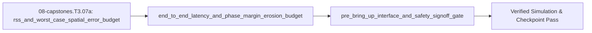

<!-- run-callout:start -->
> **Step 10 of 10 · Put it together: the 2-DOF arm**
>
> **Run this in the workbench.** [Open MechaLab with `EX.08-capstones.T3.07a` loaded](https://tle47.github.io/Mechatronics-Roadmap/?lesson=EX.08-capstones.T3.07a) - it opens on the **Run Python Lessons** tab with that entry selected. Starter code, hints and the graded check are ready; this page is the reading copy, and nothing you type here is saved.
<!-- run-callout:end -->

## 1. Why it matters
This is the final bridge module in the entire repository before Step 3.8 (`08-capstones.T3.08`: **Capstone 1** High-Speed Precision Motion Stage, **Capstone 2** Balancing Mobility Robot, or **Capstone 3** 6-DOF Force-Controlled Tele-Impedance Manipulator — the **Graduate Goal**). Why do so many student and startup robot builds fail during final integration even when the CAD, PCB, firmware, and ROS 2 nodes each worked on their own benches? Because nobody added up the **end-to-end spatial error budget** ($\sigma_{\text{total}} = \sqrt{\sum \sigma_i^2}$), the **end-to-end latency & phase-margin erosion budget** ($\Delta\phi = \omega_{gc}\sum \tau_i$), or verified a formal **Cross-Domain Interface Contract (ICD) & Pre-Bring-Up Safety Sign-Off** before energizing the $48\text{ V}$ bus! Already know this? Read `### Safety notes` first, then take the Skip test or the Ladder Gate test in section 7.

## 2. Intuition first

<!-- figure: latency-budget | Every stage spends part of the period, and the unmeasured one overruns it. -->

When you bolt six joints, six encoders, a camera, a CAN-FD bus, a $1\text{ kHz}$ `ros2_control` loop, and a $50\text{ Hz}$ learned policy together, errors and delays accumulate across every domain boundary:
1. **Spatial Error Budgeting (RSS vs. Worst-Case):** Deterministic systematic offsets $b_i$ (like uncalibrated thermal expansion) add linearly ($\sum |b_i|$), whereas independent random errors $\sigma_i$ (encoder noise, bearing runout, structural deflection, calibration residual) add in **Root-Sum-Square (RSS)**: $\sigma_{\text{rss}} = \sqrt{\sum \sigma_i^2}$. Looking at the RSS breakdown tells you immediately which single subsystem dominates $80\%$ of your error so you don't waste \$1,000 on an ultra-precise encoder when link deflection is $10\times$ larger!
2. **End-to-End Latency & Phase-Margin Budget:** Every microsecond of sensor readout delay ($\tau_{\text{enc}}$), CAN-FD wire transport ($\tau_{\text{can}}$), digital filtering ($\tau_{\text{filt}}$), and zero-order hold ($\frac{1}{2}T_s$) adds up to total loop delay $\tau_{\text{total}} = \sum \tau_k$, which steals $\Delta\phi = \omega_{gc}\tau_{\text{total}}\frac{180^\circ}{\pi}$ degrees of Phase Margin from your servo loop (`05-control.T2.05a`).
3. **Cross-Domain Interface Control Document (ICD) & Pre-Bring-Up Sign-Off:** Before first motion on a multi-DOF capstone robot, every mechanical, electrical, firmware, control, and safety assertion must pass an automated **Go / No-Go Sign-Off Checklist**.

## 3. Formalization
1. **Combined Systematic + Root-Sum-Square (RSS) Spatial Error Budget:** Given $M$ subsystems with residual systematic bias $b_i$ and independent $1\sigma$ random error $\sigma_i$ mapped to end-effector tip displacement via sensitivity $s_i$:

$$
e_{3\sigma,\text{total}} = \sum_{i=1}^{M} |s_i b_i| + 3\sqrt{\sum_{i=1}^{M} (s_i \sigma_i)^2} \le e_{\text{spec}}
$$

   The fractional variance contribution of source $i$ is $w_i = \frac{(s_i \sigma_i)^2}{\sum_j (s_j \sigma_j)^2}$ ($\sum w_i = 1$).
2. **End-to-End Loop Latency & Phase-Margin Erosion Budget:** Across sensor delay $\tau_{\text{sens}}$, bus transport $\tau_{\text{bus}}$, filter group delay $\tau_{\text{filt}}$, compute time $\tau_{\text{comp}}$, and Zero-Order Hold $\tau_{\text{zoh}} = \frac{1}{2}T_s$:

$$
\tau_{\text{total}} = \tau_{\text{sens}} + \tau_{\text{bus}} + \tau_{\text{filt}} + \tau_{\text{comp}} + \frac{1}{2}T_s, \quad \text{PM}_{\text{net}} = \text{PM}_0 - \omega_{gc}\tau_{\text{total}}\frac{180^\circ}{\pi} \ge \text{PM}_{\min}
$$

3. **Cross-Domain ICD & Pre-Bring-Up Go/No-Go Sign-Off Function:** A capstone build is cleared for energized closed-loop testing (`GO = True`) iff all 5 domain gates hold simultaneously:

$$
\text{GO} = (e_{3\sigma,\text{total}} \le e_{\text{spec}}) \land (\text{PM}_{\text{net}} \ge 45^\circ) \land (\text{CPU-Util} \le 0.70) \land (\text{CAN-Term-Ohm} \in [55, 65]) \land (\text{Cat3-STO-Verified} = \text{True})
$$


### Use & Understand
Reach for these three budgets at design freeze, and again after any subsystem swap, before a multi-DOF build is energised for the first time: the error budget says which source is worth money, the latency budget says whether the loop is still stable at its crossover, and the sign-off gate says whether it may move at all.

One run on this module's own numbers:
- The biases $0.01 + 0.04 + 0.03 + 0.02 = 0.10\text{ mm}$ add linearly; the random terms give $\sqrt{0.03^2 + 0.06^2 + 0.08^2 + 0.03^2} = 0.1086\text{ mm}$, so $e_{3\sigma} = 0.10 + 3(0.1086) = 0.4259\text{ mm} \le 0.50\text{ mm}$. Structural link deflection owns $0.08^2/0.0118 = 54\%$ of the variance and is the only source worth re-engineering.
- The delays $20 + 180 + 250 + 150\ \mu\text{s}$ plus half a $1\text{ kHz}$ tick are $\tau_{\text{total}} = 1.10\text{ ms}$, which erodes $150 \times 0.0011 \times 180/\pi = 9.45^\circ$ and leaves $52.55^\circ$: the verdict is `GO`.
- Swap in a 10-tap average ($2550\ \mu\text{s}$) and the same chain is $3.40\text{ ms}$ and $32.78^\circ$; the margin alone fails, so the verdict is `NO-GO` whatever the other four gates say.

Checks that catch most mistakes: an RSS sum is never larger than the sum of magnitudes; a larger delay must lower the margin; the $3\sigma$ factor multiplies only the quadrature sum and never the biases; the zero-order hold is half a tick, not zero; and a five-way gate is a conjunction - four green lights and one red is red.

### Derive & Extend
**Why RSS, and why biases do not cancel.** With independent zero-mean errors $\epsilon_i$ mapped to the tip by sensitivity $s_i$, the combined displacement is $e = \sum_i s_i\epsilon_i + \sum_i s_i b_i$. Independence makes every cross term vanish in expectation, so the variance is additive:

$$
\operatorname{Var}(e) = \sum_{i=1}^{M} s_i^2 \sigma_i^2, \qquad
e_{3\sigma} = \sum_{i=1}^{M} |s_i b_i| + 3\sqrt{\sum_{i=1}^{M} s_i^2 \sigma_i^2}
$$

The systematic part takes magnitudes because a bias does not average out with more samples: two offsets on opposite sides still move the tip by their sum in the worst case. The factor $3$ is a coverage factor ($99.73\%$ of a normal source), so it belongs on the random term alone. The variance share $w_i = s_i^2\sigma_i^2 / \sum_j s_j^2\sigma_j^2$ is what makes the budget actionable - at $w = 0.54$ a better encoder buys at most the remaining $46\%$.

**Why half a tick, and why it becomes degrees.** A sample taken at $kTs$ is held until $(k+1)Ts$, so on average it describes the signal $Ts/2$ late; in the frequency domain the hold $(1 - e^{-sTs})/(sTs)$ is $e^{-sTs/2}$ to first order in $s$. A pure delay $\tau$ contributes phase $-\omega\tau$ radians, so at crossover it subtracts directly:

$$
\text{PM}_{\text{net}} = \text{PM}_0 - \omega_{gc}\left(\sum_k \tau_k + \tfrac{1}{2}Ts\right)\frac{180^\circ}{\pi}
$$

The $17^\circ$ between $62^\circ$ and the $45^\circ$ floor therefore buys $\tau_{\max} = (17\pi/180)/150 = 1.978\text{ ms}$, which the $3.40\text{ ms}$ chain spends nearly twice over.

**Extend.** Add a vision pipeline and a second encoder to the same capstone: allocate the fixed $0.50\text{ mm}$ and the $17^\circ$ of margin between the new sources, then derive the largest delay the vision stage may add while `capstone_signoff` still returns `GO`.

## 4. Worked example
**Predict first (before you run it):** Commit to four numbers, a dominant source and one verdict. (1) For $1\sigma$ sources of $0.03, 0.06, 0.08, 0.03\text{ mm}$, is $\sigma_{\text{rss}}$ nearer $0.10$ or $0.14\text{ mm}$? (2) With $20 + 180 + 250 + 150\ \mu\text{s}$ plus the zero-order hold, is $\tau_{\text{total}}$ nearer $0.6$ or $1.1\text{ ms}$? (3) At $\omega_{gc} = 150\text{ rad/s}$ and $\text{PM}_0 = 62.0^\circ$, does the loop keep the $45^\circ$ floor? (4) Which source owns most of the variance? Then answer the exercise's verdict after a $10$-tap filter pushes $\tau_{\text{total}}$ to $3.40\text{ ms}$: GO or NO-GO? Two tells that a wrong answer is a mistake rather than a convention: a systematic term of $0.0548\text{ mm}$ instead of $0.10\text{ mm}$ means the four biases were Root-Sum-Squared like the random errors (they add linearly); and a net margin above $62.0^\circ$ means the erosion was added to the nominal margin instead of subtracted from it.

Evaluate the complete system error budget, latency/phase-margin budget, and 5-domain Pre-Bring-Up Go/No-Go Sign-Off for Capstone 3 (the 6-DOF Tele-Impedance Manipulator with $e_{\text{spec}} = 0.50\text{ mm}$ repeatability, $\omega_{gc} = 150\text{ rad/s}$, and nominal $\text{PM}_0 = 62.0^\circ$).

```python
import math

# 1. Spatial Repeatability Budget (in mm): (name, systematic_bias_mm, sigma_1_mm)
error_sources = [
    ("Encoder quantization & noise", 0.01, 0.03),
    ("Harmonic/planetary backlash",  0.04, 0.06),
    ("Structural link deflection",   0.03, 0.08),
    ("Thermal drift (calibrated)",   0.02, 0.03),
]
sys_sum_mm = sum(abs(b) for _, b, _ in error_sources)
rss_1sigma_mm = math.sqrt(sum(s ** 2 for _, _, s in error_sources))
e_3sigma_mm = sys_sum_mm + 3.0 * rss_1sigma_mm
dominant_source = max(error_sources, key=lambda item: item[2] ** 2)[0]
assert math.isclose(rss_1sigma_mm, math.sqrt(0.03**2 + 0.06**2 + 0.08**2 + 0.03**2), rel_tol=1e-9)
assert e_3sigma_mm < 0.50  # Meets 0.50 mm spec!

# 2. End-to-End Loop Latency Budget at 1 kHz (Ts = 1000 us) and w_gc = 150 rad/s
tau_sens_us, tau_can_us, tau_filt_us, tau_comp_us, ts_us = 20.0, 180.0, 250.0, 150.0, 1000.0
tau_total_s = (tau_sens_us + tau_can_us + tau_filt_us + tau_comp_us + 0.5 * ts_us) * 1e-6  # 0.0011 s (1.1 ms)
pm0_deg, w_gc = 62.0, 150.0
pm_net_deg = pm0_deg - w_gc * tau_total_s * (180.0 / math.pi)
assert math.isclose(tau_total_s, 0.0011, rel_tol=1e-9)
assert pm_net_deg >= 45.0  # 52.55 deg >= 45 deg!

# 3. Pre-Bring-Up 5-Domain Go/No-Go Sign-Off Gate
def capstone_signoff(e_3sig: float, pm_net: float, cpu_u: float, can_ohm: float, sto_cat3_ok: bool) -> bool:
    return (e_3sig <= 0.50) and (pm_net >= 45.0) and (cpu_u <= 0.70) and (55.0 <= can_ohm <= 65.0) and sto_cat3_ok

assert capstone_signoff(e_3sigma_mm, pm_net_deg, cpu_u=0.42, can_ohm=60.0, sto_cat3_ok=True) is True
assert capstone_signoff(e_3sigma_mm, pm_net_deg, cpu_u=0.42, can_ohm=60.0, sto_cat3_ok=False) is False
print(f"e_3sigma={e_3sigma_mm:.3f} mm (dominant: {dominant_source}), tau={tau_total_s*1e3:.2f} ms, PM_net={pm_net_deg:.2f} deg, GO=True")
```
Expected output:
```text
e_3sigma=0.426 mm (dominant: Structural link deflection), tau=1.10 ms, PM_net=52.55 deg, GO=True
```

## 5. Exercise
Suppose an engineer replaces the $250\ \mu\text{s}$ low-pass filter in the $1\text{ kHz}$ loop above with a heavy 10-tap moving-average filter that adds $\tau_{\text{filt,new}} = 2550\ \mu\text{s}$ of delay (so $\tau_{\text{total}}$ increases from $1.10\text{ ms}$ to $3.40\text{ ms}$). Compute the new net Phase Margin $\text{PM}_{\text{net}} = 62.0^\circ - 150.0 \times 0.0034 \times \frac{180^\circ}{\pi}$ in degrees, and verify whether `capstone_signoff` returns `True` or `False`. Verify $\text{PM}_{\text{net}} = 32.779^\circ < 45.0^\circ$ and `capstone_signoff == False`.
- **If your result differs:** Multiply $150.0\text{ rad/s} \times 0.0034\text{ s} = 0.51\text{ rad}$, convert to degrees ($0.51 \times 180/\pi = 29.2208^\circ$), and subtract from $62.0^\circ$ ($32.78^\circ < 45^\circ \implies \text{NO-GO}$).


### Graded package - the error budget, the delay and the sign-off
[`exercises/08-capstones.T3.07a/`](../exercises/08-capstones.T3.07a/) turns this section into a test. `starter.py` holds nine holes: `rss`, `systematic_sum`, `error_budget_3sigma`, `variance_fraction`, `zoh_delay_us`, `total_latency_s`, `net_phase_margin_deg`, `max_allowable_delay_ms` and `capstone_signoff`. Edit it, then run the tests the way CI does:

```bash
EXERCISE_TARGET=exercises/08-capstones.T3.07a/starter.py \
  python3 -m unittest discover -s exercises/08-capstones.T3.07a -p 'test_*.py'
```

**42 tests.** The $3\sigma$ budget is checked at the worked example's $0.4259\text{ mm}$ and the Gate test's $0.35\text{ mm}$, and a $-0.02\text{ mm}$ bias must still add $0.02\text{ mm}$ rather than cancel, so a linear sum or a signed sum each fail; the latency chain is checked at $1100\ \mu\text{s}$ and at the 10-tap filter's $3400\ \mu\text{s}$, so a chain that forgets the $500\ \mu\text{s}$ zero-order hold fails; the phase subtraction is checked in degrees at $52.55^\circ$, $32.78^\circ$ and $48.54^\circ$, so a raw radian result fails; and the sign-off is checked at the 4-of-5 `STO` case, an out-of-window $50\ \Omega$ bus, and the inclusive boundaries of all five limits. The transfer suite runs **the plant**: one count of its 12-bit encoder seen at the full $0.20\text{ m}$ reach is $0.3068\text{ mm}$, so $3\sigma$ is $0.9204\text{ mm}$ and the $0.50\text{ mm}$ capstone spec is already lost before any other source is counted; its $1\text{ kHz}$ tick is the worked $1000\ \mu\text{s}$ period and erodes $8.59^\circ$ at $150\text{ rad/s}$; and the $17^\circ$ between the nominal margin and the $45^\circ$ floor buys $1.978\text{ ms}$, which the module's filter swap spends nearly twice over. Five planted faults - `rss_adds_linearly`, `systematic_forgets_abs`, `latency_forgets_zoh`, `phase_margin_forgets_radians`, `signoff_ignores_sto` - each fail the test named for them.

**The browser bench is this module's pass condition.** In the Python runner, a Tier 3 Capstone Budget Bench reports four rows computed by the harness from *your* functions on a design point this module never prints: the $3\sigma$ spatial budget, the net phase margin through the latency chain, the delay the remaining margin may buy, and how many of the two sign-off verdicts your `capstone_signoff` gets right. **Run & Verify Output** marks the lesson verified only when all four rows are at target ($\le 0.50\text{ mm}$, $\ge 45^\circ$, at least the $1.18\text{ ms}$ chain, both verdicts) - a zero-order hold charged a full tick instead of half keeps its real $42.7^\circ$ on the row and leaves the lesson unverified, whatever the printed line says.

### Starter code
```python
"""Exercise 08-capstones.T3.07a - the learner's file.

Three budgets and one gate: the RSS spatial error budget, the end-to-end latency that becomes
phase margin, and the five-domain Go/No-Go sign-off. Fill the nine TODOs:

    EXERCISE_TARGET=exercises/08-capstones.T3.07a/starter.py \
        python3 -m unittest discover -s exercises/08-capstones.T3.07a -p 'test_*.py'
"""

import math


def rss(sigmas):
    """The root-sum-square of independent 1-sigma contributions."""
    raise NotImplementedError("TODO 1: square, sum, then ONE square root - not the sum itself")


def systematic_sum(biases):
    """Deterministic offsets add linearly."""
    raise NotImplementedError("TODO 2: abs() first, either - a bias on the other side is not a credit")


def error_budget_3sigma(biases, sigmas, sensitivities=None, nsig=3.0):
    """e = sum |s_i b_i| + nsig * sqrt(sum (s_i sigma_i)^2)."""
    raise NotImplementedError(
        "TODO 3: systematic terms add as magnitudes, random terms add in quadrature, then scale"
    )


def variance_fraction(index, sigmas, sensitivities=None):
    """w_i = (s_i sigma_i)^2 / sum_j (s_j sigma_j)^2."""
    raise NotImplementedError("TODO 4: variance, not sigma - the squares are what add to one")


def zoh_delay_us(ts_us):
    """The zero-order hold delay, in microseconds."""
    raise NotImplementedError("TODO 5: half a sample period, not a whole one")


def total_latency_s(tau_sens_us, tau_bus_us, tau_filt_us, tau_comp_us, ts_us):
    """Every delay plus the ZOH, in seconds."""
    raise NotImplementedError("TODO 6: four delays PLUS half a tick, then microseconds to seconds")


def net_phase_margin_deg(pm0_deg, w_gc_rad_s, tau_total_s):
    """PM_net = PM_0 - omega_gc * tau_total, in degrees."""
    raise NotImplementedError("TODO 7: the product is in RADIANS - multiply by 180/pi")


def max_allowable_delay_ms(dphi_max_rad, w_gc_rad_s):
    """The delay a phase budget buys, in milliseconds."""
    raise NotImplementedError("TODO 8: divide the phase budget by crossover, then scale to ms")


def capstone_signoff(e_3sig_mm, pm_net_deg, cpu_u, can_ohm, sto_cat3_ok,
                     e_spec_mm=0.50, pm_min_deg=45.0, cpu_max=0.70,
                     can_min_ohm=55.0, can_max_ohm=65.0):
    """GO only when every one of the five domains passes."""
    raise NotImplementedError(
        "TODO 9: four gates AND the STO - and the limits are inclusive at their own boundary"
    )


# The browser entry appends `selfcheck.py` below this line; on its own this file prints nothing.
```

**Expected numbers (the answer):** $\tau_{\text{total}} = 3.40\ \text{ms}$, $\text{PM}_{\text{net}} = 32.779^\circ < 45.0^\circ$, `capstone_signoff == False`.

### Hint ladder
1. **The ZOH is half a tick.** Six delays, not five: $20 + 180 + 2550 + 150\ \mu\text{s}$ of measured latency *plus* $\frac{1}{2}T_s = 500\ \mu\text{s}$, which is $3400\ \mu\text{s}$ and not the $2900\ \mu\text{s}$ the measured chain alone gives.
2. **Radians before degrees.** $150.0\ \text{rad/s} \times 0.0034\ \text{s} = 0.51\ \text{rad}$ of lag; subtract $0.51 \times 180/\pi = 29.2208^\circ$ from $62.0^\circ$. A net margin near $61.5^\circ$ means the product was treated as degrees already.
3. **Four out of five is NO-GO.** The gate is a conjunction: the $3\sigma$ budget ($0.4259\ \text{mm} \le 0.50$), the margin ($32.78^\circ < 45^\circ$), CPU, termination and STO. Here the margin alone already fails, so the verdict is `False` whatever the other four say.
4. **The $3\sigma$ budget is a magnitude budget.** Biases add linearly, so two offsets on opposite sides still add their sizes; only the independent random terms add in quadrature, and only then is the $3\sigma$ factor applied to that quadrature sum.

5. **What the suite refuses.** `error_budget_3sigma` refuses an empty budget and a sensitivity list whose lengths cannot pair, `rss` refuses a negative sigma, `variance_fraction` refuses a variance budget summing to zero and an index past its terms, `total_latency_s` refuses a negative delay or a zero sample period, `zoh_delay_us` refuses a zero sample period, `max_allowable_delay_ms` and `net_phase_margin_deg` refuse a crossover that is not positive (there is no delay budget to divide into), and `capstone_signoff` refuses an STO flag that is not a bool - each with `ValueError`.

### Full Solution
```python
import math


def _floats(values, name):
    """A non-empty list of plain, finite numbers, or a ValueError naming the argument."""
    if not isinstance(values, (list, tuple)):
        raise ValueError("%s must be a list of numbers" % name)
    out = []
    for value in values:
        if isinstance(value, bool) or not isinstance(value, (int, float)):
            raise ValueError("%s must hold plain numbers, not %r" % (name, value))
        value = float(value)
        if not math.isfinite(value):
            raise ValueError("%s must be finite" % name)
        out.append(value)
    return out


def rss(sigmas):
    """The root-sum-square of independent 1-sigma contributions: sqrt(sum sigma_i^2)."""
    values = _floats(sigmas, "sigmas")
    if not values:
        raise ValueError("an error budget needs at least one source")
    if any(value < 0.0 for value in values):
        raise ValueError("a 1-sigma contribution is a magnitude, never negative")
    return math.sqrt(sum(value * value for value in values))


def systematic_sum(biases):
    """Deterministic offsets add linearly, and they add in magnitude however signed they are."""
    values = _floats(biases, "biases")
    if not values:
        raise ValueError("an error budget needs at least one source")
    return sum(abs(value) for value in values)


def error_budget_3sigma(biases, sigmas, sensitivities=None, nsig=3.0):
    """e = sum |s_i b_i| + nsig * sqrt(sum (s_i sigma_i)^2), in the inputs' own unit."""
    bias_values = _floats(biases, "biases")
    sigma_values = _floats(sigmas, "sigmas")
    # The two lists are independent sums (one systematic offset against any number of random
    # sources), so they need not pair up: a single 0.05 mm bias may face two sigma sources.
    if not bias_values or not sigma_values:
        raise ValueError("an error budget needs at least one source")
    if sensitivities is None:
        bias_gains = [1.0] * len(bias_values)
        sigma_gains = [1.0] * len(sigma_values)
    else:
        gains = _floats(sensitivities, "sensitivities")
        if len(gains) != max(len(bias_values), len(sigma_values)):
            raise ValueError("one sensitivity per source; a shorter list cannot pair with it")
        bias_gains = gains[:len(bias_values)]
        sigma_gains = gains[:len(sigma_values)]
    if nsig < 0.0:
        raise ValueError("a coverage factor cannot be negative")
    systematic = systematic_sum([gain * bias for gain, bias in zip(bias_gains, bias_values)])
    random_part = rss([gain * sigma for gain, sigma in zip(sigma_gains, sigma_values)])
    return systematic + nsig * random_part


def variance_fraction(index, sigmas, sensitivities=None):
    """w_i = (s_i sigma_i)^2 / sum_j (s_j sigma_j)^2 - which source owns the variance."""
    values = _floats(sigmas, "sigmas")
    if not values:
        raise ValueError("an error budget needs at least one source")
    if sensitivities is None:
        gains = [1.0] * len(values)
    else:
        gains = _floats(sensitivities, "sensitivities")
        if len(gains) != len(values):
            raise ValueError("one sensitivity per source")
    if isinstance(index, bool) or not isinstance(index, int) or not 0 <= index < len(values):
        raise ValueError("%r is not a source in this budget" % (index,))
    contributions = [(gain * sigma) ** 2 for gain, sigma in zip(gains, values)]
    total = sum(contributions)
    if total <= 0.0:
        raise ValueError("a budget of zero variance has no dominant source")
    return contributions[index] / total


def zoh_delay_us(ts_us):
    """The zero-order hold costs half a sample period of delay."""
    if not math.isfinite(ts_us) or ts_us <= 0.0:
        raise ValueError("a loop needs a positive sample period")
    return 0.5 * ts_us


def total_latency_s(tau_sens_us, tau_bus_us, tau_filt_us, tau_comp_us, ts_us):
    """Every delay in the chain plus half a sample period of ZOH, in seconds."""
    for name, value in (("sensor", tau_sens_us), ("bus", tau_bus_us), ("filter", tau_filt_us),
                        ("compute", tau_comp_us)):
        if not math.isfinite(value) or value < 0.0:
            raise ValueError("the %s delay cannot be negative" % name)
    return (tau_sens_us + tau_bus_us + tau_filt_us + tau_comp_us + zoh_delay_us(ts_us)) * 1e-6


def net_phase_margin_deg(pm0_deg, w_gc_rad_s, tau_total_s):
    """PM_net = PM_0 - omega_gc tau (180/pi): a radian of lag is 57.3 degrees."""
    if not math.isfinite(w_gc_rad_s) or w_gc_rad_s < 0.0:
        raise ValueError("crossover is a positive frequency")
    if not math.isfinite(tau_total_s) or tau_total_s < 0.0:
        raise ValueError("delay cannot be negative")
    return pm0_deg - w_gc_rad_s * tau_total_s * (180.0 / math.pi)


def max_allowable_delay_ms(dphi_max_rad, w_gc_rad_s):
    """tau_max = dphi_max / omega_gc, reported in milliseconds."""
    if not math.isfinite(w_gc_rad_s) or w_gc_rad_s <= 0.0:
        raise ValueError("crossover must be a positive frequency")
    if not math.isfinite(dphi_max_rad) or dphi_max_rad < 0.0:
        raise ValueError("a phase budget is a magnitude")
    return (dphi_max_rad / w_gc_rad_s) * 1e3


def capstone_signoff(e_3sig_mm, pm_net_deg, cpu_u, can_ohm, sto_cat3_ok,
                     e_spec_mm=0.50, pm_min_deg=45.0, cpu_max=0.70,
                     can_min_ohm=55.0, can_max_ohm=65.0):
    """GO only when all five domains pass simultaneously; four out of five is NO-GO."""
    if not isinstance(sto_cat3_ok, bool):
        raise ValueError("the STO result is a verified yes or no, not a stand-in")
    if not 0.0 < e_spec_mm or not 0.0 < pm_min_deg or not 0.0 < cpu_max <= 1.0:
        raise ValueError("the spec limits must be positive fractions")
    if can_min_ohm >= can_max_ohm:
        raise ValueError("the termination window is empty")
    return (
        e_3sig_mm <= e_spec_mm
        and pm_net_deg >= pm_min_deg
        and cpu_u <= cpu_max
        and can_min_ohm <= can_ohm <= can_max_ohm
        and sto_cat3_ok
    )


# No `__main__` block on purpose: the browser grades this file's stdout against the appended
# self-check's single PASS line, and a second print here would be a mismatch for a correct answer.

e_3sig = error_budget_3sigma([0.01, 0.04, 0.03, 0.02], [0.03, 0.06, 0.08, 0.03])
tau_nominal = total_latency_s(20.0, 180.0, 250.0, 150.0, 1000.0)
pm_nominal = net_phase_margin_deg(62.0, 150.0, tau_nominal)
tau_filtered = total_latency_s(20.0, 180.0, 2550.0, 150.0, 1000.0)
pm_filtered = net_phase_margin_deg(62.0, 150.0, tau_filtered)
go = capstone_signoff(e_3sig, pm_filtered, 0.42, 60.0, True)

assert math.isclose(e_3sig, 0.425883, abs_tol=1e-6)
assert math.isclose(tau_nominal, 0.0011, rel_tol=1e-12)
assert math.isclose(pm_nominal, 52.5462, abs_tol=1e-3)
assert math.isclose(tau_filtered, 0.0034, rel_tol=1e-12)
assert math.isclose(pm_filtered, 32.7791, abs_tol=1e-3)
assert go is False

print("PM_net=%.2f deg at tau=%.2f ms | signoff=%s" % (pm_filtered, tau_filtered * 1e3, go))
print("nominal: tau=%.2f ms, PM_net=%.2f deg, e_3sigma=%.3f mm"
      % (tau_nominal * 1e3, pm_nominal, e_3sig))

```

Printed: `PM_net=32.78 deg at tau=3.40 ms | signoff=False`, then `nominal: tau=1.10 ms, PM_net=52.55 deg, e_3sigma=0.426 mm`.

**On the shared arm.** The Transfer suite prices the plant's own 12-bit encoder and 1 kHz sample period against the capstone's 0.50 mm and $45^\circ$ budgets:

```python
import math
import mechalab_plant as plant

one_count_mm = (2.0 * math.pi / plant.ENCODER_CPR) * 0.20 * 1e3  # one count at the 0.20 m reach
assert math.isclose(one_count_mm, 0.3067961575771282, rel_tol=1e-12)
assert math.isclose(plant.DT * 1e6, 1000.0, rel_tol=1e-12)
margin = 62.0 - 150.0 * plant.DT * (180.0 / math.pi)  # 150 rad/s crossover, one tick of delay
assert math.isclose(margin, 53.405633073, abs_tol=1e-9)
assert 3.0 * one_count_mm > 0.50  # the encoder alone already blows the spec at 3 sigma
print("one count=%.4f mm | tick=%.1f us | PM=%.4f deg" % (one_count_mm, plant.DT * 1e6, margin))
```

### Break it on purpose

<!-- figure: fault-cost | A budget that has never been measured is a wish; the fault is where it shows. -->

Inject the `latency_forgets_zoh` fault and diagnose it from the budget alone, keeping $T_s = 1000\ \mu\text{s}$ and $\omega_{gc} = 150\text{ rad/s}$:
- **Inject:** sum the four measured delays and drop the zero-order hold term, i.e. `tau_total_s = (tau_sens_us + tau_bus_us + tau_filt_us + tau_comp_us) * 1e-6` instead of adding `0.5 * ts_us`.
- **Symptom:** the worked case reports $0.60\text{ ms}$ and $56.84^\circ$ instead of $1.10\text{ ms}$ and $52.55^\circ$, so it still says GO and a smoke test passes; the exercise's $3.40\text{ ms}$ becomes $2.90\text{ ms}$ and $37.08^\circ$ instead of $32.78^\circ$ (still NO-GO, but $4.3^\circ$ of margin that no longer exists), and the transfer suite's one-plant-tick erosion halves from $8.59^\circ$ to $4.30^\circ$. The error is always exactly $0.5\text{ ms}$ of delay, regardless of which filter is installed.
- **Diagnose:** the constant offset separates it from a sensor or bus latency mistake. A wrong measured delay changes with the hardware and shifts every case by a different amount, whereas a gap that is exactly $\frac{1}{2}T_s$ in all four cases - and that leaves $\text{PM}_0$, the $3\sigma$ budget and the $5$-domain gate untouched - can only be the sampling term, not `max_allowable_delay_ms` or a degrees/radians slip.
- **Fix:** restore `+ 0.5 * ts_us` in the chain and prove it at the two numbers CI checks: $1.10\text{ ms}$ and $52.55^\circ$ for the worked example, $3.40\text{ ms}$ and $32.78^\circ$ for the filter swap, plus the gate's $500\ \mu\text{s}$ ZOH. `latency_forgets_zoh` must fail `test_behavior`, and the plant-tick transfer check ($8.59^\circ$ at $150\text{ rad/s}$) must pass.

- **📚 What to Learn & Resources to Solve This Exercise:**
  - **Required Foundations Modules (`00-foundations`):** [`00-foundations.T2.00d`](00-foundations.T2.00d.md) (*Bode Phase Margin*), [`00-foundations.T2.00f`](00-foundations.T2.00f.md) (*Root-Sum-Square Variance Summation*), and [`00-foundations.T3.00a`](00-foundations.T3.00a.md) (*Multi-Domain Power & Energy Balance*).
  - **Prerequisite Tier 3 Modules:** [`01-electronics.T3.02`](../01-electronics-and-power/README.md), [`02-mechanics.T3.03`](../02-mechanics-kinematics-dynamics/README.md), [`03-sensors.T3.04`](../03-sensors-and-actuators/README.md), [`04-embedded.T3.05`](../04-embedded-and-realtime/README.md), [`05-control.T3.06`](../05-control-and-estimation/README.md), and [`06-robotics.T3.07`](../06-robotics-and-autonomy/README.md).
  - **Core Concepts to Review First:** End-to-end latency phase erosion $\Delta\phi(\omega_{gc}) = -\omega_{gc}\tau_{\text{total}}\frac{180^\circ}{\pi}$ and net phase margin $\text{PM}_{\text{net}} = \text{PM}_0 - |\Delta\phi|$, coupled electro-thermo-mechanical power sizing, and `ISO 13855` safety stopping distance in `## 3. Formalization` and `## 4. Worked example` above.
  - **Study Links & Resources:** [Slocum *Precision Machine Design*](https://ocw.mit.edu/courses/2-75-precision-machine-design-fall-2001/), [NASA Systems Engineering Handbook (`NASA/SP-2016-6105`)](https://www.nasa.gov/reference/systems-engineering-handbook/), and [Track 08 Capstones (`08-capstone-projects/README.md`)](../08-capstone-projects/README.md#tier-3-capstone-builds-advanced--production-pass).

## 6. Simulation path
Open **URDF / MuJoCo & STO — Capstone 3: 6-DOF Force-Controlled Tele-Impedance Manipulator & System Verification** in the MechaLab Workbench (`npm run dev`), or run the standalone verification script `python3 08-capstone-projects/urdf-mujoco-capstone3-6dof/verify_capstone3_kinematics_cbf.py`.

### Safety notes
> **⚠️ Mandatory Safety Briefing (`safety_level: high` — read before energizing any Capstone hardware build or taking the Skip/Gate test):**
> 1. **Mandatory 5-Stage Progressive Bring-Up Sequence:** Never power up a newly assembled multi-DOF robot and immediately enable full-torque closed-loop trajectory tracking. Always execute in strict order:
>    - **Stage 0 (Power-Off Bench Check):** Verify bus resistance (`> 10 kOhm` `+Vbus` to `GND`), CAN termination ($60\ \Omega$), fastener torque witness marks, and mechanical hard stops.
>    - **Stage 1 (Current-Limited Logic & Sensor Check):** Current-limited bench PSU ($24\text{ V}/48\text{ V}$ at $0.5\text{ A}$), verify encoder counts, joint signs, `tf2` tree directions in `RViz2`, and dual-channel `STO` cut-off (`torque_removed == True`).
>    - **Stage 2 (Single-Joint Open-Loop / Low-Current FOC Alignment):** Align electrical zero angle $\theta_e$ with mechanical load uncoupled or arm supported in a safe cradle.
>    - **Stage 3 (Zero-Stiffness Gravity Compensation + Damping Mode):** Set $K_p = 0$, $K_d > 0$, $\tau_{\text{ff}} = g(q)$ with $20\%$ torque ceiling; move the arm by hand to verify smooth backdrivability and confirm that pushing each link produces damped resistance (positive damping, not positive feedback!).
>    - **Stage 4 (Full Closed-Loop Impedance + CBF Safety Shield + E-Stop Live Test):** Enable Cartesian impedance / learned policy only after Stages 0–3 and a live physical E-stop cut test pass.




## 7. Checkpoint
Pass criteria: read `### Safety notes`, score $\ge 80\%$ ($5/6$, $100\%$ on `[SAFETY]` items) on the Skip test, or score $\ge 80\%$ ($7/8$, $100\%$ on `[SAFETY]` items) on the Ladder Gate test to unlock Step 3.8 (`08-capstones.T3.08`).

### Skip test
<!-- skip-test:start -->
1. `[Recall] [Concept: rss_and_worst_case_spatial_error_budget]` Three independent random error sources have $1\sigma$ end-effector contributions $\sigma_1 = 0.03\text{ mm}$, $\sigma_2 = 0.04\text{ mm}$, and $\sigma_3 = 0.12\text{ mm}$. Compute the combined Root-Sum-Square (RSS) $1\sigma$ error $\sigma_{\text{rss}} = \sqrt{\sigma_1^2 + \sigma_2^2 + \sigma_3^2}$ in millimeters ($\text{mm}$, tolerance $\pm 10^{-9}$).
2. `[Apply] [Concept: rss_and_worst_case_spatial_error_budget]` In Q1 ($\sigma_1 = 0.03, \sigma_2 = 0.04, \sigma_3 = 0.12\text{ mm}$, so $\sigma_{\text{rss}} = 0.13\text{ mm}$), what fraction of the total error variance $\sigma_3^2 / \sigma_{\text{rss}}^2$ comes from source 3 alone (tolerance $\pm 10^{-4}$)?
3. `[Transfer] [Concept: end_to_end_latency_and_phase_margin_erosion_budget]` A servo loop has crossover $\omega_{gc} = 200\text{ rad/s}$, delay-free Phase Margin $\text{PM}_0 = 60.0^\circ$, and total end-to-end loop delay $\tau_{\text{total}} = 0.001\text{ s}$ ($1.0\text{ ms}$). Compute the net Phase Margin $\text{PM}_{\text{net}} = \text{PM}_0 - \omega_{gc}\tau_{\text{total}}\frac{180^\circ}{\pi}$ in degrees (tolerance $\pm 0.01^\circ$).
4. `[SAFETY] [Concept: pre_bring_up_interface_and_safety_signoff_gate]` During **Stage 3** of progressive bring-up on a 6-DOF robot arm (before enabling stiff position trajectories), you set $K_p = 0$, $K_d = 1.5\text{ N}\cdot\text{m}\cdot\text{s/rad}$, and $\tau_{\text{ff}} = g(q)$ at a $20\%$ torque limit and gently push Joint 2 by hand. Why is this test mandatory before enabling $K_p > 0$?
   - **A.** To polish the aluminum links.
   - **B.** It safely verifies at low torque that encoder direction, motor phase sequence, velocity sign ($-K_d\dot{q}$), and gravity vector $g(q)$ all oppose external disturbances rather than accelerating into positive-feedback runaway!
   - **C.** Because $K_p$ is never used in robotics.
   - **D.** To discharge the battery.
5. `[SAFETY] [Concept: pre_bring_up_interface_and_safety_signoff_gate]` If 4 out of 5 pre-bring-up gates pass (`e_3sigma <= spec`, `PM_net >= 45 deg`, `CPU_Util <= 0.70`, `CAN_Term == 60 Ohm`), but the dual-channel Category 3 `STO` test has **not** been verified (`sto_cat3_ok = False`), what integer value must `int(all(gates))` return (`0` for `False / NO-GO`, `1` for `True / GO`, exact integer, tolerance $\pm 0$)?
6. `[Spaced review -> 07-systems.T2.07a — Concept: regenerative_bus_energy_and_chopper_sizing]` A $1000\ \mu\text{F}$ bus at $48.0\,\text{V}$ is pushed to $60.0\,\text{V}$ by regeneration. Compute the added energy $\tfrac12 C (V_2^2 - V_1^2)$ in joules (tolerance $\pm 10^{-6}$).

**Answer key:**
```python
import math

q1_rss_mm = math.sqrt(0.03**2 + 0.04**2 + 0.12**2)
q2_var_frac = (0.12 ** 2) / (q1_rss_mm ** 2)
q3_pm_net = 60.0 - 200.0 * 0.001 * (180.0 / math.pi)
q4_safety_choice = "B"
q5_safety_go = int(all([True, True, True, True, False]))

assert math.isclose(q1_rss_mm, 0.13, rel_tol=1e-9)
assert math.isclose(q2_var_frac, 144.0 / 169.0, rel_tol=1e-4)
assert math.isclose(q3_pm_net, 48.540844, abs_tol=1e-2)
assert q4_safety_choice == "B"  # Mandatory [SAFETY] 100% required
assert q5_safety_go == 0         # Mandatory [SAFETY] 100% required
q6_review = 0.5 * 1000e-6 * (60.0 ** 2 - 48.0 ** 2)
assert math.isclose(q6_review, 0.648, rel_tol=1e-9, abs_tol=1e-06)
```
- **Pass mark:** $5/6$ overall AND $2/2$ ($100\%$) on Q4 and Q5 (`[SAFETY]`). If you missed Q1 or Q2, study `## 3. Formalization` item 1; Q3, study `## 3. Formalization` item 2; Q4 or Q5, study `## 3. Formalization` item 3 and `### Safety notes`. If you missed  Q6, review `07-systems.T2.07a`. On pass, proceed to `## 10. Next modules`.
<!-- skip-test:end -->

### Gate test
Covers the complete Track 08 Tier 3 Capstone Engineering bridge ladder (`08-capstones.T3.07a`) before Step 3.8 (`08-capstones.T3.08`):
1. `[Concept: rss_and_worst_case_spatial_error_budget]` Compute the $3\sigma$ total error $e_{3\sigma} = |b| + 3\sqrt{\sigma_1^2 + \sigma_2^2}$ in millimeters ($\text{mm}$, tolerance $\pm 10^{-9}$) for systematic bias $b = 0.05\text{ mm}$ and independent random errors $\sigma_1 = 0.06\text{ mm}, \sigma_2 = 0.08\text{ mm}$.
2. `[Concept: rss_and_worst_case_spatial_error_budget]` Why is reducing a small error source ($\sigma_1 = 0.02\text{ mm}$) to zero almost useless when another subsystem has $\sigma_2 = 0.20\text{ mm}$?
   - **A.** Because in Root-Sum-Square $\sqrt{0.02^2 + 0.20^2} = 0.2010\text{ mm} \to 0.2000\text{ mm}$, the largest variance source ($\sigma_2^2 = 99\%$ of variance) dominates the total RSS sum!
   - **B.** Because square roots cannot be computed on small numbers.
   - **C.** Because encoders do not affect accuracy.
   - **D.** Because systematic bias cancels random noise.
3. `[Concept: end_to_end_latency_and_phase_margin_erosion_budget]` In a digital control loop running at sample period $T_s = 1000\ \mu\text{s}$ ($1\text{ kHz}$), what is the effective Zero-Order Hold (ZOH) delay $\tau_{\text{zoh}} = \frac{1}{2}T_s$ in microseconds ($\mu\text{s}$, tolerance $\pm 10^{-9}$)?
4. `[Concept: end_to_end_latency_and_phase_margin_erosion_budget]` Compute the maximum allowable total loop delay $\tau_{\max} = \frac{\Delta\phi_{\max}}{\omega_{gc}}$ in milliseconds ($\text{ms}$, tolerance $\pm 10^{-3}\text{ ms}$) if a loop with crossover $\omega_{gc} = 200\text{ rad/s}$ can afford to lose at most $\Delta\phi_{\max} = 0.20\text{ rad}$ ($\approx 11.46^\circ$) of Phase Margin.
5. `[Concept: pre_bring_up_interface_and_safety_signoff_gate]` Why must a Cross-Domain Interface Control Document (ICD) explicitly lock down coordinate frame conventions (`REP-103` `+X` fwd, `+Y` left, `+Z` up), joint rotation sign (`+q` right-hand rule about joint axis), and SI units (`rad`, `N*m`, `A`) across Mechanical, Firmware, and ROS 2 teams?
   - **A.** Because a single sign inversion or deg/rad unit mismatch across the CAN-FD interface turns negative feedback into violent positive-feedback instability on the very first control tick!
   - **B.** To make the README file longer.
   - **C.** Because C++ does not support negative numbers.
   - **D.** To change the motor winding resistance.
6. `[Concept: pre_bring_up_interface_and_safety_signoff_gate]` During **Stage 0 (Power-Off Bench Check)**, what nominal DC resistance in ohms ($\Omega$, tolerance $\pm 10^{-9}$) must you measure between `CAN_H` and `CAN_L` across a properly terminated 6-joint CAN-FD daisy chain?
7. `[SAFETY] [Concept: pre_bring_up_interface_and_safety_signoff_gate]` During **Stage 3** bring-up, you push Joint 1 slightly in the $+\theta$ direction and feel the motor push your hand *further* in the $+\theta$ direction instead of resisting. What is the root cause and immediate action?
   - **A.** Hit E-Stop immediately; the encoder direction or motor phase order is inverted relative to the controller sign convention (positive feedback!), and must be flipped and re-tested at low current before proceeding.
   - **B.** Increase $K_p$ by $10\times$ to overpower it.
   - **C.** Remove the E-stop button.
   - **D.** Ignore it and start the neural network policy.
8. `[SAFETY] [Concept: pre_bring_up_interface_and_safety_signoff_gate]` Why must the physical hardware E-stop (`STO`) test in **Stage 1 / Stage 4** be tested under actual motion before running autonomous policies?
   - **A.** To prove end-to-end that pressing the physical E-stop mushroom immediately removes inverter gate drive power (`STO`), coasts/brakes the links safely within the stopping distance budget, and latches `FAULT` until manually reset.
   - **B.** To wear in the button spring.
   - **C.** To calibrate the camera focal length.
   - **D.** To test the Wi-Fi router.

**Gate answer key:**
```python
import math

g1_e3sig = 0.05 + 3.0 * math.sqrt(0.06**2 + 0.08**2)
g2_choice = "A"
g3_zoh_us = 0.5 * 1000.0
g4_tau_max_ms = (0.20 / 200.0) * 1e3
g5_choice = "A"
g6_can_ohm = 60.0
g7_safety_choice = "A"
g8_safety_choice = "A"

assert math.isclose(g1_e3sig, 0.35, rel_tol=1e-9)
assert g2_choice == "A"
assert math.isclose(g3_zoh_us, 500.0, rel_tol=1e-9)
assert math.isclose(g4_tau_max_ms, 1.0, rel_tol=1e-9)
assert g5_choice == "A"
assert math.isclose(g6_can_ohm, 60.0, rel_tol=1e-9)
assert g7_safety_choice == "A"  # Mandatory [SAFETY] 100% required
assert g8_safety_choice == "A"  # Mandatory [SAFETY] 100% required
```
- **Pass mark:** $7/8$ overall AND $2/2$ ($100\%$) on `[SAFETY]` questions Q7 and Q8. Remediation: Q1–Q2 $\to$ `## 3. Formalization` item 1; Q3–Q4 $\to$ `## 3. Formalization` item 2; Q5–Q8 $\to$ `## 3. Formalization` item 3 and `### Safety notes`.

## 8. Common mistakes
| Symptom | Root cause | 2-minute fix |
| :--- | :--- | :--- |
| Final 6-DOF arm misses its $0.5\text{ mm}$ repeatability spec by $3\times$ despite using $18\text{ -bit}$ encoders | Assumed encoder resolution equals tip accuracy and ignored structural link compliance and gearbox backlash in the RSS error budget. | Build the full sensitivity-weighted RSS table $e_{3\sigma} = \sum \lvert s_i b_i\rvert  + 3\sqrt{\sum (s_i\sigma_i)^2}$ before ordering parts, and use dual-encoder (motor + output-side) feedback if gearbox compliance dominates. |
| Individual joint loops are stable at $1\text{ kHz}$, but closing the Cartesian loop over USB/ROS 2 oscillates at $25\text{ Hz}$ | Unbudgeted USB buffer latency ($16\text{ ms}$ bulk transfer timer) eroded $> 60^\circ$ of Phase Margin. | Run torque/impedance loops inside `ros2_control` over deterministic CAN-FD ($\tau_{\text{bus}} < 0.25\text{ ms}$) or set `BM_LATENCY_TIMER = 1 ms` on FTDI adapters. |
| Enabled full-stiffness trajectory tracking on first power-up without running Stage 3 ($K_p = 0$ gravity/damping check) | Sign mismatch between URDF joint axis and actuator encoder caused an immediate full-torque slam into the hard stop. | Never skip Stage 3 ($K_p = 0$, $20\%$ torque limit backdrivability & damping sign check) before enabling position stiffness! |

## 9. Resources
- **Alexander Slocum — *Precision Machine Design* & NASA *Systems Engineering Handbook (`NASA/SP-2016-6105 Rev2`)* (`resources/textbooks-and-papers.md`):** Industry-standard methodology for structural error budgets, interface control documents (ICDs), and staged system verification `[VERIFIED 2026-10-15]`.
- **Track 08 (`08-capstone-projects/README.md`):** Directly unlocks Step 3.8 (`08-capstones.T3.08`: Capstones 1, 2, and 3) `[VERIFIED 2026-10-15]`.
## 10. Next modules

<!-- next-step:start -->
👉 **You have finished the arm route.** The depth pass is optional and starts at [Step 3 · Make a joint move: foundations — 00-foundations.T2.00a: Numerical Derivatives & Integrals: Backward Difference and the Running Sum](00-foundations.T2.00a.md).
<!-- next-step:end -->
