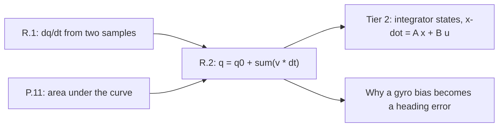

# Lesson R.2: Accumulation — Recovering Position From Rates, and Why a Small Bias Drifts

## Goal
Go the other way from R.1 and recover **position from a series of rates** by adding up area, then use that sum to explain the two things that bite every real robot: **the starting value is part of the answer**, and **a constant bias integrates into an ever-growing error**.

- **New ideas (max 2):**
  1. **Accumulation as area: adding each rate times its time step, and the starting value it needs.** Position is the area under the velocity trace — every sample contributes `v * dt`, and the total must be added to where the joint *started*. Change the rule for pairing samples (left, right, trapezoid) and the area changes, which is why the rule has to be named.
  2. **Signed accumulation and drift: why a small constant bias becomes a large position error.** Rates below zero subtract area, so a motion that goes out and comes back accumulates to zero — but a rate that is *slightly wrong on average* accumulates into a ramp. A gyroscope bias of 0.02 rad/s is nothing per sample and 0.6 rad after 30 seconds.
- **New syntax:** an accumulator that lives across a loop (`q = q + ...` inside `for`), and a function that returns the *estimate* rather than the last sample.
- **Target time (unmeasured — [log yours](../.github/ISSUE_TEMPLATE/beginner-timing-log.md)):** Typical: 0.75–1.0 hours | Slow-learner: 1.5–2.0 hours

---

## Prerequisites
- [Lesson R.1: Rate of Change](R.1-rate-of-change.md) — the quotient this lesson reverses
- [Lesson P.11: Reading Time-Series Graphs — Slope & Area](../track-p/P.11-reading-time-series-graphs.md) — rectangle area as `height × width`
- [Lesson 05.2: Complementary IMU Sensor Fusion](../05-control-and-estimation/05.2-complementary-imu-sensor-fusion.md) — where a drifting rate comes from in practice



---

## Learn

### Idea 1: Accumulation as area: adding each rate times its time step, and the starting value it needs
- **Primary resource:** [Wikipedia — Integral](https://en.wikipedia.org/wiki/Integral)
  - **What to read:** The lead section and the `Riemann integral` subsection — the sum of rectangle areas as the number of rectangles grows.
  - **What to skip:** Skip Lebesgue integration, improper integrals and measure theory.
  - **Key takeaway:** Every sample of a rate is a rectangle of height `v` and width `dt`, and adding them accumulates area:
    $q(t_n) = q(t_0) + \sum_{i=1}^{n} v_i\,\Delta t$.
    With the nine 100 Hz samples below, the **left rule** (each rate paired with the interval *after* it) gives **0.300 rad**, the **right rule** gives **0.280 rad**, and the **trapezoid rule** (the average of adjacent rates) gives **0.290 rad**. The three answers differ because the trace changes between samples; the trapezoid is the better estimate, and the gap between left and right is an honest error bar. Whatever the rule, `q0` is added **once**, outside the sum, and dropping it is the most common integration bug in robotics.
- **Alternative resource:** [OpenStax — Calculus Volume 1, §5.2 The Definite Integral](https://openstax.org/books/calculus-volume-1/pages/5-2-the-definite-integral)
  - **What to read:** Read the subsection that approximates area with a sum of rectangles, and the worked example that doubles the number of rectangles. Skip the proofs of integrability.

### Idea 2: Signed accumulation and drift: why a small constant bias becomes a large position error
- **Primary resource:** [Wikipedia — Dead reckoning](https://en.wikipedia.org/wiki/Dead_reckoning)
  - **What to read:** The lead section and the `Errors` section — why integrating rates without an absolute reference accumulates error without bound.
  - **What to skip:** Skip the marine-navigation history and the inertial-navigation maths.
  - **Key takeaway:** Accumulation is signed, so out-and-back motion cancels: a rate of `+2 rad/s` for 0.1 s and `-2 rad/s` for 0.1 s accumulates to exactly zero. A **bias** does not cancel, because it is not symmetric: a gyroscope reading 0.02 rad/s while standing still adds 0.02 rad of heading every second, and **0.600 rad after 30 seconds** — 34°, enough to drive a heading controller into the wall. This is why an integrated rate is never trusted alone: it is corrected by an absolute measurement (the complementary filter in Lesson 05.2) or reset at a known pose.

### Bridge Notes
The two ideas in this lesson are the two halves of a Tier 2 integrator state. When Tier 2 writes $\dot{x} = Ax + Bu$, the state $x$ is a set of accumulated quantities, and each line of that matrix equation is a rate being added to a state at every tick. Reading the matrix as "these rates feed those states" is exactly the left-rule sum you just wrote in code. Two consequences follow straight from the arithmetic. First, **the sampling rule is a design choice with a measurable error**: left and right bracket the true area, and the trapezoid halves the gap, which is why the Tustin discretisation of an integrator replaces `v * dt` with $\tfrac{dt}{2}(v_k + v_{k-1})$. Second, **an integrator has no opinion about the truth**: it will happily add a bias forever, so any state built by accumulation needs either a measurement that corrects it or a reset you control. That is the same reason a PID's integral term needs anti-windup: it is the same accumulator, pointed at an actuator.

---

## Do it yourself

- **What is simulated and in which tool:** Runs 100% in Python — the MechaLab Browser Runner or `python3` locally. The rates are a trapezoidal velocity profile, the kind a trajectory generator commands.
- **What is real-hardware only:** Nothing. On a bench, the rates come from an encoder (R.1) or a gyroscope, and the same three rules apply to both.

### Starter Code (runs as-is — fill in the TODOs)
Complete `left_rule_rad` (`TODO 1`), `right_rule_rad` (`TODO 2`), `trapezoid_rad` (`TODO 3`), `accumulate_rad` (`TODO 4`) and `drift_rad` (`TODO 5`):

```python
DT_S = 0.01  # 100 Hz rate samples
V_RAD_S = [0.0, 2.0, 4.0, 6.0, 6.0, 6.0, 4.0, 2.0, -2.0]


def left_rule_rad(v, dt_s=DT_S):
    # TODO 1: sum every rate EXCEPT the last, then multiply by dt_s
    return 0.0


def right_rule_rad(v, dt_s=DT_S):
    # TODO 2: sum every rate EXCEPT the first, then multiply by dt_s
    return 0.0


def trapezoid_rad(v, dt_s=DT_S):
    # TODO 3: for each pair, half the sum of the two rates, times dt_s
    return 0.0


def accumulate_rad(v, q0=0.0, dt_s=DT_S):
    # TODO 4: start at q0 and add one trapezoid slice per sample after the first
    return 0.0


def drift_rad(bias_rad_s, seconds):
    # TODO 5: a constant bias accumulates linearly: bias * seconds
    return 0.0


print(f"left rule: {left_rule_rad(V_RAD_S):.3f} rad")
print(f"right rule: {right_rule_rad(V_RAD_S):.3f} rad")
print(f"trapezoid: {trapezoid_rad(V_RAD_S):.3f} rad")
print(f"from q0 = 0.5 rad: {accumulate_rad(V_RAD_S, 0.5):.3f} rad")
print(f"bias drift: {drift_rad(0.02, 30.0):.3f} rad after 30 s")
```

### Expected Output
When the five TODOs are completed, running the script prints:

```text
left rule: 0.300 rad
right rule: 0.280 rad
trapezoid: 0.290 rad
from q0 = 0.5 rad: 0.790 rad
bias drift: 0.600 rad after 30 s
```

### Hint Ladder

<details>
<summary><strong>Hint 1 (Concept nudge)</strong></summary>

Each rate is a rectangle's height and `dt_s` is its width. The left rule pairs a rate with the interval *after* it, so it uses `v[:-1]`; the right rule uses `v[1:]`. The trapezoid is `0.5 * (v[i] + v[i + 1]) * dt_s` per pair. `accumulate_rad` starts at `q0` and adds the same slices one at a time — do not start the loop at index 0, because there is no slice before the first sample.
</details>

<details>
<summary><strong>Hint 2 (Formula / structure)</strong></summary>

```python
def left_rule_rad(v, dt_s=DT_S):
    return sum(v[:-1]) * dt_s


def right_rule_rad(v, dt_s=DT_S):
    return sum(v[1:]) * dt_s


def accumulate_rad(v, q0=0.0, dt_s=DT_S):
    q = q0
    for i in range(1, len(v)):
        q += 0.5 * (v[i] + v[i - 1]) * dt_s
    return q
```
</details>

<details>
<summary><strong>Full Solution</strong></summary>

```python
DT_S = 0.01
V_RAD_S = [0.0, 2.0, 4.0, 6.0, 6.0, 6.0, 4.0, 2.0, -2.0]


def left_rule_rad(v, dt_s=DT_S):
    if len(v) < 2:
        raise ValueError("accumulation needs at least two samples")
    return sum(v[:-1]) * dt_s


def right_rule_rad(v, dt_s=DT_S):
    if len(v) < 2:
        raise ValueError("accumulation needs at least two samples")
    return sum(v[1:]) * dt_s


def trapezoid_rad(v, dt_s=DT_S):
    if len(v) < 2:
        raise ValueError("accumulation needs at least two samples")
    return sum(0.5 * (v[i] + v[i + 1]) * dt_s for i in range(len(v) - 1))


def accumulate_rad(v, q0=0.0, dt_s=DT_S):
    q = q0
    for i in range(1, len(v)):
        q += 0.5 * (v[i] + v[i - 1]) * dt_s
    return q


def drift_rad(bias_rad_s, seconds):
    if seconds < 0.0:
        raise ValueError("time does not run backwards")
    return bias_rad_s * seconds


print(f"left rule: {left_rule_rad(V_RAD_S):.3f} rad")
print(f"right rule: {right_rule_rad(V_RAD_S):.3f} rad")
print(f"trapezoid: {trapezoid_rad(V_RAD_S):.3f} rad")
print(f"from q0 = 0.5 rad: {accumulate_rad(V_RAD_S, 0.5):.3f} rad")
print(f"bias drift: {drift_rad(0.02, 30.0):.3f} rad after 30 s")

assert abs(left_rule_rad(V_RAD_S) - 0.30) < 1e-12
assert abs(right_rule_rad(V_RAD_S) - 0.28) < 1e-12
assert abs(trapezoid_rad(V_RAD_S) - 0.29) < 1e-12
assert abs(accumulate_rad(V_RAD_S, 0.5) - 0.79) < 1e-12
assert abs(drift_rad(0.02, 30.0) - 0.60) < 1e-12
```
</details>

---

## Common mistakes & troubleshooting
- **Forgetting `q0`:** Starting the accumulator at 0 answers "how far did it move", not "where is it". A joint that begins at 0.5 rad and moves 0.29 rad is at 0.79 rad; the missing half rad is a real pose error even though the *area* was right.
- **Letting a bias ride:** A rate that reads `0.02 rad/s` while the joint is still adds 0.6 rad every 30 s. The tell is a slowly growing offset that survives every gain change; the fix is an absolute reference (encoder index, limit switch, or complementary fusion), not a larger filter.
- **Using one rule in the lab and another in code:** If the lesson, the plot and the firmware disagree about left/right/trapezoid, the same trace yields three displacements and the bug looks like noise. Name the rule in the function name and test it against a straight-line trace where all three agree.

---

## Check yourself
1. **A joint moves at +3 rad/s for 0.2 s, then −3 rad/s for 0.2 s. What did it accumulate, and what would a 0.05 rad/s bias have added over the same 0.4 s?**
   <details>
   <summary><strong>Answer 1</strong></summary>
   The motion accumulates $+0.6 - 0.6 = 0$ rad: it went out and came back. The bias adds $0.05 \times 0.4 = 0.02$ rad, which does not cancel, because it has the same sign throughout.
   </details>
2. **The left rule gives 0.300 rad and the right rule 0.280 rad on the same samples. Which is right, and what does the gap tell you?**
   <details>
   <summary><strong>Answer 2</strong></summary>
   Neither exactly; the truth is bracketed. The traces rises then falls, so pairing rates with the interval after them overshoots and pairing them with the interval before undershoots. The trapezoid's 0.290 rad sits between them, and the 0.020 rad gap is the size of the sampling error for this trace.
   </details>
3. **Why does adding one more sample not change `accumulate_rad(v, q0)` into `accumulate_rad(v, q0, dt_s)` confusion about `q0`?**
   <details>
   <summary><strong>Answer 3</strong></summary>
   `q0` is added once before the loop; `dt_s` scales every slice. Keeping them separate means a longer trace changes the area but never the starting pose.
   </details>

---

## Recap
- [ ] I can accumulate a velocity trace into a displacement with the left, right and trapezoid rules, and say why they disagree.
- [ ] I can add the starting value `q0` once and explain why it cannot be dropped.
- [ ] I can compute the drift a constant bias produces over a given time, and name the absolute reference that stops it.

👉 **Next:** [Tier 1 Exit Check](../docs/TIER1_EXIT_CHECK.md) — ten items, each pointing back at R.1 or R.2, before you start Tier 2.
