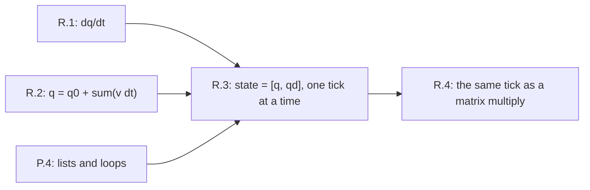

# Lesson R.3: Two Numbers That Move Together — State Vectors, One Tick, and Why Separate Commands Add Up

<!-- run-callout:start -->
> **Before Step 1 · the school-maths ramp**
>
> **Run this in the workbench.** [Open MechaLab with `R.3` loaded](https://tle47.github.io/Mechatronics-Roadmap/?lesson=R.3) - it opens on the **Run Python Lessons** tab with that entry selected. Starter code, hints and the graded check are ready; this page is the reading copy, and nothing you type here is saved.
<!-- run-callout:end -->

## Goal
Stop tracking a joint as loose variables and hold it as **one state with two named slots**, `[q, qd]`, advanced **together** on every tick. Then use that shape to see why two separate torque commands produce exactly the same motion as their sum.

- **New ideas (max 2):**
  1. **A state is a fixed-length list whose slots keep their meaning, and one tick advances all of its slots together.** `state[0]` is always position in rad and `state[1]` is always speed in rad/s. A tick reads the whole old state, computes every new slot, and *then* replaces the state — so the new position is built from the speed the joint had when the tick began.
  2. **Vectors add and scale slot by slot, so separate commands add up — the property Tier 2's matrix multiply depends on.** `add(a, b)` is `[a[0] + b[0], a[1] + b[1]]` and `scale(a, k)` multiplies each slot. On this linear joint, the motion from `0.20 N m` plus the motion from another `0.20 N m` equals the motion from `0.40 N m`, to the last digit.
- **New syntax:** unpacking a two-item list (`q, qd = state`) and returning a **fresh list** each tick instead of editing one in place.
- **Target time (unmeasured — [log yours](../.github/ISSUE_TEMPLATE/beginner-timing-log.md)):** Typical: 0.75–1.0 hours | Slow-learner: 1.5–2.0 hours

---

## Prerequisites
- [Lesson R.1: Rate of Change](R.1-rate-of-change.md) — a rate is a change over an interval
- [Lesson R.2: Accumulation](R.2-accumulation.md) — position is the accumulated rate, and it needs a starting value
- [Lesson P.4: Ordered Lists and Repeating Actions with for Loops](../track-p/P.4-lists-and-for-loops.md) — indexing, length and loops over a list



---

## Learn

### Idea 1: A state is a fixed-length list whose slots keep their meaning, and one tick advances all of its slots together
- **Primary resource:** [Wikipedia — State-space representation](https://en.wikipedia.org/wiki/State-space_representation)
  - **What to read:** The lead section and the sentence that defines the **state vector** as the smallest set of numbers that, together with the input, fixes the next moment of the system.
  - **What to skip:** Skip the transfer-function derivations, the controllability/observability algebra and the discrete-time matrix formulas.
  - **Key takeaway:** The arm's joint needs exactly two numbers — position `q` and speed `qd` — because those two plus the torque decide how it moves next. Written as `state = [q, qd]`, one 10 ms tick is two lines that must both read the **old** state:
    `qd_next = qd + a(state) * 0.01` and `q_next = q + qd * 0.01`.
    At `J = 0.02`, `B = 0.05`, `tau = 0.40`, the acceleration is `(0.40 − 0.05·qd)/0.02`, and thirty ticks take the joint from rest to `q = 0.697230 rad` at `qd = 4.256926 rad/s`. Advancing `q` with the **new** speed instead adds `a·dt² = 0.002 rad` to the very first tick — small, wrong, and repeated 100 times a second.
- **Alternative resource:** [Python documentation — Data Structures, "More on Lists"](https://docs.python.org/3/tutorial/datastructures.html)
  - **What to read:** The list indexing and slicing examples at the top of the section — a state is used exactly like these lists, with fixed positions instead of fixed meaning-by-name.

### Idea 2: Vectors add and scale slot by slot, so separate commands add up — the property Tier 2's matrix multiply depends on
- **Primary resource:** [Wikipedia — Superposition principle](https://en.wikipedia.org/wiki/Superposition_principle)
  - **What to read:** The lead section, especially the sentence that defines superposition for a **linear** system as a response to a sum of inputs being the sum of the responses.
  - **What to skip:** Skip the differential-equation and wave sections; the arithmetic here is additions, not proofs.
  - **Key takeaway:** From rest, `0.20 N m` for 30 ticks gives `[0.348615 rad, 2.128463 rad/s]`; running it twice and adding the two states gives `[0.697230, 4.256926]`, and one run at `0.40 N m` gives the same pair with a superposition error of **0.000e+00**. Doubling the response is the same statement with `k = 2`. This holds *because* the model is linear in `state` and `tau` and *because* both runs start from the same state: `0.05·qd` is proportional to `qd`, so two speeds add the friction they each feel.

### Bridge Notes
Tier 2's first page writes exactly this state as a column and calls it `x`. The two-line tick you just coded is `x_dot = Ax + Bu` read aloud: the first line says `q` changes at the rate `qd`, the second says `qd` changes at the rate `(tau − B·qd)/J`. When those lines become a matrix, the arithmetic does not change — only the way the coefficients are stored — so a learner who can say "which slot is this, and which old slots does it read" can read a matrix row without translating. Superposition is what makes that storage useful: because the response to two inputs is the sum of the responses, a matrix can hold one coefficient per input per output and the total is a sum of scaled columns. Two conditions come with it, and both bite in practice. The model must be **linear**, which the arm's `B·qd` friction term is but stiction, saturation and backlash are not, so a superposition check is also a linearity test. And every run being added must start from the **same state**: adding a response from rest to one from `0.5 rad` mixes two different questions. In R.4 you will fold these two lines into one multiply, and the numbers will match to the last digit.

---

## Do it yourself

- **What is simulated and in which tool:** Runs 100% in Python — the MechaLab Browser Runner or `python3` locally. The joint is the same 2 kg·m²-scale arm used in R.1 and R.2, started at rest.
- **What is real-hardware only:** Nothing. On a bench the same state is `q` from the encoder and `qd` from R.1's differencing, and the torque is what your driver commands.

### Starter Code (runs as-is — fill in the TODOs)
Complete `accel_rad_s2` (`TODO 1`), `step` (`TODO 2`), `run` (`TODO 3`), `add` (`TODO 4`) and `scale` (`TODO 5`). The prints and asserts at the bottom are given:

```python
DT_S = 0.01
J = 0.02    # arm joint inertia, kg m^2
B = 0.05    # viscous friction, N m s / rad
TAU = 0.40  # constant commanded torque, N m


def accel_rad_s2(state, tau=TAU, j=J, b=B):
    # TODO 1: (tau - b * state[1]) / j - read the speed from slot 1
    return 0.0


def step(state, dt_s=DT_S, tau=TAU, j=J, b=B):
    # TODO 2: unpack the old state, advance qd, then advance q with the OLD qd
    return list(state)


def run(state, ticks, dt_s=DT_S, tau=TAU, j=J, b=B):
    # TODO 3: replace the state with step(state) once per tick
    return state


def add(a, b):
    # TODO 4: add slot by slot, not with list concatenation
    return list(a)


def scale(a, k):
    # TODO 5: multiply every slot by k
    return list(a)


half = run([0.0, 0.0], 30, tau=TAU / 2.0)
rest = run([0.0, 0.0], 30, tau=TAU - TAU / 2.0)
both = run([0.0, 0.0], 30, tau=TAU)
summed = add(half, rest)

print(f"after 30 ticks at 0.40 N m: q = {both[0]:.6f} rad, qd = {both[1]:.6f} rad/s")
print(f"0.20 + 0.20 N m, added up: q = {summed[0]:.6f} rad, qd = {summed[1]:.6f} rad/s")
print(f"superposition error: {abs(both[0] - summed[0]) + abs(both[1] - summed[1]):.3e}")
print(f"half the command alone: q = {half[0]:.6f} rad, qd = {half[1]:.6f} rad/s")
print(f"twice the half command: q = {scale(half, 2.0)[0]:.6f} rad, qd = {scale(half, 2.0)[1]:.6f} rad/s")
```

### Expected Output
When the five TODOs are completed, running the script prints:

```text
after 30 ticks at 0.40 N m: q = 0.697230 rad, qd = 4.256926 rad/s
0.20 + 0.20 N m, added up: q = 0.697230 rad, qd = 4.256926 rad/s
superposition error: 0.000e+00
half the command alone: q = 0.348615 rad, qd = 2.128463 rad/s
twice the half command: q = 0.697230 rad, qd = 4.256926 rad/s
```

### Hint Ladder

<details>
<summary><strong>Hint 1 (Concept nudge)</strong></summary>

Slot 0 is position and slot 1 is speed, on every tick and in every function. `step` must finish computing the **new speed** before multiplying it by `dt_s` — but the position line uses the speed the tick started with. `add` and `scale` never touch the physics; they only do arithmetic slot by slot.
</details>

<details>
<summary><strong>Hint 2 (Formula / structure)</strong></summary>

```python
def accel_rad_s2(state, tau=TAU, j=J, b=B):
    return (tau - b * state[1]) / j


def step(state, dt_s=DT_S, tau=TAU, j=J, b=B):
    q, qd = state
    qd_next = qd + accel_rad_s2(state, tau, j, b) * dt_s
    q_next = q + qd * dt_s
    return [q_next, qd_next]


def add(a, b):
    if len(a) != len(b):
        raise ValueError("states must have the same length")
    return [a[0] + b[0], a[1] + b[1]]
```
</details>

<details>
<summary><strong>Full Solution</strong></summary>

```python
DT_S = 0.01
J = 0.02    # arm joint inertia, kg m^2
B = 0.05    # viscous friction, N m s / rad
TAU = 0.40  # constant commanded torque, N m


def accel_rad_s2(state, tau=TAU, j=J, b=B):
    """The angular acceleration at this state, from the joint's own balance."""
    return (tau - b * state[1]) / j


def step(state, dt_s=DT_S, tau=TAU, j=J, b=B):
    """One 10 ms tick: the two numbers are advanced together, never alone."""
    q, qd = state
    qd_next = qd + accel_rad_s2(state, tau, j, b) * dt_s
    q_next = q + qd * dt_s
    return [q_next, qd_next]


def run(state, ticks, dt_s=DT_S, tau=TAU, j=J, b=B):
    for _ in range(ticks):
        state = step(state, dt_s, tau, j, b)
    return state


def add(a, b):
    """Add two states element by element: same length, same meaning per slot."""
    if len(a) != len(b):
        raise ValueError("states must have the same length")
    return [a[0] + b[0], a[1] + b[1]]


def scale(a, k):
    """Multiply every element by one number."""
    return [k * a[0], k * a[1]]


half = run([0.0, 0.0], 30, tau=TAU / 2.0)
rest = run([0.0, 0.0], 30, tau=TAU - TAU / 2.0)
both = run([0.0, 0.0], 30, tau=TAU)
summed = add(half, rest)

print(f"after 30 ticks at 0.40 N m: q = {both[0]:.6f} rad, qd = {both[1]:.6f} rad/s")
print(f"0.20 + 0.20 N m, added up: q = {summed[0]:.6f} rad, qd = {summed[1]:.6f} rad/s")
print(f"superposition error: {abs(both[0] - summed[0]) + abs(both[1] - summed[1]):.3e}")
print(f"half the command alone: q = {half[0]:.6f} rad, qd = {half[1]:.6f} rad/s")
print(f"twice the half command: q = {scale(half, 2.0)[0]:.6f} rad, qd = {scale(half, 2.0)[1]:.6f} rad/s")

assert abs(both[0] - summed[0]) < 1e-12
assert abs(both[1] - summed[1]) < 1e-12
assert abs(scale(half, 2.0)[1] - both[1]) < 1e-12
```
</details>

---

## Common mistakes & troubleshooting
- **Advancing `q` with the new speed:** `q + qd_next * dt` looks tidier and is wrong by `a·dt² = 0.002 rad` on the first tick at this torque. The error is systematic, so a trajectory that should land at 0.697230 rad lands elsewhere and the controller spends gain hunting a modelling bug.
- **Two loose variables instead of one state:** Updating `q` in one place and `qd` in another leaves a stale pair, and `run` then steps a state that never existed. Build the new `[q_next, qd_next]` in one `return` and let the caller rebind `state`.
- **Adding responses that did not start from the same state:** `add(run([0.5, 0.0], 30, tau=0.2), run([0.0, 0.0], 30, tau=0.2))` is not the response to `0.4 N m` from any single start. Superposition adds *inputs applied to one starting state*; it does not add two different starting states.

---

## Check yourself
1. **A joint sits at `[0.10 rad, 1.0 rad/s]` with `dt = 10 ms` and a constant acceleration of `20 rad/s²`. Give the next state both ways — old speed and new speed — and the difference.**
   <details>
   <summary><strong>Answer 1</strong></summary>
   New speed is `1.0 + 20 × 0.01 = 1.2 rad/s`. Old-speed rule: `0.10 + 1.0 × 0.01 = 0.110 rad`. New-speed rule: `0.10 + 1.2 × 0.01 = 0.112 rad`. The difference is `0.002 rad` on one tick, and it accumulates on every tick after it.
   </details>
2. **Two torques, `0.25 N m` and `0.15 N m`, are each applied from rest for 40 ticks. Does the sum of the two responses equal one 40-tick run at `0.40 N m`? What would break that?**
   <details>
   <summary><strong>Answer 2</strong></summary>
   Yes — the model is linear in `tau` and in `state`, both runs start from rest, and the arithmetic is the same sum of `tau * dt` contributions. It stops holding the moment a term is nonlinear: stiction, a torque limit, backlash, or a speed-dependent friction that is not proportional to `qd`.
   </details>
3. **What does `add([1.0, 2.0], [0.5, -1.0])` return, and what does `[1.0, 2.0] + [0.5, -1.0]` do instead?**
   <details>
   <summary><strong>Answer 3</strong></summary>
   `add` returns `[1.5, 1.0]`. The `+` operator on two lists **concatenates**, giving `[1.0, 2.0, 0.5, -1.0]` — a four-slot state where the code expects two, so the next tick reads slot 2 as a speed and the joint gets a nonsense acceleration.
   </details>

---

## Recap
- [ ] I can hold a joint as `[q, qd]` and advance both slots on one tick using the **old** speed.
- [ ] I can add and scale states slot by slot, and say why list `+` is not addition.
- [ ] I can state the two conditions under which two responses may be added: a linear model, and one shared starting state.

👉 **Next lesson:** [Lesson R.4: Tables That Transform — Writing the Tick as a Matrix Multiply](R.4-matrix-updates.md)
