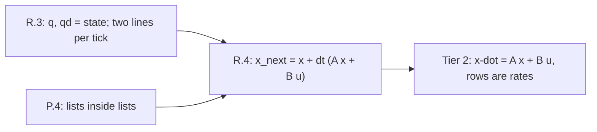

# Lesson R.4: Tables That Transform — Writing One Tick as a Matrix Multiply, and Reading Rows as Rates

<!-- run-callout:start -->
> **Before Step 1 · the school-maths ramp**
>
> **Run this in the workbench.** [Open MechaLab with `R.4` loaded](https://tle47.github.io/Mechatronics-Roadmap/?lesson=R.4) - it opens on the **Run Python Lessons** tab with that entry selected. Starter code, hints and the graded check are ready; this page is the reading copy, and nothing you type here is saved.
<!-- run-callout:end -->

## Goal
Take the two-line tick from R.3 and store its **coefficients in a table**, so one multiply `A @ x + B·u` produces the same answer as the two lines. Then read the table back: each **row** is the rate of one slot, each **column** says where one input goes.

- **New ideas (max 2):**
  1. **A matrix is a table of coefficients: each row of `A x` is a weighted sum of the inputs, and each column says where one input goes.** With `A = [[0, 1], [0, −2.5]]`, row 0 says *position changes at 1 × speed plus 0 × position*, row 1 says *speed changes at −2.5 × speed plus 0 × position*. Column 1 says the position input touches neither rate; column 2 says the speed input touches both.
  2. **The same tick written as `x_next = x + dt (A x + B u)` reproduces the R.3 answer to the last digit, so the table is bookkeeping rather than new physics.** Thirty 10 ms ticks give `q = 0.697230 rad`, `qd = 4.256926 rad/s` through the matrix, the largest difference from R.3's two lines is `0.000e+00`, and `B = [[0], [50]]` carries the one third of the model the state cannot: the torque.
- **New syntax:** a matrix as a list of rows (`A = [[...], [...]]`), `A[i][j]` for one coefficient, and a nested loop or generator that builds one output slot per row.
- **Target time (unmeasured — [log yours](../.github/ISSUE_TEMPLATE/beginner-timing-log.md)):** Typical: 0.75–1.0 hours | Slow-learner: 1.5–2.0 hours

---

## Prerequisites
- [Lesson R.3: State Vectors](R.3-state-vectors.md) — the two-line tick this lesson rewrites
- [Lesson R.2: Accumulation](R.2-accumulation.md) — why `dt` multiplies a rate to make a change
- [Lesson P.4: Ordered Lists and Repeating Actions with for Loops](../track-p/P.4-lists-and-for-loops.md) — nested lists are lists of lists



---

## Learn

### Idea 1: A matrix is a table of coefficients: each row of A x is a weighted sum of the inputs, and each column says where one input goes
- **Primary resource:** [Wikipedia — Matrix multiplication](https://en.wikipedia.org/wiki/Matrix_multiplication)
  - **What to read:** The lead section and the `Matrix times column vector` example — that is the only multiplication this lesson uses.
  - **What to skip:** Skip the general `m × n` product, block matrices, the transpose identities and the complexity discussion.
  - **Key takeaway:** For `A = [[0, 1], [0, −2.5]]` and `x = [0, 1]`, the answer is `A x = [1.0, −2.5]`: row 0 is `0·0 + 1·1`, row 1 is `0·0 + (−2.5)·1`. Nothing is happening that the two lines did not do — row 0 is exactly `qd`, row 1 is exactly `−B/J · qd`. Read the other way, **a column is an input's footprint**: column 2 contributes `1` to the position rate and `−2.5` to the speed rate, which is the single sentence "speed moves position, and friction eats speed". `B` is a two-row, one-column table for the torque: `B u = [0, 50·0.40] = [0, 20]`, i.e. torque changes speed and never position directly.
- **Alternative resource:** [3Blue1Brown — Linear transformations and matrices](https://www.3blue1brown.com/lessons/linear-transformations)
  - **What to read:** The first half, where a matrix is introduced as a function that takes a vector to a vector, and the columns are shown as where the basis arrows land.
  - **What to skip:** Skip the determinant and eigenvector material; both arrive later in the course.

### Idea 2: The same tick written as x_next = x + dt (A x + B u) reproduces the R.3 answer to the last digit, so the table is bookkeeping rather than new physics
- **Primary resource:** [Wikipedia — State-space representation](https://en.wikipedia.org/wiki/State-space_representation)
  - **What to read:** The lead section's continuous form `x_dot = A x + B u` and the sentence that describes `A` as how the state affects its own rate.
  - **What to skip:** Skip the `C` and `D` output equations, the discretisation formulae and the canonical forms.
  - **Key takeaway:** Putting `dt` **outside** the bracket is the whole step from "rate" to "next state": `x_next = x + dt·(A x + B u)`. Run both paths for thirty ticks and the states agree to `0.000e+00` — the matrix path prints `q = 0.697230 rad`, `qd = 4.256926 rad/s`, identical to R.3's two lines. That equality is the test that the table was transcribed correctly: a sign slip in `A[1][1]` or a missing `dt` shows up as a difference in the fourth decimal within a few ticks.

### Bridge Notes
This is the page where `x_dot = Ax + Bu` stops being a formula to memorise. Every Tier 2 state-space page writes rows for rates and columns for inputs, and asks you to say which coefficient does what; that sentence is available now, in the same numbers. Three habits carry forward. First, **check the shape before trusting the answer**: a 2 × 2 `A` needs a two-slot state, and a 2 × 1 `B` needs a one-slot input, so a length mismatch is a table error, not a maths mystery. Second, **`dt` is never inside the coefficients**: `A` holds rates per second, and the tick converts them to changes, which is why the same `A` works at 1 kHz and at 100 Hz on the same arm. Third, **the table is a description you can audit**: swap the sign of one entry and the printed comparison against the two-line version stops matching, so a transcription mistake surfaces as a number rather than as behaviour that "feels off" three pages later. In Tier 2 the same table gains a third and fourth slot and grows control and estimation terms; nothing about reading it changes.

---

## Do it yourself

- **What is simulated and in which tool:** Runs 100% in Python — the MechaLab Browser Runner or `python3` locally. Same joint, same torque, same 10 ms tick as R.3, now stepped through `A` and `B`.
- **What is real-hardware only:** Nothing. The matrix path is what a firmware state-space controller evaluates every tick; the rows are its coefficients.

### Starter Code (runs as-is — fill in the TODOs)
Complete `mat_vec` (`TODO 1`), `step_matrix` (`TODO 2`) and `step_two_lines` (`TODO 3`). `A` and `B_IN` are given, and so is the comparison loop:

```python
DT_S = 0.01
J = 0.02
B = 0.05
TAU = 0.40

# Rows are outputs, columns are inputs: row 0 says "q-dot = 0*q + 1*qd", row 1 says
# "qd-dot = 0*q + (-B/J)*qd". The torque enters through its own 2x1 vector.
A = [[0.0, 1.0], [0.0, -B / J]]
B_IN = [[0.0], [1.0 / J]]


def mat_vec(matrix, vector):
    # TODO 1: row i of the answer is sum(matrix[i][j] * vector[j] for each j)
    return [0.0 for _ in matrix]


def step_matrix(state, dt_s=DT_S, tau=TAU):
    # TODO 2: x + dt * (A x + B u) - keep dt OUTSIDE the bracket
    return list(state)


def step_two_lines(state, dt_s=DT_S, tau=TAU):
    # TODO 3: the R.3 update, for comparison: qd first, then q with the OLD qd
    return list(state)


matrix_path = [0.0, 0.0]
line_path = [0.0, 0.0]
for _ in range(30):
    matrix_path = step_matrix(matrix_path)
    line_path = step_two_lines(line_path)

velocity_only = [0.0, 1.0]
first_row = mat_vec(A, velocity_only)

print(f"A rows: {A[0]}, {A[1]}")
print(f"A applied to [0, 1] rad/s: {first_row}")
print(f"after 30 ticks, matrix form: q = {matrix_path[0]:.6f} rad, qd = {matrix_path[1]:.6f} rad/s")
print(f"after 30 ticks, two lines: q = {line_path[0]:.6f} rad, qd = {line_path[1]:.6f} rad/s")
print(f"largest difference: {max(abs(matrix_path[0] - line_path[0]), abs(matrix_path[1] - line_path[1])):.3e}")
```

### Expected Output
When the three TODOs are completed, running the script prints:

```text
A rows: [0.0, 1.0], [0.0, -2.5]
A applied to [0, 1] rad/s: [1.0, -2.5]
after 30 ticks, matrix form: q = 0.697230 rad, qd = 4.256926 rad/s
after 30 ticks, two lines: q = 0.697230 rad, qd = 4.256926 rad/s
largest difference: 0.000e+00
```

### Hint Ladder

<details>
<summary><strong>Hint 1 (Concept nudge)</strong></summary>

Row `i` of `A x` uses row `i` of `A` and **every** slot of `x`: index two loops, outer over rows, inner over columns. `step_matrix` computes `A x` and `B u` separately and adds them **before** multiplying by `dt_s`. `step_two_lines` is the R.3 function with the torque and friction written out.
</details>

<details>
<summary><strong>Hint 2 (Formula / structure)</strong></summary>

```python
def mat_vec(matrix, vector):
    rows = len(matrix)
    cols = len(matrix[0])
    if len(vector) != cols:
        raise ValueError("matrix columns must match vector length")
    return [sum(matrix[i][j] * vector[j] for j in range(cols)) for i in range(rows)]


def step_matrix(state, dt_s=DT_S, tau=TAU):
    ax = mat_vec(A, state)
    bu = mat_vec(B_IN, [tau])
    return [state[0] + dt_s * (ax[0] + bu[0]), state[1] + dt_s * (ax[1] + bu[1])]
```
</details>

<details>
<summary><strong>Full Solution</strong></summary>

```python
DT_S = 0.01
J = 0.02
B = 0.05
TAU = 0.40

# Rows are outputs, columns are inputs: row 0 says "q-dot = 0*q + 1*qd", row 1 says
# "qd-dot = 0*q + (-B/J)*qd". The torque enters through its own 2x1 vector.
A = [[0.0, 1.0], [0.0, -B / J]]
B_IN = [[0.0], [1.0 / J]]


def mat_vec(matrix, vector):
    """Row i of the answer is the dot product of row i with the vector."""
    rows = len(matrix)
    cols = len(matrix[0])
    if len(vector) != cols:
        raise ValueError("matrix columns must match vector length")
    return [sum(matrix[i][j] * vector[j] for j in range(cols)) for i in range(rows)]


def step_matrix(state, dt_s=DT_S, tau=TAU):
    """x_next = x + dt * (A x + B u): the two-line update, written as one multiply."""
    ax = mat_vec(A, state)
    bu = mat_vec(B_IN, [tau])
    return [state[0] + dt_s * (ax[0] + bu[0]), state[1] + dt_s * (ax[1] + bu[1])]


def step_two_lines(state, dt_s=DT_S, tau=TAU):
    """The R.3 update, for comparison only."""
    q, qd = state
    qd_next = qd + (tau - B * qd) / J * dt_s
    q_next = q + qd * dt_s
    return [q_next, qd_next]


matrix_path = [0.0, 0.0]
line_path = [0.0, 0.0]
for _ in range(30):
    matrix_path = step_matrix(matrix_path)
    line_path = step_two_lines(line_path)

velocity_only = [0.0, 1.0]
first_row = mat_vec(A, velocity_only)

print(f"A rows: {A[0]}, {A[1]}")
print(f"A applied to [0, 1] rad/s: {first_row}")
print(f"after 30 ticks, matrix form: q = {matrix_path[0]:.6f} rad, qd = {matrix_path[1]:.6f} rad/s")
print(f"after 30 ticks, two lines: q = {line_path[0]:.6f} rad, qd = {line_path[1]:.6f} rad/s")
print(f"largest difference: {max(abs(matrix_path[0] - line_path[0]), abs(matrix_path[1] - line_path[1])):.3e}")

assert abs(matrix_path[0] - line_path[0]) < 1e-12
assert abs(matrix_path[1] - line_path[1]) < 1e-12
assert first_row == [1.0, -2.5]
```
</details>

---

## Common mistakes & troubleshooting
- **Putting `dt` inside the coefficients:** `A = [[0, dt], [0, −2.5·dt]]` works for exactly one sampling rate and silently doubles every change at 5 ms. `A` holds rates **per second**; `dt` converts them, once, outside the bracket.
- **Transposing by habit:** `A x` is row-by-vector, not vector-by-row. With `A = [[0, 1], [0, −2.5]]` and `x = [2, 3]`, `A x = [3, −7.5]`; a mistake that swaps rows for columns gives `[0, −5.5]`, and the printout no longer matches the two-line path — which is exactly why the comparison line is in the script.
- **Letting the shapes drift:** `B_IN` is `[[0.0], [1.0/J]]` — two rows, one column — because the torque is one input. Passing a bare two-slot list as `u` makes `mat_vec` read `u[0]` as a row, so the guard raises instead of quietly using half the torque.

---

## Check yourself
1. **With `A = [[0, 1], [0, −2.5]]`, what is `A x` for `x = [2, 3]`, and which row says what?**
   <details>
   <summary><strong>Answer 1</strong></summary>
   `A x = [3, −7.5]`: row 0 is `0·2 + 1·3 = 3`, the position rate; row 1 is `0·2 + (−2.5)·3 = −7.5`, the speed rate. Row 0 carries no position term, which is why position never feeds its own rate directly.
   </details>
2. **What does `B u` contribute with `B = [[0], [50]]` and `u = 0.40`, and why is its shape 2 × 1 rather than 2 × 2?**
   <details>
   <summary><strong>Answer 2</strong></summary>
   `[0, 20]` — torque adds `20 rad/s²` and no position change this tick. There is one input (torque), so `B` has one column; a second input, such as a disturbance force, would add a second column and no change to the state's length.
   </details>
3. **The matrix path and the two-line path print the same state. What would you change in `A` to model twice the friction, and what would you expect the printout to do?**
   <details>
   <summary><strong>Answer 3</strong></summary>
   `A[1][1] = −2·B/J = −5.0`. The matrix path then reaches a lower speed than the two-line path, whose `B` was not changed, so `largest difference` stops being `0.000e+00` and the disagreement starts in the third or fourth decimal within a few ticks — the intended failure signal.
   </details>

---

## Recap
- [ ] I can store a tick's coefficients in `A` and `B`, and say what each row and each column means.
- [ ] I can write `x_next = x + dt (A x + B u)` and keep `dt` outside the coefficients.
- [ ] I can prove my table is right by comparing it against the two-line update for the same number of ticks.

👉 **Next:** [Tier 1 Exit Check](../docs/TIER1_EXIT_CHECK.md) — fourteen items, each pointing back at R.1–R.6, before you start Tier 2.
