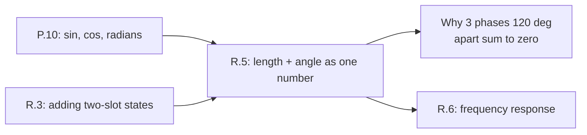

# Lesson R.5: Spinning Arrows — Complex Numbers and Phasor Sums, Computed Before Named

<!-- run-callout:start -->
> **No workbench entry for this page.** There is nothing to load in Tab 2 for it - its code runs in your own Python 3 or on the bench, with no starter file or graded check. The pages that do have one are listed in [MechaLab, Run Python Lessons](https://tle47.github.io/Mechatronics-Roadmap/).
<!-- run-callout:end -->

## Goal
Carry a **rotation and a length together in one number**, rotate by multiplying, and add two of them the way you add arrows — then use that to explain why three motor phases 120° apart sum to nothing while a 3 and a 4 at right angles make a 5.

- **New ideas (max 2):**
  1. **A rotation can be carried by one number with two parts, and multiplying by a unit-length one adds angles while keeping lengths.** A number with a real part and an imaginary part is an arrow: `3 + 4j` points right 3 and up 4. Multiplying by `1j` turns any arrow a quarter turn left without changing its length, so `3` becomes `3j`; in general lengths multiply and angles add.
  2. **Arrows at one frequency add part by part, which is why a three-phase set cancels and a 3-4 pair makes a 5.** Adding arrows is adding real parts and imaginary parts separately: `3∠0° + 4∠90° = 3 + 4j`, length `5`, angle `53.130°`. Three unit arrows 120° apart close into a triangle, and their sum is `4.003e-16` — zero, as far as a computer is concerned.
- **New syntax:** Python's built-in complex literals (`3 + 4j`, `1j`), and `cmath.rect`, `abs`, `cmath.phase` to build an arrow from a length and an angle and read it back.
- **Target time (unmeasured — [log yours](../.github/ISSUE_TEMPLATE/beginner-timing-log.md)):** Typical: 0.75–1.0 hours | Slow-learner: 1.5–2.0 hours

---

## Prerequisites
- [Lesson R.3: State Vectors](R.3-state-vectors.md) — adding two numbers slot by slot
- [Lesson P.10: Radians and Right-Triangle Trigonometry](../track-p/P.10-radians-and-right-triangle-trig.md) — `sin`, `cos` and why the unit circle takes radians
- [Lesson 03.2: Three-Phase BLDC and the Electrical Angle](../03-sensors-and-actuators/03.2-three-phase-bldc-and-electrical-angle.md) — the 120° between motor phases



---

## Learn

### Idea 1: A rotation can be carried by one number with two parts, and multiplying by a unit-length one adds angles while keeping lengths
- **Primary resource:** [Wikipedia — Complex number](https://en.wikipedia.org/wiki/Complex_number)
  - **What to read:** The lead section and the `Multiplication` subsection, where lengths multiply and angles add.
  - **What to skip:** Skip the formal construction, conjugates, and the algebraic-closure material.
  - **Key takeaway:** An arrow is a length plus an angle, and Python stores it as two parts: `cmath.rect(3.0, 0.0)` is `3.000 + 0.000j`, and its angle is `0.000°`. Multiplying by a *unit* arrow keeps the length and adds the angle, so `3∠0°` turned by 90° is `0.000 + 3.000j` — length `3.000` still, angle `90.000°`. That is the whole trick behind every rotating-frame calculation in Tier 2: turning a vector is a multiplication, not a table of sine and cosine identities.
- **Alternative resource:** [Python documentation — `cmath`](https://docs.python.org/3/library/cmath.html)
  - **What to read:** `cmath.rect`, `cmath.phase`, and the note that these take and return **radians** — a `degrees`/`radians` slip here is the same bug as in P.10.

### Idea 2: Arrows at one frequency add part by part, which is why a three-phase set cancels and a 3-4 pair makes a 5
- **Primary resource:** [Wikipedia — Phasor](https://en.wikipedia.org/wiki/Phasor)
  - **What to read:** The lead section and the statement that sinusoids of the **same frequency** add like vectors.
  - **What to skip:** Skip the circuit-analysis examples and the three-phase power algebra; the arithmetic here is what matters.
  - **Key takeaway:** Add `3∠0°` and `4∠90°` part by part: real `3.000 + 0.000`, imaginary `0.000 + 4.000`, giving `3.000 + 4.000j`, length `5.000`, angle `53.130°`. Three unit arrows at `0°`, `120°` and `240°` sum to `4.003e-16` — a triangle that closes, and the reason a balanced three-phase motor draws no neutral current. Adding *lengths* instead would give 7 for the pair and 3 for the phases, both wrong.

### Bridge Notes
Tier 2 writes every AC quantity this way: an impedance is one arrow per frequency, and multiplying voltage by an admittance is this multiplication. The two ideas here are what make that legal. First, **a rotation is a multiplication**, so a rotating frame — the `dq` transform on the same motor — is a per-tick multiply by an arrow, not a new trigonometric derivation each time. Second, **arrows only add at one frequency**, because adding two sinusoids of different frequencies does not preserve a single length and angle; that restriction is exactly why an AC analysis is done one frequency at a time, and why a controller designed at one frequency can behave differently at another. The corner in R.6 is where that difference starts to matter. Keep two checks with you: a length is `abs(z)` and must never be negative, and an angle from `cmath.phase` is in radians unless you convert it. A negative length or a degrees-instead-of-radians angle is the tell that a rotation was applied twice, or applied with the wrong sign.

---

## Do it yourself

- **What is simulated and in which tool:** Runs 100% in Python — the MechaLab Browser Runner or `python3` locally. The arrows are the motor's phase voltages at one instant, and the same arithmetic runs on a real three-phase drive.
- **What is real-hardware only:** Nothing. On a bench, the three arrows come from the three phase commands; the sum is what the neutral carries.

### Starter Code (runs as-is — fill in the TODOs)
Complete `arrow` (`TODO 1`), `rotate` (`TODO 2`), `sum_arrows` (`TODO 3`) and `report` (`TODO 4`):

```python
import cmath
import math


def arrow(magnitude, angle_rad):
    # TODO 1: cmath.rect turns a length and an angle into one two-part number
    return 0j


def rotate(z, angle_rad):
    # TODO 2: multiply by a UNIT arrow at angle_rad - length stays, angle adds
    return z


def sum_arrows(arrows):
    # TODO 3: add real parts and imaginary parts - plain + on the numbers does it
    return 0j


def report(name, z):
    # TODO 4: real, imag, length (abs) and angle (cmath.phase, in DEGREES)
    return name


A = arrow(3.0, 0.0)
B = arrow(4.0, math.pi / 2.0)
S = sum_arrows([A, B])

print(report("A", A))
print(report("B", B))
print(report("A+B", S))
print(report("A turned 90 deg", rotate(A, math.pi / 2.0)))

phases = [arrow(1.0, math.radians(deg)) for deg in (0.0, 120.0, 240.0)]
Z = sum_arrows(phases)
print(f"three phases 120 deg apart, added: length {abs(Z):.3e}")
```

### Expected Output
When the four TODOs are completed, running the script prints:

```text
A: real 3.000, imag 0.000, length 3.000, angle 0.000 deg
B: real 0.000, imag 4.000, length 4.000, angle 90.000 deg
A+B: real 3.000, imag 4.000, length 5.000, angle 53.130 deg
A turned 90 deg: real 0.000, imag 3.000, length 3.000, angle 90.000 deg
three phases 120 deg apart, added: length 4.003e-16
```

### Hint Ladder

<details>
<summary><strong>Hint 1 (Concept nudge)</strong></summary>

`cmath.rect(length, angle)` builds the arrow; `abs(z)` reads the length back and `cmath.phase(z)` the angle. Rotating is multiplying by an arrow whose length is exactly 1. `sum_arrows` is a loop with `total = total + z` — the two parts add on their own.
</details>

<details>
<summary><strong>Hint 2 (Formula / structure)</strong></summary>

```python
def arrow(magnitude, angle_rad):
    return cmath.rect(magnitude, angle_rad)


def rotate(z, angle_rad):
    return z * cmath.rect(1.0, angle_rad)


def sum_arrows(arrows):
    total = 0j
    for z in arrows:
        total += z
    return total
```
</details>

<details>
<summary><strong>Full Solution</strong></summary>

```python
import cmath
import math


def arrow(magnitude, angle_rad):
    """One rotation-plus-scale, as a single number with two parts."""
    return cmath.rect(magnitude, angle_rad)


def rotate(z, angle_rad):
    """Multiplying by a unit arrow adds the angle and keeps the length."""
    return z * cmath.rect(1.0, angle_rad)


def sum_arrows(arrows):
    """Arrow addition: add the real parts, add the imaginary parts."""
    total = 0j
    for z in arrows:
        total += z
    return total


def report(name, z):
    return (
        f"{name}: real {z.real:.3f}, imag {z.imag:.3f}, "
        f"length {abs(z):.3f}, angle {math.degrees(cmath.phase(z)):.3f} deg"
    )


A = arrow(3.0, 0.0)
B = arrow(4.0, math.pi / 2.0)
S = sum_arrows([A, B])

print(report("A", A))
print(report("B", B))
print(report("A+B", S))
print(report("A turned 90 deg", rotate(A, math.pi / 2.0)))

phases = [arrow(1.0, math.radians(deg)) for deg in (0.0, 120.0, 240.0)]
Z = sum_arrows(phases)
print(f"three phases 120 deg apart, added: length {abs(Z):.3e}")

assert abs(abs(S) - 5.0) < 1e-12
assert abs(math.degrees(cmath.phase(S)) - 53.13010235415598) < 1e-9
assert abs(Z) < 1e-12
```
</details>

---

## Common mistakes & troubleshooting
- **Adding lengths instead of parts:** `3 + 4 = 7` is not the sum of `3∠0°` and `4∠90°`; the answer is `5` because the two arrows are at right angles. Whenever two answers disagree by more than the smaller input, check that the addition happened on the parts.
- **Degrees into `cmath`:** `cmath.rect(1.0, 90.0)` is a 90-**radian** turn, not a quarter turn — it lands at `−0.448` on the real axis and the triangle no longer closes. Convert at the boundary with `math.radians` and keep every stored angle in radians.
- **Bare `j`:** `3 + 4j` is a literal, but `3 + 4 * j` needs a name that does not exist. The unit is written `1j`; a `NameError: name 'j' is not defined` means the `1` was dropped.

---

## Check yourself
1. **Add `1∠0°` and `1∠90°`. Give the length and angle of the sum, and say whether adding the lengths would have been right.**
   <details>
   <summary><strong>Answer 1</strong></summary>
   `1 + 1j` has length `√2 = 1.414` and angle `45°`. Adding lengths would give 2 — wrong, because the two arrows are not parallel; only arrows with the same angle add lengths.
   </details>
2. **What does multiplying an arrow by `−1` do, and what is the angle of the result?**
   <details>
   <summary><strong>Answer 2</strong></summary>
   `−1` is an arrow of length 1 at 180°, so the multiplication turns the arrow a half turn and keeps its length. A `3∠0°` becomes `3∠180°`, i.e. `−3`, which is what a phase reversal does to a motor command.
   </details>
3. **Two unit arrows 120° apart are added. What is the length of the sum, and why does that matter for a three-phase motor?**
   <details>
   <summary><strong>Answer 3</strong></summary>
   `1∠0° + 1∠120° = 0.5 + 0.866j`, length `1` at `60°`. Adding the third arrow at `240°` gives zero — so a balanced three-phase set carries no neutral current, and the phases can be driven without a return conductor.
   </details>

---

## Recap
- [ ] I can build an arrow from a length and an angle, read both back, and state that a rotation is a multiplication.
- [ ] I can add two arrows part by part and say why adding lengths is wrong unless the angles match.
- [ ] I can show why three equal arrows 120° apart sum to zero, and convert degrees to radians before calling `cmath`.

👉 **Next lesson:** [Lesson R.6: Frequency Response — Shaking the Joint and Reading Gain and Phase](R.6-frequency-response.md)
