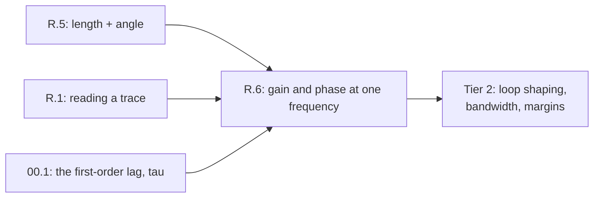

# Lesson R.6: Wiggle In, Wiggle Out — Shaking the Joint and Reading Gain and Phase

<!-- run-callout:start -->
> **Before Step 1 · the school-maths ramp**
>
> **Run this in the workbench.** [Open MechaLab with `R.6` loaded](https://tle47.github.io/Mechatronics-Roadmap/?lesson=R.6) - it opens on the **Run Python Lessons** tab with that entry selected. Starter code, hints and the graded check are ready; this page is the reading copy, and nothing you type here is saved.
<!-- run-callout:end -->

## Goal
Command the joint with a **sine wave** instead of a step, wait for the transient to die, and read two numbers from one steady period: how big the motion was compared with the command (**gain**) and how far behind it lagged (**phase**). Then find the frequency where the lag is 45° and the gain has fallen to 0.7071 — the corner.

- **New ideas (max 2):**
  1. **Shake the joint at one frequency and record two numbers: how much the response moved, and how late it was.** Gain is the ratio of the response's amplitude to the command's, and phase is the delay measured as an angle: one full period is 360°, so a lag of an eighth of a period is 45°. Both are needed — a response can be the right size and still arrive too late to be useful.
  2. **A first-order lag has a corner at omega = 1/tau, where the gain is 0.7071 and the phase is −45 degrees.** With `τ = 0.05 s` the corner is `20 rad/s`, i.e. `3.183099 Hz`; at `2 rad/s` the response is almost perfect (`0.9950` at `−5.711°`), at the corner it is `0.7071` at `−45.000°`, and by `200 rad/s` it is `0.0995` at `−84.289°` — the joint is shaking fast and barely moving.
- **New syntax:** sampling one steady period at a fixed `dt`, then projecting it onto `sin(ωt)` and `cos(ωt)` to recover amplitude and phase; `math.atan2` for the angle, and `math.hypot` for the length.
- **Target time (unmeasured — [log yours](../.github/ISSUE_TEMPLATE/beginner-timing-log.md)):** Typical: 0.75–1.0 hours | Slow-learner: 1.5–2.0 hours

---

## Prerequisites
- [Lesson R.5: Phasors](R.5-phasors.md) — an arrow with a length and an angle
- [Lesson R.1: Rate of Change](R.1-rate-of-change.md) — reading a trace that moves
- [Lesson 00.1: Effort, Flow and the First-Order Lag](../00-foundations/00.1-effort-flow-and-first-order-lag.md) — `τ` as the time a system takes to respond



---

## Learn

### Idea 1: Shake the joint at one frequency and record two numbers: how much the response moved, and how late it was
- **Primary resource:** [Wikipedia — Frequency response](https://en.wikipedia.org/wiki/Frequency_response)
  - **What to read:** The lead section, where the response is described per frequency by a magnitude and a phase.
  - **What to skip:** Skip the Bode-plot construction, the Laplace material and the filter catalogues.
  - **Key takeaway:** Drive the lag with `sin(ωt)` and, after the transient has decayed (`e^{-20} ≈ 2×10^{-9}` after one second at `τ = 0.05`), the response is another sine at the **same frequency** with a smaller amplitude and a delay. At `2 rad/s` the simulation measures gain `0.9950` and phase `−5.652°`; the formula says `0.9950` and `−5.711°`. Two numbers per frequency is the whole measurement, and both come from one steady period — not from the first wiggle, which is still the transient.
- **Alternative resource:** [Wikipedia — Phase (waves)](https://en.wikipedia.org/wiki/Phase_(waves))
  - **What to read:** The lead and the `Phase shift` subsection, so a delay can be read as a fraction of a period in degrees.
  - **What to skip:** Skip superposition of waves and the interference material.

### Idea 2: A first-order lag has a corner at omega = 1/tau, where the gain is 0.7071 and the phase is −45 degrees
- **Primary resource:** [Wikipedia — Cutoff frequency](https://en.wikipedia.org/wiki/Cutoff_frequency)
  - **What to read:** The lead section and the half-power definition — the frequency where the response has fallen to `1/√2` of its low-frequency value.
  - **What to skip:** Skip the electronic-filter design sections and the digital-filter material.
  - **Key takeaway:** The corner is `ω = 1/τ = 20 rad/s`, and `τ = 0.05 s` puts it at `3.183099 Hz`. There the gain is `0.7071` and the phase is `−45.000°`, both measured (`0.7074`, `−44.426°`) and predicted. Either side of it the shape is monotone: at `2 rad/s` the joint nearly follows (`0.9950`), at `200 rad/s` it barely moves (`0.0995`) and is `−84.289°` late. The gain falls by 10× per decade past the corner, which is what "first order" means.
- **Alternative resource:** [OpenStax — College Physics 2e, §16.8 Forced Oscillations](https://openstax.org/books/college-physics-2e/pages/16-8-forced-oscillations)
  - **What to read:** The description of a driven system's amplitude depending on the driving frequency — the same idea, with resonance instead of a first-order roll-off.

### Bridge Notes
Tier 2 asks for the response at many frequencies and calls the picture a Bode plot; the axes are exactly these two numbers. Three habits make the step. First, **measure in steady state**: a gain read during the transient is the sum of the transient and the forced response, and it changes with how long you waited. Second, **both numbers travel together**: a gain of `0.9` sounds fine until the phase is `−170°`, at which point the loop is nearly an oscillator — this is why a controller's gain must fall before its lag reaches a half turn. Third, **the sampling itself is a lag**: the `1 ms` hold in this lesson is a small delay of its own, which is why the measured phase at `200 rad/s` reads `−79.798°` against the formula's `−84.289°`. Shorten `dt` and the two converge; that is also why a firmware loop running slowly has less phase margin than the maths predicts. In Tier 2 the same measurement appears as bandwidth, as the corner of a filter, and as the frequency where a control loop runs out of authority.

---

## Do it yourself

- **What is simulated and in which tool:** Runs 100% in Python — the MechaLab Browser Runner or `python3` locally. The plant is the same first-order joint lag used in 00.1, driven by a sine at three frequencies.
- **What is real-hardware only:** Nothing. On a bench the same measurement is a sine-sweep or a chirp on the real joint, with gain and phase read from the recorded command and encoder.

### Starter Code (runs as-is — fill in the TODOs)
Complete `gain` (`TODO 1`), `phase_deg` (`TODO 2`), `simulate` (`TODO 3`) and `measure` (`TODO 4`). The print loop and the 1% assertion are given:

```python
import math

TAU = 0.05  # s, the joint's first-order lag
DT_S = 0.001
SETTLE_S = 1.0


def gain(omega, tau=TAU):
    # TODO 1: 1 / sqrt(1 + (omega * tau) ** 2)
    return 1.0


def phase_deg(omega, tau=TAU):
    # TODO 2: -atan(omega * tau), converted to DEGREES
    return 0.0


def simulate(omega, tau=TAU, dt_s=DT_S, settle_s=SETTLE_S):
    # TODO 3: hold a sine for settle_s, then return one steady period of (t, u, y)
    return []


def measure(samples, omega):
    # TODO 4: RMS gain, and the response's phase relative to the command
    return 0.0, 0.0


print(f"corner frequency: {1.0 / (2.0 * math.pi * TAU):.6f} Hz")
for omega in (2.0, 20.0, 200.0):
    m_gain, m_phase = measure(simulate(omega), omega)
    print(
        f"omega {omega:5.1f} rad/s: formula {gain(omega):.4f} at {phase_deg(omega):8.3f} deg, "
        f"measured {m_gain:.4f} at {m_phase:8.3f} deg"
    )
    assert abs(m_gain - gain(omega)) / gain(omega) < 0.01, "gain within 1 %"
```

### Expected Output
When the four TODOs are completed, running the script prints:

```text
corner frequency: 3.183099 Hz
omega   2.0 rad/s: formula 0.9950 at   -5.711 deg, measured 0.9950 at   -5.652 deg
omega  20.0 rad/s: formula 0.7071 at  -45.000 deg, measured 0.7074 at  -44.426 deg
omega 200.0 rad/s: formula 0.0995 at  -84.289 deg, measured 0.1005 at  -79.798 deg
```

### Hint Ladder

<details>
<summary><strong>Hint 1 (Concept nudge)</strong></summary>

`simulate` runs the exact first-order step for a held input: `y = u + (y - u) * exp(-dt/tau)`. Build `t` yourself and append `(t, u, y)` for one period. `measure` takes the RMS of the response over the RMS of the command for the gain, and the difference of the two arrows' angles for the phase — `atan2` of the sine-projection against the cosine-projection, for `y` and for `u`.
</details>

<details>
<summary><strong>Hint 2 (Formula / structure)</strong></summary>

```python
def gain(omega, tau=TAU):
    return 1.0 / math.sqrt(1.0 + (omega * tau) ** 2)


def phase_deg(omega, tau=TAU):
    return -math.degrees(math.atan(omega * tau))


def measure(samples, omega):
    n = len(samples)
    rms_u = math.sqrt(sum(u * u for _t, u, _y in samples) / n)
    rms_y = math.sqrt(sum(y * y for _t, _u, y in samples) / n)
    sy = sum(y * math.sin(omega * t) for t, _u, y in samples)
    cy = sum(y * math.cos(omega * t) for t, _u, y in samples)
    su = sum(u * math.sin(omega * t) for t, u, _y in samples)
    cu = sum(u * math.cos(omega * t) for t, u, _y in samples)
    return rms_y / rms_u, math.degrees(math.atan2(cy, sy) - math.atan2(cu, su))
```
</details>

<details>
<summary><strong>Full Solution</strong></summary>

```python
import math

TAU = 0.05  # s, the joint's first-order lag
DT_S = 0.001
SETTLE_S = 1.0


def gain(omega, tau=TAU):
    """Amplitude out / amplitude in for a first-order lag."""
    return 1.0 / math.sqrt(1.0 + (omega * tau) ** 2)


def phase_deg(omega, tau=TAU):
    """Phase of the response relative to the command, in degrees."""
    return -math.degrees(math.atan(omega * tau))


def simulate(omega, tau=TAU, dt_s=DT_S, settle_s=SETTLE_S):
    """Hold a sine command for `settle_s`, then return one steady period."""
    decay = math.exp(-dt_s / tau)
    y = 0.0
    t = 0.0
    for _ in range(int(settle_s / dt_s)):
        u = math.sin(omega * t)
        y = u + (y - u) * decay
        t += dt_s
    period = 2.0 * math.pi / omega
    steps = int(round(period / dt_s))
    samples = []
    for _ in range(steps):
        u = math.sin(omega * t)
        y = u + (y - u) * decay
        samples.append((t, u, y))
        t += dt_s
    return samples


def measure(samples, omega):
    """RMS gain, and the response's phase relative to the command's."""
    n = len(samples)
    rms_u = math.sqrt(sum(u * u for _t, u, _y in samples) / n)
    rms_y = math.sqrt(sum(y * y for _t, _u, y in samples) / n)
    sy = sum(y * math.sin(omega * t) for t, _u, y in samples)
    cy = sum(y * math.cos(omega * t) for t, _u, y in samples)
    su = sum(u * math.sin(omega * t) for t, u, _y in samples)
    cu = sum(u * math.cos(omega * t) for t, u, _y in samples)
    measured_phase = math.degrees(math.atan2(cy, sy) - math.atan2(cu, su))
    return rms_y / rms_u, measured_phase


print(f"corner frequency: {1.0 / (2.0 * math.pi * TAU):.6f} Hz")
for omega in (2.0, 20.0, 200.0):
    m_gain, m_phase = measure(simulate(omega), omega)
    print(
        f"omega {omega:5.1f} rad/s: formula {gain(omega):.4f} at {phase_deg(omega):8.3f} deg, "
        f"measured {m_gain:.4f} at {m_phase:8.3f} deg"
    )
    assert abs(m_gain - gain(omega)) / gain(omega) < 0.01, "gain within 1 %"
```
</details>

---

## Common mistakes & troubleshooting
- **Measuring during the transient:** The first period contains the start-up response, and its "gain" depends on when you looked. Wait at least `5τ` (`0.25 s` here) before recording; this lesson waits a full second, which is `20τ`.
- **A window that is not a whole number of periods:** Projecting over a partial period leaks energy into the other projection and corrupts both numbers. `steps = round(period / dt_s)` and then sample exactly that many; if `dt_s` cannot divide the period, choose frequencies that it can.
- **Reporting gain without phase:** A gain of `0.9` at `−170°` is a near-oscillator, not a good response. Tier 2's loop shaping reads the pair together, and a controller tuned on gain alone will ring.

---

## Check yourself
1. **With `τ = 0.05 s`, what are the gain and phase at `ω = 40 rad/s`, and how do they compare with the corner?**
   <details>
   <summary><strong>Answer 1</strong></summary>
   `ωτ = 2`, so gain is `1/√(1+4) = 1/√5 = 0.4472` and phase is `−atan(2) = −63.435°`. Past the corner the gain keeps falling and the lag keeps growing; doubling the frequency from the corner halved the gain and added `18.4°` of lag.
   </details>
2. **Why wait a full second before recording, when one period at `2 rad/s` is about 3.14 s?**
   <details>
   <summary><strong>Answer 2</strong></summary>
   The wait is for the **transient**, whose decay is `e^{-t/τ}`: after `1 s` it is `e^{-20} ≈ 2×10^{-9}`, far below the printed precision. The recorded window is then one whole period of the steady response, which at `2 rad/s` is a longer stretch of the same signal.
   </details>
3. **The measured phase at `200 rad/s` reads `−79.798°` where the formula says `−84.289°`. Which is wrong?**
   <details>
   <summary><strong>Answer 3</strong></summary>
   Neither. The simulation holds each command for `1 ms`, and that hold is itself a small delay — a zero-order hold adds roughly `ω·dt/2` of lag, about `5.7°` at `200 rad/s`. Shorten `dt_s` and the measured value moves toward the formula; a real firmware loop has the same effect, which is why fast loops keep more phase margin.
   </details>

---

## Recap
- [ ] I can drive a lag with a sine, wait out the transient, and read gain and phase from one steady period.
- [ ] I can compute the corner `ω = 1/τ`, and state the gain and phase there (`0.7071`, `−45°`).
- [ ] I can explain why gain and phase must be read together, and why sampling adds its own lag.

👉 **Next:** [Tier 1 Exit Check](../docs/TIER1_EXIT_CHECK.md) — fourteen items, each pointing back at R.1–R.6, before you start Tier 2.
