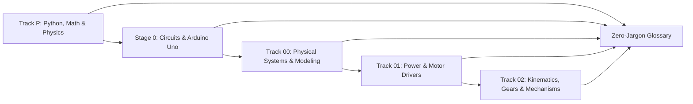

# Beginner Mechatronics Glossary (Track P, Stage 0, and Tracks 00–02 Tier 1)

Every technical term, symbol, and acronym used in the Beginner Path is defined here in plain English with its **SI unit** and the exact **First Lesson** where it is introduced. Automated CI (`scripts/check_term_order.py`) verifies that no lesson uses a glossary term before the lesson that defines it.

---

## Track P — Programming, Units, Math & Physics (`P.1`–`P.M`)

| Term | Plain-English Definition | Unit / Symbol | First Lesson |
| :--- | :--- | :--- | :--- |
| **Variable** | A named box in computer memory that stores a value (`battery_level = 12.6`). | — | [Lesson P.1](../track-p/P.1-variables-and-data-types.md) |
| **Assignment (`=`)** | The single equals sign in code: evaluates the right side first and copies the result into the variable name on the left. | `=` | [Lesson P.1](../track-p/P.1-variables-and-data-types.md) |
| **Integer (`int`)** | A whole number with no decimal point (`0`, `255`, `-40`). | `int` | [Lesson P.1](../track-p/P.1-variables-and-data-types.md) |
| **Float (`float`)** | A floating-point number with a decimal point (`12.60`, `0.005`, `-9.81`). | `float` | [Lesson P.1](../track-p/P.1-variables-and-data-types.md) |
| **String (`str`)** | A piece of text enclosed in quotation marks (`"READY"`). | `str` | [Lesson P.1](../track-p/P.1-variables-and-data-types.md) |
| **Boolean (`bool`)** | A logical truth value that is either `True` or `False`. | `bool` | [Lesson P.1](../track-p/P.1-variables-and-data-types.md) |
| **Order of Operations** | The precedence rules (`PEMDAS`) that evaluate Parentheses `()` first, Exponents `**` second, Multiplication/Division `* / //` third, and Addition/Subtraction `+ -` last. | `()`, `**`, `*`, `/` | [Lesson P.2](../track-p/P.2-arithmetic-and-order-of-operations.md) |
| **Clamping (Saturation)** | Bounding a calculated number between a safe minimum and maximum (`[0, 255]`) using `if / elif` checks so it cannot overflow hardware limits. | — | [Lesson P.3](../track-p/P.3-decisions-and-clamping.md) |
| **Zero-Based Indexing** | Counting list positions starting at `0` for the first item (`items[0]`), `1` for the second, up to `len(items) - 1`. | `[0]` | [Lesson P.4](../track-p/P.4-lists-and-for-loops.md) |
| **Function (`def` / `return`)** | A reusable named block of code that takes input parameters and hands back a computed value via `return`. | `def`, `return` | [Lesson P.5](../track-p/P.5-functions-and-while-loops.md) |
| **Assertion (`assert`)** | An automated self-check statement (`assert condition`) that stops the program with an `AssertionError` if `condition` is `False`. | `assert` | [Lesson P.6](../track-p/P.6-modules-and-automated-asserts.md) |
| **Base SI Units** | Standard un-prefixed units required by physics equations: meters (`m`), kilograms (`kg`), seconds (`s`), Amperes (`A`), Volts (`V`), and Ohms (`Ω`). | `m`, `kg`, `s`, `A`, `V`, `Ω` | [Lesson P.7](../track-p/P.7-si-units-and-metric-prefixes.md) |
| **Metric Prefixes** | Power-of-10 multipliers placed in front of a unit: **mega (`M`)** $= 10^6$, **kilo (`k`)** $= 10^3$, **milli (`m`)** $= 10^{-3}$, and **micro (`µ`)** $= 10^{-6}$. | `M`, `k`, `m`, `µ` | [Lesson P.7](../track-p/P.7-si-units-and-metric-prefixes.md) |
| **Frequency ($f$)** | How many complete cycles repeat in one second ($f = 1 / T$). | Hertz (`Hz` $= \text{s}^{-1}$) | [Lesson P.8](../track-p/P.8-frequency-and-binary-bits.md) |
| **Period ($T$)** | The time duration of a single repeating cycle ($T = 1 / f$). | Seconds (`s`), `ms`, `µs` | [Lesson P.8](../track-p/P.8-frequency-and-binary-bits.md) |
| **Binary Bit** | A single digital `0` or `1`; an $N$-bit unsigned register holds $2^N$ integers from `0` to $2^N - 1$ (`0..255` for 8-bit, `0..1023` for 10-bit). | `bit`, $2^N$ | [Lesson P.8](../track-p/P.8-frequency-and-binary-bits.md) |
| **Linear Range Scaling** | Mapping an input $x \in [0, X_{\max}]$ to an output $y \in [0, Y_{\max}]$ via the fraction of full scale: $y = (x / X_{\max}) \times Y_{\max}$. | — | [Lesson P.9](../track-p/P.9-rearranging-formulas-and-scaling.md) |
| **Radian (`rad`)** | The natural unit of angle where a half-circle ($180^\circ$) is $\pi\text{ rad}$ and a full circle ($360^\circ$) is $2\pi \approx 6.2832\text{ rad}$. Required by `math.cos()` and `math.sin()`. | `rad` | [Lesson P.10](../track-p/P.10-radians-and-right-triangle-trig.md) |
| **Angular Velocity ($\omega$)** | Rotational speed in radians per second: $\omega = \text{RPM} \times \frac{2\pi}{60}$. | `rad/s` | [Lesson P.10](../track-p/P.10-radians-and-right-triangle-trig.md) |
| **Four-Quadrant Inverse Tangent (`atan2`)** | `math.atan2(y, x)` returns the angle $\theta \in (-\pi, \pi]\text{ rad}$ from the horizontal $+x$-axis to point $(x, y)$ without dividing by zero. | `rad` | [Lesson P.10](../track-p/P.10-radians-and-right-triangle-trig.md) |
| **Graph Slope (Rate of Change)** | Vertical rise divided by horizontal time run ($\frac{\Delta y}{\Delta t}$); on a position-vs-time graph, slope is velocity. | `(unit)/s` | [Lesson P.11](../track-p/P.11-reading-time-series-graphs.md) |
| **Area Under a Curve (Accumulation)** | Sum of rectangle slices ($\sum y \cdot \Delta t$); on a velocity-vs-time graph, area is accumulated displacement $\Delta x$. | `(unit)·s` | [Lesson P.11](../track-p/P.11-reading-time-series-graphs.md) |
| **Force ($F$) and Weight ($W$)** | Push or pull in Newtons ($F = m \cdot a$); gravitational weight is $W = m \cdot g$ where $g = 9.81\text{ m/s}^2$. | Newton (`N` $= \text{kg}\cdot\text{m/s}^2$) | [Lesson P.12](../track-p/P.12-forces-and-lever-torque.md) |
| **Lever Arm ($r_\perp$)** | The perpendicular distance from a joint pivot to the line of action of a force ($r_\perp = L\cos\theta$ for gravity when arm angle $\theta$ is measured from the horizontal). | Meter (`m`) | [Lesson P.12](../track-p/P.12-forces-and-lever-torque.md) |
| **Lever Torque ($\tau$)** | Rotational twisting effort around a pivot: $\tau = F \cdot r_\perp = m \cdot g \cdot L \cdot \cos\theta$ (with $\theta$ measured from horizontal). | Newton-meter (`N·m`) | [Lesson P.12](../track-p/P.12-forces-and-lever-torque.md) |
| **Recommended Operating Conditions** | The `Min` / `Typ` / `Max` datasheet operating window within which a part is guaranteed to work reliably (distinct from destructive **Absolute Maximum Ratings**). | `Min`, `Typ`, `Max` | [Lesson P.14](../track-p/P.14-reading-a-datasheet-table.md) |

---

## Stage 0 — Electronics, Circuits & Arduino Uno (`S0.0`–`S0.M`)

| Term | Plain-English Definition | Unit / Symbol | First Lesson |
| :--- | :--- | :--- | :--- |
| **Effort and Flow** | Cross-domain pair of variables whose product is instantaneous power ($P = \text{Effort} \times \text{Flow}$): Water pressure $\times$ stream rate (`S0.0`), Voltage $\times$ Current (`S0.1`), or Force/Torque $\times$ Velocity (`00.1` revisit). | Watt (`W`) | [Lesson S0.0](../stage-0/S0.0-why-electricity-is-like-flow.md) |
| **Ground (`GND`)** | The common $0.0\text{ V}$ reference node in a circuit against which all other voltages are measured. | $0\text{ V}$ (`GND`) | [Lesson S0.1](../stage-0/S0.1-closed-circuits-and-ohms-law.md) |
| **Voltage ($V$)** | Electrical potential difference ("pressure") between two nodes that pushes charge around a closed loop. | Volt (`V`) | [Lesson S0.1](../stage-0/S0.1-closed-circuits-and-ohms-law.md) |
| **Current ($I$)** | Flow rate of electric charge through a conductor. | Ampere (`A`), milliamp (`mA`) | [Lesson S0.1](../stage-0/S0.1-closed-circuits-and-ohms-law.md) |
| **Resistance ($R$)** | Opposition to electric current flow. | Ohm (`Ω`), kilohm (`kΩ`) | [Lesson S0.1](../stage-0/S0.1-closed-circuits-and-ohms-law.md) |
| **Ohm's Law** | Linear law relating voltage drop, current, and resistance across a resistor: $V = I \cdot R$. | $V = IR$ | [Lesson S0.1](../stage-0/S0.1-closed-circuits-and-ohms-law.md) |
| **Series Circuit** | Components chained end-to-end along one path so they share the exact same current ($R_{\text{total}} = R_1 + R_2$). | — | [Lesson S0.2](../stage-0/S0.2-series-parallel-and-voltage-dividers.md) |
| **Parallel Circuit** | Components wired side-by-side across the same two nodes so they share the exact same voltage. | — | [Lesson S0.2](../stage-0/S0.2-series-parallel-and-voltage-dividers.md) |
| **Voltage Divider** | Two series resistors ($R_1$ to $V_{\text{in}}$, $R_2$ to `GND`) producing $V_{\text{out}} = V_{\text{in}} \cdot \frac{R_2}{R_1 + R_2}$ at their midpoint. | $V_{\text{out}}$ | [Lesson S0.2](../stage-0/S0.2-series-parallel-and-voltage-dividers.md) |
| **Potentiometer** | A 3-pin adjustable resistor whose rotating middle wiper pin forms a variable voltage divider from $0\text{ V}$ to $V_{\text{in}}$. | `Ω` (`kΩ`) | [Lesson S0.2](../stage-0/S0.2-series-parallel-and-voltage-dividers.md) |
| **Solderless Breadboard** | Prototyping board whose terminal rows connect 5 holes horizontally (`a–e` and `f–j` across a center ravine) and whose power rails run vertically. | — | [Lesson S0.3](../stage-0/S0.3-breadboards-and-short-circuits.md) |
| **Short Circuit** | An unintended near-zero-resistance path ($R \to 0$) across a supply or component that causes excessive current flow. | — | [Lesson S0.3](../stage-0/S0.3-breadboards-and-short-circuits.md) |
| **LED (Light-Emitting Diode)** | Polarized one-way semiconductor lamp conducting only from **Anode (`+`)** to **Cathode (`-`)** with a fixed forward voltage drop $V_f$. | $V_f$ (`V`) | [Lesson S0.4](../stage-0/S0.4-leds-and-resistor-power.md) |
| **Forward Voltage ($V_f$)** | The voltage drop claimed by a forward-biased diode or LED ($\approx 2.0\text{ V}$ for red LED, $\approx 0.7\text{ V}$ for silicon diode). | Volt (`V`) | [Lesson S0.4](../stage-0/S0.4-leds-and-resistor-power.md) |
| **Electrical Power ($P$)** | Rate of electrical energy transfer or heat dissipation: $P = V \cdot I = I^2 R = V^2 / R$. | Watt (`W`), milliwatt (`mW`) | [Lesson S0.4](../stage-0/S0.4-leds-and-resistor-power.md) |
| **Voltmeter and Ammeter** | Multimeter modes: a **voltmeter** ($R_V \approx 10\text{ M}\Omega$) is placed **in parallel**, whereas an **ammeter** ($R_A \approx 0.05\ \Omega$) must be wired **in series**. | `V`, `A` (`mA`) | [Lesson S0.5](../stage-0/S0.5-multimeters-and-current-limited-supplies.md) |
| **CC/CV Bench Supply** | Adjustable power supply that regulates Constant Voltage (`CV`, $V_{\text{set}}$) until load current hits $I_{\text{limit}}$, then switches to Constant Current (`CC`) and folds back voltage. | `V`, `A` | [Lesson S0.5](../stage-0/S0.5-multimeters-and-current-limited-supplies.md) |
| **Capacitor ($C$)** | Two-plate component that stores electric charge and resists sudden changes in **voltage**, charging with RC time constant $\tau = R \cdot C$. | Farad (`F`), `µF`, `nF` | [Lesson S0.6](../stage-0/S0.6-capacitors-and-decoupling.md) |
| **Decoupling Capacitor** | A $0.1\ \mu\text{F}$ ($100\text{ nF}$) ceramic capacitor placed right across a chip's `VCC` and `GND` pins (plus $100\ \mu\text{F}$ bulk rail capacitor) to prevent supply brownouts. | `0.1 µF` (`100 nF`) | [Lesson S0.6](../stage-0/S0.6-capacitors-and-decoupling.md) |
| **Digital I/O (`pinMode`, `digitalWrite`, `digitalRead`)** | Microcontroller pins that switch between discrete `LOW` ($0.0\text{ V}$) and `HIGH` ($5.0\text{ V}$ on Arduino Uno). | `0` / `1` (`0 V` / `5 V`) | [Lesson S0.7](../stage-0/S0.7-arduino-uno-digital-io-and-pullups.md) |
| **Pull-Up Resistor (`INPUT_PULLUP`)** | Resistor ($20\text{–}50\text{ k}\Omega$ internal to the Arduino Uno) holding a pushbutton pin safely `HIGH` (`1`) when open so pressing the button to `GND` reads active-low `LOW` (`0`). | `kΩ` | [Lesson S0.7](../stage-0/S0.7-arduino-uno-digital-io-and-pullups.md) |
| **Serial Monitor (UART)** | Text telemetry link (`Serial.begin(9600)`, `Serial.print`, `Serial.println`) sending characters from the Arduino Uno to the computer at `9600 baud` (bits/s). | `baud` (`bits/s`) | [Lesson S0.7](../stage-0/S0.7-arduino-uno-digital-io-and-pullups.md) |
| **ADC (Analog-to-Digital Converter)** | Hardware circuit (`analogRead(A0)`) converting a continuous $0.0\text{–}5.0\text{ V}$ voltage on the Arduino Uno into a 10-bit integer (`0..1023`). | Counts (`0..1023`) | [Lesson S0.8](../stage-0/S0.8-adc-analog-read-and-serial-monitor.md) |
| **PWM (Pulse-Width Modulation)** | Rapidly switching a pin between $0\text{ V}$ and $V_{\text{cc}}$ (`analogWrite(pin, 0..255)`) with duty cycle $\text{Duty} = T_{\text{on}} / T$ so average voltage is $V_{\text{avg}} = \text{Duty} \cdot V_{\text{cc}}$. | Duty `%` (`0..255`) | [Lesson S0.9](../stage-0/S0.9-pwm-duty-cycle-and-analog-write.md) |

---

## Track 00 — Physical Systems & Engineering Modeling (`00.1`–`00.3`)

| Term | Plain-English Definition | Unit / Symbol | First Lesson |
| :--- | :--- | :--- | :--- |
| **Mechanical Power** | Instantaneous rate of mechanical work: $P_{\text{mech}} = F \cdot v$ (linear) or $P_{\text{rot}} = \tau \cdot \omega$ (rotational, with $\omega$ in `rad/s`). | Watt (`W` $= \text{N}\cdot\text{m/s}$) | [Lesson 00.1](../00-foundations/00.1-effort-flow-and-first-order-lag.md) |
| **First-Order Lag** | A system with one energy storage state that approaches its target exponentially with time constant $\tau$ ($63.2\%$ at $1\tau$, $99.3\%$ at $5\tau$). | $\tau$ (`s`) | [Lesson 00.1](../00-foundations/00.1-effort-flow-and-first-order-lag.md) |
| **Hooke's Law** | Linear spring law stating that spring restoring force is proportional to stretch or compression $x$: $F_{\text{spring}} = -k \cdot x$. | $F_s = -kx$ (`N`) | [Lesson 00.2](../00-foundations/00.2-mass-spring-damper-oscillations.md) |
| **Spring Constant ($k$)** | Stiffness of a linear spring measured in Newtons of restoring force per meter of deflection. | `N/m` | [Lesson 00.2](../00-foundations/00.2-mass-spring-damper-oscillations.md) |
| **Viscous Damping ($b$)** | Friction-like braking force proportional to velocity ($F_{\text{damper}} = -b \cdot v$) that removes energy and stops oscillations. | `N·s/m` | [Lesson 00.2](../00-foundations/00.2-mass-spring-damper-oscillations.md) |
| **Natural Frequency ($\omega_n$)** | The speed at which an undamped mass-spring system oscillates back and forth: $\omega_n = \sqrt{k / m}$. | `rad/s` | [Lesson 00.2](../00-foundations/00.2-mass-spring-damper-oscillations.md) |
| **Damping Ratio ($\zeta$)** | Dimensionless ratio $\zeta = \frac{b}{2\sqrt{m k}}$ distinguishing **underdamped** ($\zeta < 1$, ringing), **critically damped** ($\zeta = 1$, fastest settling with zero overshoot), and **overdamped** ($\zeta > 1$, sluggish) motion. | $\zeta$ (dimensionless) | [Lesson 00.2](../00-foundations/00.2-mass-spring-damper-oscillations.md) |
| **Dimensional Consistency** | Checking that every term added or equated in a formula has the exact same base SI units (`[kg·m/s^2] = [N]`). | — | [Lesson 00.3](../00-foundations/00.3-modeling-discipline-and-sanity-checks.md) |
| **Sign Convention** | Explicit choice of positive coordinate direction (`+x` right, `+theta` counter-clockwise from horizontal) so restoring and gravity forces carry the right `+`/`-` sign. | — | [Lesson 00.3](../00-foundations/00.3-modeling-discipline-and-sanity-checks.md) |

---

## Track 01 — Power Electronics, Motor Drivers & Clean Signals (`01.1`–`01.4`)

| Term | Plain-English Definition | Unit / Symbol | First Lesson |
| :--- | :--- | :--- | :--- |
| **MOSFET (N-Channel)** | Three-terminal voltage-controlled transistor switch (**Gate `G`**, **Drain `D`**, **Source `S`**) with tiny on-resistance $R_{\text{DS(on)}}$ when $V_{\text{GS}} = 5.0\text{ V}$. | $R_{\text{DS(on)}}$ (`Ω`) | [Lesson 01.1](../01-electronics-and-power/01.1-mosfet-inductor-flyback.md) |
| **Common Ground** | Wiring the negative terminal of a high-voltage motor battery (`12 V`) to the microcontroller's `GND` (`0 V`) so control signals share a reference. | `GND` ($0\text{ V}$) | [Lesson 01.1](../01-electronics-and-power/01.1-mosfet-inductor-flyback.md) |
| **Inductor ($L$)** | Coil of wire (such as a motor winding) that stores energy in a magnetic field and resists sudden changes in **current** ($V_L = L \frac{\Delta I}{\Delta t}$). | Henry (`H`), millihenry (`mH`) | [Lesson 01.1](../01-electronics-and-power/01.1-mosfet-inductor-flyback.md) |
| **Inductive Kickback** | High-voltage spike generated across an inductor or motor coil when current is switched off abruptly without a recirculation path. | Volt (`V`) | [Lesson 01.1](../01-electronics-and-power/01.1-mosfet-inductor-flyback.md) |
| **Flyback Diode** | Diode wired in parallel across an inductive load (cathode to $+V_{\text{supply}}$, anode to switch Drain) to recirculate turn-off current and clamp voltage spikes. | $V_{\text{clamp}} \approx V_s + 0.7\text{ V}$ | [Lesson 01.1](../01-electronics-and-power/01.1-mosfet-inductor-flyback.md) |
| **H-Bridge** | Four-switch motor driver circuit that reverses polarity across a DC motor for bidirectional (`Forward`, `Reverse`, `Brake`, `Coast`) PWM control. | — | [Lesson 01.2](../01-electronics-and-power/01.2-h-bridge-and-stall-current.md) |
| **Shoot-Through** | Short-circuit fault when both the top (`high-side`) and bottom (`low-side`) switches on the same side of an H-bridge turn on simultaneously. | — | [Lesson 01.2](../01-electronics-and-power/01.2-h-bridge-and-stall-current.md) |
| **Back-EMF ($V_{\text{emf}}$)** | Generator voltage induced inside a spinning motor's coils proportional to rotational speed ($V_{\text{emf}} = K_e \cdot \omega$) that opposes supply voltage. | Volt (`V`) | [Lesson 01.2](../01-electronics-and-power/01.2-h-bridge-and-stall-current.md) |
| **Stall Current ($I_{\text{stall}}$)** | Maximum DC motor current drawn when the shaft is stationary ($\omega = 0 \implies V_{\text{emf}} = 0$): $I_{\text{stall}} = V_{\text{supply}} / R_{\text{motor}}$. | Ampere (`A`) | [Lesson 01.2](../01-electronics-and-power/01.2-h-bridge-and-stall-current.md) |
| **Linear Regulator (LDO)** | Voltage regulator that drops excess voltage by burning the difference as heat: $P_{\text{heat}} = (V_{\text{in}} - V_{\text{out}}) \cdot I_{\text{load}}$. | Watt (`W`) | [Lesson 01.3](../01-electronics-and-power/01.3-power-regulators-and-power-budget.md) |
| **Buck Converter** | High-efficiency ($\eta \approx 85\text{–}95\%$) switching step-down regulator that trades higher voltage for lower input current ($P_{\text{in}} = P_{\text{out}} / \eta$). | Efficiency $\eta$ (`%`) | [Lesson 01.3](../01-electronics-and-power/01.3-power-regulators-and-power-budget.md) |
| **Power Budget** | Engineering table summing peak and continuous currents and powers across every voltage rail (`12 V` motor rail, `5 V` logic rail) to size batteries, regulators, and fuses. | `A`, `W` | [Lesson 01.3](../01-electronics-and-power/01.3-power-regulators-and-power-budget.md) |
| **Ground Bounce** | Unwanted voltage offset ($V_{\text{bounce}} = I_{\text{motor}} \cdot R_{\text{wire}}$) induced on a sensor's ground wire when it shares a return path with heavy motor currents. | Volt (`V`, `mV`) | [Lesson 01.4](../01-electronics-and-power/01.4-grounding-and-rc-lowpass-filters.md) |
| **Star Ground** | Wiring layout where noisy high-current motor return wires and quiet analog sensor ground wires meet at a single central point at the power supply negative terminal. | — | [Lesson 01.4](../01-electronics-and-power/01.4-grounding-and-rc-lowpass-filters.md) |
| **Low-Pass Filter** | Series resistor $R$ and parallel capacitor $C$ to `GND` that passes slow DC sensor signals while shunting high-frequency PWM switching noise to ground. | — | [Lesson 01.4](../01-electronics-and-power/01.4-grounding-and-rc-lowpass-filters.md) |
| **Cutoff Frequency ($f_c$)** | Boundary frequency $f_c = \frac{1}{2\pi R C}$ of an RC low-pass filter where output amplitude drops to $\frac{1}{\sqrt{2}} \approx 70.7\%$ of input amplitude. | Hertz (`Hz`) | [Lesson 01.4](../01-electronics-and-power/01.4-grounding-and-rc-lowpass-filters.md) |

---

## Track 02 — Kinematics, Rotational Inertia & Mechanisms (`02.1`–`02.5`)

| Term | Plain-English Definition | Unit / Symbol | First Lesson |
| :--- | :--- | :--- | :--- |
| **Coordinate Frame** | Origin $(0, 0)$ and perpendicular axes ($+x$ right, $+y$ up, $+\theta$ counter-clockwise from $+x$) used to measure robot positions and angles. | `(x, y, θ)` | [Lesson 02.1](../02-mechanics-kinematics-dynamics/02.1-1d-link-fk-and-coord-frames.md) |
| **Forward Kinematics (FK)** | Computing the robot tip coordinates $(x, y)$ from known joint angles ($\theta_1, \theta_2$) and link lengths ($L_1, L_2$). | Meter (`m`) | [Lesson 02.1](../02-mechanics-kinematics-dynamics/02.1-1d-link-fk-and-coord-frames.md) |
| **Workspace** | The set of all $(x, y)$ points that a robot arm's tip can physically reach. | $\text{m}^2$ | [Lesson 02.1](../02-mechanics-kinematics-dynamics/02.1-1d-link-fk-and-coord-frames.md) |
| **Relative Joint Angle** | Angle $\theta_2$ of a second arm link measured relative to the direction of the first link, so its global angle from horizontal is $\theta_{12} = \theta_1 + \theta_2$. | `rad` (`deg`) | [Lesson 02.2](../02-mechanics-kinematics-dynamics/02.2-2link-planar-forward-kinematics.md) |
| **End-Effector** | The tool, gripper, or tip at the far end of a robot arm whose $(x, y)$ position we control. | `(x, y)` (`m`) | [Lesson 02.2](../02-mechanics-kinematics-dynamics/02.2-2link-planar-forward-kinematics.md) |
| **Inverse Kinematics (IK)** | Solving backward from a desired target $(x, y)$ to find the joint angles $(\theta_1, \theta_2)$ required to reach that target. | `rad` (`deg`) | [Lesson 02.3](../02-mechanics-kinematics-dynamics/02.3-2link-planar-inverse-kinematics.md) |
| **Law of Cosines** | Triangle identity $r^2 = L_1^2 + L_2^2 + 2 L_1 L_2 \cos\theta_2$ used in 2-link IK to solve for elbow angle $\theta_2$ from target distance $r = \sqrt{x^2 + y^2}$. | — | [Lesson 02.3](../02-mechanics-kinematics-dynamics/02.3-2link-planar-inverse-kinematics.md) |
| **Kinematic Singularity** | Full-stretch ($\theta_2 = 0^\circ$) or full-fold ($\theta_2 = 180^\circ$) arm configuration at the workspace boundary where the arm loses the ability to move radially outward/inward. | — | [Lesson 02.3](../02-mechanics-kinematics-dynamics/02.3-2link-planar-inverse-kinematics.md) |
| **Moment of Inertia ($I_{\text{rot}}$)** | Rotational equivalent of mass ($I_{\text{rot}} = m r^2$ for a point mass at radius $r$) measuring how strongly an object resists angular acceleration. | $\text{kg}\cdot\text{m}^2$ | [Lesson 02.4](../02-mechanics-kinematics-dynamics/02.4-rotational-inertia-and-gear-ratios.md) |
| **Angular Acceleration ($\alpha$)** | Rate of change of angular velocity ($\alpha = \frac{\Delta \omega}{\Delta t} = \frac{\tau_{\text{net}}}{I_{\text{rot}}}$). | $\text{rad/s}^2$ | [Lesson 02.4](../02-mechanics-kinematics-dynamics/02.4-rotational-inertia-and-gear-ratios.md) |
| **Gear Ratio ($N$)** | Ratio $N = \frac{\omega_{\text{motor}}}{\omega_{\text{out}}} = \frac{N_{\text{driven}}}{N_{\text{driver}}}$ that divides speed by $N$, multiplies torque by $\eta N$, and reduces reflected inertia by $1/N^2$. | $N:1$ | [Lesson 02.4](../02-mechanics-kinematics-dynamics/02.4-rotational-inertia-and-gear-ratios.md) |
| **Backlash** | Small angular play (deadband) between mating gear teeth where the motor shaft can reverse slightly before the output shaft begins moving. | Degrees (`deg`), arcmin | [Lesson 02.4](../02-mechanics-kinematics-dynamics/02.4-rotational-inertia-and-gear-ratios.md) |
| **Double Shear** | Supporting a joint shaft with bearings on **both** sides of the load (rather than cantilevered on one side) to prevent shaft bending. | — | [Lesson 02.5](../02-mechanics-kinematics-dynamics/02.5-bearings-belts-and-3d-printing.md) |
| **Timing Belt Pitch** | Tooth-to-tooth spacing on a synchronous belt (`2.0 mm` for a `GT2` belt), giving pulley pitch circumference $C = N_{\text{teeth}} \times 2.0\text{ mm}$. | `mm` (`2.0 mm` for `GT2`) | [Lesson 02.5](../02-mechanics-kinematics-dynamics/02.5-bearings-belts-and-3d-printing.md) |
| **Clearance Fit** | Designing a 3D-printed hole slightly larger (`+0.20 mm` radial/diametral allowance) than a metal shaft or screw so it slides in smoothly despite plastic expansion. | `mm` (`+0.20 mm`) | [Lesson 02.5](../02-mechanics-kinematics-dynamics/02.5-bearings-belts-and-3d-printing.md) |

---

## Tracks 03–08 — Encoders, Embedded ISRs, PID Control, Trajectories & Bring-Up (`03.1`–`08.1`)

| Term | Plain-English Definition | Unit / Symbol | First Lesson |
| :--- | :--- | :--- | :--- |
| **Quadrature Encoder** | Incremental rotary sensor outputting two $90^\circ$-shifted square waves (`A/B`) counted at $4\times$ edges per slot ($\text{CPR} = 4 N_{\text{lines}} N_{\text{gear}}$). | Counts/rev (`CPR`) | [Lesson 03.1](../03-sensors-and-actuators/03.1-quadrature-and-magnetic-encoders.md) |
| **Absolute Magnetic Encoder** | On-axis Hall/AMR angle sensor (`AS5600`, 12-bit `0..4095`) measuring a diametrically magnetized shaft magnet to report instant absolute angle at power-on. | `0..4095` (`rad`, `deg`) | [Lesson 03.1](../03-sensors-and-actuators/03.1-quadrature-and-magnetic-encoders.md) |
| **Pole Pairs ($N_p$)** | Number of North-South permanent magnet pairs on a brushless rotor ($N_p = N_{\text{magnets}} / 2$), setting the ratio between electrical and mechanical angles. | $N_p$ | [Lesson 03.2](../03-sensors-and-actuators/03.2-three-phase-bldc-and-electrical-angle.md) |
| **Electrical Angle ($\theta_e$)** | Magnetic cycle angle of a brushless motor ($\theta_e = N_p \cdot \theta_m$) that completes $N_p$ full $360^\circ$ cycles per mechanical shaft revolution. | `rad` (`deg`) | [Lesson 03.2](../03-sensors-and-actuators/03.2-three-phase-bldc-and-electrical-angle.md) |
| **Interrupt Service Routine (ISR)** | Hardware-triggered C/C++ callback function executed at an exact timer period (such as $1.000\text{ ms}$ for a $1\text{ kHz}$ control loop) independent of `loop()`. | `Hz` (`ms`, `µs`) | [Lesson 04.1](../04-embedded-and-realtime/04.1-c-types-and-hardware-timer-isr.md) |
| **Volatile Variable (`volatile`)** | C/C++ qualifier telling the compiler that a variable is modified asynchronously inside an `ISR`, forcing every check to read fresh SRAM. | `volatile` | [Lesson 04.1](../04-embedded-and-realtime/04.1-c-types-and-hardware-timer-isr.md) |
| **Packed Binary Struct** | Fixed-layout binary packet (`__attribute__((packed))` in C, `struct.pack("<BHHfB", ...)` in Python) that transmits numbers in raw bytes without padding or ASCII overhead. | `bytes` | [Lesson 04.2](../04-embedded-and-realtime/04.2-packed-structs-and-crc8-telemetry.md) |
| **XOR Checksum (`crc8`)** | 8-bit frame integrity check: a simple longitudinal **XOR checksum** (`chk ^= b`) catches single-bit flips, whereas a shift-register polynomial **CRC-8 (`0x07`)** (`crc8_ccitt`) also catches paired two-byte bit flips. | `uint8_t` | [Lesson 04.2](../04-embedded-and-realtime/04.2-packed-structs-and-crc8-telemetry.md) |
| **C Struct Pointer (`*`, `&`, `->`)** | Passing the memory address of a C `struct` ("a labeled box") via `&box` to a pointer parameter (`JointBox *p`) so the function updates fields in place via `p->field` instead of modifying a temporary copy. | `*`, `&`, `->` | [Lesson 04.3](../04-embedded-and-realtime/04.3-structs-and-pointers-labeled-boxes.md) |
| **PID Controller** | Closed-loop feedback law combining a virtual spring ($K_p e$), a virtual viscous damper ($-K_d \dot{q}$), and a steady-state error integrator ($K_i \int e\,dt$). | `N·m` or `V` | [Lesson 05.1](../05-control-and-estimation/05.1-pid-virtual-spring-damper-and-anti-windup.md) |
| **Integrator Windup** | Overshoot fault where an unclamped integral term accumulates a huge value while the actuator is saturated at $\pm u_{\max}$; cured by **anti-windup clamping**. | — | [Lesson 05.1](../05-control-and-estimation/05.1-pid-virtual-spring-damper-and-anti-windup.md) |
| **Gyroscope Bias** | Small constant offset error ($b_g$, in `rad/s`) on a gyroscope reading that causes pure angle integration ($\sum \omega \Delta t$) to drift linearly over time. | `rad/s` | [Lesson 05.2](../05-control-and-estimation/05.2-complementary-imu-sensor-fusion.md) |
| **Complementary IMU Filter** | Two-line sensor fusion law $\hat{\theta}_k = \alpha(\hat{\theta}_{k-1} + \omega_{\text{gyro}}\Delta t) + (1-\alpha)\theta_{\text{acc},k}$ blending fast gyroscope changes with drift-free accelerometer gravity tilt. | `rad` | [Lesson 05.2](../05-control-and-estimation/05.2-complementary-imu-sensor-fusion.md) |
| **Cubic Polynomial Trajectory** | Smooth rest-to-rest motion profile $q_d(t) = q_0 + (3s^2 - 2s^3)\Delta q$ ($s = t/T \in [0, 1]$) with zero velocity at both endpoints. | `rad`, `rad/s` | [Lesson 06.1](../06-robotics-and-autonomy/06.1-cubic-trajectories-and-compliant-joints.md) |
| **Gravity Feedforward** | Model-based torque term $\tau_{\text{ff}}(q) = m g L_{\text{com}}\cos q$ added directly to a compliant PD controller to hold a robot link up against gravity with zero steady-state sag. | `N·m` | [Lesson 06.1](../06-robotics-and-autonomy/06.1-cubic-trajectories-and-compliant-joints.md) |
| **Encoder-to-Actuator Sign Verification** | Pre-flight bring-up test confirming that a small positive open-loop motor command produces a positive encoder angle change ($\Delta\theta_{\text{meas}} \cdot u_{\text{test}} > 0$). | — | [Lesson 07.1](../07-systems-hil-and-production/07.1-safe-bringup-and-sine-sweep-sysid.md) |
| **Sine-Sweep System Identification** | Driving a joint with sinusoidal torque $\tau(t) = A\sin(2\pi f t)$ across low and high frequencies to measure viscous friction $\hat{b}$ and rotational inertia $\hat{J}$. | `b`, `J` | [Lesson 07.1](../07-systems-hil-and-production/07.1-safe-bringup-and-sine-sweep-sysid.md) |
| **Figure-8 Trajectory** | Smooth 2D Lissajous/lemniscate curve ($x_d = x_0 + A_x\sin(\omega t)$, $y_d = A_y\sin(2\omega t)$) used to test coordinated 2-DOF Inverse Kinematics and compliant tracking. | `(x, y)` (`m`) | [Lesson 08.1](../08-capstone-projects/08.1-tier1-2dof-compliant-arm-capstone.md) |

