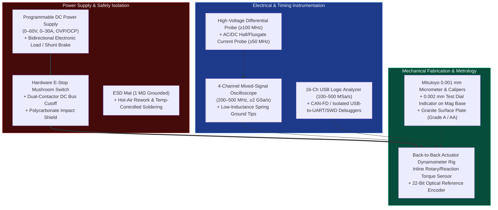

# Tiered Mechatronics Hardware Lab & Workbench Bill of Materials (BOM)

> **Curated for:** [Production-Grade Mechatronics Engineering & Research Roadmap](../README.md)  
> Building and debugging physical mechatronic systems requires instruments that can observe nanosecond switching edges, microvolt sensor noise, milliohm Kelvin resistances, and micron mechanical runout. This guide specifies three progressive laboratory tiers.

---

## 1. Laboratory Instrument & Measurement Architecture

---

## 2. Three-Tier Hardware Workbench Comparison

### Tier 1: Foundation & Embedded Controls Bench (~$500 – $800 USD)
*Designed for individual students/engineers completing Tracks 00, 03, 04, 05, and Capstone II (Furuta Pendulum) or low-voltage FOC.*

| Category | Recommended Equipment / Specification | Approx. Cost | Why It Is Essential |
| :--- | :--- | :--- | :--- |
| **Oscilloscope + Logic Analyzer** | 4-Ch $100\text{–}200\text{ MHz}$ Entry DSO (e.g., Rigol `DHO804` 12-bit HD) + $24\text{ MHz}$/16-Ch `fx2lafw` (`sigrok`) Logic Analyzer | $\$350 - \$420$ | 12-bit vertical resolution lets you inspect millivolt current-sense waveforms alongside 3-phase PWM edges. |
| **Programmable Power Supply** | $30\text{ V} / 10\text{ A}$ Regulated Bench PSU with fast constant-current (CC) foldback + $24\text{ V}$ Brake Shunt Module | $\$70 - \$110$ | Current limiting saves MOSFETs during initial FOC firmware bring-up mistakes. |
| **MCU & FOC Dev Kit** | ST `B-G431B-ESC1` or `NUCLEO-G474RE` + `X-NUCLEO-IHM08M1` + Gimbal/Outrunner PMSM with `AS5047P` / `MT6835` magnetic encoder + `FDCAN` USB adapter (`candleLight` / `CANable 2.0`) | $\$80 - \$140$ | Out-of-the-box 3-phase shunt sensing, Cortex-M4F with CORDIC, and CAN-FD interface. |
| **Soldering & Multimeter** | Pinecil V2 / T12 PID Soldering Iron + True-RMS Digital Multimeter (`UNI-T UT61E+` or `Fluke 101/115`) | $\$75 - \$130$ | Fine-pitch (`0402` / `QFN` / `LQFP`) rework and accurate millivolt/resistance troubleshooting. |

---

### Tier 2: Senior R&D & Custom PCB Bring-Up Lab (~$3,500 – $6,000 USD)
*Designed for startups, university research labs, and engineers executing all 8 Tracks including custom 6-layer PCBs, 48V/30A drives, and QDD robotics.*

| Category | Recommended Equipment / Specification | Approx. Cost | Why It Is Essential |
| :--- | :--- | :--- | :--- |
| **Mixed-Signal Oscilloscope** | 4-Ch $200\text{–}350\text{ MHz}$ 12-bit MSO (`Rigol DHO1000/4000` or `Siglent SDS2000X HD`) with Bode Plot Generator AWG | $\$1,100 - \$1,800$ | Built-in Frequency Response Analyzer (FRA) measures power-supply and current-loop Bode plots automatically via injection transformer. |
| **Current & Differential Probes** | $50\text{ MHz}$ AC/DC Hall Current Clamp (`Micsig CP2100B` / `Tektronix TCP2020`) + $100\text{ MHz}$ High-Voltage Differential Probe (`Micsig DP10013`) | $\$450 - \$800$ | **Mandatory** for probing high-side $V_{GS}$ and phase current $I_a(t)$ safely without blowing up oscilloscope ground clips! |
| **Power Supply & Electronic Load** | $60\text{ V} / 30\text{ A}$ ($1.2\text{ kW}$) Programmable PSU + $300\text{ W}$ Programmable DC Electronic Load + Custom Regenerative Brake Clamp | $\$500 - \$900$ | Tests full $48\text{ V}$ peak torque bursts and absorbs regenerative braking energy without over-voltage trips. |
| **SMT Assembly & Inspection** | Stereo Trinocular Boom Microscope ($7\times\text{–}45\times$) + Hot-Air Station (`Quick 861DW`) + Reflow Hotplate + Thermal Camera (`Infiray P2 Pro` / `FLIR`) | $\$750 - \$1,100$ | Inspects QFN/BGA solder joints and identifies thermal hotspots on MOSFETs, shunts, and LDOs during load soak tests. |
| **Mechanical Metrology & Dyno** | Grade-A Granite Surface Plate ($300\times 300\text{ mm}$) + Mitutoyo $0.002\text{ mm}$ Dial Test Indicator + Reaction Torque Load Cell + $20\text{-bit}$ Optical Reference Encoder (`Renishaw` / `RLS AksIM-2`) | $\$700 - \$1,400$ | Quantifies shaft runout ($< 10\ \mu\text{m}$), bearing preload stiffness, encoder INL harmonic error, and true output torque vs. $i_q$. |

---

### Tier 3: Principal Production Qualification & Pre-Compliance Lab (~$20,000 – $35,000 USD)
*Designed for production hardware sign-off, SIL/PLd functional safety validation, high-speed GaN switching, and EMC pre-compliance.*

| Category | Recommended Equipment / Specification | Approx. Cost | Why It Is Essential |
| :--- | :--- | :--- | :--- |
| **High-Bandwidth Oscilloscope + Iso-Probes** | $\ge 500\text{ MHz} - 1\text{ GHz}$ 12-bit MSO + Optically Isolated High-CMRR Gate Probe ($>120\text{ dB}$ CMRR @ $100\text{ MHz}$ for high-side GaN/SiC $V_{GS}$) | $\$6,000 - \$12,000$ | Only an optically isolated differential probe can accurately resolve a $5.0\text{ V}$ GaN gate waveform riding on a $100\text{ V/ns}$ switching node. |
| **EMC Pre-Compliance Suite** | $9\text{ kHz} - 3.2\text{ GHz}$ Spectrum Analyzer with EMI Quasi-Peak Detector + Line Impedance Stabilization Network (`LISN`) + Near-Field H/E Probe Set + ESD Gun (`IEC 61000-4-2`, $\pm 8\text{ kV}$ contact / $\pm 15\text{ kV}$ air) | $\$4,000 - \$8,000$ | Catches conducted/radiated EMI peaks and ESD reset vulnerabilities in-house before paying $\$15,000/$week at an accredited NRTL chamber. |
| **4-Quadrant Regenerative Source & Active Dyno** | Bidirectional 4-Quadrant Regenerative DC Supply ($0\text{–}80\text{ V}, \pm 60\text{ A}$) + Coupled Absorber Servo Dynamometer with Inline Rotary Torque Transducer ($0.05\%$ accuracy) & $24\text{-bit}$ Heidenhain/Renishaw Encoder | $\$6,000 - \$10,000$ | Maps full 4-quadrant efficiency contours ($\eta(\omega, \tau)$), MTPA trajectories, and thermal derating curves under automated Python SCPI control. |
| **Precision Coordinate & Vibration Metrology** | Triaxial IEPE Piezoelectric Accelerometer + 24-bit Dynamic Signal Analyzer (Modal Hammer Impact Testing) + Laser Displacement Interferometer / Keyence Confocal Sensor | $\$4,000 - \$5,000$ | Validates experimental modal FEA eigenfrequencies ($\omega_1, \zeta_1$) and sub-micron stage positioning repeatability. |

---

## 3. Essential Probing & Bench Safety Rules

1. **Never Use the $15\text{ cm}$ Alligator Ground Lead on Switching Nodes:** A standard oscilloscope ground lead has $\sim 150\text{ nH}$ of inductance, forming a resonant tank with the probe's $10\text{ pF}$ tip capacitance at $f_0 = \frac{1}{2\pi\sqrt{LC}} \approx 130\text{ MHz}$. This makes a clean $20\text{ ns}$ MOSFET edge look like it has $25\text{ V}$ of ringing! Always remove the ground clip lead and use the coaxial **pigtail spring ground tip** directly across the MOSFET drain-source or capacitor pads ($< 3\text{ mm}$ loop).
2. **Oscilloscope BNC Shells Are Connected to Earth Ground:** Clipping a standard passive probe's ground clip onto a half-bridge phase node or a non-isolated shunt resistor shorts that node directly through the oscilloscope chassis to AC mains protective earth, vaporizing the PCB trace and probe! Use a **High-Voltage Differential Probe** or power the DUT from an isolated DC supply.
3. **Polycarbonate Blast Shield & Eye Protection During First High-Energy Bring-Up:** An electrolytic capacitor or TO-247/DFN5x6 MOSFET failing short across a $48\text{ V}$ LiFePO4 battery ($> 1,000\text{ A}$ short-circuit current) ejects molten copper and epoxy shrapnel. Always bring up new boards first on a current-limited bench supply ($I_{\text{limit}} = 0.2\text{ A}$) before connecting a high-discharge battery pack behind an inline high-interrupting-capacity fuse (`Class T` / `MEGA` fuse) and polycarbonate shield.
