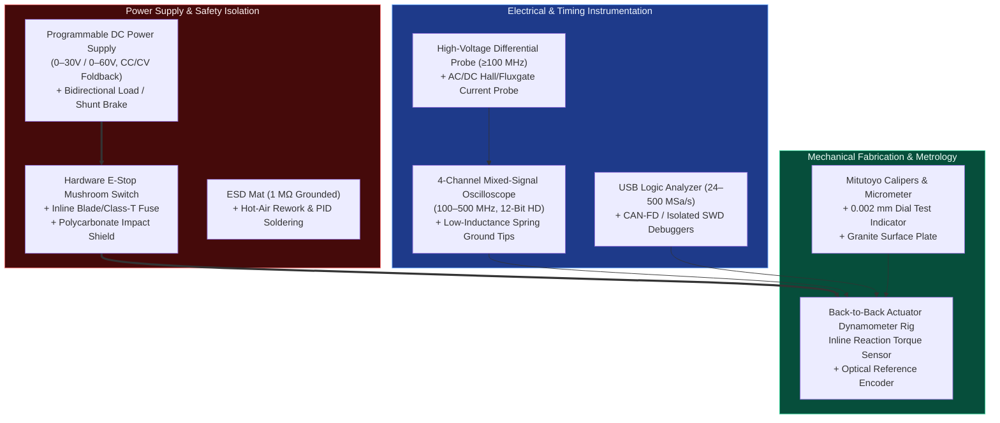

# Tiered Mechatronics Hardware Lab & Workbench Bill of Materials (BOM)

> **Curated for:** [MechaLab Multi-Pass Tiered Roadmap](../README.md)  
> Building and debugging physical mechatronic systems requires instruments matched to your current pass in the roadmap. You do **not** need a \$10,000 lab to start Pass 1! Start with the **Level 0 / Tier 1 Starter Bench (~\$150–\$280)**, and only upgrade instruments when you loop back for **Pass 2 (Tier 2)** and **Pass 3 (Tier 3)**.

---

## 1. Laboratory Instrument & Measurement Architecture

---

## 2. Multi-Pass Hardware Workbench Shopping Lists

### 🛠️ Stage 0 & Pass 1 (Tier 1): Breadboard & Breakout Starter Bench (~\$150 – \$280 USD)
*Everything required to complete **Stage 0 (Level 0 On-Ramp)** and **Pass 1 (Tier 1: Track 00 $\to$ Track 08)** on your desk with zero custom PCB fabrication.*

| Category | Recommended Equipment / Breakout Modules | Approx. Cost | Why It Is Essential in Level 0 & Pass 1 |
| :--- | :--- | :--- | :--- |
| **Breadboards & Wiring** | 2x 830-Tie-Point Solderless Breadboards (BB830) + 22 AWG Solid-Core Pre-Bent Jumper Kit + XT60/Banana Pigtails | \$18 - \$25 | Clean color-coded wiring (`Red = VCC`, `Black = GND`) and star-ground distribution. |
| **Current-Limited Bench PSU** | $30\text{ V} / 5\text{ A}$ Regulated CC/CV Bench Power Supply (`Korad KA3005D` or `Wanptek`) + Physical E-Stop Switch | \$50 - \$75 | Constant-Current (CC) limiting acts as your hardware `try/catch` block against wiring shorts. |
| **Multimeter & Logic Analyzer** | Auto-Ranging True-RMS Digital Multimeter (`UNI-T UT61E+` / `ANENG AN8008`) + $24\text{ MHz}$ 8-Ch USB Logic Analyzer (`sigrok`/`PulseView`) | \$35 - \$60 | Continuity beep checks before power-up + decoding `PWM`, `I2C`, `SPI`, and `UART` packets. |
| **Starter MCUs & Breakouts** | `ESP32-S3 DevKitC` or `STM32 Nucleo-G474RE` + `DRV8833` DC H-Bridge + 2x `SimpleFOCMini` (`DRV8313`) + 2x Gimbal BLDC Motors with `AS5600`/`AS5048A` Magnetic Encoders + `MPU6050` IMU | \$55 - \$110 | Runs every Level 0 and Tier 1 lab up through the **Track 08 Tier 1 Boss 2-DOF Compliant Robot Arm**. |

---

### 🔵 Pass 2 (Tier 2): Custom 4-Layer PCB, SMD & CAN-FD Bench (~\$550 – \$950 USD)
*Add these tools when looping back to Track 00 for **Pass 2 (Tier 2)** to assemble custom 4-layer KiCad PCBs, debug Kelvin shunts, and run $1\text{ kHz}$ CAN-FD servos.*

| Category | Recommended Equipment / Specification | Approx. Cost | Why It Is Essential in Pass 2 |
| :--- | :--- | :--- | :--- |
| **12-Bit Entry Oscilloscope** | 4-Ch $100\text{–}200\text{ MHz}$ 12-bit HD DSO (`Rigol DHO804` or `Siglent SDS804X HD`) | \$350 - \$420 | 12-bit vertical resolution resolves millivolt `INA240` current-sense waveforms alongside 3-phase PWM edges and `TIM1_TRGO2` trigger pulses. |
| **SMD Soldering & Reflow** | `Pinecil V2` / `TS101` PID Iron + Mini MHP30 / Hotplate + `Quick 858D/861DW` Hot-Air Station + Flux Syringe & Fine Tweezers | \$110 - \$220 | Effortless reflow and rework of `0603` passives, `SOIC-8` current amps, and `QFN` gate drivers on 4-layer boards. |
| **CAN-FD & SWD Tooling** | Isolated USB-to-CAN-FD Adapter (`CANable 2.0` / `candleLight`) + `STLINK-V3MINIE` SWD Debugger + $24\text{ V}$ Shunt Brake Resistor Module | \$50 - \$90 | Streams $1\text{ kHz}$ `MIT Mode` impedance packets and real-time `SEGGER RTT` / `SWO` telemetry without halting the MCU. |

---

### 🟣 Pass 3 (Tier 3): Production Qualification, High-Speed Switching & Dyno Lab (~\$3,500 – \$15,000+ USD)
*Designed for startups, university research labs, and engineers executing **Pass 3 (Tier 3)** including $<2\text{ nH}$ 6-layer $48\text{ V}/30\text{ A}$ drives, Double-Pulse Tests, and SIL-3/PLe STO qualification.*

| Category | Recommended Equipment / Specification | Approx. Cost | Why It Is Essential in Pass 3 |
| :--- | :--- | :--- | :--- |
| **Current & Differential Probes** | $50\text{ MHz}$ AC/DC Hall Current Clamp (`Micsig CP2100B` / `Tektronix TCP2020`) + $100\text{ MHz}$ High-Voltage Differential Probe (`Micsig DP10013`) | \$450 - \$800 | **Mandatory** for probing high-side $V_{GS}$ and phase current $I_a(t)$ safely without shorting the switching node through oscilloscope earth ground! |
| **High-Power Programmable PSU & Load** | $60\text{ V} / 30\text{ A}$ ($1.5\text{ kW}$) Programmable PSU + $300\text{ W}$ Electronic Load / 4-Quadrant Regenerative Supply | \$600 - \$2,500 | Tests full $48\text{ V} / 30\text{ A}$ peak torque bursts and absorbs regenerative braking energy during emergency SS1/STO stops. |
| **Mechanical Metrology & Dyno Rig** | Grade-A Granite Surface Plate + Mitutoyo $0.002\text{ mm}$ Dial Test Indicator + Inline Reaction Torque Load Cell + $20\text{-bit}$ Optical Reference Encoder (`RLS AksIM-2`) + Thermal Camera | \$1,200 - \$3,500 | Quantifies shaft runout ($< 10\ \mu\text{m}$), encoder harmonic INL ($< \pm 0.04^\circ$), anticogging torque ripple ($< 1.5\%$), and MOSFET thermal soak ($T_j < 125^\circ\text{C}$). |

---

## 3. Essential Probing & Bench Safety Rules (All Tiers)

1. **Never Use the $15\text{ cm}$ Alligator Ground Lead on Switching Nodes:** A standard oscilloscope ground lead has $\sim 150\text{ nH}$ of inductance, forming a resonant tank with the probe's $10\text{ pF}$ tip capacitance at $f_0 = \frac{1}{2\pi\sqrt{LC}} \approx 130\text{ MHz}$. This makes a clean $20\text{ ns}$ MOSFET edge look like it has $25\text{ V}$ of ringing! Always remove the ground clip lead and use the coaxial **pigtail spring ground tip** directly across the MOSFET drain-source or capacitor pads ($< 3\text{ mm}$ loop).
2. **Oscilloscope BNC Shells Are Connected to Earth Ground:** Clipping a standard passive probe's ground clip onto a half-bridge phase node or a non-isolated shunt resistor shorts that node directly through the oscilloscope chassis to AC mains protective earth, vaporizing the PCB trace and probe! Use a **High-Voltage Differential Probe** or power the DUT from an isolated DC supply.
3. **Polycarbonate Blast Shield & Eye Protection During First High-Energy Bring-Up:** Always bring up new boards first on a current-limited bench supply ($I_{\text{limit}} = 0.15\text{ A}$) following the **Track 07 10-Step Bring-Up Protocol** before connecting a high-discharge battery pack behind an inline high-interrupting-capacity fuse (`Class T` / `MEGA` fuse) and polycarbonate shield.
