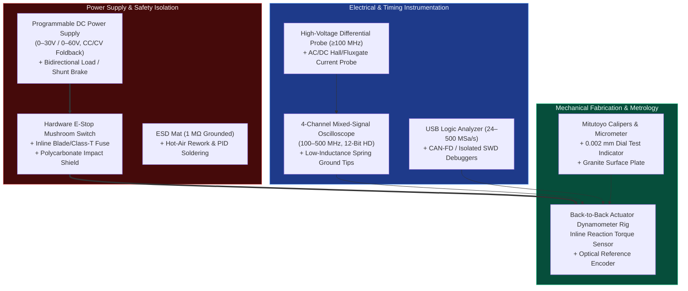

# Tiered Mechatronics Hardware Lab, Actuators & Open Robot Platforms (Tier 1 → Tier 3)

> **Curated for:** [MechaLab Multi-Pass Tiered Roadmap](../README.md) · **Merged with [`engyasin/awesome-mechatronics`](https://github.com/engyasin/awesome-mechatronics)**  
> Building and debugging physical mechatronic systems requires instruments, compute, and actuator platforms matched to your current pass in the roadmap. You can complete **100% of Track P, Stage 0, and every Pass 1 (Tier 1) simulation exercise for \$0 in your browser** (in-page Python runner, Falstad, Wokwi, and the 8-tab MechaLab Workbench). When you want physical hardware, start with an optional **\$15–\$25 Arduino Uno + Breadboard Starter Kit** for Stage 0 LEDs/buttons/potentiometers, upgrade to the **~\$150–\$280 Closed-Loop Motor Control Bench** for full Pass 1 12 V / BLDC hardware labs, and only invest in Pass 2 / Pass 3 instruments when designing custom PCBs.

---

## 1. Laboratory Instrument & Measurement Architecture

---

## 2. Multi-Pass Hardware Workbench Shopping Lists

### 💻 Tier 0A (\$0 USD): 100% Browser Simulator Path (`Track P` $\to$ `Stage 0` $\to$ `Pass 1` Sim Path)
| Category | Browser Tools Included | Cost | Coverage |
| :--- | :--- | :--- | :--- |
| **In-Browser Python & Simulators** | Built-in **MechaLab Python (`Pyodide`) Runner**, [Falstad Circuit Simulator](https://www.falstad.com/circuit/circuitjs.html), [Wokwi Arduino/ESP32 Simulator](https://wokwi.com/), and the **8-Tab MechaLab Physics Workbench** | **\$0** | 100% of `Track P`, 100% of `Stage 0`, all 50 Bridge Modules (`hardware_required: false`), and the simulation path of every `Pass 1` lesson (`Tracks 00–08`). |

### 🔌 Tier 0B (~\$15 – \$25 USD): Optional Stage 0 Desktop Micro-Kit
| Category | Recommended Starter Parts | Approx. Cost | Coverage |
| :--- | :--- | :--- | :--- |
| **Arduino Uno + Breadboard Kit** | `Arduino Uno R3/R4` clone + USB cable + 400-point breadboard + $10\text{ k}\Omega$ potentiometer + pushbuttons + LEDs + $220\ \Omega / 1\text{ k}\Omega / 10\text{ k}\Omega$ resistor assortment + $100\text{ nF} / 100\ \mu\text{F}$ capacitors | **\$15 - \$25** | Physical breadboard builds for `Stage 0` (`S0.1–S0.M`) and `Lesson 01.1` low-voltage switching powered from $5\text{ V}$ USB. |

### 🛠️ Pass 1 (Tier 1): Closed-Loop Motor & Breakout Starter Bench (~\$150 – \$280 USD)
*Everything required to wire physical $6\text{–}12\text{ V}$ DC gearmotors, quadrature/magnetic encoders, `SimpleFOCMini` gimbal actuators, and the **Track 08 Tier 1 Boss 2-DOF Compliant Desktop Robot** on your bench.*

| Category | Recommended Equipment / Breakout Modules | Approx. Cost | Why It Is Essential in Level 0 & Pass 1 |
| :--- | :--- | :--- | :--- |
| **Breadboards & Wiring** | 2x 830-Tie-Point Solderless Breadboards (BB830) + 22 AWG Solid-Core Pre-Bent Jumper Kit + XT60/Banana Pigtails | \$18 - \$25 | Clean color-coded wiring (`Red = VCC`, `Black = GND`) and star-ground distribution. |
| **Current-Limited Bench PSU** | $30\text{ V} / 5\text{ A}$ Regulated CC/CV Bench Power Supply (`Korad KA3005D` or `Wanptek`) + Physical E-Stop Switch | \$50 - \$75 | Constant-Current (CC) limiting acts as your hardware `try/catch` block against wiring shorts. |
| **Multimeter & Logic Analyzer** | Auto-Ranging True-RMS Digital Multimeter (`UNI-T UT61E+` / `ANENG AN8008`) + $24\text{ MHz}$ 8-Ch USB Logic Analyzer (`sigrok`/`PulseView`) | \$35 - \$60 | Continuity beep checks before power-up + decoding `PWM`, `I2C`, `SPI`, and `UART` packets. |
| **Starter MCUs & Breakouts** | [`Arduino Uno R4` / `Nano ESP32`](https://www.arduino.cc/), [`ESP32-S3 DevKitC`](https://www.espressif.com/), [`Raspberry Pi Pico 2 (RP2350)`](https://www.raspberrypi.com/products/rp2350/), or `STM32 Nucleo-G474RE` + `DRV8833` ($2.7\text{–}10.8\text{ V}$) / `TB6612FNG` ($4.5\text{–}13.5\text{ V}$) DC H-Bridges + 2x [`SimpleFOCMini` (`DRV8313`)](https://simplefoc.com/) + 2x Gimbal BLDC Motors with `AS5600`/`AS5048A` Magnetic Encoders + `MPU6050` IMU | \$55 - \$110 | Runs every Level 0 and Tier 1 hardware lab (`RP2350` PIO state machines excel at glitch-free quadrature decoding; `ESP32-S3` runs `micro-ROS`) up through the **Track 08 Tier 1 Boss 2-DOF Compliant Robot Arm**. |

---

### 🔵 Pass 2 (Tier 2): Custom 4-Layer PCB, SMD, High-Rate Compute & CAN-FD Bench (~\$550 – \$950 USD)
*Add these tools when looping back to Track 00 for **Pass 2 (Tier 2)** to assemble custom 4-layer KiCad PCBs, debug Kelvin shunts, and run $1\text{ kHz}$ CAN-FD servos.*

| Category | Recommended Equipment / Specification | Approx. Cost | Why It Is Essential in Pass 2 |
| :--- | :--- | :--- | :--- |
| **12-Bit Entry Oscilloscope** | 4-Ch $100\text{–}200\text{ MHz}$ 12-bit HD DSO (`Rigol DHO804` or `Siglent SDS804X HD`) | \$350 - \$420 | 12-bit vertical resolution resolves millivolt `INA240` current-sense waveforms alongside 3-phase PWM edges and `TIM1_TRGO2` trigger pulses. |
| **SMD Soldering & Reflow** | `Pinecil V2` / `TS101` PID Iron + Mini MHP30 / Hotplate + `Quick 858D/861DW` Hot-Air Station + Flux Syringe & Fine Tweezers | \$110 - \$220 | Effortless reflow and rework of `0603` passives, `SOIC-8` current amps, and `QFN` gate drivers on 4-layer boards. |
| **High-Rate MCUs, Linux SBC & Off-the-Shelf FOC** | [`STM32G474` / `STM32H7`](https://www.st.com/), [`Teensy 4.1` (`600 MHz` Cortex-M7)](https://www.pjrc.com/teensy/), [`Raspberry Pi 5`](https://www.raspberrypi.com/) (+ Hailo/Coral NPU), [`mjbots moteus`](https://mjbots.com/) / [`ODrive`](https://odriverobotics.com/), and [`CubeMars AK-series`](https://www.cubemars.com/) QDD actuators | \$80 - \$300 | `Teensy 4.1` and `STM32G4/H7` execute $10\text{–}40\text{ kHz}$ loops effortlessly; `moteus` and `ODrive` provide open reference benchmarks for your custom 4-layer PCB. |
| **CAN-FD & SWD Tooling** | Isolated USB-to-CAN-FD Adapter (`CANable 2.0` / `candleLight` / `mjbots fdcanusb`) + `STLINK-V3MINIE` SWD Debugger + $24\text{ V}$ Shunt Brake Resistor Module | \$50 - \$90 | Streams $1\text{ kHz}$ `MIT Mode` impedance packets and real-time `SEGGER RTT` / `SWO` telemetry without halting the MCU. |

---

### 🟣 Pass 3 (Tier 3): Production Qualification, On-Robot AI Compute & Dyno Lab (~\$3,500 – \$15,000+ USD)
*Designed for startups, university research labs, and engineers executing **Pass 3 (Tier 3)** including $<2\text{ nH}$ 6-layer $48\text{ V}/30\text{ A}$ drives, Double-Pulse Tests, SIL-3/PLe STO qualification, and on-robot VLA deployment.*

| Category | Recommended Equipment / Specification | Approx. Cost | Why It Is Essential in Pass 3 |
| :--- | :--- | :--- | :--- |
| **Current & Differential Probes** | $50\text{ MHz}$ AC/DC Hall Current Clamp (`Micsig CP2100B` / `Tektronix TCP2020`) + $100\text{ MHz}$ High-Voltage Differential Probe (`Micsig DP10013`) | \$450 - \$800 | **Mandatory** for probing high-side $V_{GS}$ and phase current $I_a(t)$ safely without shorting the switching node through oscilloscope earth ground! |
| **High-Power Programmable PSU & Load** | $60\text{ V} / 30\text{ A}$ ($1.5\text{ kW}$) Programmable PSU + $300\text{ W}$ Electronic Load / 4-Quadrant Regenerative Supply | \$600 - \$2,500 | Tests full $48\text{ V} / 30\text{ A}$ peak torque bursts and absorbs regenerative braking energy during emergency SS1/STO stops. |
| **On-Robot Physical AI Compute** | [`NVIDIA Jetson Orin Nano / AGX Orin` & `Jetson Thor (T4000 Blackwell)`](https://developer.nvidia.com/embedded-computing) + Global-Shutter Stereo Cameras + 3D LiDAR | \$500 - \$2,500 | Executes real-time action-chunked VLAs (`SmolVLA`, `π₀`, `Isaac GR00T N1.6`), `nvblox` ESDF mapping, and `PREEMPT_RT` $1\text{ kHz}$ `WBC-QP` on-board the robot. |
| **Mechanical Metrology & Dyno Rig** | Grade-A Granite Surface Plate + Mitutoyo $0.002\text{ mm}$ Dial Test Indicator + Inline Reaction Torque Load Cell + $20\text{-bit}$ Optical Reference Encoder (`RLS AksIM-2`) + Thermal Camera | \$1,200 - \$3,500 | Quantifies shaft runout ($< 10\ \mu\text{m}$), encoder harmonic INL ($< \pm 0.04^\circ$), anticogging torque ripple ($< 1.5\%$), and MOSFET thermal soak ($T_j < 125^\circ\text{C}$). |

---

## 3. Open-Source & Reference Robot Hardware Platforms You Can Build or Buy (Tier 1 → Tier 3)

| Platform | Tier | Approx. Cost | Type | Engineering Role & Open-Source Ecosystem |
| :--- | :---: | :--- | :--- | :--- |
| **[SO-101 / SO-ARM100](https://github.com/TheRobotStudio/SO-ARM100)** | **Tier 1/2** | €120–€350 | 6-DOF Leader-Follower Arm Pair | **Open Hardware (`LeRobot` reference platform):** 3D-printed 6-DOF manipulator pair for leader-follower teleoperation and training `ACT`, `Diffusion Policy`, and `SmolVLA` in one afternoon ([Assembly Guide](https://huggingface.co/docs/lerobot/so101)). |
| **[Koch v1.1](https://github.com/jess-moss/koch-v1-1)** & **[Open Duck Mini](https://github.com/apirrone/Open_Duck_Mini)** | **Tier 1/2** | €250–€400 | 5-DOF Arm / Bipedal Walker | Low-cost 3D-printable Dynamixel manipulation arm (`Koch v1.1`) and approachable open-source bipedal walking platform (`Open Duck Mini`). |
| **[LeKiwi](https://github.com/SIGRobotics-UIUC/LeKiwi)** & **[Duckietown](https://duckietown.com/)** | **Tier 2** | €300–€400 | Holonomic Mobile Manipulator / Autonomy Kit | `LeKiwi` mounts an `SO-101` arm on an open-source 3-wheel omni base; `Duckietown` provides a complete visual-autonomy curriculum in a box. |
| **[Universal Manipulation Interface (`UMI`)](https://umi-gripper.github.io/)** | **Tier 2** | ~€200 | Handheld Data-Collection Gripper | 3D-printed handheld gripper + GoPro fisheye camera with side mirrors that collects in-the-wild manipulation trajectories with **zero robot hardware required**. |
| **[TurtleBot 4](https://turtlebot.github.io/turtlebot4-user-manual/)** | **Tier 2** | ~€1.5k | ROS 2 Mobile Robot | Canonical teaching and integration platform for `ROS 2`, `Nav2`, `SLAM Toolbox`, and 2D/3D LiDAR navigation. |
| **[Open Dynamic Robot Initiative (`ODRI`)](https://open-dynamic-robot-initiative.github.io/)** | **Tier 3** | ~€3k+ | Open QDD Actuator & Legged Platform | 100% open-source dual-brushless Quasi-Direct-Drive (QDD) actuator modules, 3-DOF hopping legs, and Solo-12 quadruped designs from MPI / NYU. |
| **[ALOHA 2](https://aloha-2.github.io/)** & **[Reachy 2](https://www.pollen-robotics.com/)** | **Tier 3** | €5k–€70k | Bimanual Teleop / Open Humanoid | Reference bimanual manipulation research cell (`ALOHA 2`) and Pollen Robotics / Hugging Face open-source upper-body humanoid (`Reachy 2`). |
| **[Unitree Go2 / G1](https://www.unitree.com/)**, **[Franka Research 3](https://franka.de/)**, & **[Universal Robots (`UR`)](https://www.universal-robots.com/)** | **Tier 3** | €1.6k–€30k+ | Quadruped / Humanoid / 7-DOF Torque Arm / Cobot | Default research legged platforms (`Go2`/`G1`), academic 1 kHz joint-torque manipulation standard (`Franka Research 3`), and industrial ISO/TS 15066 cobot standard (`UR`). |

---

## 4. Essential Probing, Mechanical & Bench Safety Rules (All Tiers)

1. **Never Use the $15\text{ cm}$ Alligator Ground Lead on Switching Nodes:** A standard oscilloscope ground lead has $\sim 150\text{ nH}$ of inductance, forming a resonant tank with the probe's $10\text{ pF}$ tip capacitance at $f_0 = \frac{1}{2\pi\sqrt{LC}} \approx 130\text{ MHz}$. Always remove the ground clip lead and use the coaxial **pigtail spring ground tip** directly across the MOSFET drain-source or capacitor pads ($< 3\text{ mm}$ loop).
2. **Oscilloscope BNC Shells Are Connected to Earth Ground:** Clipping a standard passive probe's ground clip onto a half-bridge phase node or a non-isolated shunt resistor shorts that node directly through the oscilloscope chassis to AC mains protective earth! Use a **High-Voltage Differential Probe** or power the DUT from an isolated DC supply.
3. **Practical Mechanical & Learnability Checklist (Before Training Any Policy):**
   * **Size Actuators on Continuous RMS Torque ($\tau_{\text{rms}}$), Not Peak:** Provide an aluminum thermal conduction path (never enclose hot BLDC stators in insulating PLA).
   * **Keep Reflected Inertia Ratio $J_{\text{load}} / (N^2 J_{\text{motor}}) \le 10:1$** ($< 3:1$ for high-dynamic contact) and keep closed-loop bandwidth $\omega_c \le \frac{1}{3}\omega_{\text{res,1}}$.
   * **Hardware Learnability:** If you plan to collect teleoperated demonstrations (`ACT` / `Diffusion Policy` / `VLA`), the mechanism must be **backdrivable**, **zero-backlash**, and have a rigid camera-to-gripper kinematic chain.
