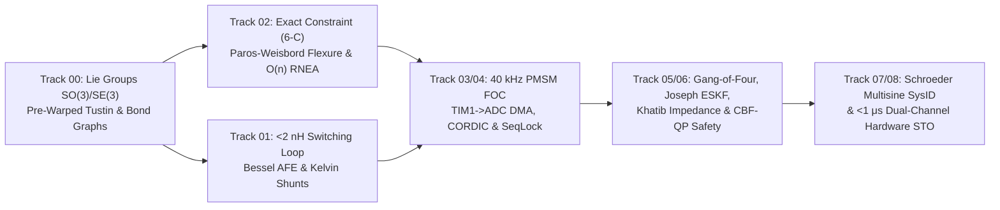

# Printable 1-Page Mechatronics Engineering Reference Cheat Sheet

> **Print / PDF Version:** Open [../web/cheatsheet.html](../web/cheatsheet.html) in any browser and press `Cmd/Ctrl + P` for a dense, 3-column A4/Letter desk reference card.

---

## 1. Signal Flow & Domain Conservation Map

---

## 2. Core Equations Across All 8 Tracks

| Domain | Law / Formula | Engineering Design Rule & Sizing Criterion |
| :--- | :--- | :--- |
| **Lie Group $SO(3)$** | $\exp([\phi]_\times) = I + \frac{\sin\theta}{\theta}[\phi]_\times + \frac{1-\cos\theta}{\theta^2}[\phi]_\times^2$ | Use Taylor series $1 - \theta^2/6$ and $\frac{1}{2} - \theta^2/24$ for $\theta < 10^{-4}\text{ rad}$ to avoid $0/0$ NaN. |
| **Two-Mass Resonance** | $\omega_{ar} = \sqrt{\frac{k_s}{J_L}}, \quad \omega_r = \omega_{ar}\sqrt{1 + \frac{J_L}{J_m}}$ | Place pre-warped Tustin biquad notch center at $\omega_n = \omega_r$; keep first structural mode $\omega_1 > 5\,\omega_{bw}$. |
| **Tustin Pre-Warping** | $s \leftarrow \frac{\omega_n}{\tan(\omega_n T_s / 2)}\frac{z - 1}{z + 1}$ | Execute IIR biquads in **Transposed Direct Form II** (`float32` / `float64`) to prevent low-frequency pole clustering. |
| **Power Switching Loop** | $V_{DS,\text{peak}} = V_{\text{bus}} + L_{\text{loop}}\frac{di}{dt}, \quad R_{DS(\text{on})}(T_j) = R_{25}\big(1+\alpha(T_j-25)\big)$ | Keep hot-loop inductance $L_{\text{loop}} < 2\text{ nH}$ via inner-layer return plane (`L2`/`L5`) directly under half-bridge MLCCs. |
| **Bessel AFE & SAR Bucket** | $H_{\text{Bessel}}(s) = \frac{3}{(s/\omega_0)^2 + 3(s/\omega_0) + 3}, \quad \tau_{\text{filt}} = R_{\text{filt}}C_{\text{filt}}$ | Use 2nd-order **Bessel** (never Chebyshev) in current/force loops for flat group delay; size $C_{\text{filt}} \ge 20\,C_{sh}$ for $<0.25\text{ LSB}$ error. |
| **Exact Constraint & Abbe** | $\text{DOF} = 6 - C, \quad \varepsilon_{\text{Abbe}} = L_{\text{offset}}\sin\theta_{\text{pitch}}$ | Kelvin coupling ($3+2+1=6$) or Maxwell 3-V groove ($2+2+2=6$) prevents thermal binding; align encoder scale collinear with load. |
| **Notch Flexure Hinge** | $k_\theta = \frac{2 E b t^{5/2}}{9\pi\sqrt{R}}, \quad \sigma_{\max} = K_t \frac{6 M_{\max}}{b t^2}$ | Use `Ti-6Al-4V` ($E=114\text{ GPa}, \sigma_{\text{fat}}=510\text{ MPa}$) or `7075-T6`; maintain fatigue safety factor $\ge 1.4\times$. |
| **Reflected Inertia (QDD)** | $J_{\text{refl}} = N^2 J_{\text{rotor}}, \quad (J_L + N^2 J_m)\ddot{q} = N\eta\tau_m - \tau_{\text{ext}}$ | Keep $N \le 10:1$ (`8:1` single-stage planetary in double shear) for dynamic impact backdrivability and proprioceptive torque control. |
| **Screw PoE & RNEA** | $T(q) = e^{[\mathcal{S}_1]q_1}\cdots e^{[\mathcal{S}_n]q_n}M, \quad x^\top(\dot{M}-2C)x = 0$ | Every link inertia tensor in URDF/MJCF must satisfy Sylvester SPD **and** triangle inequality $I_1 + I_2 \ge I_3$. |
| **PMSM $d$-$q$ FOC & SVPWM** | $v_d^* = u_{pi,d} - \omega_e L_q i_q, \quad v_q^* = u_{pi,q} + \omega_e(L_d i_d + \lambda_{pm})$ | Pole-zero cancellation gains: $K_{p,q} = L_q\omega_{bw}$, $K_{i,q} = R_s\omega_{bw}$; Min-Max SVPWM boosts linear voltage by $+15.47\%$ ($V_{\text{bus}}/\sqrt{3}$). |
| **Wait-Free SeqLock & RTA** | $R_i^{(k+1)} = C_i + B_i + \sum_{j \in hp(i)} \left\lceil \frac{R_i^{(k)}}{T_j} \right\rceil C_j \le D_i$ | Writer increments sequence to odd before write, even after (`memory_order_release`); reader retries if `seq0 != seq1` or `(seq0 & 1)`. |
| **Gang of Four & ESKF** | $S + T = 1, \quad P^+ = (I - KH)P^-(I - KH)^\top + KRK^\top$ | Enforce peak sensitivity $M_s = \|S(j\omega)\|_\infty \le 1.75$; always use **Joseph-form** covariance update + multiplicative $SO(3)$ boxplus reset. |
| **Operational WBC & CBF** | $\Lambda(q) = (J M^{-1} J^\top)^{-1}, \quad N^\top = I - J^\top\bar{J}^\top, \quad \dot{h}(x,u) \ge -\alpha h(x)$ | Dynamically consistent generalized inverse $\bar{J} = M^{-1}J^\top\Lambda$ guarantees zero end-effector acceleration from null-space posture torques. |
| **Schroeder SysID & STO** | $\phi_k = -\frac{\pi k(k-1)}{M}, \quad \hat{P}(j\omega_k) = \frac{\hat{S}_{y d_{\text{exc}}}(j\omega_k)}{\hat{S}_{u d_{\text{exc}}}(j\omega_k)}$ | Schroeder phases compress multisine Crest Factor to $\sim 1.65$; dual-channel hardware STO (`BKIN`) must disable gates in $< 1\ \mu\text{s}$. |

---

## 3. PCB Layout, Real-Time Firmware & Safety Sign-Off Checklist

1. **6-Layer Mixed-Signal Stackup:** `L1` Power/Signal $\to$ `L2` **Unbroken Solid GND** $\to$ `L3` Differential Sense/SPI/CAN $\to$ `L4` Power Pours (`3V3`, `12V`) $\to$ `L5` High-Current Flux-Canceling Return $\to$ `L6` Heatsink Thermal Pads.
2. **4-Terminal Kelvin Shunts:** Tap differential `IN+`/`IN-` traces from the **inner sense pads** of the shunt footprint and route as a tightly coupled pair referenced to `L2` ground.
3. **Timer-Triggered ADC-DMA:** Trigger simultaneous `ADC1`+`ADC2` via `TIM1_TRGO2` at the **SVPWM counter peak (`CNT == ARR`)** when all three low-side shunts conduct and switching $dV/dt$ noise is zero.
4. **Zero-Allocation Real-Time Path:** Lock `mlockall(MCL_CURRENT | MCL_FUTURE)` (Linux `PREEMPT_RT`) or place ISR in Cortex-M `ITCM`/`CCM-SRAM`; trap `operator new` inside the control loop.
