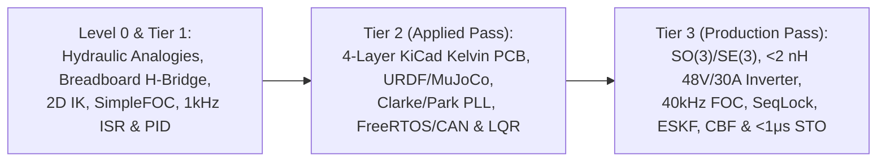

# Printable 1-Page Mechatronics Engineering Reference Cheat Sheet (Tier 1 → Tier 3)

> **Interactive / Print Version:** Click **"1-Page Cheat Sheet"** in the top-right header of the MechaLab Workbench and press `Cmd/Ctrl + P` for a formatted A4/Letter desk reference card.

---

## 1. Multi-Pass Signal Flow & Domain Conservation Map

---

## 2. Core Equations Across All 8 Tracks (Indexed by Tier)

| Track & Tier | Law / Formula | Engineering Design Rule & Sizing Criterion |
| :--- | :--- | :--- |
| **Track 00 (L0/T1)** *RC & Symplectic Euler* | $v_{k+1} = v_k + a_k \Delta t,\quad x_{k+1} = x_k + v_{k+1}\Delta t,\quad f_c = \frac{1}{2\pi R C}$ | Wrap angular error via $\text{atan2}(\sin e, \cos e)$; first-order low-pass adds $-45^\circ$ phase lag at $f = f_c$. |
| **Track 00 (T2/T3)** *Two-Mass & Lie $SO(3)$* | $\omega_{ar} = \sqrt{\frac{k_s}{J_L}}, \quad \omega_r = \omega_{ar}\sqrt{1 + \frac{J_L}{J_m}}, \quad \exp([\phi]_\times) = I + \frac{\sin\theta}{\theta}[\phi]_\times + \frac{1-\cos\theta}{\theta^2}[\phi]_\times^2$ | Place pre-warped Tustin biquad notch (`TDF-II`) at $\omega_n = \omega_r$; use Taylor series for $\theta < 10^{-4}\text{ rad}$. |
| **Track 01 (L0/T1)** *Ohm, Flyback & Decoupling* | $V = I R, \quad P = I^2 R, \quad V_L = L\frac{dI}{dt}, \quad I_C = C\frac{dV}{dt}$ | Place $470\ \mu\text{F}$ bulk + $100\text{ nF}$ ceramic decoupling + star ground so motor reversals never brown-out MCU. |
| **Track 01 (T2/T3)** *Hot Loop & SAR Bucket* | $V_{DS,\text{peak}} = V_{\text{bus}} + L_{\text{loop}}\frac{di}{dt}, \quad R_{DS(\text{on})}(T_j) = R_{25}\big(1+\alpha(T_j-25)\big)$ | Keep hot-loop inductance $L_{\text{loop}} < 2\text{ nH}$ via unbroken `L2` GND plane; size SAR bucket $C_{\text{filt}} \ge 20\,C_{sh}$ (C0G/NP0). |
| **Track 02 (T1/T2)** *Reflected Inertia & Exact Constraint* | $J_{\text{refl}} = N^2 J_{\text{rotor}}, \quad \text{DOF} = 6 - C, \quad \tau = J(q)^\top F_{\text{ext}}$ | Keep $N \le 10:1$ (`8:1` QDD planetary in double shear) for impact backdrivability; Kelvin 3-2-1 prevents thermal binding. |
| **Track 02 (T3)** *Flexures, PoE & RNEA* | $k_\theta = \frac{2 E b t^{5/2}}{9\pi\sqrt{R}}, \quad T(q) = e^{[\mathcal{S}_1]q_1}\cdots e^{[\mathcal{S}_n]q_n}M, \quad x^\top(\dot{M}-2C)x = 0$ | Every URDF inertia tensor must satisfy Sylvester SPD **and** triangle inequality $I_1 + I_2 \ge I_3$. |
| **Track 03 (T1/T2)** *Clarke/Park & Type-II PLL* | $i_\alpha = i_a,\ i_\beta = \frac{i_a + 2i_b}{\sqrt{3}}, \quad \dot{\hat{\omega}} = K_i e_\theta,\ \dot{\hat{\theta}} = \hat{\omega} + K_p e_\theta$ | Never use finite-difference $(\theta_k - \theta_{k-1})/T_s$ at $25\text{ kHz}$; use a Type-II PLL observer ($K_p = 2\zeta\omega_n, K_i = \omega_n^2$). |
| **Track 03 (T3)** *PMSM $d$-$q$ FOC & SVPWM* | $v_d^* = u_{pi,d} - \omega_e L_q i_q, \quad v_q^* = u_{pi,q} + \omega_e(L_d i_d + \lambda_{pm})$ | Pole-zero cancellation gains: $K_{p,q} = L_q\omega_{bw}$, $K_{i,q} = R_s\omega_{bw}$; Min-Max SVPWM boosts voltage by $+15.47\%$ ($V_{\text{bus}}/\sqrt{3}$). |
| **Track 04 (T1/T2/T3)** *RTA & `WaitFreeSeqLock`* | $R_i^{(k+1)} = C_i + B_i + \sum_{j \in hp(i)} \left\lceil \frac{R_i^{(k)}}{T_j} \right\rceil C_j \le D_i$ | Writer increments `seq_` to odd before write, even after (`memory_order_release`); reader retries if `(seq0 != seq1) \|\| (seq0 & 1)`. |
| **Track 05 (T1/T2/T3)** *PID, LQR, ESKF & CBF* | $S + T = 1, \quad P^+ = (I - KH)P^-(I - KH)^\top + KRK^\top, \quad \dot{h}(x,u) \ge -\alpha h(x)$ | Enforce peak sensitivity $M_s \le 1.75$; always use **Joseph-form** covariance update + velocity-aware CBF safety walls. |
| **Track 06 (T1/T2/T3)** *Operational WBC & S-Curves* | $\Lambda(q) = (J M^{-1} J^\top)^{-1}, \quad \bar{J} = M^{-1}J^\top\Lambda, \quad N^\top = I - J^\top\bar{J}^\top$ | Dynamically consistent generalized inverse $\bar{J}$ guarantees zero end-effector acceleration from null-space posture torques. |
| **Track 07 (T1/T2/T3)** *Schroeder SysID & STO* | $\phi_k = -\frac{\pi k(k-1)}{M}, \quad \hat{P}(j\omega_k) = \frac{\hat{S}_{y d_{\text{exc}}}(j\omega_k)}{\hat{S}_{u d_{\text{exc}}}(j\omega_k)}$ | Schroeder phases compress multisine Crest Factor to $\sim 1.65$; dual-channel hardware STO (`BKIN`) disables gates in $< 1\ \mu\text{s}$. |

---

## 3. Bring-Up, PCB Layout, Real-Time Firmware & Safety Sign-Off Checklist

1. **Level 0 / Tier 1 Bring-Up Rule:** Always run an unpowered DMM Continuity Beep Check (`VCC` to `GND`), set your bench PSU current limit to $150\text{ mA}$ (`CC` mode), and verify encoder direction matches positive motor torque *before* enabling closed-loop feedback.
2. **Tier 2 / Tier 3 Mixed-Signal Stackup:** `L1` Power/Signal $\to$ `L2` **Unbroken Solid GND** $\to$ `L3` Differential Kelvin Sense/SPI/CAN $\to$ `L4` Power Pours (`3V3`, `12V`) $\to$ `L5` High-Current Flux-Canceling Return $\to$ `L6` Heatsink Thermal Pads.
3. **4-Terminal Kelvin Shunts:** Tap differential `IN+`/`IN-` traces from the **inner center pads** of the shunt footprint and route as a tightly coupled pair referenced to `L2` ground.
4. **Timer-Triggered ADC-DMA:** Trigger simultaneous `ADC1`+`ADC2` via `TIM1_TRGO2` at the **SVPWM counter peak (`CNT == ARR`)** when all three low-side shunts conduct and switching $dV/dt$ noise is zero.
