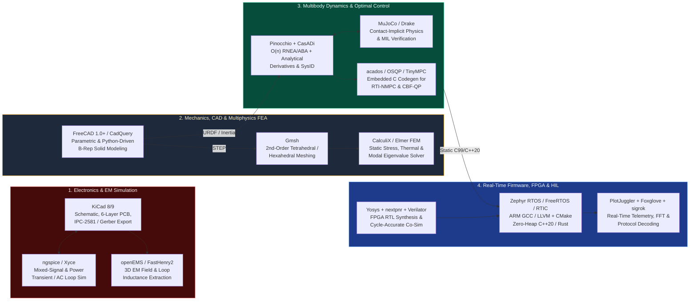

# Production Open-Source Toolchain Matrix (Tier 1 → Tier 3)

> **Curated for:** [MechaLab Multi-Pass Tiered Roadmap](../README.md)  
> You do not need to install 20 industrial solvers on Day 1! Adopt toolchains progressively as you advance through the three linear passes:
> * **🟢 Level 0 & Pass 1 (Tier 1 — Beginner Pass):** `PlatformIO` / `Arduino IDE`, `SimpleFOC`, `Python` (`NumPy`/`Matplotlib`), `PulseView` (`sigrok`), and `Onshape` / `FreeCAD` basics.
> * **🔵 Pass 2 (Tier 2 — Applied Pass):** `KiCad 8/9` (4-layer PCBs), `ngspice`, `CadQuery` / `Build123d`, `MuJoCo`, `Python Control` (`control`), `FreeRTOS` / `Zephyr`, `Ruckig`, and `PlotJuggler`.
> * **🟣 Pass 3 (Tier 3 — Production Pass):** `FastHenry2` / `openEMS`, `Gmsh` + `CalculiX` Modal FEA, `Pinocchio` ($O(n)$ RNEA), `acados` / `OSQP` / `TinyMPC`, `GTSAM`, `PREEMPT_RT` Linux + `ros2_control`, and `Verilator` / `Yosys`.

---

## 1. End-to-End Mechatronics Toolchain Flow

---

## 2. Electronics, SPICE & Electromagnetic Extraction

| Tool | License | Primary Engineering Role | Key Production Features & CLI / Automation Integration |
| :--- | :--- | :--- | :--- |
| **KiCad (`8.0+ / 9.0`)** | GPLv3 | Schematic capture, multilayer PCB layout, 3D STEP export | Native `kicad-cli` for automated CI DRC/ERC checks, BOM CSV generation, PDF schematic plots, and Gerber/IPC-2581 fab packages. |
| **ngspice / Xyce** | BSD / GPL | Analog front-end, gate-drive transient, and small-signal loop simulation | Integrated inside KiCad or driven headless from Python (`PySpice`) to run automated Monte-Carlo component tolerance and thermal sweeps. |
| **FastHenry2 / FastCap2** | MIT-like | 3D quasi-static parasitic inductance ($L$) and capacitance ($C$) extraction | Extracts the exact $6\times 6$ mutual inductance matrix of PCB half-bridge switching loops to predict $L_{\text{loop}}\,dI/dt$ overshoot before tape-out. |
| **openEMS** | GPLv3 | 3D Finite-Difference Time-Domain (FDTD) electromagnetic solver | Full-wave simulation of PCB trace impedance, return-path discontinuities, and near-field/far-field radiated emissions. |

---

## 3. Mechanical CAD, Meshing & Finite Element Analysis (FEA)

| Tool | License | Primary Engineering Role | Key Production Features & CLI / Automation Integration |
| :--- | :--- | :--- | :--- |
| **FreeCAD (`1.0+`)** | LGPLv2+ | Parametric 3D solid modeling, assembly constraints, FEM workbench | Full Python API (`import FreeCAD`), bidirectional STEP/IGES exchange, and direct integration with Gmsh and CalculiX. |
| **CadQuery / Build123d** | Apache 2.0 | Code-first parametric Python CAD (`OpenCASCADE` kernel) | Enables version-controlled (`git diff`) programmatic generation of cycloidal disks, flexure hinges, bearing housings, and custom motor stators. |
| **Gmsh** | GPLv2+ | Parametric 3D finite-element mesh generator | Generates high-quality 10-node quadratic tetrahedral (`C3D10`) meshes essential for accurate bending stiffness in thin flexures. |
| **CalculiX (`ccx`)** | GPLv2 | Structural static, nonlinear contact, thermal, and modal eigenvalue FEA | Uses Abaqus-compatible `.inp` deck syntax; extracts natural frequencies ($\omega_1\dots\omega_n$), mass-normalized mode shapes, and stress tensors. |
| **Elmer FEM** | LGPLv2.1 | Multiphysics FEA (coupled electromagnetic-thermal-structural) | Simulates motor stator Joule heating, eddy-current losses, and thermal expansion deformation in one coupled solve. |
| **onshape-to-robot / phobos** | MIT / BSD | CAD-to-URDF/MJCF automated exporter | Extracts exact mass, Center of Mass (CoM), and $3\times 3$ inertia tensors directly from CAD assemblies into `URDF` and `MuJoCo` XML models. |

---

## 4. Multibody Dynamics, Simulation & Optimal Control Solvers

| Tool | License | Primary Engineering Role | Key Production Features & CLI / Automation Integration |
| :--- | :--- | :--- | :--- |
| **Pinocchio** | BSD-2 | Fast $O(n)$ rigid-body dynamics and analytical derivatives | Computes RNEA, ABA, CRBA, operational-space $\Lambda(q)$, and exact analytical Jacobians $\frac{\partial \tau}{\partial q}, \frac{\partial \tau}{\partial \dot{q}}$ in $< 4\ \mu\text{s}$ in C++ (`Eigen`) and Python. |
| **MuJoCo (`DeepMind`)** | Apache 2.0 | High-speed contact-implicit physics engine | Industry standard for legged/manipulation simulation; supports tendon routing, actuator delay, sensor noise models, and C/C++ plugin loops. |
| **Drake (`MIT / TRI`)** | BSD-3 | Model-based multibody dynamics, trajectory optimization, and Lyapunov verification | First-class support for symbolic/autodiff (`AutoDiffXd`) plant inspection, Direct Collocation, Sums-of-Squares (SOS), and hydroelastic contact. |
| **CasADi** | LGPLv3 | Symbolic framework for algorithmic differentiation and nonlinear optimization | Generates zero-allocation C99 code for nonlinear kinematics, dynamics, Jacobians, and Hessians with exact sparsity patterns. |
| **`acados`** | BSD-2 | Embedded Nonlinear Model Predictive Control (NMPC) & MHE | Implements Real-Time Iteration (RTI), Gauss-Newton Hessian approximations, and calls `HPIPM`/`BLASFEO` for sub-millisecond embedded execution. |
| **OSQP / ProxQP / TinyMPC** | Apache 2.0 / BSD-2 / MIT | Embedded Convex Quadratic Programming (QP) solvers | Division-free active-set/ADMM solvers with warm-starting and static C code generation (`0` `malloc` calls) for Cortex-M4/M7 and `PREEMPT_RT`. |
| **Python Control (`control`)** | BSD-3 | LTI state-space, Bode/Nyquist, Gang of Four, LQR/Kalman/Hinfsyn | MATLAB-compatible API (`tf`, `ss`, `bode`, `gangof4`, `dlqr`, `hinfsyn`, `c2d`) for scriptable control design and SysID verification. |

---

## 5. Embedded Firmware, RTOS, FPGA & Telemetry

| Tool | License | Primary Engineering Role | Key Production Features & CLI / Automation Integration |
| :--- | :--- | :--- | :--- |
| **ARM GNU Toolchain / LLVM Embedded + CMake + Ninja** | GPL / Apache 2.0 | Cross-compilation, linker-script memory partitioning, static analysis | Combine with `-fno-exceptions -fno-rtti -Wall -Wextra -Werror -Wconversion` and `clang-tidy` / `cppcheck` in CI. |
| **Zephyr RTOS / FreeRTOS** | Apache 2.0 / MIT | Deterministic real-time operating systems | Priority-inheritance mutexes, static object allocation (`configSUPPORT_DYNAMIC_ALLOCATION 0`), devicetree hardware description, and CAN-FD/EtherCAT stacks. |
| **RTIC (`Real-Time Interrupt-driven Concurrency`)** | MIT / Apache 2.0 | Hardware-scheduled concurrency framework for Embedded Rust | Uses the ARM Cortex-M NVIC hardware directly to implement Stack Resource Policy (SRP) with **zero kernel software overhead** and compile-time deadlock freedom. |
| **OpenOCD / probe-rs / pyOCD + GDB** | GPL / MIT / Apache 2.0 | SWD/JTAG flashing, hardware breakpoints, real-time RTT/SWO trace | `probe-rs` and `SEGGER RTT` stream high-rate binary telemetry from target RAM over SWD without halting or slowing the $40\text{ kHz}$ control ISR! |
| **Renode** | BSD-3 | Deterministic instruction-set & multi-node network simulator | Boots unmodified production ARM `.elf` binaries in CI and simulates virtual CAN-FD/SPI/UART networks across multiple MCU nodes. |
| **Yosys + nextpnr + Verilator + Surfer** | ISC / LGPL | Open-source Verilog/SystemVerilog synthesis, place-and-route, and fast C++ cycle-accurate RTL simulation | Compiles FPGA quadrature decoders, sinc³ $\Sigma\Delta$ filters, and SVPWM generators into fast C++ models that co-simulate directly with firmware. |
| **PlotJuggler & `sigrok` / PulseView** | MPL 2.0 / GPLv3 | High-rate real-time telemetry plotting, live FFT, and logic-analyzer protocol decoding | Decodes SPI, BiSS-C, CAN-FD, I2C, and PWM timings while streaming live CSV/UDP/ZeroMQ/MCAP control signals. |
