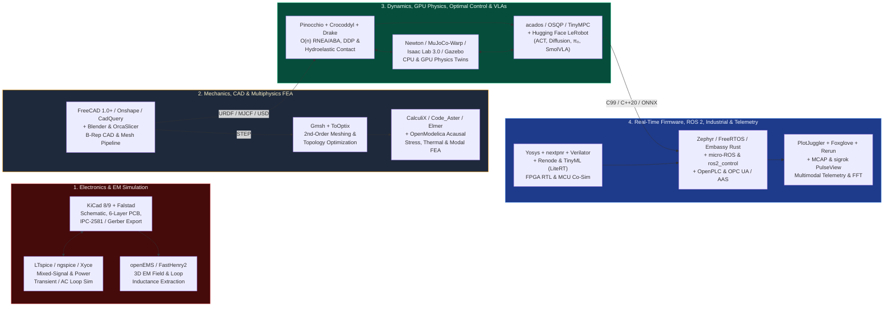

# Production Open-Source Toolchain, Simulator & Robotics Stack Matrix (Tier 1 → Tier 3)

> **Curated for:** [MechaLab Multi-Pass Tiered Roadmap](../README.md) · **Merged with [`engyasin/awesome-mechatronics`](https://github.com/engyasin/awesome-mechatronics)**  
> Adopt toolchains progressively as you advance through the three linear passes:
> * **🟢 Level 0 & Pass 1 (Tier 1 — Beginner Pass):** `Falstad`, `Fritzing`, `PlatformIO` / `Arduino IDE`, `SimpleFOC`, `Python` (`NumPy`/`Matplotlib` + `PythonRobotics`), `PulseView` (`sigrok`), `Onshape` / `FreeCAD 1.0+`, `PrusaSlicer` / `OrcaSlicer`, `Webots` / `CoppeliaSim`, and `OpenPLC`.
> * **🔵 Pass 2 (Tier 2 — Applied Pass):** `KiCad 8/9` (4-layer PCBs), `LTspice` / `ngspice`, `CadQuery` / `Build123d`, `OpenModelica`, `MuJoCo` (CPU), `Gazebo`, `ROS 2 Jazzy / Lyrical` + `micro-ROS` + `ros2_control` + `MoveIt 2` + `Nav2` + `Zenoh`, `FreeRTOS` / `Zephyr RTOS`, `Ruckig`, `PlotJuggler` / `Foxglove` / `Rerun` (`MCAP`), `Edge Impulse` / `LiteRT`, and `OPC UA` (`open62541`).
> * **🟣 Pass 3 (Tier 3 — Production & Physical AI Pass):** `FastHenry2` / `openEMS`, `Gmsh` + `CalculiX` / `Code_Aster` / `Elmer FEM` + `ToOptix` (topology opt), `Pinocchio` ($O(n)$ RNEA) + `Crocoddyl`, `acados` / `OSQP` / `TinyMPC`, `Newton` (Linux Foundation GPU physics) / `MuJoCo-Warp` / `NVIDIA Isaac Lab v3.0` / `Isaac Sim` / `Genesis`, `Hugging Face LeRobot` (`SmolVLA`, `OpenVLA`, `π₀ / openpi`, `GR00T N1.6`, `HIL-SERL`), `Embassy` / `RTIC` (Embedded Rust), `AAS (Eclipse BaSyx)`, and `Model Context Protocol (MCP)`.

---

## 1. End-to-End Mechatronics & Physical AI Toolchain Flow

---

## 2. Electronics, SPICE & Electromagnetic Extraction ([Track 01](../01-electronics-and-power/README.md))

| Tool | Tier | License | Primary Engineering Role & Key Production Features |
| :--- | :---: | :--- | :--- |
| **[Falstad Circuit Simulator](https://www.falstad.com/circuit/)** & **[Fritzing](https://fritzing.org/)** | **Tier 1** | GPL / Paid | Instant browser-based analog/switching circuit animation for building voltage/current intuition, plus breadboard wiring diagrams. |
| **[KiCad (`8.0+ / 9.0`)](https://www.kicad.org/)** | **Tier 1–3** | GPLv3 🆓 | Full production schematic capture, 4-to-6-layer PCB layout, 3D STEP export, and `kicad-cli` automated CI DRC/ERC & BOM checks. |
| **[LTspice](https://www.analog.com/en/resources/design-tools-and-calculators/ltspice-simulator.html)** & **[ngspice](https://ngspice.sourceforge.io/) / Xyce** | **Tier 2/3** | Freeware / BSD 🆓 | Industry-standard SPICE simulators for MOSFET gate-drive transients, SAR ADC charge buckets, and Monte-Carlo tolerance sweeps. |
| **[FastHenry2 / FastCap2](https://www.fastfieldsolvers.com/)** | **Tier 3** | MIT-like 🆓 | Extracts the exact 3D quasi-static $6\times 6$ partial inductance matrix of PCB half-bridge switching loops ($< 2\text{ nH}$) before tape-out. |
| **[openEMS](https://openems.de/)** | **Tier 3** | GPLv3 🆓 | 3D Finite-Difference Time-Domain (FDTD) full-wave electromagnetic solver for PCB return-path discontinuities and radiated EMC. |

---

## 3. Mechanical CAD, Meshing, FEA & Multi-Domain Modeling ([Track 02](../02-mechanics-kinematics-dynamics/README.md))

| Tool | Tier | License | Primary Engineering Role & Key Production Features |
| :--- | :---: | :--- | :--- |
| **[FreeCAD (`1.0+`)](https://www.freecad.org/)** & **[Onshape](https://www.onshape.com/)** | **Tier 1–3** | LGPLv2+ / Free Tier 🆓 | FreeCAD v1.0+ fixed the topological naming problem and includes a built-in FEM workbench; Onshape excels at collaborative open-hardware CAD. |
| **[PrusaSlicer](https://www.prusa3d.com/prusaslicer/) / [OrcaSlicer](https://github.com/SoftFever/OrcaSlicer)** & **[Blender](https://www.blender.org/)** | **Tier 1/2** | GPLv3 🆓 | Slicers for controlling layer orientation, perimeters, and anisotropic strength of 3D-printed robot links; Blender for visual meshes/rendering. |
| **[CadQuery](https://cadquery.readthedocs.io/) / [Build123d](https://build123d.readthedocs.io/)** | **Tier 2/3** | Apache 2.0 🆓 | Code-first parametric Python CAD (`OpenCASCADE` kernel) enabling `git diff` version control of cycloidal disks, flexures, and planetary carriers. |
| **[OpenModelica](https://openmodelica.org/)** | **Tier 2/3** | OSMC-PL 🆓 | Open-source acausal multi-domain modeling (Modelica language) coupling mechanical, electrical, hydraulic, and thermal networks (open alternative to Simscape). |
| **[Gmsh](https://gmsh.info/)** + **[CalculiX (`ccx`)](http://www.calculix.de/)** / **[Code_Aster](https://code-aster.org/)** / **[Elmer FEM](https://www.elmerfem.org/)** | **Tier 3** | GPL / LGPL 🆓 | 10-node quadratic tetrahedral meshing (`C3D10`) + static stress, nonlinear contact, modal eigenvalue ($\omega_n$), and coupled EM-thermal FEA. |
| **[ToOptix](https://github.com/DerBaumeister/toOptix)** / **[ToPy](https://github.com/williamhunter/topy)** | **Tier 3** | GPL / MIT 🆓 | Open-source 3D structural topology optimization for designing maximum-stiffness-to-mass robot brackets and links (open alternative to nTop). |
| **[onshape-to-robot](https://github.com/Rhoban/onshape-to-robot)** / **[phobos](https://github.com/dfki-ric/phobos)** | **Tier 2/3** | MIT / BSD 🆓 | Automated exporters that extract exact mass, Center of Mass (CoM), and $3\times 3$ inertia tensors from CAD directly into `URDF` and `MuJoCo` XML. |

---

## 4. Robotics Simulators, Multibody Dynamics & Optimal Control ([Track 05](../05-control-and-estimation/README.md) & [Track 06](../06-robotics-and-autonomy/README.md))

### 4.1 CPU & GPU Physics Simulation Landscape (2026)

| Simulator | Tier | License | Best Engineering Use Case |
| :--- | :---: | :--- | :--- |
| **[Webots](https://cyberbotics.com/)** & **[CoppeliaSim](https://www.coppeliarobotics.com/)** | **Tier 1** | Apache 2.0 / Edu 🆓 | Fastest zero-setup educational simulators for beginners; CoppeliaSim powers the *Modern Robotics* Coursera specialization labs. |
| **[MuJoCo (`DeepMind`)](https://mujoco.org/)** & **[MuJoCo Playground](https://github.com/google-deepmind/mujoco_playground)** | **Tier 2/3** | Apache 2.0 🆓 | Gold standard for contact-rich control debugging on CPU (interactive viewer) and ready-made GPU RL environments (`MuJoCo Playground`). |
| **[Gazebo](https://gazebosim.org/)** & **[SAPIEN](https://sapien.ucsd.edu/)** | **Tier 2/3** | Apache 2.0 🆓 | Gazebo is the native ROS 2 system-level integration simulator; SAPIEN specializes in articulated-object manipulation research. |
| **[Newton Physics](https://github.com/newton-physics/newton)** (`Linux Foundation`) | **Tier 3** | Open Source 🆓 | **The 2026 GPU physics standard:** open-source, GPU-accelerated, differentiable engine built on NVIDIA Warp + OpenUSD by NVIDIA, Google DeepMind & Disney Research; bundles `MuJoCo-Warp` and Disney's `Kamino` closed-loop mechanism solver, SDF collision, and hydroelastic contact. |
| **[NVIDIA Isaac Lab (`v3.0`)](https://github.com/isaac-sim/IsaacLab)** & **[Isaac Sim](https://developer.nvidia.com/isaac/sim)** | **Tier 3** | BSD-3 / Free 🆓 | Large-scale GPU robot learning (`Isaac Lab v3.0` built on Newton + PhysX) and photorealistic OpenUSD synthetic sensor/factory digital twins (`Isaac Sim`). |
| **[Genesis](https://github.com/Genesis-Embodied-AI/Genesis)** | **Tier 3** | Apache 2.0 🆓 | Ultra-fast multi-platform GPU physics engine with built-in generative scene creation and soft/rigid body coupling. |

### 4.2 Kinematics, Dynamics, Optimal Control & Classical Stack

| Tool | Tier | License | Primary Engineering Role & Key Production Features |
| :--- | :---: | :--- | :--- |
| **[PythonRobotics](https://github.com/AtsushiSakai/PythonRobotics)** & **[Python Control (`control`)](https://python-control.readthedocs.io/)** | **Tier 1/2** | MIT / BSD-3 🆓 | Readable Python implementations of EKF, LQR, MPC, A*, RRT*, and MATLAB-compatible Bode/Nyquist/Gang-of-Four analysis. |
| **[ROS 2 (`Jazzy Jalisco` / `Lyrical Luth` LTS)](https://docs.ros.org/)** + **[ros2_control](https://control.ros.org/)** + **[Zenoh](https://zenoh.io/)** | **Tier 2/3** | Apache 2.0 🆓 | Production robotics middleware (`Lyrical Luth` LTS 2026–2031, `Jazzy` LTS 2024–2029), deterministic `ros2_control` hardware lifecycle, and `Zenoh` RMW bridging. |
| **[MoveIt 2](https://moveit.picknik.ai/)**, **[Nav2](https://docs.nav2.org/)**, & **[OMPL](https://ompl.kavrakilab.org/)** | **Tier 2/3** | BSD-3 / Apache 🆓 | Manipulator motion planning (`MoveIt 2`), mobile robot navigation (`Nav2` with MPPI), and sampling-based planning (`OMPL`). |
| **[Pinocchio](https://github.com/stack-of-tasks/pinocchio)** & **[Crocoddyl](https://github.com/loco-3d/crocoddyl)** | **Tier 3** | BSD-2 / BSD-3 🆓 | $< 4\ \mu\text{s}$ $O(n)$ RNEA/ABA/CRBA rigid-body dynamics with analytical derivatives (`Pinocchio`) + Differential Dynamic Programming (`Crocoddyl`) for legged WBC/MPC. |
| **[Drake (`MIT / TRI`)](https://drake.mit.edu/)**, **[CasADi](https://web.casadi.org/)**, **`acados`**, & **[OSQP](https://osqp.org/) / [TinyMPC](https://tinympc.org/)** | **Tier 3** | BSD / LGPL / Apache 🆓 | Hydroelastic contact & trajectory optimization (`Drake`), symbolic C99 codegen (`CasADi`), sub-millisecond RTI-NMPC (`acados`), and zero-malloc embedded QP solvers (`OSQP`/`TinyMPC`). |
| **[OpenCV v5](https://opencv.org/)**, **[Open3D](https://www.open3d.org/)**, **[ORB-SLAM3](https://github.com/UZ-SLAMLab/ORB_SLAM3)**, **[SAM 2](https://github.com/facebookresearch/sam2)**, **[FoundationPose](https://github.com/NVlabs/FoundationPose)**, & **[gsplat](https://github.com/nerfstudio-project/gsplat)** | **Tier 2/3** | Apache / BSD / GPL 🆓 | Complete 2D/3D perception stack: visual-inertial SLAM (`ORB-SLAM3`/`RTAB-Map`), promptable video segmentation (`SAM 2`), 6-DOF novel-object pose (`FoundationPose`), and 3D Gaussian Splatting real-to-sim capture (`gsplat`). |

---

## 5. Visuomotor Imitation, Diffusion Policies, Flow Matching & VLAs ([Track 06](../06-robotics-and-autonomy/README.md))

| Framework / Model / Benchmark | Tier | License | Architecture & Why Mechatronic Engineers Use It |
| :--- | :---: | :--- | :--- |
| **[Hugging Face `LeRobot`](https://github.com/huggingface/lerobot)** | **Tier 2/3** | Apache 2.0 🆓 | **The end-to-end PyTorch robot learning toolkit (`pip install lerobot`, no ROS required):** unifies teleoperation data capture, datasets, and training/deployment for `ACT`, `Diffusion Policy`, `VQ-BeT`, `π₀`, `SmolVLA`, and `HIL-SERL`. |
| **[SmolVLA (`450M`)](https://huggingface.co/blog/smolvla)** & **[Octo (`27M–93M`)](https://octo-models.github.io/)** | **Tier 2/3** | Apache 2.0 🆓 | Lightweight generalist policies trained on open community datasets that run and fine-tune on a single consumer GPU. |
| **[`π₀` / `openpi` (`3B`)](https://github.com/Physical-Intelligence/openpi)** & **[OpenVLA / OpenVLA-OFT (`7B`)](https://openvla-oft.github.io/)** | **Tier 3** | Open Weights 🆓 | `π₀` pairs a VLM backbone with a **Flow-Matching action expert** (pretrained on $10,000+\text{ hrs}$) for ultra-smooth contact-rich trajectories; `OpenVLA-OFT` provides high-throughput fine-tuning on Open X-Embodiment. |
| **[NVIDIA Isaac GR00T N1.6](https://github.com/NVIDIA/Isaac-GR00T)** & **[NVIDIA Cosmos 3](https://developer.nvidia.com/cosmos)** | **Tier 3** | Open Weights 🆓 | Dual-system humanoid VLA (`System 2` VLM planner + `System 1` fast diffusion controller on Cosmos-2B) paired with `Cosmos` world foundation models for synthetic data generation. |
| **[`rsl_rl`](https://github.com/leggedrobotics/rsl_rl)**, **[CleanRL](https://docs.cleanrl.dev/)**, **[Stable-Baselines3](https://stable-baselines3.readthedocs.io/)**, & **[HIL-SERL](https://hil-serl.github.io/)** | **Tier 2/3** | MIT / BSD 🆓 | `rsl_rl` is the fast GPU PPO engine behind legged locomotion sim-to-real; `HIL-SERL` trains real-robot manipulation policies to near-100% success in 1–2 hours of human-in-the-loop interaction. |
| **Open Benchmarks & Datasets:** **[Open X-Embodiment](https://robotics-transformer-x.github.io/)**, **[DROID](https://droid-dataset.github.io/)**, **[LIBERO](https://libero-project.github.io/)**, **[SimplerEnv](https://github.com/simpler-env/SimplerEnv)**, **[RoboCasa](https://robocasa.ai/)**, **[RoboTwin 2.0](https://arxiv.org/abs/2506.18088)** | **Tier 3** | Open Access 🆓 | Standardized 1M+ episode manipulation datasets and reproducible simulation benchmarks for evaluating visuomotor policies before hardware deployment. |

---

## 6. Embedded Firmware, RTOS, TinyML, Industrial Automation & Telemetry ([Track 04](../04-embedded-and-realtime/README.md) & [Track 07](../07-systems-hil-and-production/README.md))

| Tool | Tier | License | Primary Engineering Role & Key Production Features |
| :--- | :---: | :--- | :--- |
| **[PlatformIO](https://platformio.org/)** & **[SimpleFOC](https://simplefoc.com/)** | **Tier 1/2** | Apache / MIT 🆓 | Multi-board embedded build system and educational C++ BLDC Field-Oriented Control library for Arduino/ESP32/STM32. |
| **[Zephyr RTOS](https://zephyrproject.org/)**, **[FreeRTOS](https://www.freertos.org/)**, & **[micro-ROS](https://micro.ros.org/)** | **Tier 2/3** | Apache 2.0 / MIT 🆓 | Vendor-neutral devicetree RTOS (`Zephyr`), deterministic preemptive kernel (`FreeRTOS`), and native XRCE-DDS bridge (`micro-ROS`) connecting MCUs into a ROS 2 graph. |
| **[Embassy](https://embassy.dev/)**, **[RTIC](https://rtic.rs/)**, & **[`embedded-hal`](https://github.com/rust-embedded/embedded-hal)** | **Tier 3** | MIT / Apache 2.0 🆓 | Memory-safe **Embedded Rust** frameworks using async/await (`Embassy`) or hardware NVIC Stack Resource Policy (`RTIC`) with compile-time race-and-deadlock freedom. |
| **[Edge Impulse](https://edgeimpulse.com/)**, **[LiteRT (TFLite Micro)](https://ai.google.dev/edge/litert/microcontrollers/overview)**, **[microTVM](https://tvm.apache.org/docs/topic/microtvm/index.html)**, & **[MicroFlow](https://github.com/matteocarnelos/microflow-rs)** | **Tier 2/3** | Apache / MIT / Free Tier 🆓 | On-MCU TinyML inference pipelines for bearing vibration FFT anomaly detection, thermal residual modeling, and sensor fault classification. |
| **[OpenPLC](https://autonomylogic.com/)**, **[Beremiz](https://beremiz.org/)**, & **[Eclipse 4diac](https://eclipse.dev/4diac/)** | **Tier 1–3** | GPL / EPL 🆓 | Open-source industrial PLC runtimes for **IEC 61131-3** (Structured Text / Ladder) and **IEC 61499** distributed event-driven automation; pair with **[Factory I/O](https://factoryio.com/)** for 3D cell commissioning. |
| **[OPC UA (`open62541`)](https://www.open62541.org/)**, **[AAS (`Eclipse BaSyx`)](https://basyx.org/)**, **[MQTT + Sparkplug B](https://sparkplug.eclipse.org/)**, & **[Model Context Protocol (MCP)](https://modelcontextprotocol.io/)** | **Tier 2/3** | MPL / EPL / MIT 🆓 | Industrial OT-to-IT semantic information modeling (`OPC UA`), standardized IEC 63278-1 Digital Twins (`AAS` / `AASX Package Explorer`), and bounded `MCP` tool interfaces. |
| **[Renode](https://renode.io/)**, **[OpenOCD](https://openocd.org/) / [probe-rs](https://probe.rs/)**, & **[Yosys + nextpnr + Verilator](https://www.veripool.org/verilator/)** | **Tier 3** | BSD / MIT / ISC 🆓 | Full-board instruction-set & CAN-FD network emulation in CI (`Renode`), non-intrusive SWD RTT streaming (`probe-rs`), and cycle-accurate FPGA RTL co-simulation (`Verilator`). |
| **[PlotJuggler](https://plotjuggler.io/)**, **[Foxglove](https://foxglove.dev/)**, **[Rerun.io](https://rerun.io/)**, **[MCAP](https://mcap.dev/)**, & **[`sigrok` / PulseView](https://sigrok.org/)** | **Tier 1–3** | MPL / MIT / GPL 🆓 | High-rate time-series & live FFT (`PlotJuggler`), ROS 2 / `MCAP` log inspection (`Foxglove`), multimodal camera + tensor + action policy visualization (`Rerun`), and logic-analyzer protocol decoding (`PulseView`). |
