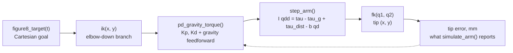

# `resources/plants/` — the one plant every exercise shares

Every Tier 2 and Tier 3 exercise is supposed to meet the robot it already built, not a fresh toy.
This directory is that robot: the Tier 1 capstone's 2-DOF planar arm with the joint-space dynamics,
measured sensing helpers and telemetry budget, in one place, so a matrix lesson, a Bode plot, a
Kalman filter and a controller all act on the same numbers.

| File | What it is |
| :--- | :--- |
| [`mechalab_plant.py`](mechalab_plant.py) | **The executable model.** Stdlib only, Python 3.8+, Pyodide-compatible. This is the single source of truth. |
| [`tier1_arm_motor.yaml`](tier1_arm_motor.yaml) | The same values with the lesson that states each one. Documentation and provenance; the module is what runs. |
| [`../../scripts/generate_plant_data.py`](../../scripts/generate_plant_data.py) | Embeds both into `app/src/data/mechalabPlant.ts` so the browser can have them. `--check` in CI. |
| [`mechalab_models.py`](mechalab_models.py) | **Level B**: `linearize`, `discretize`, `simulate_linear`, `compare_to_plant`, plus the A-D level table. See [`docs/MODEL_LEVELS.md`](../../docs/MODEL_LEVELS.md). |
| [`../../tests/test_plant.py`](../../tests/test_plant.py) | Provenance agreement plus the physics properties, including the capstone's own published numbers. |
| [`../../tests/test_model_levels.py`](../../tests/test_model_levels.py) | Level B against Level A, the three discretisations, and the integration order. |

The loop every advanced exercise works on is the capstone's, unchanged:



## Using it

**In the workbench** (the way a lesson exercise does it) — nothing to set up, the runner writes the
module into Pyodide's filesystem before your code runs:

```python
import mechalab_plant as plant

print(plant.plant_summary())
run = plant.simulate_arm()                       # the capstone's own 1 kHz figure-8 run
print(run["max_dyn_err_mm"], run["rms_dyn_err_mm"])

q1, q2 = plant.ik(0.12, 0.0)                     # law-of-cosines IK, elbow-down branch
x, y = plant.fk(q1, q2)                          # and straight back again
counts = plant.encoder_counts(q1, cpr=plant.ENCODER_CPR)
noisy = plant.add_noise([0.0] * 8, 0.002, seed=7)  # seeded, so a printed number reproduces
```

**On the host or in CI**, put the directory on the path first:

```python
import sys; sys.path.insert(0, "resources/plants")
import mechalab_plant as plant
```

The plant law it implements is the Tier 1 capstone's, step for step:

```
I_i * qdd_i = tau_i - tau_g_i(q) + tau_dist_i(t) - b_i * qd_i      # simulate_arm, step_arm
di/dt     = (V - R*i - Ke*omega) / L                               # simulate_motor
domega/dt = (Kt*i - b*omega - load) / J
```

## The rules

1. **Never invent a number.** Every value in the YAML carries the lesson, stage or bench measurement
   it came from, and `tests/test_plant.py` fails any row whose citation is missing or unrecognisable.
   A value no lesson states belongs in the exercise that needs it, with its own source.
2. **The YAML and the module move together.** Editing one alone fails the agreement test, so the
   documentation cannot rot into a different plant from the one that runs.
3. **Stdlib only, no numpy.** Pyodide offers more, but a plant that needs a package the runner has to
   fetch is a plant half the exercises cannot import. Array and matrix work belongs in the exercise.
4. **Measured, not guessed, motor constants.** `simulate_motor` takes `R, L, Kt, Ke, J, b` as
   required arguments with no defaults: those come off your own bench (Tier 1 lesson 07.1's
   sine-sweep identification, or the datasheet), and a plausible invented value would hide the
   measurement. In SI, `Kt == Ke`.
5. **Say when the step is too big.** `simulate_motor` refuses a `dt` past the Euler stability limit
   of either pole (`dt < 2*L/R`, `dt < 2*J/b`) instead of returning `nan`. The limit is itself a
   Tier 2 lesson, not a nuisance to be silenced. Both `step_arm` and `simulate_motor` integrate
   **semi-implicitly** (velocity/current first, then position using the new value), and the plant
   says so: see [`docs/MODEL_LEVELS.md`](../../docs/MODEL_LEVELS.md) for the scheme, and for levels
   B-D that build on this one.
6. **After any change**: `python3 scripts/generate_plant_data.py`, then
   `python3 tests/test_plant.py` and `python3 scripts/generate_plant_data.py --check`.

## Where the numbers come from

Tier 1 capstone `08-capstone-projects/08.1-tier1-2dof-compliant-arm-capstone.md`: `L1 = L2 = 0.10 m`,
`m1 = 0.20 kg`, `m2 = 0.15 kg`, joint inertias `0.008`/`0.003 kg·m²`, damping `0.04`/`0.02 N·m·s/rad`,
a ±2.5 N·m torque clamp, the shipped `Kp = 18`/`12` and `Kd = 0.60`/`0.35`, a 1 kHz step over 1000
ticks, the −0.15/−0.08 N·m payload pulse at 0.40–0.60 s, the Gerono figure-8 at
`(0.12, 0.00) ± (0.03, 0.04) m`, the AS5600's 4096 counts/rev, and the 20-byte CRC-8 frame with a
256-byte TX ring.

Because those values are the capstone's, `simulate_arm()` reproduces its published output exactly —
`IK->FK err=0.0000 mm | Dynamic tip err max=2.40 mm, RMS=0.91 mm`, gravity torques `0.3188`/`0.0736`
N·m, `Dropped @115.2k=412, @500k=0` — and the test suite asserts those numbers, so the plant CI ships
is the plant the Tier 1 learner finished with.

## What this is not (yet)

- **No numpy, no URDF, no 3-D.** The 2-link arm is planar, as it is in Track 02.
- **Used by every bridge module.** All 48 bridge modules ship a learner scaffold, and every one of
  them runs its Transfer suite on this arm: each module declares `plant: tier1_arm_motor` and carries
  a runnable block that asserts one of its own Transfer figures against the constants here.
- **Scored for every module, and now settled.** `scripts/module_parity.py` scores
  `executable:shared_plant` for every bridge module: `plant: tier1_arm_motor` only counts with a real
  `import mechalab_plant` in the module, and `plant: none` only counts with a `plant_note:` reason.
  The published state is **46 arm, 0 exempt, 0 unhooked, 0 undeclared** — a module either runs on the
  arm or says in its own front matter why it does not, and the ratchet refuses to let any of those
  scores fall. The front-matter contract is in
  [`docs/QUALITY_SPEC.md`](../../docs/QUALITY_SPEC.md) §1–§2.
