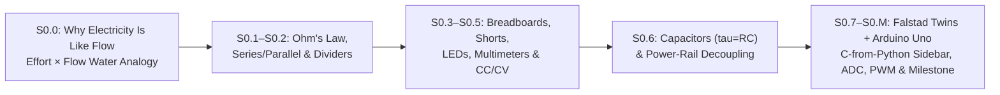

# Stage 0: Electronics & Microcontroller Foundations (Zero-Hardware Sim First)

Welcome to **Stage 0**! Now that you have completed [Track P (Prerequisites)](../track-p/README.md), Stage 0 takes you from basic electrical quantities ($V, I, R$) all the way to reading analog sensors and driving PWM outputs on a standardized **Arduino Uno (`5.0 V`, 10-bit ADC `0..1023`, 8-bit PWM `0..255`)** using free browser simulators (**Falstad** for analog circuits, short circuits, and live oscilloscope waveforms; **Wokwi** for Arduino Uno firmware). Every lesson introduces **at most 2 new ideas** (enforced in YAML front matter by `scripts/lint_lessons.py`).

---

## 1. The Deliberate 8-Step `"Simulate → Measure → Build"` Sequence & Demonstrated Safety Checks

Every Stage 0 lesson follows the same 8-step engineering discipline so that safety practices become **demonstrated habits**, not just rules on a page:
1. **Inspect or draw the schematic:** Trace the closed loop from supply positive ($+V$), through the load, back to ground (`0 V`).
2. **Predict voltage and current first:** Write down your expected $V$ and $I$ using Ohm's Law or the voltage-divider ratio *before* clicking Run.
3. **Run the supplied simulator setup:** Open the pre-built `falstad/*.txt` circuit or Wokwi project and compare the simulated meters against your prediction.
4. **Change one component value:** Double or halve one resistor, capacitor, or PWM duty cycle and verify that the direction of change matches physical intuition.
5. **If following the optional Hardware Build Route (\$15–\$25), wire unpowered first:** Never move breadboard jumpers while the supply or USB cable is energized.
6. **Complete the 3 Demonstrated Safety Checks before power-up:**
   - **Check A (Continuity / Short Check):** Measure resistance between $+5\text{ V}$ and `GND` with the multimeter in $\Omega$ mode ($R > 100\ \Omega$, never $0\ \Omega$).
   - **Check B (Current Limit Set):** If using a `CC/CV` bench supply (`S0.5`), set voltage to $5.0\text{ V}$ and current limit to $\le 100\text{ mA}$ before connecting the load.
   - **Check C (Meter Lead & Mode Verification):** Confirm the red lead is in the `V/Ω` jack (never the `10A` shunt jack) before probing voltage in parallel.
7. **Power up and compare actual vs. predicted measurements.**
8. **Diagnose one deliberately introduced fault:** Every lesson includes a "Break It on Purpose" check (e.g., bridging the same breadboard row in `S0.3`, omitting the ballast resistor in `S0.4`, floating an input pin without `INPUT_PULLUP` in `S0.7`, or inverting the active-low kill switch in `S0.M`).

For the **[Stage 0 Milestone (`S0.M`)](S0.M-stage-0-milestone.md)**, completion requires more than dimming an LED: you trace the complete 5-stage signal path (`Potentiometer wiper voltage -> 10-bit ADC count 0..1023 -> C++ clamping & active-low kill-switch override -> 8-bit PWM duty cycle 0..255 -> Average LED voltage`) and diagnose a planted wiring/code fault.

---

## 2. Lesson Map & Unmeasured Target Times

> **Note on Timing:** Per-lesson times below (`~45–180 min` target per lesson, `~14–33 hours` total for Step 2) are **unmeasured author targets**, not empirical averages. Please help us calibrate Stage 0 by submitting your completion times via our **[Beginner Timing Log Issue Template](../.github/ISSUE_TEMPLATE/beginner-timing-log.md)**!

| Lesson | Title | New Ideas (Max 2, Enforced in YAML Front Matter) | Primary Simulator | Unmeasured Target | Unmeasured Slow-Paced Target |
| :--- | :--- | :--- | :--- | :--- | :--- |
| **[Lesson S0.0](S0.0-why-electricity-is-like-flow.md)** | **Why Electricity Is Like Flow — Water-Pipe Analogy for Effort ($V$), Flow ($I$) & Power ($P = V \cdot I$)** | 1. Effort (pressure/voltage $V$, force $F$, torque $\tau$) vs. flow (current $I$, velocity $v$, angular speed $\omega$) 2. Instantaneous power as $\text{Effort} \times \text{Flow}$ ($P = V \cdot I$) before touching Falstad | Python 3 / Pyodide | ~30–45 min (unmeasured) | ~60–90 min (unmeasured) |
| **[Lesson S0.1](S0.1-closed-circuits-and-ohms-law.md)** | **Closed DC Circuits, Ground (`0 V`) & Ohm's Law** | 1. Closed DC circuit loop & ground (`0 V`) 2. Voltage ($V$), current ($I$), resistance ($R$) & Ohm's Law | Falstad | ~45–60 min (unmeasured) | ~90–120 min (unmeasured) |
| **[Lesson S0.2](S0.2-series-parallel-and-voltage-dividers.md)** | **Series/Parallel Networks, Dividers & Potentiometers** | 1. Series vs. parallel resistor networks 2. Resistor voltage dividers & potentiometers | Falstad | ~60–90 min (unmeasured) | ~120–150 min (unmeasured) |
| **[Lesson S0.3](S0.3-breadboards-and-short-circuits.md)** | **Reading Schematics, Breadboards & Short Circuits** | 1. Schematic symbols & breadboard connections 2. Short circuits ($R \to 0\ \Omega$) & why Falstad is used | Falstad | ~45–60 min (unmeasured) | ~90–120 min (unmeasured) |
| **[Lesson S0.4](S0.4-leds-and-resistor-power.md)** | **Diodes, LEDs ($V_f$) & Resistor Power ($P = VI$)** | 1. Diodes & LEDs ($V_f$ & current-limiting resistor) 2. Electrical power dissipation ($P = VI = I^2R$) | Falstad | ~45–60 min (unmeasured) | ~90–120 min (unmeasured) |
| **[Lesson S0.5](S0.5-multimeters-and-current-limited-supplies.md)** | **Multimeters (`V`/`A`/`Ω`) & `CC/CV` Bench Supplies** | 1. Parallel voltmeter vs. series ammeter probing 2. Current-limited (`CC/CV`) bench power supplies | Falstad | ~45–60 min (unmeasured) | ~90–120 min (unmeasured) |
| **[Lesson S0.6](S0.6-capacitors-and-decoupling.md)** | **Capacitors ($\tau = RC$) & Power-Rail Decoupling** | 1. Capacitor charge storage & $\tau = RC$ 2. Power-rail decoupling (bypass) capacitors | Falstad | ~60–90 min (unmeasured) | ~120–150 min (unmeasured) |
| **[Lesson S0.7](S0.7-arduino-uno-digital-io-and-pullups.md)** | **Arduino Uno (`5 V`) — Digital I/O & `INPUT_PULLUP` (+ 5-Min Falstad Pull-Up Twin & 4-Row C-from-Python Sidebar)** | 1. `setup()`/`loop()` & digital output (`digitalWrite`) 2. Digital input (`digitalRead`) & `INPUT_PULLUP` | Falstad Twin + Wokwi | ~60–90 min (unmeasured) | ~120–150 min (unmeasured) |
| **[Lesson S0.8](S0.8-adc-analog-read-and-serial-monitor.md)** | **10-Bit ADC (`analogRead`) & Serial Monitor (+ 5-Min Falstad Divider Twin)** | 1. 10-bit ADC (`analogRead` `0..1023` at $5.0\text{ V}$) 2. Serial UART telemetry (`Serial.begin`/`println`) | Falstad Twin + Wokwi | ~60–90 min (unmeasured) | ~120–150 min (unmeasured) |
| **[Lesson S0.9](S0.9-pwm-duty-cycle-and-analog-write.md)** | **PWM Duty Cycle & `analogWrite()` (+ 5-Min Falstad Square-Wave LED Twin)** | 1. PWM duty cycle & average voltage ($V_{\text{avg}}$) 2. 8-bit `analogWrite` (`0..255`) & carrier frequency | Falstad Twin + Wokwi | ~60–90 min (unmeasured) | ~120–150 min (unmeasured) |
| **[Lesson S0.M](S0.M-stage-0-milestone.md)** | **Stage 0 Milestone — LED Dimmer with Kill-Switch (+ 5-Min Falstad Analog Twin)** | 1. Hardware-software safety override loop | Falstad Twin + Wokwi | ~45–60 min (unmeasured) | ~90–120 min (unmeasured) |
| **Total Stage 0** | **10 Lessons + 1 Milestone (11 Files)** | **21 Ideas Total ($\le 2$ per lesson)** | **Python + Falstad + Wokwi** | **Unmeasured (~8.5–11 hrs total target)** | **Submit logs via Issue Template** |

---

## 3. Term-Order Discipline (Why Series/Parallel Networks (`S0.2`) Come Before LEDs (`S0.4`) & Multimeters (`S0.5`))
- In the Stage 0 sequence (`S0.1`–`S0.9`), **Series/Parallel Resistor Networks & Voltage Dividers (`S0.2`)** are introduced immediately after single-loop Ohm's Law (`S0.1`).
- This ensures learners understand **series** vs. **parallel** connections before sizing a **series** current-limiting resistor for an LED (`S0.4`) and before probing voltage in **parallel** vs. current in **series** with a multimeter (`S0.5`).

👉 **Next Step After Stage 0:** [Track 00, Lesson 00.1: Cross-Domain Power (`P = Effort * Flow`) & First-Order Lag](../00-foundations/00.1-effort-flow-and-first-order-lag.md)
