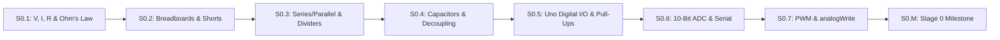

# Stage 0: Electronics & Microcontroller Foundations (Zero-Hardware Sim First)

Welcome to **Stage 0**! Now that you have completed [Track P (Prerequisites)](../track-p/README.md), Stage 0 takes you from basic electrical quantities ($V, I, R$) all the way to reading analog sensors and driving PWM outputs on a standardized **Arduino Uno (`5.0 V`, 10-bit ADC `0..1023`, 8-bit PWM `0..255`)** using free browser simulators (**Falstad** for analog circuits, short circuits, and live oscilloscope waveforms; **Wokwi** for Arduino Uno firmware).

## Lesson List & Time Estimates (Untimed Guesses)

| Lesson | Title | Primary Simulator | Typical Time | Slow-Learner Time |
| :--- | :--- | :--- | :--- | :--- |
| **[S0.1](S0.1-voltage-current-resistance-and-ohms-law.md)** | **Charge, Voltage ($V$), Current ($I$), Resistance ($R$) & Ohm's Law** | Falstad + Python | 1.5–2.0 hrs | 2.5–3.5 hrs |
| **[S0.2](S0.2-breadboards-multimeter-and-short-circuits.md)** | **Reading Schematics, Breadboards, Virtual Multimeters & Short Circuits** | Falstad + Python | 1.5–2.0 hrs | 2.5–3.5 hrs |
| **[S0.3](S0.3-series-parallel-and-voltage-dividers.md)** | **Series vs. Parallel Circuits, Voltage Dividers & Potentiometers** | Falstad + Python | 1.5–2.0 hrs | 2.5–3.5 hrs |
| **[S0.4](S0.4-capacitors-and-power-rail-decoupling.md)** | **Capacitors — Storing Charge & Smoothing Power-Rail Drops** | Falstad + Python | 1.5–2.0 hrs | 2.5–3.0 hrs |
| **[S0.5](S0.5-arduino-uno-digital-io-and-pullups.md)** | **Meet the Microcontroller (Arduino Uno `5 V`) — Digital I/O, Buttons & Pull-Ups** | Wokwi + Python | 1.5–2.0 hrs | 2.5–3.5 hrs |
| **[S0.6](S0.6-adc-analog-read-and-serial-monitor.md)** | **Reading Analog Sensors — The 10-Bit ADC (`analogRead`) & Serial Monitor** | Wokwi + Python | 1.5–2.0 hrs | 2.5–3.0 hrs |
| **[S0.7](S0.7-pwm-duty-cycle-and-analog-write.md)** | **Switching Power Smoothly — PWM Duty Cycle & `analogWrite()`** | Falstad Scope + Wokwi | 1.5–2.0 hrs | 2.5–3.0 hrs |
| **[S0.M](S0.M-stage-0-milestone.md)** | **Stage 0 Milestone — Potentiometer LED Dimmer with Safety Kill-Switch** | Wokwi + Python | 1.0–1.5 hrs | 2.0–2.5 hrs |
| **Total** | **8 Lessons** | **Browser-only (Falstad + Wokwi + Python)** | **11.5–15.5 hrs** | **19.5–25.5 hrs** |

- **Next Lesson (Track 01 Entry):** [Lesson 01.1: High-Current Switching — MOSFETs, Inductors (Motor Coils) & Flyback Diodes](../01-electronics-and-power/01.1-mosfet-inductor-flyback.md)
