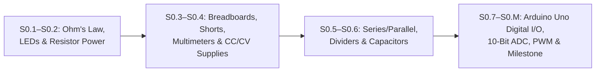

# Stage 0: Electronics & Microcontroller Foundations (Zero-Hardware Sim First)

Welcome to **Stage 0**! Now that you have completed [Track P (Prerequisites)](../track-p/README.md), Stage 0 takes you from basic electrical quantities ($V, I, R$) all the way to reading analog sensors and driving PWM outputs on a standardized **Arduino Uno (`5.0 V`, 10-bit ADC `0..1023`, 8-bit PWM `0..255`)** using free browser simulators (**Falstad** for analog circuits, short circuits, and live oscilloscope waveforms; **Wokwi** for Arduino Uno firmware). Every lesson introduces **at most 2 new ideas** (enforced in YAML front matter by `scripts/lint_lessons.py`).

---

## Lesson Map & Time Estimates (Untimed Guesses)

| Lesson | Title | New Ideas (Max 2, Enforced in YAML Front Matter) | Primary Simulator | Typical Time | Slow-Learner Time |
| :--- | :--- | :--- | :--- | :--- | :--- |
| **[Lesson S0.1](S0.1-closed-circuits-and-ohms-law.md)** | **Closed DC Circuits, Ground (`0 V`) & Ohm's Law** | 1. Closed DC circuit loop & ground (`0 V`) 2. Voltage ($V$), current ($I$), resistance ($R$) & Ohm's Law | Falstad + Python | 1.0–1.5 hrs | 2.0–3.0 hrs |
| **[Lesson S0.2](S0.2-leds-and-resistor-power.md)** | **Diodes, LEDs ($V_f$) & Resistor Power ($P = VI$)** | 1. Diodes & LEDs ($V_f$ & current-limiting resistor) 2. Electrical power dissipation ($P = VI = I^2R$) | Falstad + Python | 1.0–1.5 hrs | 2.0–3.0 hrs |
| **[Lesson S0.3](S0.3-breadboards-and-short-circuits.md)** | **Reading Schematics, Breadboards & Short Circuits** | 1. Schematic symbols & breadboard connections 2. Short circuits ($R \to 0\ \Omega$) & why Falstad is used | Falstad + Python | 1.0–1.5 hrs | 2.0–3.0 hrs |
| **[Lesson S0.4](S0.4-multimeters-and-current-limited-supplies.md)** | **Multimeters (`V`/`A`/`Ω`) & `CC/CV` Bench Supplies** | 1. Parallel voltmeter vs. series ammeter probing 2. Current-limited (`CC/CV`) bench power supplies | Falstad + Python | 1.0–1.5 hrs | 2.0–3.0 hrs |
| **[Lesson S0.5](S0.5-series-parallel-and-voltage-dividers.md)** | **Series/Parallel Networks, Dividers & Potentiometers** | 1. Series vs. parallel resistor networks 2. Resistor voltage dividers & potentiometers | Falstad + Python | 1.5–2.0 hrs | 2.5–3.5 hrs |
| **[Lesson S0.6](S0.6-capacitors-and-decoupling.md)** | **Capacitors ($\tau = RC$) & Power-Rail Decoupling** | 1. Capacitor charge storage & $\tau = RC$ 2. Power-rail decoupling (bypass) capacitors | Falstad + Python | 1.5–2.0 hrs | 2.5–3.0 hrs |
| **[Lesson S0.7](S0.7-arduino-uno-digital-io-and-pullups.md)** | **Arduino Uno (`5 V`) — Digital I/O & `INPUT_PULLUP`** | 1. `setup()`/`loop()` & digital output (`digitalWrite`) 2. Digital input (`digitalRead`) & `INPUT_PULLUP` | Wokwi (Arduino Uno) | 1.5–2.0 hrs | 2.5–3.5 hrs |
| **[Lesson S0.8](S0.8-adc-analog-read-and-serial-monitor.md)** | **10-Bit ADC (`analogRead`) & Serial Monitor** | 1. 10-bit ADC (`analogRead` `0..1023` at $5.0\text{ V}$) 2. Serial UART telemetry (`Serial.begin`/`println`) | Wokwi (Arduino Uno) | 1.5–2.0 hrs | 2.5–3.0 hrs |
| **[Lesson S0.9](S0.9-pwm-duty-cycle-and-analog-write.md)** | **PWM Duty Cycle & `analogWrite()`** | 1. PWM duty cycle & average voltage ($V_{\text{avg}}$) 2. 8-bit `analogWrite` (`0..255`) & carrier frequency | Falstad Scope + Wokwi | 1.5–2.0 hrs | 2.5–3.0 hrs |
| **[Lesson S0.M](S0.M-stage-0-milestone.md)** | **Stage 0 Milestone — LED Dimmer with Kill-Switch** | 1. Hardware-software safety override loop | Wokwi (Arduino Uno) | 1.0–1.5 hrs | 2.0–2.5 hrs |
| **Total Stage 0** | **9 Lessons + 1 Milestone** | **19 Ideas Total ($\le 2$ per lesson)** | **Falstad + Wokwi + Python** | **12.5–17.0 hrs** | **22.0–30.5 hrs** |

---

## Curriculum Order Note (Why Breadboards, Multimeters & `CC/CV` Supplies Come Before Series/Parallel Dividers)
- In the final Stage 0 sequence (`S0.1`–`S0.9`), **Schematics, Breadboards & Short Circuits (`S0.3`)** and **Multimeters & Current-Limited (`CC/CV`) Bench Supplies (`S0.4`)** are placed immediately after single-loop Ohm's Law (`S0.1`) and LEDs (`S0.2`), **before** Series/Parallel Networks & Voltage Dividers (`S0.5`) and Capacitors (`S0.6`).
- This ensures learners know how breadboard rows are wired, how to avoid row-to-row short circuits, how a `CC/CV` bench supply folds back voltage during an overload, and how to probe voltage in parallel vs. current in series **before** they wire multi-resistor series/parallel networks and voltage dividers in `S0.5`.

👉 **Next Step After Stage 0:** [Track 01, Lesson 01.1: High-Current Switching — MOSFETs, Inductors (Motor Coils) & Flyback Diodes](../01-electronics-and-power/01.1-mosfet-inductor-flyback.md)
