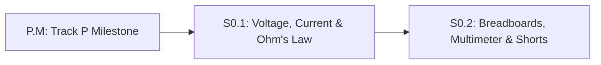

# Lesson S0.1: Charge, Voltage ($V$), Current ($I$), Resistance ($R$) & Ohm's Law ($V = I \cdot R$)

## Goal
Build a physical intuition for voltage (pressure), current (flow), and resistance (pipe narrowing) in a closed Direct Current (`DC`) loop, and use **Ohm's Law** ($V = I \cdot R$) and the power formula ($P = V \cdot I$) to size a safe LED current-limiting resistor.

- **New ideas (max 2):**
  1. **Closed circuits, voltage ($V$), current ($I$), and resistance ($R$)**: Why electric current only flows around a complete closed loop from a higher voltage source back to **ground (`GND`, $0\text{ V}$ reference)**, and how resistance restricts that flow.
  2. **Ohm's Law ($V = I \cdot R$) and electrical power ($P = V \cdot I$)**: Calculating current ($I = \frac{V}{R}$), sizing an LED series resistor ($R = \frac{V_{\text{supply}} - V_f}{I_{\text{target}}}$), and checking resistor heat dissipation in Watts (`W`).
- **New syntax:** None (uses Python arithmetic and functions from Track P).
- **Estimated time (untimed guesses):** Typical: 1.5–2.0 hours | Slow-learner: 2.5–3.5 hours

---

## Prerequisites
- [Lesson P.4: SI Units, Metric Prefixes, Binary Bits & Frequency (`Hz`)](../track-p/P.4-units-prefixes-binary-and-frequency.md) (`mA` $\to$ `A`, `kΩ` $\to$ `Ω`)
- [Lesson P.5: Rearranging Formulas, Right-Triangle Trig & Radians](../track-p/P.5-algebra-and-trigonometry-for-robotics.md)



---

## Learn

### Idea 1: Closed Circuits, Voltage ($V$), Current ($I$), and Resistance ($R$)
- **Primary resource:** [SparkFun — Voltage, Current, Resistance, and Ohm's Law](https://learn.sparkfun.com/tutorials/voltage-current-resistance-and-ohms-law) `[HTTP 200 — Verified by scripts/check_links.py]`
  - **What to read:** Read exact headings **`Electricity Basics`**, **`Electrical Charge`**, **`Voltage`**, **`Current`**, and **`Resistance`**.
  - **What to skip:** Skip the bottom kit-shopping links until you read the Ohm's Law section below.
  - **Key takeaway:** Think of a circuit as a closed water loop: **voltage** ($V$, in **Volts** `V`) is the water pressure difference pushing charges, **current** ($I$, in **Amperes** `A`) is the flow rate of charge through the wire, and **resistance** ($R$, in **Ohms** `Ω`) is a narrow constriction that limits the flow. Current can only flow when there is a complete **closed loop** from the positive supply terminal back to **ground (`GND`, defined as $0.0\text{ V}$)**.
  - **Alternative resource:** [SparkFun — What is a Circuit?](https://learn.sparkfun.com/tutorials/what-is-a-circuit) `[HTTP 200 — Verified by scripts/check_links.py]` — Read exact headings **`Circuit Basics`**, **`Voltage and How it Works`**, and **`Short and Open Circuits`**.

### Idea 2: Ohm's Law ($V = I \cdot R$) and Electrical Power ($P = V \cdot I$)
- **Primary resource:** [SparkFun — Voltage, Current, Resistance, and Ohm's Law ("Ohm's Law")](https://learn.sparkfun.com/tutorials/voltage-current-resistance-and-ohms-law) `[HTTP 200 — Verified by scripts/check_links.py]` & [SparkFun — Light-Emitting Diodes (LEDs)](https://learn.sparkfun.com/tutorials/light-emitting-diodes-leds) `[HTTP 200 — Verified by scripts/check_links.py]`
  - **What to read:** On the Ohm's Law page, read **`Ohm's Law`** and **`An Ohm's Law Experiment`**. On the LEDs page, read **`How to Use Them`**, **`1) Polarity Matters`**, **`2) Moar Current Equals Moar Light`**, and **`3) There is Such a Thing as Too Much Power`**.
  - **What to skip:** Skip ultraviolet/infrared LED wavelength tables.
  - **Key takeaway:** **Ohm's Law** states that the voltage drop across a resistor equals current times resistance ($V = I \cdot R$, so $I = \frac{V}{R}$ and $R = \frac{V}{I}$). Because an **LED** (Light-Emitting Diode) drops a fixed **forward voltage** ($V_f \approx 2.0\text{ V}$ for a red LED) and offers almost zero resistance above $V_f$, you must place a **current-limiting resistor** $R = \frac{V_{\text{supply}} - V_f}{I_{\text{target}}}$ in line with it, and check that heat power $P = V \cdot I = I^2 \cdot R$ (in **Watts** `W`) stays well below the resistor's rating (typically $0.25\text{ W} = 250\text{ mW}$).
  - **Alternative resource:** [PhET — Ohm's Law Interactive Simulation](https://phet.colorado.edu/en/simulations/ohms-law) `[HTTP 200 — SPA/App: verify in-app]` — Drag the **`Voltage`** and **`Resistance`** sliders `[verify in-app]` to see current in `mA` scale linearly with $V$ and inversely with $R$.
  - **Optional extra:** [Falstad Circuit Simulator — Ohm's Law](https://www.falstad.com/circuit/circuitjs.html) `[HTTP 200 — SPA/App: verify in-app]` — Open `Circuits` $\rightarrow$ `Basics` $\rightarrow$ `Ohm's Law` `[verify in-app]` to watch moving yellow dots represent current flow.

### Bridge Notes
In this roadmap, all Stage 0 circuits run on **Direct Current (`DC`)**—steady one-way voltage from an Arduino Uno's **`5V`** supply pin returning to **`GND`** (**ground**, our $0.0\text{ V}$ reference point). Remember from Lesson P.4 that **Ohm's Law** ($V = I \cdot R$) requires base SI units: Volts (`V`), Amperes (`A`), and Ohms (`Ω`). If you want $15\text{ mA}$ of current, convert $15\text{ mA} \div 1000 = 0.015\text{ A}$ before dividing!

An **LED** is a one-way light valve with two legs: current enters the longer **anode** (`+`) leg and exits the shorter **cathode** (`-`, flat edge) leg toward `GND`. When turned on, a standard red LED consumes a fixed **forward voltage** drop of $V_f = 2.0\text{ V}$. If you wire it to an Arduino Uno's $V_{\text{supply}} = 5.0\text{ V}$ pin through a series resistor $R$, the remaining voltage across the resistor is $V_R = V_{\text{supply}} - V_f = 5.0\text{ V} - 2.0\text{ V} = 3.0\text{ V}$. To limit current to $I = 0.015\text{ A}$ ($15\text{ mA}$), choose $R = \frac{3.0\text{ V}}{0.015\text{ A}} = 200\ \Omega$ (or the standard $220\ \Omega$ value, which gives $\frac{3.0}{220} \approx 13.6\text{ mA}$). Finally, **electrical power** $P = V_R \cdot I$ measures how fast electrical energy turns into heat in **Watts (`W`)**, ensuring your resistor stays cool.

---

## Do it yourself

- **What is simulated and in which tool:** Circuit visualization in [Falstad (`Circuits -> Basics -> Ohm's Law`)](https://www.falstad.com/circuit/circuitjs.html) `[verify in-app]`; exact LED resistor and power sizing verified in Python below.
- **What is real-hardware only:** Feeling physical resistor heating when $P > 0.25\text{ W}$ or burning out an unprotected LED.

### Starter Code (runs as-is — fill in the TODOs)
Complete `size_led_resistor_ohms` (`TODO 1`) and `resistor_power_mw` (`TODO 2`) to calculate the exact series resistance and heat dissipation (in milliwatts `mW`) for a red LED ($V_f = 2.0\text{ V}$) powered from an Arduino Uno's $5.0\text{ V}$ pin:

```python
def size_led_resistor_ohms(v_supply, v_forward, target_current_ma):
    # TODO 1: Convert target_current_ma from milliamps (mA) to amps (A) by dividing by 1000.0,
    #         compute resistor voltage drop v_r = v_supply - v_forward,
    #         and return v_r / target_current_a
    return 0.0


def led_circuit_current_and_power(v_supply, v_forward, r_ohms):
    # TODO 2: Given a standard resistor r_ohms (like 220 ohms):
    #         - Compute v_r = v_supply - v_forward
    #         - Compute current_a = v_r / r_ohms
    #         - Compute current_ma = current_a * 1000.0
    #         - Compute power_mw = (v_r * current_a) * 1000.0
    current_ma = 0.0
    power_mw = 0.0
    return [current_ma, power_mw]


r_ideal = size_led_resistor_ohms(5.0, 2.0, 15.0)
stats_220 = led_circuit_current_and_power(5.0, 2.0, 220.0)

print(f"Ideal resistor for 15.0 mA: {r_ideal:.1f} ohms")
print(f"With 220 ohm resistor: current={stats_220[0]:.2f} mA | resistor heat={stats_220[1]:.2f} mW")
```

### Expected Output
When both `TODO`s are completed, running the script prints:

```text
Ideal resistor for 15.0 mA: 200.0 ohms
With 220 ohm resistor: current=13.64 mA | resistor heat=40.91 mW
```

### Hint Ladder

<details>
<summary><strong>Hint 1 (Concept nudge)</strong></summary>

In `TODO 1`, remember to subtract `v_r = v_supply - v_forward` (`5.0 - 2.0 = 3.0 V`) before dividing by `target_current_ma / 1000.0`. In `TODO 2`, multiply Watts (`v_r * current_a`) by `1000.0` to get milliwatts (`mW`).
</details>

<details>
<summary><strong>Hint 2 (Formula / structure)</strong></summary>

- In `size_led_resistor_ohms`:
  ```python
  target_current_a = target_current_ma / 1000.0
  v_r = v_supply - v_forward
  return v_r / target_current_a
  ```
- In `led_circuit_current_and_power`:
  ```python
  v_r = v_supply - v_forward
  current_a = v_r / r_ohms
  return [current_a * 1000.0, (v_r * current_a) * 1000.0]
  ```
</details>

<details>
<summary><strong>Full Solution</strong></summary>

```python
def size_led_resistor_ohms(v_supply, v_forward, target_current_ma):
    target_current_a = target_current_ma / 1000.0
    v_r = v_supply - v_forward
    return v_r / target_current_a


def led_circuit_current_and_power(v_supply, v_forward, r_ohms):
    v_r = v_supply - v_forward
    current_a = v_r / r_ohms
    current_ma = current_a * 1000.0
    power_mw = (v_r * current_a) * 1000.0
    return [current_ma, power_mw]


r_ideal = size_led_resistor_ohms(5.0, 2.0, 15.0)
stats_220 = led_circuit_current_and_power(5.0, 2.0, 220.0)

assert round(r_ideal, 1) == 200.0
assert round(stats_220[0], 2) == 13.64
assert round(stats_220[1], 2) == 40.91

print(f"Ideal resistor for 15.0 mA: {r_ideal:.1f} ohms")
print(f"With 220 ohm resistor: current={stats_220[0]:.2f} mA | resistor heat={stats_220[1]:.2f} mW")
```
</details>

---

## Common mistakes & troubleshooting
- **Forgetting to subtract the LED forward voltage $V_f$:** Writing $R = \frac{5.0\text{ V}}{0.015\text{ A}} = 333.3\ \Omega$ pretends the LED drops $0\text{ V}$. Because the red LED drops $2.0\text{ V}$, only $5.0 - 2.0 = 3.0\text{ V}$ sits across the resistor!
- **Dividing by milliamps (`15`) instead of amps (`0.015`):** $\frac{3.0\text{ V}}{15} = 0.2\ \Omega$—which is $1000\times$ too small and would letamps of current destroy the LED! Always convert `mA` to `A` first.
- **Wiring the LED backward (reverse polarity):** If the LED's anode (`+`, longer leg) is connected to `GND` and cathode (`-`, shorter leg) to `+5V`, the diode blocks current and remains dark.

---

## Check yourself

1. **Ohm's Law calculation:** A $10\text{ k}\Omega$ ($10{,}000\ \Omega$) resistor is connected directly between an Arduino Uno's `5V` pin and `GND`. How much current flows through it in amperes (`A`) and in milliamps (`mA`)?
   <details>
   <summary><strong>Answer</strong></summary>

   $I = \frac{V}{R} = \frac{5.0\text{ V}}{10{,}000\ \Omega} = \mathbf{0.0005\text{ A}} = \mathbf{0.5\text{ mA}}$.
   </details>

2. **Why LEDs need resistors:** What happens physically if you connect a red LED ($V_f = 2.0\text{ V}$) directly across a $5.0\text{ V}$ supply with **no** series resistor?
   <details>
   <summary><strong>Answer</strong></summary>

   Above $2.0\text{ V}$, an LED has almost zero internal resistance (only a few ohms). Trying to force $5.0\text{ V}$ across it drives a massive current spike (hundreds of milliamps) that instantly overheats and burns out the LED junction (and can damage the Arduino pin).
   </details>

3. **Resistor placement order:** Does it matter whether the $220\ \Omega$ current-limiting resistor is placed *before* the LED (`5V -> Resistor -> LED -> GND`) or *after* the LED (`5V -> LED -> Resistor -> GND`) in a single loop?
   <details>
   <summary><strong>Answer</strong></summary>

   **No!** In a single series loop, the exact same current flows through every component in the loop, just like a pinch valve anywhere along a single garden hose slows down the water flow throughout the entire hose.
   </details>

4. **Power rating safety check:** A $100\ \Omega$ resistor has $12.0\text{ V}$ across it. How much current $I$ flows through it, how much heat power $P = V \cdot I$ does it generate in Watts (`W`), and will a standard $0.25\text{ W}$ ($1/4\text{ W}$) resistor survive?
   <details>
   <summary><strong>Answer</strong></summary>

   - Current: $I = \frac{12.0\text{ V}}{100\ \Omega} = \mathbf{0.12\text{ A}}$ ($120\text{ mA}$).
   - Power: $P = 12.0\text{ V} \times 0.12\text{ A} = \mathbf{1.44\text{ W}}$.
   - **No, it will burn up!** $1.44\text{ W}$ is nearly $6\times$ higher than the $0.25\text{ W}$ limit; you would need at least a $2\text{ W}$ or $3\text{ W}$ power resistor.
   </details>

---

## Recap
- **Voltage ($V$)** is electrical pressure difference relative to **ground (`GND`, $0\text{ V}$)**, **current ($I$)** is charge flow rate in Amperes (`A`), and **resistance ($R$)** opposes flow in Ohms (`Ω`).
- **Ohm's Law** ($V = I \cdot R$) and the **power law** ($P = V \cdot I$) govern resistor sizing and heat dissipation.

### You're ready to move on when...
- [ ] You can size an LED series resistor using $R = \frac{V_{\text{supply}} - V_f}{I_{\text{target}}}$ in base SI units.
- [ ] You can check whether $P = V_R \cdot I$ is safely below a resistor's $0.25\text{ W}$ ($250\text{ mW}$) rating.
- [ ] Your **Do it yourself** script outputs `200.0 ohms`, `13.64 mA`, and `40.91 mW`.
- **Next lesson:** [Lesson S0.2: Reading Schematics, Breadboard Connections, Virtual Multimeter & Short Circuits](S0.2-breadboards-multimeter-and-short-circuits.md)
