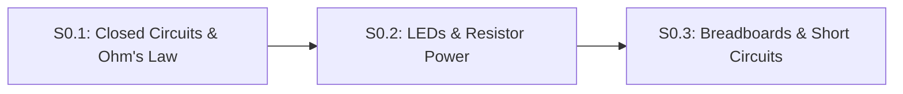

# Lesson S0.2: LEDs, Forward Voltage Drop ($V_f$) and Resistor Power Ratings ($P = V \cdot I$)

## Goal
Size a safe current-limiting series resistor for an **LED** by accounting for its fixed **forward voltage drop** ($V_f \approx 2.0\text{ V}$), and verify that resistor heat dissipation ($P = V_R \cdot I$) stays well below its $0.25\text{ W}$ ($250\text{ mW}$) rating.

- **New ideas (max 2):**
  1. **LED polarity, forward voltage drop, and series resistor sizing**: Why an LED conducts in only one direction (`Anode +` to `Cathode -`), drops a fixed $V_f$, and requires a series resistor $R = \frac{V_{\text{supply}} - V_f}{I_{\text{target}}}$.
  2. **Electrical power dissipation ($P = V \cdot I$)**: Computing the heat power generated in a resistor in Watts (`W`) or milliwatts (`mW`) so components never overheat.
- **New syntax:** None (uses Python functions and arithmetic from Track P).
- **Estimated time (untimed guesses):** Typical: 1.0–1.5 hours | Slow-learner: 2.0–3.0 hours

---

## Prerequisites
- [Lesson P.9: Rearranging Physics Formulas & Linear Range Scaling](../track-p/P.9-rearranging-formulas-and-scaling.md)
- [Lesson S0.1: Closed DC Circuits, Ground Reference (`0 V`) & Ohm's Law](S0.1-closed-circuits-and-ohms-law.md)



---

## Learn

### Idea 1: LED polarity, forward voltage drop, and series resistor sizing
- **Primary resource:** [SparkFun — Light-Emitting Diodes (LEDs)](https://learn.sparkfun.com/tutorials/light-emitting-diodes-leds) `[HTTP 200 — Verified by scripts/check_links.py]`
  - **What to read:** Read exact headings **`How to Use Them`**, **`1) Polarity Matters`**, **`2) Moar Current Equals Moar Light`**, and **`3) There is Such a Thing as Too Much Power`**.
  - **What to skip:** Skip **`Types of LEDs`** (IR, UV, RGB strip addressing).
  - **Key takeaway:** An **LED** (Light-Emitting Diode) is a one-way light valve: current enters the longer **anode (`+`)** leg and exits the shorter **cathode (`-`, flat rim)** leg toward `GND`. When conducting, a red LED drops a fixed **forward voltage** $V_f \approx 2.0\text{ V}$ and offers almost zero resistance above $V_f$—so you must wire a **current-limiting resistor** $R = \frac{V_{\text{supply}} - V_f}{I_{\text{target}}}$ in line with it.

### Idea 2: Electrical power dissipation ($P = V \cdot I$)
- **Primary resource:** [SparkFun — Electric Power](https://learn.sparkfun.com/tutorials/electric-power) `[HTTP 200 — Verified by scripts/check_links.py]`
  - **What to read:** Read exact headings **`What is Electric Power?`**, **`Wattage`**, **`Calculating Power`**, and **`Power Ratings`**.
  - **What to skip:** Skip mechanical horsepower conversions.
  - **Key takeaway:** **Electrical power** ($P$, measured in **Watts `W`** or **milliwatts `mW`**) is the rate at which electrical energy turns into heat or light: $P = V \cdot I$ (or $P = I^2 \cdot R$ for a resistor). Standard through-hole breadboard resistors are rated for **$0.25\text{ W}$ ($250\text{ mW}$)** maximum; for cool, reliable operation, keep continuous resistor heat below half of its rating ($< 125\text{ mW}$).

### Bridge Notes
Why does connecting an LED directly across `5V` and `GND` without a resistor instantly destroy it? Because unlike a resistor, an LED does not obey $V = IR$. Once the supply voltage exceeds the LED's **forward voltage** ($V_f \approx 2.0\text{ V}$ for red, $\approx 3.0\text{ V}$ for blue/white), the LED acts like an open floodgate with almost zero internal resistance!

When we place a resistor $R$ in line with a red LED ($V_f = 2.0\text{ V}$) across an Arduino Uno's $V_{\text{supply}} = 5.0\text{ V}$ rail:
1. The LED consumes $V_f = 2.0\text{ V}$, leaving $V_R = V_{\text{supply}} - V_f = 5.0\text{ V} - 2.0\text{ V} = 3.0\text{ V}$ across the resistor.
2. To set a safe LED current of $I = 15\text{ mA} = 0.015\text{ A}$, Ohm's Law gives:

$$
R = \frac{V_{\text{supply}} - V_f}{I_{\text{target}}} = \frac{3.0\text{ V}}{0.015\text{ A}} = 200\ \Omega
$$

Picking the nearest standard kit resistor ($R = 220\ \Omega$) gives $I = \frac{3.0\text{ V}}{220\ \Omega} \approx 0.01364\text{ A}$ ($13.64\text{ mA}$), and the resistor's heat dissipation is $P_R = V_R \cdot I = 3.0\text{ V} \times 0.01364\text{ A} \approx 0.0409\text{ W} = 40.91\text{ mW}$—more than $6\times$ below the $250\text{ mW}$ limit!

---

## Do it yourself

- **What is simulated and in which tool:**
  1. **In [Falstad Circuit Simulator](https://www.falstad.com/circuit/circuitjs.html) `[verify in-app]`:** Import [`falstad/S0.2-led-resistor.txt`](falstad/S0.2-led-resistor.txt) `[verify in-app]` via `File` $\rightarrow$ `Import From Text...` (`5 V` source + `220 Ω` resistor + red LED) and inspect the resistor drop and current.
  2. **In Python below:** Complete `size_led_resistor_ohms` (`TODO 1`) and `led_circuit_current_and_power` (`TODO 2`).
- **What is real-hardware only:** Burning out a physical LED or overheating a $0.25\text{ W}$ resistor when $P > 250\text{ mW}$.

### Starter Code (runs as-is — fill in the TODOs)
Complete `size_led_resistor_ohms` (`TODO 1`) and `led_circuit_current_and_power` (`TODO 2`):

```python
def size_led_resistor_ohms(v_supply, v_forward, target_current_ma):
    # TODO 1: Convert target_current_ma to Amperes (/ 1000.0),
    #         compute v_r = v_supply - v_forward, and return v_r / target_current_a
    return 0.0


def led_circuit_current_and_power(v_supply, v_forward, r_ohms):
    # TODO 2: Given r_ohms (e.g. 220.0 ohms):
    #         - Compute v_r = v_supply - v_forward
    #         - Compute current_a = v_r / r_ohms
    #         - Return [current_a * 1000.0, (v_r * current_a) * 1000.0] (mA and mW)
    return [0.0, 0.0]


r_ideal = size_led_resistor_ohms(5.0, 2.0, 15.0)
stats_220 = led_circuit_current_and_power(5.0, 2.0, 220.0)

print(f"Ideal resistor for 15.0 mA: {r_ideal:.1f} ohms")
print(f"With 220 ohm resistor: current={stats_220[0]:.2f} mA | resistor heat={stats_220[1]:.2f} mW")
```

### Expected Output
When both `TODO`s are completed, running the script prints:

```text
Ideal resistor for 15.0 mA: 200.0 ohms
With 220 ohm resistor: current=13.64 mA | resistor heat=40.91 mW
```

### Hint Ladder

<details>
<summary><strong>Hint 1 (Concept nudge)</strong></summary>

In `TODO 1`, subtract `v_r = v_supply - v_forward` (`3.0 V`) before dividing by `target_current_ma / 1000.0`. In `TODO 2`, multiply Watts (`v_r * current_a`) by `1000.0` to return milliwatts (`mW`).
</details>

<details>
<summary><strong>Hint 2 (Formula / structure)</strong></summary>

```python
def size_led_resistor_ohms(v_supply, v_forward, target_current_ma):
    target_current_a = target_current_ma / 1000.0
    v_r = v_supply - v_forward
    return v_r / target_current_a

def led_circuit_current_and_power(v_supply, v_forward, r_ohms):
    v_r = v_supply - v_forward
    current_a = v_r / r_ohms
    return [current_a * 1000.0, (v_r * current_a) * 1000.0]
```
</details>

<details>
<summary><strong>Full Solution</strong></summary>

```python
def size_led_resistor_ohms(v_supply, v_forward, target_current_ma):
    target_current_a = target_current_ma / 1000.0
    v_r = v_supply - v_forward
    return v_r / target_current_a


def led_circuit_current_and_power(v_supply, v_forward, r_ohms):
    v_r = v_supply - v_forward
    current_a = v_r / r_ohms
    return [current_a * 1000.0, (v_r * current_a) * 1000.0]


r_ideal = size_led_resistor_ohms(5.0, 2.0, 15.0)
stats_220 = led_circuit_current_and_power(5.0, 2.0, 220.0)

assert round(r_ideal, 1) == 200.0
assert round(stats_220[0], 2) == 13.64
assert round(stats_220[1], 2) == 40.91

print(f"Ideal resistor for 15.0 mA: {r_ideal:.1f} ohms")
print(f"With 220 ohm resistor: current={stats_220[0]:.2f} mA | resistor heat={stats_220[1]:.2f} mW")
```
</details>

---

## Common mistakes & troubleshooting
- **Forgetting to subtract $V_f$ ($2.0\text{ V}$):** Calculating $R = \frac{5.0\text{ V}}{0.015\text{ A}} = 333\ \Omega$ ignores the $2.0\text{ V}$ drop across the LED. Only $5.0 - 2.0 = 3.0\text{ V}$ sits across the resistor.
- **Wiring the LED backward:** If the shorter cathode (`-`) leg faces `+5V` and the longer anode (`+`) leg faces `GND`, the diode blocks current and never lights up.
- **Dividing by `15` (`mA`) instead of `0.015` (`A`):** $\frac{3.0}{15} = 0.2\ \Omega$, which is $1{,}000\times$ too small!

---

## Check yourself

1. **Sizing for a $12.0\text{ V}$ supply:** You want to run a red LED ($V_f = 2.0\text{ V}$) at $I = 10.0\text{ mA}$ ($0.010\text{ A}$) from a $12.0\text{ V}$ battery. What resistor value $R$ do you need, and how much heat power $P_R = V_R \cdot I$ does that resistor dissipate?
   <details>
   <summary><strong>Answer</strong></summary>

   $V_R = 12.0 - 2.0 = 10.0\text{ V}$, so $R = \frac{10.0\text{ V}}{0.010\text{ A}} = \mathbf{1{,}000\ \Omega}$ ($1.0\text{ k}\Omega$), and $P_R = 10.0\text{ V} \times 0.010\text{ A} = \mathbf{0.10\text{ W}} = \mathbf{100\text{ mW}}$ (safe for a $250\text{ mW}$ resistor).
   </details>

2. **Does resistor order in a single loop matter?** Does it matter whether the $220\ \Omega$ resistor is placed *before* the LED (`5V -> Resistor -> LED -> GND`) or *after* the LED (`5V -> LED -> Resistor -> GND`)?
   <details>
   <summary><strong>Answer</strong></summary>

   **No!** In a single series loop, the exact same current flows through every part of the loop.
   </details>

3. **Resistor thermal overload check:** A $100\ \Omega$ resistor has $12.0\text{ V}$ directly across it ($I = 0.12\text{ A}$). How much power $P = V \cdot I$ does it burn, and will a $0.25\text{ W}$ resistor survive?
   <details>
   <summary><strong>Answer</strong></summary>

   $P = 12.0\text{ V} \times 0.12\text{ A} = \mathbf{1.44\text{ W}}$—nearly $6\times$ above the $0.25\text{ W}$ rating, so a $0.25\text{ W}$ resistor will smoke and burn!
   </details>

---

## Recap
- An **LED** conducts from **Anode (`+`)** to **Cathode (`-`)**, drops a fixed $V_f$, and requires a series resistor $R = \frac{V_{\text{supply}} - V_f}{I_{\text{target}}}$.
- **Electrical power** $P = V \cdot I = I^2 R$ (in Watts `W`) must stay safely below a resistor's $0.25\text{ W}$ ($250\text{ mW}$) limit.

### You're ready to move on when...
- [ ] You can size an LED series resistor and check its wattage rating for any supply voltage.
- [ ] Your **Do it yourself** script prints `200.0 ohms`, `13.64 mA`, and `40.91 mW`.
- **Next lesson:** [Lesson S0.3: Reading Schematics, Breadboards & Short Circuits](S0.3-breadboards-and-short-circuits.md)
