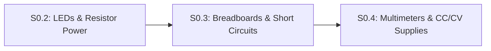

# Lesson S0.3: Reading Schematics, Breadboards and Short Circuits

## Goal
Translate a circuit schematic into a physical or simulated **solderless breadboard** layout without accidentally shorting component legs across the same row, and visualize **short circuits** in Falstad.

- **New ideas (max 2):**
  1. **Schematic symbols and breadboard internal row clips**: How schematic lines represent shared electrical **nodes**, and how a breadboard connects 5 holes horizontally (`a–e` and `f–j`) in each row and vertically along the outer `+`/`-` power rails.
  2. **Open circuits versus short circuits**: Why bridging two legs of a component (or `5V` and `GND`) in the same 5-hole breadboard row creates a near-zero-resistance **short circuit** ($I = V / R_{\text{wire}}$), and why we demonstrate shorts in **Falstad** rather than Wokwi.
- **New syntax:** None (uses Python functions and `if/else` from Track P).
- **Estimated time (untimed guesses):** Typical: 1.0–1.5 hours | Slow-learner: 2.0–3.0 hours

---

## Prerequisites
- [Lesson S0.1: Closed DC Circuits, Ground Reference (`0 V`) & Ohm's Law](S0.1-closed-circuits-and-ohms-law.md)
- [Lesson S0.2: LEDs, Forward Voltage Drop & Resistor Power Ratings](S0.2-leds-and-resistor-power.md)



---

## Learn

### Idea 1: Schematic symbols and breadboard internal row clips
- **Primary resource:** [SparkFun — How to Read a Schematic](https://learn.sparkfun.com/tutorials/how-to-read-a-schematic) `[HTTP 200 — Verified by scripts/check_links.py]` & [SparkFun — How to Use a Breadboard](https://learn.sparkfun.com/tutorials/how-to-use-a-breadboard) `[HTTP 200 — Verified by scripts/check_links.py]`
  - **What to read:** On the Schematic page, read exact headings **`Overview`**, **`Schematic Symbols (Part 1)`**, and **`Reading Schematics: Nets, Nodes and Labels`**. On the Breadboard page, read **`Anatomy of a Breadboard`** and **`Building Your First Breadboard Circuit`**.
  - **What to skip:** Skip **`Binding Posts`** and logic-IC pinout history.
  - **Key takeaway:** Every continuous line on a schematic is a **node**—all component legs touching that node must share one metal clip on your breadboard. Inside a solderless breadboard, the outer **power rails** (`+` red and `-` blue/black) run **vertically** down the sides, whereas the inner **terminal rows** connect **5 holes horizontally (`a-b-c-d-e` on the left, `f-g-h-i-j` on the right)**, separated by a center ravine.

### Idea 2: Open circuits versus short circuits
- **Primary resource:** [SparkFun — What is a Circuit? ("Short and Open Circuits")](https://learn.sparkfun.com/tutorials/what-is-a-circuit) `[HTTP 200 — Verified by scripts/check_links.py]`
  - **What to read:** Read exact heading **`Short and Open Circuits`**.
  - **What to skip:** Skip the bottom links.
  - **Key takeaway:** An **open circuit** is a broken loop ($R = \infty, I = 0$). A **short circuit** is an unintended near-zero-resistance bypass path ($R_{\text{wire}} \approx 0.05\ \Omega$) directly across a power supply or across both legs of a component. By Ohm's Law ($I = V / R_{\text{wire}}$), a $5.0\text{ V}$ short attempts to draw $I = 5.0 / 0.05 = 100\text{ A}$, starving the rest of the circuit and overheating wires!

### Bridge Notes
Look at a breadboard's two rules so you never wire a hidden short circuit:
1. **Never plug both legs of the same resistor or LED into the same 5-hole horizontal row (such as `row 10, hole a` and `row 10, hole d`)!** Because holes `10a–10e` are pinched together by a single metal clip underneath the plastic, plugging both legs into row 10 shorts the two legs together—current takes the $0\ \Omega$ metal clip underneath instead of flowing through your component! Always place the two legs in **two different numbered rows** (e.g., `row 10` and `row 14`) or across the center ravine (`10e` to `10f`).
2. **Important Simulator Fact (Wokwi vs. Falstad on Breadboard Shorts):**
   - We checked Wokwi's breadboard and analog simulation behavior: Wokwi primarily routes digital logic states and **does NOT display a smoke warning, error message, or current spike if you wire `5V` directly to `GND` on a Wokwi breadboard**.
   - Therefore, we always demonstrate and inspect **short circuits in Falstad** (`falstad/S0.3-short-circuit.txt`), where closing a $0.05\ \Omega$ short-circuit switch across an LED visibly diverts all current away from the LED and spikes supply current!

---

## Do it yourself

- **What is simulated and in which tool:**
  1. **Short-circuit demonstration in [Falstad Circuit Simulator](https://www.falstad.com/circuit/circuitjs.html) `[verify in-app]`:** Import [`falstad/S0.3-short-circuit.txt`](falstad/S0.3-short-circuit.txt) `[verify in-app]` via `File` $\rightarrow$ `Import From Text...`. With the bypass switch open, the LED glows normally ($13.6\text{ mA}$). Click the switch closed to simulate plugging both LED legs into the same breadboard row (`0.05 Ω` clip): watch all current bypass the LED while the LED goes completely dark!
  2. **In Python below:** Complete `are_holes_connected_on_breadboard` (`TODO 1`) and `check_component_placement` (`TODO 2`).
- **What is real-hardware only:** Melting plastic breadboard clips or tripping a USB port's polyfuse during a real `5V`-to-`GND` short.

### Starter Code (runs as-is — fill in the TODOs)
Complete `are_holes_connected_on_breadboard` (`TODO 1`) and `check_component_placement` (`TODO 2`) to detect when two legs of a component are accidentally plugged into the same 5-hole breadboard strip (`a–e` or `f–j` of the same row):

```python
def are_holes_connected_on_breadboard(row1, col1, row2, col2):
    left_bank = ["a", "b", "c", "d", "e"]
    right_bank = ["f", "g", "h", "i", "j"]
    # TODO 1: Two terminal holes share the same metal clip if and only if:
    #         row1 == row2 AND ((col1 in left_bank and col2 in left_bank)
    #                           OR (col1 in right_bank and col2 in right_bank))
    #         Return True if connected, else False.
    return False


def check_component_placement(row1, col1, row2, col2):
    # TODO 2: If are_holes_connected_on_breadboard(row1, col1, row2, col2) is True,
    #         return "SHORTED_SAME_CLIP", otherwise return "VALID_ACROSS_NODES".
    return "UNKNOWN"


print(f"Row 10a to 10d: {check_component_placement(10, 'a', 10, 'd')}")
print(f"Row 10a to 14a: {check_component_placement(10, 'a', 14, 'a')}")
print(f"Row 10e to 10f (across ravine): {check_component_placement(10, 'e', 10, 'f')}")
```

### Expected Output
When `TODO 1` and `TODO 2` are completed, running the script prints:

```text
Row 10a to 10d: SHORTED_SAME_CLIP
Row 10a to 14a: VALID_ACROSS_NODES
Row 10e to 10f (across ravine): VALID_ACROSS_NODES
```

### Hint Ladder

<details>
<summary><strong>Hint 1 (Concept nudge)</strong></summary>

In `TODO 1`, first check `if row1 != row2: return False`. If `row1 == row2`, check if both columns are in `left_bank` or both are in `right_bank`.
</details>

<details>
<summary><strong>Hint 2 (Formula / structure)</strong></summary>

```python
def are_holes_connected_on_breadboard(row1, col1, row2, col2):
    left_bank = ["a", "b", "c", "d", "e"]
    right_bank = ["f", "g", "h", "i", "j"]
    if row1 != row2:
        return False
    if (col1 in left_bank) and (col2 in left_bank):
        return True
    if (col1 in right_bank) and (col2 in right_bank):
        return True
    return False
```
</details>

<details>
<summary><strong>Full Solution</strong></summary>

```python
def are_holes_connected_on_breadboard(row1, col1, row2, col2):
    left_bank = ["a", "b", "c", "d", "e"]
    right_bank = ["f", "g", "h", "i", "j"]
    if row1 != row2:
        return False
    if (col1 in left_bank) and (col2 in left_bank):
        return True
    if (col1 in right_bank) and (col2 in right_bank):
        return True
    return False


def check_component_placement(row1, col1, row2, col2):
    if are_holes_connected_on_breadboard(row1, col1, row2, col2):
        return "SHORTED_SAME_CLIP"
    return "VALID_ACROSS_NODES"


assert check_component_placement(10, "a", 10, "d") == "SHORTED_SAME_CLIP"
assert check_component_placement(10, "a", 14, "a") == "VALID_ACROSS_NODES"
assert check_component_placement(10, "e", 10, "f") == "VALID_ACROSS_NODES"

print(f"Row 10a to 10d: {check_component_placement(10, 'a', 10, 'd')}")
print(f"Row 10a to 14a: {check_component_placement(10, 'a', 14, 'a')}")
print(f"Row 10e to 10f (across ravine): {check_component_placement(10, 'e', 10, 'f')}")
```
</details>

---

## Common mistakes & troubleshooting
- **Plugging both legs of a resistor or LED into the same 5-hole strip (`10a` and `10e`):** The internal metal strip shorts the two legs together so zero current flows through the component.
- **Assuming Wokwi will warn you about a `5V`-to-`GND` breadboard short:** Wokwi does not flag power-to-ground breadboard shorts. Always trace power and ground wires by eye and simulate analog short behavior in Falstad.

---

## Check yourself

1. **Breadboard connectivity:** A resistor's top leg is in hole **`12b`** and its bottom leg is in hole **`18b`**. If you want to connect an LED's anode (`+`) leg to the bottom leg of that resistor, which holes on the breadboard can you plug the LED's anode into?
   <details>
   <summary><strong>Answer</strong></summary>

   Any of the remaining 4 holes in that same left-side strip of row 18: **`18a`, `18c`, `18d`, or `18e`** (not `18f–18j`, which are on the opposite side of the center ravine).
   </details>

2. **Why the center ravine exists:** Why is there a gap down the middle of every breadboard between column `e` and column `f`?
   <details>
   <summary><strong>Answer</strong></summary>

   So dual-row chips (DIP integrated circuits) and pushbuttons can straddle the middle gap without their left-side pins shorting to their right-side pins!
   </details>

3. **Short-circuit current calculation:** If you accidentally connect a jumper wire with resistance $R_{\text{wire}} = 0.05\ \Omega$ directly between an unprotected $5.0\text{ V}$ supply and `GND`, how much current tries to flow according to Ohm's Law?
   <details>
   <summary><strong>Answer</strong></summary>

   $I = \frac{5.0\text{ V}}{0.05\ \Omega} = \mathbf{100.0\text{ A}}$!
   </details>

---

## Recap
- Breadboard terminal rows connect 5 holes horizontally (`a–e` and `f–j` separated by the center ravine), while outer power rails run vertically.
- Never place both legs of a component in the same 5-hole clip, and remember that **Falstad** (not Wokwi) visualizes analog short circuits.

### You're ready to move on when...
- [ ] You tested [`falstad/S0.3-short-circuit.txt`](falstad/S0.3-short-circuit.txt) `[verify in-app]` in Falstad and watched the short-circuit switch bypass the LED.
- [ ] Your **Do it yourself** script passes all assertions.
- **Next lesson:** [Lesson S0.4: Virtual Multimeters (Voltmeter vs. Ammeter) & Current-Limited (`CC/CV`) Power Supplies](S0.4-multimeters-and-current-limited-supplies.md)
