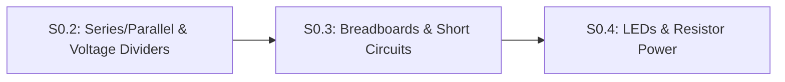

# Lesson S0.3: Reading Schematics, Breadboards and Short Circuits

<!-- run-callout:start -->
> **No workbench entry for this page.** There is nothing to load in Tab 2 for it - its code runs in your own Python 3 or on the bench, with no starter file or graded check. The pages that do have one are listed in [MechaLab, Run Python Lessons](https://tle47.github.io/Mechatronics-Roadmap/).
<!-- run-callout:end -->

## Goal
Translate a circuit schematic into a physical or simulated **solderless breadboard** layout without accidentally shorting component legs across the same row, and visualize **short circuits** in Falstad.

- **New ideas (max 2):**
  1. **Schematic symbols and breadboard internal row clips**: How schematic lines represent shared electrical **nodes**, and how a breadboard connects 5 holes horizontally (`a–e` and `f–j`) in each row and vertically along the outer `+`/`-` power rails.
  2. **Open circuits versus short circuits**: Why bridging two legs of a component (or `5V` and `GND`) in the same 5-hole breadboard row creates a near-zero-resistance **short circuit** ($I = V / R_{\text{wire}}$), and why we demonstrate shorts in **Falstad** rather than Wokwi.
- **New syntax:** Falstad switch (`s`) element in circuit netlists.
- **Target time (unmeasured — [log yours](../.github/ISSUE_TEMPLATE/beginner-timing-log.md)):** Typical: 1.0–1.5 hours | Slow-learner: 2.0–3.0 hours

---

## Prerequisites
- [Lesson S0.1: Closed DC Circuits, Ground Reference (`0 V`) & Ohm's Law](S0.1-closed-circuits-and-ohms-law.md)
- [Lesson S0.2: Series vs. Parallel Resistor Networks, Voltage Dividers & Potentiometers](S0.2-series-parallel-and-voltage-dividers.md)



---

## Learn

### Idea 1: Schematic symbols and breadboard internal row clips
- **Primary resource:** [SparkFun — How to Read a Schematic](https://learn.sparkfun.com/tutorials/how-to-read-a-schematic) `[HTTP 200 — Verified by scripts/check_links.py]`
  - **What to read:** Read exact headings **`Overview`**, **`Schematic Symbols (Part 1)`**, **`Reading Schematics`**, and **`Nets, Nodes and Labels`**.
  - **What to skip:** Skip logic-gate IC pinout history.
  - **Key takeaway:** Every continuous line on a schematic is a **node**—all component legs touching that node must share one metal clip on your breadboard. Inside a solderless breadboard, the outer **power rails** (`+` red and `-` blue/black) run **vertically** down the sides, whereas the inner **terminal rows** connect **5 holes horizontally (`a-b-c-d-e` on the left, `f-g-h-i-j` on the right)**, separated by a center ravine.
  - **Alternative resource:** [SparkFun — How to Use a Breadboard](https://learn.sparkfun.com/tutorials/how-to-use-a-breadboard) `[HTTP 200 — Verified by scripts/check_links.py]` — Read exact headings **`Anatomy of a Breadboard`** and **`Building Your First Breadboard Circuit`** (skip **`Binding Posts`**).

### Idea 2: Open circuits versus short circuits
- **Primary resource:** [SparkFun — What is a Circuit? ("Short and Open Circuits")](https://learn.sparkfun.com/tutorials/what-is-a-circuit) `[HTTP 200 — Verified by scripts/check_links.py]`
  - **What to read:** Read exact heading **`Short and Open Circuits`**.
  - **What to skip:** Skip the bottom links.
  - **Key takeaway:** An **open circuit** is a broken loop ($R = \infty, I = 0$). A **short circuit** is an unintended near-zero-resistance bypass path ($R_{\text{wire}} \approx 0.05\ \Omega$) directly across a power supply or across both legs of a component. By Ohm's Law ($I = V / R_{\text{wire}}$), a $5.0\text{ V}$ short attempts to draw $I = 5.0 / 0.05 = 100\text{ A}$, starving the rest of the circuit and overheating wires!

### Bridge Notes
Look at a breadboard's two rules so you never wire a hidden short circuit:
1. **Never plug both legs of the same component into the same 5-hole horizontal row (such as `row 10, hole a` and `row 10, hole d`)!** Because holes `10a–10e` are pinched together by a single metal clip underneath the plastic, plugging both legs into row 10 shorts the two legs together in parallel with a $0\ \Omega$ metal bar—current takes the metal clip underneath instead of flowing through your component! Always place the two legs in **two different numbered rows** (e.g., `row 10` and `row 14`) or across the center ravine (`10e` to `10f`).
2. **Important Simulator Fact (Wokwi vs. Falstad on Breadboard Shorts):**
   - We checked Wokwi's breadboard and analog simulation behavior: Wokwi primarily routes digital logic states and **does NOT display a smoke warning, error message, or current spike if you wire `5V` directly to `GND` on a Wokwi breadboard**.
   - Therefore, we always demonstrate and inspect **short circuits in Falstad** (`falstad/S0.3-short-circuit.txt`), where closing a $0.05\ \Omega$ short-circuit switch across a load visibly diverts current away from the load!

---

## Do it yourself

- **What is simulated and in which tool:**
  - **Short-circuit demonstration in [Falstad Circuit Simulator](https://www.falstad.com/circuit/circuitjs.html) `[verify in-app]`:** Import [`falstad/S0.3-short-circuit.txt`](falstad/S0.3-short-circuit.txt) `[verify in-app]` via `File` $\rightarrow$ `Import From Text...`. With the bypass switch open (`s ... false`), current flows normally through the load. Click the switch closed (`TODO 1`, `s ... true`) to simulate plugging both legs into the same breadboard row (`0.05 Ω` clip): watch all current bypass the load through the `0.05 Ω` short! *(Automated CI verifies the Falstad netlist and breadboard clip logic in `tests/test_exercises.py`.)*
- **What is real-hardware only:** Melting plastic breadboard clips or tripping a USB port's polyfuse during a real `5V`-to-`GND` short.

### Starter Code (import into Falstad — fill in the TODOs)
Import this Falstad netlist (`File` $\rightarrow$ `Import From Text...`) and complete `TODO 1` by clicking the bypass switch closed (or changing `false` to `true` on the `s` switch line `s 384 128 384 288 0 1 false`) to observe what happens when a component is shorted across the same breadboard clip:

```text
$ 1 0.000005 10.20027730826997 50 5 50 5e-11
v 144 288 144 128 0 0 40 5 0 0 0.5
r 144 128 304 128 0 220
r 304 128 304 288 0 200
s 384 128 384 288 0 1 false
r 384 288 304 288 0 0.05
w 304 128 384 128 0
w 304 288 144 288 0
g 144 288 144 320 0 0
o 4 64 0 4099 5 100 0 2 4 3
```

### Expected Output
Checking the three breadboard hole-pair placements (`10a` to `10d`, `10a` to `14a`, and `10e` to `10f` across the center ravine) yields:

```text
Row 10a to 10d: SHORTED_SAME_CLIP
Row 10a to 14a: VALID_ACROSS_NODES
Row 10e to 10f (across ravine): VALID_ACROSS_NODES
```

### Hint Ladder

<details>
<summary><strong>Hint 1 (Concept nudge)</strong></summary>

Holes `10a` through `10e` share the exact same metal clip on the left bank of row 10 (`SHORTED_SAME_CLIP`), whereas `10a` to `14a` are in different rows (`VALID_ACROSS_NODES`) and `10e` to `10f` straddle the center ravine (`VALID_ACROSS_NODES`).
</details>

<details>
<summary><strong>Hint 2 (Formula / structure)</strong></summary>

In the Falstad netlist, line 5 (`s 384 128 384 288 0 1 false`) controls the parallel `0.05 Ω` short-circuit switch. Change `false` to `true` (or click the switch in Falstad) to close the short.
</details>

<details>
<summary><strong>Full Solution</strong></summary>

```text
$ 1 0.000005 10.20027730826997 50 5 50 5e-11
v 144 288 144 128 0 0 40 5 0 0 0.5
r 144 128 304 128 0 220
r 304 128 304 288 0 200
s 384 128 384 288 0 1 true
r 384 288 304 288 0 0.05
w 304 128 384 128 0
w 304 288 144 288 0
g 144 288 144 320 0 0
o 4 64 0 4099 5 100 0 2 4 3
```
</details>

---

## Common mistakes & troubleshooting
- **Plugging both legs of a resistor into the same 5-hole strip (`10a` and `10e`):** The internal metal strip shorts the two legs together so zero current flows through the component.
- **Assuming Wokwi will warn you about a `5V`-to-`GND` breadboard short:** Wokwi does not flag power-to-ground breadboard shorts. Always trace power and ground wires by eye and simulate analog short behavior in Falstad.

---

## Check yourself

1. **Breadboard connectivity:** A resistor's top leg is in hole **`12b`** and its bottom leg is in hole **`18b`**. If you want to connect another component's leg to the bottom leg of that resistor, which holes on the breadboard can you plug it into?
   <details>
   <summary><strong>Answer</strong></summary>

   Any of the remaining 4 holes in that same left-side strip of row 18: **`18a`, `18c`, `18d`, or `18e`** (not `18f–18j`, which are on the opposite side of the center ravine).
   </details>

2. **Why the center ravine exists:** Why is there a gap down the middle of every breadboard between column `e` and column `f`?
   <details>
   <summary><strong>Answer</strong></summary>

   So dual-row chips (DIP integrated circuits) and pushbuttons can straddle the middle gap without their left-side pins shorting to their right-side pins!
   </details>

3. **Short-circuit current calculation:** If you accidentally connect a jumper wire with resistance $R_{\text{wire}} = 0.05\ \Omega$ directly between an unprotected $5.0\text{ V}$ supply and `GND`, how much current tries to flow according to Ohm's Law?
   <details>
   <summary><strong>Answer</strong></summary>

   $I = \frac{5.0\text{ V}}{0.05\ \Omega} = \mathbf{100.0\text{ A}}$!
   </details>

---

## Recap
- Breadboard terminal rows connect 5 holes horizontally (`a–e` and `f–j` separated by the center ravine), while outer power rails run vertically.
- Never place both legs of a component in the same 5-hole clip, and remember that **Falstad** (not Wokwi) visualizes analog short circuits.

### You're ready to move on when...
- [ ] You tested [`falstad/S0.3-short-circuit.txt`](falstad/S0.3-short-circuit.txt) `[verify in-app]` in Falstad and watched the short-circuit switch bypass the load.
- [ ] You can tell immediately whether two breadboard holes are connected or isolated.
- **Next lesson:** [Lesson S0.4: Diodes, LEDs, Forward Voltage Drop & Resistor Power Ratings](S0.4-leds-and-resistor-power.md)
