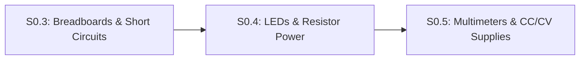

# Lesson S0.4: Diodes, LEDs, Forward Voltage Drop ($V_f$) and Resistor Power Ratings ($P = VI$)

<!-- run-callout:start -->
> **Step 2 of 10 · Circuits and your first microcontroller**
>
> **No workbench entry for this page.** There is nothing to load in Run Python Lessons for it - its code runs in your own Python 3 or on the bench, with no starter file or graded check. The pages that do have one are listed in [Run Python Lessons](https://tle47.github.io/Mechatronics-Roadmap/).
<!-- run-callout:end -->

## Goal
Size a **current-limiting series resistor** ($R = \frac{V_{\text{supply}} - V_f}{I_{\text{target}}}$) to protect a **Light-Emitting Diode (`LED`)** on a $5.0\text{ V}$ supply in Falstad, and calculate **electrical power dissipation** ($P = V \cdot I = I^2 R$) so your resistors never overheat.

- **New ideas (max 2):**
  1. **Diodes, LED polarity, and series current-limiting resistor sizing**: Why a diode only conducts current in one direction (from **Anode `+`** to **Cathode `-`**) with a fixed **forward voltage drop** ($V_f \approx 2.0\text{ V}$ for a red LED), requiring a series resistor $R = \frac{V_{\text{supply}} - V_f}{I_{\text{target}}}$.
  2. **Electrical power dissipation ($P = V \cdot I = I^2 R$) and resistor power ratings**: Computing heat generated in Watts (`W`) or milliwatts (`mW`) and applying a $2\times$ safety margin against a standard quarter-watt ($0.25\text{ W} = 250\text{ mW}$) resistor rating.
- **New syntax:** Falstad LED (`162`) element in circuit netlists.
- **Target time (unmeasured — [log yours](../.github/ISSUE_TEMPLATE/beginner-timing-log.md)):** Typical: 1.5–2.0 hours | Slow-learner: 2.5–3.5 hours

---

## Prerequisites
- [Lesson P.9: Rearranging Physics Formulas & Linear Range Scaling](../track-p/P.9-rearranging-formulas-and-scaling.md)
- [Lesson S0.2: Series vs. Parallel Resistor Networks, Voltage Dividers & Potentiometers](S0.2-series-parallel-and-voltage-dividers.md)
- [Lesson S0.3: Reading Schematics, Breadboards & Short Circuits](S0.3-breadboards-and-short-circuits.md)



---

## Learn

### Idea 1: Diodes, LED polarity, and series current-limiting resistor sizing
- **Primary resource:** [SparkFun — Light-Emitting Diodes (LEDs)](https://learn.sparkfun.com/tutorials/light-emitting-diodes-leds) `[HTTP 200 — Verified by scripts/check_links.py]`
  - **What to read:** Read exact headings **`Introduction`**, **`How to Use Them`**, **`1) Polarity Matters`**, and **`Calculating Current Limiting Resistors`** (sizing the ballast resistor).
  - **What to skip:** Skip **`Types of LEDs`** (RGB, addressable NeoPixels, and IR LEDs).
  - **Key takeaway:** A **diode** is a one-way electrical check valve: current only flows when the **Anode (`+`, longer leg)** is at a higher voltage than the **Cathode (`-`, shorter leg / flat rim)** by at least its **forward voltage** ($V_f \approx 1.8\text{–}2.0\text{ V}$ for red, $\approx 3.0\text{–}3.3\text{ V}$ for blue/white). Once turned on, an **LED** has almost zero internal resistance of its own—connecting it directly across $5.0\text{ V}$ without a series **current-limiting resistor** destroys it instantly!

### Idea 2: Electrical power dissipation ($P = V \cdot I = I^2 R$) and resistor power ratings
- **Primary resource:** [SparkFun — Electric Power](https://learn.sparkfun.com/tutorials/electric-power) `[HTTP 200 — Verified by scripts/check_links.py]`
  - **What to read:** Read exact headings **`What is Electric Power?`**, **`Calculating Power`**, and **`Power Ratings`**.
  - **What to skip:** Skip high-voltage AC transmission line math.
  - **Key takeaway:** **Electrical power** ($P$, measured in **Watts `W`** or **milliwatts `mW`**) is the rate at which electrical energy turns into heat or work: $P = V \cdot I$. Substituting Ohm's Law ($V = I \cdot R$) gives $P = I^2 \cdot R = \frac{V^2}{R}$. Standard breadboard resistors are rated for **$1/4\text{ W}$ ($0.25\text{ W} = 250\text{ mW}$)** maximum heat; engineers always keep continuous resistor dissipation below **$50\%$ of its rating ($\le 125\text{ mW}$)** so it stays cool to the touch.

### Bridge Notes
When a current-limiting resistor $R$ and a red **LED** ($V_f = 2.0\text{ V}$) are wired in **series** across a $V_{\text{supply}} = 5.0\text{ V}$ supply, the same current $I$ flows through both components:
1. Forward-biasing the LED (Anode `+` toward $+5.0\text{ V}$, Cathode `-` flat edge toward `GND`) drops its fixed **forward voltage** $V_f = 2.0\text{ V}$.
2. The remaining supply voltage must drop across the series resistor: $V_R = V_{\text{supply}} - V_f = 5.0\text{ V} - 2.0\text{ V} = 3.0\text{ V}$.
3. Applying Ohm's Law ($R = \frac{V_R}{I_{\text{target}}}$) for a desired safe LED current of $I_{\text{target}} = 15\text{ mA} = 0.015\text{ A}$ gives:

$$
R = \frac{V_{\text{supply}} - V_f}{I_{\text{target}}} = \frac{5.0\text{ V} - 2.0\text{ V}}{0.015\text{ A}} = 200\ \Omega
$$

With a standard $200\ \Omega$ resistor ($I = 15.0\text{ mA}$) or $220\ \Omega$ resistor ($I = \frac{3.0\text{ V}}{220\ \Omega} \approx 13.64\text{ mA}$), we always check the **electrical power** turned into heat inside the resistor:

$$
P_R = V_R \cdot I = I^2 \cdot R = 3.0\text{ V} \times 0.015\text{ A} = 0.045\text{ W} = 45.0\text{ mW}
$$

Because $45.0\text{ mW}$ is well below the $125\text{ mW}$ derated safe limit ($50\%$ of a standard $250\text{ mW}$ / $1/4\text{ W}$ resistor rating), the series resistor runs completely cool!

---

## Do it yourself

- **What is simulated and in which tool:**
  - **In [Falstad Circuit Simulator](https://www.falstad.com/circuit/circuitjs.html) `[verify in-app]`:** Import [`falstad/S0.4-led-resistor.txt`](falstad/S0.4-led-resistor.txt) `[verify in-app]` via `File` $\rightarrow$ `Import From Text...` ($5.0\text{ V}$ source, series resistor, and LED to `GND`). Change the resistor (`TODO 1`) from `220` to `200` Ohms (with LED $V_f = 2.0\text{ V}$) to verify $I = 15.0\text{ mA}$ and $P_R = 45.0\text{ mW}$. *(Automated CI verifies the Falstad netlist and numerical mirror in `tests/test_exercises.py`.)*
- **What is real-hardware only:** Burning a finger on an overloaded $1/4\text{ W}$ resistor or popping a physical LED connected without a series resistor.

### Starter Code (import into Falstad — fill in the TODOs)
Import this Falstad netlist (`File` $\rightarrow$ `Import From Text...`) and complete `TODO 1` by changing the series resistor (`r 160 128 320 128 0 220`) from `220` to `200` Ohms for a $15.0\text{ mA}$ target current at $V_f = 2.0\text{ V}$:

```text
$ 1 0.000005 10.20027730826997 50 5 50 5e-11
v 160 288 160 128 0 0 40 5 0 0 0.5
r 160 128 320 128 0 220
162 320 128 320 288 2 default-led 1 0 0 0.01
w 320 288 160 288 0
g 160 288 160 320 0 0
o 1 64 0 4099 5 0.025 0 2 1 3
```

### Expected Output
Sizing the series resistor for $5.0\text{ V}$ supply, $V_f = 2.0\text{ V}$, and $I = 15.0\text{ mA}$, and checking power dissipation on $200\ \Omega$ ($15\text{ mA}$) vs. $100\ \Omega$ across $12\text{ V}$ ($120\text{ mA}$) gives:

```text
5.0V supply, Vf=2.0V, I=15.0mA -> R = 200.0 ohms | P_R = 45.0 mW (SAFE_QUARTER_WATT)
12.0V across 100 ohms (120mA) -> P_R = 1440.0 mW (OVERHEAT_DANGER)
```

### Hint Ladder

<details>
<summary><strong>Hint 1 (Concept nudge)</strong></summary>

Subtract $V_f = 2.0\text{ V}$ from $V_{\text{supply}} = 5.0\text{ V}$ to get $V_R = 3.0\text{ V}$, then divide by $0.015\text{ A}$ ($15\text{ mA}$) to get $R = 200.0\ \Omega$ and $P_R = (0.015)^2 \times 200 = 0.045\text{ W} = 45.0\text{ mW}$.
</details>

<details>
<summary><strong>Hint 2 (Formula / structure)</strong></summary>

In the Falstad netlist, edit line 3 (`r 160 128 320 128 0 220`) so the resistance value at the end of the line is `200`.
</details>

<details>
<summary><strong>Full Solution</strong></summary>

```text
$ 1 0.000005 10.20027730826997 50 5 50 5e-11
v 160 288 160 128 0 0 40 5 0 0 0.5
r 160 128 320 128 0 200
162 320 128 320 288 2 default-led 1 0 0 0.01
w 320 288 160 288 0
g 160 288 160 320 0 0
o 1 64 0 4099 5 0.025 0 2 1 3
```
</details>

---

## Common mistakes & troubleshooting
- **LED does not light up at all:** Check polarity! If the LED is inserted backward (Cathode `-` toward `+5V`, Anode `+` toward `GND`), it is **reverse-biased** and blocks all current. Flip the LED around.
- **Using $V_{\text{supply}}$ instead of $(V_{\text{supply}} - V_f)$ when computing resistor power:** Only $V_R = V_{\text{supply}} - V_f$ drops across the resistor; the remaining $V_f$ drops across the LED.
- **Putting a $100\ \Omega$ quarter-watt resistor directly across a $12.0\text{ V}$ motor battery:** By $P = V^2 / R = 144 / 100 = 1.44\text{ W}$ ($1{,}440\text{ mW}$), that resistor dissipates nearly $6\times$ its $250\text{ mW}$ rating and will smoke within seconds!

---

## Check yourself

1. **White LED resistor sizing:** A white LED has forward voltage $V_f = 3.2\text{ V}$ and you want $I = 10.0\text{ mA}$ ($0.010\text{ A}$) from a $5.0\text{ V}$ Arduino pin. What resistor value $R$ in Ohms do you need?
   <details>
   <summary><strong>Answer</strong></summary>

   $R = \frac{5.0\text{ V} - 3.2\text{ V}}{0.010\text{ A}} = \frac{1.8\text{ V}}{0.010\text{ A}} = \mathbf{180\ \Omega}$.
   </details>

2. **Reversed diode:** What current flows if you connect a red LED in series with a $220\ \Omega$ resistor, but connect the LED's **Cathode (`-`)** to `+5V` and its **Anode (`+`)** to `GND`?
   <details>
   <summary><strong>Answer</strong></summary>

   **$0.0\text{ mA}$**—the diode is reverse-biased and acts like a closed one-way valve blocking flow.
   </details>

3. **Quarter-watt safety check:** A $1.0\text{ k}\Omega$ ($1{,}000\ \Omega$) resistor has $12.0\text{ V}$ across it ($I = 12.0\text{ mA} = 0.012\text{ A}$). How many milliwatts (`mW`) of heat does it dissipate, and is a $1/4\text{ W}$ ($250\text{ mW}$) resistor safe?
   <details>
   <summary><strong>Answer</strong></summary>

   $P = V \cdot I = 12.0\text{ V} \times 0.012\text{ A} = 0.144\text{ W} = \mathbf{144\text{ mW}}$. While below the absolute $250\text{ mW}$ burn-out limit, it exceeds our $50\%$ derating guideline ($125\text{ mW}$), so it will run noticeably warm (stepping up to a $2.2\text{ k}\Omega$ resistor or a $1/2\text{ W}$ resistor is better practice).
   </details>

---

## Recap
- An **LED** conducts only from **Anode (`+`) to Cathode (`-`)** with forward drop $V_f$, requiring a series resistor $R = \frac{V_{\text{supply}} - V_f}{I_{\text{target}}}$.
- **Electrical power** ($P = V \cdot I = I^2 R$) measures heat dissipation in Watts (`W`); keep continuous dissipation below half of a resistor's power rating ($\le 125\text{ mW}$ for a $1/4\text{ W}$ resistor).

### You're ready to move on when...
- [ ] You tested [`falstad/S0.4-led-resistor.txt`](falstad/S0.4-led-resistor.txt) `[verify in-app]` in Falstad and verified the series LED current.
- [ ] You can size an LED series resistor and check its milliwatt power dissipation.
- **Next lesson:** [Lesson S0.5: Virtual Multimeters (Voltmeter vs. Ammeter) & Current-Limited (`CC/CV`) Power Supplies](S0.5-multimeters-and-current-limited-supplies.md)
