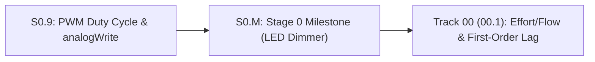

# Lesson S0.M: Stage 0 Milestone — Potentiometer LED Dimmer with Safety Kill-Switch

<!-- run-callout:start -->
> **Step 2 of 10 · Circuits and your first microcontroller**
>
> **No workbench entry for this page.** There is nothing to load in Run Python Lessons for it - its code runs in your own Python 3 or on the bench, with no starter file or graded check. The pages that do have one are listed in [Run Python Lessons](https://tle47.github.io/Mechatronics-Roadmap/).
<!-- run-callout:end -->

## Goal
Build and verify a complete **Sense $\rightarrow$ Decide $\rightarrow$ Act** embedded system on the Arduino Uno (`5.0 V`) in Wokwi that reads a potentiometer on `A0` (`0..1023`), checks an active-low safety kill-switch button on `Pin 2` (`INPUT_PULLUP`), drives an LED on `Pin 9` with 8-bit PWM (`0..255`), and logs live telemetry to the Serial Monitor.

- **New ideas (max 2):**
  1. **Hardware-software safety override loop (Sense $\rightarrow$ Decide $\rightarrow$ Act)**: Combining continuous analog sensing (`analogRead(A0)`), highest-priority digital kill-switch gating (`digitalRead(2) == LOW`), and scaled PWM output (`analogWrite(9, pwm_val)`) in a single loop.
- **New syntax:** Integer scaling `adc_raw / 4` in C/C++ (`0..1023` $\rightarrow$ `0..255`).
- **Target time (unmeasured — [log yours](../.github/ISSUE_TEMPLATE/beginner-timing-log.md)):** Typical: 1.0–1.5 hours | Slow-learner: 2.0–2.5 hours

---

## Prerequisites
- All Stage 0 lessons: [S0.1](S0.1-closed-circuits-and-ohms-law.md), [S0.2](S0.2-series-parallel-and-voltage-dividers.md), [S0.3](S0.3-breadboards-and-short-circuits.md), [S0.4](S0.4-leds-and-resistor-power.md), [S0.5](S0.5-multimeters-and-current-limited-supplies.md), [S0.6](S0.6-capacitors-and-decoupling.md), [S0.7](S0.7-arduino-uno-digital-io-and-pullups.md), [S0.8](S0.8-adc-analog-read-and-serial-monitor.md), and [S0.9](S0.9-pwm-duty-cycle-and-analog-write.md).



---

## Learn

### Idea 1: Hardware-software safety override loop (Sense -> Decide -> Act)
- **Primary resource:** [Wokwi Docs — `wokwi-arduino-uno` Reference](https://docs.wokwi.com/parts/wokwi-arduino-uno) `[HTTP 200 — Verified by scripts/check_links.py]`
  - **What to read:** Review exact heading **`Pin names`** (`A0`, `2`, `9`, `5V`, `GND`).
  - **What to skip:** No new external reading required—this milestone combines Lessons `S0.7`, `S0.8`, and `S0.9`.
  - **Key takeaway:** Every real mechatronic controller follows the same three-stage cycle on every tick: **Sense** (read the potentiometer on `A0` and the kill-switch on `Pin 2`), **Decide** (if the kill-switch is pressed, force output to `0`; otherwise scale `0..1023` down to `0..255`), and **Act & Report** (write `pwm_val` to `Pin 9` and print telemetry to the Serial Monitor).
  - **Alternative resource:** [Wokwi Docs — `wokwi-potentiometer` Reference](https://docs.wokwi.com/parts/wokwi-potentiometer) `[HTTP 200 — Verified by scripts/check_links.py]` — Review exact heading **`Pin names`** (`GND`, `SIG`, `VCC`).

### Bridge Notes
In this **Stage 0 Milestone**, you will wire three components to an **Arduino Uno (`5.0 V`)** in Wokwi:
1. **Potentiometer (`wokwi-potentiometer`) on `A0`:** `VCC` $\rightarrow$ `5V`, `GND` $\rightarrow$ `GND`, center wiper `SIG` $\rightarrow$ `A0`. Turning the knob sweeps `analogRead(A0)` from `0` ($0.0\text{ V}$) to `1023` ($5.0\text{ V}$).
2. **Safety Kill-Switch Pushbutton (`wokwi-pushbutton`) on `Pin 2`:** Configured with `pinMode(2, INPUT_PULLUP);` and wired between `Pin 2` and `GND`. When released, `digitalRead(2)` is `HIGH` (`1`). When pressed and held, `digitalRead(2)` is `LOW` (`0`).
3. **PWM Dimmer LED (`wokwi-led` + `220 Ω` `wokwi-resistor`) on `Pin 9`:** `Pin 9` $\rightarrow$ `220 Ω` resistor $\rightarrow$ LED Anode (`A`), and LED Cathode (`C`) $\rightarrow$ `GND`.

In every pass, your `compute_milestone_pwm(adc_raw, button_pin)` function checks the safety switch **first**: if `button_pin == LOW`, `pwm_val` is forced to `0` regardless of where the potentiometer knob sits! Otherwise, `pwm_val` is set to `adc_raw / 4` (`0..255`).

---

## Do it yourself

- **What is simulated and in which tool:**
  1. **5-Minute Falstad "See It Without Code" Twin (Falstad Before Arduino):** Before running the Arduino sketch, open [Falstad Circuit Simulator](https://www.falstad.com/circuit/circuitjs.html) `[verify in-app]` and inspect [`falstad/S0.2-voltage-divider.txt`](falstad/S0.2-voltage-divider.txt) `[verify in-app]` (potentiometer voltage divider) and [`falstad/S0.9-pwm-scope.txt`](falstad/S0.9-pwm-scope.txt) `[verify in-app]` (PWM duty-cycle wave feeding an LED + ballast resistor) so you see both analog halves of the milestone without code first.
  2. **Full interactive circuit & firmware in [Wokwi Arduino Uno Simulator](https://wokwi.com/projects/new/arduino-uno) `[verify in-app]`:** Build the 3-part circuit described above (`wokwi-potentiometer` on `A0`, `wokwi-pushbutton` between `Pin 2` and `GND`, and `220 Ω` resistor + `wokwi-led` on `Pin 9`), paste the Starter Code below, complete `TODO 1` and `TODO 2`, start the simulation, and verify that the 4 startup self-test lines in the Serial Monitor match the **Expected Output** below. *(Automated CI compiles this sketch for `arduino:avr:uno` via `arduino-cli`.)*
- **What is real-hardware only:** Physical breadboard jumper wire resistance and mechanical button contact bounce.

### Starter Code (runs as-is in Wokwi — fill in the TODOs)
Complete `compute_milestone_pwm` (`TODO 1` and `TODO 2`) in your Wokwi Arduino Uno sketch so the startup self-test verifies all 4 test cases (`[0, HIGH]`, `[512, HIGH]`, `[1023, HIGH]`, and `[1023, LOW]` with kill-switch pressed) and `loop()` runs the live dimmer:

```cpp
int compute_milestone_pwm(int adc_raw, int button_pin) {
  // TODO 1: the safe output when the kill-switch is pressed, before any other case

  // TODO 2: the PWM command for a live reading, from stopped to full duty
  return -1;
}

void print_milestone_case(int adc_raw, int button_pin) {
  int pwm_val = compute_milestone_pwm(adc_raw, button_pin);
  float v_avg = (pwm_val / 255.0) * 5.0;
  Serial.print("adc_raw:");
  Serial.print(adc_raw);
  Serial.print(" | btn:");
  Serial.print(button_pin == LOW ? "LOW(pressed)" : "HIGH(open)");
  Serial.print(" -> pwm_val:");
  Serial.print(pwm_val);
  Serial.print(" | V_avg:");
  Serial.print(v_avg, 2);
  Serial.println(" V");
}

void setup() {
  pinMode(2, INPUT_PULLUP); // Active-low safety mute button (LOW = pressed)
  pinMode(9, OUTPUT);       // PWM LED output on ~Pin 9
  Serial.begin(9600);

  // Startup self-verification across 4 reference scenarios:
  print_milestone_case(0, HIGH);
  print_milestone_case(512, HIGH);
  print_milestone_case(1023, HIGH);
  print_milestone_case(1023, LOW); // Knob at 100%, but kill-switch PRESSED!
}

void loop() {
  int adc_raw = analogRead(A0);
  int button_pin = digitalRead(2);
  int pwm_val = compute_milestone_pwm(adc_raw, button_pin);
  analogWrite(9, pwm_val);
  delay(100);
}
```

### Expected Output
When `TODO 1` and `TODO 2` are completed and you run the simulation in Wokwi, the Serial Monitor prints:

```text
adc_raw:0 | btn:HIGH(open) -> pwm_val:0 | V_avg:0.00 V
adc_raw:512 | btn:HIGH(open) -> pwm_val:128 | V_avg:2.51 V
adc_raw:1023 | btn:HIGH(open) -> pwm_val:255 | V_avg:5.00 V
adc_raw:1023 | btn:LOW(pressed) -> pwm_val:0 | V_avg:0.00 V
```

### Hint Ladder

<details>
<summary><strong>Hint 1 (Concept nudge)</strong></summary>

Check `if (button_pin == LOW)` first so that a pressed kill-switch always returns `0` even when `adc_raw` is `1023`. In C/C++, dividing two `int` values with `adc_raw / 4` performs integer floor division (`1023 / 4 == 255`).
</details>

<details>
<summary><strong>Hint 2 (Formula / structure)</strong></summary>

```cpp
int compute_milestone_pwm(int adc_raw, int button_pin) {
  if (button_pin == LOW) {
    return 0;
  }
  if (adc_raw < 0) {
    adc_raw = 0;
  } else if (adc_raw > 1023) {
    adc_raw = 1023;
  }
  return adc_raw / 4;
}
```
</details>

<details>
<summary><strong>Full Solution</strong></summary>

```cpp
int compute_milestone_pwm(int adc_raw, int button_pin) {
  if (button_pin == LOW) {
    return 0;
  }
  if (adc_raw < 0) {
    adc_raw = 0;
  } else if (adc_raw > 1023) {
    adc_raw = 1023;
  }
  return adc_raw / 4;
}

void print_milestone_case(int adc_raw, int button_pin) {
  int pwm_val = compute_milestone_pwm(adc_raw, button_pin);
  float v_avg = (pwm_val / 255.0) * 5.0;
  Serial.print("adc_raw:");
  Serial.print(adc_raw);
  Serial.print(" | btn:");
  Serial.print(button_pin == LOW ? "LOW(pressed)" : "HIGH(open)");
  Serial.print(" -> pwm_val:");
  Serial.print(pwm_val);
  Serial.print(" | V_avg:");
  Serial.print(v_avg, 2);
  Serial.println(" V");
}

void setup() {
  pinMode(2, INPUT_PULLUP);
  pinMode(9, OUTPUT);
  Serial.begin(9600);

  print_milestone_case(0, HIGH);
  print_milestone_case(512, HIGH);
  print_milestone_case(1023, HIGH);
  print_milestone_case(1023, LOW);
}

void loop() {
  int adc_raw = analogRead(A0);
  int button_pin = digitalRead(2);
  int pwm_val = compute_milestone_pwm(adc_raw, button_pin);
  analogWrite(9, pwm_val);
  delay(100);
}
```
</details>

---

## Common mistakes & troubleshooting
- **Potentiometer outer pins wired to `A0` instead of the middle wiper pin (`SIG`):** If you wire `SIG` to `5V` and one outer pin to `A0`, turning the knob will not divide the voltage! Always wire the two outer pins to `5V` and `GND`, and the **middle pin (`SIG`)** to `A0`.
- **Kill-switch works backward (LED only turns on when button is held):** You wrote `if (button_pin == HIGH) { return 0; }` instead of `if (button_pin == LOW) { return 0; }`. Remember: with `INPUT_PULLUP`, pressing the button connects the pin to `GND` (`LOW`).

---

## Check yourself

1. **Tracing the safety override:** Suppose the potentiometer knob is turned to `75%` (`adc_raw = 768`) and the user presses and holds the pushbutton on `Pin 2`. What values do `digitalRead(2)` and `pwm_val` take?
   <details>
   <summary><strong>Answer</strong></summary>

   `digitalRead(2)` returns **`LOW` (`0`)**, and the `if (button_pin == LOW)` safety check overrides the knob and sets `pwm_val` to **`0`**, turning the LED completely off.
   </details>

2. **LED current at 50% PWM:** When `adc_raw = 512` (`pwm_val = 128`, $\approx 50\%$ duty cycle) with a red LED ($V_f = 2.0\text{ V}$) and a $220\ \Omega$ series resistor on `Pin 9`, what is the current during the `HIGH` half of each pulse, what is the current during the `LOW` half, and what is the average LED current?
   <details>
   <summary><strong>Answer</strong></summary>

   - During the `HIGH` ($5.0\text{ V}$) half: $I_{\text{on}} = \frac{5.0 - 2.0}{220} \approx \mathbf{13.64\text{ mA}}$.
   - During the `LOW` ($0.0\text{ V}$) half: $I_{\text{off}} = \mathbf{0.0\text{ mA}}$.
   - Average current over the full cycle: $13.64\text{ mA} \times \frac{128}{255} \approx \mathbf{6.85\text{ mA}}$.
   </details>

3. **Why check the safety switch before writing the output?** What would happen if your code called `analogWrite(9, adc_raw / 4);` at the top of `loop()` and only checked `if (button_pin == LOW) { analogWrite(9, 0); }` after a `delay(100);`?
   <details>
   <summary><strong>Answer</strong></summary>

   Even while the emergency mute button was held down, the output pin would still turn ON for `100 ms` on every single loop iteration! Always compute the safe command first and call `analogWrite` once after all safety checks have run.
   </details>

---

## Recap
- You built and verified a complete **Stage 0 Arduino Uno (`5.0 V`)** system combining a 10-bit analog sensor (`A0`), an active-low safety switch (`D2` with `INPUT_PULLUP`), an 8-bit PWM actuator output (`~D9`), and live `9600 baud` Serial Monitor telemetry.

### You're done with Stage 0 when...
- [ ] Your Wokwi sketch prints the exact 4 expected lines in the Serial Monitor.
- [ ] Turning the potentiometer in Wokwi smoothly sweeps LED brightness, and holding the pushbutton on `Pin 2` immediately forces the LED off.

<!-- next-step:start -->
👉 **Next:** [Step 3 · Make a joint move: foundations — Lesson 00.1: Cross-Domain Power (P = Effort * Flow) and First-Order Lag](../00-foundations/00.1-effort-flow-and-first-order-lag.md)
<!-- next-step:end -->
