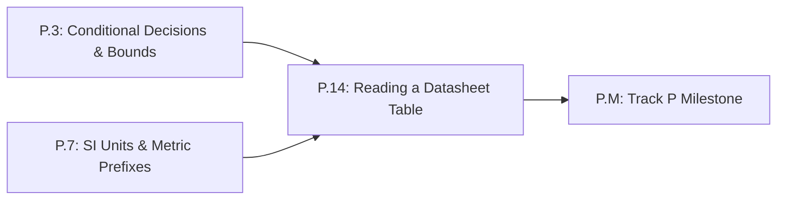

# Lesson P.14: Reading a Datasheet Table — Unit Columns, Min/Typ/Max & Safe Operating Bounds

<!-- run-callout:start -->
> **Step 1 of 10 · Python and the maths a robot needs**
>
> **Run this in the workbench.** [Open MechaLab with `P.14` loaded](https://tle47.github.io/Mechatronics-Roadmap/?lesson=P.14) - it opens on the **Run Python Lessons** tab with that entry selected. Starter code, hints and the graded check are ready; this page is the reading copy, and nothing you type here is saved.
<!-- run-callout:end -->

## Goal
Read a real hardware **datasheet specification table** (`DRV8833` vs. `TB6612FNG` motor driver ICs) by checking the **Unit** column for metric prefixes (`mV`, `mA`, `kHz`) and distinguishing **Recommended Operating Conditions (`Min` / `Typ` / `Max`)** from destructive **Absolute Maximum Ratings**.

- **New ideas (max 2):**
  1. **Reading datasheet specification tables and unit columns**: Locating the parameter symbol (`VM`, `IOUT`, `fPWM`), reading the **Unit** column (`V`, `mA`, `kHz`), and converting prefixed table entries into base SI units (`Lesson P.7`).
  2. **Recommended operating bounds (`Min`/`Typ`/`Max`) versus Absolute Maximum Ratings**: Why a part must always be operated inside its **Recommended Operating Range** (for example, `DRV8833` `VM = 2.7 V to 10.8 V`) and why running at or near the **Absolute Maximum Rating (`11.8 V`)** on a `12.0 V` battery rail risks permanent silicon damage (requiring a higher-rated part such as `TB6612FNG` at `4.5 V to 13.5 V`).
- **New syntax:** Python dictionaries (`{"min": 2.7, "max": 10.8}`) for structured datasheet lookup tables.
- **Target time (unmeasured — [log yours](../.github/ISSUE_TEMPLATE/beginner-timing-log.md)):** Typical: 0.75–1.0 hours | Slow-learner: 1.5–2.0 hours

---

## Prerequisites
- [Lesson P.3: Conditional Decisions (`if/elif/else`) & Command Clamping](P.3-decisions-and-clamping.md)
- [Lesson P.7: Base SI Units & Metric Prefixes (`M`, `k`, `m`, `µ`)](P.7-si-units-and-metric-prefixes.md)



---

## Learn

<!-- figure: datasheet-window | Min, typ and max are a band the part has to stay inside, not three unrelated numbers. -->


### Idea 1: Reading datasheet specification tables and unit columns
- **Primary resource:** [SparkFun Tutorials — How to Read a Schematic & Datasheet Basics](https://learn.sparkfun.com/tutorials/how-to-read-a-schematic/all) `[HTTP 200 — Verified by scripts/check_links.py]`
  - **What to read:** Read exact headings **`Overview`** and **`Name Designators and Values`**.
  - **What to skip:** Skip PCB net-class routing details.
  - **Key takeaway:** Every electronic component datasheet contains two core specification tables near the front: **Absolute Maximum Ratings** and **Recommended Operating Conditions**. Each row lists a **Parameter**, a **Symbol** (`VM`, `IOUT`), three numerical columns (**`Min`**, **`Typ`**, **`Max`**), and a **Unit** column (`V`, `mA`, `kHz`, `°C`). Always check the **Unit** column before using a number—a quiescent draw of `2.5` in a `mA` column is $0.0025\text{ A}$, not $2.5\text{ A}$!
  - **Alternative resource:** [Wikipedia — Datasheet ("Characteristics of an electronic datasheet")](https://en.wikipedia.org/wiki/Datasheet) `[HTTP 200 — Verified by scripts/check_links.py]` — Read the exact heading **`Product datasheet information`**.

### Idea 2: Recommended operating bounds (Min/Typ/Max) versus Absolute Maximum Ratings
- **Primary resource:** [Wikipedia — Safe operating area](https://en.wikipedia.org/wiki/Safe_operating_area) `[HTTP 200 — Verified by scripts/check_links.py]`
  - **What to read:** Read the lead section, which defines the electrical operating envelope a part survives without self-damage, and the exact heading **`Limits of the safe operating area`** — the same boundary an **Absolute Maximum Rating (`AMR`)** marks, well outside the **Recommended Operating Conditions (`ROC`)** you must design inside.
  - **What to skip:** Skip military MIL-STD qualification tables.
  - **Key takeaway:** **Absolute Maximum Ratings** are the stress threshold beyond which permanent physical destruction occurs; manufacturers explicitly state that reliable operation is *not* implied at those limits. Your design must stay strictly inside the **Recommended Operating Conditions (`Min` $\le x \le$ `Max`)** with safety margin:

| Driver IC | Parameter (`Symbol`) | Abs. Max Rating | Recommended `Min` | Recommended `Typ` | Recommended `Max` | Unit | Safe on $12.0\text{ V}$ Supply? |
| :--- | :--- | :---: | :---: | :---: | :---: | :---: | :--- |
| **`DRV8833`** | Motor Supply (`VM`) | $11.8$ | $2.7$ | $6.0\text{–}9.0$ | $10.8$ | `V` | **NO** ($12.0\text{ V} > 10.8\text{ V}$ max!) |
| **`TB6612FNG`** | Motor Supply (`VM`) | $15.0$ | $4.5$ | $12.0$ | $13.5$ | `V` | **YES** ($4.5 \le 12.0 \le 13.5\text{ V}$) |

### Bridge Notes
Before wiring any part in Stage 0 or Pass 1, you must read its datasheet specification table without falling for the two classic beginner traps:
1. **Trap 1 — Confusing Absolute Maximum Ratings with Recommended Operating Conditions:** Suppose you want to drive a motor from a $12.0\text{ V}$ supply rail. Looking at the **`DRV8833`** datasheet table above, its **Recommended Operating Conditions** specify `Min = 2.7 V` and `Max = 10.8 V`, while its **Absolute Maximum Rating** is `11.8 V`. Connecting a $12.0\text{ V}$ supply exceeds both the $10.8\text{ V}$ operating bound and the $11.8\text{ V}$ destruction limit! For a $6.0\text{–}9.0\text{ V}$ bench supply, `DRV8833` is ideal; for a $12.0\text{ V}$ supply, reading the table tells you to select **`TB6612FNG`** (`Recommended Min = 4.5 V`, `Max = 13.5 V`, `Abs Max = 15.0 V`).
2. **Trap 2 — Ignoring the Unit Column:** A datasheet row often reports standby draw as `Typ = 1.8`, `Max = 3.0` with `Unit = mA`, or logic timing as `Typ = 250` with `Unit = ns` or `µs`. Always convert the table value using the **Unit** column (`mA` $\to \times 10^{-3}\text{ A}$, `kHz` $\to \times 10^3\text{ Hz}$) before comparing or multiplying in Python.

---

## Do it yourself

- **What is simulated and in which tool:** Runs 100% in Python (zero-install in the MechaLab Browser Runner or locally via `python3`).
- **What is real-hardware only:** Nothing in this lesson requires hardware.

### Starter Code (runs as-is — fill in the TODOs)
Complete `is_within_recommended_bounds` (`TODO 1`), `select_safe_driver` (`TODO 2`), and `datasheet_val_to_base_si` (`TODO 3`):

```python
DATASHEET_DRIVERS = {
    "DRV8833": {"vm_min_v": 2.7, "vm_max_v": 10.8, "vm_abs_max_v": 11.8, "i_cont_ma": 1500.0},
    "TB6612FNG": {"vm_min_v": 4.5, "vm_max_v": 13.5, "vm_abs_max_v": 15.0, "i_cont_ma": 1200.0},
}


def is_within_recommended_bounds(val, min_val, max_val):
    # TODO 1: True when the value sits inside the recommended band, inclusive at both ends.
    return False


def select_safe_driver(supply_v):
    # TODO 2: The drivers whose recommended operating range covers the supply safely: their
    #         names from the table above, in the order the table lists them.
    safe = []
    return safe


def datasheet_val_to_base_si(value, unit_str):
    # TODO 3: the figure in base SI units, read with its unit column
    return 0.0


drv_6v = select_safe_driver(6.0)
drv_12v = select_safe_driver(12.0)
i_cont_a = datasheet_val_to_base_si(DATASHEET_DRIVERS["DRV8833"]["i_cont_ma"], "mA")
f_pwm_hz = datasheet_val_to_base_si(25.0, "kHz")

print(f"Safe at 6.0 V: {drv_6v} | Safe at 12.0 V: {drv_12v}")
print(f"DRV8833 I_cont = {i_cont_a:.2f} A | f_PWM = {f_pwm_hz:.0f} Hz")
```

### Expected Output
When `TODO 1`, `TODO 2`, and `TODO 3` are completed, running the script prints:

```text
Safe at 6.0 V: ['DRV8833', 'TB6612FNG'] | Safe at 12.0 V: ['TB6612FNG']
DRV8833 I_cont = 1.50 A | f_PWM = 25000 Hz
```

### Hint Ladder

<details>
<summary><strong>Hint 1 (Concept nudge)</strong></summary>

In `TODO 1`, check `min_val <= val <= max_val`. In `TODO 2`, loop over `["DRV8833", "TB6612FNG"]`, look up `spec = DATASHEET_DRIVERS[name]`, and call `is_within_recommended_bounds(supply_v, spec["vm_min_v"], spec["vm_max_v"])`. In `TODO 3`, multiply by `1e-3` for milli-units (`"mA"`, `"mV"`, `"ms"`) and `1e3` for `"kHz"`.
</details>

<details>
<summary><strong>Hint 2 (Formula / structure)</strong></summary>

```python
def is_within_recommended_bounds(val, min_val, max_val):
    return min_val <= val <= max_val


def select_safe_driver(supply_v):
    safe = []
    for name in ["DRV8833", "TB6612FNG"]:
        spec = DATASHEET_DRIVERS[name]
        if is_within_recommended_bounds(supply_v, spec["vm_min_v"], spec["vm_max_v"]):
            safe.append(name)
    return safe
```
</details>

<details>
<summary><strong>Full Solution</strong></summary>

```python
DATASHEET_DRIVERS = {
    "DRV8833": {"vm_min_v": 2.7, "vm_max_v": 10.8, "vm_abs_max_v": 11.8, "i_cont_ma": 1500.0},
    "TB6612FNG": {"vm_min_v": 4.5, "vm_max_v": 13.5, "vm_abs_max_v": 15.0, "i_cont_ma": 1200.0},
}


def is_within_recommended_bounds(val, min_val, max_val):
    return min_val <= val <= max_val


def select_safe_driver(supply_v):
    safe = []
    for name in ["DRV8833", "TB6612FNG"]:
        spec = DATASHEET_DRIVERS[name]
        if is_within_recommended_bounds(supply_v, spec["vm_min_v"], spec["vm_max_v"]):
            safe.append(name)
    return safe


def datasheet_val_to_base_si(value, unit_str):
    if unit_str in ("mA", "mV", "ms"):
        return value * 1e-3
    if unit_str == "kHz":
        return value * 1e3
    return float(value)


drv_6v = select_safe_driver(6.0)
drv_12v = select_safe_driver(12.0)
i_cont_a = datasheet_val_to_base_si(DATASHEET_DRIVERS["DRV8833"]["i_cont_ma"], "mA")
f_pwm_hz = datasheet_val_to_base_si(25.0, "kHz")

print(f"Safe at 6.0 V: {drv_6v} | Safe at 12.0 V: {drv_12v}")
print(f"DRV8833 I_cont = {i_cont_a:.2f} A | f_PWM = {f_pwm_hz:.0f} Hz")
assert drv_6v == ["DRV8833", "TB6612FNG"]
assert drv_12v == ["TB6612FNG"]
assert abs(i_cont_a - 1.50) < 1e-9
```
</details>

---

## Common mistakes & troubleshooting
- **Treating `Absolute Maximum Rating` as a normal operating point:** Running a `DRV8833` at $11.5\text{ V}$ or $12.0\text{ V}$ because its Absolute Maximum is $11.8\text{ V}$ leaves zero headroom for supply spikes and destroys the IC; always design strictly inside `Recommended Operating Conditions` (`2.7 V` to `10.8 V`).
- **Missing the `mA` or `µA` prefix in the `Unit` column:** Reading `1500` in a `mA` column as $1500\text{ A}$ instead of $1.50\text{ A}$ causes a $1000\times$ sizing error.

---

## Check yourself
1. **Why is `DRV8833` unsafe on a $12.0\text{ V}$ supply rail even though $12.0\text{ V}$ is close to $11.8\text{ V}$?**
   <details>
   <summary><strong>Answer 1</strong></summary>
   Because $10.8\text{ V}$ is the maximum recommended operating bound and $11.8\text{ V}$ is the destructive Absolute Maximum Rating. At $12.0\text{ V}$, use `TB6612FNG` (`4.5–13.5 V` recommended operating range).
   </details>
2. **A sensor datasheet lists `Supply Draw: Typ = 4.2, Max = 6.0, Unit = mA`. Which number and base SI value should you use when sizing your supply budget?**
   <details>
   <summary><strong>Answer 2</strong></summary>
   Always budget for worst-case `Max = 6.0 mA`, converted to base SI units as $6.0 \times 10^{-3} = 0.006\text{ A}$.
   </details>

---

## Recap
- [ ] I can read `Min`, `Typ`, `Max`, and `Unit` columns in a component datasheet table and convert prefixed entries to base SI units.
- [ ] I can distinguish **Recommended Operating Conditions** from **Absolute Maximum Ratings** and verify why `DRV8833` (`2.7–10.8 V`) is for $6\text{–}9\text{ V}$ rails while `TB6612FNG` (`4.5–13.5 V`) covers $12\text{ V}$.

<!-- next-step:start -->
👉 **Next:** [Step 1 · Python and the maths a robot needs — Lesson P.15: The Analysis Workflow — Given, Unknown, Model, Compute, Check, Answer](P.15-analysis-workflow-given-unknown-model-check-answer.md)
<!-- next-step:end -->
