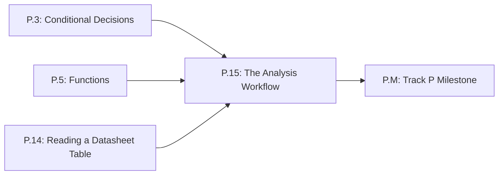

# Lesson P.15: The Analysis Workflow — Given, Unknown, Model, Compute, Check, Answer

<!-- run-callout:start -->
> **Step 1 of 10 · Python and the maths a robot needs**
>
> **Run this in the workbench.** [Open MechaLab with `P.15` loaded](https://tle47.github.io/Mechatronics-Roadmap/?lesson=P.15) - it opens on the **Run Python Lessons** tab with that entry selected. Starter code, hints and the graded check are ready; this page is the reading copy, and nothing you type here is saved.
<!-- run-callout:end -->

## Goal
Turn a word problem into an ordered **analysis workflow** — state what is **given**, name the **unknown**, choose the **model**, **compute**, **check** the result against its unit and its limits, then write the **answer** — and build the same six steps as a small Python program you can reuse.

- **New ideas (max 2):**
  1. **Ordering an analysis: Given, Unknown, Model, Compute, Check, Answer**: Writing the six steps in order, each in its own function, so the number you compute is never mistaken for the answer you give.
  2. **Checking an answer against units, bounds, and the driver limit before trusting it**: Comparing a computed value with its unit and with the hardware limit it must respect, and routing an out-of-bounds result to a clamped answer that names the problem.
- **New syntax:** None — the workflow uses functions, f-strings, and `if / else` from Lessons P.3 and P.5.
- **Target time (unmeasured — [log yours](../.github/ISSUE_TEMPLATE/beginner-timing-log.md)):** Typical: 0.75–1.0 hours | Slow-learner: 1.5–2.0 hours

---

## Prerequisites
- [Lesson P.3: Conditional Decisions (`if/elif/else`) & Command Clamping](P.3-decisions-and-clamping.md)
- [Lesson P.5: Functions & `while` Loops](P.5-functions-and-while-loops.md)
- [Lesson P.14: Reading a Datasheet Table — Min/Typ/Max & Safe Operating Bounds](P.14-reading-a-datasheet-table.md)



---

## Learn

<!-- figure: workflow | Six named steps, in order: the same list the Workflow tab in the editor draws. -->

### Idea 1: Ordering an analysis: Given, Unknown, Model, Compute, Check, Answer
- **Primary resource:** [The Physics Classroom — Drawing Free-Body Diagrams](https://www.physicsclassroom.com/class/newtlaws/Lesson-2/Drawing-Free-Body-Diagrams) `[HTTP 200 — Verified by scripts/check_links.py]`
  - **What to read:** Read the exact heading **`Drawing Free-Body Diagrams`**; the page names every force on the object before it draws a single arrow, which is the habit this lesson borrows: name every quantity before choosing a formula.
  - **What to skip:** Skip the practice problems; you are borrowing the habit of naming every known quantity before writing a formula, not the drawing technique.
  - **Key takeaway:** A problem you can state is half solved. Write the **given** quantities with their units (`supply = 12.0 V`, `winding = 2.4 ohm`, `driver limit = 3.2 A`), name the one **unknown** (`the draw`), and only then choose the **model** that connects them. The order matters because the model is chosen by the unknown, not by whichever formula you remember first.
  - **Alternative resource:** [MathsIsFun — Order of Operations](https://www.mathsisfun.com/operation-order-pemdas.html) `[HTTP 200 — Verified by scripts/check_links.py]` — Review the exact heading **`Order of Operations`**; a workflow is the same idea applied to reasoning instead of arithmetic.

### Idea 2: Checking an answer against units, bounds, and the driver limit before trusting it
- **Primary resource:** [Math is Fun — Metric System of Measurement](https://www.mathsisfun.com/measure/metric-system.html) `[HTTP 200 — Verified by scripts/check_links.py]`
  - **What to read:** Read the exact headings **`The Metric System`** and **`Units of Measurement`**.
  - **What to skip:** Skip the history of the metre.
  - **Key takeaway:** A computed number is not an answer until it carries a **unit** and fits the **bounds** of the real part. A 12 V supply across a 2.4 ohm winding gives $12.0 / 2.4 = 5.0$ **A**; the driver in this lesson passes 3.2 A continuously, so 5.0 A is a **fault**, not a result. The check step is what turns that fault into a decision: clamp the answer to 3.2 A and say which part is the limit.
  - **Alternative resource:** [SparkFun — How to Read a Datasheet](https://learn.sparkfun.com/tutorials/how-to-read-a-schematic/all) `[HTTP 200 — Verified by scripts/check_links.py]` — Review the exact heading **`Name Designators and Values`**; the `Min`/`Max` columns are the bounds your check step reads.

### Bridge Notes
Two engineers can compute the same number and only one of them produces a usable answer. The difference is not arithmetic; it is order. The workflow makes the order visible. Start with the **given** list and write every value with its unit, because a number without a unit cannot be checked later. Name the **unknown** next: it decides which **model** you are allowed to use. Then **compute** without dressing the result up as a conclusion. The **check** step asks the question arithmetic cannot: is this value inside the **bounds** of the part, and does its unit match what the answer needs? At 12 V across 2.4 ohm the computed value is 5.0 A, while the driver passes 3.2 A — so the workflow takes the failure **branch**, clamps the result, and writes an **answer** that names the limit instead of hiding it. That last step, writing the answer after the check rather than before it, is the whole habit this lesson teaches.

---

## Do it yourself

- **What is simulated and in which tool:** Runs 100% in Python (zero-install in the MechaLab Browser Runner or locally via `python3`).
- **What is real-hardware only:** Nothing in this lesson requires hardware.

### Starter Code (runs as-is — fill in the TODOs)
Complete `winding_draw` (`TODO 1`), `check_against_limit` (`TODO 2`), and `answer_line` (`TODO 3`). Each function is one step of the workflow, so fill them in order:

```python
SUPPLY_V = 12.0
WINDING_OHM = 2.4
DRIVER_LIMIT_A = 3.2


def winding_draw(supply_v, winding_ohm):
    # TODO 1: the Model step, one division. Use the parameters, not the numbers.
    return 0.0


def check_against_limit(draw_a, limit_a):
    # TODO 2: the Check step. Return (ok, passable): the draw itself when it is inside the
    # limit, and the limit when it is not.
    return (False, 0.0)


def answer_line(draw_a, limit_a, ok, passable_a):
    # TODO 3: the Answer step. Name the value and its unit; when it was clamped, say so and
    # say what the winding would have drawn.
    return "TODO"


planned_draw = winding_draw(SUPPLY_V, WINDING_OHM)
ok, passable = check_against_limit(planned_draw, DRIVER_LIMIT_A)

print(f"Model: draw = supply / winding = {SUPPLY_V:.1f} V / {WINDING_OHM:.1f} ohm")
print(f"Computed: {planned_draw:.2f} A")
print(answer_line(planned_draw, DRIVER_LIMIT_A, ok, passable))
```

### Expected Output
When all three TODOs are completed, running the script prints:

```text
Model: draw = supply / winding = 12.0 V / 2.4 ohm
Computed: 5.00 A
Answer: 3.20 A, clamped to the 3.20 A driver limit (the winding would draw 5.00 A)
```

### Hint Ladder

<details>
<summary><strong>Hint 1 (Concept nudge)</strong></summary>

`winding_draw` is the model `supply / winding`. `check_against_limit` compares `draw_a <= limit_a` and returns `(True, draw_a)` when the draw fits, `(False, limit_a)` when it does not. `answer_line` prints `passable_a` in both cases, and adds the clamped explanation only when `ok` is `False`.
</details>

<details>
<summary><strong>Hint 2 (Formula / structure)</strong></summary>

```python
def check_against_limit(draw_a, limit_a):
    if draw_a <= limit_a:
        return (True, draw_a)
    return (False, limit_a)


def answer_line(draw_a, limit_a, ok, passable_a):
    if ok:
        return f"Answer: {passable_a:.2f} A, inside the {limit_a:.2f} A driver limit"
    return (
        f"Answer: {passable_a:.2f} A, clamped to the {limit_a:.2f} A driver limit "
        f"(the winding would draw {draw_a:.2f} A)"
    )
```
</details>

<details>
<summary><strong>Full Solution</strong></summary>

```python
SUPPLY_V = 12.0
WINDING_OHM = 2.4
DRIVER_LIMIT_A = 3.2


def winding_draw(supply_v, winding_ohm):
    return supply_v / winding_ohm


def check_against_limit(draw_a, limit_a):
    if draw_a <= limit_a:
        return (True, draw_a)
    return (False, limit_a)


def answer_line(draw_a, limit_a, ok, passable_a):
    if ok:
        return f"Answer: {passable_a:.2f} A, inside the {limit_a:.2f} A driver limit"
    return (
        f"Answer: {passable_a:.2f} A, clamped to the {limit_a:.2f} A driver limit "
        f"(the winding would draw {draw_a:.2f} A)"
    )


planned_draw = winding_draw(SUPPLY_V, WINDING_OHM)
ok, passable = check_against_limit(planned_draw, DRIVER_LIMIT_A)

print(f"Model: draw = supply / winding = {SUPPLY_V:.1f} V / {WINDING_OHM:.1f} ohm")
print(f"Computed: {planned_draw:.2f} A")
print(answer_line(planned_draw, DRIVER_LIMIT_A, ok, passable))
```
</details>

---

## Common mistakes & troubleshooting
- **Writing the answer before the check:** Printing `5.00 A` because the division was correct skips the only step that knows about the 3.2 A driver limit. Compute, then check, then answer.
- **Reporting the clamped value as if it were computed:** Printing `3.20 A` with no note hides the fact that the winding wanted 5.00 A. The check step's job is to make that gap visible.
- **Dropping the unit in the answer:** `3.20` is not an answer; `3.20 A` is. Carry the unit from the given list through the model into the answer.

---

## Check yourself
1. **The model gives 5.00 A and the driver limit is 3.20 A. Why is `5.00 A` not the answer?**
   <details>
   <summary><strong>Answer 1</strong></summary>
   Because 5.00 A is the computed value, and the check step compares it with a bound the arithmetic does not know about. The answer is the passable value, 3.20 A, plus the reason it was clamped and what the winding would have drawn.
   </details>
2. **Your flow has a Compute step but no Check step. What kind of mistake can still reach the answer?**
   <details>
   <summary><strong>Answer 2</strong></summary>
   An answer that is arithmetically right and physically wrong: the right number in the wrong unit, or a value outside the part's limit. Without a check that reads the unit and the bound, nothing catches it before the answer is written.
   </details>

---

## Recap
- [ ] I can list the six steps in order and say what each one decides.
- [ ] I can take a computed value, check it against its unit and its limit, and write an answer that names both.

<!-- next-step:start -->
👉 **Next:** [Step 1 · Python and the maths a robot needs — Lesson P.M: Track P Milestone — Gravity-Holding Robot Arm Link Simulator](P.M-track-p-milestone.md)
<!-- next-step:end -->
