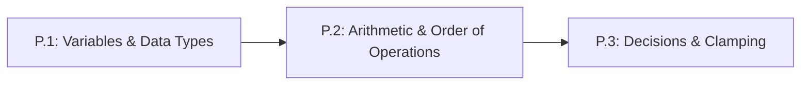

# Lesson P.2: Computer Arithmetic and Order of Operations

<!-- run-callout:start -->
> **Step 1 of 10 · Python and the maths a robot needs**
>
> **Run this in the workbench.** [Open MechaLab with `P.2` loaded](https://tle47.github.io/Mechatronics-Roadmap/?lesson=P.2) - it opens on the **Run Python Lessons** tab with that entry selected. Starter code, hints and the graded check are ready; this page is the reading copy, and nothing you type here is saved.
<!-- run-callout:end -->

## Goal
Translate multi-step physics and circuit formulas into bug-free Python arithmetic using explicit multiplication (`*`), division (`/`), exponents (`**`), and parentheses `()`.

- **New ideas (max 2):**
  1. **Computer arithmetic operators**: Performing addition (`+`), subtraction (`-`), multiplication (`*`), float division (`/`), integer floor division (`//`), and exponents (`**`).
  2. **Parentheses and order of operations**: Using parentheses `()` around numerators and denominators so multi-term engineering fractions evaluate in the exact intended order.
- **New syntax:** `+`, `-`, `*`, `/`, `//`, `**`, `()`.
- **Target time (unmeasured — [log yours](../.github/ISSUE_TEMPLATE/beginner-timing-log.md)):** Typical: 1.0–1.5 hours | Slow-learner: 2.0–2.5 hours

---

## Prerequisites
- [Lesson P.1: Variables and Fundamental Data Types](P.1-variables-and-data-types.md)



---

## Learn

### Idea 1: Computer arithmetic operators
- **Primary resource:** [Official Python 3 Tutorial — Section 3.1: Using Python as a Calculator](https://docs.python.org/3/tutorial/introduction.html) `[HTTP 200 — Verified by scripts/check_links.py]`
  - **What to read:** Read exact headings **`3.1. Using Python as a Calculator`** and **`3.1.1. Numbers`**.
  - **What to skip:** Skip **`3.1.2. Text`** and **`3.1.3. Lists`** (covered in Lesson P.4).
  - **Key takeaway:** In Python, multiplication always requires an explicit asterisk `*` (never write `2x` or `2(3)`), standard division `/` always produces a decimal `float` (`8 / 2` gives `4.0`), floor division `//` drops the fractional remainder (`1023 // 4` gives `255`), and powers use a double asterisk `**` (`3 ** 2` computes $3^2 = 9$).
  - **Alternative resource:** [Harvard CS50P Lecture 0 Notes](https://cs50.harvard.edu/python/2022/notes/0/) `[HTTP 200 — Verified by scripts/check_links.py]` — Review exact headings **`Integers or int`** and **`Float Basics`**.

### Idea 2: Parentheses and order of operations
- **Primary resource:** [MathsIsFun — Order of Operations (PEMDAS/BODMAS)](https://www.mathsisfun.com/operation-order-pemdas.html) `[HTTP 200 — Verified by scripts/check_links.py]`
  - **What to read:** Read exact headings **`Order of Operations`** and **`How Do I Remember It All ... ?`**.
  - **What to skip:** Skip the bottom puzzle links once the four precedence levels are clear.
  - **Key takeaway:** Python evaluates **Parentheses `()`** first, then **Exponents `**`**, then **Multiplication `*` and Division `/` / `//`** (from left to right), and finally **Addition `+` and Subtraction `-`** (from left to right). Whenever a printed fraction has a horizontal bar with multiple terms on top or bottom, you must wrap the numerator and denominator in parentheses: `(top) / (bottom)`.
  - **Alternative resource:** [Official Python 3 Tutorial — Section 3.1.1: Numbers](https://docs.python.org/3/tutorial/introduction.html) `[HTTP 200 — Verified by scripts/check_links.py]` — Review the parentheses examples under **`3.1.1. Numbers`**.

### Bridge Notes
On paper, engineers write multiplication by placing letters side by side ($d = s \cdot t$) and write fractions with a horizontal bar:

$$
y_{\text{out}} = y_{\text{in}} \cdot \frac{b}{a + b}
$$

When you translate equations into **computer arithmetic operators** (`+`, `-`, `*`, `/`, `**`) on a single line of code, the horizontal fraction bar disappears! You must always write `*` explicitly for multiplication, `/` for floating-point division, and `**` for exponents. If you type `y_in * b / a + b` without parentheses, Python's **order of operations** (`PEMDAS`) performs `y_in * b / a` first and then adds `b` at the very end—producing a completely wrong answer. Wrapping the denominator in **parentheses** (`y_in * (b / (a + b))`) forces Python to add `a + b` first, just like the horizontal bar on paper.

Similarly, when squaring a speed in $E_k = \frac{1}{2} m s^2$ in Python, write `0.5 * cart_mass * (cart_speed ** 2)` using `**` for the **exponent** (never `^`, which is a bitwise operator in Python). Whenever you are unsure which operation happens first, add parentheses `()`—extra parentheses never slow down your code and make your intent unmistakable.

---

## Do it yourself

- **What is simulated and in which tool:** Runs 100% in Python (zero-install in [futurecoder.io](https://futurecoder.io/course/) `[verify in-app]` or locally via `python3`).
- **What is real-hardware only:** Nothing in this lesson requires hardware.

### Starter Code (runs as-is — fill in the TODOs)
Complete `TODO 1`, `TODO 2`, and `TODO 3` to calculate a robot's updated position, a scaled sensor reading, and the motion energy of a moving cart:

```python
wheel_speed = 1.25
elapsed_sec = 0.05
start_pos_m = 2.0

supply_level = 12.0
part_a = 20000
part_b = 10000

cart_mass = 2.0
cart_speed = 3.0

# TODO 1: Compute new_pos_m = start_pos_m + (wheel_speed * elapsed_sec)
new_pos_m = 0.0

# TODO 2: Compute sensor_pin = supply_level * (part_b / (part_a + part_b))
#         Keep parentheses around (part_a + part_b)!
sensor_pin = 0.0

# TODO 3: Compute kinetic_energy_j = 0.5 * cart_mass * (cart_speed ** 2)
kinetic_energy_j = 0.0

print(f"New Position: {new_pos_m:.4f} m")
print(f"Scaled Sensor Output: {sensor_pin:.2f} V")
print(f"Kinetic Energy: {kinetic_energy_j:.2f} J")
```

### Expected Output
When all three `TODO`s are completed, running the script prints:

```text
New Position: 2.0625 m
Scaled Sensor Output: 4.00 V
Kinetic Energy: 9.00 J
```

### Hint Ladder

<details>
<summary><strong>Hint 1 (Concept nudge)</strong></summary>

Use `*` for multiplication, `/` for division, and `** 2` to square `cart_speed`. Make sure `part_a + part_b` is inside parentheses `(part_a + part_b)`.
</details>

<details>
<summary><strong>Hint 2 (Formula / structure)</strong></summary>

```python
new_pos_m = start_pos_m + (wheel_speed * elapsed_sec)
sensor_pin = supply_level * (part_b / (part_a + part_b))
kinetic_energy_j = 0.5 * cart_mass * (cart_speed ** 2)
```
</details>

<details>
<summary><strong>Full Solution</strong></summary>

```python
wheel_speed = 1.25
elapsed_sec = 0.05
start_pos_m = 2.0

supply_level = 12.0
part_a = 20000
part_b = 10000

cart_mass = 2.0
cart_speed = 3.0

new_pos_m = start_pos_m + (wheel_speed * elapsed_sec)
sensor_pin = supply_level * (part_b / (part_a + part_b))
kinetic_energy_j = 0.5 * cart_mass * (cart_speed ** 2)

print(f"New Position: {new_pos_m:.4f} m")
print(f"Scaled Sensor Output: {sensor_pin:.2f} V")
print(f"Kinetic Energy: {kinetic_energy_j:.2f} J")
```
</details>

---

## Common mistakes & troubleshooting
- **`TypeError: 'int' object is not callable`:** You wrote implicit multiplication like `2(3 + 4)` instead of `2 * (3 + 4)`. Always write `*` explicitly.
- **Using `^` instead of `**` for exponents:** In Python, `3 ^ 2` performs bitwise XOR (`1`), NOT $3^2 = 9$. Always write `3 ** 2`.
- **Missing denominator parentheses:** Writing `30 / 2 * 3` computes `(30 / 2) * 3 = 45.0` instead of `30 / (2 * 3) = 5.0`.

---

## Check yourself

1. **Order of operations bug:** You want to compute $\frac{10 + 20}{2 \times 3} = 5.0$, so you type `10 + 20 / 2 * 3`. What number does Python actually produce, and how do you fix it?
   <details>
   <summary><strong>Answer</strong></summary>

   Python computes **`40.0`** (`20 / 2` is `10.0`, times `3` is `30.0`, plus `10` is `40.0`). Fix it with parentheses: `(10 + 20) / (2 * 3)`, which gives **`5.0`**.
   </details>

2. **Exponents and division:** What value does `(2 ** 3) + (15 / 2)` produce?
   <details>
   <summary><strong>Answer</strong></summary>

   **`15.5`**. First `2 ** 3` is `8`, then `15 / 2` is `7.5`, and `8 + 7.5` equals **`15.5`**.
   </details>

3. **Float division `/` vs. floor division `//`:** What is the difference between `1023 / 4` and `1023 // 4` in Python?
   <details>
   <summary><strong>Answer</strong></summary>

   `1023 / 4` returns the exact decimal `float` **`255.75`**, whereas `1023 // 4` discards the decimal remainder and returns the whole `int` **`255`**.
   </details>

---

## Recap
- Python requires explicit `*` for multiplication, `/` for decimal division, `//` for whole-number floor division, and `**` for exponents.
- Always wrap multi-term numerators and denominators in parentheses: `(numerator) / (denominator)`.

### You're ready to move on when...
- [ ] You never write `^` for exponents or omit `*` in multiplication.
- [ ] You can translate any fraction with a multi-term denominator into parentheses-safe Python.
- [ ] Your **Do it yourself** script prints `2.0625 m`, `4.00 V`, and `9.00 J`.
- **Next lesson:** [Lesson P.3: Conditional Decisions (`if/elif/else`) & Command Clamping](P.3-decisions-and-clamping.md)
