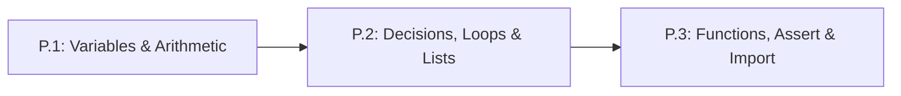

# Lesson P.2: Making Decisions & Repeating Actions — `if/else`, `for` Loops & Lists

## Goal
Use conditional statements (`if/elif/else`) to clamp robot actuator commands within safe limits, and use zero-indexed `lists` with `for` loops to process sequences of sensor readings automatically.

- **New ideas (max 2):**
  1. **Conditional branching (`if / elif / else`)**: Comparing values with `<`, `>`, and `==` so your code chooses different actions (such as clamping an unsafe motor command) based on live data.
  2. **Ordered collections (`list`) and definite iteration (`for` loops)**: Storing multiple readings in a zero-indexed list `[...]` and stepping through every item automatically using `for` and `range()`.
- **New syntax:** `if`, `elif`, `else:`, `<`, `>`, `<=`, `>=`, `==`, `!=`, 4-space indentation, `[a, b, c]`, `list[0]`, `.append()`, `len()`, `for item in list:`, `for i in range(n):`.
- **Estimated time (untimed guesses):** Typical: 2.5–3.5 hours | Slow-learner: 4.5–6.0 hours

---

## Prerequisites
- [Lesson P.1: Variables, Data Types & Arithmetic Expressions](P.1-variables-types-and-arithmetic.md) (`int`, `float`, `bool`, assignment `=`, `print()`, `f-strings`).



---

## Learn

### Idea 1: Conditional Branching (`if / elif / else`)
- **Primary resource:** [futurecoder.io — Chapter 5: If Statements](https://futurecoder.io/course/#toc) `[HTTP 200 — SPA/App: verify in-app]` *(Chapter and page names verified against [futurecoder GitHub source `c05_if_statements.py`](https://github.com/alexmojaki/futurecoder/blob/main/core/chapters/c05_if_statements.py) `[HTTP 200 — Verified by scripts/check_links.py]`)*
  - **What to read/complete:** Complete **`IntroducingIfStatements`**, **`IfAndElse`**, **`TheEqualityOperator`**, **`IntroducingElif`**, and **`OtherComparisonOperators`** inside **Chapter 5 (`If Statements`)** `[verify in-app]`.
  - **What to skip:** You may skip **`UnderstandingProgramsWithSnoop`** if the step-by-step trace is already clear to you.
  - **Key takeaway:** An `if` statement checks whether a comparison evaluates to `True` and runs its indented block of code only when that condition holds. Adding `elif` (else-if) and `else` lets you handle mutually exclusive cases—such as clamping a motor signal that is too high (`> 255`) or too low (`< 0`).
  - **Alternative resource:** [Harvard CS50P Lecture 1 Notes](https://cs50.harvard.edu/python/2022/notes/1/) `[HTTP 200 — Verified by scripts/check_links.py]` — Read exact headings **`Conditionals`**, **`if Statements`**, and **`Control Flow, elif, and else`** (skip **`match`** and **`Pythonic`**).

### Idea 2: Ordered Collections (`list`) and Definite Iteration (`for` Loops)
- **Primary resource:** [futurecoder.io — Chapter 4 (For Loops) & Chapter 6 (Lists)](https://futurecoder.io/course/#toc) `[HTTP 200 — SPA/App: verify in-app]` *(Verified against [futurecoder GitHub source `c04_for_loops.py` & `c06_lists.py`](https://github.com/alexmojaki/futurecoder/tree/main/core/chapters) `[HTTP 200 — Verified by scripts/check_links.py]`)*
  - **What to read/complete:** In **Chapter 4 (`For Loops`)**, complete **`IntroducingForLoops`**, **`Indentation`**, and **`BasicForLoopExercises`** `[verify in-app]`. In **Chapter 6 (`Lists`)**, complete **`IntroducingLists`**, **`BuildingNewLists`**, and **`GettingElementsAtPosition`** (which covers `range()` and `len()`) `[verify in-app]`.
  - **What to skip:** Skip **`BuildingUpStrings`** in Chapter 4 and **`StringMethodsUnderstandingMutation`** in Chapter 6.
  - **Key takeaway:** A **list** stores an ordered row of values inside square brackets `[...]`, where positions (indices) start counting at **`0`** (`readings[0]` is the first item). A **`for` loop** repeats an indented block once for each item in a list or each index generated by `range(n)` (`0` up to `n - 1`).
  - **Alternative resource:** [Official Python 3 Tutorial — Sections 4.1 to 4.3](https://docs.python.org/3/tutorial/controlflow.html) `[HTTP 200 — Verified by scripts/check_links.py]` — Read exact headings **`4.1. if Statements`**, **`4.2. for Statements`**, and **`4.3. The range() Function`** (skip **`4.4. break and continue Statements`** through **`4.7. match Statements`**).

### Bridge Notes
In a robot controller, raw calculation outputs can easily exceed hardware limits. A **conditional statement** (`if`, `elif`, `else`) tests a condition using **comparison operators**: `<` (less than), `<=` (less than or equal to), `>` (greater than), `>=` (greater than or equal to), `==` (equal to—note the double equals!), and `!=` (not equal to). Never confuse single `=` (which stores a value) with double `==` (which asks whether two values are equal). Every `if`, `elif`, or `else` line ends with a colon `:`, and the lines inside it must use **indentation** (4 spaces) so Python knows which statements belong to that branch. Using `if val > max_val:` and `elif val < min_val:` to restrict a number to a safe interval is called **clamping** (or saturation).

To record sensor history over time, we store values in a **list** (`[12.1, 11.9, 11.5]`). Lists use **zero-based indexing**, meaning the first element is at **index** `0` (`voltages[0]`), the last element is `voltages[-1]`, `.append(x)` adds a new item to the end, and `len(voltages)` returns the item count. Combining a **`for` loop** with `range(len(voltages))` lets your program step through every time step from `0` to `len - 1` automatically.

---

## Do it yourself

- **What is simulated and in which tool:** Runs 100% in Python (in [futurecoder.io](https://futurecoder.io/course/) `[verify in-app]` or locally via `python3`).
- **What is real-hardware only:** Nothing in this lesson requires hardware.

### Starter Code (runs as-is — fill in the TODOs)
A motor controller receives 5 raw command values (`raw_commands`), some of which exceed the Arduino Uno's valid PWM range of `0` to `255`. Fill in `TODO 1` and `TODO 2` so each command is clamped into `[0, 255]` and appended to `safe_commands`:

```python
raw_commands = [-40, 0, 128, 255, 310]
safe_commands = []
clamped_count = 0

for i in range(len(raw_commands)):
    cmd = raw_commands[i]
    safe_cmd = cmd

    # TODO 1: Write an if / elif / else block:
    # - If cmd > 255, set safe_cmd = 255 and add 1 to clamped_count
    # - Else if cmd < 0, set safe_cmd = 0 and add 1 to clamped_count
    # - Else, set safe_cmd = cmd

    # TODO 2: Append safe_cmd to the safe_commands list using .append()

    print(f"Step {i}: raw={cmd} -> safe={safe_cmd}")

print(f"Safe list: {safe_commands} | Total clamped: {clamped_count}")
```

### Expected Output
When both `TODO`s are completed, running the script prints:

```text
Step 0: raw=-40 -> safe=0
Step 1: raw=0 -> safe=0
Step 2: raw=128 -> safe=128
Step 3: raw=255 -> safe=255
Step 4: raw=310 -> safe=255
Safe list: [0, 0, 128, 255, 255] | Total clamped: 2
```

### Hint Ladder

<details>
<summary><strong>Hint 1 (Concept nudge)</strong></summary>

Inside the `for` loop (indented by 4 spaces), start your check with `if cmd > 255:` and indent the lines inside that `if` by 8 spaces total. Remember to increment `clamped_count = clamped_count + 1` whenever `cmd` is above `255` or below `0`.
</details>

<details>
<summary><strong>Hint 2 (Formula / structure)</strong></summary>

Your `if / elif / else` and `.append()` inside the loop should follow this structure:
```python
    if cmd > 255:
        safe_cmd = 255
        clamped_count = clamped_count + 1
    elif cmd < 0:
        safe_cmd = 0
        clamped_count = clamped_count + 1
    else:
        safe_cmd = cmd
    safe_commands.append(safe_cmd)
```
</details>

<details>
<summary><strong>Full Solution</strong></summary>

```python
raw_commands = [-40, 0, 128, 255, 310]
safe_commands = []
clamped_count = 0

for i in range(len(raw_commands)):
    cmd = raw_commands[i]
    if cmd > 255:
        safe_cmd = 255
        clamped_count = clamped_count + 1
    elif cmd < 0:
        safe_cmd = 0
        clamped_count = clamped_count + 1
    else:
        safe_cmd = cmd
    safe_commands.append(safe_cmd)
    print(f"Step {i}: raw={cmd} -> safe={safe_cmd}")

print(f"Safe list: {safe_commands} | Total clamped: {clamped_count}")
```
</details>

---

## Common mistakes & troubleshooting
- **`SyntaxError: invalid syntax` on `if x = 5:`:** You used a single `=` (assignment) inside an `if` condition. Comparisons for equality must use double equals: `if x == 5:`.
- **`IndentationError: expected an indented block`:** You forgot to indent the line immediately following `if ...:`, `elif ...:`, `else:`, or `for ...:` by 4 spaces, or you forgot the colon `:` at the end of the header line.
- **`IndexError: list index out of range`:** If a list has 4 items (`len(items) == 4`), valid indices are `0, 1, 2, 3`. Asking for `items[4]` crashes because index `4` would be a 5th item.
- **Appending inside vs. outside the loop:** If `safe_commands.append(safe_cmd)` is not indented by 4 spaces inside the `for` loop, it will only run once after the loop finishes, storing `[255]` instead of all 5 numbers.

---

## Check yourself

1. **Zero-based indexing:** Given `pins = [2, 5, 9, 13]`, what value is `pins[0]`? What value is `pins[2]`? What is `len(pins)`?
   <details>
   <summary><strong>Answer</strong></summary>

   - `pins[0]` is **`2`** (the first element is always index `0`).
   - `pins[2]` is **`9`** (the third element).
   - `len(pins)` is **`4`** (there are 4 elements in total).
   </details>

2. **Understanding `range(n)`:** What sequence of numbers does `for step in range(4):` assign to `step`, and how many times does the loop run?
   <details>
   <summary><strong>Answer</strong></summary>

   It assigns **`0, 1, 2, 3`** (starting at `0` and stopping one integer before `4`), so the loop runs **4 times**.
   </details>

3. **Tracing `if / elif / else`:** If `temp_c = 85`, what does the following code print?
   ```python
   if temp_c > 85:
       print("SHUTDOWN")
   elif temp_c >= 70:
       print("WARNING")
   else:
       print("NORMAL")
   ```
   <details>
   <summary><strong>Answer</strong></summary>

   It prints **`WARNING`**. Because `85 > 85` is `False` (85 is not strictly greater than 85), Python moves to `elif temp_c >= 70:`, which is `True` (`85 >= 70`).
   </details>

4. **Summing a list in a loop:** What number is printed at the end of this snippet?
   ```python
   readings = [10, 20, 30]
   total = 0
   for r in readings:
       total = total + r
   print(total / len(readings))
   ```
   <details>
   <summary><strong>Answer</strong></summary>

   **`20.0`**. The loop adds `10 + 20 + 30 = 60` into `total`, and dividing `60 / 3` produces the average `20.0`.
   </details>

---

## Recap
- **`if / elif / else`** lets your program test conditions (`<`, `>`, `<=`, `>=`, `==`, `!=`) and execute indented blocks selectively, such as clamping commands to `[0, 255]`.
- A **`list`** holds an ordered sequence accessed from index `0` (`items[0]`) and grown with `.append()`.
- A **`for` loop** repeats an indented block over every item in a list or every index in `range(n)`.

### You're ready to move on when...
- [ ] You never mix up single `=` (assignment) with double `==` (comparison).
- [ ] You can explain why `items[0]` is the first item and why `range(5)` stops at `4`.
- [ ] Your solution to **Do it yourself** prints `Safe list: [0, 0, 128, 255, 255] | Total clamped: 2`.
- **Next lesson:** [Lesson P.3: Reusable Functions (`def`/`return`), Self-Tests (`assert`) & `import`](P.3-functions-assert-and-import.md)
